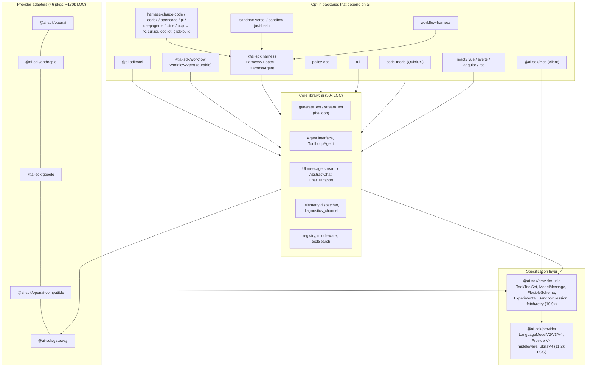

# Vercel AI SDK (the basic baseline)

> **Verdict.** The AI SDK (`ai` 7.0.140 at the pin) is the TypeScript reference point for the `llm-library` layer. It provides a versioned provider specification (`LanguageModelV4`), a small agent loop (`generateText`/`streamText` with `stopWhen` and `prepareStep`), typed tool definitions, a call-level approval system, an MCP client, a UI stream protocol with `useChat` hooks, and pluggable telemetry. It does **not** provide built-in coding tools, compaction, AGENTS.md loading, session storage, local sandboxing, or a subagent primitive. Those are what a harness built on it has to supply. AI SDK 7 also adds several opt-in packages that sit above that baseline. `@ai-sdk/workflow` gives a durable `WorkflowAgent`. `@ai-sdk/harness` defines a `HarnessV1` adapter spec that wraps *other* harnesses (Claude Code, Codex, OpenCode, Pi, Deep Agents, Cline, fx, Cursor, Copilot, Grok Build) behind the AI SDK `Agent` interface. There are also sandbox adapters, an OPA policy package, and a TUI. Build on the core when you want to own the harness and need provider neutrality and a web-streaming surface. Use `HarnessAgent` when you want to drive an existing coding agent from an AI SDK app. Don't expect either to be a finished coding agent.

| | |
|---|---|
| Repo(s) | `vercel/ai` @ `3f0c878c4f74` (2026-10-14) |
| License | Apache-2.0 |
| Language(s) | TypeScript (ESM-only, Node ≥ 22; edge-runtime test config in `packages/ai`) |
| Size | 9,361 tracked files, 82 packages. Non-test TS in `packages/`: ~329k LOC; tests: ~561k LOC. `packages/ai` src: 50.0k LOC (160k test LOC). Loop core (`generate-text/` + `agent/` + `prompt/`): ~17.3k LOC. `provider` spec 11.2k, `provider-utils` 10.9k, `mcp` 7.6k. 46 provider packages incl. gateway: ~130k LOC. Harness family (harness + 11 adapters + workflow-harness + 2 sandboxes): ~62.5k LOC. `workflow` 10.2k. UI framework bindings: ~6.5k |
| Version at pin | `ai` 7.0.140, `@ai-sdk/provider` 4.0.27 (spec V4), `@ai-sdk/provider-utils` 5.0.59, `@ai-sdk/mcp` 2.0.74, `@ai-sdk/harness` 1.0.151 (experimental), `@ai-sdk/workflow` 2.0.72 |
| Release history | `ai` 3.0 2024-02-29 → 4.0 2024-11-18 → 5.0 2025-07-31 → 6.0 2025-12-22 (`Agent` interface, `ToolLoopAgent`, `needsApproval`, stable `@ai-sdk/mcp`) → 7.0 2026-06-25 (`LanguageModelV4`, call-level `toolApproval`, `@ai-sdk/otel`, `HarnessAgent`, `WorkflowAgent`, `@ai-sdk/tui`) → 7.0.140 at pin. Dates are from GitHub release tags |
| Category | `llm-library` (with opt-in `agent-framework` and meta-harness packages layered on top) |

---

## 1. Layering & package map

The monorepo has three strata. `AGENTS.md` describes the original dependency diamond (`ai` → `provider-utils` → `provider`, and every `@ai-sdk/<provider>` → `provider-utils` → `provider`). AI SDK 7 adds a fourth set of packages that depend on `ai` rather than sit under it.

| Layer | Owns | Does not own |
|---|---|---|
| `@ai-sdk/provider` | Versioned model contracts: [`LanguageModelV4`](https://github.com/vercel/ai/blob/3f0c878c4f74db15df89d1df126cc9e3a83bda0e/packages/provider/src/language-model/v4/language-model-v4.ts#L8-L61) with `doGenerate`/`doStream`, the stream-part union, usage, prompt; `ProviderV4` | Any loop or tool execution |
| `@ai-sdk/provider-utils` | `Tool` union and `tool()`/`dynamicTool()` ([`tool.ts:L336-L387`](https://github.com/vercel/ai/blob/3f0c878c4f74db15df89d1df126cc9e3a83bda0e/packages/provider-utils/src/types/tool.ts#L336-L387)), `ModelMessage`, schema adapters, the `SandboxSession` interface | Orchestration |
| `ai` | The multi-step loop, approvals, `Agent`/`ToolLoopAgent`, structured `Output`, UI stream protocol, telemetry dispatch, registry, middleware | Persistence, compaction, sandbox implementations, built-in tools |
| Opt-in packages | Durable execution (`workflow`), third-party harness adapters (`harness-*`), sandboxes, OTel, policy, TUI | — |

`ai` has only three runtime dependencies: `@ai-sdk/gateway`, `@ai-sdk/provider` and `@ai-sdk/provider-utils` ([`packages/ai/package.json:L58-L61`](https://github.com/vercel/ai/blob/3f0c878c4f74db15df89d1df126cc9e3a83bda0e/packages/ai/package.json#L58-L61)). The gateway dependency is what makes bare string model IDs route to Vercel's AI Gateway by default (see §3).

---

## 2. Agent loop

### 2.1 Where it lives

There is no separate "agent runtime". The loop is the body of `generateText` and `streamText`:

- **`generateText`**: a plain `do { … } while (…)` in [`generate-text.ts:L883-L1541`](https://github.com/vercel/ai/blob/3f0c878c4f74db15df89d1df126cc9e3a83bda0e/packages/ai/src/generate-text/generate-text.ts#L883-L1541).
- **`streamText`**: a recursive `streamStep()` ([`stream-text.ts:L2203-L3152`](https://github.com/vercel/ai/blob/3f0c878c4f74db15df89d1df126cc9e3a83bda0e/packages/ai/src/generate-text/stream-text.ts#L2203-L3152)). Each step's `flush` re-invokes `streamStep({ currentStep: currentStep + 1 })` ([`L3099-L3137`](https://github.com/vercel/ai/blob/3f0c878c4f74db15df89d1df126cc9e3a83bda0e/packages/ai/src/generate-text/stream-text.ts#L3099-L3137)). Each step stream is appended to a *stitchable stream* that is consumed one stream at a time ([`create-stitchable-stream.ts:L9-L19`](https://github.com/vercel/ai/blob/3f0c878c4f74db15df89d1df126cc9e3a83bda0e/packages/ai/src/util/create-stitchable-stream.ts#L9-L19)). The in-repo design note [`architecture/stream-text-loop-control.md`](https://github.com/vercel/ai/blob/3f0c878c4f74db15df89d1df126cc9e3a83bda0e/architecture/stream-text-loop-control.md) diagrams this as "funnel in N step streams → middle pipeline → funnel out via `.tee()`".
- **`ToolLoopAgent`**: a 323-line wrapper. It merges constructor settings with per-call options, runs an optional `prepareCall`, defaults `stopWhen` to `createDefaultStopCondition(20)`, and delegates to `generateText`/`streamText` ([`tool-loop-agent.ts:L130-L148`](https://github.com/vercel/ai/blob/3f0c878c4f74db15df89d1df126cc9e3a83bda0e/packages/ai/src/agent/tool-loop-agent.ts#L130-L148), [`L251-L255`](https://github.com/vercel/ai/blob/3f0c878c4f74db15df89d1df126cc9e3a83bda0e/packages/ai/src/agent/tool-loop-agent.ts#L251-L255)). It also tags requests with the `ai-sdk-agent/tool-loop` user-agent suffix ([`L185-L192`](https://github.com/vercel/ai/blob/3f0c878c4f74db15df89d1df126cc9e3a83bda0e/packages/ai/src/agent/tool-loop-agent.ts#L185-L192)).
- **`Agent` interface**: `version: 'agent-v1'`, `id`, `tools`, `generate()`, `stream()` ([`agent.ts:L184-L219`](https://github.com/vercel/ai/blob/3f0c878c4f74db15df89d1df126cc9e3a83bda0e/packages/ai/src/agent/agent.ts#L184-L219)). In the repo it is implemented by `ToolLoopAgent` and `HarnessAgent` ([`harness-agent.ts:L181-L193`](https://github.com/vercel/ai/blob/3f0c878c4f74db15df89d1df126cc9e3a83bda0e/packages/harness/src/agent/harness-agent.ts#L181-L193)). `WorkflowAgent` does not implement it, because its `stream()` takes a `writable`.

### 2.2 One step, in order (`generateText`)

1. **Pre-loop approval replay.** `collectToolApprovals` scans the incoming messages for `tool-approval-response` parts. `validateApprovedToolApprovals` re-checks each approved call: HMAC signature, input schema, and current policy. Approved calls are then executed *before* the first model call. Denied calls become `execution-denied` tool results ([`generate-text.ts:L725-L857`](https://github.com/vercel/ai/blob/3f0c878c4f74db15df89d1df126cc9e3a83bda0e/packages/ai/src/generate-text/generate-text.ts#L725-L857)). Approved calls whose input no longer validates are reported to the model, not repaired, because "repairing the input after approval would change the operation that the user authorized" ([`L814-L830`](https://github.com/vercel/ai/blob/3f0c878c4f74db15df89d1df126cc9e3a83bda0e/packages/ai/src/generate-text/generate-text.ts#L814-L830)).
2. **`prepareStep`** is called with `steps`, `stepNumber`, `model`, `instructions`, `messages`, `initialMessages`, `responseMessages`, `runtimeContext`, `toolsContext` and `experimental_sandbox` ([`L907-L919`](https://github.com/vercel/ai/blob/3f0c878c4f74db15df89d1df126cc9e3a83bda0e/packages/ai/src/generate-text/generate-text.ts#L907-L919)). It may override `model`, `toolChoice`, `activeTools`, `toolOrder`, `instructions`, `messages`, `toolsContext`, `runtimeContext`, `experimental_sandbox`, `providerOptions` and any call setting ([`prepare-step.ts:L105-L184`](https://github.com/vercel/ai/blob/3f0c878c4f74db15df89d1df126cc9e3a83bda0e/packages/ai/src/generate-text/prepare-step.ts#L105-L184)). `messages` and `instructions` overrides **carry forward** to later steps. The sandbox override applies to the current step only. This is the single hook a harness uses for compaction, model routing and tool gating.
3. **Tool preparation.** `filterActiveTools` → `prepareToolSearch` (deferred tools) → `prepareToolsForToolCallers` (code-mode callers) → `prepareTools` with a stable `toolOrder` ([`L937-L967`](https://github.com/vercel/ai/blob/3f0c878c4f74db15df89d1df126cc9e3a83bda0e/packages/ai/src/generate-text/generate-text.ts#L937-L967)).
4. **Model call** inside `retry(...)` → `stepModel.doGenerate(...)` ([`L1056-L1083`](https://github.com/vercel/ai/blob/3f0c878c4f74db15df89d1df126cc9e3a83bda0e/packages/ai/src/generate-text/generate-text.ts#L1056-L1083)).
5. **Parse tool calls** with optional `repairToolCall` and `refineToolInput` ([`L1090-L1107`](https://github.com/vercel/ai/blob/3f0c878c4f74db15df89d1df126cc9e3a83bda0e/packages/ai/src/generate-text/generate-text.ts#L1090-L1107)). A required/forced `toolChoice` that the model ignored throws `ToolChoiceViolationError` ([`L1173-L1194`](https://github.com/vercel/ai/blob/3f0c878c4f74db15df89d1df126cc9e3a83bda0e/packages/ai/src/generate-text/generate-text.ts#L1173-L1194)).
6. **Per-call approval resolution** emits `tool-approval-request`/`-response` content and blocks calls that need a user or were denied ([`L1240-L1319`](https://github.com/vercel/ai/blob/3f0c878c4f74db15df89d1df126cc9e3a83bda0e/packages/ai/src/generate-text/generate-text.ts#L1240-L1319)).
7. **Execute client tools** that are valid, unblocked and not provider-executed, but only when the finish reason is `stop` or `tool-calls` ([`L1353-L1399`](https://github.com/vercel/ai/blob/3f0c878c4f74db15df89d1df126cc9e3a83bda0e/packages/ai/src/generate-text/generate-text.ts#L1353-L1399); [`is-tool-execution-allowed-finish-reason.ts:L3-L7`](https://github.com/vercel/ai/blob/3f0c878c4f74db15df89d1df126cc9e3a83bda0e/packages/ai/src/generate-text/is-tool-execution-allowed-finish-reason.ts#L3-L7)). A response truncated by `length` therefore never executes its half-formed tool calls.
8. **Record the step** (`DefaultStepResult`). The next step's messages become `[...stepMessages, ...stepResponseMessages]` ([`L1516-L1518`](https://github.com/vercel/ai/blob/3f0c878c4f74db15df89d1df126cc9e3a83bda0e/packages/ai/src/generate-text/generate-text.ts#L1516-L1518)), then `onStepEnd` fires.

### 2.3 Stop semantics

The `while` predicate is the whole termination policy ([`generate-text.ts:L1533-L1541`](https://github.com/vercel/ai/blob/3f0c878c4f74db15df89d1df126cc9e3a83bda0e/packages/ai/src/generate-text/generate-text.ts#L1533-L1541)). The loop continues only if:

- every client tool call was executed or denied (a call with no `execute`, or one awaiting user approval, ends the loop), and
- there was at least one client tool call or a pending deferred provider result, and
- no `stopWhen` condition holds.

Stop conditions are plain `({ steps }) => boolean | Promise<boolean>`. The built-ins are `isStepCount(n)`, `hasToolCall(...names)` and `isLoopFinished()`. Any element of the array returning `true` stops the loop ([`stop-condition.ts:L14-L77`](https://github.com/vercel/ai/blob/3f0c878c4f74db15df89d1df126cc9e3a83bda0e/packages/ai/src/generate-text/stop-condition.ts#L14-L77)).

**The defaults matter.** `generateText` and `streamText` default to `stopWhen = isStepCount(1)` ([`generate-text.ts:L252`](https://github.com/vercel/ai/blob/3f0c878c4f74db15df89d1df126cc9e3a83bda0e/packages/ai/src/generate-text/generate-text.ts#L252), [`stream-text.ts:L373`](https://github.com/vercel/ai/blob/3f0c878c4f74db15df89d1df126cc9e3a83bda0e/packages/ai/src/generate-text/stream-text.ts#L373)). One model call executes its tools and then stops *without* feeding the results back. Only `ToolLoopAgent` defaults to 20 steps, and it logs a warning when it hits that limit ([`default-stop-condition.ts:L8-L33`](https://github.com/vercel/ai/blob/3f0c878c4f74db15df89d1df126cc9e3a83bda0e/packages/ai/src/agent/default-stop-condition.ts#L8-L33)).

### 2.4 Streaming specifics (`streamText`)

- **Tool execution timing.** `executeToolsFromStream` forwards every chunk immediately. On `tool-call` it resolves approval and queues executable calls. It runs them only on the `model-call-end` chunk, again gated by finish reason ([`execute-tools-from-stream.ts:L114-L273`](https://github.com/vercel/ai/blob/3f0c878c4f74db15df89d1df126cc9e3a83bda0e/packages/ai/src/generate-text/execute-tools-from-stream.ts#L114-L273)). The comment at L238 says "we don't await the tool execution here", but L241 does `await executeToolCall(...)`. The comment is stale; the code waits for the model to finish, then runs tools.
- **Parallelism.** Tool calls in a step run concurrently by default. `toolCallConcurrency` bounds this with an order-preserving worker pool that stops claiming work on abort or the first rejection ([`tool-call-concurrency.ts:L38-L80`](https://github.com/vercel/ai/blob/3f0c878c4f74db15df89d1df126cc9e3a83bda0e/packages/ai/src/generate-text/tool-call-concurrency.ts#L38-L80)).
- **Pipeline.** Stitchable stream → resilient abort wrapper (emits `start`/`abort`) → a `stopStream()` gate that lets user transforms terminate the loop → `experimental_transform[]` (e.g. `smoothStream`) → output transform (partial structured output) → event processor ([`stream-text.ts:L1813-L1928`](https://github.com/vercel/ai/blob/3f0c878c4f74db15df89d1df126cc9e3a83bda0e/packages/ai/src/generate-text/stream-text.ts#L1813-L1928)).
- **Retries.** `maxRetries` (default 2, exponential backoff from 2 s with factor 2, honouring `retry-after-ms`/`retry-after`) wraps the call *setup* ([`prepare-retries.ts:L15`](https://github.com/vercel/ai/blob/3f0c878c4f74db15df89d1df126cc9e3a83bda0e/packages/ai/src/util/prepare-retries.ts#L15), [`retry-with-exponential-backoff.ts:L27-L68`](https://github.com/vercel/ai/blob/3f0c878c4f74db15df89d1df126cc9e3a83bda0e/packages/ai/src/util/retry-with-exponential-backoff.ts#L27-L68)). The v7 option `streamRetries` (default off) re-runs *only the current step* when an error arrives after streaming has started. `onError` may request one extra retry ([`stream-text.ts:L596-L614`](https://github.com/vercel/ai/blob/3f0c878c4f74db15df89d1df126cc9e3a83bda0e/packages/ai/src/generate-text/stream-text.ts#L596-L614), [`L2610-L2673`](https://github.com/vercel/ai/blob/3f0c878c4f74db15df89d1df126cc9e3a83bda0e/packages/ai/src/generate-text/stream-text.ts#L2610-L2673)). Partial output that was already emitted is not retracted. A `reset-step` UI chunk exists for this ([`ui-message-chunks.ts:L192`](https://github.com/vercel/ai/blob/3f0c878c4f74db15df89d1df126cc9e3a83bda0e/packages/ai/src/ui-message-stream/ui-message-chunks.ts#L192)).
- **Timeouts.** `timeout` accepts `totalMs`, `stepMs`, `firstChunkMs`, `chunkMs`, `toolMs` and per-tool `<name>Ms` ([`request-options.ts:L13-L21`](https://github.com/vercel/ai/blob/3f0c878c4f74db15df89d1df126cc9e3a83bda0e/packages/ai/src/prompt/request-options.ts#L13-L21)). The chunk timers are armed and cleared per step ([`stream-text.ts:L2217-L2294`](https://github.com/vercel/ai/blob/3f0c878c4f74db15df89d1df126cc9e3a83bda0e/packages/ai/src/generate-text/stream-text.ts#L2217-L2294)).
- **Errors.** A tool exception becomes a `tool-error` output that is returned to the model, not thrown ([`execute-tool-call.ts:L162-L191`](https://github.com/vercel/ai/blob/3f0c878c4f74db15df89d1df126cc9e3a83bda0e/packages/ai/src/generate-text/execute-tool-call.ts#L162-L191)). Invalid calls to *dynamic* tools likewise get synthetic error outputs ([`generate-text.ts:L1321-L1341`](https://github.com/vercel/ai/blob/3f0c878c4f74db15df89d1df126cc9e3a83bda0e/packages/ai/src/generate-text/generate-text.ts#L1321-L1341)). The default `onError` is `console.error` ([`stream-text.ts:L798-L802`](https://github.com/vercel/ai/blob/3f0c878c4f74db15df89d1df126cc9e3a83bda0e/packages/ai/src/generate-text/stream-text.ts#L798-L802)).
- **Deferred provider results.** Provider-executed tools flagged `supportsDeferredResults` (e.g. code execution that calls back into client tools) keep the loop alive until their result arrives ([`generate-text.ts:L1422-L1449`](https://github.com/vercel/ai/blob/3f0c878c4f74db15df89d1df126cc9e3a83bda0e/packages/ai/src/generate-text/generate-text.ts#L1422-L1449)).

**Steering, interrupts and queued messages.** The core has none. Interruption is `abortSignal` (an `onAbort` callback plus an `abort` stream part). Mid-run input is only possible *pull*-style, by having `prepareStep` return a new `messages` array. There is no queue, no `submitUserMessage`, and no pause/resume inside a call. Pausing happens only at approval or client-tool boundaries, where the call ends and the next request replays history. The harness layer is different: `HarnessV1PromptControl.submitUserMessage?` lets runtimes that support it accept mid-turn input ([`harness-v1-prompt-control.ts:L12-L47`](https://github.com/vercel/ai/blob/3f0c878c4f74db15df89d1df126cc9e3a83bda0e/packages/harness/src/v1/harness-v1-prompt-control.ts#L12-L47)).

### 2.5 Three loops, not one

The monorepo contains three independent loop implementations that share types but not execution code:

| Loop | File | Default step limit | Who owns history |
|---|---|---|---|
| `generateText`/`streamText` (+`ToolLoopAgent`) | `ai/src/generate-text/*` (1.7k + 3.6k lines) | 1 (20 for `ToolLoopAgent`) | Caller |
| `WorkflowAgent` | [`workflow/src/workflow-agent.ts`](https://github.com/vercel/ai/blob/3f0c878c4f74db15df89d1df126cc9e3a83bda0e/packages/workflow/src/workflow-agent.ts#L1541-L1560) (3.8k) + `model-call-iterator.ts` (1.1k) | `stream()`: none; `generate()`: 20 | Caller, replayed by Workflow DevKit |
| `HarnessAgent` | [`harness/src/agent/internal/run-prompt.ts`](https://github.com/vercel/ai/blob/3f0c878c4f74db15df89d1df126cc9e3a83bda0e/packages/harness/src/agent/internal/run-prompt.ts#L1305-L1330) (1.9k) | runtime-defined; `stopWhen` checked at `finish-step` | Wrapped runtime |

The Phase 1 design note [`contributing/workflow-agent-compatibility.md:L5-L36`](https://github.com/vercel/ai/blob/3f0c878c4f74db15df89d1df126cc9e3a83bda0e/contributing/workflow-agent-compatibility.md#L5-L36) is stale at this pin: `WorkflowAgent.generate()` is implemented, calls the shared `execute(options, "generate")` path, and returns `DefaultGenerateTextResult` ([`workflow-agent.ts:L1652-L1700`](https://github.com/vercel/ai/blob/3f0c878c4f74db15df89d1df126cc9e3a83bda0e/packages/workflow/src/workflow-agent.ts#L1652-L1700)). Generate defaults to 20 steps while streaming retains no implicit step limit ([`L1749-L1754`](https://github.com/vercel/ai/blob/3f0c878c4f74db15df89d1df126cc9e3a83bda0e/packages/workflow/src/workflow-agent.ts#L1749-L1754)).

---

## 3. Model / provider abstraction

**Four message layers** ([`architecture/message-layers.md`](https://github.com/vercel/ai/blob/3f0c878c4f74db15df89d1df126cc9e3a83bda0e/architecture/message-layers.md)):

1. `UIMessage`: parts-based, carries `data-*` parts and tool states.
2. `ModelMessage`: the user-facing prompt type in `provider-utils`.
3. `LanguageModelV4Prompt`: the stable spec. Roles `system | user | assistant | tool`; the `tool` role also carries `tool-approval-response` parts ([`language-model-v4-prompt.ts:L18-L59`](https://github.com/vercel/ai/blob/3f0c878c4f74db15df89d1df126cc9e3a83bda0e/packages/provider/src/language-model/v4/language-model-v4-prompt.ts#L18-L59)).
4. Provider wire format.

`convertToModelMessages` maps 1 → 2 and `convertToLanguageModelPrompt` maps 2 → 3.

**The spec.** `LanguageModelV4` is deliberately tiny: `specificationVersion: 'v4'`, `provider`, `modelId`, `supportedUrls`, `doGenerate`, `doStream`. The `do` prefix exists "to prevent accidental direct usage" ([`language-model-v4.ts:L8-L61`](https://github.com/vercel/ai/blob/3f0c878c4f74db15df89d1df126cc9e3a83bda0e/packages/provider/src/language-model/v4/language-model-v4.ts#L8-L61)). The stream-part union has `text-*`, `reasoning-*` and `tool-input-*` start/delta/end blocks, plus `tool-call`, `tool-result`, `tool-approval-request`, `file`, `reasoning-file`, `source`, `custom`, `stream-start` (warnings), `response-metadata`, `finish`, `raw` and `error` ([`language-model-v4-stream-part.ts:L15-L113`](https://github.com/vercel/ai/blob/3f0c878c4f74db15df89d1df126cc9e3a83bda0e/packages/provider/src/language-model/v4/language-model-v4-stream-part.ts#L15-L113)). Provider-executed tools (web search, code execution) and even provider-side approval requests are therefore first-class stream parts.

**Backward compatibility.** V2 and V3 models are adapted to V4 at call time by a `Proxy`. V2 is lifted to V3 first ([`as-language-model-v4.ts:L20-L32`](https://github.com/vercel/ai/blob/3f0c878c4f74db15df89d1df126cc9e3a83bda0e/packages/ai/src/model/as-language-model-v4.ts#L20-L32); [`resolve-model.ts:L35-L50`](https://github.com/vercel/ai/blob/3f0c878c4f74db15df89d1df126cc9e3a83bda0e/packages/ai/src/model/resolve-model.ts#L35-L50)). This is why third-party V3 providers keep working on `ai` 7.

**Reasoning.** V4 adds a unified `reasoning` effort option (`'provider-default' | 'none' | 'minimal' | 'low' | 'medium' | 'high' | 'xhigh' | 'max'`) ([`language-model-v4-call-options.ts:L123-L131`](https://github.com/vercel/ai/blob/3f0c878c4f74db15df89d1df126cc9e3a83bda0e/packages/provider/src/language-model/v4/language-model-v4-call-options.ts#L123-L131)). Each provider maps it to its own native knobs. Reasoning content travels as `reasoning-*` parts, with signatures and redaction in `providerMetadata`. Models that emit `<think>` tags are handled by `extractReasoningMiddleware`.

**Usage and cost.** `LanguageModelV4Usage` splits input into `noCache`/`cacheRead`/`cacheWrite` and output into `text`/`reasoning`, and keeps a `raw` provider object ([`language-model-v4-usage.ts:L6-L59`](https://github.com/vercel/ai/blob/3f0c878c4f74db15df89d1df126cc9e3a83bda0e/packages/provider/src/language-model/v4/language-model-v4-usage.ts#L6-L59)). Per-step usage is summed into `totalUsage` ([`generate-text.ts:L1545-L1563`](https://github.com/vercel/ai/blob/3f0c878c4f74db15df89d1df126cc9e3a83bda0e/packages/ai/src/generate-text/generate-text.ts#L1545-L1563)). There is **no cost computation** in core. Dollar cost exists only in the Gateway's generation-info lookup (`totalCost`, `upstreamInferenceCost` in [`gateway-generation-info.ts:L22-L26`](https://github.com/vercel/ai/blob/3f0c878c4f74db15df89d1df126cc9e3a83bda0e/packages/gateway/src/gateway-generation-info.ts#L22-L26)).

**Prompt caching** is not automated in core. It is driven by provider options: Anthropic `cacheControl`, limited to 4 breakpoints by `CacheControlValidator` ([`get-cache-control.ts:L7-L40`](https://github.com/vercel/ai/blob/3f0c878c4f74db15df89d1df126cc9e3a83bda0e/packages/anthropic/src/get-cache-control.ts#L7-L40)). The only core contribution is `toolOrder`, which keeps tool definitions in a stable order "to improve provider-side caching" ([`generate-text.ts:L353-L360`](https://github.com/vercel/ai/blob/3f0c878c4f74db15df89d1df126cc9e3a83bda0e/packages/ai/src/generate-text/generate-text.ts#L353-L360)).

**Provider resolution.** Bare string IDs go to `globalThis.AI_SDK_DEFAULT_PROVIDER ?? gateway` ([`resolve-model.ts:L271-L274`](https://github.com/vercel/ai/blob/3f0c878c4f74db15df89d1df126cc9e3a83bda0e/packages/ai/src/model/resolve-model.ts#L271-L274); [`global.ts:L28-L30`](https://github.com/vercel/ai/blob/3f0c878c4f74db15df89d1df126cc9e3a83bda0e/packages/ai/src/global.ts#L28-L30)). The Gateway base URL is `https://ai-gateway.vercel.sh/v4/ai`, authenticated by `AI_GATEWAY_API_KEY` or OIDC ([`gateway-provider.ts:L331`](https://github.com/vercel/ai/blob/3f0c878c4f74db15df89d1df126cc9e3a83bda0e/packages/gateway/src/gateway-provider.ts#L331)). `createProviderRegistry(providers, { separator: ':', languageModelMiddleware })` provides vendor-neutral `provider:model` lookup ([`provider-registry.ts:L181-L200`](https://github.com/vercel/ai/blob/3f0c878c4f74db15df89d1df126cc9e3a83bda0e/packages/ai/src/registry/provider-registry.ts#L181-L200)). `wrapLanguageModel` applies `LanguageModelV4Middleware` (`transformParams`, `wrapGenerate`, `wrapStream`) ([`wrap-language-model.ts:L25`](https://github.com/vercel/ai/blob/3f0c878c4f74db15df89d1df126cc9e3a83bda0e/packages/ai/src/middleware/wrap-language-model.ts#L25); [`language-model-v4-middleware.ts:L44-L78`](https://github.com/vercel/ai/blob/3f0c878c4f74db15df89d1df126cc9e3a83bda0e/packages/provider/src/language-model-middleware/v4/language-model-v4-middleware.ts#L44-L78)). Coverage is 46 first-party provider packages, plus `openai-compatible` for everything else.

---

## 4. Tool system

**Definition API.** `tool()` is an identity function used for type inference ([`tool.ts:L359-L378`](https://github.com/vercel/ai/blob/3f0c878c4f74db15df89d1df126cc9e3a83bda0e/packages/provider-utils/src/types/tool.ts#L359-L378)). The `Tool` union has four kinds:

| Kind | Discriminator | Executed by | Example |
|---|---|---|---|
| `FunctionTool` | `type?: 'function'` | AI SDK (if `execute`) | user tools |
| `DynamicTool` | `type: 'dynamic'` | AI SDK | MCP tools with unknown schemas ([`L243-L249`](https://github.com/vercel/ai/blob/3f0c878c4f74db15df89d1df126cc9e3a83bda0e/packages/provider-utils/src/types/tool.ts#L243-L249)) |
| `ProviderDefinedTool` | `type: 'provider'`, `isProviderExecuted: false` | the app, with provider-trained schema | Anthropic `bash_20250124`, `text-editor_*`, `memory_20250818` |
| `ProviderExecutedTool` | `isProviderExecuted: true`, optional `supportsDeferredResults` | provider server | web search, code execution ([`L303-L327`](https://github.com/vercel/ai/blob/3f0c878c4f74db15df89d1df126cc9e3a83bda0e/packages/provider-utils/src/types/tool.ts#L303-L327)) |

Fields on `BaseTool` ([`L56-L177`](https://github.com/vercel/ai/blob/3f0c878c4f74db15df89d1df126cc9e3a83bda0e/packages/provider-utils/src/types/tool.ts#L56-L177)):

- `inputSchema`, typed as `FlexibleSchema`. Accepted forms are Zod 3/4 via `zodSchema`, Standard Schema validators, Valibot via `@ai-sdk/valibot`, or raw JSON Schema via `jsonSchema()`.
- Optional `outputSchema` and `contextSchema`.
- `deferLoading`: hides the tool until `toolSearch` surfaces it.
- `metadata`: not sent to the model, but propagated to tool parts.
- `onInputStart`/`onInputDelta`/`onInputAvailable`: input-streaming callbacks.
- `toModelOutput`: decouples what the UI stores from what the model sees.
- `description`: may be a function of `context` and the sandbox ([`L197-L202`](https://github.com/vercel/ai/blob/3f0c878c4f74db15df89d1df126cc9e3a83bda0e/packages/provider-utils/src/types/tool.ts#L197-L202)).

**Execution.** `execute(input, { toolCallId, messages, abortSignal, context, experimental_sandbox })` may return a value, a promise, or an `AsyncIterable` ([`tool-execute-function.ts:L8-L56`](https://github.com/vercel/ai/blob/3f0c878c4f74db15df89d1df126cc9e3a83bda0e/packages/provider-utils/src/types/tool-execute-function.ts#L8-L56)). An iterable is turned into `preliminary` outputs and then a `final` output equal to the last yield ([`execute-tool.ts:L23-L47`](https://github.com/vercel/ai/blob/3f0c878c4f74db15df89d1df126cc9e3a83bda0e/packages/provider-utils/src/types/execute-tool.ts#L23-L47)). Those outputs surface as `tool-output-available` chunks with `preliminary: true` ([`ui-message-chunks.ts:L104-L113`](https://github.com/vercel/ai/blob/3f0c878c4f74db15df89d1df126cc9e3a83bda0e/packages/ai/src/ui-message-stream/ui-message-chunks.ts#L104-L113)). **Tool output streaming** is exactly this mechanism, and so is subagent progress (§9). The per-call pipeline is: context validation → `onToolExecutionStart` → telemetry wrapper and tracing span → iterate → `onToolExecutionEnd` ([`execute-tool-call.ts:L86-L222`](https://github.com/vercel/ai/blob/3f0c878c4f74db15df89d1df126cc9e3a83bda0e/packages/ai/src/generate-text/execute-tool-call.ts#L86-L222)). Tool lookups use `getOwn()`, so a model-supplied name such as `constructor` cannot resolve to an `Object.prototype` member ([`resolve-tool-approval.ts:L78-L83`](https://github.com/vercel/ai/blob/3f0c878c4f74db15df89d1df126cc9e3a83bda0e/packages/ai/src/generate-text/resolve-tool-approval.ts#L78-L83)).

**Built-ins.** The core ships no file, shell or edit tools. It offers:

- **Provider tool factories**, e.g. Anthropic's `bash_20250124`, `text-editor_20250728`, `memory_20250818`, `computer_20251124`, `web-search_20260318`, `code-execution_20260120` and `tool-search-*`.
- **`toolSearch()`**, a client-side discovery tool over `deferLoading` tools, whose matches become available on the *next* step ([`tool-search.ts:L25`](https://github.com/vercel/ai/blob/3f0c878c4f74db15df89d1df126cc9e3a83bda0e/packages/ai/src/tool-search/tool-search.ts#L25)).
- **`@ai-sdk/code-mode`**, a QuickJS-sandboxed "write JS that calls my tools" tool wired through `experimental_toolCallers` ([`tool-caller-configuration.ts:L11-L24`](https://github.com/vercel/ai/blob/3f0c878c4f74db15df89d1df126cc9e3a83bda0e/packages/ai/src/generate-text/tool-caller-configuration.ts#L11-L24)).

There is **no output truncation** anywhere in the loop. A harness has to implement it in `toModelOutput` or inside `execute`.

**Approvals (v7 design).** `ToolApprovalStatus` is one of `not-applicable | approved | denied | user-approval`, optionally with a `reason` ([`tool-approval-configuration.ts:L27-L36`](https://github.com/vercel/ai/blob/3f0c878c4f74db15df89d1df126cc9e3a83bda0e/packages/ai/src/generate-text/tool-approval-configuration.ts#L27-L36)). `toolApproval` on the call or agent is either a generic function over `{ toolCall, tools, toolsContext, runtimeContext, messages }` or a per-tool map of statuses or functions ([`L115-L132`](https://github.com/vercel/ai/blob/3f0c878c4f74db15df89d1df126cc9e3a83bda0e/packages/ai/src/generate-text/tool-approval-configuration.ts#L115-L132)). Precedence is generic function → per-tool entry → the tool's own `needsApproval` ([`resolve-tool-approval.ts:L22-L127`](https://github.com/vercel/ai/blob/3f0c878c4f74db15df89d1df126cc9e3a83bda0e/packages/ai/src/generate-text/resolve-tool-approval.ts#L22-L127)). The AI SDK 6 per-tool `needsApproval` is now `@deprecated` ([`tool.ts:L110-L120`](https://github.com/vercel/ai/blob/3f0c878c4f74db15df89d1df126cc9e3a83bda0e/packages/provider-utils/src/types/tool.ts#L110-L120)). Automatic approvals and denials still emit request/response parts marked `isAutomatic: true`, so UIs and logs see a uniform record ([`execute-tools-from-stream.ts:L157-L216`](https://github.com/vercel/ai/blob/3f0c878c4f74db15df89d1df126cc9e3a83bda0e/packages/ai/src/generate-text/execute-tools-from-stream.ts#L157-L216)).

---

## 5. Context management

| Concern | What AI SDK provides | Evidence |
|---|---|---|
| System prompt | `instructions` (renamed from `system` in v7), a string or `SystemModelMessage`; per-step override via `prepareStep` | [`prepare-step.ts:L132-L143`](https://github.com/vercel/ai/blob/3f0c878c4f74db15df89d1df126cc9e3a83bda0e/packages/ai/src/generate-text/prepare-step.ts#L132-L143) |
| Project instruction files | **None in core.** No AGENTS.md or CLAUDE.md discovery. The harness layer *writes* `instructions` into the wrapped runtime's home-level file (e.g. `.fx/AGENTS.md`, `.grok/AGENTS.md`), and the Pi adapter mirrors workspace `AGENTS.md` | [`write-instructions.ts:L30-L36`](https://github.com/vercel/ai/blob/3f0c878c4f74db15df89d1df126cc9e3a83bda0e/packages/harness/src/utils/write-instructions.ts#L30-L36); [`fx-harness.ts:L507`](https://github.com/vercel/ai/blob/3f0c878c4f74db15df89d1df126cc9e3a83bda0e/packages/harness-fx/src/fx-harness.ts#L507); [`pi-workspace-mirror.ts:L34`](https://github.com/vercel/ai/blob/3f0c878c4f74db15df89d1df126cc9e3a83bda0e/packages/harness-pi/src/pi-workspace-mirror.ts#L34) |
| Compaction (client) | **None.** The hook is `prepareStep` returning a replacement `messages` array that carries forward. `pruneMessages({ reasoning, toolCalls: 'before-last-N-messages', emptyMessages })` strips reasoning and tool parts. It is deterministic pruning, not summarization | [`prune-messages.ts:L17-L35`](https://github.com/vercel/ai/blob/3f0c878c4f74db15df89d1df126cc9e3a83bda0e/packages/ai/src/generate-text/prune-messages.ts#L17-L35) |
| Compaction (server) | Passed through as provider options: Anthropic `compaction: { type: 'summarize' }` and `contextManagement` edits (`clear_tool_uses_20250919`, `compact_20260112`); OpenAI Responses `{ type: 'compaction', compactThreshold }` | [`anthropic-language-model-options.ts:L401-L420`](https://github.com/vercel/ai/blob/3f0c878c4f74db15df89d1df126cc9e3a83bda0e/packages/anthropic/src/anthropic-language-model-options.ts#L401-L420); [`openai-responses-language-model-options.ts:L398-L404`](https://github.com/vercel/ai/blob/3f0c878c4f74db15df89d1df126cc9e3a83bda0e/packages/openai/src/responses/openai-responses-language-model-options.ts#L398-L404) |
| Compaction (harness) | `HarnessV1Session.doCompact()` is a *trigger only*. "The runtime owns the compaction — the harness neither implements nor schedules it." Completion is observed as a `compaction` stream part | [`harness-v1-session.ts:L192-L203`](https://github.com/vercel/ai/blob/3f0c878c4f74db15df89d1df126cc9e3a83bda0e/packages/harness/src/v1/harness-v1-session.ts#L192-L203); [`harness-v1-stream-part.ts:L123-L130`](https://github.com/vercel/ai/blob/3f0c878c4f74db15df89d1df126cc9e3a83bda0e/packages/harness/src/v1/harness-v1-stream-part.ts#L123-L130) |
| Spill-to-disk | None | — |
| Memory | Documented as three delegated approaches: provider tools (Anthropic memory tool), memory providers (Letta, Mem0, Supermemory…), or a custom tool | [`content/docs/03-agents/06-memory.mdx`](https://github.com/vercel/ai/blob/3f0c878c4f74db15df89d1df126cc9e3a83bda0e/content/docs/03-agents/06-memory.mdx#L10-L18) |
| Large payloads | `include.requestBody/requestMessages/responseBody` default `false` so step results do not retain base64 media | [`generate-text.ts:L581-L586`](https://github.com/vercel/ai/blob/3f0c878c4f74db15df89d1df126cc9e3a83bda0e/packages/ai/src/generate-text/generate-text.ts#L581-L586) |

`toModelOutput` is the main context-budget tool. The subagent recipe uses it to store the full sub-run in UI history while sending only a summary to the parent model (§9).

---

## 6. State, sessions & durability

**Core is stateless.** `generateText` and `streamText` take `messages` and return `response.messages`. They do not persist anything. The intended persistence point is the UI layer:

- `toUIMessageStream({ originalMessages, generateMessageId, onEnd })` produces the final `UIMessage[]` for the app to store ([`stream-text-result.ts:L48-L77`](https://github.com/vercel/ai/blob/3f0c878c4f74db15df89d1df126cc9e3a83bda0e/packages/ai/src/generate-text/stream-text-result.ts#L48-L77)).
- `validateUIMessages` re-validates them on load.
- `AbstractChat.resumeStream()` reconnects to an in-flight stream through `ChatTransport.reconnectToStream` ([`chat.ts:L540`](https://github.com/vercel/ai/blob/3f0c878c4f74db15df89d1df126cc9e3a83bda0e/packages/ai/src/ui/chat.ts#L540)). The server has to buffer the stream itself; the docs point to the external `resumable-stream` package.

There is no session ID, no fork or branch, no checkpoint and no undo.

**Approval and client-tool resumption is history-driven.** Because pending approvals are ordinary message parts, "resume" means sending the history back with a `tool-approval-response` appended. The pre-loop replay in §2.2 executes it. `useChat` drives this with `addToolApprovalResponse`/`addToolOutput` and `sendAutomaticallyWhen` ([`chat.ts:L246-L251`](https://github.com/vercel/ai/blob/3f0c878c4f74db15df89d1df126cc9e3a83bda0e/packages/ai/src/ui/chat.ts#L246-L251), [`L581-L656`](https://github.com/vercel/ai/blob/3f0c878c4f74db15df89d1df126cc9e3a83bda0e/packages/ai/src/ui/chat.ts#L581-L656)).

**Durable execution is opt-in.**

1. **`@ai-sdk/workflow` `WorkflowAgent`** targets Vercel's Workflow DevKit (`workflow@^5` peer). Each model call is a `'use step'` function ([`do-stream-step.ts:L53-L60`](https://github.com/vercel/ai/blob/3f0c878c4f74db15df89d1df126cc9e3a83bda0e/packages/workflow/src/do-stream-step.ts#L53-L60)), as are stream writes and approval-request emission ([`workflow-agent.ts:L3297-L3340`](https://github.com/vercel/ai/blob/3f0c878c4f74db15df89d1df126cc9e3a83bda0e/packages/workflow/src/workflow-agent.ts#L3297-L3340)). Tool execution is durable **only if the tool's `execute` is itself marked `'use step'`**. The agent deliberately destructures `execute` so the step system does not try to serialize `this` ([`workflow-agent.ts:L3649-L3685`](https://github.com/vercel/ai/blob/3f0c878c4f74db15df89d1df126cc9e3a83bda0e/packages/workflow/src/workflow-agent.ts#L3649-L3685)).
2. **Harness lifecycle.** `HarnessV1Session` separates *resuming a session* (`resumeFrom`, returned by `doDetach`/`doStop`) from *continuing a turn* (`continueFrom`, returned by `doSuspendTurn`). For bridge adapters, `doSuspendTurn` freezes the turn "at a precise cursor while keeping the runtime alive" so the next attach replays without gaps. Host-resident adapters such as Pi recompute the in-flight tail ([`harness-v1-session.ts:L233-L296`](https://github.com/vercel/ai/blob/3f0c878c4f74db15df89d1df126cc9e3a83bda0e/packages/harness/src/v1/harness-v1-session.ts#L233-L296)). `doReadHistory?` reads the runtime's own transcript store ([`L229-L231`](https://github.com/vercel/ai/blob/3f0c878c4f74db15df89d1df126cc9e3a83bda0e/packages/harness/src/v1/harness-v1-session.ts#L229-L231)). Per the docs table, no adapter implements it yet.
3. **`@ai-sdk/workflow-harness`** chops a `HarnessAgent` turn into time slices (to survive the ~800 s Fluid Compute recycle) or semantic steps, persisting `HarnessWorkflowState` as each step's return value ([`workflow-harness/README.md`](https://github.com/vercel/ai/blob/3f0c878c4f74db15df89d1df126cc9e3a83bda0e/packages/workflow-harness/README.md)).

---

## 7. Safety & sandboxing

**Permission model (core).** Safety in core consists of approvals plus a tamper-evident approval wire format:

- **HMAC signing.** With `experimental_toolApprovalSecret`, every request is HMAC-SHA-256 signed over `["ai-sdk-tool-approval-v1", approvalId, toolCallId, toolName, sha(canonical(input))]`. The JSON array keeps field boundaries injective ([`tool-approval-signature.ts:L27-L79`](https://github.com/vercel/ai/blob/3f0c878c4f74db15df89d1df126cc9e3a83bda0e/packages/ai/src/generate-text/tool-approval-signature.ts#L27-L79)). A legacy newline-joined format is still accepted only when no field contains `\n` (TODO: remove in v8, [`L105-L124`](https://github.com/vercel/ai/blob/3f0c878c4f74db15df89d1df126cc9e3a83bda0e/packages/ai/src/generate-text/tool-approval-signature.ts#L105-L124)).
- **Replay checks.** On replay a missing or invalid signature throws `InvalidToolApprovalSignatureError`, and the input schema and approval policy are re-evaluated ([`validate-tool-approvals.ts:L21-L80`](https://github.com/vercel/ai/blob/3f0c878c4f74db15df89d1df126cc9e3a83bda0e/packages/ai/src/generate-text/validate-tool-approvals.ts#L21-L80)). This targets the stateless-server threat model: a browser client cannot forge "approved" for a call the server never issued.
- **Policy as code.** `@ai-sdk/policy-opa` compiles Rego policies (OPA WASM in-process or OPA over HTTP) into the same `toolApproval` function. It also has a shadow mode and an MCP tool wrapper ([`policy-opa/README.md`](https://github.com/vercel/ai/blob/3f0c878c4f74db15df89d1df126cc9e3a83bda0e/packages/policy-opa/README.md)).

**Sandbox contract.** `Experimental_SandboxSession` is a small interface: `description`, `readFile`/`readBinaryFile`/`readTextFile` (line ranges), `writeFile`/`writeBinaryFile`/`writeTextFile`, `spawn` (stdout/stderr streams, `wait`, `kill`) and `run` ([`sandbox.ts:L69-L217`](https://github.com/vercel/ai/blob/3f0c878c4f74db15df89d1df126cc9e3a83bda0e/packages/provider-utils/src/types/sandbox.ts#L69-L217)). Core only *threads* it through to `execute`, `prepareStep` and tool `description` functions. It never creates one. `HarnessV1NetworkSandboxSession` extends it with ports, `stop`/`destroy`, `setNetworkPolicy?`, `addRequestTransformations?`, and `restricted()`, which narrows the session back to the basic interface before it is handed to user tools ([`harness-v1-network-sandbox-session.ts:L105-L153`](https://github.com/vercel/ai/blob/3f0c878c4f74db15df89d1df126cc9e3a83bda0e/packages/harness/src/v1/harness-v1-network-sandbox-session.ts#L105-L153)). Network policy can be `allow-all`, `deny-all`, or `custom` (allowed hosts/CIDRs, with denied CIDRs taking precedence) ([`L171-L185`](https://github.com/vercel/ai/blob/3f0c878c4f74db15df89d1df126cc9e3a83bda0e/packages/harness/src/v1/harness-v1-network-sandbox-session.ts#L171-L185)).

**Implementations.** `@ai-sdk/sandbox-vercel` wraps `@vercel/sandbox` (remote VMs) and maps network policy to `sandbox.update({ networkPolicy })` ([`vercel-network-policy-manager.ts:L61-L206`](https://github.com/vercel/ai/blob/3f0c878c4f74db15df89d1df126cc9e3a83bda0e/packages/sandbox-vercel/src/vercel-network-policy-manager.ts#L61-L206)). `@ai-sdk/sandbox-just-bash` is an in-process JS bash emulator with a virtual FS and no ports. There is **no local OS sandbox** (Seatbelt, Landlock or seccomp) anywhere in the repo.

**Credentials.** `architecture/harness-abstraction.md` states that "model and provider credentials must not enter the sandbox". Bridge adapters inject placeholders, and the network session's request transformations substitute real secrets on egress ([`harness-abstraction.md:L192-L223`](https://github.com/vercel/ai/blob/3f0c878c4f74db15df89d1df126cc9e3a83bda0e/architecture/harness-abstraction.md#L192-L223)). Without `addRequestTransformations` the adapter falls back to forwarding real values and warns. `HarnessAgent` rejects user-set `authorization`/`x-api-key` headers ([`harness-agent.ts:L241-L254`](https://github.com/vercel/ai/blob/3f0c878c4f74db15df89d1df126cc9e3a83bda0e/packages/harness/src/agent/harness-agent.ts#L241-L254)).

**Built-in-tool permissions (harness).** `HarnessV1PermissionMode = 'allow-reads' | 'allow-edits' | 'allow-all'` covers *runtime-native* tools ([`harness-v1-permission-mode.ts:L8-L11`](https://github.com/vercel/ai/blob/3f0c878c4f74db15df89d1df126cc9e3a83bda0e/packages/harness/src/v1/harness-v1-permission-mode.ts#L8-L11)). The agent throws `HarnessCapabilityUnsupportedError` if a non-`allow-all` mode is requested from an adapter without `supportsBuiltinToolApprovals` ([`harness-agent.ts:L278-L289`](https://github.com/vercel/ai/blob/3f0c878c4f74db15df89d1df126cc9e3a83bda0e/packages/harness/src/agent/harness-agent.ts#L278-L289)). Per the adapter docs table, Codex, Cursor, Copilot and Grok Build lack it. **Conflict flag:** Vercel's changelog says "every harness runs the agent in a sandboxed workspace, keeping the host environment safe" (2026-06-12). The adapter docs list Cline and Pi as "Host process" runtimes whose file and shell operations are *routed* to the sandbox ([`pi-remote-ops.ts:L1-L30`](https://github.com/vercel/ai/blob/3f0c878c4f74db15df89d1df126cc9e3a83bda0e/packages/harness-pi/src/pi-remote-ops.ts#L1-L30)). Host safety for those adapters therefore depends on adapter correctness, not on process isolation.

---

## 8. Extensibility

| Mechanism | API surface |
|---|---|
| **MCP client** | `@ai-sdk/mcp` `createMCPClient` (SSE, Streamable HTTP, `mcp-stdio` subpath, custom `MCPTransport`). Supports OAuth (1.7k-line `oauth.ts`), resources, prompts, elicitation (`elicitation/create` handler), MCP Apps (`readMCPAppResource`, resource-drift fingerprints) and experimental MCP events/webhooks ([`mcp/src/index.ts:L10-L73`](https://github.com/vercel/ai/blob/3f0c878c4f74db15df89d1df126cc9e3a83bda0e/packages/mcp/src/index.ts#L10-L73)). `client.tools()` paginates `tools/list` and returns `dynamicTool`s with `additionalProperties: false`, or typed `tool()`s when explicit `schemas` are given. MCP annotations (`readOnlyHint`, `destructiveHint`…) are copied into `metadata` but **not** mapped to approvals ([`mcp-client.ts:L1215-L1353`](https://github.com/vercel/ai/blob/3f0c878c4f74db15df89d1df126cc9e3a83bda0e/packages/mcp/src/tool/mcp-client.ts#L1215-L1353)) |
| **MCP server** | No public server. Bridge adapters run an internal MCP server inside the sandbox to re-expose *host* AI SDK tools to the wrapped runtime ([`host-tool-mcp-server.ts:L1-L15`](https://github.com/vercel/ai/blob/3f0c878c4f74db15df89d1df126cc9e3a83bda0e/packages/harness-acp/src/v1/bridge/host-tool-mcp-server.ts#L1-L15)) |
| **Lifecycle callbacks** | `onStart`, `onStepStart`, `onLanguageModelCallStart/End`, `onToolExecutionStart/End`, `onChunk`, `onStepEnd`, `onEnd`, `onAbort`, `onError`. Interceptors: `prepareCall`, `prepareStep`, `toolApproval`, `repairToolCall`, `experimental_refineToolInput`, `experimental_transform` ([`generate-text.ts:L235-L294`](https://github.com/vercel/ai/blob/3f0c878c4f74db15df89d1df126cc9e3a83bda0e/packages/ai/src/generate-text/generate-text.ts#L235-L294)). These are in-process functions, not a declarative or shell hook system |
| **Model middleware** | `LanguageModelV4Middleware` plus registry-level middleware; DevTools itself is a middleware |
| **Telemetry integrations** | The `Telemetry` interface, registered globally or per call (§11) |
| **Custom agents / transports** | Implement `Agent` or `ChatTransport`, or a `HarnessV1` adapter |
| **Skills** | `uploadSkill()` pushes skill bundles to provider-hosted skill APIs (`SkillsV4`, implemented by Anthropic and OpenAI) ([`upload-skill.ts:L17-L30`](https://github.com/vercel/ai/blob/3f0c878c4f74db15df89d1df126cc9e3a83bda0e/packages/ai/src/upload-skill/upload-skill.ts#L17-L30); [`provider-v4.ts:L91-L94`](https://github.com/vercel/ai/blob/3f0c878c4f74db15df89d1df126cc9e3a83bda0e/packages/provider/src/provider/v4/provider-v4.ts#L91-L94)). `HarnessV1Skill { name, description, content, files }` is materialized into each runtime's native skill directory under `$HOME`, never in the workdir ([`harness-v1-skill.ts:L5-L24`](https://github.com/vercel/ai/blob/3f0c878c4f74db15df89d1df126cc9e3a83bda0e/packages/harness/src/v1/harness-v1-skill.ts#L5-L24)). `ToolLoopAgent` has **no** SKILL.md loader |
| **Plugins / distribution** | None. Extension is npm packages and code composition |

---

## 9. Multi-agent

The core has **no multi-agent primitive**: no handoff, no supervisor, no subagent tool, no worktrees. The documented pattern ([`06-subagents.mdx`](https://github.com/vercel/ai/blob/3f0c878c4f74db15df89d1df126cc9e3a83bda0e/content/docs/03-agents/06-subagents.mdx#L57-L200)) is *agent-as-tool*:

1. A tool's `execute` is an `async function*` that calls `subAgent.stream({ prompt, abortSignal })`.
2. It folds the result with `readUIMessageStream` and yields growing `UIMessage`s as preliminary results.
3. `toModelOutput` sends only the final text to the parent model.

Cancellation propagates through `abortSignal`. Parallel subagents come from parallel tool calls (§2.4). `prepareStep` with a different `model` and `activeTools` per step gives routing, a form of "specialist" switching inside a single loop.

`HarnessAgent` passes runtime-native subagents through as tool calls, e.g. the Claude Code adapter declares a builtin `Agent` tool with `subagent_type`, `run_in_background` and `team_name` ([`claude-code-harness.ts:L315-L330`](https://github.com/vercel/ai/blob/3f0c878c4f74db15df89d1df126cc9e3a83bda0e/packages/harness-claude-code/src/claude-code-harness.ts#L315-L330)). Orchestrating *several* harnesses, e.g. Claude Code and Codex on the same sandbox template via `createHarnessSandboxTemplate({ harnesses })`, is left to the app ([`harness-abstraction.md:L171-L174`](https://github.com/vercel/ai/blob/3f0c878c4f74db15df89d1df126cc9e3a83bda0e/architecture/harness-abstraction.md#L171-L174)).

---

## 10. Surfaces & integration

**Web surface (the product of the library).**

- **Protocol.** The UI message stream is SSE: `data: <json>\n\n` frames, terminated by `data: [DONE]`, with header `x-vercel-ai-ui-message-stream: v1` ([`ui-message-stream-headers.ts:L1-L7`](https://github.com/vercel/ai/blob/3f0c878c4f74db15df89d1df126cc9e3a83bda0e/packages/ai/src/ui-message-stream/ui-message-stream-headers.ts#L1-L7)).
- **Chunk vocabulary.** `text-*`, `reasoning-*`, `tool-input-*`, `tool-approval-request/response`, `tool-output-available/error/denied`, `source-*`, `file`, `start/finish-step`, `reset-step`, `start/finish/abort`, `message-metadata`, and app-defined `data-<name>` parts with a `transient` flag ([`ui-message-chunks.ts:L28-L218`](https://github.com/vercel/ai/blob/3f0c878c4f74db15df89d1df126cc9e3a83bda0e/packages/ai/src/ui-message-stream/ui-message-chunks.ts#L28-L218)).
- **Tool part states.** `input-streaming → input-available → approval-requested → approval-responded → output-available | output-error | output-denied` ([`ui-messages.ts:L302-L401`](https://github.com/vercel/ai/blob/3f0c878c4f74db15df89d1df126cc9e3a83bda0e/packages/ai/src/ui/ui-messages.ts#L302-L401)).
- **Client state.** `AbstractChat` is the framework-agnostic client store. React, Vue, Svelte and Angular bind it.
- **Transports.** HTTP (default), `TextStreamChatTransport`, `WebSocketChatTransport`, and `DirectChatTransport`, which runs an `Agent` in-process without HTTP ([`direct-chat-transport.ts:L55`](https://github.com/vercel/ai/blob/3f0c878c4f74db15df89d1df126cc9e3a83bda0e/packages/ai/src/ui/direct-chat-transport.ts#L55)).
- **Server helpers.** `createAgentUIStreamResponse`/`pipeAgentUIStreamToResponse` and `StreamTextResult.toUIMessageStream()` ([`stream-text.ts:L3438`](https://github.com/vercel/ai/blob/3f0c878c4f74db15df89d1df126cc9e3a83bda0e/packages/ai/src/generate-text/stream-text.ts#L3438)) plug into any Fetch-API or Node handler. The SDK ships **no HTTP server** of its own.

**Other surfaces.**

- `@ai-sdk/tui` `runAgentTUI({ agent })`: a full-screen terminal runner with tool cards and approvals that can also connect to a remote agent endpoint.
- `@ai-sdk/devtools`: a local web viewer (port 4983, per the Vercel blog) backed by `.devtools/generations.json` ([`db.ts:L4-L5`](https://github.com/vercel/ai/blob/3f0c878c4f74db15df89d1df126cc9e3a83bda0e/packages/devtools/src/db.ts#L4-L5)).
- `@ai-sdk/rsc` (React Server Components streaming).
- No IDE extension.

**Agent Client Protocol.** AI SDK is an **ACP client**, not an ACP server. `@ai-sdk/harness-acp` runs an ACP v1 agent inside the sandbox behind a WebSocket bridge, and `harness-fx`, `harness-cursor`, `harness-github-copilot` and `harness-grok-build` are thin `createACP` configurations ([`github-copilot-harness.ts:L267-L280`](https://github.com/vercel/ai/blob/3f0c878c4f74db15df89d1df126cc9e3a83bda0e/packages/harness-github-copilot/src/github-copilot-harness.ts#L267-L280); [`fx-harness.ts:L489-L500`](https://github.com/vercel/ai/blob/3f0c878c4f74db15df89d1df126cc9e3a83bda0e/packages/harness-fx/src/fx-harness.ts#L489-L500)).

**The meta-harness: which study harnesses AI SDK 7 wraps.**

| Adapter | Wrapped runtime (pinned) | Placement | Evidence |
|---|---|---|---|
| `harness-claude-code` | `@anthropic-ai/claude-agent-sdk` 0.3.290 + `@anthropic-ai/claude-code` 2.1.290, via `query()` | sandbox bridge | [`bridge/package.json:L7-L8`](https://github.com/vercel/ai/blob/3f0c878c4f74db15df89d1df126cc9e3a83bda0e/packages/harness-claude-code/src/bridge/package.json#L7-L8) |
| `harness-codex` | `@openai/codex` 0.160.1, driven over **`codex app-server`** | sandbox bridge | [`bridge/package.json:L7`](https://github.com/vercel/ai/blob/3f0c878c4f74db15df89d1df126cc9e3a83bda0e/packages/harness-codex/src/bridge/package.json#L7); [`codex-app-server-client.ts`](https://github.com/vercel/ai/blob/3f0c878c4f74db15df89d1df126cc9e3a83bda0e/packages/harness-codex/src/bridge/codex-app-server-client.ts#L100) |
| `harness-opencode` | `@opencode-ai/sdk` 1.18.34, `createOpencodeServer` | sandbox bridge | [`bridge/package.json:L8`](https://github.com/vercel/ai/blob/3f0c878c4f74db15df89d1df126cc9e3a83bda0e/packages/harness-opencode/src/bridge/package.json#L8) |
| `harness-pi` | `@earendil-works/pi-coding-agent` ^1.0.3, `pi-ai` 0.74.2 | **host process**, FS/shell routed to sandbox | [`harness-pi/package.json:L40-L41`](https://github.com/vercel/ai/blob/3f0c878c4f74db15df89d1df126cc9e3a83bda0e/packages/harness-pi/package.json#L40-L41) |
| `harness-deepagents` | `deepagents` 1.14.2 (LangChain JS), `createDeepAgent` | sandbox bridge | [`bridge/package.json:L12`](https://github.com/vercel/ai/blob/3f0c878c4f74db15df89d1df126cc9e3a83bda0e/packages/harness-deepagents/src/bridge/package.json#L12) |
| `harness-cline` | `@cline/agents`, `@cline/core` ^0.0.90 | host process | [`harness-cline/package.json:L41-L42`](https://github.com/vercel/ai/blob/3f0c878c4f74db15df89d1df126cc9e3a83bda0e/packages/harness-cline/package.json#L41-L42) |
| `harness-fx` / `-cursor` / `-github-copilot` / `-grok-build` | fx (`fx acp`), Cursor (`agent`), `@github/copilot` 1.0.92 (`copilot --acp --stdio`), Grok (`grok`) | sandbox via ACP | [`cursor-harness.ts:L379-L389`](https://github.com/vercel/ai/blob/3f0c878c4f74db15df89d1df126cc9e3a83bda0e/packages/harness-cursor/src/cursor-harness.ts#L379-L389); [`grok-build-harness.ts:L326-L339`](https://github.com/vercel/ai/blob/3f0c878c4f74db15df89d1df126cc9e3a83bda0e/packages/harness-grok-build/src/grok-build-harness.ts#L326-L339) |

`HarnessV1` is explicitly "modelled after `LanguageModelV4`": a tagged spec version, a few descriptive fields, and one `doStart` entry point, with no capabilities object. Optional methods signal optional features ([`harness-v1.ts:L8-L94`](https://github.com/vercel/ai/blob/3f0c878c4f74db15df89d1df126cc9e3a83bda0e/packages/harness/src/v1/harness-v1.ts#L8-L94)). The runtime streams `HarnessV1StreamPart`, which reuses V4 tool primitives and adds `file-change` and `compaction` ([`harness-v1-stream-part.ts:L72-L137`](https://github.com/vercel/ai/blob/3f0c878c4f74db15df89d1df126cc9e3a83bda0e/packages/harness/src/v1/harness-v1-stream-part.ts#L72-L137)). Bridge traffic is Zod-validated JSON over WebSocket ([`harness-v1-bridge-protocol.ts:L30-L40`](https://github.com/vercel/ai/blob/3f0c878c4f74db15df89d1df126cc9e3a83bda0e/packages/harness/src/v1/harness-v1-bridge-protocol.ts#L30-L40)). `HarnessAgent.generate/stream` return ordinary `GenerateTextResult`/`StreamTextResult`, so `toUIMessageStream` and `useChat` work unchanged.

**Reuse and reshaping assessment.**

- **Most reusable:** `LanguageModelV4` plus provider packages (adopted by OpenCode, Kilo, Mastra, Cline), the UI stream protocol plus `useChat`, and the MCP client.
- **Easy to reshape:** the loop. `stopWhen: isStepCount(1)` turns it into a one-step function that an outer loop can own.
- **Hard to reshape:** `streamText`'s pipeline internals, which are not exported as pieces.

---

## 11. Observability & evals

- **Telemetry interface.** v7 made telemetry a plug-in interface. `Telemetry` has `onStart`, `onStepStart`, `onLanguageModelCallStart/End`, `onToolExecutionStart/End`, `onStepEnd`, `onEnd`, `onAbort`, `onError`, embed/rerank events, plus `executeLanguageModelCall`/`executeTool` context wrappers that let nested AI SDK calls inside a tool attach to the parent span ([`telemetry.ts:L84-L136`](https://github.com/vercel/ai/blob/3f0c878c4f74db15df89d1df126cc9e3a83bda0e/packages/ai/src/telemetry/telemetry.ts#L84-L136)). Integrations are registered globally with `registerTelemetry(...)` ([`telemetry-registry.ts:L6-L11`](https://github.com/vercel/ai/blob/3f0c878c4f74db15df89d1df126cc9e3a83bda0e/packages/ai/src/telemetry/telemetry-registry.ts#L6-L11)) or per call via `telemetry.integrations`. Telemetry is **opt-out once an integration is registered**. Runtime and tool context are excluded unless whitelisted (`includeRuntimeContext`, `includeToolsContext`), and `recordInputs`/`recordOutputs` toggle payload capture ([`telemetry-options.ts:L24-L76`](https://github.com/vercel/ai/blob/3f0c878c4f74db15df89d1df126cc9e3a83bda0e/packages/ai/src/telemetry/telemetry-options.ts#L24-L76)).
- **Node diagnostics_channel.** All operations are also published on the `ai:telemetry` `tracingChannel` when it has subscribers, at zero cost otherwise ([`tracing-channel.ts:L1-L15`](https://github.com/vercel/ai/blob/3f0c878c4f74db15df89d1df126cc9e3a83bda0e/packages/ai/src/telemetry/tracing-channel.ts#L1-L15); [`tracing-channel-publisher.ts:L65-L77`](https://github.com/vercel/ai/blob/3f0c878c4f74db15df89d1df126cc9e3a83bda0e/packages/ai/src/telemetry/tracing-channel-publisher.ts#L65-L77)).
- **OTel.** `@ai-sdk/otel` `OpenTelemetry implements Telemetry` ([`open-telemetry.ts:L124`](https://github.com/vercel/ai/blob/3f0c878c4f74db15df89d1df126cc9e3a83bda0e/packages/otel/src/open-telemetry.ts#L124)) emits GenAI-semconv attributes (`gen_ai.input.messages`, `gen_ai.operation.name` with `ai.streamText → invoke_agent`) ([`gen-ai-format-messages.ts:L112-L117`](https://github.com/vercel/ai/blob/3f0c878c4f74db15df89d1df126cc9e3a83bda0e/packages/otel/src/gen-ai-format-messages.ts#L112-L117)). `LegacyOpenTelemetry` preserves the v6 `ai.*` span shape.
- **Harness diagnostics.** A file reporter writes a unified `events.jsonl` of spans plus bridge diagnostics, optionally only for failed turns ([`file-reporter.ts:L1-L40`](https://github.com/vercel/ai/blob/3f0c878c4f74db15df89d1df126cc9e3a83bda0e/packages/harness/src/agent/observability/file-reporter.ts#L1-L40)).
- **Per-step performance.** Step results carry `responseTimeMs`, `toolExecutionMs` per call, and tokens-per-second ([`generate-text.ts:L1401-L1420`](https://github.com/vercel/ai/blob/3f0c878c4f74db15df89d1df126cc9e3a83bda0e/packages/ai/src/generate-text/generate-text.ts#L1401-L1420)).
- **Evals.** None. `ai/test` exports `MockLanguageModelV4` and stream simulators for unit tests. `experimental-evaluation` in provider-utils is a deprecated alias for the decision-model API, not an eval harness.

---

## 12. Notable design decisions & trade-offs

1. **The loop is a function, not a runtime.** Putting the agent loop inside `generateText`/`streamText`, with `stopWhen` defaulting to one step, keeps the API small and serverless-friendly. It also means every non-trivial behaviour (compaction, persistence, budgets, steering) has to be expressed through `prepareStep` and callbacks. Downstream harnesses bear this out: **Eve** constructs a `ToolLoopAgent` per model call with `stopWhen: isStepCount(1)` and owns the outer durable loop ([`eve call.ts:L383-L393`](https://github.com/vercel/eve/blob/2e45423acff29b02a705a64e6d3b2dff10c1fd4d/packages/eve/src/harness/model-call/call.ts#L383-L393)). **Kilo** calls `streamText` without `stopWhen` (one step) inside its own session processor ([`kilo llm.ts:L369`](https://github.com/Kilo-Org/kilocode/blob/4ee8d1b3b1f8cadefa925c9959dcbda7f87100da/packages/opencode/src/session/llm.ts#L369)). AI SDK's most valuable "harness" contribution to these products is the *step*: model call, tool parsing, repair, approval and parallel execution. The multi-step loop matters less to them.
2. **Approvals as data, not callbacks.** Pending approvals are message parts, so a server holds no state between "approval requested" and "approved". The price is the HMAC and revalidation machinery (§7) needed to make client-supplied history trustworthy. v7 moved policy from the tool (`needsApproval`) to the call (`toolApproval`), which makes reusable tools policy-free and lets OPA plug in.
3. **Tools wait for the model.** In streaming mode client tools start only after `model-call-end`, and only for `stop`/`tool-calls` finish reasons. This is safer, since truncated calls never run, but it gives up overlapping slow tools with the remaining model output.
4. **Spec-first neutrality, Gateway-first defaults.** `LanguageModelV4` is genuinely minimal and back-adapts V2/V3. The zero-config path (`model: 'anthropic/claude-…'`) still routes to Vercel's Gateway because `ai` hard-depends on `@ai-sdk/gateway`.
5. **v7 inverted the stack position.** `HarnessV1` copies the provider-spec pattern one level up, so Claude Code, Codex, OpenCode, Pi, Deep Agents and Cline become interchangeable "models" behind `Agent`. The trade-off is lowest-common-denominator semantics. Approvals, built-in tool filtering, structured output and history access are all optional per adapter. Everything is experimental, and adapters pin exact runtime versions (e.g. Claude Code 2.1.290) that will drift.
6. **Duplicated loops.** Three loops (§2.5) with different defaults are the cost of bolting durability and third-party runtimes onto a function-shaped core. Users can get subtly different behaviour from `ToolLoopAgent`, `WorkflowAgent` and `HarnessAgent` with the same settings.
7. **Test mass over code mass.** `packages/ai` has 3.2× more test LOC than source LOC (160k vs 50k). This fits a library whose value is cross-provider behavioural consistency.

### What a harness gets for free vs. must build

| Capability | Free from AI SDK core | Available opt-in in the monorepo | Harness must build |
|---|---|---|---|
| Provider abstraction, streaming, reasoning, usage | ✔ V4 spec + 46 providers + Gateway | — | cost accounting (unless Gateway) |
| Multi-step tool loop, parallel tools, retries, timeouts | ✔ | — | steering, queued user input, budgets |
| Tool definitions, schemas, repair, dynamic tools, output streaming | ✔ | code-mode, toolSearch | built-in FS/shell/edit tools, output truncation |
| Approvals | ✔ statuses + HMAC | policy-opa | interactive approval UX outside `useChat` |
| MCP | — | ✔ `@ai-sdk/mcp` client | config discovery, MCP-annotation→policy mapping |
| Context | `prepareStep`, `pruneMessages`, provider compaction options | — | summarization compaction, token counting/trigger, AGENTS.md loading, memory |
| Persistence | `UIMessage` + `onEnd` hook | WorkflowAgent (durable), harness lifecycle state | session store, fork/branch, checkpoints/undo |
| Sandbox | interface only | Vercel Sandbox, just-bash, network policy | local OS sandbox, permission prompts for shell |
| Subagents | recipe (agent-as-tool) | runtime-native via HarnessAgent | orchestration, worktrees, handoffs |
| Surfaces | UI protocol, `useChat`, transports | TUI, DevTools | CLI product, IDE, HTTP server |
| Observability | Telemetry interface, diagnostics_channel | `@ai-sdk/otel` | evals |

---

## 13. Scorecard

Scores describe the core `ai` baseline plus its first-party provider, MCP and UI integration surface. Workflow durability, sandbox providers and wrapped third-party harness capabilities are optional, separately identified integrations; they are not built into `ToolLoopAgent`.

| Dimension | Score (1–5) | Rationale |
|---|---|---|
| Flexibility | **5** | Every layer is replaceable or composable. Swap providers via the spec, wrap models with middleware, implement `Agent`, override everything per step with `prepareStep`, terminate with stream transforms, and supply custom `ChatTransport`s and telemetry integrations. `stopWhen: isStepCount(1)` lets a host own the loop entirely. |
| Integration | **2** | Core is a loop plus UI plumbing. There are no built-in tools, sessions or CLI binary. TUI, sandboxes and `HarnessAgent` exist, but the integrated behaviour they offer comes from the wrapped third-party runtimes. |
| Embeddability | **5** | First-class in-process ESM library with a versioned `agent-v1`/`v4` contract. Runs on Node and edge runtimes (an edge Vitest config exists). `DirectChatTransport` even embeds an agent into `useChat` without HTTP. |
| Durability | **1** | Core is in-memory and supplies no session store. Optional `@ai-sdk/workflow` adds step-level replay on Workflow DevKit, with implemented `generate()` and `stream()`; effectful tools require their own step boundaries and idempotency. Harness `resumeFrom`/`continueFrom` delegates to the wrapped runtime. |
| Safety | **3** | Approvals are strong (statuses, HMAC-signed replay validation, OPA policy) and the harness sandbox contract has network policy and credential brokering. There is no local OS sandbox. Sandboxing is Vercel-hosted or an emulator, and approvals for built-in tools are missing on several adapters. |
| Extensibility | **4** | Rich programmatic surface: middleware, lifecycle callbacks/interceptors, telemetry integrations, a full MCP client (OAuth, elicitation, apps), provider-hosted skill upload. No plugin or skill distribution mechanism and no declarative hooks. |
| Multi-agent | **2** | No primitive. Subagents are a documented agent-as-tool recipe with preliminary streaming and `toModelOutput`. Runtime-native subagents only through `HarnessAgent`. No handoffs, worktrees or orchestrator. |
| Provider neutrality | **5** | `LanguageModelV4` spec with V2/V3 adapters, 46 first-party provider packages, `openai-compatible`, and a registry. The only tilt is that bare string IDs default to Vercel Gateway. |
| Maturity | **5** | Seventh major version, Apache-2.0, frequent patch releases (7.0.140 since 2026-06-25), codemods per major, very large test suite, and wide downstream adoption (OpenCode, Kilo, Mastra, Cline, Eve). Harness packages are explicitly experimental. |
| Minimalism | **3** | The contracts are small (`LanguageModelV4` is 61 lines, `Agent` is 36, `ToolLoopAgent` is 323) and `generateText` is a readable 1.7k-line loop. `streamText` is a 3.6k-line stream pipeline, and the repo is ~329k non-test LOC across 82 packages. |

---

## 14. When to build on it / when not to

**Build on it when:**

- You are writing your own harness in TypeScript and want provider neutrality, reasoning and usage normalization, and a correct parallel tool-calling step. Most of this study's TS harnesses treat it this way: OpenCode and Kilo use provider packages, Eve, Cline and Kilo use `streamText`/`ToolLoopAgent` as a step function, and Mastra vendors it.
- The agent's primary surface is a web app. The UI message stream, `useChat` tool and approval states, and resumable streams have no equivalent elsewhere in this study.
- You need approvals that survive stateless request/response boundaries (HMAC-signed approvals).
- You want to *drive* Claude Code, Codex, OpenCode, Pi or Deep Agents from one app through `HarnessAgent`, and can accept an experimental API plus a remote sandbox.

**Don't build on it when:**

- You need a finished coding agent. There are no file or shell tools, no compaction, no AGENTS.md, no session store and no local sandbox. Pi, OpenCode, Codex or Claude Code (directly or via `HarnessAgent`) fill that role.
- You need durable or long-running execution without adopting Workflow DevKit.
- You need multi-agent orchestration primitives such as handoffs, supervisors or worktrees. OpenAI Agents SDK, ADK and Mastra have them.
- You work outside TypeScript.

### Relations to other systems in this study

| System | Relation | Evidence |
|---|---|---|
| Eve | **builds on.** Catalog `ai ^7.0.137`; depends on `@ai-sdk/mcp`, `@ai-sdk/otel`, `@ai-sdk/code-mode`; a fresh `ToolLoopAgent` with `isStepCount(1)` per model call, outer loop owned by Eve | [`pnpm-workspace.yaml:L50`](https://github.com/vercel/eve/blob/2e45423acff29b02a705a64e6d3b2dff10c1fd4d/pnpm-workspace.yaml#L50); [`packages/eve/package.json:L584-L591`](https://github.com/vercel/eve/blob/2e45423acff29b02a705a64e6d3b2dff10c1fd4d/packages/eve/package.json#L584-L591); [`call.ts:L383-L393`](https://github.com/vercel/eve/blob/2e45423acff29b02a705a64e6d3b2dff10c1fd4d/packages/eve/src/harness/model-call/call.ts#L383-L393) |
| OpenCode | **consumes the provider spec.** Catalog `ai 6.0.168`. `packages/core/src/aisdk.ts` adapts `LanguageModelV3` providers into its own Effect-based `@opencode/ai` LLM layer; no `streamText(` call sites remain at the pin, so the loop is OpenCode's own. **Wrapped by** `harness-opencode` | [`package.json:L85`](https://github.com/anomalyco/opencode/blob/8ffbcc2c81d1ff558618137204c36954797d7a6f/package.json#L85); [`aisdk.ts:L4-L16`](https://github.com/anomalyco/opencode/blob/8ffbcc2c81d1ff558618137204c36954797d7a6f/packages/core/src/aisdk.ts#L4-L16) |
| Kilo | **builds on.** `ai 6.0.235` plus 20 `@ai-sdk/*` provider deps in `packages/core`; single-step `streamText` call inside its own session loop | [`package.json:L61`](https://github.com/Kilo-Org/kilocode/blob/4ee8d1b3b1f8cadefa925c9959dcbda7f87100da/package.json#L61); [`llm.ts:L369`](https://github.com/Kilo-Org/kilocode/blob/4ee8d1b3b1f8cadefa925c9959dcbda7f87100da/packages/opencode/src/session/llm.ts#L369) |
| Mastra | **vendors** AI SDK v4–v7 as `@internal/ai-*` and aliases provider packages per major. Ships `toolLoopAgentToMastraAgent()` | [`_vendored/ai_v7/package.json:L51`](https://github.com/mastra-ai/mastra/blob/a68b1a4950334fbfb08ede44237150970dac271b/packages/_vendored/ai_v7/package.json#L51); [`tool-loop-agent/index.ts:L36`](https://github.com/mastra-ai/mastra/blob/a68b1a4950334fbfb08ede44237150970dac271b/packages/core/src/tool-loop-agent/index.ts#L36) |
| Cline | **bidirectional.** `@cline/llms` uses `ai ^7.0.120` `streamText` (with `stopWhen: stepCountIs(8)` for provider-executed tools); AI SDK's `harness-cline` wraps `@cline/core` | [`llms/package.json:L76`](https://github.com/cline/cline/blob/789f79e46d3ba579717e8dc8be35fe28af935b06/sdk/packages/llms/package.json#L76); [`ai-sdk.ts:L2326-L2361`](https://github.com/cline/cline/blob/789f79e46d3ba579717e8dc8be35fe28af935b06/sdk/packages/llms/src/providers/ai-sdk.ts#L2326-L2361) |
| OpenAI Agents SDK (JS) | **adapts.** `AiSdkModel implements Model` lets any AI SDK provider back an OpenAI agent; plus an `ai-sdk-ui` stream bridge | [`agents-extensions/src/ai-sdk/index.ts:L808`](https://github.com/openai/openai-agents-js/blob/89a9ddf1e241e75f2e0ad4c15d89de9e215ebac6/packages/agents-extensions/src/ai-sdk/index.ts#L808) |
| Flue | **does not** use AI SDK; builds on Pi (`@earendil-works/pi-agent-core`, `pi-ai`) | [`runtime/package.json:L87-L88`](https://github.com/withastro/flue/blob/deee93b40d275ecc9a50c50af2158f20089d54bc/packages/runtime/package.json#L87-L88) |
| Pi, Claude Code, Codex, Deep Agents, fx, Grok Build | **wrapped by** AI SDK harness adapters (§10) | see adapter table |
| Letta | exposed to AI SDK as a provider (`@letta-ai/vercel-ai-sdk-provider`), per docs | [`06-memory.mdx:L60-L80`](https://github.com/vercel/ai/blob/3f0c878c4f74db15df89d1df126cc9e3a83bda0e/content/docs/03-agents/06-memory.mdx#L60-L80) |

---

## 15. Evidence index

Permalink base: `https://github.com/vercel/ai/blob/3f0c878c4f74db15df89d1df126cc9e3a83bda0e/`

**Loop and agent**
- [`packages/ai/src/generate-text/generate-text.ts`](https://github.com/vercel/ai/blob/3f0c878c4f74db15df89d1df126cc9e3a83bda0e/packages/ai/src/generate-text/generate-text.ts#L235-L1711): non-streaming loop, approvals, tool execution
- [`packages/ai/src/generate-text/stream-text.ts`](https://github.com/vercel/ai/blob/3f0c878c4f74db15df89d1df126cc9e3a83bda0e/packages/ai/src/generate-text/stream-text.ts#L355-L3160): streaming loop, recursive `streamStep`, retries, timeouts
- [`packages/ai/src/generate-text/execute-tools-from-stream.ts`](https://github.com/vercel/ai/blob/3f0c878c4f74db15df89d1df126cc9e3a83bda0e/packages/ai/src/generate-text/execute-tools-from-stream.ts#L47-L279) · [`execute-tool-call.ts`](https://github.com/vercel/ai/blob/3f0c878c4f74db15df89d1df126cc9e3a83bda0e/packages/ai/src/generate-text/execute-tool-call.ts#L43-L223) · [`tool-call-concurrency.ts`](https://github.com/vercel/ai/blob/3f0c878c4f74db15df89d1df126cc9e3a83bda0e/packages/ai/src/generate-text/tool-call-concurrency.ts#L38-L80)
- [`stop-condition.ts`](https://github.com/vercel/ai/blob/3f0c878c4f74db15df89d1df126cc9e3a83bda0e/packages/ai/src/generate-text/stop-condition.ts#L14-L77) · [`prepare-step.ts`](https://github.com/vercel/ai/blob/3f0c878c4f74db15df89d1df126cc9e3a83bda0e/packages/ai/src/generate-text/prepare-step.ts#L34-L184) · [`prune-messages.ts`](https://github.com/vercel/ai/blob/3f0c878c4f74db15df89d1df126cc9e3a83bda0e/packages/ai/src/generate-text/prune-messages.ts#L17-L35)
- [`packages/ai/src/agent/agent.ts`](https://github.com/vercel/ai/blob/3f0c878c4f74db15df89d1df126cc9e3a83bda0e/packages/ai/src/agent/agent.ts#L184-L219) · [`tool-loop-agent.ts`](https://github.com/vercel/ai/blob/3f0c878c4f74db15df89d1df126cc9e3a83bda0e/packages/ai/src/agent/tool-loop-agent.ts#L39-L323) · [`default-stop-condition.ts`](https://github.com/vercel/ai/blob/3f0c878c4f74db15df89d1df126cc9e3a83bda0e/packages/ai/src/agent/default-stop-condition.ts#L8-L33)
- [`architecture/stream-text-loop-control.md`](https://github.com/vercel/ai/blob/3f0c878c4f74db15df89d1df126cc9e3a83bda0e/architecture/stream-text-loop-control.md) · [`contributing/workflow-agent-compatibility.md`](https://github.com/vercel/ai/blob/3f0c878c4f74db15df89d1df126cc9e3a83bda0e/contributing/workflow-agent-compatibility.md#L5-L36)

**Tools and approvals**
- [`packages/provider-utils/src/types/tool.ts`](https://github.com/vercel/ai/blob/3f0c878c4f74db15df89d1df126cc9e3a83bda0e/packages/provider-utils/src/types/tool.ts#L56-L387) · [`tool-execute-function.ts`](https://github.com/vercel/ai/blob/3f0c878c4f74db15df89d1df126cc9e3a83bda0e/packages/provider-utils/src/types/tool-execute-function.ts#L8-L56) · [`execute-tool.ts`](https://github.com/vercel/ai/blob/3f0c878c4f74db15df89d1df126cc9e3a83bda0e/packages/provider-utils/src/types/execute-tool.ts#L23-L47)
- [`tool-approval-configuration.ts`](https://github.com/vercel/ai/blob/3f0c878c4f74db15df89d1df126cc9e3a83bda0e/packages/ai/src/generate-text/tool-approval-configuration.ts#L27-L132) · [`resolve-tool-approval.ts`](https://github.com/vercel/ai/blob/3f0c878c4f74db15df89d1df126cc9e3a83bda0e/packages/ai/src/generate-text/resolve-tool-approval.ts#L22-L137) · [`tool-approval-signature.ts`](https://github.com/vercel/ai/blob/3f0c878c4f74db15df89d1df126cc9e3a83bda0e/packages/ai/src/generate-text/tool-approval-signature.ts#L27-L144) · [`validate-tool-approvals.ts`](https://github.com/vercel/ai/blob/3f0c878c4f74db15df89d1df126cc9e3a83bda0e/packages/ai/src/generate-text/validate-tool-approvals.ts#L21-L80)
- [`packages/ai/src/tool-search/tool-search.ts`](https://github.com/vercel/ai/blob/3f0c878c4f74db15df89d1df126cc9e3a83bda0e/packages/ai/src/tool-search/tool-search.ts#L25) · [`tool-caller-configuration.ts`](https://github.com/vercel/ai/blob/3f0c878c4f74db15df89d1df126cc9e3a83bda0e/packages/ai/src/generate-text/tool-caller-configuration.ts#L11-L24) · [`packages/policy-opa/README.md`](https://github.com/vercel/ai/blob/3f0c878c4f74db15df89d1df126cc9e3a83bda0e/packages/policy-opa/README.md)

**Provider spec**
- [`language-model-v4.ts`](https://github.com/vercel/ai/blob/3f0c878c4f74db15df89d1df126cc9e3a83bda0e/packages/provider/src/language-model/v4/language-model-v4.ts#L8-L61) · [`language-model-v4-stream-part.ts`](https://github.com/vercel/ai/blob/3f0c878c4f74db15df89d1df126cc9e3a83bda0e/packages/provider/src/language-model/v4/language-model-v4-stream-part.ts#L15-L113) · [`language-model-v4-usage.ts`](https://github.com/vercel/ai/blob/3f0c878c4f74db15df89d1df126cc9e3a83bda0e/packages/provider/src/language-model/v4/language-model-v4-usage.ts#L6-L59) · [`language-model-v4-call-options.ts`](https://github.com/vercel/ai/blob/3f0c878c4f74db15df89d1df126cc9e3a83bda0e/packages/provider/src/language-model/v4/language-model-v4-call-options.ts#L123-L131)
- [`resolve-model.ts`](https://github.com/vercel/ai/blob/3f0c878c4f74db15df89d1df126cc9e3a83bda0e/packages/ai/src/model/resolve-model.ts#L35-L50) · [`as-language-model-v4.ts`](https://github.com/vercel/ai/blob/3f0c878c4f74db15df89d1df126cc9e3a83bda0e/packages/ai/src/model/as-language-model-v4.ts#L20-L32) · [`provider-registry.ts`](https://github.com/vercel/ai/blob/3f0c878c4f74db15df89d1df126cc9e3a83bda0e/packages/ai/src/registry/provider-registry.ts#L181-L200) · [`gateway-provider.ts`](https://github.com/vercel/ai/blob/3f0c878c4f74db15df89d1df126cc9e3a83bda0e/packages/gateway/src/gateway-provider.ts#L331)

**MCP, UI, telemetry**
- [`packages/mcp/src/tool/mcp-client.ts`](https://github.com/vercel/ai/blob/3f0c878c4f74db15df89d1df126cc9e3a83bda0e/packages/mcp/src/tool/mcp-client.ts#L1215-L1353) · [`packages/mcp/src/index.ts`](https://github.com/vercel/ai/blob/3f0c878c4f74db15df89d1df126cc9e3a83bda0e/packages/mcp/src/index.ts#L10-L73)
- [`ui-message-chunks.ts`](https://github.com/vercel/ai/blob/3f0c878c4f74db15df89d1df126cc9e3a83bda0e/packages/ai/src/ui-message-stream/ui-message-chunks.ts#L28-L218) · [`ui/chat.ts`](https://github.com/vercel/ai/blob/3f0c878c4f74db15df89d1df126cc9e3a83bda0e/packages/ai/src/ui/chat.ts#L246-L656) · [`direct-chat-transport.ts`](https://github.com/vercel/ai/blob/3f0c878c4f74db15df89d1df126cc9e3a83bda0e/packages/ai/src/ui/direct-chat-transport.ts#L55)
- [`telemetry.ts`](https://github.com/vercel/ai/blob/3f0c878c4f74db15df89d1df126cc9e3a83bda0e/packages/ai/src/telemetry/telemetry.ts#L84-L136) · [`tracing-channel-publisher.ts`](https://github.com/vercel/ai/blob/3f0c878c4f74db15df89d1df126cc9e3a83bda0e/packages/ai/src/telemetry/tracing-channel-publisher.ts#L65-L77) · [`packages/otel/src/open-telemetry.ts`](https://github.com/vercel/ai/blob/3f0c878c4f74db15df89d1df126cc9e3a83bda0e/packages/otel/src/open-telemetry.ts#L124)

**Harness, sandbox, workflow**
- [`packages/harness/src/v1/harness-v1.ts`](https://github.com/vercel/ai/blob/3f0c878c4f74db15df89d1df126cc9e3a83bda0e/packages/harness/src/v1/harness-v1.ts#L8-L94) · [`harness-v1-session.ts`](https://github.com/vercel/ai/blob/3f0c878c4f74db15df89d1df126cc9e3a83bda0e/packages/harness/src/v1/harness-v1-session.ts#L170-L297) · [`harness-v1-stream-part.ts`](https://github.com/vercel/ai/blob/3f0c878c4f74db15df89d1df126cc9e3a83bda0e/packages/harness/src/v1/harness-v1-stream-part.ts#L72-L137) · [`harness-v1-network-sandbox-session.ts`](https://github.com/vercel/ai/blob/3f0c878c4f74db15df89d1df126cc9e3a83bda0e/packages/harness/src/v1/harness-v1-network-sandbox-session.ts#L105-L185)
- [`packages/harness/src/agent/harness-agent.ts`](https://github.com/vercel/ai/blob/3f0c878c4f74db15df89d1df126cc9e3a83bda0e/packages/harness/src/agent/harness-agent.ts#L146-L291) · [`internal/run-prompt.ts`](https://github.com/vercel/ai/blob/3f0c878c4f74db15df89d1df126cc9e3a83bda0e/packages/harness/src/agent/internal/run-prompt.ts#L925-L960)
- [`architecture/harness-abstraction.md`](https://github.com/vercel/ai/blob/3f0c878c4f74db15df89d1df126cc9e3a83bda0e/architecture/harness-abstraction.md) · [`architecture/sandbox-abstraction.md`](https://github.com/vercel/ai/blob/3f0c878c4f74db15df89d1df126cc9e3a83bda0e/architecture/sandbox-abstraction.md)
- [`packages/provider-utils/src/types/sandbox.ts`](https://github.com/vercel/ai/blob/3f0c878c4f74db15df89d1df126cc9e3a83bda0e/packages/provider-utils/src/types/sandbox.ts#L69-L217) · [`sandbox-vercel/src/vercel-network-policy-manager.ts`](https://github.com/vercel/ai/blob/3f0c878c4f74db15df89d1df126cc9e3a83bda0e/packages/sandbox-vercel/src/vercel-network-policy-manager.ts#L61-L206)
- [`packages/workflow/src/workflow-agent.ts`](https://github.com/vercel/ai/blob/3f0c878c4f74db15df89d1df126cc9e3a83bda0e/packages/workflow/src/workflow-agent.ts#L1514-L1560) · [`do-stream-step.ts`](https://github.com/vercel/ai/blob/3f0c878c4f74db15df89d1df126cc9e3a83bda0e/packages/workflow/src/do-stream-step.ts#L53-L60) · [`workflow-harness/README.md`](https://github.com/vercel/ai/blob/3f0c878c4f74db15df89d1df126cc9e3a83bda0e/packages/workflow-harness/README.md)
- Docs: [`content/docs/08-migration-guides/23-migration-guide-7-0.mdx`](https://github.com/vercel/ai/blob/3f0c878c4f74db15df89d1df126cc9e3a83bda0e/content/docs/08-migration-guides/23-migration-guide-7-0.mdx#L737-L800) (OTel move, opt-out telemetry) · [`content/docs/03-ai-sdk-harnesses/05-harness-adapters.mdx`](https://github.com/vercel/ai/blob/3f0c878c4f74db15df89d1df126cc9e3a83bda0e/content/docs/03-ai-sdk-harnesses/05-harness-adapters.mdx#L36-L47) (adapter capability matrix) · [`content/docs/03-agents/06-subagents.mdx`](https://github.com/vercel/ai/blob/3f0c878c4f74db15df89d1df126cc9e3a83bda0e/content/docs/03-agents/06-subagents.mdx)

**External sources** (all accessed 2026-10-14)
- Vercel blog, "AI SDK 6" (2025-12-22): introduces `Agent` interface and `ToolLoopAgent` (default 20 steps), `needsApproval`, stable `@ai-sdk/mcp`, DevTools. <https://vercel.com/blog/ai-sdk-6>
- Vercel changelog, "Program agent harnesses with AI SDK" (2026-06-12, Malte Ubl & Felix Arntz): `HarnessAgent`, initial adapters Claude Code/Codex/Pi, "experimental". Its claim that every harness runs sandboxed conflicts with the host-process Pi/Cline adapters (see §7). <https://vercel.com/changelog/program-agent-harnesses-with-ai-sdk>
- Vercel changelog, "AI SDK 7 is now available" (2026-06-25): harnesses, `WorkflowAgent`, `@ai-sdk/otel`, `@ai-sdk/tui`, call/agent-level approval policies, timeouts, sandboxed execution, MCP Apps. <https://vercel.com/changelog/ai-sdk-7>
- GitHub release tags `ai@3.0.0` … `ai@7.0.140`, `@ai-sdk/harness@1.0.0`, `@ai-sdk/harness-acp@1.0.0` (2026-08-07), `@ai-sdk/code-mode@1.0.0` (2026-07-30), via `gh api repos/vercel/ai/releases/tags/<tag>`.
