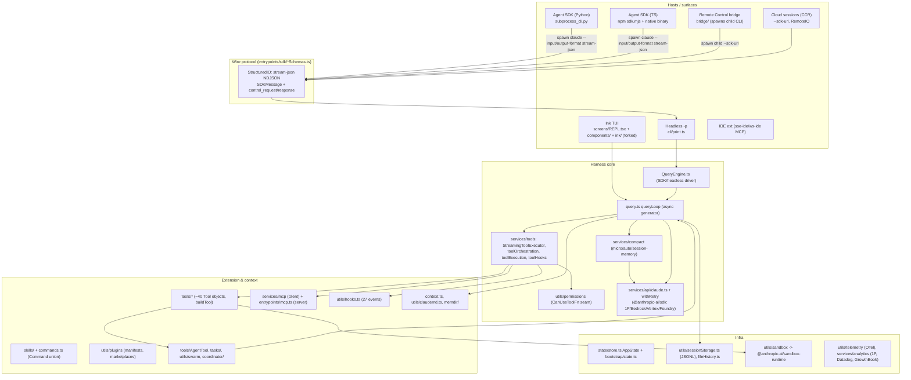

# Claude Code (leaked March-2026 source) + Claude Agent SDK

> **Verdict.** Claude Code is an `integrated-product`. A single Bun/TypeScript binary of about 515 kLOC contains the agent loop, about 40 tools, a layered permission engine, an opt-in OS sandbox, hooks, skills, plugins, MCP, subagents and a React/Ink TUI. The harness core is small and well factored: an async-generator loop in `src/query.ts` (about 1.7 kLOC) behind an injectable `CanUseToolFn` permission seam. Around that core sits a very large product layer, much of it tuned for Anthropic's prompt cache and API features. The **Claude Agent SDK** (Python and TypeScript) is not a library port of that core. It is a thin client that spawns the CLI binary and drives it over newline-delimited JSON on stdio, using a bidirectional `control_request`/`control_response` protocol. The same protocol carries the IDE, Remote Control ("bridge") and cloud ("CCR") surfaces. Build on the SDK when you want Claude Code's full behaviour as a subprocess-backed agent and can accept a single model vendor. Do not build on it if you need an in-process, provider-neutral, reshapeable loop. **claw-code** is a community Rust re-implementation of about 100 kLOC. It is useful as a legible map of the design, but it is low-fidelity on the hard parts: compaction, permissions depth, and streaming tool execution.

| | |
|---|---|
| Repo(s) | `keejkrej/claude-code` @ `3a854557e01e` (fork of a public mirror of the leaked `src/`); `anthropics/claude-agent-sdk-python` @ `65a6676344ca`; `anthropics/claude-agent-sdk-typescript` @ `273b4c87f832`; `ultraworkers/claw-code` @ `6d7412d958eb` |
| License | Claude Code: proprietary (the mirror's `package.json` says `UNLICENSED`; the source was exposed by accident). Python SDK: MIT. TS SDK: Anthropic Commercial Terms (`LICENSE.md`/README). claw-code: MIT |
| Language(s) | TypeScript on Bun, with React 19 + a forked Ink. Python ≥3.10 (anyio) for the Python SDK. Rust 2021 for claw-code |
| Size | Leak: 1,899 TS/TSX files, **516,705 lines** under `src/` once mirror-added `src/server/web/` and `src/shims/` are excluded. About 1.3 kLOC more is suspected mirror code (see below). Loop core is about 8.0 kLOC, tools 51 kLOC, services 55 kLOC, utils 181 kLOC, TUI about 140 kLOC, slash commands 27 kLOC. Python SDK: 13.3 kLOC in `src/`. TS SDK repo: no SDK source (37 files: changelog plus SessionStore examples). claw-code: about 103 kLOC of Rust across 12 crates plus a 2.4 kLOC Python "porting workspace" |
| Version at pin | Leak = npm `@anthropic-ai/claude-code` **2.1.88**, published 2026-03-30T22:36Z per the npm registry. Third-party reports name 2.1.88 as the leaked build, and in-code comments reference v2.1.83 and later. The SDKs at their pins track CLI **2.1.299**: Python `claude-agent-sdk` 0.2.166 bundles CLI 2.1.299 and TS SDK 0.3.299 is "parity with v2.1.299". npm `latest` was 2.1.300 on 2026-10-14. claw-code workspace 0.1.6 |
| Release history | npm 0.2.8 (2025-02-24, research preview) → 1.0.0 (2025-05-22, GA) → 2.0.0 (2025-09-29). On the same day the "Claude Code SDK" was renamed to the Claude Agent SDK (TS 0.1.0). Then 2.1.0 (2026-01-07) → 2.1.88 (2026-03-30), whose source map leaked on 2026-03-31 → 2.1.300 (2026-10-14). The SDK moved from bundled JS to spawning a native per-platform binary in TS 0.2.113 |
| Category | Claude Code: `integrated-product`. Agent SDK: `integrated-product` (a subprocess SDK over the product). claw-code: `integrated-product` (re-implementation) |

### Source provenance and fidelity

The leak is a **source-map reconstruction of the external npm build**. That fact explains three structural artifacts in the code:

1. **Feature-gated modules are missing; feature-gated branches are present.** Claude Code uses Bun's compile-time `feature('FLAG')` from `bun:bundle` for dead-code elimination. There are 89 distinct flags in `src/`, for example `KAIROS`, `COORDINATOR_MODE`, `CONTEXT_COLLAPSE` and `WORKFLOW_SCRIPTS`. A module that is only `require`d inside a disabled branch never reaches the bundle, so it is absent from the map. Examples:
   - `services/compact/reactiveCompact.ts`, `services/contextCollapse/` and `services/compact/snipCompact.ts`, all required at [`src/query.ts:L15-L20`](https://github.com/keejkrej/claude-code/blob/3a854557e01eeda1009329d608cdbeb1deb7c45d/src/query.ts#L15-L20) and [`L114-L121`](https://github.com/keejkrej/claude-code/blob/3a854557e01eeda1009329d608cdbeb1deb7c45d/src/query.ts#L114-L121).
   - `tools/REPLTool/REPLTool.ts`, `WorkflowTool`, `SleepTool` and `MonitorTool` ([`src/tools.ts:L16-L52`](https://github.com/keejkrej/claude-code/blob/3a854557e01eeda1009329d608cdbeb1deb7c45d/src/tools.ts#L16-L52), [`L120-L134`](https://github.com/keejkrej/claude-code/blob/3a854557e01eeda1009329d608cdbeb1deb7c45d/src/tools.ts#L120-L134)).
   - `server/server.js` for `claude server` ([`src/main.tsx:L3961-L3976`](https://github.com/keejkrej/claude-code/blob/3a854557e01eeda1009329d608cdbeb1deb7c45d/src/main.tsx#L3961-L3976)).

   The *call sites* of these features are readable, but their implementations are not.
2. **`.tsx` files are post-transform.** 294 component files import `react/compiler-runtime`, which is React Compiler output. In 27 files the build-time `USER_TYPE` constant has been folded to the string literal `"external"`, as at [`src/tools/AgentTool/AgentTool.tsx:L99`](https://github.com/keejkrej/claude-code/blob/3a854557e01eeda1009329d608cdbeb1deb7c45d/src/tools/AgentTool/AgentTool.tsx#L99). The `.ts` files appear to be original source, but 143 of them still branch on `process.env.USER_TYPE === 'ant'`.
3. **Type-only modules are erased.** Imports such as `./sdk/sdkUtilityTypes.js` ([`src/entrypoints/sdk/coreTypes.ts:L21`](https://github.com/keejkrej/claude-code/blob/3a854557e01eeda1009329d608cdbeb1deb7c45d/src/entrypoints/sdk/coreTypes.ts#L21)) have no file behind them.

**Mirror additions.** These are not original and are ignored in this chapter. They are `Dockerfile`, `docker/`, `vercel.json`, `web/` (a Next.js chat UI), `mcp-server/` (a "code explorer" MCP server published as `claude-code-explorer-mcp`), `prompts/` (a 16-step Copilot "build-out" plan), `scripts/`, `docs/`, `server.json`, `Skill.md`, `agent.md` and `.github/`. `package.json` is a reconstruction: its version is `0.0.0-leaked`, and its dependency list omits packages the code imports, such as `@anthropic-ai/sandbox-runtime` and `@anthropic-ai/bedrock-sdk`. Inside `src/`, the following are additions:

- `src/server/web/**` (20 files: an express+node-pty web terminal with token/OAuth/API-key auth). The HEAD commit message is about "API key authentication and user session management".
- `src/shims/**`, a runtime shim for `bun:bundle` that reads flags from env vars ([`src/shims/bun-bundle.ts:L1-L20`](https://github.com/keejkrej/claude-code/blob/3a854557e01eeda1009329d608cdbeb1deb7c45d/src/shims/bun-bundle.ts#L1-L20)).
- Very likely `src/services/x402/` and `src/commands/x402/`, a USDC-on-Base payment client wired into `commands.ts`, `cost-tracker.ts` and `services/api/client.ts`.

The evidence for the x402 attribution is a cross-check. claw-code ships an independent inventory of the original archive, which counts `services` = 130 modules and `server` = 3. This fork has 136 and 23 ([`claw-code src/reference_data/subsystems/services.json`](https://github.com/ultraworkers/claw-code/blob/6d7412d958ebc338722e112d08c5e46d7cd458e1/src/reference_data/subsystems/services.json)). The six extra service files are exactly the x402 module. *Inference:* `src/types/message.ts` and `src/constants/querySource.ts` are likely mirror reconstructions of erased type-only modules. For example, the 22-line `QuerySource` union does not cover the `agent:`-prefixed sources that `query.ts` tests for.

**Snapshot caveat.** Everything below describes 2.1.88 as of March 2026. The SDK changelogs show substantial later change, for example a `prewarm()` process pool, a browser SDK, and new hook fields. Treat the leak as an architectural X-ray rather than a description of the current product.

## 1. Layering & package map

| Layer | Paths | Files | LOC | Owns |
|---|---|---:|---:|---|
| Loop core | `query.ts`, `query/`, `QueryEngine.ts`, `Tool.ts`, `tools.ts`, `services/tools/` | 13 | 8,021 | Turn loop, tool contract, scheduling, per-call pipeline |
| Tools | `tools/` | 184 | 51,049 | Built-in tools. BashTool alone is 12.4 kLOC, including about 7.2 kLOC of command-safety analysis |
| Services | `services/` | 136 | 54,843 | API client, compaction, MCP client (12.3 kLOC), analytics, LSP, OAuth, memory extraction |
| Utilities | `utils/` | 564 | 181,036 | Permissions (9.4 kLOC), hooks, settings, plugins (20.6 kLOC), swarm (7.6 kLOC), session storage, sandbox adapter, telemetry |
| Slash commands | `commands/`, `commands.ts` | 192 | 27,793 | About 100 command directories |
| TUI | `components/`, `ink/`, `hooks/`, `screens/`, `keybindings/`, `vim/`, `native-ts/`, etc. | ~640 | 139,664 | Forked Ink renderer, pure-TS Yoga port, REPL screen |
| CLI, transports, remote | `main.tsx`, `cli/`, `entrypoints/`, `bridge/`, `remote/`, `server/` (3 files) | ~70 | ~37,000 | Commander CLI, print mode, StructuredIO, WebSocket/SSE transports, bridge |

The process bootstrap ([`src/entrypoints/cli.tsx:L33-L240`](https://github.com/keejkrej/claude-code/blob/3a854557e01eeda1009329d608cdbeb1deb7c45d/src/entrypoints/cli.tsx#L33-L240)) dispatches fast paths before it loads the full CLI. Examples are `--version` with zero imports, `--claude-in-chrome-mcp`, and the flag-gated `daemon`, `remote-control`/`bridge`, `ps`/`logs`/`attach` (BG_SESSIONS), `environment-runner` and `self-hosted-runner`. `main.tsx` (4.7 kLOC) then builds a Commander program. Its main flag block is at [`src/main.tsx:L960-L1010`](https://github.com/keejkrej/claude-code/blob/3a854557e01eeda1009329d608cdbeb1deb7c45d/src/main.tsx#L960-L1010).

Global state is split in two:

- A tiny external store (`createStore` with `getState`/`setState`/`subscribe`, [`src/state/store.ts:L10-L34`](https://github.com/keejkrej/claude-code/blob/3a854557e01eeda1009329d608cdbeb1deb7c45d/src/state/store.ts#L10-L34)) holds `AppState`. The tool layer reaches it only through `getAppState`/`setAppState` closures on `ToolUseContext`.
- A 1.8 kLOC module-level singleton, `bootstrap/state.ts`, holds session-scoped latches such as the session ID, cost totals and cache-TTL eligibility.

## 2. Agent loop

**Where it lives.** The loop is `query()` → `queryLoop()` in [`src/query.ts:L219-L1729`](https://github.com/keejkrej/claude-code/blob/3a854557e01eeda1009329d608cdbeb1deb7c45d/src/query.ts#L219-L1729). It is a single `while (true)` inside an async generator. It yields stream events, messages and tombstones, and *returns* a typed `Terminal`.

Cross-iteration state is one immutable-by-convention `State` record ([`L204-L217`](https://github.com/keejkrej/claude-code/blob/3a854557e01eeda1009329d608cdbeb1deb7c45d/src/query.ts#L204-L217)). Every `continue` site rebuilds that record and tags it with a `transition` reason. The exit and continue vocabularies are closed unions in [`src/query/transitions.ts:L8-L37`](https://github.com/keejkrej/claude-code/blob/3a854557e01eeda1009329d608cdbeb1deb7c45d/src/query/transitions.ts#L8-L37):

- **Terminal** (10): `completed`, `blocking_limit`, `image_error`, `model_error`, `aborted_streaming`, `aborted_tools`, `prompt_too_long`, `stop_hook_prevented`, `hook_stopped`, `max_turns`.
- **Continue** (8): `tool_use`/`next_turn`, `reactive_compact_retry`, `max_output_tokens_recovery`, `max_output_tokens_escalate`, `collapse_drain_retry`, `stop_hook_blocking`, `token_budget_continuation`, `queued_command`.

I/O is injected through a four-member `QueryDeps` (`callModel`, `microcompact`, `autocompact`, `uuid`; [`src/query/deps.ts:L21-L40`](https://github.com/keejkrej/claude-code/blob/3a854557e01eeda1009329d608cdbeb1deb7c45d/src/query/deps.ts#L21-L40)). Runtime gates are snapshotted once per call into `QueryConfig` ([`src/query/config.ts:L15-L46`](https://github.com/keejkrej/claude-code/blob/3a854557e01eeda1009329d608cdbeb1deb7c45d/src/query/config.ts#L15-L46)). That file's own comment says it is preparing for a pure `step(state, event, config)` reducer.

**One iteration, step by step:**

1. **Prefetch, without blocking.**
   - Relevant-memory selection starts once per user turn, scoped with `using` ([`L301-L304`](https://github.com/keejkrej/claude-code/blob/3a854557e01eeda1009329d608cdbeb1deb7c45d/src/query.ts#L301-L304)).
   - Skill discovery is prefetched per iteration ([`L331-L335`](https://github.com/keejkrej/claude-code/blob/3a854557e01eeda1009329d608cdbeb1deb7c45d/src/query.ts#L331-L335)).
   - The loop emits `stream_request_start`.
2. **Context shaping (the "compaction ladder", §5).** Messages after the last compact boundary are run through these stages in order:
   - the per-message tool-result budget ([`L376-L394`](https://github.com/keejkrej/claude-code/blob/3a854557e01eeda1009329d608cdbeb1deb7c45d/src/query.ts#L376-L394));
   - snip (flag-gated);
   - microcompact ([`L412-L426`](https://github.com/keejkrej/claude-code/blob/3a854557e01eeda1009329d608cdbeb1deb7c45d/src/query.ts#L412-L426));
   - context collapse (flag-gated, [`L440-L447`](https://github.com/keejkrej/claude-code/blob/3a854557e01eeda1009329d608cdbeb1deb7c45d/src/query.ts#L440-L447));
   - autocompact ([`L453-L543`](https://github.com/keejkrej/claude-code/blob/3a854557e01eeda1009329d608cdbeb1deb7c45d/src/query.ts#L453-L543)).

   If none of them is active and the estimate exceeds the hard blocking limit, the loop returns `blocking_limit` without calling the API ([`L615-L648`](https://github.com/keejkrej/claude-code/blob/3a854557e01eeda1009329d608cdbeb1deb7c45d/src/query.ts#L615-L648)).
3. **Model selection.** In `plan` mode with more than 200k tokens of context, a different runtime model may be chosen ([`L570-L578`](https://github.com/keejkrej/claude-code/blob/3a854557e01eeda1009329d608cdbeb1deb7c45d/src/query.ts#L570-L578)).
4. **Streaming call.** `deps.callModel` receives the following ([`L654-L708`](https://github.com/keejkrej/claude-code/blob/3a854557e01eeda1009329d608cdbeb1deb7c45d/src/query.ts#L654-L708)):
   - messages with user context *prepended*;
   - the system prompt with system context *appended*;
   - the thinking config, tools, abort signal and fallback model;
   - effort, advisor model, task budget, and MCP tool and pending-server state.
5. **Streaming tool execution.** When the GrowthBook gate `tengu_streaming_tool_execution2` is on, a `StreamingToolExecutor` is created before the request. Every `tool_use` block is handed to it *as soon as its assistant message arrives*, so tools start while the model is still emitting later blocks. Completed results are drained in the same loop ([`L826-L862`](https://github.com/keejkrej/claude-code/blob/3a854557e01eeda1009329d608cdbeb1deb7c45d/src/query.ts#L826-L862)). Assistant messages whose tool inputs gain derived fields are cloned before they are yielded. The original object is kept byte-identical for the API, so that prompt caching is not broken ([`L742-L787`](https://github.com/keejkrej/claude-code/blob/3a854557e01eeda1009329d608cdbeb1deb7c45d/src/query.ts#L742-L787)).
6. **Withhold-then-recover.** Prompt-too-long, media-size and `max_output_tokens` errors are *withheld* from the stream ([`L788-L825`](https://github.com/keejkrej/claude-code/blob/3a854557e01eeda1009329d608cdbeb1deb7c45d/src/query.ts#L788-L825)). Recovery is then attempted in a fixed order:
   1. drain staged context collapses;
   2. reactive compact, single-shot ([`L1062-L1183`](https://github.com/keejkrej/claude-code/blob/3a854557e01eeda1009329d608cdbeb1deb7c45d/src/query.ts#L1062-L1183));
   3. for output caps, first re-issue the same request with an escalated max-tokens value, then up to three times (`MAX_OUTPUT_TOKENS_RECOVERY_LIMIT`, [`L164`](https://github.com/keejkrej/claude-code/blob/3a854557e01eeda1009329d608cdbeb1deb7c45d/src/query.ts#L164)) inject a hidden meta user message telling the model to resume mid-thought ([`L1185-L1256`](https://github.com/keejkrej/claude-code/blob/3a854557e01eeda1009329d608cdbeb1deb7c45d/src/query.ts#L1185-L1256)).

   Only exhausted recoveries surface the error. The in-code reason is that SDK hosts such as desktop "cowork" terminate a session on any `error` field.
7. **Model fallback.** `FallbackTriggeredError`, raised by `withRetry` after repeated 529s, switches to `fallbackModel` ([`L893-L951`](https://github.com/keejkrej/claude-code/blob/3a854557e01eeda1009329d608cdbeb1deb7c45d/src/query.ts#L893-L951)). It also:
   - tombstones partial assistant messages, because their thinking signatures are model-bound;
   - synthesises `tool_result` errors for orphaned `tool_use` IDs;
   - discards and recreates the tool executor.
8. **Abort handling.** On abort, the executor's remaining results are drained, so every `tool_use` gets a synthetic `tool_result` ([`L1011-L1052`](https://github.com/keejkrej/claude-code/blob/3a854557e01eeda1009329d608cdbeb1deb7c45d/src/query.ts#L1011-L1052)). An abort with reason `'interrupt'` means the user submitted a new message. In that case the interruption marker is suppressed, because the queued message follows.
9. **No `tool_use` in the response.** The loop runs Stop hooks ([`L1258-L1306`](https://github.com/keejkrej/claude-code/blob/3a854557e01eeda1009329d608cdbeb1deb7c45d/src/query.ts#L1258-L1306)); blocking feedback re-enters the loop with `stop_hook_blocking`. It then runs the optional token-budget auto-continue ([`L1308-L1357`](https://github.com/keejkrej/claude-code/blob/3a854557e01eeda1009329d608cdbeb1deb7c45d/src/query.ts#L1308-L1357)) and returns `completed`. The code relies on observed `tool_use` blocks rather than `stop_reason`, which a comment calls "unreliable" ([`L553-L558`](https://github.com/keejkrej/claude-code/blob/3a854557e01eeda1009329d608cdbeb1deb7c45d/src/query.ts#L553-L558)).
10. **Tools present.** Tools run either through the streaming executor or through `runTools` ([`L1380-L1409`](https://github.com/keejkrej/claude-code/blob/3a854557e01eeda1009329d608cdbeb1deb7c45d/src/query.ts#L1380-L1409)). A Haiku "tool-use summary" for mobile UIs is kicked off without blocking and awaited in the *next* iteration ([`L1411-L1482`](https://github.com/keejkrej/claude-code/blob/3a854557e01eeda1009329d608cdbeb1deb7c45d/src/query.ts#L1411-L1482)).
11. **Steering and queued input.** Between tool batches, the process-global command queue is drained ([`L1547-L1590`](https://github.com/keejkrej/claude-code/blob/3a854557e01eeda1009329d608cdbeb1deb7c45d/src/query.ts#L1547-L1590)). User prompts typed mid-turn (mode `prompt`) and `task-notification`s from background agents are injected as attachments, so the model sees them *within* the current turn. The main thread drains entries without an `agentId`. Subagents drain only notifications addressed to them. Slash commands wait until the turn ends.
12. **Bookkeeping.** The loop then:
    - consumes memory and skill prefetches;
    - re-reads the tool list so that newly connected MCP servers appear ([`L1659-L1671`](https://github.com/keejkrej/claude-code/blob/3a854557e01eeda1009329d608cdbeb1deb7c45d/src/query.ts#L1659-L1671));
    - enforces `maxTurns` ([`L1704-L1712`](https://github.com/keejkrej/claude-code/blob/3a854557e01eeda1009329d608cdbeb1deb7c45d/src/query.ts#L1704-L1712));
    - continues with `next_turn` ([`L1714-L1728`](https://github.com/keejkrej/claude-code/blob/3a854557e01eeda1009329d608cdbeb1deb7c45d/src/query.ts#L1714-L1728)).

**Parallel tool calls.** There are two schedulers.

- `runTools` partitions a turn's calls into maximal runs of consecutive concurrency-safe calls. It decides by calling `tool.isConcurrencySafe(parsedInput)`, and a throw counts as unsafe. Each safe run executes in parallel with a cap of `CLAUDE_CODE_MAX_TOOL_USE_CONCURRENCY`, default 10. Every other call runs alone ([`src/services/tools/toolOrchestration.ts:L8-L12`](https://github.com/keejkrej/claude-code/blob/3a854557e01eeda1009329d608cdbeb1deb7c45d/src/services/tools/toolOrchestration.ts#L8-L12), [`L84-L115`](https://github.com/keejkrej/claude-code/blob/3a854557e01eeda1009329d608cdbeb1deb7c45d/src/services/tools/toolOrchestration.ts#L84-L115)). Context modifiers from a parallel batch are applied in block order after the batch.
- `StreamingToolExecutor` enforces the same exclusivity rule incrementally. It emits results in arrival order. It owns a child `siblingAbortController`, and **only a Bash error cancels sibling tools**, on the rationale that shell commands form implicit dependency chains ([`src/services/tools/StreamingToolExecutor.ts:L34-L66`](https://github.com/keejkrej/claude-code/blob/3a854557e01eeda1009329d608cdbeb1deb7c45d/src/services/tools/StreamingToolExecutor.ts#L34-L66), [`L350-L363`](https://github.com/keejkrej/claude-code/blob/3a854557e01eeda1009329d608cdbeb1deb7c45d/src/services/tools/StreamingToolExecutor.ts#L350-L363)).

On user interrupt, a tool's optional `interruptBehavior()` (`'cancel' | 'block'`) decides whether the tool is killed.

**Two drivers of one loop.** The REPL calls `query()` directly ([`src/screens/REPL.tsx:L2793`](https://github.com/keejkrej/claude-code/blob/3a854557e01eeda1009329d608cdbeb1deb7c45d/src/screens/REPL.tsx#L2793)). Headless and SDK runs go through `QueryEngine` ([`src/QueryEngine.ts:L175-L207`](https://github.com/keejkrej/claude-code/blob/3a854557e01eeda1009329d608cdbeb1deb7c45d/src/QueryEngine.ts#L175-L207)), whose doc comment says the REPL will move onto it "in a future phase". `QueryEngine.submitMessage` handles several concerns:

- it wraps `canUseTool` to record `permission_denials` ([`L243-L271`](https://github.com/keejkrej/claude-code/blob/3a854557e01eeda1009329d608cdbeb1deb7c45d/src/QueryEngine.ts#L243-L271));
- it assembles the system prompt;
- it processes slash commands through `processUserInput`;
- it persists the user message *before* the API call, so a kill seconds after sending is still resumable ([`L436-L463`](https://github.com/keejkrej/claude-code/blob/3a854557e01eeda1009329d608cdbeb1deb7c45d/src/QueryEngine.ts#L436-L463));
- it enforces `maxBudgetUsd` after every message, ending with `result/error_max_budget_usd` ([`L971-L1000`](https://github.com/keejkrej/claude-code/blob/3a854557e01eeda1009329d608cdbeb1deb7c45d/src/QueryEngine.ts#L971-L1000)).

Note that `ask()` builds a fresh `QueryEngine` on every call over a shared mutable message array that `print.ts` owns ([`L1186-L1297`](https://github.com/keejkrej/claude-code/blob/3a854557e01eeda1009329d608cdbeb1deb7c45d/src/QueryEngine.ts#L1186-L1297), [`src/cli/print.ts:L1142-L1160`](https://github.com/keejkrej/claude-code/blob/3a854557e01eeda1009329d608cdbeb1deb7c45d/src/cli/print.ts#L1142-L1160)).

## 3. Model / provider abstraction

**Message model.** The internal `Message` union is richer than the API's. It includes `assistant`, `user`, `attachment`, `progress`, `system`, `tombstone` and tool-use-summary messages, and `normalizeMessagesForAPI` projects it to Anthropic `MessageParam`s. Attachments carry out-of-band context such as memory, changed files, queued prompts, task notifications and skill-discovery hits. The API sees them as user content, while the UI renders them separately.

**Providers.** There is exactly one wire format: the Anthropic Messages API via `@anthropic-ai/sdk`. `APIProvider = 'firstParty' | 'bedrock' | 'vertex' | 'foundry'` ([`src/utils/model/providers.ts:L4-L13`](https://github.com/keejkrej/claude-code/blob/3a854557e01eeda1009329d608cdbeb1deb7c45d/src/utils/model/providers.ts#L4-L13)). The client factory picks `AnthropicBedrock`, `AnthropicFoundry` or `AnthropicVertex` based on `CLAUDE_CODE_USE_*` env vars ([`src/services/api/client.ts:L153-L300`](https://github.com/keejkrej/claude-code/blob/3a854557e01eeda1009329d608cdbeb1deb7c45d/src/services/api/client.ts#L153-L300)). There is no adapter interface for non-Anthropic models. Gateways work only if they speak the Anthropic API, via the base URL. The request layer `queryModel` is about 1.9 kLOC ([`src/services/api/claude.ts:L1017`](https://github.com/keejkrej/claude-code/blob/3a854557e01eeda1009329d608cdbeb1deb7c45d/src/services/api/claude.ts#L1017)) and is threaded with first-party features:

- adaptive/enabled/disabled thinking, with interleaved-thinking signature rules documented at [`src/query.ts:L151-L163`](https://github.com/keejkrej/claude-code/blob/3a854557e01eeda1009329d608cdbeb1deb7c45d/src/query.ts#L151-L163);
- `effort`;
- `output_config.task_budget` (beta `task-budgets-2026-03-13`, [`src/query.ts:L193-L197`](https://github.com/keejkrej/claude-code/blob/3a854557e01eeda1009329d608cdbeb1deb7c45d/src/query.ts#L193-L197));
- a server-side "advisor" model;
- deferred tools / `tool_reference`;
- `cache_edits`;
- a flag-gated `anti_distillation: ['fake_tools']` request field for the first-party CLI ([`src/services/api/claude.ts:L300-L313`](https://github.com/keejkrej/claude-code/blob/3a854557e01eeda1009329d608cdbeb1deb7c45d/src/services/api/claude.ts#L300-L313)).

**Retries.** `withRetry` allows 10 retries by default and at most 3 consecutive 529s before fallback. Only *foreground* query sources retry 529s; background summarisers and classifiers drop the request, explicitly to avoid amplifying load ([`src/services/api/withRetry.ts:L52-L110`](https://github.com/keejkrej/claude-code/blob/3a854557e01eeda1009329d608cdbeb1deb7c45d/src/services/api/withRetry.ts#L52-L110), [`L160-L170`](https://github.com/keejkrej/claude-code/blob/3a854557e01eeda1009329d608cdbeb1deb7c45d/src/services/api/withRetry.ts#L160-L170)).

**Prompt caching** is a first-class design constraint throughout:

- `getCacheControl` emits ephemeral markers, a `1h` TTL when `should1hCacheTTL` allows it, and `scope: 'global'`. Eligibility and the GrowthBook allowlist are *latched* in bootstrap state, so a mid-session overage flip cannot change the TTL and bust about 20k cached tokens ([`src/services/api/claude.ts:L333-L431`](https://github.com/keejkrej/claude-code/blob/3a854557e01eeda1009329d608cdbeb1deb7c45d/src/services/api/claude.ts#L333-L431)).
- `addCacheBreakpoints` places exactly one message-level marker per request ([`L3063-L3080`](https://github.com/keejkrej/claude-code/blob/3a854557e01eeda1009329d608cdbeb1deb7c45d/src/services/api/claude.ts#L3063-L3080)).
- The tool pool is sorted with built-ins as a contiguous prefix ahead of MCP tools. A server-side cache policy places a global breakpoint after the last built-in tool ([`src/tools.ts:L345-L367`](https://github.com/keejkrej/claude-code/blob/3a854557e01eeda1009329d608cdbeb1deb7c45d/src/tools.ts#L345-L367)).
- The system prompt is split at a `SYSTEM_PROMPT_DYNAMIC_BOUNDARY` sentinel (§5).

**Cost.** `cost-tracker.ts` accumulates per-model usage and USD, and restores them on resume ([`src/cost-tracker.ts:L87-L143`](https://github.com/keejkrej/claude-code/blob/3a854557e01eeda1009329d608cdbeb1deb7c45d/src/cost-tracker.ts#L87-L143)). Prices come from static tier tables ([`src/utils/modelCost.ts:L27-L96`](https://github.com/keejkrej/claude-code/blob/3a854557e01eeda1009329d608cdbeb1deb7c45d/src/utils/modelCost.ts#L27-L96)). The auto-mode classifier's own cost is computed and logged per decision.

## 4. Tool system

**Definition API.** `Tool<Input extends ZodObject, Output, Progress>` ([`src/Tool.ts:L362-L700`](https://github.com/keejkrej/claude-code/blob/3a854557e01eeda1009329d608cdbeb1deb7c45d/src/Tool.ts#L362-L700)) is a wide, UI-coupled interface. Its members fall into four groups:

- **Execution:** `call()` takes parsed input, `ToolUseContext`, `canUseTool`, the parent message and a progress callback. It returns `ToolResult { data, newMessages?, contextModifier?, mcpMeta? }` ([`L321-L336`](https://github.com/keejkrej/claude-code/blob/3a854557e01eeda1009329d608cdbeb1deb7c45d/src/Tool.ts#L321-L336)).
- **Schema:** Zod `inputSchema` plus an optional raw `inputJSONSchema` for MCP; `description()` and `prompt()` for model-facing text.
- **Policy predicates:** `isConcurrencySafe`, `isReadOnly`, `isDestructive`, `isOpenWorld`, `requiresUserInteraction`, `interruptBehavior`, `validateInput`, `checkPermissions`, `preparePermissionMatcher` and `toAutoClassifierInput`.
- **Context and rendering:** context-budget fields `maxResultSizeChars`, `shouldDefer`/`alwaysLoad` and `strict`; and about 12 React render methods such as `renderToolUseMessage`, `renderToolResultMessage` and `renderGroupedToolUse`.

`buildTool()` fills fail-closed defaults: not concurrency-safe, not read-only, `checkPermissions` = allow (defer to the general system), and classifier input = empty ([`L757-L792`](https://github.com/keejkrej/claude-code/blob/3a854557e01eeda1009329d608cdbeb1deb7c45d/src/Tool.ts#L757-L792)). `ToolUseContext` ([`L158-L300`](https://github.com/keejkrej/claude-code/blob/3a854557e01eeda1009329d608cdbeb1deb7c45d/src/Tool.ts#L158-L300)) is the one object passed everywhere: options, abort controller, `readFileState` cache, app-state accessors, agent ID, notification and UI callbacks, and content-replacement state. It is the de facto "kernel API" of the harness.

**Built-ins.** `getAllBaseTools()` ([`src/tools.ts:L193-L251`](https://github.com/keejkrej/claude-code/blob/3a854557e01eeda1009329d608cdbeb1deb7c45d/src/tools.ts#L193-L251)) is noted as needing to stay in sync with a server-side cache policy. Always present in external builds: `Agent`, `TaskOutput`, `Bash`, `Glob`/`Grep` (dropped when ant-native builds embed bfs/ugrep), `ExitPlanMode`, `Read`, `Edit`, `Write`, `NotebookEdit`, `WebFetch`, `TodoWrite`, `WebSearch`, `TaskStop`, `AskUserQuestion`, `Skill`, `EnterPlanMode`, `SendMessage`, `Brief`, `ListMcpResources`, `ReadMcpResource` and `ToolSearch`. Conditional tools are:

- Task v2 CRUD (`TaskCreate`, `TaskGet`, `TaskUpdate`, `TaskList`);
- `LSP` when `ENABLE_LSP_TOOL` is set;
- `EnterWorktree`/`ExitWorktree`;
- `TeamCreate`/`TeamDelete` under agent swarms;
- PowerShell;
- Cron tools (`AGENT_TRIGGERS`);
- several ant-only or flag-only tools, many of whose modules are absent from the leak.

`getTools()` filters by blanket deny rules, so a denied MCP server prefix removes that server's tools *before the model sees them*. `CLAUDE_CODE_SIMPLE`/`--bare` reduces the set to Bash, Read and Edit ([`L271-L327`](https://github.com/keejkrej/claude-code/blob/3a854557e01eeda1009329d608cdbeb1deb7c45d/src/tools.ts#L271-L327)).

**Per-call pipeline** (`checkPermissionsAndCallTool`, [`src/services/tools/toolExecution.ts:L599-L1746`](https://github.com/keejkrej/claude-code/blob/3a854557e01eeda1009329d608cdbeb1deb7c45d/src/services/tools/toolExecution.ts#L599-L1746)):

1. Zod `safeParse`. On failure the model gets an `InputValidationError`, plus a hint if the tool's schema was deferred and never sent ([`L615-L680`](https://github.com/keejkrej/claude-code/blob/3a854557e01eeda1009329d608cdbeb1deb7c45d/src/services/tools/toolExecution.ts#L615-L680)).
2. `tool.validateInput` ([`L683`](https://github.com/keejkrej/claude-code/blob/3a854557e01eeda1009329d608cdbeb1deb7c45d/src/services/tools/toolExecution.ts#L683)).
3. A speculative start of the Bash allow-classifier, in parallel with hooks ([`L734`](https://github.com/keejkrej/claude-code/blob/3a854557e01eeda1009329d608cdbeb1deb7c45d/src/services/tools/toolExecution.ts#L734)).
4. `PreToolUse` hooks, which may allow, deny, ask, rewrite input or stop ([`L800`](https://github.com/keejkrej/claude-code/blob/3a854557e01eeda1009329d608cdbeb1deb7c45d/src/services/tools/toolExecution.ts#L800)).
5. `resolveHookPermissionDecision` combines the hook verdict with `canUseTool` ([`L921`](https://github.com/keejkrej/claude-code/blob/3a854557e01eeda1009329d608cdbeb1deb7c45d/src/services/tools/toolExecution.ts#L921)).
6. `tool.call` inside OTel tool spans ([`L1207`](https://github.com/keejkrej/claude-code/blob/3a854557e01eeda1009329d608cdbeb1deb7c45d/src/services/tools/toolExecution.ts#L1207)).
7. Result mapping with size handling ([`L1403-L1415`](https://github.com/keejkrej/claude-code/blob/3a854557e01eeda1009329d608cdbeb1deb7c45d/src/services/tools/toolExecution.ts#L1403-L1415)).
8. `PostToolUse` or `PostToolUseFailure` hooks ([`L1483`](https://github.com/keejkrej/claude-code/blob/3a854557e01eeda1009329d608cdbeb1deb7c45d/src/services/tools/toolExecution.ts#L1483), [`L1700`](https://github.com/keejkrej/claude-code/blob/3a854557e01eeda1009329d608cdbeb1deb7c45d/src/services/tools/toolExecution.ts#L1700)).

**Output truncation is spill-to-disk, not truncation.**

- Results above a per-tool threshold are written to `<projectDir>/<sessionId>/tool-results/<id>`, by default `min(tool.maxResultSizeChars, 50_000)` chars, overridable per tool through GrowthBook.
- The model receives a `<persisted-output>` wrapper with a 2 kB preview and the file path ([`src/utils/toolResultStorage.ts:L27-L31`](https://github.com/keejkrej/claude-code/blob/3a854557e01eeda1009329d608cdbeb1deb7c45d/src/utils/toolResultStorage.ts#L27-L31), [`L55-L77`](https://github.com/keejkrej/claude-code/blob/3a854557e01eeda1009329d608cdbeb1deb7c45d/src/utils/toolResultStorage.ts#L55-L77), [`L137`](https://github.com/keejkrej/claude-code/blob/3a854557e01eeda1009329d608cdbeb1deb7c45d/src/utils/toolResultStorage.ts#L137)).
- An aggregate cap of 200k chars per message applies ([`src/constants/toolLimits.ts:L13-L49`](https://github.com/keejkrej/claude-code/blob/3a854557e01eeda1009329d608cdbeb1deb7c45d/src/constants/toolLimits.ts#L13-L49)).
- `Read` opts out with `maxResultSizeChars = Infinity` and self-bounds by tokens.

**Tool search.** When MCP tool definitions would exceed 10% of the context window by default (`ENABLE_TOOL_SEARCH=auto:N`), tools are marked deferred and loaded on demand via `ToolSearch` ([`src/utils/toolSearch.ts:L47-L49`](https://github.com/keejkrej/claude-code/blob/3a854557e01eeda1009329d608cdbeb1deb7c45d/src/utils/toolSearch.ts#L47-L49), [`L161-L196`](https://github.com/keejkrej/claude-code/blob/3a854557e01eeda1009329d608cdbeb1deb7c45d/src/utils/toolSearch.ts#L161-L196)).

## 5. Context management

**System prompt assembly.** `getSystemPrompt()` ([`src/constants/prompts.ts:L444-L577`](https://github.com/keejkrej/claude-code/blob/3a854557e01eeda1009329d608cdbeb1deb7c45d/src/constants/prompts.ts#L444-L577)) returns a string array in two parts:

- **Static sections:** intro, system, doing-tasks (dropped by output styles that disable coding instructions), actions, tool usage, tone and efficiency.
- **Dynamic sections:** these follow the `SYSTEM_PROMPT_DYNAMIC_BOUNDARY` sentinel ([`L114-L115`](https://github.com/keejkrej/claude-code/blob/3a854557e01eeda1009329d608cdbeb1deb7c45d/src/constants/prompts.ts#L114-L115)) when global cache scope is on. They include session guidance, memory, environment, language, output style, MCP instructions, scratchpad and function-result-clearing. Each is a memoized `systemPromptSection` that is computed once until `/clear` or `/compact`. A recompute-every-turn variant must be declared as `DANGEROUS_uncachedSystemPromptSection` with a stated reason ([`src/constants/systemPromptSections.ts:L20-L41`](https://github.com/keejkrej/claude-code/blob/3a854557e01eeda1009329d608cdbeb1deb7c45d/src/constants/systemPromptSections.ts#L20-L41)).

`--bare`/`CLAUDE_CODE_SIMPLE` collapses everything to a one-line prompt. The SDK path can replace the prompt (`customSystemPrompt`) or append to it ([`src/QueryEngine.ts:L284-L325`](https://github.com/keejkrej/claude-code/blob/3a854557e01eeda1009329d608cdbeb1deb7c45d/src/QueryEngine.ts#L284-L325)).

**Project instructions are not in the system prompt.** `getUserContext()` returns `{claudeMd, currentDate}` and `getSystemContext()` returns `{gitStatus}` ([`src/context.ts:L116-L188`](https://github.com/keejkrej/claude-code/blob/3a854557e01eeda1009329d608cdbeb1deb7c45d/src/context.ts#L116-L188)). At request time, user context is *prepended as a synthetic first user message* and system context is *appended* to the system array ([`src/query.ts:L449-L451`](https://github.com/keejkrej/claude-code/blob/3a854557e01eeda1009329d608cdbeb1deb7c45d/src/query.ts#L449-L451), [`L660`](https://github.com/keejkrej/claude-code/blob/3a854557e01eeda1009329d608cdbeb1deb7c45d/src/query.ts#L660)). *Inference:* this keeps the static system prompt byte-identical across users for global caching, while per-repo content sits in the per-session cached message prefix.

The CLAUDE.md hierarchy ([`src/utils/claudemd.ts:L1-L26`](https://github.com/keejkrej/claude-code/blob/3a854557e01eeda1009329d608cdbeb1deb7c45d/src/utils/claudemd.ts#L1-L26), loader at [`L790-L930`](https://github.com/keejkrej/claude-code/blob/3a854557e01eeda1009329d608cdbeb1deb7c45d/src/utils/claudemd.ts#L790-L930)) loads, from lowest to highest priority:

- Managed (`/etc/claude-code/CLAUDE.md` plus managed rules);
- User (`~/.claude/CLAUDE.md`, `~/.claude/rules/*.md`);
- Project (`CLAUDE.md`, `.claude/CLAUDE.md`, `.claude/rules/**/*.md`, walking from the repo root down to cwd);
- Local (`CLAUDE.local.md`).

`@path` includes are allowed to depth 5 (`MAX_INCLUDE_DEPTH`, [`L537`](https://github.com/keejkrej/claude-code/blob/3a854557e01eeda1009329d608cdbeb1deb7c45d/src/utils/claudemd.ts#L537)), with a 40k-char warning threshold ([`L92`](https://github.com/keejkrej/claude-code/blob/3a854557e01eeda1009329d608cdbeb1deb7c45d/src/utils/claudemd.ts#L92)). Nested CLAUDE.md files under subdirectories are attached lazily when the model reads files there. **AGENTS.md is not loaded natively.** It appears only in `/init`'s survey instructions, which fold it into CLAUDE.md ([`src/commands/init.ts:L46`](https://github.com/keejkrej/claude-code/blob/3a854557e01eeda1009329d608cdbeb1deb7c45d/src/commands/init.ts#L46)).

**Compaction is a ladder**, cheapest first:

| Stage | Trigger | Mechanism | Evidence |
|---|---|---|---|
| Tool-result budget | Every iteration | Replaces oversized results with persisted-file stubs; records replacements in the transcript so resume replays them | [`src/query.ts:L369-L394`](https://github.com/keejkrej/claude-code/blob/3a854557e01eeda1009329d608cdbeb1deb7c45d/src/query.ts#L369-L394) |
| Microcompact | Every iteration | Clears old results of a fixed set of compactable tools. A time-based variant clears them in place. A cached variant (flag `CACHED_MICROCOMPACT`) uses API `cache_edits` to delete from the server-side cache without rewriting the prefix | [`src/services/compact/microCompact.ts:L36-L41`](https://github.com/keejkrej/claude-code/blob/3a854557e01eeda1009329d608cdbeb1deb7c45d/src/services/compact/microCompact.ts#L36-L41), [`L253-L270`](https://github.com/keejkrej/claude-code/blob/3a854557e01eeda1009329d608cdbeb1deb7c45d/src/services/compact/microCompact.ts#L253-L270) |
| Snip / context collapse | Flag-gated (`HISTORY_SNIP`, `CONTEXT_COLLAPSE`) | A read-time projection that archives spans into a collapse store. The modules are absent from the leak | [`src/query.ts:L396-L447`](https://github.com/keejkrej/claude-code/blob/3a854557e01eeda1009329d608cdbeb1deb7c45d/src/query.ts#L396-L447) |
| Autocompact | Estimate > window − min(maxOutput, 20k) − 13k | Tries session-memory compaction first. Otherwise `compactConversation`: PreCompact hooks, then a **forked agent** with `CacheSafeParams` (identical system, tools and message prefix, `maxTurns: 1`, `skipCacheWrite`) so the summary call reuses the main prompt cache, then PostCompact hooks. Circuit breaker after 3 consecutive failures | [`src/services/compact/autoCompact.ts:L28-L91`](https://github.com/keejkrej/claude-code/blob/3a854557e01eeda1009329d608cdbeb1deb7c45d/src/services/compact/autoCompact.ts#L28-L91), [`L241-L345`](https://github.com/keejkrej/claude-code/blob/3a854557e01eeda1009329d608cdbeb1deb7c45d/src/services/compact/autoCompact.ts#L241-L345); [`src/services/compact/compact.ts:L1178-L1199`](https://github.com/keejkrej/claude-code/blob/3a854557e01eeda1009329d608cdbeb1deb7c45d/src/services/compact/compact.ts#L1178-L1199) |
| Post-compact rehydration | After summary | Re-attaches up to 5 recently read files (5k tokens each, 50k total), invoked skills (25k budget), plan and plan-mode state, and async-agent state | [`src/services/compact/compact.ts:L122-L130`](https://github.com/keejkrej/claude-code/blob/3a854557e01eeda1009329d608cdbeb1deb7c45d/src/services/compact/compact.ts#L122-L130), [`L1415`](https://github.com/keejkrej/claude-code/blob/3a854557e01eeda1009329d608cdbeb1deb7c45d/src/services/compact/compact.ts#L1415) |
| Reactive compact | Real 413 / media error | Single-shot; the module is absent from the leak | [`src/query.ts:L1119-L1183`](https://github.com/keejkrej/claude-code/blob/3a854557e01eeda1009329d608cdbeb1deb7c45d/src/query.ts#L1119-L1183) |

The comment at [`autoCompact.ts:L67-L70`](https://github.com/keejkrej/claude-code/blob/3a854557e01eeda1009329d608cdbeb1deb7c45d/src/services/compact/autoCompact.ts#L67-L70) cites production telemetry: 1,279 sessions with 50 or more consecutive failures, about 250k wasted calls per day. That number motivated the circuit breaker.

**Memory** has four mechanisms.

1. **Auto-memory directory (`memdir/`).** Memories live under `~/.claude/projects/<slug>/memory/`, with an always-loaded `MEMORY.md` index capped at 200 lines and 25 kB plus topic files ([`src/memdir/memdir.ts:L34-L38`](https://github.com/keejkrej/claude-code/blob/3a854557e01eeda1009329d608cdbeb1deb7c45d/src/memdir/memdir.ts#L34-L38)). Per turn, a `sideQuery` to a small model selects relevant topic files to attach ([`src/memdir/findRelevantMemories.ts:L39-L136`](https://github.com/keejkrej/claude-code/blob/3a854557e01eeda1009329d608cdbeb1deb7c45d/src/memdir/findRelevantMemories.ts#L39-L136)).
2. **Session memory.** A post-sampling hook periodically runs a forked subagent that maintains a markdown notes file for the current conversation. Experimentally, autocompact can use that file instead of a fresh summary ([`src/services/SessionMemory/sessionMemory.ts:L1-L4`](https://github.com/keejkrej/claude-code/blob/3a854557e01eeda1009329d608cdbeb1deb7c45d/src/services/SessionMemory/sessionMemory.ts#L1-L4)).
3. **Background extraction and consolidation.** `services/extractMemories` and `autoDream` (memory consolidation, surfaced as a `dream` task) run in the background.
4. **Team memory.** `teamMemPaths`/`teamMemorySync` are flag-gated as `TEAMMEM`.

## 6. State, sessions & durability

**Transcripts.** Sessions are append-only JSONL at `~/.claude/projects/<sanitized-cwd>/<sessionId>.jsonl` ([`src/utils/sessionStorage.ts:L202-L205`](https://github.com/keejkrej/claude-code/blob/3a854557e01eeda1009329d608cdbeb1deb7c45d/src/utils/sessionStorage.ts#L202-L205), [`L436-L438`](https://github.com/keejkrej/claude-code/blob/3a854557e01eeda1009329d608cdbeb1deb7c45d/src/utils/sessionStorage.ts#L436-L438)). Entries form a `parentUuid` chain. A compact boundary starts a new root (`parentUuid: null`) and records `logicalParentUuid` ([`L1001-L1041`](https://github.com/keejkrej/claude-code/blob/3a854557e01eeda1009329d608cdbeb1deb7c45d/src/utils/sessionStorage.ts#L1001-L1041)). Subagents write *sidechain* transcripts to `<sessionId>/subagents/agent-<id>.jsonl` plus a `.meta.json` ([`L250-L261`](https://github.com/keejkrej/claude-code/blob/3a854557e01eeda1009329d608cdbeb1deb7c45d/src/utils/sessionStorage.ts#L250-L261)). Large tool outputs sit in the sibling `tool-results/` directory. The module is 5.1 kLOC.

**Resume and fork.** The CLI provides `-c/--continue`, `-r/--resume [id]`, `--fork-session`, `--session-id`, `--resume-session-at` (hidden), `--rewind-files` (hidden), `--from-pr` and `--no-session-persistence` ([`src/main.tsx:L960-L1010`](https://github.com/keejkrej/claude-code/blob/3a854557e01eeda1009329d608cdbeb1deb7c45d/src/main.tsx#L960-L1010)). On load, `deserializeMessagesWithInterruptDetection` does the following ([`src/utils/conversationRecovery.ts:L164-L240`](https://github.com/keejkrej/claude-code/blob/3a854557e01eeda1009329d608cdbeb1deb7c45d/src/utils/conversationRecovery.ts#L164-L240)):

- it migrates legacy attachment types;
- it strips permission modes that are invalid in this build;
- it filters unresolved `tool_use`s and orphaned thinking-only messages;
- it detects a turn that was interrupted mid-flight and appends a synthetic "continue" meta message. Its doc comment says this lets the SDK resume path auto-continue after a gateway restart.

This is crash recovery at turn granularity. It is not deterministic replay.

**Checkpoints and undo.** `fileHistory.ts` (1.1 kLOC) snapshots files before edits. It keeps up to 100 snapshots, versioned backups under `{configDir}/file-history/{sessionId}/`, and supports `fileHistoryRewind` ([`src/utils/fileHistory.ts:L33-L54`](https://github.com/keejkrej/claude-code/blob/3a854557e01eeda1009329d608cdbeb1deb7c45d/src/utils/fileHistory.ts#L33-L54), [`L86`](https://github.com/keejkrej/claude-code/blob/3a854557e01eeda1009329d608cdbeb1deb7c45d/src/utils/fileHistory.ts#L86), [`L347`](https://github.com/keejkrej/claude-code/blob/3a854557e01eeda1009329d608cdbeb1deb7c45d/src/utils/fileHistory.ts#L347)). It is exposed as `/rewind` and the SDK `rewind_files` control request. Only edits made through Claude's file tools are captured. Bash side-effects are not, which is an inference from the tracking entry point `fileHistoryTrackEdit`.

**Durability semantics.** The user message is flushed before the request (§2). `CLAUDE_CODE_EAGER_FLUSH` forces fsync-like flushes for desktop and cowork hosts. Background tasks persist output files (`Task.ts` `outputFile`/`outputOffset`, [`src/Task.ts:L44-L57`](https://github.com/keejkrej/claude-code/blob/3a854557e01eeda1009329d608cdbeb1deb7c45d/src/Task.ts#L44-L57)). There is no workflow-engine style checkpoint replay. The Agent SDK later added a `SessionStore` adapter that mirrors transcript entries to S3, Redis or Postgres *after* the local write succeeds (§10.2).

## 7. Safety & sandboxing

**Modes.** The external modes are `default`, `acceptEdits`, `plan`, `bypassPermissions` and `dontAsk`. Internally there are also `auto` (gated by `TRANSCRIPT_CLASSIFIER`) and `bubble`, which surfaces a subagent's prompts to its parent ([`src/types/permissions.ts:L16-L38`](https://github.com/keejkrej/claude-code/blob/3a854557e01eeda1009329d608cdbeb1deb7c45d/src/types/permissions.ts#L16-L38)).

**Rules.** Rules have the form `Tool(content)` with allow, deny or ask behaviour. They come from eight sources: `userSettings`, `projectSettings`, `localSettings`, `flagSettings`, `policySettings`, `cliArg`, `command` and `session` ([`L54-L62`](https://github.com/keejkrej/claude-code/blob/3a854557e01eeda1009329d608cdbeb1deb7c45d/src/types/permissions.ts#L54-L62)). Settings layers merge in the order user → project → local → `--settings` flag → policy. Policy means `managed-settings.json` plus a `managed-settings.d/` drop-in under `/etc/claude-code` or `/Library/Application Support/ClaudeCode`, or remote-managed settings ([`src/utils/settings/constants.ts:L1-L20`](https://github.com/keejkrej/claude-code/blob/3a854557e01eeda1009329d608cdbeb1deb7c45d/src/utils/settings/constants.ts#L1-L20), [`src/utils/settings/managedPath.ts:L19-L33`](https://github.com/keejkrej/claude-code/blob/3a854557e01eeda1009329d608cdbeb1deb7c45d/src/utils/settings/managedPath.ts#L19-L33)).

**Decision pipeline.** The pipeline is `hasPermissionsToUseToolInner` ([`src/utils/permissions/permissions.ts:L1158-L1318`](https://github.com/keejkrej/claude-code/blob/3a854557e01eeda1009329d608cdbeb1deb7c45d/src/utils/permissions/permissions.ts#L1158-L1318)):

- **1a/1b:** a whole-tool deny or ask rule.
- **1c/1d:** the tool's own `checkPermissions`, for example Bash subcommand prefix rules and path checks.
- **1e:** `requiresUserInteraction`.
- **1f:** content-specific ask rules, which *override bypass*.
- **1g:** bypass-immune safety checks for `.git/`, `.claude/`, `.vscode/` and shell rc files.
- **2a:** the bypass mode.
- **2b:** a whole-tool allow rule.
- **3:** passthrough becomes ask.

The outer `hasPermissionsToUseTool` then applies mode transforms ([`L473-L700`](https://github.com/keejkrej/claude-code/blob/3a854557e01eeda1009329d608cdbeb1deb7c45d/src/utils/permissions/permissions.ts#L473-L700)). `dontAsk` turns ask into deny. `auto` runs, in order:

1. safety-check immunity;
2. an "acceptEdits would allow it" fast path, skipped for `Agent`/`REPL` because inner calls could escape;
3. a safe-tool allowlist;
4. the **LLM transcript classifier** (`classifyYoloAction`, `yoloClassifier.ts`, 1.5 kLOC), with denial tracking and limits.

Headless agents that cannot prompt get deny, or a `PermissionRequest` hook verdict.

**One seam, three hosts.** `CanUseToolFn` is the injection point.

- The REPL implements it with a React confirm queue (`hooks/useCanUseTool.tsx`).
- Print and SDK implement it as a `can_use_tool` control request *raced* against `PermissionRequest` hooks, where the first resolver wins ([`src/cli/structuredIO.ts:L533-L611`](https://github.com/keejkrej/claude-code/blob/3a854557e01eeda1009329d608cdbeb1deb7c45d/src/cli/structuredIO.ts#L533-L611)).
- `--permission-prompt-tool` delegates the decision to an MCP tool.

**Bash analysis.** About 7.2 kLOC across `bashSecurity.ts` (injection, IFS, `/proc/*/environ`, obfuscated flags, heredoc substitution, zsh builtins and more), `bashPermissions.ts`, `readOnlyValidation.ts` and a sed parser ([`src/tools/BashTool/bashSecurity.ts:L77-L1700`](https://github.com/keejkrej/claude-code/blob/3a854557e01eeda1009329d608cdbeb1deb7c45d/src/tools/BashTool/bashSecurity.ts#L77-L1700)). Tree-sitter shadow parsing is flag-gated.

**OS sandbox.** The sandbox is opt-in (`sandbox.enabled`, default `false`) and implemented by `@anthropic-ai/sandbox-runtime` through a CLI adapter ([`src/utils/sandbox/sandbox-adapter.ts:L1-L22`](https://github.com/keejkrej/claude-code/blob/3a854557e01eeda1009329d608cdbeb1deb7c45d/src/utils/sandbox/sandbox-adapter.ts#L1-L22)). Supported platforms are macOS, Linux and WSL2; Linux needs bubblewrap and socat; WSL1 and native Windows are unsupported ([`L459-L594`](https://github.com/keejkrej/claude-code/blob/3a854557e01eeda1009329d608cdbeb1deb7c45d/src/utils/sandbox/sandbox-adapter.ts#L459-L594)). How it is configured and applied:

- Filesystem rules come from Edit/Read permission rules.
- **Network allow-domains** come from `WebFetch(domain:…)` rules plus `sandbox.network.allowedDomains`. A policy can set `allowManagedDomainsOnly`. HTTP and SOCKS proxy ports and Unix-socket controls are also configurable ([`L172-L367`](https://github.com/keejkrej/claude-code/blob/3a854557e01eeda1009329d608cdbeb1deb7c45d/src/utils/sandbox/sandbox-adapter.ts#L172-L367)).
- Only shell commands are wrapped. The model can set `dangerouslyDisableSandbox` per call unless policy forbids it, and `excludedCommands` bypass the sandbox ([`src/tools/BashTool/shouldUseSandbox.ts:L130-L153`](https://github.com/keejkrej/claude-code/blob/3a854557e01eeda1009329d608cdbeb1deb7c45d/src/tools/BashTool/shouldUseSandbox.ts#L130-L153)).
- `autoAllowBashIfSandboxed` (default `true`) converts sandboxing into fewer prompts.
- In SDK mode, sandbox network asks are tunnelled as synthetic `can_use_tool` requests ([`src/cli/structuredIO.ts:L725-L757`](https://github.com/keejkrej/claude-code/blob/3a854557e01eeda1009329d608cdbeb1deb7c45d/src/cli/structuredIO.ts#L725-L757)).

**Other controls.**

- A workspace-trust check gates hooks: `shouldSkipHookDueToTrust` ([`src/utils/hooks.ts:L286`](https://github.com/keejkrej/claude-code/blob/3a854557e01eeda1009329d608cdbeb1deb7c45d/src/utils/hooks.ts#L286)).
- Managed settings provide `disableAllHooks` and `allowManagedHooksOnly` ([`L3024`](https://github.com/keejkrej/claude-code/blob/3a854557e01eeda1009329d608cdbeb1deb7c45d/src/utils/hooks.ts#L3024)).
- Project `.mcp.json` servers require approval.
- An "undercover" mode strips attribution and internal codenames in commits to public repos. It has no force-off ([`src/utils/undercover.ts:L1-L15`](https://github.com/keejkrej/claude-code/blob/3a854557e01eeda1009329d608cdbeb1deb7c45d/src/utils/undercover.ts#L1-L15)).

## 8. Extensibility

**Hooks.** There are 27 events ([`src/entrypoints/sdk/coreTypes.ts:L25-L53`](https://github.com/keejkrej/claude-code/blob/3a854557e01eeda1009329d608cdbeb1deb7c45d/src/entrypoints/sdk/coreTypes.ts#L25-L53)):

- **Tool lifecycle:** Pre/Post/PostFailure.
- **Prompt and session:** UserPromptSubmit, SessionStart/End, Setup, Stop/StopFailure.
- **Agents and teams:** SubagentStart/Stop, TeammateIdle, TaskCreated/Completed.
- **Compaction:** Pre/PostCompact.
- **Permissions:** PermissionRequest/Denied.
- **MCP elicitation:** Elicitation/ElicitationResult.
- **Environment:** ConfigChange, CwdChanged, FileChanged, InstructionsLoaded, WorktreeCreate/Remove.
- **Notification.**

Hooks come in four types as a Zod discriminated union ([`src/schemas/hooks.ts:L33-L183`](https://github.com/keejkrej/claude-code/blob/3a854557e01eeda1009329d608cdbeb1deb7c45d/src/schemas/hooks.ts#L33-L183)):

- `command`: a shell process with JSON on stdin; exit code 2 or `decision: block` blocks ([`src/utils/hooks.ts:L3328-L3334`](https://github.com/keejkrej/claude-code/blob/3a854557e01eeda1009329d608cdbeb1deb7c45d/src/utils/hooks.ts#L3328-L3334));
- `prompt`: an LLM judgement;
- `http`: guarded by an SSRF filter in `utils/hooks/ssrfGuard.ts`;
- `agent`: an agentic verifier.

The default timeout is 10 minutes ([`L166`](https://github.com/keejkrej/claude-code/blob/3a854557e01eeda1009329d608cdbeb1deb7c45d/src/utils/hooks.ts#L166)). Hooks can also be declared in skill and agent frontmatter, and SDK hosts register in-process callbacks via `hook_callback`.

**Skills and slash commands share one type.** `Command = PromptCommand | LocalCommand | LocalJSXCommand` ([`src/types/command.ts:L25-L205`](https://github.com/keejkrej/claude-code/blob/3a854557e01eeda1009329d608cdbeb1deb7c45d/src/types/command.ts#L25-L205)). Skills are `prompt` commands loaded from four places ([`src/skills/loadSkillsDir.ts:L67-L95`](https://github.com/keejkrej/claude-code/blob/3a854557e01eeda1009329d608cdbeb1deb7c45d/src/skills/loadSkillsDir.ts#L67-L95)):

- `.claude/skills/<name>/SKILL.md`, at policy, user or project level;
- legacy `.claude/commands/`;
- plugins;
- MCP prompts.

Frontmatter fields include `description`, `when_to_use`, `allowed-tools`, `model`, `effort`, `user-invocable`, `disable-model-invocation`, `hooks`, `paths` (conditional activation), `context: fork`, `agent` and `shell` ([`L185-L263`](https://github.com/keejkrej/claude-code/blob/3a854557e01eeda1009329d608cdbeb1deb7c45d/src/skills/loadSkillsDir.ts#L185-L263)). The model invokes a skill through `SkillTool`, in one of two ways:

- **Inline:** the skill's prompt is injected as `newMessages`, and a `contextModifier` adds `allowed-tools` to the `command`-source allow rules and may switch the model ([`src/tools/SkillTool/SkillTool.ts:L766-L800`](https://github.com/keejkrej/claude-code/blob/3a854557e01eeda1009329d608cdbeb1deb7c45d/src/tools/SkillTool/SkillTool.ts#L766-L800)).
- **Forked:** with `context: fork`, the skill runs as a subagent via `runAgent` ([`L622`](https://github.com/keejkrej/claude-code/blob/3a854557e01eeda1009329d608cdbeb1deb7c45d/src/tools/SkillTool/SkillTool.ts#L622)).

The command registry merges bundled skills, built-in plugin skills, skill dirs, workflows, plugin commands, plugin skills and about 85 built-ins ([`src/commands.ts:L451-L470`](https://github.com/keejkrej/claude-code/blob/3a854557e01eeda1009329d608cdbeb1deb7c45d/src/commands.ts#L451-L470)). It also tags `REMOTE_SAFE_COMMANDS` and `BRIDGE_SAFE_COMMANDS` ([`L621-L686`](https://github.com/keejkrej/claude-code/blob/3a854557e01eeda1009329d608cdbeb1deb7c45d/src/commands.ts#L621-L686)).

**Plugins.** The `plugin.json` manifest bundles `commands`, `agents`, `skills`, `hooks`, `outputStyles`, `mcpServers` and `lspServers` ([`src/utils/plugins/schemas.ts:L431-L870`](https://github.com/keejkrej/claude-code/blob/3a854557e01eeda1009329d608cdbeb1deb7c45d/src/utils/plugins/schemas.ts#L431-L870)). Plugins are distributed through **marketplaces**: a `marketplace.json` from a URL, a GitHub repo, an npm package or a local path, with an official GCS-hosted marketplace. The subsystem also covers dependency resolution, autoupdate, a blocklist, policy and zip caching. It is 20.6 kLOC in `utils/plugins/` plus the `claude plugin …` CLI ([`src/main.tsx:L4148-L4255`](https://github.com/keejkrej/claude-code/blob/3a854557e01eeda1009329d608cdbeb1deb7c45d/src/main.tsx#L4148-L4255)).

**MCP client.** `services/mcp` is 12.3 kLOC.

- **Transports:** `stdio`, `sse`, `http`, `ws`, the IDE variants `sse-ide`/`ws-ide`, `sdk` (in-SDK-process servers) and `claudeai-proxy` ([`src/services/mcp/types.ts:L24-L118`](https://github.com/keejkrej/claude-code/blob/3a854557e01eeda1009329d608cdbeb1deb7c45d/src/services/mcp/types.ts#L24-L118)).
- **Config scopes:** `local`, `user`, `project` (`.mcp.json`), `dynamic`, `enterprise`, `claudeai` and `managed` ([`L10-L18`](https://github.com/keejkrej/claude-code/blob/3a854557e01eeda1009329d608cdbeb1deb7c45d/src/services/mcp/types.ts#L10-L18)).
- **Other features:** OAuth (`auth.ts`, 2.5 kLOC), URL elicitation retry, resources, MCP prompts as skills, and "channels" (inbound push notifications).

**MCP server.** `claude mcp serve` exposes the built-in tool set over stdio ([`src/entrypoints/mcp.ts:L35-L191`](https://github.com/keejkrej/claude-code/blob/3a854557e01eeda1009329d608cdbeb1deb7c45d/src/entrypoints/mcp.ts#L35-L191)).

**Other extension points:** output styles (`outputStyles/`), custom agents (§9), status-line commands, keybindings (`~/.claude/keybindings.json`), and LSP servers from plugins.

## 9. Multi-agent

**`Agent` tool (formerly Task).** Its parameters are `subagent_type`, `run_in_background`, `team_name`/`mode`, `isolation: 'worktree'` (plus `'remote'` for ants) and `cwd` ([`src/tools/AgentTool/AgentTool.tsx:L85-L100`](https://github.com/keejkrej/claude-code/blob/3a854557e01eeda1009329d608cdbeb1deb7c45d/src/tools/AgentTool/AgentTool.tsx#L85-L100)). `runAgent` ([`src/tools/AgentTool/runAgent.ts:L248`](https://github.com/keejkrej/claude-code/blob/3a854557e01eeda1009329d608cdbeb1deb7c45d/src/tools/AgentTool/runAgent.ts#L248)) does the following:

- runs `SubagentStart` hooks and injects their output ([`L530-L552`](https://github.com/keejkrej/claude-code/blob/3a854557e01eeda1009329d608cdbeb1deb7c45d/src/tools/AgentTool/runAgent.ts#L530-L552));
- connects agent-scoped MCP servers ([`L653`](https://github.com/keejkrej/claude-code/blob/3a854557e01eeda1009329d608cdbeb1deb7c45d/src/tools/AgentTool/runAgent.ts#L653));
- builds a child context with `createSubagentContext` ([`L700`](https://github.com/keejkrej/claude-code/blob/3a854557e01eeda1009329d608cdbeb1deb7c45d/src/tools/AgentTool/runAgent.ts#L700));
- records a sidechain transcript ([`L735`](https://github.com/keejkrej/claude-code/blob/3a854557e01eeda1009329d608cdbeb1deb7c45d/src/tools/AgentTool/runAgent.ts#L735));
- runs **the same `query()` loop** in-process ([`L748`](https://github.com/keejkrej/claude-code/blob/3a854557e01eeda1009329d608cdbeb1deb7c45d/src/tools/AgentTool/runAgent.ts#L748)).

The child context gets a cloned file cache, a child abort controller, and `shouldAvoidPermissionPrompts: true` unless it shares the parent's abort controller. In practice background agents cannot prompt and fall back to deny, hooks or the classifier ([`src/utils/forkedAgent.ts:L345-L375`](https://github.com/keejkrej/claude-code/blob/3a854557e01eeda1009329d608cdbeb1deb7c45d/src/utils/forkedAgent.ts#L345-L375)).

Built-in agent types include general-purpose, Explore, Plan, verification, statusline-setup and claude-code-guide. Custom agents are Markdown files with frontmatter in `.claude/agents/`. The fields are `tools`, `disallowedTools`, `model`, `effort`, `permissionMode`, `mcpServers`, `hooks`, `maxTurns`, `skills`, `memory` (user/project/local), `isolation`, `background`, `initialPrompt` and `color` (`tools/AgentTool/loadAgentsDir.ts`). SDK hosts pass agents in the `initialize` request.

**Background tasks.** `TaskType` takes the values `local_bash`, `local_agent`, `remote_agent`, `in_process_teammate`, `local_workflow`, `monitor_mcp` and `dream` ([`src/Task.ts:L6-L20`](https://github.com/keejkrej/claude-code/blob/3a854557e01eeda1009329d608cdbeb1deb7c45d/src/Task.ts#L6-L20)). When a background agent completes, it enqueues a `task-notification` command ([`src/tasks/LocalAgentTask/LocalAgentTask.tsx:L197-L260`](https://github.com/keejkrej/claude-code/blob/3a854557e01eeda1009329d608cdbeb1deb7c45d/src/tasks/LocalAgentTask/LocalAgentTask.tsx#L197-L260)). The loop drains that command mid-turn (§2 step 11), which forms an asynchronous fan-out/fan-in without a workflow engine.

**Worktrees.** These live in `.claude/worktrees/<slug>` through `git worktree add`. `WorktreeCreate`/`WorktreeRemove` hooks allow non-git VCS. `EnterWorktree`/`ExitWorktree` tools exist, and `--worktree`/`--tmux` CLI flags are available ([`src/utils/worktree.ts:L205`](https://github.com/keejkrej/claude-code/blob/3a854557e01eeda1009329d608cdbeb1deb7c45d/src/utils/worktree.ts#L205), [`L322`](https://github.com/keejkrej/claude-code/blob/3a854557e01eeda1009329d608cdbeb1deb7c45d/src/utils/worktree.ts#L322), [`L902`](https://github.com/keejkrej/claude-code/blob/3a854557e01eeda1009329d608cdbeb1deb7c45d/src/utils/worktree.ts#L902)).

**Agent teams ("swarms").** Teams are opt-in for external users via `CLAUDE_CODE_EXPERIMENTAL_AGENT_TEAMS` or `--agent-teams`, behind a killswitch ([`src/utils/agentSwarmsEnabled.ts:L24-L44`](https://github.com/keejkrej/claude-code/blob/3a854557e01eeda1009329d608cdbeb1deb7c45d/src/utils/agentSwarmsEnabled.ts#L24-L44)). The pieces are:

- `TeamCreate`/`TeamDelete` and `SendMessage` tools;
- a file-based mailbox at `~/.claude/teams/{team}/inboxes/{agent}.json` ([`src/utils/teammateMailbox.ts:L54-L60`](https://github.com/keejkrej/claude-code/blob/3a854557e01eeda1009329d608cdbeb1deb7c45d/src/utils/teammateMailbox.ts#L54-L60));
- teammates spawned as separate CLI processes in tmux or iTerm2 panes, or in-process ([`src/utils/swarm/backends/registry.ts:L396`](https://github.com/keejkrej/claude-code/blob/3a854557e01eeda1009329d608cdbeb1deb7c45d/src/utils/swarm/backends/registry.ts#L396));
- a leader-permission bridge.

**Gated or absent.** Coordinator mode (`COORDINATOR_MODE` plus `CLAUDE_CODE_COORDINATOR_MODE`) gives the lead only Agent, TaskStop and SendMessage ([`src/coordinator/coordinatorMode.ts:L36-L40`](https://github.com/keejkrej/claude-code/blob/3a854557e01eeda1009329d608cdbeb1deb7c45d/src/coordinator/coordinatorMode.ts#L36-L40)). The implicit "fork" subagent inherits the parent's exact rendered system prompt and tool pool for byte-identical cache prefixes ([`src/tools/AgentTool/forkSubagent.ts:L32-L68`](https://github.com/keejkrej/claude-code/blob/3a854557e01eeda1009329d608cdbeb1deb7c45d/src/tools/AgentTool/forkSubagent.ts#L32-L68)). `WorkflowTool` scripts exist only as call sites; their modules are absent.

## 10. Surfaces & integration

**TUI.** The terminal UI uses React 19 on a **forked Ink**: 96 files and about 20 kLOC with its own reconciler, screen buffer, selection, hit-testing, bidi and terminal querier (`src/ink/`). Layout runs on a **pure-TypeScript port of Yoga** ([`src/native-ts/yoga-layout/index.ts:L1-L20`](https://github.com/keejkrej/claude-code/blob/3a854557e01eeda1009329d608cdbeb1deb7c45d/src/native-ts/yoga-layout/index.ts#L1-L20)). There is also a vim mode, keybindings and a "buddy" companion sprite.

**Headless.** `-p/--print` supports `--output-format text|json|stream-json` and `--input-format stream-json`. `stream-json` output requires `--verbose` ([`src/cli/print.ts:L787-L790`](https://github.com/keejkrej/claude-code/blob/3a854557e01eeda1009329d608cdbeb1deb7c45d/src/cli/print.ts#L787-L790)). Other flags are `--json-schema` (structured output via a synthetic tool, retried and capped), `--max-turns`, `--max-budget-usd`, `--include-partial-messages`, `--include-hook-events` and `--replay-user-messages`.

**The wire protocol** is defined as Zod schemas *inside the CLI* (`entrypoints/sdk/coreSchemas.ts`, 1.9 kLOC; `controlSchemas.ts`):

- **Stdout** carries `SDKMessage` (a 24-variant union: assistant, user, `result` with subtypes `success`/`error_max_turns`/`error_during_execution`/`error_max_budget_usd`/`error_max_structured_output_retries`, `system/init`, `compact_boundary`, hook, task and rate-limit events…) ([`src/entrypoints/sdk/coreSchemas.ts:L1854-L1880`](https://github.com/keejkrej/claude-code/blob/3a854557e01eeda1009329d608cdbeb1deb7c45d/src/entrypoints/sdk/coreSchemas.ts#L1854-L1880)) plus `control_request`, `control_response`, `control_cancel_request` and `keep_alive`.
- **Stdin** accepts user messages, control messages and `update_environment_variables` ([`src/entrypoints/sdk/controlSchemas.ts:L578-L663`](https://github.com/keejkrej/claude-code/blob/3a854557e01eeda1009329d608cdbeb1deb7c45d/src/entrypoints/sdk/controlSchemas.ts#L578-L663)).
- **Control subtypes** (21) fall into these groups:
  - session: `initialize` (hooks, SDK MCP server names, JSON schema, system prompt, agents; [`L57-L95`](https://github.com/keejkrej/claude-code/blob/3a854557e01eeda1009329d608cdbeb1deb7c45d/src/entrypoints/sdk/controlSchemas.ts#L57-L95)), `interrupt`, `set_model`, `set_max_thinking_tokens`;
  - permissions: `can_use_tool` ([`L106-L122`](https://github.com/keejkrej/claude-code/blob/3a854557e01eeda1009329d608cdbeb1deb7c45d/src/entrypoints/sdk/controlSchemas.ts#L106-L122)), `set_permission_mode`;
  - MCP: `mcp_status`, `mcp_message`, `mcp_set_servers`, `mcp_reconnect`, `mcp_toggle`;
  - state: `rewind_files`, `get_context_usage`, `seed_read_state`;
  - hooks: `hook_callback`;
  - tasks and plugins: `stop_task`, `reload_plugins`;
  - settings: `apply_flag_settings`, `get_settings`;
  - `elicitation`.

`StructuredIO` implements the protocol over stdio; `RemoteIO extends StructuredIO` carries it over WebSocket/SSE for `--sdk-url` ([`src/cli/remoteIO.ts:L31-L46`](https://github.com/keejkrej/claude-code/blob/3a854557e01eeda1009329d608cdbeb1deb7c45d/src/cli/remoteIO.ts#L31-L46)). In-SDK MCP servers ride on the same channel: `SdkControlClientTransport` wraps JSON-RPC in `mcp_message` control requests ([`src/services/mcp/SdkControlTransport.ts:L1-L37`](https://github.com/keejkrej/claude-code/blob/3a854557e01eeda1009329d608cdbeb1deb7c45d/src/services/mcp/SdkControlTransport.ts#L1-L37)). The leak's `agentSdkTypes.ts` is the SDK's *type surface* with stubbed bodies, for example `query()` throws "not implemented" ([`src/entrypoints/agentSdkTypes.ts:L103-L122`](https://github.com/keejkrej/claude-code/blob/3a854557e01eeda1009329d608cdbeb1deb7c45d/src/entrypoints/agentSdkTypes.ts#L103-L122)). The SDK runtime is a separate build. npm metadata names the build path `claude-cli-internal/staged-npm`, so both packages come from one internal repo.

**Remote Control and cloud.** `claude remote-control`/`--rc` registers an *environment* with `POST /v1/environments/bridge` (beta `environments-2025-11-01`) and long-polls `…/work/poll` ([`src/bridge/bridgeApi.ts:L38`](https://github.com/keejkrej/claude-code/blob/3a854557e01eeda1009329d608cdbeb1deb7c45d/src/bridge/bridgeApi.ts#L38), [`L146-L260`](https://github.com/keejkrej/claude-code/blob/3a854557e01eeda1009329d608cdbeb1deb7c45d/src/bridge/bridgeApi.ts#L146-L260)). For each session it **spawns a child `claude --print --sdk-url … --input-format stream-json --output-format stream-json --replay-user-messages`** ([`src/bridge/sessionRunner.ts:L286-L304`](https://github.com/keejkrej/claude-code/blob/3a854557e01eeda1009329d608cdbeb1deb7c45d/src/bridge/sessionRunner.ts#L286-L304)). claude.ai clients drive local sessions this way: the API client comments describe claude.ai filtering environments by `worker_type`. That mobile clients use the same path is product documentation, not something this code shows. CCR containers use the same child mode, with `WebSocketTransport`, `SSETransport`, `HybridTransport` and `ccrClient` in `cli/transports/`. `claude server` plus `claude open cc://…` (direct-connect) is flag-gated and its server module is absent.

**IDE and other surfaces.** IDE extensions for VS Code and JetBrains connect through `sse-ide`/`ws-ide` MCP transports. A Chrome extension acts as an MCP server (`--claude-in-chrome-mcp`). There is **no ACP in the code**. Zed's Apache-licensed `claude-agent-acp` adapter (formerly `claude-code-acp`) wraps the Agent SDK and vendors the CLI (Zed blog and docs, 2025–2026; third-party).

**Reuse assessment.** The embeddable unit is the *process*, not the loop. Reusable as-is:

- the stream-json/control protocol, which other harnesses already target (see 10.3);
- the hook and plugin formats;
- `claude mcp serve`.

The mirror does not provide an open-source license for reshaping and redistributing the proprietary loop; this chapter is a historical architecture comparison, not an open-source reuse recommendation. The SDK's levers are the system prompt (replace or append), the tool allowlist and denylist, custom tools via in-process MCP, the permission callback, hooks, agents, plugins, settings sources and the sandbox config.

### 10.1 Claude Agent SDK, Python (`claude-agent-sdk` 0.2.166)

**Transport.** `SubprocessCLITransport` resolves the CLI in this order: a bundled binary in `_bundled/` (the wheel ships CLI **2.1.299**, [`_cli_version.py:L3`](https://github.com/anthropics/claude-agent-sdk-python/blob/65a6676344ca793a09843f2c9b150da50668d2e2/src/claude_agent_sdk/_cli_version.py#L3)), then `claude` on PATH, then known install paths ([`subprocess_cli.py:L255-L354`](https://github.com/anthropics/claude-agent-sdk-python/blob/65a6676344ca793a09843f2c9b150da50668d2e2/src/claude_agent_sdk/_internal/transport/subprocess_cli.py#L255-L354)). It builds `claude --output-format stream-json --verbose … --input-format stream-json`, translating options to flags:

- `--system-prompt`/`--append-system-prompt`, `--tools`, `--allowedTools`/`--disallowedTools`;
- `--permission-mode`, `--permission-prompt-tool`;
- `--mcp-config` (SDK servers with their `instance` stripped);
- `--resume=`/`--fork-session`/`--resume-session-at=`;
- `--settings` (with merged `sandbox`), `--setting-sources=`, `--plugin-dir`;
- `--json-schema`, `--thinking`, `--effort`;
- `--session-mirror` when a `SessionStore` is set.

Agents travel in `initialize`, not as a flag ([`L570-L795`](https://github.com/anthropics/claude-agent-sdk-python/blob/65a6676344ca793a09843f2c9b150da50668d2e2/src/claude_agent_sdk/_internal/transport/subprocess_cli.py#L570-L795)). `connect()` spawns with `anyio.open_process`, sets `CLAUDE_CODE_ENTRYPOINT=sdk-py`, scrubs `CLAUDECODE`, and propagates the W3C `traceparent` from an active OTel span ([`L797-L882`](https://github.com/anthropics/claude-agent-sdk-python/blob/65a6676344ca793a09843f2c9b150da50668d2e2/src/claude_agent_sdk/_internal/transport/subprocess_cli.py#L797-L882)).

**Control protocol client.** The `Query` object handles the protocol from the SDK side:

- `initialize` registers hook callbacks as opaque IDs (`hook_N`) per matcher, and sends agents, skills and the system-prompt snapshot ([`query.py:L309-L363`](https://github.com/anthropics/claude-agent-sdk-python/blob/65a6676344ca793a09843f2c9b150da50668d2e2/src/claude_agent_sdk/_internal/query.py#L309-L363)).
- Inbound `can_use_tool`, `hook_callback` and `mcp_message` requests are dispatched to the user's `can_use_tool`, the hook callbacks and in-process MCP servers. Errors become `control_response/error` ([`L577-L704`](https://github.com/anthropics/claude-agent-sdk-python/blob/65a6676344ca793a09843f2c9b150da50668d2e2/src/claude_agent_sdk/_internal/query.py#L577-L704)).
- Outbound control requests use `req_<n>_<hex>` IDs and a 60 s timeout ([`L706-L751`](https://github.com/anthropics/claude-agent-sdk-python/blob/65a6676344ca793a09843f2c9b150da50668d2e2/src/claude_agent_sdk/_internal/query.py#L706-L751)).

**Custom tools.** `@tool` plus `create_sdk_mcp_server()` build a real `mcp.server.Server` in the host process ([`__init__.py:L277`](https://github.com/anthropics/claude-agent-sdk-python/blob/65a6676344ca793a09843f2c9b150da50668d2e2/src/claude_agent_sdk/__init__.py#L277), [`L517-L540`](https://github.com/anthropics/claude-agent-sdk-python/blob/65a6676344ca793a09843f2c9b150da50668d2e2/src/claude_agent_sdk/__init__.py#L517-L540)). `SdkMcpBridge` connects it to the CLI's `mcp_message` requests through MCP's in-memory transport ([`sdk_mcp_bridge.py:L1-L22`](https://github.com/anthropics/claude-agent-sdk-python/blob/65a6676344ca793a09843f2c9b150da50668d2e2/src/claude_agent_sdk/_internal/sdk_mcp_bridge.py#L1-L22)). Tool *execution* is in-process, but the loop, permission engine and prompt live in the CLI child.

**Public API and sessions.** The public surface is `query()`, which is one-shot or takes an async iterable, and `ClaudeSDKClient`, which is bidirectional with `interrupt`, `set_permission_mode`, `set_model`, `rewind_files`, MCP toggles and `stop_task` ([`client.py:L26-L40`](https://github.com/anthropics/claude-agent-sdk-python/blob/65a6676344ca793a09843f2c9b150da50668d2e2/src/claude_agent_sdk/client.py#L26-L40)). The typed `HookEvent` literal exposes only **10** of the CLI's 27 events ([`types.py:L284-L295`](https://github.com/anthropics/claude-agent-sdk-python/blob/65a6676344ca793a09843f2c9b150da50668d2e2/src/claude_agent_sdk/types.py#L284-L295)). Session utilities read the CLI's JSONL directly: `list_sessions`, `get_session_messages`, `fork_session`, `rename_session`, `tag_session` and `delete_session` (`_internal/sessions.py`, 2.0 kLOC). A `SessionStore` protocol mirrors transcripts to external storage after the local write, and only `append`/`load` are required ([`types.py:L1964-L1990`](https://github.com/anthropics/claude-agent-sdk-python/blob/65a6676344ca793a09843f2c9b150da50668d2e2/src/claude_agent_sdk/types.py#L1964-L1990)).

### 10.2 Claude Agent SDK, TypeScript (`@anthropic-ai/claude-agent-sdk` 0.3.299)

**The GitHub repo contains no SDK source.** It holds a 1.8 kLOC CHANGELOG, a README, and `SessionStore` reference adapters for S3, Redis and Postgres with a 13-contract conformance suite ([`examples/session-stores/README.md:L1-L20`](https://github.com/anthropics/claude-agent-sdk-typescript/blob/273b4c87f832a82300e1f9e5db57acd835b862a5/examples/session-stores/README.md#L1-L20)). The published package (npm 0.3.300) has `main: sdk.mjs`, exports `./core`, `./bridge`, `./browser` and `./extract`, and lists **per-platform native CLI binaries** as optional dependencies.

The changelog records the important transitions:

- the switch to spawning the native binary instead of bundled JS (0.2.113, [`CHANGELOG.md:L1022`](https://github.com/anthropics/claude-agent-sdk-typescript/blob/273b4c87f832a82300e1f9e5db57acd835b862a5/CHANGELOG.md#L1022));
- `pathToClaudeCodeExecutable` ([`L735`](https://github.com/anthropics/claude-agent-sdk-typescript/blob/273b4c87f832a82300e1f9e5db57acd835b862a5/CHANGELOG.md#L735));
- removal of the `unstable_v2_*` session API ([`L894`](https://github.com/anthropics/claude-agent-sdk-typescript/blob/273b4c87f832a82300e1f9e5db57acd835b862a5/CHANGELOG.md#L894));
- a browser SDK over WebSocket/SSE to remote CLIs ([`L334`](https://github.com/anthropics/claude-agent-sdk-typescript/blob/273b4c87f832a82300e1f9e5db57acd835b862a5/CHANGELOG.md#L334));
- `prewarm()`/`SpareProcess.claim()` process pre-spawning ([`L149`](https://github.com/anthropics/claude-agent-sdk-typescript/blob/273b4c87f832a82300e1f9e5db57acd835b862a5/CHANGELOG.md#L149));
- moving the in-process MCP handshake into the SDK to cut startup time ([`L160`](https://github.com/anthropics/claude-agent-sdk-typescript/blob/273b4c87f832a82300e1f9e5db57acd835b862a5/CHANGELOG.md#L160));
- the 0.1.0 decision that SDK sessions load **no default system prompt and no filesystem settings** unless `settingSources` asks for them ([`L1778-L1782`](https://github.com/anthropics/claude-agent-sdk-typescript/blob/273b4c87f832a82300e1f9e5db57acd835b862a5/CHANGELOG.md#L1778-L1782)).

The TS SDK's subprocess transport can therefore only be confirmed from published artifacts, the changelog and the Python SDK's "matching TypeScript SDK" comments ([`subprocess_cli.py:L726-L727`](https://github.com/anthropics/claude-agent-sdk-python/blob/65a6676344ca793a09843f2c9b150da50668d2e2/src/claude_agent_sdk/_internal/transport/subprocess_cli.py#L726-L727), [`L791-L793`](https://github.com/anthropics/claude-agent-sdk-python/blob/65a6676344ca793a09843f2c9b150da50668d2e2/src/claude_agent_sdk/_internal/transport/subprocess_cli.py#L791-L793)). There is no repository source to confirm it from.

### 10.3 Who builds on it (other harnesses in this study)

- **Agent SDK as a dependency:**
  - Vercel AI SDK's `@ai-sdk/harness-claude-code` pins `@anthropic-ai/claude-agent-sdk` 0.3.290 (`ai-sdk/packages/harness-claude-code/package.json:L48`).
  - DeepSeek Harness's `@deepseek-ai/dsh-subagent-claude-code` pins 0.3.263 (`deepseek-harness/packages/subagent/subagent-claude-code/package.json:L48`).
  - Mastra has `agent-sdks/claude` (`mastra/agent-sdks/claude/package.json:L37`).
  - MS Agent Framework's Python `claude` package depends on `claude-agent-sdk>=0.1.46,<0.3` (`ms-agent-framework/python/packages/claude/pyproject.toml:L28`).
  - OpenClaw's `extensions/acpx` lists the SDK's native binaries (`openclaw/extensions/acpx/package.json:L31-L32`).
- **The raw protocol without the SDK:** Goose's `claude_code` provider spawns `claude --input-format stream-json --output-format stream-json` directly (`goose/crates/goose/src/providers/claude_code.rs:L334-L341`).
- **Claude Code as a provider, plus JSONL import:** Cline has a `ClaudeCodeProvider` and imports Claude Code JSONL sessions (`cline/sdk/packages/core/src/services/session-import/claude-code.ts`).
- **Cross-ecosystem formats:** `SKILL.md`, hook JSON and `.mcp.json` recur across OpenCode, Codex, Gemini CLI and others. See their chapters.

## 11. Observability & evals

- **OpenTelemetry.** Opt-in via `CLAUDE_CODE_ENABLE_TELEMETRY` ([`src/utils/telemetry/instrumentation.ts:L325`](https://github.com/keejkrej/claude-code/blob/3a854557e01eeda1009329d608cdbeb1deb7c45d/src/utils/telemetry/instrumentation.ts#L325)). Metrics and log exporters can be `otlp` (gRPC, HTTP or proto), `prometheus` or console ([`L131-L200`](https://github.com/keejkrej/claude-code/blob/3a854557e01eeda1009329d608cdbeb1deb7c45d/src/utils/telemetry/instrumentation.ts#L131-L200)). Traces use a `BatchSpanProcessor` ([`L376-L386`](https://github.com/keejkrej/claude-code/blob/3a854557e01eeda1009329d608cdbeb1deb7c45d/src/utils/telemetry/instrumentation.ts#L376-L386)) with spans `claude_code.interaction`, `claude_code.llm_request`, `claude_code.tool` and `claude_code.tool.blocked_on_user`. Traces are gated as "enhanced telemetry beta" ([`src/utils/telemetry/sessionTracing.ts:L126-L140`](https://github.com/keejkrej/claude-code/blob/3a854557e01eeda1009329d608cdbeb1deb7c45d/src/utils/telemetry/sessionTracing.ts#L126-L140), [`L216`](https://github.com/keejkrej/claude-code/blob/3a854557e01eeda1009329d608cdbeb1deb7c45d/src/utils/telemetry/sessionTracing.ts#L216), [`L319`](https://github.com/keejkrej/claude-code/blob/3a854557e01eeda1009329d608cdbeb1deb7c45d/src/utils/telemetry/sessionTracing.ts#L319), [`L505`](https://github.com/keejkrej/claude-code/blob/3a854557e01eeda1009329d608cdbeb1deb7c45d/src/utils/telemetry/sessionTracing.ts#L505)). The Python SDK propagates the caller's trace context into the child process (§10.1).
- **Product analytics.** `logEvent` emits more than 900 distinct `tengu_*` event and gate names. Sinks are a first-party event logger and Datadog, each with a killswitch ([`src/services/analytics/sink.ts:L11-L30`](https://github.com/keejkrej/claude-code/blob/3a854557e01eeda1009329d608cdbeb1deb7c45d/src/services/analytics/sink.ts#L11-L30)). GrowthBook supplies runtime gates and configs, mostly read via `…_CACHED_MAY_BE_STALE`. A marker type, `AnalyticsMetadata_I_VERIFIED_THIS_IS_NOT_CODE_OR_FILEPATHS`, forces every string field to be explicitly asserted as non-sensitive.
- **Profiling.** `queryCheckpoint` and `headlessProfilerCheckpoint` mark latency points throughout the loop, there is a startup profiler, and Perfetto tracing is flag-gated.
- **Evals and test infrastructure visible in code.** QueryDeps injection exists for tests (§2). `services/vcr.ts` provides record/replay fixtures for model calls, including streaming and token counting (`withVCR`, `withStreamingVCR`). The loop's comments mention "VCR fixture hashes on resume". `--dump-system-prompt` exists for "prompt sensitivity evals". A "harness-science L0 ablation baseline" switches off thinking, compaction and other features via env vars ([`src/entrypoints/cli.tsx:L16-L26`](https://github.com/keejkrej/claude-code/blob/3a854557e01eeda1009329d608cdbeb1deb7c45d/src/entrypoints/cli.tsx#L16-L26)). No test files are present: the source map excludes them.

## 12. Notable design decisions & trade-offs

1. **The prompt cache is treated as the critical resource.** Many design choices exist to protect the cache prefix:
   - the CLAUDE.md-as-user-message split;
   - the static/dynamic system-prompt boundary with memoized sections and a `DANGEROUS_` escape hatch;
   - sorted tool pools with built-ins first;
   - `CacheSafeParams` forks for compaction, summaries and suggestions ([`src/utils/forkedAgent.ts:L57-L75`](https://github.com/keejkrej/claude-code/blob/3a854557e01eeda1009329d608cdbeb1deb7c45d/src/utils/forkedAgent.ts#L57-L75));
   - non-mutating backfill clones;
   - latched TTL eligibility;
   - `cache_edits` microcompaction.

   The cost is pervasive coupling to Anthropic server-side cache semantics. The same harness would perform very differently on another provider.
2. **A typed generator state machine instead of a framework.** Explicit `Terminal`/`Continue` reasons and a single `State` rebuild per `continue` make complex recovery paths testable. The comments document real production loops this structure prevented, for example "compact → still too long → stop hook → compact …" burning thousands of calls ([`src/query.ts:L1291-L1297`](https://github.com/keejkrej/claude-code/blob/3a854557e01eeda1009329d608cdbeb1deb7c45d/src/query.ts#L1291-L1297)). The cost is that the loop is 1.7 kLOC of interleaved, feature-gated special cases.
3. **Withhold-then-recover error semantics.** Intermediate errors are hidden from SDK consumers until recovery fails. This is a pragmatic answer to hosts that abort on any error. It also means the stream is not a faithful log of what happened, although the transcript is.
4. **Execution overlaps generation.** Tools start while the model is still streaming, under a strict concurrency partition. Only Bash failures cascade.
5. **Permission as a pluggable function, safety as layers.** Rules, tool self-checks, bypass-immune paths, an LLM classifier, hooks and an optional OS sandbox are layered. The OS sandbox is *off by default* and covers only shell commands. Much of the day-to-day safety therefore rests on static analysis and model judgement rather than containment, in contrast to Codex's default sandbox.
6. **One protocol for every non-TUI surface.** The SDK, IDE, Remote Control, CCR and the bridge child all speak stream-json plus `control_request`. This gives strong reuse: third parties such as Goose target it without the SDK. It also means "embedding" always costs a process and the CLI's startup.
7. **Compile-time feature flags as product strategy.** Eighty-nine `bun:bundle` flags carve internal, ant-only and experimental capabilities out of the public binary. These include proactive "KAIROS" assistant mode, coordinator mode, workflows, context collapse and a REPL tool. Public builds are a strict subset, so the leak exposes feature intent without implementations.
8. **Many auxiliary model calls.** Haiku tool-use summaries, memory relevance side-queries, skill discovery, session memory, auto-dream, prompt suggestions, away summaries and the auto-mode classifier each add cost and latency. They are hidden behind prefetch, `void` promises and per-source 529 policies.

### 12.1 claw-code (`ultraworkers/claw-code`): structure and fidelity

**What it is.** A Rust workspace of 12 crates and about 103 kLOC including tests, MIT licensed, version 0.1.6, `publish = false` ([`rust/Cargo.toml`](https://github.com/ultraworkers/claw-code/blob/6d7412d958ebc338722e112d08c5e46d7cd458e1/rust/Cargo.toml)). The crates are:

- `runtime` (46 kLOC): conversation, permissions, sandbox, sessions, MCP, hooks, compaction and a policy engine;
- `rusty-claude-cli` (32.5 kLOC; `main.rs` alone is 20.8 kLOC);
- `api` (12.4 kLOC: Anthropic, OpenAI-compatible and xAI providers);
- `tools` (12 kLOC);
- `commands`, `plugins`, `telemetry` and `sdk`, the last being a wire transport for the separate "gajae-code" broker ([`rust/crates/sdk/src/lib.rs:L1-L5`](https://github.com/ultraworkers/claw-code/blob/6d7412d958ebc338722e112d08c5e46d7cd458e1/rust/crates/sdk/src/lib.rs#L1-L5));
- mock-service crates.

The repo was created on 2026-03-31, the day of the leak, and has about 195k stars. The README calls it "closer to a museum exhibit than a product" maintained by agents ([`README.md:L59-L67`](https://github.com/ultraworkers/claw-code/blob/6d7412d958ebc338722e112d08c5e46d7cd458e1/README.md#L59-L67)).

**Provenance.** The repo does not describe itself as clean-room. Its Python `src/` "porting workspace" carries `reference_data/` inventories of the leaked archive's file layout, with module counts and file names per subsystem ([`src/reference_data/archive_surface_snapshot.json`](https://github.com/ultraworkers/claw-code/blob/6d7412d958ebc338722e112d08c5e46d7cd458e1/src/reference_data/archive_surface_snapshot.json)), plus Python stubs named after leaked modules (`QueryEngine.py`, `Tool.py`). The port was therefore *structurally guided* by the leak. No leaked TypeScript text was found in the inspected files.

**Fidelity** (the repo's own [`PARITY.md:L1-L12`](https://github.com/ultraworkers/claw-code/blob/6d7412d958ebc338722e112d08c5e46d7cd458e1/PARITY.md#L1-L12) records 9 merged "lanes" and a 12-scenario mock parity harness):

| Concern | Claude Code 2.1.88 | claw-code | Evidence |
|---|---|---|---|
| Loop | Async generator; streaming tool execution; 8 continue / 10 terminal transitions | Synchronous `run_turn` loop. `ApiClient::stream` returns a collected `Vec<AssistantEvent>`. Tools run **sequentially**. Supports a steer queue and `max_iterations` | [`conversation.rs:L217-L223`](https://github.com/ultraworkers/claw-code/blob/6d7412d958ebc338722e112d08c5e46d7cd458e1/rust/crates/runtime/src/conversation.rs#L217-L223), [`L573-L700`](https://github.com/ultraworkers/claw-code/blob/6d7412d958ebc338722e112d08c5e46d7cd458e1/rust/crates/runtime/src/conversation.rs#L573-L700) |
| Compaction | LLM summary via a cache-sharing fork, plus micro/session-memory stages | **Heuristic, no LLM**: keeps the last 4 messages and emits a summary of counts and tool names | [`compact.rs:L10-L21`](https://github.com/ultraworkers/claw-code/blob/6d7412d958ebc338722e112d08c5e46d7cd458e1/rust/crates/runtime/src/compact.rs#L10-L21), [`L203-L240`](https://github.com/ultraworkers/claw-code/blob/6d7412d958ebc338722e112d08c5e46d7cd458e1/rust/crates/runtime/src/compact.rs#L203-L240) |
| Permissions | 5+2 modes, 8 rule sources, classifier | Codex-style `ReadOnly`/`WorkspaceWrite`/`DangerFullAccess`/`Prompt`/`Allow` plus a policy engine | [`permissions.rs:L12-L18`](https://github.com/ultraworkers/claw-code/blob/6d7412d958ebc338722e112d08c5e46d7cd458e1/rust/crates/runtime/src/permissions.rs#L12-L18) |
| Sandbox | sandbox-runtime (Seatbelt, bubblewrap) with a domain allowlist proxy | Linux `unshare` user namespaces, with optional `--net` isolation only | [`sandbox.rs:L164-L257`](https://github.com/ultraworkers/claw-code/blob/6d7412d958ebc338722e112d08c5e46d7cd458e1/rust/crates/runtime/src/sandbox.rs#L164-L257) |
| Hooks | 27 events, 4 hook types | 3 events (Pre/Post/PostFailure) | [`hooks.rs:L22-L38`](https://github.com/ultraworkers/claw-code/blob/6d7412d958ebc338722e112d08c5e46d7cd458e1/rust/crates/runtime/src/hooks.rs#L22-L38) |
| Providers | Anthropic only (four clouds) | Anthropic, xAI, OpenAI-compatible (including local) | [`providers/mod.rs:L33-L36`](https://github.com/ultraworkers/claw-code/blob/6d7412d958ebc338722e112d08c5e46d7cd458e1/rust/crates/api/src/providers/mod.rs#L33-L36) |
| Subagents | In-process `query()` with sidechain transcripts | `Agent` tool spawns an OS thread running a fresh `ConversationRuntime` and persists a terminal-state manifest | [`tools/src/lib.rs:L4312-L4346`](https://github.com/ultraworkers/claw-code/blob/6d7412d958ebc338722e112d08c5e46d7cd458e1/rust/crates/tools/src/lib.rs#L4312-L4346) |
| Sessions | JSONL with parentUuid chain | JSONL snapshot/append plus resume | [`session.rs:L485`](https://github.com/ultraworkers/claw-code/blob/6d7412d958ebc338722e112d08c5e46d7cd458e1/rust/crates/runtime/src/session.rs#L485), [`L608-L660`](https://github.com/ultraworkers/claw-code/blob/6d7412d958ebc338722e112d08c5e46d7cd458e1/rust/crates/runtime/src/session.rs#L608-L660) |
| Instructions | CLAUDE.md hierarchy | CLAUDE.md, `.claw/`, CLAW.md **and AGENTS.md** | [`prompt.rs:L326-L347`](https://github.com/ultraworkers/claw-code/blob/6d7412d958ebc338722e112d08c5e46d7cd458e1/rust/crates/runtime/src/prompt.rs#L326-L347) |
| ACP / SDK | stream-json control protocol | No stream-json control protocol. ACP is "status only". It can serve its own tools as an stdio MCP server | [`README.md:L107`](https://github.com/ultraworkers/claw-code/blob/6d7412d958ebc338722e112d08c5e46d7cd458e1/README.md#L107), [`rusty-claude-cli/src/main.rs:L3839-L3852`](https://github.com/ultraworkers/claw-code/blob/6d7412d958ebc338722e112d08c5e46d7cd458e1/rust/crates/rusty-claude-cli/src/main.rs#L3839-L3852) |

The tool *names* largely mirror Claude Code's: Bash, file tools, WebFetch, TodoWrite, Skill, Agent, ToolSearch, Task*, Team*, Cron*, LSP and MCP resource tools. Their semantics are simplified. claw-code also adds `Worker*` and `Git*` tools.

## 13. Scorecard

**Claude Code (CLI 2.1.88 snapshot) + Agent SDK**

| Dimension | Score (1–5) | Rationale |
|---|---|---|
| Flexibility | 3 | Hooks (27 events, 4 types), plugins, skills, agents, prompt replace/append, tool allowlists and a permission callback reshape behaviour. The loop, context ladder and provider are fixed and closed-source; `QueryDeps` is internal and only four members wide. |
| Integration | 5 | A full product: TUI, headless, IDE, Chrome, Remote Control from claude.ai, cloud sessions, OAuth and subscriptions, OS sandbox, plugin marketplaces, OTel. |
| Embeddability | 3 | Exactly the rubric's "SDK that wraps a subprocess". Python and TS SDKs spawn the native CLI over stream-json. Only custom tools and callbacks run in-process ([`subprocess_cli.py:L570-L882`](https://github.com/anthropics/claude-agent-sdk-python/blob/65a6676344ca793a09843f2c9b150da50668d2e2/src/claude_agent_sdk/_internal/transport/subprocess_cli.py#L570-L882)). |
| Durability | 4 | JSONL transcripts persisted before each API call; sidechains; resume, fork and resume-at; interrupted-turn auto-continue; file-history rewind; SDK `SessionStore` mirroring. No deterministic replay or durable-execution engine. |
| Safety | 4 | A layered rule engine with managed policy, bypass-immune paths, static Bash analysis, an LLM auto-mode classifier, and an OS sandbox with domain-level network control. The sandbox is opt-in, covers only shell commands, and has no native Windows support. |
| Extensibility | 5 | Hooks, skills (inline or forked), slash commands, plugins with marketplaces, MCP client (7 transports) and server, output styles, custom agents, in-process SDK MCP tools. |
| Multi-agent | 4 | Parallel background subagents with notifications, worktree isolation, custom agent types, and experimental agent teams with mailboxes and tmux or in-process teammates. Coordinator, fork and workflow engines are gated or absent in public builds. |
| Provider neutrality | 2 | One model vendor and wire format (Anthropic Messages) across four hosting routes (1P, Bedrock, Vertex, Foundry). Deep use of Anthropic-only API features ([`client.ts:L153-L300`](https://github.com/keejkrej/claude-code/blob/3a854557e01eeda1009329d608cdbeb1deb7c45d/src/services/api/client.ts#L153-L300)). |
| Maturity | 4 | The CLI is stable 2.x with a very large user base and near-daily releases. The SDKs remain 0.x (Python classifier "Alpha"; TS removed its v2 session API), so the embeddable API is not stable. |
| Minimalism | 1 | About 515 kLOC and 89 compile-time flags. Even the loop core (about 8 kLOC) is dense with gated special cases. |

**Claude Agent SDK wrapper scope (separate matrix record)**

These scores describe the October wrapper packages and their subprocess integration, not an independently open-source implementation of the March CLI loop.

| Dimension | Score (1–5) | Rationale |
|---|---|---|
| Flexibility | 3 | Prompts, tools, callbacks and configuration; the CLI loop remains externally owned. |
| Integration | 4 | Exposes the CLI runtime and its tools, but the wrapper itself supplies no end-user UI. |
| Embeddability | 3 | Python/TS clients drive a child process; custom tool callbacks alone are in-process. |
| Durability | 4 | CLI sessions, resume/fork and SessionStore mirroring; no independent replay engine. |
| Safety | 4 | Exposes permissions and optional CLI sandbox configuration; deployment remains decisive. |
| Extensibility | 4 | Hook/permission callbacks and in-process MCP; the wrapper surface is narrower than the full CLI. |
| Multi-agent | 4 | Exposes the underlying agent configuration and delegation rather than a separate scheduler. |
| Provider neutrality | 2 | Anthropic-oriented runtime with multiple hosting routes. |
| Maturity | 3 | Independently versioned 0.x wrapper API with breaking history. |
| Minimalism | 2 | Wrapper concept is small, but full behavior depends on the large CLI binary. |

**claw-code (Rust re-implementation)**

| Dimension | Score (1–5) | Rationale |
|---|---|---|
| Flexibility | 3 | Plugins, hooks, MCP and multiple providers. The loop is fixed but sits behind `ApiClient`/`ToolExecutor` traits. |
| Integration | 3 | Tools, sessions and a CLI with JSON output. No IDE, web or cloud surfaces. |
| Embeddability | 2 | Crates are `publish = false`. The `runtime` traits are usable only by vendoring, and the `sdk` crate targets a different broker. |
| Durability | 3 | JSONL session files and resume. No turn-level recovery semantics. |
| Safety | 3 | Permission modes, a policy engine and Bash validation. The sandbox is Linux-only `unshare` namespaces. |
| Extensibility | 3 | MCP, plugins and skills, but only 3 hook events. |
| Multi-agent | 3 | Thread-spawned sub-agents plus team, cron and worker registries. No worktree isolation found. |
| Provider neutrality | 3 | Anthropic, xAI and OpenAI-compatible (including local). |
| Maturity | 2 | 0.1.6, build-from-source only, and self-described as an agent-maintained "exhibit". |
| Minimalism | 2 | About 103 kLOC, with a 20.8 kLOC `main.rs`. |

## 14. When to build on it / when not to

**Build on the Claude Agent SDK when:**
- You want Claude Code's exact behaviour headless: its tools, compaction, permission engine, skills, plugins and CLAUDE.md semantics. Examples are CI agents, internal coding bots and hosted "Claude Code as a service". You add custom tools as in-process MCP servers and gate tool use with `can_use_tool` and hooks.
- You are fine with one model vendor, a native subprocess per session (plus `prewarm()` pools in the TS SDK), and Anthropic's Commercial Terms for the TS SDK.
- You want to reuse a de facto protocol. stream-json plus `control_request` is already targeted by Goose, and wrapped by the Vercel AI SDK, Mastra, MS Agent Framework, DeepSeek Harness and Zed's ACP adapter.

**Do not build on it when:**
- You need provider neutrality, or an in-process loop you can step, fork or replay. In that case, look at the library-category harnesses in this study (pi-agent-core, Deep Agents, Strands, OpenAI Agents SDK).
- You need to change the loop itself, for example custom compaction, different streaming semantics or a durable workflow engine. The core is closed, and the leaked source is not licensed for reuse.
- You need default-on OS isolation. Enable `sandbox.enabled` (and `failIfUnavailable`) explicitly, or run inside a container.

**Use the leaked source** as reference material for design patterns only:
- the transition-typed loop;
- the withhold-and-recover ladder;
- cache-safe forks;
- spill-to-disk tool results;
- the permission pipeline ordering.

**Use claw-code** to *read* a compact, permissively licensed approximation of Claude Code's shape, or as a starting point for a multi-provider Rust CLI. Do not expect Claude Code-level behaviour on long sessions: compaction is heuristic and tools run sequentially.

## 15. Evidence index

**Claude Code (leak) — permalink base `https://github.com/keejkrej/claude-code/blob/3a854557e01eeda1009329d608cdbeb1deb7c45d/`**

| File | What it shows |
|---|---|
| [`src/query.ts`](https://github.com/keejkrej/claude-code/blob/3a854557e01eeda1009329d608cdbeb1deb7c45d/src/query.ts) | The agent loop: compaction ladder, streaming tools, recovery, queued commands |
| [`src/query/transitions.ts`](https://github.com/keejkrej/claude-code/blob/3a854557e01eeda1009329d608cdbeb1deb7c45d/src/query/transitions.ts), [`deps.ts`](https://github.com/keejkrej/claude-code/blob/3a854557e01eeda1009329d608cdbeb1deb7c45d/src/query/deps.ts), [`config.ts`](https://github.com/keejkrej/claude-code/blob/3a854557e01eeda1009329d608cdbeb1deb7c45d/src/query/config.ts) | Terminal/Continue unions, dependency injection, config snapshot |
| [`src/QueryEngine.ts`](https://github.com/keejkrej/claude-code/blob/3a854557e01eeda1009329d608cdbeb1deb7c45d/src/QueryEngine.ts) | Headless/SDK driver, budget, transcript-before-request |
| [`src/Tool.ts`](https://github.com/keejkrej/claude-code/blob/3a854557e01eeda1009329d608cdbeb1deb7c45d/src/Tool.ts), [`src/tools.ts`](https://github.com/keejkrej/claude-code/blob/3a854557e01eeda1009329d608cdbeb1deb7c45d/src/tools.ts) | Tool contract, `buildTool`, registry, cache-stable pool |
| [`src/services/tools/`](https://github.com/keejkrej/claude-code/blob/3a854557e01eeda1009329d608cdbeb1deb7c45d/src/services/tools/toolExecution.ts) | Per-call pipeline, partitioning, streaming executor |
| [`src/utils/toolResultStorage.ts`](https://github.com/keejkrej/claude-code/blob/3a854557e01eeda1009329d608cdbeb1deb7c45d/src/utils/toolResultStorage.ts) | Spill-to-disk tool results |
| [`src/services/api/claude.ts`](https://github.com/keejkrej/claude-code/blob/3a854557e01eeda1009329d608cdbeb1deb7c45d/src/services/api/claude.ts), [`client.ts`](https://github.com/keejkrej/claude-code/blob/3a854557e01eeda1009329d608cdbeb1deb7c45d/src/services/api/client.ts), [`withRetry.ts`](https://github.com/keejkrej/claude-code/blob/3a854557e01eeda1009329d608cdbeb1deb7c45d/src/services/api/withRetry.ts) | Request building, caching, providers, retries and fallback |
| [`src/constants/prompts.ts`](https://github.com/keejkrej/claude-code/blob/3a854557e01eeda1009329d608cdbeb1deb7c45d/src/constants/prompts.ts), [`systemPromptSections.ts`](https://github.com/keejkrej/claude-code/blob/3a854557e01eeda1009329d608cdbeb1deb7c45d/src/constants/systemPromptSections.ts), [`src/context.ts`](https://github.com/keejkrej/claude-code/blob/3a854557e01eeda1009329d608cdbeb1deb7c45d/src/context.ts), [`src/utils/claudemd.ts`](https://github.com/keejkrej/claude-code/blob/3a854557e01eeda1009329d608cdbeb1deb7c45d/src/utils/claudemd.ts) | Prompt assembly, CLAUDE.md hierarchy |
| [`src/services/compact/`](https://github.com/keejkrej/claude-code/blob/3a854557e01eeda1009329d608cdbeb1deb7c45d/src/services/compact/compact.ts), [`src/memdir/`](https://github.com/keejkrej/claude-code/blob/3a854557e01eeda1009329d608cdbeb1deb7c45d/src/memdir/memdir.ts) | Compaction, memory |
| [`src/utils/sessionStorage.ts`](https://github.com/keejkrej/claude-code/blob/3a854557e01eeda1009329d608cdbeb1deb7c45d/src/utils/sessionStorage.ts), [`conversationRecovery.ts`](https://github.com/keejkrej/claude-code/blob/3a854557e01eeda1009329d608cdbeb1deb7c45d/src/utils/conversationRecovery.ts), [`fileHistory.ts`](https://github.com/keejkrej/claude-code/blob/3a854557e01eeda1009329d608cdbeb1deb7c45d/src/utils/fileHistory.ts) | Persistence, resume, rewind |
| [`src/types/permissions.ts`](https://github.com/keejkrej/claude-code/blob/3a854557e01eeda1009329d608cdbeb1deb7c45d/src/types/permissions.ts), [`src/utils/permissions/permissions.ts`](https://github.com/keejkrej/claude-code/blob/3a854557e01eeda1009329d608cdbeb1deb7c45d/src/utils/permissions/permissions.ts), [`src/utils/sandbox/sandbox-adapter.ts`](https://github.com/keejkrej/claude-code/blob/3a854557e01eeda1009329d608cdbeb1deb7c45d/src/utils/sandbox/sandbox-adapter.ts), [`src/tools/BashTool/`](https://github.com/keejkrej/claude-code/blob/3a854557e01eeda1009329d608cdbeb1deb7c45d/src/tools/BashTool/bashSecurity.ts) | Safety |
| [`src/utils/hooks.ts`](https://github.com/keejkrej/claude-code/blob/3a854557e01eeda1009329d608cdbeb1deb7c45d/src/utils/hooks.ts), [`src/schemas/hooks.ts`](https://github.com/keejkrej/claude-code/blob/3a854557e01eeda1009329d608cdbeb1deb7c45d/src/schemas/hooks.ts), [`src/skills/loadSkillsDir.ts`](https://github.com/keejkrej/claude-code/blob/3a854557e01eeda1009329d608cdbeb1deb7c45d/src/skills/loadSkillsDir.ts), [`src/commands.ts`](https://github.com/keejkrej/claude-code/blob/3a854557e01eeda1009329d608cdbeb1deb7c45d/src/commands.ts), [`src/utils/plugins/schemas.ts`](https://github.com/keejkrej/claude-code/blob/3a854557e01eeda1009329d608cdbeb1deb7c45d/src/utils/plugins/schemas.ts), [`src/services/mcp/`](https://github.com/keejkrej/claude-code/blob/3a854557e01eeda1009329d608cdbeb1deb7c45d/src/services/mcp/types.ts), [`src/entrypoints/mcp.ts`](https://github.com/keejkrej/claude-code/blob/3a854557e01eeda1009329d608cdbeb1deb7c45d/src/entrypoints/mcp.ts) | Extensibility |
| [`src/tools/AgentTool/`](https://github.com/keejkrej/claude-code/blob/3a854557e01eeda1009329d608cdbeb1deb7c45d/src/tools/AgentTool/runAgent.ts), [`src/utils/forkedAgent.ts`](https://github.com/keejkrej/claude-code/blob/3a854557e01eeda1009329d608cdbeb1deb7c45d/src/utils/forkedAgent.ts), [`src/Task.ts`](https://github.com/keejkrej/claude-code/blob/3a854557e01eeda1009329d608cdbeb1deb7c45d/src/Task.ts), [`src/utils/swarm/`](https://github.com/keejkrej/claude-code/blob/3a854557e01eeda1009329d608cdbeb1deb7c45d/src/utils/swarm/backends/registry.ts), [`src/utils/worktree.ts`](https://github.com/keejkrej/claude-code/blob/3a854557e01eeda1009329d608cdbeb1deb7c45d/src/utils/worktree.ts), [`src/coordinator/coordinatorMode.ts`](https://github.com/keejkrej/claude-code/blob/3a854557e01eeda1009329d608cdbeb1deb7c45d/src/coordinator/coordinatorMode.ts) | Multi-agent |
| [`src/entrypoints/sdk/controlSchemas.ts`](https://github.com/keejkrej/claude-code/blob/3a854557e01eeda1009329d608cdbeb1deb7c45d/src/entrypoints/sdk/controlSchemas.ts), [`coreSchemas.ts`](https://github.com/keejkrej/claude-code/blob/3a854557e01eeda1009329d608cdbeb1deb7c45d/src/entrypoints/sdk/coreSchemas.ts), [`src/cli/structuredIO.ts`](https://github.com/keejkrej/claude-code/blob/3a854557e01eeda1009329d608cdbeb1deb7c45d/src/cli/structuredIO.ts), [`src/cli/print.ts`](https://github.com/keejkrej/claude-code/blob/3a854557e01eeda1009329d608cdbeb1deb7c45d/src/cli/print.ts), [`src/cli/remoteIO.ts`](https://github.com/keejkrej/claude-code/blob/3a854557e01eeda1009329d608cdbeb1deb7c45d/src/cli/remoteIO.ts), [`src/bridge/`](https://github.com/keejkrej/claude-code/blob/3a854557e01eeda1009329d608cdbeb1deb7c45d/src/bridge/sessionRunner.ts) | Protocol and surfaces |
| [`src/utils/telemetry/`](https://github.com/keejkrej/claude-code/blob/3a854557e01eeda1009329d608cdbeb1deb7c45d/src/utils/telemetry/instrumentation.ts), [`src/services/analytics/`](https://github.com/keejkrej/claude-code/blob/3a854557e01eeda1009329d608cdbeb1deb7c45d/src/services/analytics/sink.ts) | Observability |
| [`src/shims/bun-bundle.ts`](https://github.com/keejkrej/claude-code/blob/3a854557e01eeda1009329d608cdbeb1deb7c45d/src/shims/bun-bundle.ts), [`src/server/web/`](https://github.com/keejkrej/claude-code/blob/3a854557e01eeda1009329d608cdbeb1deb7c45d/src/server/web/pty-server.ts), [`src/services/x402/`](https://github.com/keejkrej/claude-code/blob/3a854557e01eeda1009329d608cdbeb1deb7c45d/src/services/x402/index.ts) | Mirror additions (not original) |

**Claude Agent SDK**
- Python: [`subprocess_cli.py`](https://github.com/anthropics/claude-agent-sdk-python/blob/65a6676344ca793a09843f2c9b150da50668d2e2/src/claude_agent_sdk/_internal/transport/subprocess_cli.py), [`query.py`](https://github.com/anthropics/claude-agent-sdk-python/blob/65a6676344ca793a09843f2c9b150da50668d2e2/src/claude_agent_sdk/_internal/query.py), [`sdk_mcp_bridge.py`](https://github.com/anthropics/claude-agent-sdk-python/blob/65a6676344ca793a09843f2c9b150da50668d2e2/src/claude_agent_sdk/_internal/sdk_mcp_bridge.py), [`types.py`](https://github.com/anthropics/claude-agent-sdk-python/blob/65a6676344ca793a09843f2c9b150da50668d2e2/src/claude_agent_sdk/types.py), [`__init__.py`](https://github.com/anthropics/claude-agent-sdk-python/blob/65a6676344ca793a09843f2c9b150da50668d2e2/src/claude_agent_sdk/__init__.py), [`pyproject.toml`](https://github.com/anthropics/claude-agent-sdk-python/blob/65a6676344ca793a09843f2c9b150da50668d2e2/pyproject.toml). GitHub release v0.2.166, 2026-10-14.
- TypeScript: [`CHANGELOG.md`](https://github.com/anthropics/claude-agent-sdk-typescript/blob/273b4c87f832a82300e1f9e5db57acd835b862a5/CHANGELOG.md), [`README.md`](https://github.com/anthropics/claude-agent-sdk-typescript/blob/273b4c87f832a82300e1f9e5db57acd835b862a5/README.md), [`examples/session-stores/`](https://github.com/anthropics/claude-agent-sdk-typescript/blob/273b4c87f832a82300e1f9e5db57acd835b862a5/examples/session-stores/README.md). npm registry metadata for `@anthropic-ai/claude-agent-sdk@0.3.300` (exports, optional native binaries; fetched 2026-10-14).

**claw-code** — [`PARITY.md`](https://github.com/ultraworkers/claw-code/blob/6d7412d958ebc338722e112d08c5e46d7cd458e1/PARITY.md), [`rust/crates/runtime/src/conversation.rs`](https://github.com/ultraworkers/claw-code/blob/6d7412d958ebc338722e112d08c5e46d7cd458e1/rust/crates/runtime/src/conversation.rs), [`compact.rs`](https://github.com/ultraworkers/claw-code/blob/6d7412d958ebc338722e112d08c5e46d7cd458e1/rust/crates/runtime/src/compact.rs), [`permissions.rs`](https://github.com/ultraworkers/claw-code/blob/6d7412d958ebc338722e112d08c5e46d7cd458e1/rust/crates/runtime/src/permissions.rs), [`sandbox.rs`](https://github.com/ultraworkers/claw-code/blob/6d7412d958ebc338722e112d08c5e46d7cd458e1/rust/crates/runtime/src/sandbox.rs), [`tools/src/lib.rs`](https://github.com/ultraworkers/claw-code/blob/6d7412d958ebc338722e112d08c5e46d7cd458e1/rust/crates/tools/src/lib.rs), [`src/reference_data/`](https://github.com/ultraworkers/claw-code/blob/6d7412d958ebc338722e112d08c5e46d7cd458e1/src/reference_data/archive_surface_snapshot.json).

**External sources (secondary, attributed)**
- npm registry, `@anthropic-ai/claude-code`: 2.1.88 published 2026-03-30T22:36:48Z; 0.2.8 on 2025-02-24, 1.0.0 on 2025-05-22, 2.0.0 on 2025-09-29, 2.1.0 on 2026-01-07; `latest` 2.1.300 (fetched 2026-10-14). GitHub release `anthropics/claude-code` v2.1.300, 2026-10-14.
- Chaofan Shou (@Fried_rice), 2026-03-31, the discovery post linked from the mirror README; [InfoQ, "Claude Code source leak" (2026-04)](https://infoq.com/news/2026/04/claude-code-source-leak); [pasqualepillitteri.it summary](https://pasqualepillitteri.it/en/news/581/claude-code-source-leak-npm-512000-lines). These reports put the leak at v2.1.88 via a `cli.js.map` source map, about 1,900 files and 512k lines. Line counts vary between outlets; this chapter's own count is 516,705 lines in 1,899 files, minus the mirror additions noted above.
- [Zed blog, "Claude Code via ACP"](https://zed.dev/blog/claude-code-via-acp) and [Zed docs, external agents](https://zed.dev/docs/ai/external-agents): the ACP adapter wraps the Agent SDK and was later renamed `claude-agent-acp`.

## Verification notes

Independent continuation review on 2026-10-14 sampled 4 load-bearing claims: Python wrapper uses anyio.open_process; Wrapper explicitly selects stream-json input and output; Mirror lacks an open-source license for the proprietary loop; Historical March snapshot is separate from October SDK package pins. Corrections: Marked mirror as historical proprietary-source exception; no reuse recommendation. The repository validator separately checks pinned file and line references; that is not semantic proof of every sentence. No harness was executed, and release chronology/approximate source-size calculations were not fully repeated.
