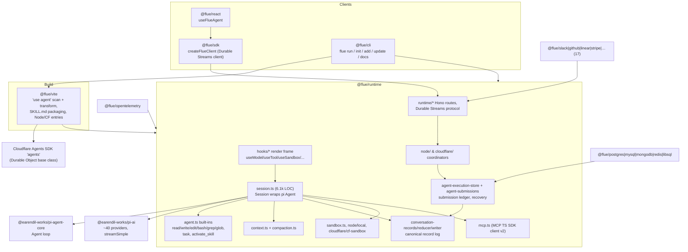

# Flue (Astro team)

> Flue is a durable, server-side **harness-library-plus-framework** for TypeScript agents. Its inner loop is not its own: every model turn runs inside `@earendil-works/pi-agent-core`'s `Agent` class, and every provider call goes through `@earendil-works/pi-ai`. Flue adds three things on top.
>
> 1. **Authoring model.** An agent is a synchronous, React-style *render function*. Hooks (`useModel`, `useTool`, `useSandbox`, `useSkill`, `useSubagent`, `usePersistentState`, …) compose the agent, and the function is re-rendered before every turn.
> 2. **Event-sourced conversation log.** The submission ledger and recovery state machine on top of it survive crashes, restarts and redeploys. This durability layer is the largest and most carefully engineered part of the codebase.
> 3. **Deployment shell.** A Vite plugin, a Hono route map, a Durable Streams HTTP protocol, and Node / Cloudflare Durable Object targets, plus 17 webhook "channel" packages and 5 database adapters.
>
> Flue is the right base for **long-lived, event-driven, headless agents that run as a service** (Slack/GitHub bots, support desks, CI agents) and need crash-safe conversations. It is a poor fit if you want an interactive coding CLI, a pluggable loop, or a small core to fork.

| | |
|---|---|
| Repo(s) | `withastro/flue` @ `deee93b40d27` (tag `v2.3.0`, commit date 2026-10-12) |
| License | Apache-2.0 ([`package.json:L5`](https://github.com/withastro/flue/blob/deee93b40d275ecc9a50c50af2158f20089d54bc/package.json#L5)) |
| Language(s) | TypeScript (ESM, Node ≥ 22.19 or workerd); docs site in Astro/MDX |
| Size | 961 tracked files. About 69k lines of non-test TS/TSX under `packages/`. `@flue/runtime` is 40,956 lines, split as: harness core ≈15.6k, durable log/ledger ≈6.6k, HTTP/coordination ≈9.7k, Cloudflare target ≈4.9k, `errors.ts` 1.45k. Other packages: `@flue/vite` 4.2k, `@flue/cli` 3.2k, `@flue/sdk` 2.9k, `@flue/react` 0.6k, `@flue/opentelemetry` 1.1k, 17 channel packages 8.2k, 5 DB adapters 7.4k. Non-package code: examples 6.7k TS, blueprints 12.9k lines of Markdown, docs and site ≈55.8k lines. Tests in the public tree: two React test files plus exported adapter contract suites (2.4k lines in `test-utils/`) |
| Version at pin | 2.3.0 for all packages (pi-ai / pi-agent-core `^1.1.0`) |
| Release history | Repo created 2026-02-07. Public launch by Fred K. Schott on X on **2026-05-01** (third-party: Firecrawl, 2026-06-21). 0.6.0 (2026-05-13). 0.8.0 (2026-05-27) introduced `createAgent`/`defineAgentProfile`/workflows. 1.0.0-beta.1 (2026-06-16). **2.0.0 (2026-07-31)** was a ground-up rewrite to the hooks API and Vite plugin, and removed workflows. 2.1.0 (09-18), 2.2.0 (09-28), 2.3.0 (10-12). GitHub Releases only go back to 2.0.7 (308 per-package releases). The latest published GitHub release is `@flue/cli@2.2.2`, but the pinned commit is tagged `v2.3.0`. |
| Category | `harness-library` (with `agent-framework`-grade deployment surface) |

> **Conflict flag: the focus notes and third-party write-ups are stale.** The task brief and Firecrawl's June 2026 comparison both describe `createAgent()`, `defineAgentProfile`, and workflows. Those APIs existed from 0.8.0 to the 1.0 betas. The 2.0.0 changelog lists them as deleted: "Deleted with the old model: `defineAgent`, `createAgent`, `defineAgentProfile` and `AgentProfile`" ([`CHANGELOG.md:L175`](https://github.com/withastro/flue/blob/deee93b40d275ecc9a50c50af2158f20089d54bc/CHANGELOG.md#L175)), and "Workflows are removed" ([`CHANGELOG.md:L174`](https://github.com/withastro/flue/blob/deee93b40d275ecc9a50c50af2158f20089d54bc/CHANGELOG.md#L174)). The term "connectors" in the brief maps to two things in today's tree: **channel** packages (webhook ingress) and **database adapter** packages. Sandbox "connectors" are now Markdown **blueprints**. `defineTool` survives unchanged in name.

---

## 1. Layering & package map



**What it builds on (the crucial dependency question).**
- `@flue/runtime` has only nine runtime dependencies ([`packages/runtime/package.json:L86-L96`](https://github.com/withastro/flue/blob/deee93b40d275ecc9a50c50af2158f20089d54bc/packages/runtime/package.json#L86-L96)):
  - `@earendil-works/pi-agent-core` and `@earendil-works/pi-ai` (both `^1.1.0`) — the loop and the provider layer;
  - `@modelcontextprotocol/client` `2.0.0` — MCP;
  - `hono` and `@hono/node-server` — HTTP;
  - `valibot` and `@valibot/to-json-schema` — schemas;
  - `js-yaml` (skill frontmatter) and `ulidx` (ids).
- There is no Vercel AI SDK dependency anywhere in the workspace. The public message projection is deliberately shaped like AI SDK `UIMessage` parts (`text`, `reasoning`, `data-<name>`, `file`, `dynamic-tool`) without importing it ([`conversation-projections.ts:L22-L37`](https://github.com/withastro/flue/blob/deee93b40d275ecc9a50c50af2158f20089d54bc/packages/runtime/src/conversation-projections.ts#L22-L37), [`L262-L265`](https://github.com/withastro/flue/blob/deee93b40d275ecc9a50c50af2158f20089d54bc/packages/runtime/src/conversation-projections.ts#L262-L265)).
- `AGENTS.md` names the turn as "one LLM round-trip inside pi-agent-core" ([`AGENTS.md:L22-L26`](https://github.com/withastro/flue/blob/deee93b40d275ecc9a50c50af2158f20089d54bc/AGENTS.md#L22-L26)) and says "The model layer is Pi's provider protocol, used directly" ([`AGENTS.md:L3`](https://github.com/withastro/flue/blob/deee93b40d275ecc9a50c50af2158f20089d54bc/AGENTS.md#L3)).
- `@flue/vite` ships the Cloudflare Agents SDK (`agents ^0.20.1`) as its own dependency ([`packages/vite/package.json:L37-L43`](https://github.com/withastro/flue/blob/deee93b40d275ecc9a50c50af2158f20089d54bc/packages/vite/package.json#L37-L43)). The generated Worker extends `Agent` from it, one Durable Object class per agent ([`cloudflare-entry.ts:L79-L86`](https://github.com/withastro/flue/blob/deee93b40d275ecc9a50c50af2158f20089d54bc/packages/vite/src/cloudflare-entry.ts#L79-L86)).
- `@flue/sdk` depends only on `@durable-streams/client` ([`packages/sdk/package.json:L29-L31`](https://github.com/withastro/flue/blob/deee93b40d275ecc9a50c50af2158f20089d54bc/packages/sdk/package.json#L29-L31)).
- Notably, Flue does **not** use Pi's own durable-execution package (`@earendil-works/pi-durable`, present in the Pi monorepo at [`packages/durable/package.json:L2`](https://github.com/earendil-works/pi/blob/b45e0ebcc5ae2fc42a6f2f23104d10e656e6bedb/packages/durable/package.json#L2)). Its durability is entirely home-grown.

**Ownership by layer.**

| Layer | Owns | Key files |
|---|---|---|
| Authoring (hooks) | Module-global render frame; validation; render-to-config mapping | `hooks/frame.ts`, `hooks/render.ts`, `hooks/use-*.ts` |
| Session | Wraps one pi `Agent`; tool wrapping; event→record persistence; retries; compaction; tasks | `session.ts` |
| Harness | Sandbox slot, session table, context discovery, child scopes | `harness.ts`, `context.ts` |
| Canonical log | 24 record types, reducer/fold, writer, projections | `conversation-*.ts` |
| Ledger/recovery | Submission rows, leases, attempts, settlement, joins | `agent-execution-store.ts`, `runtime/agent-submissions.ts`, `submission-state.ts` |
| Coordinators | Claim loop / heartbeat (Node); DO alarms + fibers (Cloudflare) | `node/agent-coordinator.ts`, `cloudflare/agent-coordinator.ts` |
| HTTP | Hono routers, Durable Streams reads, admission | `runtime/registration.ts`, `runtime/agent-routes.ts`, `runtime/handle-*.ts` |
| Build | `'use agent'` scan, identity binding, skill packaging, generated entries | `packages/vite/src/*` |

---

## 2. Agent loop

**Where it lives.** The loop is pi-agent-core's `Agent`. `Session`'s constructor instantiates it with Flue-specific settings ([`session.ts:L2276-L2302`](https://github.com/withastro/flue/blob/deee93b40d275ecc9a50c50af2158f20089d54bc/packages/runtime/src/session.ts#L2276-L2302)):

- `toolExecution: 'parallel'`;
- `steeringMode: 'all'` and `followUpMode: 'all'`, so everything steered at a boundary reaches the model together;
- `sessionId: this.affinityKey`;
- default `thinkingLevel: 'medium'`;
- `prepareNextTurnWithContext` wired to `prepareRerenderTurn` when the agent is a function agent.

Flue does **not** use pi's `beforeToolCall`/`afterToolCall`/`transformContext` options (no references in `session.ts`). Pi's corresponding hooks are visible at [`pi packages/agent/src/agent.ts:L113-L141`](https://github.com/earendil-works/pi/blob/b45e0ebcc5ae2fc42a6f2f23104d10e656e6bedb/packages/agent/src/agent.ts#L113-L141). Instead, Flue wraps every tool itself and drives the loop through `prompt()`/`continue()`/`waitForIdle()` from its own recovery wrapper.

**One submission, step by step.**

```
POST /agents/<name>/<id>  or  dispatch(Agent, {id, message})
   │  admission: validate DeliveredMessage, initialData; idempotencyKey dedupe
   ▼
ledger row  status=queued ──► coordinator claims (attemptId, 30 s lease)
   ▼
openAgentSubmissionSession: render agent fn → AgentRuntimeConfig
   → Harness: sandbox.createSandbox({id}), discoverSessionContext(AGENTS.md, skills),
     MCP resolve (cached per instance)
   ▼
useAgentStart callbacks (may ctx.append signals)
   ▼
┌─ pi Agent turn ────────────────────────────────────────────────────────────┐
│ streamFn = emitTurnRequestAndStream → interceptors → models.streamSimple() │
│ message_start/update/end → canonical records (deltas coalesced)            │
│ tool calls (parallel) → wrapModelTool → tool_outcome records               │
│ turn_end → tool_results_committed + usePersistentState writes (1 batch)    │
│          → applyQueuedJoins (dispatch-while-busy → steering queue)         │
│ prepareNextTurnWithContext → re-render fn → new tools + system prompt      │
│          → narrate resource deltas as `resources` signals                  │
└───────── loop while tool calls or steered messages ────────────────────────┘
   ▼
useAgentFinish cycles (≤32): append → back into loop; else settle
   ▼
checkCompaction → submission_settled record → ledger row settled
```

**Streaming and persistence.** Every pi event is converted into canonical records *before* it is published to observers ([`session.ts:L2354-L2507`](https://github.com/withastro/flue/blob/deee93b40d275ecc9a50c50af2158f20089d54bc/packages/runtime/src/session.ts#L2354-L2507)).
- Record sequence per assistant message: `assistant_message_started`, `assistant_text_started` / `_delta` / `_completed`, `assistant_reasoning_*` (keeping `thinkingSignature` as `encrypted` and the `redacted` flag), then `assistant_tool_call`.
- Text deltas go through `enqueueCanonical(records, publish)` and are coalesced. The changelog notes the first delta after a quiet period flushes immediately ([`CHANGELOG.md:L97`](https://github.com/withastro/flue/blob/deee93b40d275ecc9a50c50af2158f20089d54bc/CHANGELOG.md#L97)).
- `toolcall_delta` is the one deliberate exception: it is emitted for live preview but never persisted ([`session.ts:L2491-L2506`](https://github.com/withastro/flue/blob/deee93b40d275ecc9a50c50af2158f20089d54bc/packages/runtime/src/session.ts#L2491-L2506)).

**Tool batch commit.** Each tool result is written as a `tool_outcome` record at `tool_execution_end`, keyed deterministically by `(assistantMessageId, toolCallId)` and carrying pi's monotonic `durationMs` and the `terminate` flag ([`session.ts:L2590-L2665`](https://github.com/withastro/flue/blob/deee93b40d275ecc9a50c50af2158f20089d54bc/packages/runtime/src/session.ts#L2590-L2665)). At `turn_end`, a single append writes three things together: drained `usePersistentState` writes, a `tool_results_committed` marker listing the outcome ids, and then queued joins are applied ([`session.ts:L2667-L2746`](https://github.com/withastro/flue/blob/deee93b40d275ecc9a50c50af2158f20089d54bc/packages/runtime/src/session.ts#L2667-L2746)). This batch is the durability unit: state written by a tool is durable exactly when its batch is.

**Re-render per turn.** `prepareRerenderTurn` runs the following steps before the next provider request ([`session.ts:L939-L1004`](https://github.com/withastro/flue/blob/deee93b40d275ecc9a50c50af2158f20089d54bc/packages/runtime/src/session.ts#L939-L1004)):
1. Re-invokes the agent function.
2. Swaps the sandbox if `useSandbox()` presence flipped.
3. Rebuilds the tool list under any active per-call overrides.
4. Rewrites the leading system message. Pi derives `systemPrompt` from it ([`session.ts:L1012-L1022`](https://github.com/withastro/flue/blob/deee93b40d275ecc9a50c50af2158f20089d54bc/packages/runtime/src/session.ts#L1012-L1022)).
5. Narrates changes as a `resources` signal (or one `environment` snapshot on a swap).
6. Returns `{ context: { messages, tools } }` to pi.

**Stop conditions.**
- The model ends without tool calls (pi's normal termination).
- A tool batch in which every result has `terminate: true`; the built-in `finish`/`give_up` result tools use the same contract ([`result.ts:L12-L14`](https://github.com/withastro/flue/blob/deee93b40d275ecc9a50c50af2158f20089d54bc/packages/runtime/src/result.ts#L12-L14)).
- Abort, either through the signal or a durable `abortRequestedAt`.
- Durability timeout, checked cooperatively by `throwIfHalted` before each turn and before recovery work.
- The fixed `MAX_AGENT_FINISH_CYCLES = 32` ceiling on `useAgentFinish` continuations ([`session.ts:L247-L257`](https://github.com/withastro/flue/blob/deee93b40d275ecc9a50c50af2158f20089d54bc/packages/runtime/src/session.ts#L247-L257)).

**Retries and error recovery.** `runModelTurnWithRecovery` is a `while (true)` state machine around `start()` and `agentLoop.waitForIdle()` ([`session.ts:L4958-L5090`](https://github.com/withastro/flue/blob/deee93b40d275ecc9a50c50af2158f20089d54bc/packages/runtime/src/session.ts#L4958-L5090)).
- **Context overflow:** detected via pi-ai's `isContextOverflow` plus a Workers AI marker. It triggers *one* `runCompaction('overflow')`, and the turn is retried only if the assistant had `stopReason === 'error'`.
- **Transient errors:** classified by a sentinel marker or a regex over the error text (`overloaded|rate.?limit|429|5xx|fetch failed|timeout|…|provider finish_reason: error`) ([`submission-state.ts:L437-L456`](https://github.com/withastro/flue/blob/deee93b40d275ecc9a50c50af2158f20089d54bc/packages/runtime/src/submission-state.ts#L437-L456)). They are retried up to `MAX_TRANSIENT_MODEL_RETRIES = 3` *consecutive* errors, counted from the durable history rather than in memory. That way a restart computes the same budget.
- **Backoff:** `2000 ms · 2^(n-1)` with 0.75–1.0 jitter ([`session.ts:L672-L675`](https://github.com/withastro/flue/blob/deee93b40d275ecc9a50c50af2158f20089d54bc/packages/runtime/src/session.ts#L672-L675)).
- After any error or abort, the in-memory pi transcript is rebuilt from the canonical log (`rebuildCanonicalContext`). **The durable log, not pi's in-memory state, is the source of truth.**

**Steering and interrupts.** There is no mid-turn user interrupt besides abort. Messages that arrive while a response is running are *joined* at the next turn boundary instead of queuing behind it: `applyQueuedJoins` claims queued dispatches and steers them into pi's steering queue ([`session.ts:L1736-L1746`](https://github.com/withastro/flue/blob/deee93b40d275ecc9a50c50af2158f20089d54bc/packages/runtime/src/session.ts#L1736-L1746)). The joined submission settles together with its host, and settlements expose `answeredBySubmissionId`.

**Parallel tools.** Pi executes a batch in parallel. Flue adds per-path mutation locks for `write`/`edit` so same-file edits in one batch serialize in dispatch order, while `bash` stays unsynchronized ([`agent.ts:L119-L169`](https://github.com/withastro/flue/blob/deee93b40d275ecc9a50c50af2158f20089d54bc/packages/runtime/src/agent.ts#L119-L169)). A signal-deaf tool cannot wedge a turn: `abandonToolOnAbort` rejects one macrotask after abort and orphans the promise ([`abort.ts:L121-L186`](https://github.com/withastro/flue/blob/deee93b40d275ecc9a50c50af2158f20089d54bc/packages/runtime/src/abort.ts#L121-L186)).

---

## 3. Model / provider abstraction

**Provider layer = pi-ai, used directly.**
- The runtime holds one module-global pi-ai `MutableModels` instance. `setProvider(provider)` registers any pi `Provider` object, replacing one with the same id ([`runtime/providers.ts:L14-L33`](https://github.com/withastro/flue/blob/deee93b40d275ecc9a50c50af2158f20089d54bc/packages/runtime/src/runtime/providers.ts#L14-L33)).
- By default every pi built-in is registered through `builtinProviders()` from `@earendil-works/pi-ai/providers/all` ([`runtime/builtin-providers.ts:L8-L19`](https://github.com/withastro/flue/blob/deee93b40d275ecc9a50c50af2158f20089d54bc/packages/runtime/src/runtime/builtin-providers.ts#L8-L19)). A `providers` list in `flue.config.ts` narrows that set to named modules, validated by `registerBuiltinProviderModule` ([`runtime/providers.ts:L59-L81`](https://github.com/withastro/flue/blob/deee93b40d275ecc9a50c50af2158f20089d54bc/packages/runtime/src/runtime/providers.ts#L59-L81)).
- At the Pi pin in this study, `pi-ai` ships about 40 provider modules: Anthropic, OpenAI, Azure, Bedrock, Google/Vertex, Mistral, xAI, Groq, DeepSeek, OpenRouter, Fireworks, Together, Cerebras, Moonshot, Qwen, Z.ai, MiniMax, Vercel AI Gateway, Cloudflare AI Gateway / Workers AI, GitHub Copilot, and others ([`pi packages/ai/src/providers/`](https://github.com/earendil-works/pi/tree/b45e0ebcc5ae2fc42a6f2f23104d10e656e6bedb/packages/ai/src/providers)).
- Model specifiers are `provider/model-id` strings passed to `useModel()` ([`hooks/use-model.ts:L33-L63`](https://github.com/withastro/flue/blob/deee93b40d275ecc9a50c50af2158f20089d54bc/packages/runtime/src/hooks/use-model.ts#L33-L63)).
- Pi upgrades flow straight through to users. The 2.3.0 changelog forces Azure users to rename `azure-openai-responses/…` to `azure/…` because Pi renamed the provider ([`CHANGELOG.md:L7`](https://github.com/withastro/flue/blob/deee93b40d275ecc9a50c50af2158f20089d54bc/CHANGELOG.md#L7)).

**Flue's own provider code.** The single substantial exception is `cloudflare/workers-ai-provider.ts` (1,491 LOC). It is a pi-ai `Provider` that talks to the Workers AI binding (`env.AI.run`) and Cloudflare AI Gateway. It speaks:
- the Anthropic Messages dialect, with opt-in `cacheRetention` that emits `cache_control`;
- the OpenAI Responses dialect, with `prompt_cache_key` derived from `sessionId` ([`workers-ai-provider.ts:L911`](https://github.com/withastro/flue/blob/deee93b40d275ecc9a50c50af2158f20089d54bc/packages/runtime/src/cloudflare/workers-ai-provider.ts#L911));
- chat-completions for everything else.

The generated Cloudflare entry installs it as the `cloudflare` provider unless the user registered one ([`cloudflare-entry.ts:L137-L146`](https://github.com/withastro/flue/blob/deee93b40d275ecc9a50c50af2158f20089d54bc/packages/vite/src/cloudflare-entry.ts#L137-L146)). Models synthesized from a dynamic template report `$0` cost, and the runtime warns once (`isDynamicModel()`).

**Message model.** Three layers:
1. pi-ai `Message` (`UserMessage | AssistantMessage | ToolResultMessage`) inside the live pi `Agent`.
2. Flue's **canonical record log**, the durable truth.
3. A **public projection** (`FlueConversationMessage` with UIMessage-style parts, `purpose`, `display`, `turnId`, `settlement`).

The reducer rebuilds pi messages from records (`buildConversationContext`). Every assistant step of a submission folds into one public message ([`conversation-projections.ts:L262-L265`](https://github.com/withastro/flue/blob/deee93b40d275ecc9a50c50af2158f20089d54bc/packages/runtime/src/conversation-projections.ts#L262-L265)).

**Reasoning.**
- `thinkingLevel` is set per agent (`useModel(..., { thinkingLevel })`), per subagent, or per call; the default is `'medium'`.
- Thinking blocks are persisted with their signatures as `encrypted` and the `redacted` flag ([`session.ts:L2450-L2474`](https://github.com/withastro/flue/blob/deee93b40d275ecc9a50c50af2158f20089d54bc/packages/runtime/src/session.ts#L2450-L2474)), so replay after recovery can return signed thinking to Anthropic.
- Gemini `thoughtSignature` on tool calls is preserved as well ([`session.ts:L2475-L2490`](https://github.com/withastro/flue/blob/deee93b40d275ecc9a50c50af2158f20089d54bc/packages/runtime/src/session.ts#L2475-L2490)).

**Prompt caching** is delegated to pi-ai providers. Flue's contribution is architectural: it keeps the cacheable prefix stable.
- The `task` tool's schema is fully static. Its `agent` field is a plain string, not an enum, "so the serialized tools block never changes" ([`agent.ts:L387-L421`](https://github.com/withastro/flue/blob/deee93b40d275ecc9a50c50af2158f20089d54bc/packages/runtime/src/agent.ts#L387-L421)).
- `activate_skill` takes a string name for the same reason ([`agent.ts:L423-L457`](https://github.com/withastro/flue/blob/deee93b40d275ecc9a50c50af2158f20089d54bc/packages/runtime/src/agent.ts#L423-L457)).
- The skill and agent catalogs in the system prompt are *baseline snapshots*, re-cut only at compaction ([`context.ts:L235-L252`](https://github.com/withastro/flue/blob/deee93b40d275ecc9a50c50af2158f20089d54bc/packages/runtime/src/context.ts#L235-L252)). Mid-window changes arrive as appended `resources` signals rather than prefix rewrites.

**Token and cost accounting.** pi-ai `Usage` (input/output/cacheRead/cacheWrite plus a cost breakdown) is normalized into `PromptUsage` and summed field-wise across steps, compaction calls and retries ([`usage.ts:L15-L45`](https://github.com/withastro/flue/blob/deee93b40d275ecc9a50c50af2158f20089d54bc/packages/runtime/src/usage.ts#L15-L45)). Compaction usage is persisted on the `compaction` record, so the triggering call reports its true cost.

**Documents.** PDFs ride pi's image carrier. `prepareDocumentRequest` rewrites them per API into Anthropic `document` blocks, OpenAI `input_file` parts or Google `inlineData`, and uses a text placeholder elsewhere ([`session.ts:L856-L873`](https://github.com/withastro/flue/blob/deee93b40d275ecc9a50c50af2158f20089d54bc/packages/runtime/src/session.ts#L856-L873)).

---

## 4. Tool system

**Definition API.** `defineTool({ name, description, input?, output?, harness?, durable?, timeoutMs?, annotations?, run })` takes Valibot schemas, converted to JSON Schema with `@valibot/to-json-schema` ([`tool.ts:L21`](https://github.com/withastro/flue/blob/deee93b40d275ecc9a50c50af2158f20089d54bc/packages/runtime/src/tool.ts#L21), [`tool-types.ts:L106-L160`](https://github.com/withastro/flue/blob/deee93b40d275ecc9a50c50af2158f20089d54bc/packages/runtime/src/tool-types.ts#L106-L160)).
- `ToolContext` is typed by the flags: `{ data, toolCallId, log, signal }`, plus `harness` when `harness: true`, plus `step` when `durable: true` ([`tool-types.ts:L35-L65`](https://github.com/withastro/flue/blob/deee93b40d275ecc9a50c50af2158f20089d54bc/packages/runtime/src/tool-types.ts#L35-L65)).
- `run()` must return an envelope `{ output?, terminate? }`. A bare non-string value is rejected ([`tool.ts:L234-L292`](https://github.com/withastro/flue/blob/deee93b40d275ecc9a50c50af2158f20089d54bc/packages/runtime/src/tool.ts#L234-L292)).
- Tools mount per render via `useTool()` ([`hooks/use-tool.ts:L23-L69`](https://github.com/withastro/flue/blob/deee93b40d275ecc9a50c50af2158f20089d54bc/packages/runtime/src/hooks/use-tool.ts#L23-L69)). They can be conditional on state, and the change is narrated to the model.

**Execution pipeline** (`createCustomTools` → `wrapModelTool`):
1. Validate input against the Valibot schema (`parseToolInput`).
2. Compose `timeoutMs` into the signal.
3. Materialize a scoped `harness` if requested. It is depth-counted against `MAX_DELEGATION_DEPTH = 4`, and harness-tool lineage blocks recursion ([`session.ts:L4031-L4083`](https://github.com/withastro/flue/blob/deee93b40d275ecc9a50c50af2158f20089d54bc/packages/runtime/src/session.ts#L4031-L4083)).
4. Run under `raceToolWithDeadline`.
5. Validate and serialize `output` to JSON text for the model ([`session.ts:L4085-L4186`](https://github.com/withastro/flue/blob/deee93b40d275ecc9a50c50af2158f20089d54bc/packages/runtime/src/session.ts#L4085-L4186)).

Every model-facing tool, built-in or custom, passes through `wrapModelTool`. It emits `tool_start`, routes execution through the registered **execution interceptors** (`{type:'tool', toolCallId, toolName}`), and applies abandon-on-abort ([`session.ts:L3899-L3971`](https://github.com/withastro/flue/blob/deee93b40d275ecc9a50c50af2158f20089d54bc/packages/runtime/src/session.ts#L3899-L3971)).

**Tool groups and name reservation.** `assembleModelTools` concatenates four groups: `builtin | adapter`, `framework`, `custom`, and `result`. It fails on duplicates and on custom use of the reserved names `task`, `activate_skill`, `read_skill_resource`, `finish` and `give_up` ([`session.ts:L4188-L4250`](https://github.com/withastro/flue/blob/deee93b40d275ecc9a50c50af2158f20089d54bc/packages/runtime/src/session.ts#L4188-L4250)).

**Built-ins.** A sandbox-backed set exists *only if* the agent declares a sandbox ([`session.ts:L4252-L4326`](https://github.com/withastro/flue/blob/deee93b40d275ecc9a50c50af2158f20089d54bc/packages/runtime/src/session.ts#L4252-L4326)). A sandbox adapter may replace the entire set through `SandboxFactory.tools` ([`types.ts:L1015-L1041`](https://github.com/withastro/flue/blob/deee93b40d275ecc9a50c50af2158f20089d54bc/packages/runtime/src/types.ts#L1015-L1041)), for example a codemode `code` tool instead of `bash`.

| Tool | Notes / limits |
|---|---|
| `read` | 2,000 lines / 50 KB head-truncation with an `offset=` continuation hint ([`agent.ts:L7-L13`](https://github.com/withastro/flue/blob/deee93b40d275ecc9a50c50af2158f20089d54bc/packages/runtime/src/agent.ts#L7-L13), [`L666-L697`](https://github.com/withastro/flue/blob/deee93b40d275ecc9a50c50af2158f20089d54bc/packages/runtime/src/agent.ts#L666-L697)) |
| `write` / `edit` | Per-path mutation lock; `edit` requires a unique match unless `replaceAll`; function replacer avoids `$&` injection |
| `bash` | Model passes `timeout` in seconds. Timeout becomes a recoverable exit code `124`; a host abort rethrows. Output is tail-truncated to 2,000 lines / 50 KB ([`agent.ts:L287-L351`](https://github.com/withastro/flue/blob/deee93b40d275ecc9a50c50af2158f20089d54bc/packages/runtime/src/agent.ts#L287-L351)) |
| `grep` | Probes `rg --version` once per sandbox exec function (10 s exec timeout plus a 15 s host race), falls back to `grep -rnH`; max 100 matches, 500 chars per line ([`agent.ts:L492-L578`](https://github.com/withastro/flue/blob/deee93b40d275ecc9a50c50af2158f20089d54bc/packages/runtime/src/agent.ts#L492-L578)) |
| `glob` | `find -name … \| head -1000` |
| `task` | Always present, static schema (§9) |
| `activate_skill`, `read_skill_resource` | Present when skills or packaged resources exist (§8) |
| `finish` / `give_up` | Injected only for `prompt(..., { result: schema })` structured-output calls |

**Output truncation** is per tool only. There is no spill-to-disk of oversized results. Large tool-result images and attachments are stored as attachment records and referenced by id.

**Approvals.** None built in. The docs state it plainly: "Flue has no built-in approval API" ([`apps/docs/.../guide/tools.md:L230`](https://github.com/withastro/flue/blob/deee93b40d275ecc9a50c50af2158f20089d54bc/apps/docs/src/content/docs/guide/tools.md#L230)). The documented pattern has four steps:
1. A tool stores its arguments in `usePersistentState` keyed by `toolCallId`.
2. It returns `terminate: true`.
3. A trusted route later dispatches the decision as a signal.
4. A `useAgentStart` callback executes the stored call.

MCP `annotations` (`destructiveHint`, …) are carried through but "the runtime ignores the field" ([`hooks/use-tool.ts:L52-L57`](https://github.com/withastro/flue/blob/deee93b40d275ecc9a50c50af2158f20089d54bc/packages/runtime/src/hooks/use-tool.ts#L52-L57)).

---

## 5. Context management

**System prompt assembly.** The prompt is composed in this order ([`context.ts:L132-L202`](https://github.com/withastro/flue/blob/deee93b40d275ecc9a50c50af2158f20089d54bc/packages/runtime/src/context.ts#L132-L202)):
1. The agent's instruction document: the render function's return string followed by `useInstruction()` texts, joined with blank lines ([`hooks/render.ts:L221-L225`](https://github.com/withastro/flue/blob/deee93b40d275ecc9a50c50af2158f20089d54bc/packages/runtime/src/hooks/render.ts#L221-L225)).
2. Contents of `AGENTS.md` and `CLAUDE.md` read from the sandbox `cwd`.
3. `## Available Skills` with the `activate_skill` instruction.
4. `## Available Agents`, or an explicit "None … do not call it".
5. `Date:`, `Working directory:`, and a top-level directory listing.

The code comment is explicit: "Flue adds no behavioral stance of its own (an autonomy preamble used to live here)". Without a sandbox, nothing is discovered and the prompt carries no workspace facts.

**Project instruction files.** `readAgentsMd` reads only `<cwd>/AGENTS.md` and `<cwd>/CLAUDE.md` and concatenates them ([`context.ts:L19-L32`](https://github.com/withastro/flue/blob/deee93b40d275ecc9a50c50af2158f20089d54bc/packages/runtime/src/context.ts#L19-L32)). There is no hierarchical walk up parent directories and no `~/.config` layering, unlike Codex, Claude Code or OpenCode. Workspace skills are discovered from `<cwd>/.agents/skills/*/SKILL.md`. Malformed workspace skills are skipped with a warning; imported skills are validated strictly at build time ([`context.ts:L54-L98`](https://github.com/withastro/flue/blob/deee93b40d275ecc9a50c50af2158f20089d54bc/packages/runtime/src/context.ts#L54-L98)).

**Compaction.** `compaction.ts` (754 LOC) is structurally a port of Pi coding-agent's compaction module. It shares function and prompt names such as `findValidCutPoints`, `TURN_PREFIX_SUMMARIZATION_PROMPT` and split-turn handling with [`pi packages/coding-agent/src/core/compaction/compaction.ts:L394`](https://github.com/earendil-works/pi/blob/b45e0ebcc5ae2fc42a6f2f23104d10e656e6bedb/packages/coding-agent/src/core/compaction/compaction.ts#L394). It is rewritten to run over Flue's canonical entries rather than Pi `SessionEntry`s. (Port lineage is an inference from structure; no attribution comment was found.)

- **Triggers.** Three modes:
  - **Threshold**, after each settled turn: `contextTokens > contextWindow − reserveTokens` ([`compaction.ts:L172-L181`](https://github.com/withastro/flue/blob/deee93b40d275ecc9a50c50af2158f20089d54bc/packages/runtime/src/compaction.ts#L172-L181), [`session.ts:L5121-L5141`](https://github.com/withastro/flue/blob/deee93b40d275ecc9a50c50af2158f20089d54bc/packages/runtime/src/session.ts#L5121-L5141)).
  - **Overflow**, on a provider overflow error, with one retry.
  - **Manual**, via `harness.compact()` / `session.compact()`.
- **Defaults.** `reserveTokens = min(20000, model.maxTokens)`, clamped to a third of the window for small models; `keepRecentTokens = 8000` ([`compaction.ts:L39-L76`](https://github.com/withastro/flue/blob/deee93b40d275ecc9a50c50af2158f20089d54bc/packages/runtime/src/compaction.ts#L39-L76)). The settings are overridable through `useModel(…, { compaction })`, including a separate summarization `model`.
- **Algorithm.**
  1. Find a valid cut point that never splits a tool call from its result.
  2. Serialize older messages, with tool results truncated to 2,000 chars.
  3. Summarize into a fixed Markdown checkpoint (Goal / Constraints / Progress / Key Decisions / Next Steps / Critical Context) ([`compaction.ts:L304-L338`](https://github.com/withastro/flue/blob/deee93b40d275ecc9a50c50af2158f20089d54bc/packages/runtime/src/compaction.ts#L304-L338)). Later compactions use an incremental *update* prompt over `<previous-summary>`.
  4. If the cut lands mid-turn, summarize history and the turn prefix in parallel ([`compaction.ts:L659-L700`](https://github.com/withastro/flue/blob/deee93b40d275ecc9a50c50af2158f20089d54bc/packages/runtime/src/compaction.ts#L659-L700)).
  5. Track read and modified file paths and append them to the summary.
- **Persistence.** `runCompaction` appends a `compaction` record (`summary`, `firstKeptEntryId`, `sourceLeafId`, `tokensBefore`, `usage`) in the same batch as a new baseline `resource_snapshot`. It then rebuilds the pi context and re-cuts the frozen catalogs ([`session.ts:L5149-L5328`](https://github.com/withastro/flue/blob/deee93b40d275ecc9a50c50af2158f20089d54bc/packages/runtime/src/session.ts#L5149-L5328)). Compaction is the *only* point at which the system prompt prefix is re-baselined, which is the design that keeps prompt caches warm.

**Memory.** `usePersistentState(name, default)` is durable per-instance key/value state stored as `state_write` records in the conversation log. Writes from a tool commit atomically with that tool batch ([`hooks/use-persistent-state.ts:L111-L150`](https://github.com/withastro/flue/blob/deee93b40d275ecc9a50c50af2158f20089d54bc/packages/runtime/src/hooks/use-persistent-state.ts#L111-L150)). There is no semantic or vector memory, and no cross-conversation memory store.

---

## 6. State, sessions & durability

This is Flue's center of gravity.

**Units of state.** An agent instance (URL `<id>`) owns one root conversation stream at `agentStreamPath(agentName, id)`. The hierarchy below it is Harness → Session → Operation → Turn ([`AGENTS.md:L15-L27`](https://github.com/withastro/flue/blob/deee93b40d275ecc9a50c50af2158f20089d54bc/AGENTS.md#L15-L27)). Task and harness-tool child sessions get their own conversations, linked by `child_session_retained` records.

**Canonical log.** The log is an append-only stream of **24 record types**: `conversation_created`, `user_message`, `signal`, the `assistant_*` streaming family, `tool_outcome`, `tool_results_committed`, `compaction`, `child_session_retained`, `submission_settled`, `state_write`, `agent_start_run`, `agent_finish_cycle`, `message_data_write`, `message_metadata`, `tool_step_settled`, and `resource_snapshot` ([`conversation-records.ts:L441-L465`](https://github.com/withastro/flue/blob/deee93b40d275ecc9a50c50af2158f20089d54bc/packages/runtime/src/conversation-records.ts#L441-L465)). Entries carry a `parentId`, and the reducer follows an active leaf path. However, there is **no public fork or branch API**: the tree exists for compaction and repair, not for user branching.

**Store contract.** `ConversationStreamStore.append` must be atomic per batch and is fenced by `producerId`/`producerEpoch`/`incarnation` plus the submission's `attemptId` ([`runtime/conversation-stream-store.ts:L63-L113`](https://github.com/withastro/flue/blob/deee93b40d275ecc9a50c50af2158f20089d54bc/packages/runtime/src/runtime/conversation-stream-store.ts#L63-L113)). Optional fold checkpoints bound cold-start replay cost.

**Persistence adapters.** A `PersistenceAdapter` bundles `submissionStore`, `conversationStreamStore` and `attachmentStore`, with `migrate()` and a mandatory `format_version` check ([`agent-execution-store.ts:L388-L439`](https://github.com/withastro/flue/blob/deee93b40d275ecc9a50c50af2158f20089d54bc/packages/runtime/src/agent-execution-store.ts#L388-L439)).
- One SQL implementation serves both targets. Node adapts `node:sqlite`'s `DatabaseSync` to the Cloudflare `SqlStorage` interface ([`node/agent-execution-store.ts:L25-L62`](https://github.com/withastro/flue/blob/deee93b40d275ecc9a50c50af2158f20089d54bc/packages/runtime/src/node/agent-execution-store.ts#L25-L62)).
- First-party adapter packages exist for Postgres, MySQL, MongoDB, Redis/Valkey and libSQL/Turso. Supabase is covered by a blueprint.
- `flue run` defaults to `node_modules/.cache/flue/run.db`, so `--id` continues a conversation across CLI invocations ([`cli/src/lib/run-local.ts:L85`](https://github.com/withastro/flue/blob/deee93b40d275ecc9a50c50af2158f20089d54bc/packages/cli/src/lib/run-local.ts#L85)).
- `start()` defaults to in-memory storage.
- Format version 1 refuses to open stores written by the 1.0 betas ([`CHANGELOG.md:L201`](https://github.com/withastro/flue/blob/deee93b40d275ecc9a50c50af2158f20089d54bc/CHANGELOG.md#L201)).

**Submission ledger.**
- `AgentSubmission` rows move through `queued → running → (terminalizing →) settled`, plus `joining`/`joined` for dispatch-while-busy ([`agent-execution-store.ts:L27-L106`](https://github.com/withastro/flue/blob/deee93b40d275ecc9a50c50af2158f20089d54bc/packages/runtime/src/agent-execution-store.ts#L27-L106)).
- Defaults: `maxAttempts = 10`, `timeoutMs = 1 h`, `LEASE_DURATION_MS = 30 s` ([`agent-execution-store.ts:L18-L23`](https://github.com/withastro/flue/blob/deee93b40d275ecc9a50c50af2158f20089d54bc/packages/runtime/src/agent-execution-store.ts#L18-L23)). They can be overridden per agent with the `durability` static ([`types.ts:L432-L450`](https://github.com/withastro/flue/blob/deee93b40d275ecc9a50c50af2158f20089d54bc/packages/runtime/src/types.ts#L432-L450)).
- The contract comment sets a "one truth per fact" rule: the stream's `submission_settled` record is authoritative, ledger status is a cache of it, and leases and attempt ids are "lossy, never history".

**Recovery decision tree.** `reconcileInterruptedSubmission` handles an interrupted submission as follows ([`runtime/agent-submissions.ts:L489-L705`](https://github.com/withastro/flue/blob/deee93b40d275ecc9a50c50af2158f20089d54bc/packages/runtime/src/runtime/agent-submissions.ts#L489-L705)):
1. It first inspects the canonical stream.
2. A completed response settles as success, *even if the budget is exhausted*.
3. A durable abort intent settles as aborted.
4. An exhausted budget fails with `SubmissionRetryExhaustedError`, or an "interrupted before input" variant.
5. An expired timeout fails as timed out.
6. Otherwise, if the input is present, a fencing CAS acquires a replacement attempt; if the input is absent, the submission is requeued.

On resume:
- `materializeGhostStream` turns any half-written assistant into an aborted entry. A partial with content is upgraded to a continuation.
- `repairTrailingPartialToolBatch` writes explicit **unknown-outcome errors** for unexecuted or in-flight ordinary tool calls and **never re-executes them** ([`session.ts:L2842-L2870`](https://github.com/withastro/flue/blob/deee93b40d275ecc9a50c50af2158f20089d54bc/packages/runtime/src/session.ts#L2842-L2870)).
- Two kinds of calls re-run instead. **`durable: true` tools** are re-executed with `step.do(name, fn)` replaying memoized `tool_step_settled` records ([`session.ts:L3993-L4019`](https://github.com/withastro/flue/blob/deee93b40d275ecc9a50c50af2158f20089d54bc/packages/runtime/src/session.ts#L3993-L4019)). **In-flight `task` children** resume from their own transcripts.

A `step.do` body executes before its result record is appended. A crash after the external effect but before that append can repeat the effect on recovery; callers need downstream idempotency keys or reconciliation. This follows directly from [`session.ts:L3993-L4019`](https://github.com/withastro/flue/blob/deee93b40d275ecc9a50c50af2158f20089d54bc/packages/runtime/src/session.ts#L3993-L4019). The documented guarantee is "at-least-once execution over exactly-once recording" ([`guide/durability.md:L39`](https://github.com/withastro/flue/blob/deee93b40d275ecc9a50c50af2158f20089d54bc/apps/docs/src/content/docs/guide/durability.md#L39)).

**Ownership per target.**
- **Node.** An in-process coordinator heartbeats leases every 10 s and scans for expired leases every 15 s ([`node/agent-coordinator.ts:L523-L563`](https://github.com/withastro/flue/blob/deee93b40d275ecc9a50c50af2158f20089d54bc/packages/runtime/src/node/agent-coordinator.ts#L523-L563)). Startup reconciliation requeues interrupted work ahead of new work. Multi-replica Node is explicitly unsafe without per-conversation routing. The code carries a `TODO(multi-process)` acknowledging a bounded advisory-ordering hazard ([`runtime/agent-submissions.ts:L645-L676`](https://github.com/withastro/flue/blob/deee93b40d275ecc9a50c50af2158f20089d54bc/packages/runtime/src/runtime/agent-submissions.ts#L645-L676)).
- **Cloudflare.** One Durable Object per conversation makes ownership structural. Recovery is wake-driven: `onStart`, the Agents SDK's `onFiberRecovered`, and a self-renewing 30 s `schedule()` backstop on the `__flueWakeAgentSubmissions` callback, with a 60 s settle grace ([`cloudflare/agent-coordinator.ts:L61-L74`](https://github.com/withastro/flue/blob/deee93b40d275ecc9a50c50af2158f20089d54bc/packages/runtime/src/cloudflare/agent-coordinator.ts#L61-L74), [`L595-L611`](https://github.com/withastro/flue/blob/deee93b40d275ecc9a50c50af2158f20089d54bc/packages/runtime/src/cloudflare/agent-coordinator.ts#L595-L611)).

**Idempotency and clients.**
- `idempotencyKey` on `dispatch`, HTTP POST and `send` makes redelivered webhooks converge on one submission.
- `init(agent, {id}).dispatch()` returns a `DispatchReceipt`. `read(receipt)` re-attaches from *any* process ([`agent-client.ts:L126-L183`](https://github.com/withastro/flue/blob/deee93b40d275ecc9a50c50af2158f20089d54bc/packages/runtime/src/agent-client.ts#L126-L183)).

**What is not durable.** Sandbox filesystems (the virtual sandbox is rebuilt per initialization), local awaiting promises, and code outside the agent.

---

## 7. Safety & sandboxing

**Sandboxes are opt-in capabilities, not a security policy.**
- An agent without `useSandbox()` has no filesystem or shell tools at all ([`hooks/use-sandbox.ts:L50-L90`](https://github.com/withastro/flue/blob/deee93b40d275ecc9a50c50af2158f20089d54bc/packages/runtime/src/hooks/use-sandbox.ts#L50-L90)).
- Subagents cannot declare their own sandbox; they share the parent's.
- The `Sandbox` contract is 10 verbs plus `cwd`/`resolvePath` ([`types.ts:L285-L337`](https://github.com/withastro/flue/blob/deee93b40d275ecc9a50c50af2158f20089d54bc/packages/runtime/src/types.ts#L285-L337)). Adapters implement a 9-method `SandboxDriver` wrapped by `sandboxFromDriver` ([`sandbox.ts:L348-L379`](https://github.com/withastro/flue/blob/deee93b40d275ecc9a50c50af2158f20089d54bc/packages/runtime/src/sandbox.ts#L348-L379)).

| Implementation | Where | Isolation |
|---|---|---|
| `local()` | `@flue/runtime/node` ([`node/local.ts:L18-L22`](https://github.com/withastro/flue/blob/deee93b40d275ecc9a50c50af2158f20089d54bc/packages/runtime/src/node/local.ts#L18-L22)) | **None by design.** Host FS and `child_process.spawn` in its own process group, SIGTERM→SIGKILL after 2 s ([`node/local-env.ts:L19-L20`](https://github.com/withastro/flue/blob/deee93b40d275ecc9a50c50af2158f20089d54bc/packages/runtime/src/node/local-env.ts#L19-L20), [`L80-L100`](https://github.com/withastro/flue/blob/deee93b40d275ecc9a50c50af2158f20089d54bc/packages/runtime/src/node/local-env.ts#L80-L100)). Environment is an **allowlist** (PATH, HOME, USER, LANG, TMPDIR…). Secrets must be passed explicitly via `env` ([`node/local-env.ts:L163-L200`](https://github.com/withastro/flue/blob/deee93b40d275ecc9a50c50af2158f20089d54bc/packages/runtime/src/node/local-env.ts#L163-L200)) |
| `bash(() => new Bash({fs}))` | Root export ([`sandbox.ts:L226`](https://github.com/withastro/flue/blob/deee93b40d275ecc9a50c50af2158f20089d54bc/packages/runtime/src/sandbox.ts#L226)) over a structural `BashLike` ([`types.ts:L1047-L1070`](https://github.com/withastro/flue/blob/deee93b40d275ecc9a50c50af2158f20089d54bc/packages/runtime/src/types.ts#L1047-L1070)) | Vercel Labs' `just-bash`, an in-process bash *emulator* over `InMemoryFs`. The user installs it. Network is opt-in via `allowedUrlPrefixes` or `dangerouslyAllowFullInternetAccess` |
| `cloudflareSandbox(getSandbox(...))` | `@flue/runtime/cloudflare` ([`cloudflare/cf-sandbox.ts:L58`](https://github.com/withastro/flue/blob/deee93b40d275ecc9a50c50af2158f20089d54bc/packages/runtime/src/cloudflare/cf-sandbox.ts#L58)) | Cloudflare Containers. Death detector polls DO state every 5 s and rejects with `SandboxDiedError` ([`cf-sandbox.ts:L73`](https://github.com/withastro/flue/blob/deee93b40d275ecc9a50c50af2158f20089d54bc/packages/runtime/src/cloudflare/cf-sandbox.ts#L73)) |
| Blueprints: E2B, Daytona, Modal, Vercel Sandbox, boxd, exe.dev, islo, Mirage, Cloudflare Computer | `blueprints/sandbox--*.md` | Provider microVMs or containers. Code is *generated into your project* by a coding agent (§8) |

**Abort semantics as a safety property.** `raceExecAbort` releases the caller promptly when its signal aborts ([`sandbox.ts:L65-L140`](https://github.com/withastro/flue/blob/deee93b40d275ecc9a50c50af2158f20089d54bc/packages/runtime/src/sandbox.ts#L65-L140)).
- On signal-blind providers the command becomes an **orphan** that may keep mutating the workspace.
- The model is told so verbatim: "…could not be confirmed cancelled and may still be running."
- `onOrphanSettled` is the adapter's only outlet for the eventual result.

**Permission model.** There is none in the Codex or Claude Code sense:
- no approval modes;
- no allow/deny rule engine;
- no network policy outside just-bash;
- skill `allowed-tools` is parsed but documented as unenforced ([`CHANGELOG.md:L53`](https://github.com/withastro/flue/blob/deee93b40d275ecc9a50c50af2158f20089d54bc/CHANGELOG.md#L53));
- MCP annotations are informational only.

Safety is **capability-shaped**: tools mount only when state allows, secrets stay out of the sandbox environment, and privileged writes happen in deterministic tool code. The repo's own `pr-redirect` agent is the canonical demonstration. It gives the sandbox a read-only `GH_TOKEN` through `local({ env })` and keeps the write PAT (`FREDKBOT_GITHUB_TOKEN`) in host-side tool code, "so even total prompt injection of the LLM phase cannot make `astrobot-houston` write anything" ([`.flue/agents/pr-redirect.ts:L28-L38`](https://github.com/withastro/flue/blob/deee93b40d275ecc9a50c50af2158f20089d54bc/.flue/agents/pr-redirect.ts#L28-L38), [`L64-L86`](https://github.com/withastro/flue/blob/deee93b40d275ecc9a50c50af2158f20089d54bc/.flue/agents/pr-redirect.ts#L64-L86)).

**Ingress and HTTP.**
- Channel packages verify webhook signatures. Slack, for example, checks an HMAC `v0=` signature with a timestamp freshness window via `crypto.subtle.verify` ([`packages/slack/src/routes.ts:L120-L150`](https://github.com/withastro/flue/blob/deee93b40d275ecc9a50c50af2158f20089d54bc/packages/slack/src/routes.ts#L120-L150)).
- Agent routes from `createAgentRouter` carry **no authentication**. Auth is Hono middleware the user mounts in `app.ts` ([`runtime/registration.ts:L253-L300`](https://github.com/withastro/flue/blob/deee93b40d275ecc9a50c50af2158f20089d54bc/packages/runtime/src/runtime/registration.ts#L253-L300)).
- Local dev CORS is restricted to localhost origins.
- Skill packaging excludes `.ssh`, `.aws`, `*.pem`, `.npmrc` and similar files from bundled skill directories ([`packages/vite/src/markdown-import-plugin.ts:L36-L46`](https://github.com/withastro/flue/blob/deee93b40d275ecc9a50c50af2158f20089d54bc/packages/vite/src/markdown-import-plugin.ts#L36-L46)).

---

## 8. Extensibility

**Hooks, in two senses.**
1. **Authoring hooks** compose the agent during render: `useModel`, `useTool`, `useSkill`, `useSubagent`, `useSandbox`, `useMcpConnection`, `useInstruction`, `usePersistentState`, `useInitialData`, `useDelivery`, `useDataWriter`, `useDispatchMessage`.
   - They resolve against a module-global frame, the same discipline as Preact's `currentComponent`. They throw outside a render and on re-entrant renders ([`hooks/frame.ts:L125-L180`](https://github.com/withastro/flue/blob/deee93b40d275ecc9a50c50af2158f20089d54bc/packages/runtime/src/hooks/frame.ts#L125-L180)).
   - Custom hooks are plain functions. Render output maps onto `AgentRuntimeConfig` ([`hooks/render.ts:L81-L129`](https://github.com/withastro/flue/blob/deee93b40d275ecc9a50c50af2158f20089d54bc/packages/runtime/src/hooks/render.ts#L81-L129)).
   - Only `useDataWriter` names must be render-invariant ([`hooks/render.ts:L190-L201`](https://github.com/withastro/flue/blob/deee93b40d275ecc9a50c50af2158f20089d54bc/packages/runtime/src/hooks/render.ts#L190-L201)).
2. **Lifecycle/control hooks**: `useAgentStart`, `useAgentFinish` (a control seam that can `append` signals to force continuation, durable per cycle; [`hooks/use-agent-finish.ts:L3-L65`](https://github.com/withastro/flue/blob/deee93b40d275ecc9a50c50af2158f20089d54bc/packages/runtime/src/hooks/use-agent-finish.ts#L3-L65)), `useResponseStart` and `useResponseFinish`.

**Execution interceptors.** `FlueExecutionInterceptor` is Koa-style middleware, `(operation, ctx, next)`, around `agent`, `model`, `tool`, `task` and `coordinator` operations ([`execution-interceptor.ts:L1-L98`](https://github.com/withastro/flue/blob/deee93b40d275ecc9a50c50af2158f20089d54bc/packages/runtime/src/execution-interceptor.ts#L1-L98)). They are registered via `instrument({ observe, interceptor, dispose })` ([`instrumentation.ts`](https://github.com/withastro/flue/blob/deee93b40d275ecc9a50c50af2158f20089d54bc/packages/runtime/src/instrumentation.ts)). This is the only pre/post-tool interception point. Tracing adapters use it, and a policy gate could be built on it, since an interceptor may throw instead of calling `next()`.

**Skills.** Agent Skills-spec `SKILL.md` files (name ≤ 64 chars, description ≤ 1024; [`skill-frontmatter.ts:L57-L82`](https://github.com/withastro/flue/blob/deee93b40d275ecc9a50c50af2158f20089d54bc/packages/runtime/src/skill-frontmatter.ts#L57-L82)) come from three sources:
- **Packaged:** `import triage from './skills/triage/SKILL.md'`. The Vite plugin bundles the entire directory at build time ([`markdown-import-plugin.ts:L1-L19`](https://github.com/withastro/flue/blob/deee93b40d275ecc9a50c50af2158f20089d54bc/packages/vite/src/markdown-import-plugin.ts#L1-L19)).
- **Inline:** `defineSkill({name, description, instructions})` ([`skill-definition.ts:L16`](https://github.com/withastro/flue/blob/deee93b40d275ecc9a50c50af2158f20089d54bc/packages/runtime/src/skill-definition.ts#L16)).
- **Workspace-discovered:** `.agents/skills`.

Loading is progressive disclosure:
1. A catalog line is placed in the prompt.
2. The `activate_skill` tool returns the body as a *tool result*, so the prompt prefix never changes ([`hooks/use-skill.ts:L5-L48`](https://github.com/withastro/flue/blob/deee93b40d275ecc9a50c50af2158f20089d54bc/packages/runtime/src/hooks/use-skill.ts#L5-L48)).
3. Supporting files are read lazily through `read_skill_resource` at `/.flue/packaged-skills/<id>/…`, overlaid onto the sandbox `readFile` ([`agent.ts:L54-L97`](https://github.com/withastro/flue/blob/deee93b40d275ecc9a50c50af2158f20089d54bc/packages/runtime/src/agent.ts#L54-L97)).

**MCP.** Flue is a client only, and only for **remote** transports.
- `McpTransport = 'streamable-http' | 'sse'`, with no stdio ([`mcp-types.ts:L7`](https://github.com/withastro/flue/blob/deee93b40d275ecc9a50c50af2158f20089d54bc/packages/runtime/src/mcp-types.ts#L7)).
- Bearer `auth` may be a per-request resolver; there are `tools` allowlists and `optional: true` degradation ([`mcp-types.ts:L43-L80`](https://github.com/withastro/flue/blob/deee93b40d275ecc9a50c50af2158f20089d54bc/packages/runtime/src/mcp-types.ts#L43-L80)).
- Tools are named `mcp__<server>__<tool>` ([`mcp.ts:L322`](https://github.com/withastro/flue/blob/deee93b40d275ecc9a50c50af2158f20089d54bc/packages/runtime/src/mcp.ts#L322)). Connections are cached per instance, with failed connects evicted ([`mcp.ts:L53-L89`](https://github.com/withastro/flue/blob/deee93b40d275ecc9a50c50af2158f20089d54bc/packages/runtime/src/mcp.ts#L53-L89)).
- `@modelcontextprotocol/server` appears only as a devDependency. **Flue does not expose agents as MCP servers.**

**Adapter interfaces.** These are the real "plugin" seams: `SandboxFactory`/`SandboxDriver`, `PersistenceAdapter`, pi `Provider`, channel `routes` arrays with `createChannelRouter` ([`runtime/channel-routes.ts:L19-L60`](https://github.com/withastro/flue/blob/deee93b40d275ecc9a50c50af2158f20089d54bc/packages/runtime/src/runtime/channel-routes.ts#L19-L60)), and `FlueInstrumentation`. Contract test suites for the store adapters are *exported* (`@flue/runtime/test-utils*`) for third-party adapter authors ([`packages/runtime/package.json:L53-L64`](https://github.com/withastro/flue/blob/deee93b40d275ecc9a50c50af2158f20089d54bc/packages/runtime/package.json#L53-L64)).

**Blueprints: distribution as Markdown for coding agents.** This is Flue's most unusual extensibility idea. `flue add sandbox e2b` fetches a versioned Markdown implementation guide, with JSON frontmatter `{kind, version, website, aliases}`, written *to an AI coding agent*. The agent then edits your project ([`blueprints/README.md:L1-L18`](https://github.com/withastro/flue/blob/deee93b40d275ecc9a50c50af2158f20089d54bc/blueprints/README.md#L1-L18)).
- The CLI uses `@vercel/detect-agent` to decide whether to print raw Markdown ([`cli/src/commands/blueprints.ts:L1`](https://github.com/withastro/flue/blob/deee93b40d275ecc9a50c50af2158f20089d54bc/packages/cli/src/commands/blueprints.ts#L1), [`L172`](https://github.com/withastro/flue/blob/deee93b40d275ecc9a50c50af2158f20089d54bc/packages/cli/src/commands/blueprints.ts#L172)).
- Its own examples pipe straight into other harnesses in this study: `flue add sandbox daytona | claude` and `… | codex` ([`L22-L24`](https://github.com/withastro/flue/blob/deee93b40d275ecc9a50c50af2158f20089d54bc/packages/cli/src/commands/blueprints.ts#L22-L24)).
- There are 42 blueprints across the `sandbox`, `channel`, `database` and `tooling` kinds.
- Firecrawl reports the team calls this "shadcn, for your agents" (third-party, unverified).

**Not present:** a runtime plugin loader or marketplace, slash commands, a user-level config directory, or hot-loaded extensions.

---

## 9. Multi-agent

**Subagents via the framework `task` tool.**
- `useSubagent({ name, description, agent: Fn, model?, thinkingLevel? })` declares a delegate ([`hooks/use-subagent.ts:L138-L154`](https://github.com/withastro/flue/blob/deee93b40d275ecc9a50c50af2158f20089d54bc/packages/runtime/src/hooks/use-subagent.ts#L138-L154)). The delegate's function is rendered *at delegation time* in a `subagent` frame, which rejects `useSandbox` and `usePersistentState`.
- The child sees nothing of the parent's instructions or tools. It shares the parent's environment and, by default, its model.
- `GeneralSubagent` (`flue-general`) is a blank opt-in delegate ([`hooks/use-subagent.ts:L80-L102`](https://github.com/withastro/flue/blob/deee93b40d275ecc9a50c50af2158f20089d54bc/packages/runtime/src/hooks/use-subagent.ts#L80-L102)).
- `runTaskForTool` resolves the `agent` name against the *live* roster. An unknown name returns a factual miss rather than an error outcome ([`session.ts:L4387-L4434`](https://github.com/withastro/flue/blob/deee93b40d275ecc9a50c50af2158f20089d54bc/packages/runtime/src/session.ts#L4387-L4434)).
- The child runs a detached session with its own durable conversation. Only its final text returns to the parent. A `cwd` parameter re-scopes AGENTS.md and skill discovery for the child.
- Depth is capped at `MAX_DELEGATION_DEPTH = 4`.

**Parallelism.** Multiple `task` calls in one assistant message run concurrently through pi's parallel tool execution, all against the *same* sandbox. There is no worktree or filesystem isolation between siblings: the only isolation is `cwd`, and `bash` writes are unsynchronized.

**Other coordination primitives.**
- `harness: true` tools receive a scoped `FlueHarness` with `prompt()`, `compact()` and `sandbox` ([`types.ts:L738-L777`](https://github.com/withastro/flue/blob/deee93b40d275ecc9a50c50af2158f20089d54bc/packages/runtime/src/types.ts#L738-L777)). This lets deterministic TypeScript orchestrate LLM sub-calls, which the pr-redirect pipeline does.
- `dispatch(OtherAgent, {id, message})` and `useDispatchMessage()` send durable messages between agent instances.

**Not present:** handoffs (transfer of control), agent-as-tool graphs, a workflow engine. Workflows existed in 0.8–1.0 and were removed in 2.0. The docs direct users to external engines (Cloudflare Workflows, Inngest) or `flue run` in CI.

---

## 10. Surfaces & integration

| Surface | Status | Evidence |
|---|---|---|
| In-process library | `start({ agents, db?, providers? })` assembles a transport-free runtime; `init(agent,{id})` returns a durable handle with `dispatch()`/`read()`. One runtime per process | [`node/start.ts:L104`](https://github.com/withastro/flue/blob/deee93b40d275ecc9a50c50af2158f20089d54bc/packages/runtime/src/node/start.ts#L104), [`agent-client.ts:L183`](https://github.com/withastro/flue/blob/deee93b40d275ecc9a50c50af2158f20089d54bc/packages/runtime/src/agent-client.ts#L183) |
| HTTP server | `createAgentRouter(Agent)` Hono sub-app: `POST /:id` (202), `GET /:id?view=history\|updates` (long-poll/SSE), `HEAD`, `POST /:id/abort`, attachments. Durable Streams offset format | [`runtime/registration.ts:L253-L300`](https://github.com/withastro/flue/blob/deee93b40d275ecc9a50c50af2158f20089d54bc/packages/runtime/src/runtime/registration.ts#L253-L300), [`reference/streaming-protocol.md:L11-L17`](https://github.com/withastro/flue/blob/deee93b40d275ecc9a50c50af2158f20089d54bc/apps/docs/src/content/docs/reference/streaming-protocol.md#L11-L17) |
| Client SDK | `createFlueClient({ url })` → `send/read/wait/history/historyBefore/observe/abort`; liveness watchdog, auth retry | [`packages/sdk/src/index.ts`](https://github.com/withastro/flue/blob/deee93b40d275ecc9a50c50af2158f20089d54bc/packages/sdk/src/index.ts) |
| React | `@flue/react` `useFlueAgent()`; `demo/` Vite+React chat SPA (4.2k LOC) for local testing | `packages/react/src/use-agent.ts` |
| CLI / headless | `flue run <module> -m "…" [--id] [--json] [--data]`. Events go to stderr, the reply to stdout | [`cli/src/commands/run.ts:L27-L46`](https://github.com/withastro/flue/blob/deee93b40d275ecc9a50c50af2158f20089d54bc/packages/cli/src/commands/run.ts#L27-L46) |
| Build/deploy | `flue()` Vite plugin. Target is auto-detected as Cloudflare when `@cloudflare/vite-plugin` is present ([`flue-plugin.ts:L320`](https://github.com/withastro/flue/blob/deee93b40d275ecc9a50c50af2158f20089d54bc/packages/vite/src/flue-plugin.ts#L320)). Node emits `dist/server.mjs`. Cloudflare emits one DO class per agent extending the Agents SDK `Agent` | [`vite/src/agent-scan.ts:L1-L23`](https://github.com/withastro/flue/blob/deee93b40d275ecc9a50c50af2158f20089d54bc/packages/vite/src/agent-scan.ts#L1-L23) |
| CI targets | GitHub Actions / GitLab CI via `flue run`. Dogfooded by the nightly `pr-redirect` workflow | [`.github/workflows/pr-redirect.yml`](https://github.com/withastro/flue/blob/deee93b40d275ecc9a50c50af2158f20089d54bc/.github/workflows/pr-redirect.yml) |
| Triggers | HTTP POST; channel webhooks (17 packages); `dispatch()` from any code. **Cron is userland**: `croner` on Node, CF cron handlers in `cloudflare.ts` | [`examples/node-schedules/src/app.ts:L14-L32`](https://github.com/withastro/flue/blob/deee93b40d275ecc9a50c50af2158f20089d54bc/examples/node-schedules/src/app.ts#L14-L32) |
| TUI | Removed in 2.0 ("`@flue/dev-console` TUI package is removed") | [`CHANGELOG.md:L184`](https://github.com/withastro/flue/blob/deee93b40d275ecc9a50c50af2158f20089d54bc/CHANGELOG.md#L184) |
| ACP / IDE / MCP-server | None | — |

**Build-time coupling.** The `'use agent'` directive is detected with Vite's oxc parser. Every capitalized exported function becomes an agent, and the build appends `__flueBindAgentModule(fn, { identity })` so that minification cannot change the durable identity ([`vite/src/use-agent-transform.ts:L39-L78`](https://github.com/withastro/flue/blob/deee93b40d275ecc9a50c50af2158f20089d54bc/packages/vite/src/use-agent-transform.ts#L39-L78)). `start()` accepts bare functions, so the Vite transform is optional for scripts and tests. `SKILL.md` imports, however, need the plugin or `flue run`.

**Reuse and embedding assessment.**
- *Easy to embed in Node:* `start()`/`init()` plus `useTool`. You also get pi-ai's providers without writing a loop.
- *Moderately hard:* hosting inside an existing web framework. You mount the Hono sub-app, and the runtime and registries are module-global, so there is one Flue per process ([`runtime/flue-app.ts:L203-L215`](https://github.com/withastro/flue/blob/deee93b40d275ecc9a50c50af2158f20089d54bc/packages/runtime/src/runtime/flue-app.ts#L203-L215)).
- *Hard to reshape:* the loop (pi), the canonical record schema, and the recovery state machine. These are internal; only `ConversationStreamChunk` is exported as a public type.

---

## 11. Observability & evals

**Event stream.** `FlueEvent` is versioned at `v: 3`, with `eventIndex` and `timestamp` ([`types.ts:L1410-L1415`](https://github.com/withastro/flue/blob/deee93b40d275ecc9a50c50af2158f20089d54bc/packages/runtime/src/types.ts#L1410-L1415)). Its roughly 31 variants include:
- `turn_request` / `turn` (full model request/response telemetry);
- `text_delta`, `thinking_*`, `toolcall_delta`, `tool_start`, `tool`;
- `task_start` / `task`, `compaction_start` / `compaction`;
- `submission_queued/running/settled/recovery`, `log`.

Subscribe in-process with `observe()` ([`runtime/events.ts:L47`](https://github.com/withastro/flue/blob/deee93b40d275ecc9a50c50af2158f20089d54bc/packages/runtime/src/runtime/events.ts#L47)). Tool code gets `ctx.log` for structured progress that the model never sees.

**OpenTelemetry.** `@flue/opentelemetry` (`createOpenTelemetryInstrumentation`) emits GenAI-semconv `invoke_agent`, `chat` and `execute_tool` spans, `gen_ai.client.*` metrics and logs ([`packages/opentelemetry/src/index.ts:L93-L157`](https://github.com/withastro/flue/blob/deee93b40d275ecc9a50c50af2158f20089d54bc/packages/opentelemetry/src/index.ts#L93-L157), [`L277-L290`](https://github.com/withastro/flue/blob/deee93b40d275ecc9a50c50af2158f20089d54bc/packages/opentelemetry/src/index.ts#L277-L290)).
- On Cloudflare, a native `createCloudflareTracing()` is installed by default and is a no-op until Workers Traces is enabled ([`cloudflare-entry.ts:L153-L159`](https://github.com/withastro/flue/blob/deee93b40d275ecc9a50c50af2158f20089d54bc/packages/vite/src/cloudflare-entry.ts#L153-L159)).
- Content capture (prompts, tool args/results) is **on by default** once instrumentation is installed, under a 56 KiB per-span budget with a `transform` redaction hook.
- W3C `traceparent` is propagated from inbound requests ([`execution-interceptor.ts:L45-L59`](https://github.com/withastro/flue/blob/deee93b40d275ecc9a50c50af2158f20089d54bc/packages/runtime/src/execution-interceptor.ts#L45-L59)).

**Third-party tooling** comes via blueprints: Braintrust, Sentry, vitest-evals.

**Cost tracking.** Per-response `PromptUsage` with a cost breakdown is available to `useResponseFinish` and can be attached as message metadata.

**Evals.** There is no built-in eval harness. The `vitest-evals` blueprint generates a harness that drives a deployed agent over HTTP through `@flue/sdk` and maps the conversation into transcript events ([`examples/vitest-evals/src/evals/harness.ts`](https://github.com/withastro/flue/blob/deee93b40d275ecc9a50c50af2158f20089d54bc/examples/vitest-evals/src/evals/harness.ts)). pi-ai's `fauxProvider` is the suggested deterministic test provider (`start({ providers: [faux.provider] })`).

**Testing posture.** `AGENTS.md` states "No tests exist in the repo". The public tree has two React tests and the exported store contract suites, while package `test` scripts reference `vitest` and `test/*.test.mjs` files that are not tracked. *Inference:* tests are maintained outside the public mirror. Outside reviewers cannot verify behavior from the public tree alone.

---

## 12. Notable design decisions & trade-offs

1. **The agent is a render function, re-run every turn.**
   - *Gains:* conditional capabilities driven by durable state (unlock `publish_release` after approval), composition through custom hooks, and React familiarity for web developers.
   - *Costs:*
     - Agent functions must be synchronous and side-effect-free.
     - Module-global render frames and registries mean one runtime per process.
     - Cache-busting is a real hazard. Flue counters it by narrating diffs as appended `resources` signals instead of rewriting the prefix, with a static `task` schema and frozen catalogs. That is intricate machinery (resource snapshots, baseline vs. narrated sets, environment-swap narration), and it exists purely to reconcile a dynamic authoring model with provider prefix caching.

2. **Borrow the loop, own the log.** Using pi-agent-core gives Flue a mature tool loop, provider coverage and steering for free.
   - Flue treats pi's in-memory transcript as disposable, rebuilding it from canonical records after every error, compaction or recovery.
   - The cost is a double representation (pi `AgentMessage` ↔ 24 canonical record types ↔ UI projection) plus a 6,105-line `session.ts` that translates between them.
   - Pi upgrades leak into user-visible changes, for example the Azure provider rename in 2.3.0.

3. **Exactly-once recording, never blind re-execution.**
   - The recovery tree refuses to re-run ordinary tools and writes unknown-outcome errors for the model to reason about.
   - Re-execution is opt-in per tool (`durable: true` with `step.do`).
   - This is more principled than replaying side effects and more useful than failing the run. The price is that tool authors must think in terms of idempotency keys.

4. **Conversations are the only durable unit.** Workflows, runs and file-based routing were deleted in 2.0. Every trigger becomes a message, either a `user` message or a structured `signal` rendered as XML with escaped attributes, delivered into a long-lived conversation. Joins at turn boundaries let bursty channels (Slack threads) collapse into one response. This simplifies the model but pushes multi-step orchestration to external engines.

5. **Sandboxes are opt-in and adapter-shaped; isolation is someone else's job.**
   - The `local()` sandbox is deliberately unisolated, and the virtual sandbox is an emulator.
   - Real isolation comes from Cloudflare Containers or a blueprint-generated adapter.
   - The design is honest (the docs say "Do not use it as an isolation boundary"), but Flue ships no policy engine, approvals or network firewall.

6. **Blueprints instead of packages.** Sandbox, database, channel and tooling integrations are versioned Markdown guides that a coding agent applies to your repo.
   - *Gains:* zero dependency surface for long-tail providers and code you own.
   - *Costs:* no semantic-versioned upgrade path beyond "re-run `flue update`", and correctness depends on the coding agent following instructions.

7. **Cloudflare-first durability, Node-second.** On Cloudflare, one DO per conversation makes ownership structural. On Node, single-owner leasing is the contract, and multi-process support is an acknowledged TODO.
   - The fact that `@flue/vite` ships the Cloudflare Agents SDK, and that the DO class extends its `Agent`, is consistent with Firecrawl's report that the Astro team joined Cloudflare in January 2026. That corporate claim is third-party and unverified here.
   - The code remains genuinely dual-target and provider-neutral.

8. **High API velocity.** Three authoring models in about five months: 0.x `init()`, then 0.8 `createAgent`/profiles, then 2.0 hooks. Persisted-format v1 rejects beta stores. Combined with PRs not being accepted (contributions are auto-redirected by a Flue agent, [`AGENTS.md:L11`](https://github.com/withastro/flue/blob/deee93b40d275ecc9a50c50af2158f20089d54bc/AGENTS.md#L11)), Flue is a vendor-steered framework rather than a community-steered one.

---

## 13. Scorecard

| Dimension | Score (1–5) | Rationale |
|---|---|---|
| Flexibility | 4 | Nearly every outer layer is swappable without forking: sandbox (`SandboxFactory`/`tools`), provider (pi `setProvider`), persistence (`PersistenceAdapter`), routes (Hono `app.ts`), model/tool middleware (interceptors), and per-turn prompt and tool recomposition. The loop itself (pi-agent-core), the compaction algorithm, retry constants and the record schema are fixed. |
| Integration | 4 | Batteries go far: durable sessions, HTTP/SSE protocol, SDK and React client, CLI, 17 verified webhook channels, 5 DB adapters, OTel, Node and Cloudflare deploy. There is no product UI (only a demo SPA), no built-in auth, no TUI, and isolation comes through adapters. |
| Embeddability | 4 | First-class in-process API (`start()`/`init()`/`dispatch()`, `defineTool`, hooks) with stable exported types. The module-global runtime limits it to one per process, `SKILL.md` imports need the Vite plugin, and 2.x is only weeks old. |
| Durability | 5 | Event-sourced canonical log with atomic batch appends and producer/attempt fencing; submission ledger with leases, attempts, timeouts and abort intents; deterministic recovery tree; `step.do` checkpoint replay for durable tools; resumable child tasks; DO alarm-driven wake. These are application-level recovery mechanisms; external effects still need idempotency. |
| Safety | 3 | Env allowlist on `local()`, URL-prefix network allowlist on the just-bash virtual sandbox, Cloudflare Containers adapter, capability gating via conditional tools, webhook signature verification. **No** approvals, permission engine or enforced `allowed-tools`, and `local()` is unsandboxed by design. |
| Extensibility | 4 | Custom tools, remote MCP client, Agent Skills (packaged and workspace), lifecycle and control hooks, execution interceptors, observation subscribers, adapter contracts with exported conformance suites, blueprint distribution. No plugin loader or marketplace, no stdio MCP, no MCP server. |
| Multi-agent | 3 | Declared-roster `task` subagents with parallel execution, a depth cap of 4, durable resumable child conversations, and cross-instance `dispatch`. No handoffs, no worktree isolation, workflows removed. |
| Provider neutrality | 5 | Inherits pi-ai's unified catalog of about 40 providers (Anthropic, OpenAI/Azure, Google/Vertex, Bedrock, Mistral, xAI, OpenRouter, Groq, DeepSeek, …), custom `createProvider`, plus Flue's own Workers AI / AI Gateway provider. |
| Maturity | 3 | Very active: 2.3.0, 300+ package releases, about 8.5k stars and 500 forks at clone time. But publicly launched only in May 2026, with two breaking authoring rewrites, a persisted-format reset, almost no public tests, and a TODO on multi-process Node. |
| Minimalism | 2 | `@flue/runtime` alone is about 41k LOC, `session.ts` is 6.1k lines, and `errors.ts` is 1.45k. The durability and narration machinery is dense and deeply commented but not an afternoon read. The harness core minus durability and transport is still about 15k LOC. |

---

## 14. When to build on it / when not to

**Build on Flue when:**
- You are deploying **agents as services**: Slack/Teams/GitHub/Linear bots, support desks, webhook-driven or scheduled agents, where conversations must survive deploys, crashes and redelivered webhooks, and you do not want to write lease or recovery plumbing.
- You want **Cloudflare Durable Objects** as the runtime, or the same code on Node, with SQL, Postgres, Redis or Mongo persistence.
- You want pi-ai's broad provider coverage plus a Claude-Code-like tool set inside a sandbox you choose, run **headless** from CI (`flue run` in GitHub Actions or GitLab CI).
- Your team is comfortable with a React-style mental model, and you want dynamic capabilities driven by durable state.

**Avoid or look elsewhere when:**
- **You need an interactive coding agent** with a TUI, approvals or IDE integration. Use Codex, Claude Code, OpenCode, or the Pi coding agent, which Flue's harness-layer lineage partly derives from.
- **You need a minimal, forkable core or a custom loop.** Use pi-agent-core directly, or AI SDK core.
- **You need enforced safety policy**: approval modes, per-tool permissions, OS sandboxing of a local host. Flue leaves these to your code and your sandbox provider.
- **You need multi-agent graphs, handoffs or workflow DAGs.** Use the OpenAI Agents SDK, Mastra, Google ADK, or Deep Agents, or pair Flue with an external workflow engine as its docs recommend.
- **You need API stability guarantees today.** The 2.x line is young and the authoring model has changed twice since launch.

---

## 15. Evidence index

**Core runtime** (permalink base `https://github.com/withastro/flue/blob/deee93b40d275ecc9a50c50af2158f20089d54bc/`)
- [`packages/runtime/package.json`](https://github.com/withastro/flue/blob/deee93b40d275ecc9a50c50af2158f20089d54bc/packages/runtime/package.json): dependencies (pi-agent-core, pi-ai, MCP client, Hono, Valibot) and subpath exports
- [`packages/runtime/src/session.ts`](https://github.com/withastro/flue/blob/deee93b40d275ecc9a50c50af2158f20089d54bc/packages/runtime/src/session.ts): pi `Agent` construction (L2276-L2302), event→record pipeline (L2304-L2752), re-render (L939-L1004), retries and overflow recovery (L4958-L5090), compaction (L5121-L5328), tool wrapping (L3899-L4326), tasks (L4387+), batch repair (L2842+)
- [`packages/runtime/src/agent.ts`](https://github.com/withastro/flue/blob/deee93b40d275ecc9a50c50af2158f20089d54bc/packages/runtime/src/agent.ts): built-in tools, `task`, `activate_skill`, truncation limits, edit locks
- [`packages/runtime/src/compaction.ts`](https://github.com/withastro/flue/blob/deee93b40d275ecc9a50c50af2158f20089d54bc/packages/runtime/src/compaction.ts): threshold/overflow compaction, summary prompts
- [`packages/runtime/src/context.ts`](https://github.com/withastro/flue/blob/deee93b40d275ecc9a50c50af2158f20089d54bc/packages/runtime/src/context.ts): AGENTS.md/CLAUDE.md, skill discovery, system prompt composition
- [`packages/runtime/src/hooks/frame.ts`](https://github.com/withastro/flue/blob/deee93b40d275ecc9a50c50af2158f20089d54bc/packages/runtime/src/hooks/frame.ts), [`hooks/render.ts`](https://github.com/withastro/flue/blob/deee93b40d275ecc9a50c50af2158f20089d54bc/packages/runtime/src/hooks/render.ts): render model
- [`packages/runtime/src/conversation-records.ts`](https://github.com/withastro/flue/blob/deee93b40d275ecc9a50c50af2158f20089d54bc/packages/runtime/src/conversation-records.ts), [`conversation-projections.ts`](https://github.com/withastro/flue/blob/deee93b40d275ecc9a50c50af2158f20089d54bc/packages/runtime/src/conversation-projections.ts): canonical log and UI projection
- [`packages/runtime/src/agent-execution-store.ts`](https://github.com/withastro/flue/blob/deee93b40d275ecc9a50c50af2158f20089d54bc/packages/runtime/src/agent-execution-store.ts), [`runtime/agent-submissions.ts`](https://github.com/withastro/flue/blob/deee93b40d275ecc9a50c50af2158f20089d54bc/packages/runtime/src/runtime/agent-submissions.ts), [`submission-state.ts`](https://github.com/withastro/flue/blob/deee93b40d275ecc9a50c50af2158f20089d54bc/packages/runtime/src/submission-state.ts): ledger and recovery
- [`packages/runtime/src/node/agent-coordinator.ts`](https://github.com/withastro/flue/blob/deee93b40d275ecc9a50c50af2158f20089d54bc/packages/runtime/src/node/agent-coordinator.ts), [`cloudflare/agent-coordinator.ts`](https://github.com/withastro/flue/blob/deee93b40d275ecc9a50c50af2158f20089d54bc/packages/runtime/src/cloudflare/agent-coordinator.ts): target coordinators
- [`packages/runtime/src/sandbox.ts`](https://github.com/withastro/flue/blob/deee93b40d275ecc9a50c50af2158f20089d54bc/packages/runtime/src/sandbox.ts), [`node/local-env.ts`](https://github.com/withastro/flue/blob/deee93b40d275ecc9a50c50af2158f20089d54bc/packages/runtime/src/node/local-env.ts), [`cloudflare/cf-sandbox.ts`](https://github.com/withastro/flue/blob/deee93b40d275ecc9a50c50af2158f20089d54bc/packages/runtime/src/cloudflare/cf-sandbox.ts): sandboxes
- [`packages/runtime/src/mcp.ts`](https://github.com/withastro/flue/blob/deee93b40d275ecc9a50c50af2158f20089d54bc/packages/runtime/src/mcp.ts), [`mcp-types.ts`](https://github.com/withastro/flue/blob/deee93b40d275ecc9a50c50af2158f20089d54bc/packages/runtime/src/mcp-types.ts): MCP client
- [`packages/runtime/src/execution-interceptor.ts`](https://github.com/withastro/flue/blob/deee93b40d275ecc9a50c50af2158f20089d54bc/packages/runtime/src/execution-interceptor.ts), [`instrumentation.ts`](https://github.com/withastro/flue/blob/deee93b40d275ecc9a50c50af2158f20089d54bc/packages/runtime/src/instrumentation.ts): middleware and instrumentation
- [`packages/runtime/src/cloudflare/workers-ai-provider.ts`](https://github.com/withastro/flue/blob/deee93b40d275ecc9a50c50af2158f20089d54bc/packages/runtime/src/cloudflare/workers-ai-provider.ts): Flue's own pi provider

**Build, CLI, clients, ecosystem**
- [`packages/vite/src/agent-scan.ts`](https://github.com/withastro/flue/blob/deee93b40d275ecc9a50c50af2158f20089d54bc/packages/vite/src/agent-scan.ts), [`use-agent-transform.ts`](https://github.com/withastro/flue/blob/deee93b40d275ecc9a50c50af2158f20089d54bc/packages/vite/src/use-agent-transform.ts), [`cloudflare-entry.ts`](https://github.com/withastro/flue/blob/deee93b40d275ecc9a50c50af2158f20089d54bc/packages/vite/src/cloudflare-entry.ts), [`markdown-import-plugin.ts`](https://github.com/withastro/flue/blob/deee93b40d275ecc9a50c50af2158f20089d54bc/packages/vite/src/markdown-import-plugin.ts)
- [`packages/cli/src/commands/run.ts`](https://github.com/withastro/flue/blob/deee93b40d275ecc9a50c50af2158f20089d54bc/packages/cli/src/commands/run.ts), [`commands/blueprints.ts`](https://github.com/withastro/flue/blob/deee93b40d275ecc9a50c50af2158f20089d54bc/packages/cli/src/commands/blueprints.ts)
- [`packages/sdk/src/index.ts`](https://github.com/withastro/flue/blob/deee93b40d275ecc9a50c50af2158f20089d54bc/packages/sdk/src/index.ts), [`packages/slack/src/routes.ts`](https://github.com/withastro/flue/blob/deee93b40d275ecc9a50c50af2158f20089d54bc/packages/slack/src/routes.ts), [`packages/opentelemetry/src/index.ts`](https://github.com/withastro/flue/blob/deee93b40d275ecc9a50c50af2158f20089d54bc/packages/opentelemetry/src/index.ts)
- [`blueprints/README.md`](https://github.com/withastro/flue/blob/deee93b40d275ecc9a50c50af2158f20089d54bc/blueprints/README.md), [`blueprints/sandbox--e2b.md`](https://github.com/withastro/flue/blob/deee93b40d275ecc9a50c50af2158f20089d54bc/blueprints/sandbox--e2b.md)
- [`.flue/agents/pr-redirect.ts`](https://github.com/withastro/flue/blob/deee93b40d275ecc9a50c50af2158f20089d54bc/.flue/agents/pr-redirect.ts), [`.github/workflows/pr-redirect.yml`](https://github.com/withastro/flue/blob/deee93b40d275ecc9a50c50af2158f20089d54bc/.github/workflows/pr-redirect.yml): dogfooded CI agent
- [`examples/`](https://github.com/withastro/flue/tree/deee93b40d275ecc9a50c50af2158f20089d54bc/examples): 28 examples (`hello-world`, `slack-channel`, `node-schedules`, `chat-sdk`, `vitest-evals`, `cloudflare`, …)

**In-repo docs:** [`AGENTS.md`](https://github.com/withastro/flue/blob/deee93b40d275ecc9a50c50af2158f20089d54bc/AGENTS.md), [`CHANGELOG.md`](https://github.com/withastro/flue/blob/deee93b40d275ecc9a50c50af2158f20089d54bc/CHANGELOG.md) (0.4.0 → 2.3.0), [`apps/docs/.../guide/durability.md`](https://github.com/withastro/flue/blob/deee93b40d275ecc9a50c50af2158f20089d54bc/apps/docs/src/content/docs/guide/durability.md), [`guide/sandboxes.md`](https://github.com/withastro/flue/blob/deee93b40d275ecc9a50c50af2158f20089d54bc/apps/docs/src/content/docs/guide/sandboxes.md), [`guide/tools.md`](https://github.com/withastro/flue/blob/deee93b40d275ecc9a50c50af2158f20089d54bc/apps/docs/src/content/docs/guide/tools.md), [`guide/why-flue.md`](https://github.com/withastro/flue/blob/deee93b40d275ecc9a50c50af2158f20089d54bc/apps/docs/src/content/docs/guide/why-flue.md), [`reference/streaming-protocol.md`](https://github.com/withastro/flue/blob/deee93b40d275ecc9a50c50af2158f20089d54bc/apps/docs/src/content/docs/reference/streaming-protocol.md)

**Cross-reference (Pi @ `b45e0ebcc5ae`):** [`packages/agent/src/agent.ts:L113-L141`](https://github.com/earendil-works/pi/blob/b45e0ebcc5ae2fc42a6f2f23104d10e656e6bedb/packages/agent/src/agent.ts#L113-L141) (the `AgentOptions` Flue configures), [`packages/coding-agent/src/core/compaction/compaction.ts`](https://github.com/earendil-works/pi/blob/b45e0ebcc5ae2fc42a6f2f23104d10e656e6bedb/packages/coding-agent/src/core/compaction/compaction.ts) (compaction lineage), [`packages/durable/package.json`](https://github.com/earendil-works/pi/blob/b45e0ebcc5ae2fc42a6f2f23104d10e656e6bedb/packages/durable/package.json) (pi-durable, *not* used by Flue).

**External sources**
- GitHub API, `repos/withastro/flue` (queried 2026-10-14): created 2026-02-07, 8,464 stars, 508 forks, description "The sandbox agent framework."; `gh release list`: 308 per-package releases, earliest listed 2.0.7 (2026-09-15), latest `@flue/cli@2.2.2` (2026-09-28).
- Firecrawl, "Flue vs Eve agent frameworks" (2026-06-21), https://firecrawl.dev/blog/flue-vs-eve-agent-frameworks. Source for: launch on X 2026-05-01; 1.0 beta 2026-06-16; "like Claude Code, but 100% headless and programmable"; Astro team joining Cloudflare in January 2026; "shadcn, for your agents". Its `createAgent()` description is **outdated** relative to the pinned code.
- Flavio Copes, "Flue: the open framework for building AI agents" (June 2026), https://flaviocopes.com/flue-framework/ (context only).
