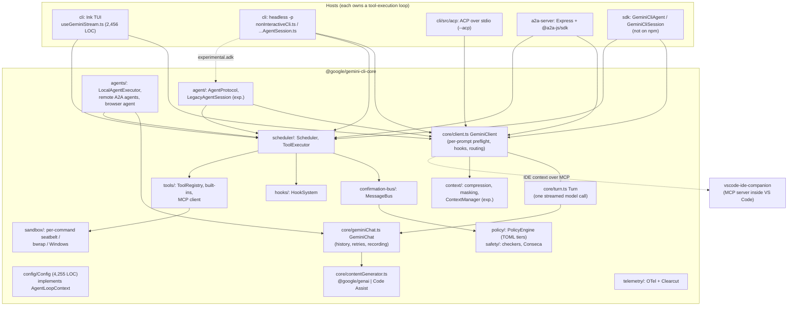

# Gemini CLI (+ Qwen Code fork)

> **Verdict.** Gemini CLI is Google's Apache-2.0 TypeScript terminal agent. It is an `integrated-product`, but it has a real seam: the published `@google/gemini-cli-core` package holds the model client, tool scheduler, policy engine, sandboxes, hooks, subagents and telemetry, and several thin hosts sit on top of it (Ink TUI, headless `-p`, ACP over stdio, an A2A HTTP server, and an unpublished SDK). Its strongest feature is a layered safety stack. A tiered TOML policy engine with an admin tier parses shell commands into sub-commands, and per-command OS sandboxes cover all three desktop OSes, in addition to Docker, Podman, gVisor and LXC process sandboxes. Two things work against it as a base: it is wire-locked to Gemini (`@google/genai` `Content` *is* the internal message model), and the tool-execution loop is re-implemented in each host, so features drift between surfaces. Strategically, Google stopped serving Gemini CLI to consumer tiers on 2026-06-18 and pointed those users to the Antigravity CLI. The repository itself is still under active weekly release at the pin. Build on it if you want a Gemini-native agent, a reference ACP/A2A implementation, or the policy and sandbox designs to borrow. Do not build on it if you need provider neutrality. **Qwen Code** forked from Gemini CLI v0.8.2 (October 2025) and has since grown about 4× larger. It added OpenAI-compatible, Anthropic and Qwen providers, and it was deliberately re-shaped toward Claude Code's semantics: hook names, permission rules, an auto-mode classifier, agent teams and workflows.

| | |
|---|---|
| Repo(s) | `google-gemini/gemini-cli` @ `65454d01f98f` (2026-10-14); `QwenLM/qwen-code` @ `9dacfdbe1a20` (2026-10-14) |
| License | Apache-2.0 (both) |
| Language(s) | TypeScript on Node (Gemini ≥20, Qwen ≥22); React + Ink TUI; a C# helper for the Windows sandbox (Gemini); Java and Python SDKs (Qwen) |
| Size | **Gemini:** 3,027 tracked files. `packages/core` has 138.8K non-test LOC (469 files); `packages/cli` 121.0K (550); `a2a-server` 6.2K; `sdk` 1.2K; `vscode-ide-companion` 1.5K; `devtools` 2.5K. Tests: about 199K LOC (core) and 176K (cli). Of the core, the *loop-relevant* part (`core/`, `scheduler/`, `agent/`, `context/`, `tools/`, `policy/`, `hooks/`) is about 52K LOC. The rest is product: auth/quota (`code_assist/` 3.7K), telemetry (12.8K), IDE, voice, billing. **Qwen:** 11,619 tracked files. `core` has 454K non-test LOC (965 files); `cli` 642K (1,466); `acp-bridge` 47K; `sdk-typescript` 48K; `sdk-java` about 114K; `web-shell` about 245K |
| Version at pin | Gemini `0.66.0-nightly.20261013` (latest stable `v0.64.0`, 2026-10-13); Qwen `0.25.1` |
| Release history | **Gemini:** announced 2025-06-25 (Google blog); first GitHub release v0.1.6 on 2025-06-28; 319 stable releases since. Channels: nightly every day, preview every week, stable every week. 2026-05-19: Google announces the transition to Antigravity CLI. 2026-06-18: consumer serving ends; v0.47.0 ships the same day. Development continues through v0.64.0. **Qwen:** repo created 2025-06-26; v0.0.1-alpha on 2025-08-01; synced with upstream until Gemini v0.8.2 (2025-10-10); v0.1.0 on 2025-10-27 (stopped syncing); v0.25.1 on 2026-10-11 |
| Category | `integrated-product` (Gemini: with a reusable core library); Qwen Code: `integrated-product` |

---

## 1. Layering & package map



| Layer | Owns | Notes |
|---|---|---|
| `packages/core` | The agent: model client, turn, scheduler, tools, policy, sandboxes, hooks, subagents, sessions, telemetry | Published to npm as `@google/gemini-cli-core` (800 versions; `latest`=0.64.0 on 2026-10-14). `Config` is a single 4,255-line object that every subsystem takes as its `AgentLoopContext` |
| `packages/cli` | TUI (React 19 on a forked Ink, `npm:@jrichman/ink@6.6.9`), slash commands, settings and extension management, headless runner, ACP agent, process-sandbox relaunch | Depends on `@agentclientprotocol/sdk` 0.16.1 ([`cli/package.json:L33`](https://github.com/google-gemini/gemini-cli/blob/65454d01f98f0983a4fee0773528fb42433131da/packages/cli/package.json#L33)) |
| `packages/a2a-server` | Exposes the agent as an A2A server ("Gemini SDLC Agent") | Described as "Experimental Agent-to-Agent server" in [`GEMINI.md:L25-L26`](https://github.com/google-gemini/gemini-cli/blob/65454d01f98f0983a4fee0773528fb42433131da/GEMINI.md#L25-L26) |
| `packages/sdk` | In-process `GeminiCliAgent` / `GeminiCliSession` with zod-defined tools | `@google/gemini-cli-sdk` returned a 404 from the npm registry on 2026-10-14, so it exists only in-repo |
| `packages/vscode-ide-companion` | A VS Code extension that runs an MCP server (`openDiff`, `closeDiff`, context push) which the CLI connects to | Not an agent host |
| `packages/devtools` | Network and console inspector | Developer tooling |

The core depends on `@google/genai` 1.30.0, `@modelcontextprotocol/sdk` 1.23.0 and `@a2a-js/sdk` 0.3.11 ([`core/package.json:L26-L34`](https://github.com/google-gemini/gemini-cli/blob/65454d01f98f0983a4fee0773528fb42433131da/packages/core/package.json#L26-L34)), along with OpenTelemetry, `tree-sitter-bash`, `puppeteer-core` and `simple-git`. The root `package.json` pins a sandbox container image per version (`config.sandboxImageUri`, [`package.json:L16-L18`](https://github.com/google-gemini/gemini-cli/blob/65454d01f98f0983a4fee0773528fb42433131da/package.json#L16-L18)).

## 2. Agent loop

The loop has three nested levels, and only the inner two live in core.

**(a) `Turn.run`: one streamed model call.** [`turn.ts:L254-L465`](https://github.com/google-gemini/gemini-cli/blob/65454d01f98f0983a4fee0773528fb42433131da/packages/core/src/core/turn.ts#L254-L465) iterates `GeminiChat.sendMessageStream`. It turns each `GenerateContentResponse` into `ServerGeminiStreamEvent`s; there are 18 kinds in `GeminiEventType` ([`turn.ts:L55-L74`](https://github.com/google-gemini/gemini-cli/blob/65454d01f98f0983a4fee0773528fb42433131da/packages/core/src/core/turn.ts#L55-L74)): `Thought`, `Content`, `ToolCallRequest`, `Citation`, `Finished` (only when a `finishReason` arrives), `Retry`, `InvalidStream`, `LoopDetected`, `ContextWindowWillOverflow`, `AgentExecutionStopped/Blocked`, and others. `functionCalls` become `ToolCallRequest` events with a synthesized `callId` of the form `${name}__${id}`. The ID is written back into the `FunctionCall` object so that history consolidation inherits it ([`turn.ts:L467-L522`](https://github.com/google-gemini/gemini-cli/blob/65454d01f98f0983a4fee0773528fb42433131da/packages/core/src/core/turn.ts#L467-L522)). **`Turn` never executes tools.**

**(b) `GeminiClient.sendMessageStream`/`processTurn`: per-request preflight and continuation.** This lives in [`client.ts:L644-L938`](https://github.com/google-gemini/gemini-cli/blob/65454d01f98f0983a4fee0773528fb42433131da/packages/core/src/core/client.ts#L644-L938). The steps, in order:

1. Enforce `maxSessionTurns`.
2. Run either the experimental `ContextManager.renderHistory` or `tryCompressChat` (§5), then mask tool outputs.
3. Estimate the request size. If it exceeds the remaining window, emit `ContextWindowWillOverflow` and stop ([`client.ts:L726-L745`](https://github.com/google-gemini/gemini-cli/blob/65454d01f98f0983a4fee0773528fb42433131da/packages/core/src/core/client.ts#L726-L745)).
4. Inject IDE context, but only when the last model turn has no unanswered `functionCall`, because the Gemini API requires `functionResponse` to follow immediately ([`L747-L772`](https://github.com/google-gemini/gemini-cli/blob/65454d01f98f0983a4fee0773528fb42433131da/packages/core/src/core/client.ts#L747-L772)).
5. Run loop detection with `turnStarted` ([`L777-L793`](https://github.com/google-gemini/gemini-cli/blob/65454d01f98f0983a4fee0773528fb42433131da/packages/core/src/core/client.ts#L777-L793)).
6. Route the model, which then stays *sticky per prompt* through `currentSequenceModel`, and call `setTools(model)` so that tool declarations match the model family ([`L795-L831`](https://github.com/google-gemini/gemini-cli/blob/65454d01f98f0983a4fee0773528fb42433131da/packages/core/src/core/client.ts#L795-L831)).
7. Stream the `Turn`.
8. If no tools were requested, run an LLM **next-speaker check**. If it answers `model`, recurse with `"Please continue."` ([`L905-L936`](https://github.com/google-gemini/gemini-cli/blob/65454d01f98f0983a4fee0773528fb42433131da/packages/core/src/core/client.ts#L905-L936)).

`sendMessageStream` wraps all of this with the `BeforeAgent` hook, which can stop, block or inject `<hook_context>`. It also runs the `AfterAgent` hook, and a blocking decision there re-enters the loop with the hook's reason as the next user message ([`client.ts:L940-L1091`](https://github.com/google-gemini/gemini-cli/blob/65454d01f98f0983a4fee0773528fb42433131da/packages/core/src/core/client.ts#L940-L1091)). Recursion depth is bounded by `MAX_TURNS = 100` ([`client.ts:L79`](https://github.com/google-gemini/gemini-cli/blob/65454d01f98f0983a4fee0773528fb42433131da/packages/core/src/core/client.ts#L79)).

**(c) The host loop: execute tools and feed `functionResponse`s back.** This is *not* in `GeminiClient`. The cleanest reference is `LegacyAgentProtocol._runLoop` ([`legacy-agent-session.ts:L174-L344`](https://github.com/google-gemini/gemini-cli/blob/65454d01f98f0983a4fee0773528fb42433131da/packages/core/src/agent/legacy-agent-session.ts#L174-L344)). It works as follows:

- Stream from the client and collect `ToolCallRequest`s. Treat `Error`/`InvalidStream`/`ContextWindowWillOverflow` as failures.
- If there are no tool calls after a tool round and no visible text, send a nudge (`"[System: You successfully executed a tool but returned an empty response..."`, [`L250-L258`](https://github.com/google-gemini/gemini-cli/blob/65454d01f98f0983a4fee0773528fb42433131da/packages/core/src/agent/legacy-agent-session.ts#L250-L258)).
- Otherwise call `Scheduler.schedule()` ([`L268-L271`](https://github.com/google-gemini/gemini-cli/blob/65454d01f98f0983a4fee0773528fb42433131da/packages/core/src/agent/legacy-agent-session.ts#L268-L271)), record the calls, and stop on `STOP_EXECUTION` or fatal tool errors ([`L323-L339`](https://github.com/google-gemini/gemini-cli/blob/65454d01f98f0983a4fee0773528fb42433131da/packages/core/src/agent/legacy-agent-session.ts#L323-L339)).

```
host loop ──► GeminiClient.sendMessageStream(parts)
                │ BeforeAgent hook ─► processTurn:
                │   turns cap → compress/mask → overflow check → IDE ctx
                │   → loopDetector.turnStarted → router.route (sticky) → setTools(model)
                │   → Turn.run ─► GeminiChat.sendMessageStream (retry layers)
                │   → [no tools] next-speaker LLM check ─► recurse "Please continue."
                │ AfterAgent hook (block ⇒ recurse with reason)
              ◄─┘ events: Content/Thought/ToolCallRequest/Finished...
host ──► Scheduler.schedule(requests) ─► functionResponse parts ─► loop
```

**The loop is duplicated.** The tool cycle is re-implemented in **eight places**:

1. The TUI's `useGeminiStream`, through `useToolScheduler`.
2. `nonInteractiveCli.ts`, which builds its own `Scheduler` at L235 and calls `sendMessageStream` at L326.
3. `nonInteractiveCliAgentSession.ts`, which delegates to `LegacyAgentSession`.
4. `LegacyAgentSession` itself.
5. The ACP `Session`.
6. The A2A `Task` (`task.ts:L426`, `L1196`).
7. The SDK `GeminiCliSession.sendStream` ([`sdk/src/session.ts:L211-L316`](https://github.com/google-gemini/gemini-cli/blob/65454d01f98f0983a4fee0773528fb42433131da/packages/sdk/src/session.ts#L211-L316)).
8. The subagent `LocalAgentExecutor`.

The new `AgentProtocol` (`send`/`subscribe`/`abort`, plus an event log with `threadId` for subagent threads, [`agent/types.ts:L14-L44`](https://github.com/google-gemini/gemini-cli/blob/65454d01f98f0983a4fee0773528fb42433131da/packages/core/src/agent/types.ts#L14-L44), [`L104-L131`](https://github.com/google-gemini/gemini-cli/blob/65454d01f98f0983a4fee0773528fb42433131da/packages/core/src/agent/types.ts#L104-L131)) is the consolidation attempt. It is still behind `experimental.adk.*` flags that default to `false` ([`settingsSchema.ts:L2185-L2224`](https://github.com/google-gemini/gemini-cli/blob/65454d01f98f0983a4fee0773528fb42433131da/packages/cli/src/config/settingsSchema.ts#L2185-L2224); headless switch at [`nonInteractiveCli.ts:L72-L80`](https://github.com/google-gemini/gemini-cli/blob/65454d01f98f0983a4fee0773528fb42433131da/packages/cli/src/nonInteractiveCli.ts#L72-L80)). The settings group is labelled "Agent Development Kit (ADK)". No ADK package dependency exists, so the label refers to a design lineage, not a code dependency (inference).

**The drift is concrete.** The ACP host runs tools **sequentially** with its own `runTool` ([`acpSession.ts:L590-L606`](https://github.com/google-gemini/gemini-cli/blob/65454d01f98f0983a4fee0773528fb42433131da/packages/cli/src/acp/acpSession.ts#L590-L606)) and calls `invocation.execute()` directly ([`L838-L840`](https://github.com/google-gemini/gemini-cli/blob/65454d01f98f0983a4fee0773528fb42433131da/packages/cli/src/acp/acpSession.ts#L838-L840)). Policy still applies, because `shouldConfirmExecute` goes through the MessageBus to the PolicyEngine. But the ACP path skips the parts that live only in `Scheduler`/`ToolExecutor`: `BeforeTool`/`AfterTool` hooks (`evaluateBeforeToolHook`, `executeToolWithHooks`), `wait_for_previous` parallelism, the taint-risk downgrade, and shell/MCP output spill-to-disk.

**Steering and interrupts.** Every layer threads an `AbortSignal` through. The TUI queues prompts while busy (`useMessageQueue`). The experimental `modelSteering` feature prepends a user hint (`buildUserSteeringHintPrompt`) to the next `functionResponse` batch rather than interrupting the model. On cancel, `discardTrailingUnansweredToolCallTurn()` removes the unpaired `functionCall` so that history stays valid ([`useGeminiStream.ts:L2290-L2350`](https://github.com/google-gemini/gemini-cli/blob/65454d01f98f0983a4fee0773528fb42433131da/packages/cli/src/ui/hooks/useGeminiStream.ts#L2290-L2350)).

**Parallel tools.** See §4. The Scheduler dequeues a *contiguous run* of parallelizable calls, validates them concurrently, and executes them only when *all* are `Scheduled` ([`scheduler.ts:L456-L575`](https://github.com/google-gemini/gemini-cli/blob/65454d01f98f0983a4fee0773528fb42433131da/packages/core/src/scheduler/scheduler.ts#L456-L575)).

**Retries.** There are two layers:

- *Connection phase:* `retryWithBackoff` with `maxAttempts`, a persistent-429 callback into `handleFallback` (for example, a model downgrade), and an `onValidationRequired` callback.
- *Mid-stream:* `MID_STREAM_RETRY_OPTIONS = {maxAttempts: 4, initialDelayMs: 1000, exponential}` ([`geminiChat.ts:L105-L109`](https://github.com/google-gemini/gemini-cli/blob/65454d01f98f0983a4fee0773528fb42433131da/packages/core/src/core/geminiChat.ts#L105-L109)). This retries transient errors and *content* failures (`InvalidStreamError`) with a `RETRY` event ([`L664-L799`](https://github.com/google-gemini/gemini-cli/blob/65454d01f98f0983a4fee0773528fb42433131da/packages/core/src/core/geminiChat.ts#L664-L799)). A stream with no tool call is invalid if it has no finish reason, `MALFORMED_FUNCTION_CALL`, `UNEXPECTED_TOOL_CALL`, or empty text under `MAX_TOKENS`/`SAFETY`/`RECITATION`/`OTHER`, or if it contains only thoughts ([`L1690-L1740`](https://github.com/google-gemini/gemini-cli/blob/65454d01f98f0983a4fee0773528fb42433131da/packages/core/src/core/geminiChat.ts#L1690-L1740)).

**Loop detection.** `TOOL_CALL_LOOP_THRESHOLD=5` and `CONTENT_LOOP_THRESHOLD=10` (on 50-character chunks). After 30 turns, an LLM judge also runs every 5–15 turns, with a 0.9 confidence threshold and a `loop-detection-double-check` model alias ([`loopDetectionService.ts:L29-L66`](https://github.com/google-gemini/gemini-cli/blob/65454d01f98f0983a4fee0773528fb42433131da/packages/core/src/services/loopDetectionService.ts#L29-L66)). The first detection triggers `_recoverFromLoop`; a second one aborts.

## 3. Model / provider abstraction

- **No IR.** The internal message model is `@google/genai`'s `Content`/`Part`, used verbatim throughout `GeminiChat`, history, recording and compression.
- **`ContentGenerator`.** The interface has four methods: `generateContent`, `generateContentStream`, `countTokens`, `embedContent` ([`contentGenerator.ts:L39-L61`](https://github.com/google-gemini/gemini-cli/blob/65454d01f98f0983a4fee0773528fb42433131da/packages/core/src/core/contentGenerator.ts#L39-L61)). `AuthType` has six values: `oauth-personal`, `gemini-api-key`, `vertex-ai`, `cloud-shell`, `compute-default-credentials`, `gateway` ([`L63-L70`](https://github.com/google-gemini/gemini-cli/blob/65454d01f98f0983a4fee0773528fb42433131da/packages/core/src/core/contentGenerator.ts#L63-L70)). The factory has two backends ([`L210-L427`](https://github.com/google-gemini/gemini-cli/blob/65454d01f98f0983a4fee0773528fb42433131da/packages/core/src/core/contentGenerator.ts#L210-L427)):
  - Google OAuth and ADC go to the **Code Assist server** (`createCodeAssistContentGenerator`, [`L293-L310`](https://github.com/google-gemini/gemini-cli/blob/65454d01f98f0983a4fee0773528fb42433131da/packages/core/src/core/contentGenerator.ts#L293-L310)).
  - API-key, Vertex and gateway go to **`GoogleGenAI.models`**, with `GOOGLE_GEMINI_BASE_URL`/`GOOGLE_VERTEX_BASE_URL`, proxy agents and custom headers ([`L312-L416`](https://github.com/google-gemini/gemini-cli/blob/65454d01f98f0983a4fee0773528fb42433131da/packages/core/src/core/contentGenerator.ts#L312-L416)).
  - Both are wrapped in `LoggingContentGenerator(ModelMappingContentGenerator(...))`.
  - `FakeContentGenerator` (replay from file) and `RecordingContentGenerator` support deterministic tests ([`L215-L228`](https://github.com/google-gemini/gemini-cli/blob/65454d01f98f0983a4fee0773528fb42433131da/packages/core/src/core/contentGenerator.ts#L215-L228), [`L422-L424`](https://github.com/google-gemini/gemini-cli/blob/65454d01f98f0983a4fee0773528fb42433131da/packages/core/src/core/contentGenerator.ts#L422-L424)).
  - The only "foreign" endpoints possible are Gemini-protocol ones: a gateway or proxy, or a local LiteRT-LM server serving Gemma, which is used *only* for routing classification ([`localLiteRtLmClient.ts:L15-L40`](https://github.com/google-gemini/gemini-cli/blob/65454d01f98f0983a4fee0773528fb42433131da/packages/core/src/core/localLiteRtLmClient.ts#L15-L40)).
- **Routing.** `ModelRouterService` composes `Fallback → Override → ApprovalMode → [GemmaClassifier] → Classifier → NumericalClassifier → Default` ([`modelRouterService.ts:L39-L66`](https://github.com/google-gemini/gemini-cli/blob/65454d01f98f0983a4fee0773528fb42433131da/packages/core/src/routing/modelRouterService.ts#L39-L66)). `auto-gemini-3` is the auto alias. Model IDs in the code include `gemini-3-pro-preview`, `gemini-2.5-pro`, `gemini-3.5-flash` and `gemini-3.5-flash-lite` ([`models.ts:L59-L79`](https://github.com/google-gemini/gemini-cli/blob/65454d01f98f0983a4fee0773528fb42433131da/packages/core/src/config/models.ts#L59-L79), [`L167`](https://github.com/google-gemini/gemini-cli/blob/65454d01f98f0983a4fee0773528fb42433131da/packages/core/src/config/models.ts#L167)).
- **Model configs** form an alias tree with `extends`. For example, `chat-base` sets `includeThoughts: true`; `chat-base-2.5` sets `thinkingBudget`; `chat-base-3` sets `thinkingLevel: HIGH` ([`defaultModelConfigs.ts:L31-L64`](https://github.com/google-gemini/gemini-cli/blob/65454d01f98f0983a4fee0773528fb42433131da/packages/core/src/config/defaultModelConfigs.ts#L31-L64)).
- **Thinking.** `part.thought` parts become `Thought` events. **Thought signatures** are repaired: the first `functionCall` in each model turn of the active loop must carry a `thoughtSignature`, otherwise the API returns 400. Missing ones get the synthetic value `skip_thought_signature_validator` ([`geminiChat.ts:L1384-L1441`](https://github.com/google-gemini/gemini-cli/blob/65454d01f98f0983a4fee0773528fb42433131da/packages/core/src/core/geminiChat.ts#L1384-L1441)).
- **Caching and cost.** Caching relies on Gemini implicit caching. `cachedContent` is only passed through ([`code_assist/converter.ts:L170`](https://github.com/google-gemini/gemini-cli/blob/65454d01f98f0983a4fee0773528fb42433131da/packages/core/src/code_assist/converter.ts#L170)), and cached tokens are tracked per message (`TokensSummary.cached`). Accounting is in tokens only. `billing/` handles Google One AI credit and overage menus; I found no currency cost computation.

## 4. Tool system

**Definition API.** A tool is a builder–invocation pair:

- `DeclarativeTool(name, displayName, description, kind, parameterSchema, messageBus, ...)` builds a `ToolInvocation` with `getDescription`, `toolLocations`, `shouldConfirmExecute` and `execute` ([`tools.ts:L470-L486`](https://github.com/google-gemini/gemini-cli/blob/65454d01f98f0983a4fee0773528fb42433131da/packages/core/src/tools/tools.ts#L470-L486)).
- Schemas are raw JSON Schema (`parametersJsonSchema`) validated with `ajv`. The SDK converts zod schemas to JSON Schema.
- `Kind` is one of `read|edit|delete|move|search|execute|think|agent|fetch|communicate|plan|switch_mode|other`, with `MUTATOR_KINDS` and `READ_ONLY_KINDS` subsets ([`tools.ts:L1116-L1145`](https://github.com/google-gemini/gemini-cli/blob/65454d01f98f0983a4fee0773528fb42433131da/packages/core/src/tools/tools.ts#L1116-L1145)).
- Every schema is silently extended with a **`wait_for_previous: boolean`** property ([`tools.ts:L525-L574`](https://github.com/google-gemini/gemini-cli/blob/65454d01f98f0983a4fee0773528fb42433131da/packages/core/src/tools/tools.ts#L525-L574)). `isParallelizable` reads it; edit tools and `update_topic` are always sequential ([`tool-utils.ts:L29-L41`](https://github.com/google-gemini/gemini-cli/blob/65454d01f98f0983a4fee0773528fb42433131da/packages/core/src/utils/tool-utils.ts#L29-L41)). The system prompt tells the model that tools "execute in parallel by default" ([`snippets.ts:L426`](https://github.com/google-gemini/gemini-cli/blob/65454d01f98f0983a4fee0773528fb42433131da/packages/core/src/prompts/snippets.ts#L426)).
- Declarations are **model-family specific**. `getToolFamily(modelId)` chooses `gemini-3` or `default-legacy` description sets (`tools/definitions/model-family-sets/`), and `client.setTools(model)` re-applies them each turn.

**Built-ins** are registered in `Config.createToolRegistry()` ([`config.ts:L3980-L4135`](https://github.com/google-gemini/gemini-cli/blob/65454d01f98f0983a4fee0773528fb42433131da/packages/core/src/config/config.ts#L3980-L4135)) and can be filtered with `coreTools`:

| Group | Tools |
|---|---|
| FS/search | `list_directory`, `read_file`, `grep_search` (ripgrep, falling back to a JS grep), `glob`, `replace`, `write_file` |
| Exec | `run_shell_command` (PTY via `@xterm/headless`, `is_background`), `list_background_processes`, `read_background_output` |
| Web | `web_fetch`, `google_web_search` (grounding) |
| MCP | `read_mcp_resource`, `list_mcp_resources`, plus discovered `mcp_{server}_{tool}` |
| Interaction/plan | `ask_user`, `write_todos`, `enter_plan_mode`, `exit_plan_mode`, `update_topic`, `activate_skill`, `tracker_*` (6, experimental) |
| Agents | `invoke_agent`; `complete_task` (subagent-only); `get_internal_docs` (the `cli_help` agent) |

There is **no `save_memory` tool**. The prompt tells the model to edit `GEMINI.md`/`MEMORY.md` directly ([`snippets.ts:L872`](https://github.com/google-gemini/gemini-cli/blob/65454d01f98f0983a4fee0773528fb42433131da/packages/core/src/prompts/snippets.ts#L872)). `read_many_files` is no longer exposed to the model; it is used only to expand `@path` mentions.

**Execution pipeline.** `Scheduler.schedule()` is wrapped in a trace span and enqueues the request if a batch is already active ([`scheduler.ts:L211-L240`](https://github.com/google-gemini/gemini-cli/blob/65454d01f98f0983a4fee0773528fb42433131da/packages/core/src/scheduler/scheduler.ts#L211-L240)). Calls move through `Validating → AwaitingApproval → Scheduled → Executing → Success|Error|Cancelled` ([`scheduler/types.ts:L26-L34`](https://github.com/google-gemini/gemini-cli/blob/65454d01f98f0983a4fee0773528fb42433131da/packages/core/src/scheduler/types.ts#L26-L34)). `_processToolCall` ([`scheduler.ts:L609-L739`](https://github.com/google-gemini/gemini-cli/blob/65454d01f98f0983a4fee0773528fb42433131da/packages/core/src/scheduler/scheduler.ts#L609-L739)) does the following, in order:

1. Runs the `BeforeTool` hook, which can rewrite args (`inputModifiedByHook`).
2. Runs `checkPolicy`.
3. Applies the taint-risk downgrade: an `ALLOW` becomes `ASK_USER` when interactive and `DENY` when headless ([`L656-L665`](https://github.com/google-gemini/gemini-cli/blob/65454d01f98f0983a4fee0773528fb42433131da/packages/core/src/scheduler/scheduler.ts#L656-L665)).
4. Runs the confirmation loop through the MessageBus (`resolveConfirmation`, with `ModifyWithEditor` support).
5. Persists "Always" outcomes as policy rules (`updatePolicy`).
6. If the user cancels, cascades the cancel to the queue.

`ToolExecutor` then runs `executeToolWithHooks` (`AfterTool`). For `run_shell_command` and MCP text outputs above `truncateToolOutputThreshold`, it **spills the full output to `<projectTemp>/tool-outputs/`** and returns a truncated head and tail with the file path ([`tool-executor.ts:L202-L260`](https://github.com/google-gemini/gemini-cli/blob/65454d01f98f0983a4fee0773528fb42433131da/packages/core/src/scheduler/tool-executor.ts#L202-L260)). When context management is enabled, an LLM `ToolOutputDistillationService` replaces truncation.

**Confirmations.** Outcomes are `ProceedOnce | ProceedAlways | ProceedAlwaysAndSave | ProceedAlwaysServer | ProceedAlwaysTool | ModifyWithEditor | Cancel` ([`tools.ts:L1106-L1114`](https://github.com/google-gemini/gemini-cli/blob/65454d01f98f0983a4fee0773528fb42433131da/packages/core/src/tools/tools.ts#L1106-L1114)). In `AUTO_EDIT` mode, `BaseToolInvocation.shouldConfirmExecute` skips confirmation for `respectsAutoEdit` tools *except* when the target is a build file ([`tools.ts:L191-L230`](https://github.com/google-gemini/gemini-cli/blob/65454d01f98f0983a4fee0773528fb42433131da/packages/core/src/tools/tools.ts#L191-L230)).

**MCP client.** `mcp-client.ts` (2,473 LOC) supports stdio, SSE and streamable-HTTP transports ([`mcp-client.ts:L16-L22`](https://github.com/google-gemini/gemini-cli/blob/65454d01f98f0983a4fee0773528fb42433131da/packages/core/src/tools/mcp-client.ts#L16-L22)), OAuth (`mcp/oauth-provider.ts`, hardened against SSRF in v0.59.0), MCP prompts loaded as slash commands (`McpPromptLoader`), and resources. Servers can be scoped per subagent (§9).

## 5. Context management

- **System prompt.** `PromptProvider.getCoreSystemPrompt` picks *modern* or *legacy* snippets by model. It then injects approval-mode-specific sections (plan mode lists available tools), the skills listing, the tracker directory and hierarchical memory ([`promptProvider.ts:L47-L140`](https://github.com/google-gemini/gemini-cli/blob/65454d01f98f0983a4fee0773528fb42433131da/packages/core/src/prompts/promptProvider.ts#L47-L140)). `GEMINI_SYSTEM_MD=1|<path>` replaces the base prompt with `.gemini/system.md` plus variable substitution, and `GEMINI_WRITE_SYSTEM_MD` dumps the built-in prompt.
- **`GEMINI.md` hierarchy.**
  - The default filename is `GEMINI.md` (with `MEMORY.md` as the private project index, [`memoryTool.ts:L11-L12`](https://github.com/google-gemini/gemini-cli/blob/65454d01f98f0983a4fee0773528fb42433131da/packages/core/src/tools/memoryTool.ts#L11-L12)). `context.fileName` can add `AGENTS.md` and others, so AGENTS.md support is opt-in.
  - Memory is split into four categories: `global` (`~/.gemini/GEMINI.md`), `extension` (extension `contextFileName`s), `project`, and `userProjectMemory`.
  - Project files are found by an **upward traversal from each trusted root, with the git root as the ceiling** ([`memoryDiscovery.ts:L405-L431`](https://github.com/google-gemini/gemini-cli/blob/65454d01f98f0983a4fee0773528fb42433131da/packages/core/src/utils/memoryDiscovery.ts#L405-L431), [`L463-L510`](https://github.com/google-gemini/gemini-cli/blob/65454d01f98f0983a4fee0773528fb42433131da/packages/core/src/utils/memoryDiscovery.ts#L463-L510)).
  - **JIT subdirectory memory** loads `GEMINI.md` files lazily when tools touch deeper paths inside a trusted root ([`L512-L560`](https://github.com/google-gemini/gemini-cli/blob/65454d01f98f0983a4fee0773528fb42433131da/packages/core/src/utils/memoryDiscovery.ts#L512-L560)).
  - `@file` imports are resolved up to depth 5 ([`memoryImportProcessor.ts:L196`](https://github.com/google-gemini/gemini-cli/blob/65454d01f98f0983a4fee0773528fb42433131da/packages/core/src/utils/memoryImportProcessor.ts#L196)).
- **Default compression** (`ChatCompressionService.compress`, [`chatCompressionService.ts:L466-L720`](https://github.com/google-gemini/gemini-cli/blob/65454d01f98f0983a4fee0773528fb42433131da/packages/core/src/context/chatCompressionService.ts#L466-L720)):
  - *Trigger:* the last prompt token count is at least `0.5 × tokenLimit(model)` (`DEFAULT_COMPRESSION_TOKEN_THRESHOLD`, [`L45`](https://github.com/google-gemini/gemini-cli/blob/65454d01f98f0983a4fee0773528fb42433131da/packages/core/src/context/chatCompressionService.ts#L45)), or the user runs `/compress`. The `PreCompress` hook fires first.
  - *Algorithm:*
    1. A reverse token-budget truncation of function responses.
    2. A split that keeps the newest **30 %** (`COMPRESSION_PRESERVE_THRESHOLD`, [`L269`](https://github.com/google-gemini/gemini-cli/blob/65454d01f98f0983a4fee0773528fb42433131da/packages/core/src/context/chatCompressionService.ts#L269)).
    3. A summarizer call that produces a `<state_snapshot>` and must integrate any previous snapshot.
    4. A **second "probe" call** that critiques and re-emits the snapshot ([`L587-L645`](https://github.com/google-gemini/gemini-cli/blob/65454d01f98f0983a4fee0773528fb42433131da/packages/core/src/context/chatCompressionService.ts#L587-L645)).
    5. The result is rejected if the token count *inflated*. After one failure, later automatic attempts fall back to truncation only.
- **Tool-output masking** uses a "hybrid backward-scanned FIFO". It protects the newest 50K tool tokens and masks older outputs only once at least 30K are prunable. Masked content is spilled to `tool-outputs/` ([`toolOutputMaskingService.ts:L25-L65`](https://github.com/google-gemini/gemini-cli/blob/65454d01f98f0983a4fee0773528fb42433131da/packages/core/src/context/toolOutputMaskingService.ts#L25-L65)).
- **Experimental `ContextManager`** (`contextManagement.enabled`, default `false`). History becomes a node graph processed by pipelines. The "Generalist (Default)" profile defines *Immediate Sanitization* (masking, blob degradation, distillation) on `new_message`, *Normalization* on `retained_exceeded`, and an *Emergency Backstop* state snapshot on `gc_backstop` ([`profiles.ts:L71-L140`](https://github.com/google-gemini/gemini-cli/blob/65454d01f98f0983a4fee0773528fb42433131da/packages/core/src/context/config/profiles.ts#L71-L140)). It is about 8.8K LOC, which signals active redesign.
- **Auto memory** (experimental, off by default). `startMemoryService` runs a background **skill-extraction subagent** that mines past sessions into `SKILL.md`/patch files. It is coordinated across CLI instances by `.extraction.lock`, throttled to once per 30 minutes, and gated on at least 10 user messages and a 3-hour idle period ([`memoryService.ts:L48-L57`](https://github.com/google-gemini/gemini-cli/blob/65454d01f98f0983a4fee0773528fb42433131da/packages/core/src/services/memoryService.ts#L48-L57), [`L1133-L1206`](https://github.com/google-gemini/gemini-cli/blob/65454d01f98f0983a4fee0773528fb42433131da/packages/core/src/services/memoryService.ts#L1133-L1206)).

## 6. State, sessions & durability

- **Session files.**
  - *Location:* `~/.gemini/tmp/<projectId>/chats/session-<YYYY-MM-DDTHH-MM>-<id8>.jsonl`. Subagent transcripts are `<sessionId>.jsonl` nested under the parent ([`chatRecordingService.ts:L799-L822`](https://github.com/google-gemini/gemini-cli/blob/65454d01f98f0983a4fee0773528fb42433131da/packages/core/src/services/chatRecordingService.ts#L799-L822); [`storage.ts:L230-L234`](https://github.com/google-gemini/gemini-cli/blob/65454d01f98f0983a4fee0773528fb42433131da/packages/core/src/config/storage.ts#L230-L234)).
  - *Format:* append-only JSONL (`appendFileSync`, [`L949`](https://github.com/google-gemini/gemini-cli/blob/65454d01f98f0983a4fee0773528fb42433131da/packages/core/src/services/chatRecordingService.ts#L949)) holding message records plus `{$patch: ...}` delta records (updates, removes, reorders) and `{$rewindTo: id}` markers. Records are replayed on load ([`L304-L345`](https://github.com/google-gemini/gemini-cli/blob/65454d01f98f0983a4fee0773528fb42433131da/packages/core/src/services/chatRecordingService.ts#L304-L345)). Legacy `.json` sessions are migrated to `.jsonl` on resume.
  - *Size caps:* tool outputs stored in records are capped (`MAX_TOOL_OUTPUT_SIZE = 50KB`, [`chatRecordingTypes.ts:L12-L14`](https://github.com/google-gemini/gemini-cli/blob/65454d01f98f0983a4fee0773528fb42433131da/packages/core/src/services/chatRecordingTypes.ts#L12-L14)).
  - *Seatbelt redirection:* under macOS Seatbelt, runtime state is redirected to `~/.cache/.gemini` ([`storage.ts:L92-L108`](https://github.com/google-gemini/gemini-cli/blob/65454d01f98f0983a4fee0773528fb42433131da/packages/core/src/config/storage.ts#L92-L108)).
- **Resume and rewind.**
  - *CLI flags:* `--resume [latest|N]`, `--session-id`, `--list-sessions`, `--delete-session` ([`cli/src/config/config.ts:L401-L455`](https://github.com/google-gemini/gemini-cli/blob/65454d01f98f0983a4fee0773528fb42433131da/packages/cli/src/config/config.ts#L401-L455)).
  - *Interactive and protocol entry points:* `/resume` and `/rewind` in the TUI, `loadSession` over ACP, and `GeminiCliAgent.resumeSession` in the SDK.
  - *Rewind:* `rewindTo(messageId)` appends a `$rewindTo` record ([`chatRecordingService.ts:L1377-L1410`](https://github.com/google-gemini/gemini-cli/blob/65454d01f98f0983a4fee0773528fb42433131da/packages/core/src/services/chatRecordingService.ts#L1377-L1410)).
  - *Fork/branch:* there is no fork/branch primitive.
- **Checkpointing (shadow git).** This is opt-in (`general.checkpointing.enabled`, default `false`).
  - *Repo setup:* `GitService` initializes a separate repository under `~/.gemini/history/<projectId>` ([`storage.ts:L326-L330`](https://github.com/google-gemini/gemini-cli/blob/65454d01f98f0983a4fee0773528fb42433131da/packages/core/src/config/storage.ts#L326-L330)) with its own `.gitconfig` and an empty system config. The user's `.gitignore` is copied in ([`gitService.ts:L136-L182`](https://github.com/google-gemini/gemini-cli/blob/65454d01f98f0983a4fee0773528fb42433131da/packages/core/src/services/gitService.ts#L136-L182)).
  - *Working tree:* the project itself, via `GIT_DIR`/`GIT_WORK_TREE` ([`L184-L191`](https://github.com/google-gemini/gemini-cli/blob/65454d01f98f0983a4fee0773528fb42433131da/packages/core/src/services/gitService.ts#L184-L191)).
  - *Snapshot:* `add . → commit --no-verify`, serialized with a path lock ([`L198-L227`](https://github.com/google-gemini/gemini-cli/blob/65454d01f98f0983a4fee0773528fb42433131da/packages/core/src/services/gitService.ts#L198-L227)).
  - *Restore:* `git restore --source <sha> .` followed by `git clean -fd` ([`L229-L234`](https://github.com/google-gemini/gemini-cli/blob/65454d01f98f0983a4fee0773528fb42433131da/packages/core/src/services/gitService.ts#L229-L234)).
  - *Checkpoint file:* a JSON file with UI history, client history, the tool call and the commit hash ([`checkpointUtils.ts:L84-L156`](https://github.com/google-gemini/gemini-cli/blob/65454d01f98f0983a4fee0773528fb42433131da/packages/core/src/utils/checkpointUtils.ts#L84-L156)).
  - *Trigger:* a **React `useEffect`** when an edit tool reaches `AwaitingApproval` ([`useGeminiStream.ts:L2378-L2420`](https://github.com/google-gemini/gemini-cli/blob/65454d01f98f0983a4fee0773528fb42433131da/packages/cli/src/ui/hooks/useGeminiStream.ts#L2378-L2420)). The only other caller is the A2A task. Headless, ACP and SDK paths therefore create no checkpoints (inferred from grep: no other callers of `processRestorableToolCalls`).
- **Remote durability.** The A2A server can persist task metadata *and a tar.gz of the workspace* to GCS (`GCSTaskStore.save`, [`gcs.ts:L94-L150`](https://github.com/google-gemini/gemini-cli/blob/65454d01f98f0983a4fee0773528fb42433131da/packages/a2a-server/src/persistence/gcs.ts#L94-L150); selected by `GCS_BUCKET_NAME`, [`app.ts:L250-L263`](https://github.com/google-gemini/gemini-cli/blob/65454d01f98f0983a4fee0773528fb42433131da/packages/a2a-server/src/http/app.ts#L250-L263)).
- **Crash semantics.** The append-only JSONL survives a crash up to the last appended line. v0.64.0 added atomic CLI-state writes with backup recovery (changelog). There is no durable execution and no tool-step replay.

## 7. Safety & sandboxing

Gemini CLI stacks **four independent layers**: policy, taint/heuristics, hooks and checkers, and OS isolation.

**Policy engine.**

- *Rule shape.* `PolicyRule` has the fields `{toolName, subagent, mcpName, argsPattern, toolAnnotations, decision: allow|deny|ask_user, priority, modes, interactive, allowRedirection, denyMessage}` ([`policy/types.ts:L114-L191`](https://github.com/google-gemini/gemini-cli/blob/65454d01f98f0983a4fee0773528fb42433131da/packages/core/src/policy/types.ts#L114-L191)).
- *Tiers.* Rules come from TOML in five tiers whose effective priority is `tier + priority/1000`, so the order is Default (1) < Extension (2) < Workspace (3) < User (4) < **Admin (5)**. Settings-derived rules sit inside the user tier: "Always allow" at 4.95, the MCP exclude list at 4.9, `--exclude-tools` at 4.4, and so on ([`read-only.toml:L1-L27`](https://github.com/google-gemini/gemini-cli/blob/65454d01f98f0983a4fee0773528fb42433131da/packages/core/src/policy/policies/read-only.toml#L1-L27); [`toml-loader.ts:L299-L308`](https://github.com/google-gemini/gemini-cli/blob/65454d01f98f0983a4fee0773528fb42433131da/packages/core/src/policy/toml-loader.ts#L299-L308)).
- *Built-in policy files.* `read-only`, `write`, `plan`, `yolo`, `agents`, `sandbox-default`, `non-interactive`, `discovered`, `conseca`.
- *Default decision.* `ASK_USER` when interactive and **`DENY` when headless** ([`policy-engine.ts:L298-L301`](https://github.com/google-gemini/gemini-cli/blob/65454d01f98f0983a4fee0773528fb42433131da/packages/core/src/policy/policy-engine.ts#L298-L301)). In headless mode, `checkPolicy` throws rather than prompting ([`scheduler/policy.ts:L53-L107`](https://github.com/google-gemini/gemini-cli/blob/65454d01f98f0983a4fee0773528fb42433131da/packages/core/src/scheduler/policy.ts#L53-L107)).
- *How `check()` works* ([`policy-engine.ts:L681-L872`](https://github.com/google-gemini/gemini-cli/blob/65454d01f98f0983a4fee0773528fb42433131da/packages/core/src/policy/policy-engine.ts#L681-L872)):
  - It tries legacy aliases of the tool name and treats the `invoke_agent` target name as a virtual alias.
  - For shell tools it splits compound commands (using `shell-quote` and `tree-sitter-bash`), checks each sub-command, recurses into `bash -c`, and **downgrades `ALLOW` to `ASK_USER` on redirection**.
  - `additional_permissions` paths outside the workspace force `ASK_USER` ([`L874-L901`](https://github.com/google-gemini/gemini-cli/blob/65454d01f98f0983a4fee0773528fb42433131da/packages/core/src/policy/policy-engine.ts#L874-L901)).
  - Build-file edits always require confirmation ([`L903-L910`](https://github.com/google-gemini/gemini-cli/blob/65454d01f98f0983a4fee0773528fb42433131da/packages/core/src/policy/policy-engine.ts#L903-L910)).
- *Approval modes.* `default | autoEdit | yolo | plan` ([`policy/types.ts:L48-L53`](https://github.com/google-gemini/gemini-cli/blob/65454d01f98f0983a4fee0773528fb42433131da/packages/core/src/policy/types.ts#L48-L53)). `security.disableYoloMode` and `disableAlwaysAllow` are available for enterprise lock-down. System-wide settings are read from `/etc/gemini-cli/settings.json` or `C:\ProgramData\gemini-cli\settings.json`.
- *MessageBus.* `TOOL_CONFIRMATION_REQUEST` messages are answered by the PolicyEngine first, and only `ASK_USER` reaches a UI ([`message-bus.ts:L105-L138`](https://github.com/google-gemini/gemini-cli/blob/65454d01f98f0983a4fee0773528fb42433131da/packages/core/src/confirmation-bus/message-bus.ts#L105-L138); types at [`confirmation-bus/types.ts:L18-L29`](https://github.com/google-gemini/gemini-cli/blob/65454d01f98f0983a4fee0773528fb42433131da/packages/core/src/confirmation-bus/types.ts#L18-L29)).

**Safety checkers.** A `SafetyCheckerRule` attaches in-process or external checkers. Examples are `AllowedPathChecker` and **Conseca**, which uses an LLM to generate a *per-prompt least-privilege policy* ([`policy-generator.ts:L17`](https://github.com/google-gemini/gemini-cli/blob/65454d01f98f0983a4fee0773528fb42433131da/packages/core/src/safety/conseca/policy-generator.ts#L17); wired by [`conseca.toml:L1-L6`](https://github.com/google-gemini/gemini-cli/blob/65454d01f98f0983a4fee0773528fb42433131da/packages/core/src/policy/policies/conseca.toml#L1-L6); off by default).

**OS isolation, two independent mechanisms.**

1. **Whole-process sandbox.** `--sandbox`, `GEMINI_SANDBOX` or `tools.sandbox` relaunches the whole CLI inside a sandbox ([`gemini.tsx:L685-L732`](https://github.com/google-gemini/gemini-cli/blob/65454d01f98f0983a4fee0773528fb42433131da/packages/cli/src/gemini.tsx#L685-L732)).
   - Supported commands are `docker | podman | sandbox-exec | runsc | lxc | windows-native` ([`sandboxConfig.ts:L26-L33`](https://github.com/google-gemini/gemini-cli/blob/65454d01f98f0983a4fee0773528fb42433131da/packages/cli/src/config/sandboxConfig.ts#L26-L33)).
   - Auto-detection prefers `sandbox-exec` on macOS, then `docker`, then `podman` ([`L104-L110`](https://github.com/google-gemini/gemini-cli/blob/65454d01f98f0983a4fee0773528fb42433131da/packages/cli/src/config/sandboxConfig.ts#L104-L110)).
   - Seatbelt uses six built-in `.sb` profiles: `{permissive, restrictive, strict} × {open, proxied}`, chosen with `SEATBELT_PROFILE` ([`sandbox.ts:L121-L152`](https://github.com/google-gemini/gemini-cli/blob/65454d01f98f0983a4fee0773528fb42433131da/packages/cli/src/utils/sandbox.ts#L121-L152)).
   - gVisor runs as `docker --runtime=runsc`. LXC is supported but never auto-detected ([`L398-L403`](https://github.com/google-gemini/gemini-cli/blob/65454d01f98f0983a4fee0773528fb42433131da/packages/cli/src/utils/sandbox.ts#L398-L403)).
2. **Tool-level sandboxing.** `security.toolSandboxing` (default `false`, [`settingsSchema.ts:L1835-L1844`](https://github.com/google-gemini/gemini-cli/blob/65454d01f98f0983a4fee0773528fb42433131da/packages/cli/src/config/settingsSchema.ts#L1835-L1844)) wraps each command in a platform `SandboxManager` ([`sandboxManagerFactory.ts:L21-L43`](https://github.com/google-gemini/gemini-cli/blob/65454d01f98f0983a4fee0773528fb42433131da/packages/core/src/services/sandboxManagerFactory.ts#L21-L43)):
   - **macOS:** generated SBPL with `(deny default)`. Network rules are appended only when network access is allowed ([`baseProfile.ts:L219-L224`](https://github.com/google-gemini/gemini-cli/blob/65454d01f98f0983a4fee0773528fb42433131da/packages/core/src/sandbox/macos/baseProfile.ts#L219-L224)).
   - **Linux:** bubblewrap with `--unshare-all --new-session --die-with-parent`. `--share-net` is added only when allowed, and `/` is read-only with the workspace bound ([`bwrapArgsBuilder.ts:L45-L53`](https://github.com/google-gemini/gemini-cli/blob/65454d01f98f0983a4fee0773528fb42433131da/packages/core/src/sandbox/linux/bwrapArgsBuilder.ts#L45-L53)). Network is granted by mode config, by the request policy, or in YOLO mode ([`LinuxSandboxManager.ts:L245-L246`](https://github.com/google-gemini/gemini-cli/blob/65454d01f98f0983a4fee0773528fb42433131da/packages/core/src/sandbox/linux/LinuxSandboxManager.ts#L245-L246)).
   - **Windows:** a C# helper using **job objects and token integrity levels**. Its network-disabled mode requests `MaxBandwidth = 1` throttling; failure only warns and execution continues, so it does not establish network isolation ([network control, L292–L305](https://github.com/google-gemini/gemini-cli/blob/65454d01f98f0983a4fee0773528fb42433131da/packages/core/src/sandbox/windows/GeminiSandbox.cs#L292-L305)) ([`GeminiSandbox.cs:L24-L31`](https://github.com/google-gemini/gemini-cli/blob/65454d01f98f0983a4fee0773528fb42433131da/packages/core/src/sandbox/windows/GeminiSandbox.cs#L24-L31)).
   - Commands may request `additional_permissions` (filesystem read/write, network). These surface as a *sandbox-expansion* confirmation.

**Secrets and trust.**

- `sanitizeEnvironment` strips environment variables whose name matches `/TOKEN/`, `/SECRET/`, `/KEY/` and similar patterns, or whose value contains a PEM private key, before hooks and shells run ([`environmentSanitization.ts:L111-L126`](https://github.com/google-gemini/gemini-cli/blob/65454d01f98f0983a4fee0773528fb42433131da/packages/core/src/services/environmentSanitization.ts#L111-L126)).
- Credentials go to the OS keychain, with a file-keychain fallback.
- *Folder trust* gates project agents, `mcpServers` (fail-closed since v0.59.0) and project hooks (`TrustedHooksManager`, `trusted_hooks.json`, [`trustedHooks.ts:L22`](https://github.com/google-gemini/gemini-cli/blob/65454d01f98f0983a4fee0773528fb42433131da/packages/core/src/hooks/trustedHooks.ts#L22)).
- **Caveat:** the in-repo SDK constructs its `Config` with `policyEngineConfig.defaultDecision = ALLOW` ("TODO: Revisit this default", [`sdk/src/session.ts:L74-L96`](https://github.com/google-gemini/gemini-cli/blob/65454d01f98f0983a4fee0773528fb42433131da/packages/sdk/src/session.ts#L74-L96)).

## 8. Extensibility

| Mechanism | Shape | Evidence |
|---|---|---|
| **Extensions** | `gemini-extension.json` with `{name, version, mcpServers, contextFileName, excludeTools, settings, themes, plan, migratedTo}`, plus directory conventions `commands/*.toml`, `hooks/hooks.json`, `skills/`, `agents/`, `policies/` (extension policy tier 2). Installed from `git`, `github-release`, `local` or `link` sources, with a consent prompt and per-workspace enablement. Registry at `geminicli.com/extensions.json` (experimental explore UI) | [`extension.ts:L24-L49`](https://github.com/google-gemini/gemini-cli/blob/65454d01f98f0983a4fee0773528fb42433131da/packages/cli/src/config/extension.ts#L24-L49), [`extension-manager.ts:L920-L960`](https://github.com/google-gemini/gemini-cli/blob/65454d01f98f0983a4fee0773528fb42433131da/packages/cli/src/config/extension-manager.ts#L920-L960), [`variables.ts:L22`](https://github.com/google-gemini/gemini-cli/blob/65454d01f98f0983a4fee0773528fb42433131da/packages/cli/src/config/extensions/variables.ts#L22) |
| **Hooks** | 11 events: `BeforeTool`, `AfterTool`, `BeforeAgent`, `AfterAgent`, `BeforeModel`, `AfterModel`, `BeforeToolSelection`, `SessionStart`, `SessionEnd`, `PreCompress`, `Notification`. Two types: `command` (JSON on stdin; JSON or plain text on stdout plus an exit code) and `runtime` (an in-process function with a 60 s default timeout). Decisions are `allow/deny/block/ask`; `BeforeTool` can rewrite args. Hooks receive the env var `CLAUDE_PROJECT_DIR` "for compatibility" alongside `GEMINI_PROJECT_DIR` | [`hooks/types.ts:L43-L68`](https://github.com/google-gemini/gemini-cli/blob/65454d01f98f0983a4fee0773528fb42433131da/packages/core/src/hooks/types.ts#L43-L68), [`hookRunner.ts:L348-L356`](https://github.com/google-gemini/gemini-cli/blob/65454d01f98f0983a4fee0773528fb42433131da/packages/core/src/hooks/hookRunner.ts#L348-L356), [`L537-L550`](https://github.com/google-gemini/gemini-cli/blob/65454d01f98f0983a4fee0773528fb42433131da/packages/core/src/hooks/hookRunner.ts#L537-L550) |
| **Skills** | `SKILL.md` directories discovered in `~/.gemini/skills`, `~/.agents/skills`, `.gemini/skills`, `.agents/skills`, extensions, and built-ins (`skill-creator`, `antigravity-support`). Exposed through the `activate_skill` tool | [`skillManager.ts:L54-L114`](https://github.com/google-gemini/gemini-cli/blob/65454d01f98f0983a4fee0773528fb42433131da/packages/core/src/skills/skillManager.ts#L54-L114), [`storage.ts:L142-L148`](https://github.com/google-gemini/gemini-cli/blob/65454d01f98f0983a4fee0773528fb42433131da/packages/core/src/config/storage.ts#L142-L148) |
| **Custom commands** | TOML files from user, project and extension dirs, supporting `@{path}` and `!{shell}` expansion. MCP prompts also become commands | [`FileCommandLoader.ts:L64-L118`](https://github.com/google-gemini/gemini-cli/blob/65454d01f98f0983a4fee0773528fb42433131da/packages/cli/src/services/FileCommandLoader.ts#L64-L118) |
| **MCP** | Client only. Gemini CLI does **not** expose itself as an MCP server. The VS Code companion's MCP server is an IDE-side bridge | §4, §10 |
| **Prompt** | Full system-prompt replacement via `GEMINI_SYSTEM_MD` | §5 |
| **Policies** | User, workspace, admin and extension TOML | §7 |

Hooks and extensions are product-level (configured in settings and files). The only *programmatic* in-process extension points are the `runtime` hook type and SDK tools.

## 9. Multi-agent

- **Subagents are tools.** `invoke_agent {agent_name, prompt}` has `Kind.Agent` ([`agent-tool.ts:L43-L72`](https://github.com/google-gemini/gemini-cli/blob/65454d01f98f0983a4fee0773528fb42433131da/packages/core/src/agents/agent-tool.ts#L43-L72)) and is allowed by default policy ("Subagents are trusted to handle their own confirmations", [`agents.toml:L1-L10`](https://github.com/google-gemini/gemini-cli/blob/65454d01f98f0983a4fee0773528fb42433131da/packages/core/src/policy/policies/agents.toml#L1-L10)).
- **Agent sources.**
  - *Built-ins:* `codebase_investigator`, `cli_help` and `generalist`, plus a **browser agent** (puppeteer/CDP). The browser agent is disabled inside container sandboxes unless `sessionMode: existing` ([`registry.ts:L285-L316`](https://github.com/google-gemini/gemini-cli/blob/65454d01f98f0983a4fee0773528fb42433131da/packages/core/src/agents/registry.ts#L285-L316)).
  - *Custom agents:* Markdown files with YAML frontmatter in user, project or extension `agents/` dirs. A *local* agent declares `{tools, mcp_servers, model, temperature, max_turns, timeout_mins}` ([`agentLoader.ts:L92-L116`](https://github.com/google-gemini/gemini-cli/blob/65454d01f98f0983a4fee0773528fb42433131da/packages/core/src/agents/agentLoader.ts#L92-L116)). A *remote* agent declares `{agent_card_url | agent_card_json, auth}` and is invoked over **A2A** ([`L209-L229`](https://github.com/google-gemini/gemini-cli/blob/65454d01f98f0983a4fee0773528fb42433131da/packages/core/src/agents/agentLoader.ts#L209-L229)). Project agents are skipped in untrusted folders, and new agents need user acknowledgement.
- **`LocalAgentExecutor` isolation** ([`local-executor.ts:L170-L217`](https://github.com/google-gemini/gemini-cli/blob/65454d01f98f0983a4fee0773528fb42433131da/packages/core/src/agents/local-executor.ts#L170-L217)):
  - Each agent gets its own `ToolRegistry`, `PromptRegistry` and `ResourceRegistry`, plus agent-scoped MCP servers.
  - A derived `MessageBus` stamps the subagent name, so `PolicyRule.subagent` can target it.
  - Tools are cloned per agent.
  - **No recursion:** `Kind.Agent` tools are filtered out of subagents.
  - Completion requires the `complete_task` tool. On timeout or max turns the agent gets a 60 s grace turn to call it ([`L107`](https://github.com/google-gemini/gemini-cli/blob/65454d01f98f0983a4fee0773528fb42433131da/packages/core/src/agents/local-executor.ts#L107), [`L444`](https://github.com/google-gemini/gemini-cli/blob/65454d01f98f0983a4fee0773528fb42433131da/packages/core/src/agents/local-executor.ts#L444)).
- **Parallelism.** `invoke_agent` is parallelizable under `isParallelizable`, so several subagents in one model turn run concurrently through `Promise.all` in the Scheduler.
- **Worktrees.** These are session-level only: `--worktree/-w` behind `experimental.worktrees` (default `false`, [`settingsSchema.ts:L2234-L2243`](https://github.com/google-gemini/gemini-cli/blob/65454d01f98f0983a4fee0773528fb42433131da/packages/cli/src/config/settingsSchema.ts#L2234-L2243)). `WorktreeService.setup` creates a worktree and records the base SHA ([`worktreeService.ts:L24-L60`](https://github.com/google-gemini/gemini-cli/blob/65454d01f98f0983a4fee0773528fb42433131da/packages/core/src/services/worktreeService.ts#L24-L60)). Subagents are *not* placed in worktrees.
- **What is missing:** handoffs, agent teams, mailboxes and a workflow engine. Compare Qwen Code (§12.2).

## 10. Surfaces & integration

| Surface | Mechanism | Reuse value |
|---|---|---|
| Interactive TUI | Ink/React (`AppContainer.tsx` 3,183 LOC; `useGeminiStream.ts` 2,456 LOC) | Product only |
| Headless | `-p` with `--output-format text\|json\|stream-json`. Stream events are `init`, `message`, `tool_use`, `tool_result`, `error`, `result` ([`output/types.ts:L9-L37`](https://github.com/google-gemini/gemini-cli/blob/65454d01f98f0983a4fee0773528fb42433131da/packages/core/src/output/types.ts#L9-L37)). Plan execution in non-interactive mode was added in v0.63.0 | High: scripting and CI (the GitHub Action `run-gemini-cli` builds on this) |
| **ACP** | `--acp` (`--experimental-acp` is deprecated) runs ndjson JSON-RPC over stdio with session new/load and slash-command interception ([`gemini.tsx:L874-L875`](https://github.com/google-gemini/gemini-cli/blob/65454d01f98f0983a4fee0773528fb42433131da/packages/cli/src/gemini.tsx#L874-L875); `cli/src/acp/README.md`). Zed's 2025-08-27 launch post names Gemini CLI as ACP's first reference agent. The `clientName === 'acp-vscode'` branch sends a `CloudCodeVSCode/... proxy_client=geminicli` user agent ([`contentGenerator.ts:L249-L267`](https://github.com/google-gemini/gemini-cli/blob/65454d01f98f0983a4fee0773528fb42433131da/packages/core/src/core/contentGenerator.ts#L249-L267)). That implies Google's VS Code Code Assist drives Gemini CLI over ACP (inference from code) | High: the best editor-integration seam. See the §2 caveat on missing hooks and parallelism |
| **A2A HTTP server** | Express plus `@a2a-js/sdk` `A2AExpressApp`. The AgentCard advertises streaming, bearer/basic auth and protocol 0.3.0 ([`app.ts:L45-L89`](https://github.com/google-gemini/gemini-cli/blob/65454d01f98f0983a4fee0773528fb42433131da/packages/a2a-server/src/http/app.ts#L45-L89)). Task store is in-memory or GCS | Medium: experimental, but a ready remote-agent endpoint |
| SDK | `GeminiCliAgent({instructions, tools (zod), skills, model, cwd})` → `session()`/`resumeSession()` → `sendStream()` ([`sdk/src/agent.ts:L40-L125`](https://github.com/google-gemini/gemini-cli/blob/65454d01f98f0983a4fee0773528fb42433131da/packages/sdk/src/agent.ts#L40-L125)). Hooks, MCP and extensions are disabled in its config | Low–medium: in-process, but not on npm and policy defaults to `ALLOW` |
| `@google/gemini-cli-core` | npm, 800 versions. Use `Config`, `GeminiClient`, `Scheduler` directly | Medium: real in-process reuse, but there is no stable API contract and versions move with the CLI |
| IDE | VS Code companion: an MCP server over streamable HTTP. It writes a `0600` port file with an auth token ([`ide-server.ts:L88-L91`](https://github.com/google-gemini/gemini-cli/blob/65454d01f98f0983a4fee0773528fb42433131da/packages/vscode-ide-companion/src/ide-server.ts#L88-L91)) and offers the tools `openDiff`/`closeDiff` ([`L504-L525`](https://github.com/google-gemini/gemini-cli/blob/65454d01f98f0983a4fee0773528fb42433131da/packages/vscode-ide-companion/src/ide-server.ts#L504-L525)). `detect-ide` recognizes many editors | Pattern worth copying |
| Distribution | npm, Homebrew, MacPorts, a SEA binary (`sea/`), a per-version Docker sandbox image | — |

**Reshaping cost.**

- *Easy:* swapping tools, policies and prompts; adding surfaces on top of `GeminiClient` + `Scheduler`.
- *Hard:* replacing the model provider. `Content`, thought-signature handling, token limits, routing and the Code Assist auth path are woven through `GeminiChat` and `Config`.
- *Unifying hosts:* this means adopting `AgentProtocol`, which is still experimental.

## 11. Observability & evals

- **OpenTelemetry.**
  - `initializeTelemetry` builds a `NodeSDK` with trace, log and metric exporters. The exporters can be OTLP gRPC/HTTP, **direct GCP** (Cloud Trace, Logging, Monitoring) or local files ([`telemetry/sdk.ts:L166`](https://github.com/google-gemini/gemini-cli/blob/65454d01f98f0983a4fee0773528fb42433131da/packages/core/src/telemetry/sdk.ts#L166), [`L250-L340`](https://github.com/google-gemini/gemini-cli/blob/65454d01f98f0983a4fee0773528fb42433131da/packages/core/src/telemetry/sdk.ts#L250-L340)).
  - Spans use the GenAI semantic-convention keys `gen_ai.operation.name`, `gen_ai.agent.name`, `gen_ai.input.messages`, and others ([`constants.ts:L13-L20`](https://github.com/google-gemini/gemini-cli/blob/65454d01f98f0983a4fee0773528fb42433131da/packages/core/src/telemetry/constants.ts#L13-L20)).
  - `Scheduler.schedule` runs inside a dev trace span.
  - `metrics.ts` alone is 1,801 LOC (tool latency, token counts, compression, loop detection, startup profiler, memory monitor, event-loop monitor).
- **First-party usage stats.** The Clearcut logger posts to `play.googleapis.com/log` with log source `CONCORD` ([`clearcut-logger.ts:L244`](https://github.com/google-gemini/gemini-cli/blob/65454d01f98f0983a4fee0773528fb42433131da/packages/core/src/telemetry/clearcut-logger/clearcut-logger.ts#L244)). `privacy.usageStatisticsEnabled` defaults to **true** ([`settingsSchema.ts:L975-L976`](https://github.com/google-gemini/gemini-cli/blob/65454d01f98f0983a4fee0773528fb42433131da/packages/cli/src/config/settingsSchema.ts#L975-L976)).
- **Cost.** Only tokens are tracked (input, output, cached, thoughts, tool), surfaced through `/stats` and `--session-summary <file>`.
- **Evals.**
  - `evals/` holds about 40 behavioral eval files (`*.eval.ts`: plan mode, subagent delegation, prompt injection via MCP, shell safety, sandbox recovery, tool-output masking, snapshot fidelity, and more). They come with an `llm-judge.ts` and an "Eval Development Kit" (`npm run eval:inventory|validate|report|coverage`, `docs/behavioral-evals.md`).
  - Further suites: integration tests in `sandbox:none|docker|podman` variants, `memory-tests/` with baselines, and `perf-tests/`.
  - `FakeContentGenerator`/`RecordingContentGenerator` provide record-and-replay at the model boundary.

## 12. Notable design decisions & trade-offs

### 12.1 Gemini CLI

1. **The core gives "one turn plus preflight", not "the agent".** `GeminiClient` owns compression, routing, hooks, loop detection and continuation, while hosts own tool execution. This kept the TUI responsive and let React drive confirmations, but it led to **eight loop implementations** and measurable drift: the ACP path has no tool hooks, no parallelism and no output spill. `AgentProtocol`/`LegacyAgentSession` is the fix, still behind flags.
2. **The Gemini wire format is the IR.** There is no translation loss, so thought signatures, grounding citations and `finishReason` semantics pass through intact. But provider neutrality is structurally impossible without a fork, which is exactly what Qwen did (§12.2).
3. **The model controls parallelism.** Every tool gets `wait_for_previous`. This avoids a hard-coded read/write classification, apart from edits, but it trusts the model to declare dependencies. Qwen went the other way and partitions by `Kind`.
4. **Policy is the single authority, and it is tiered for enterprises.** The admin tier sits above user and workspace, extensions get their own tier, and headless defaults to deny. Combined with shell sub-command parsing, redirection downgrades, taint and build-file protection, per-command OS sandboxes on all three OSes, and container or gVisor relaunch, this is a broad, layered safety design; available controls and their defaults differ by host and platform. The cost is surface area: about 4.4K LOC of policy, 4.3K of sandbox code and 1.4K of safety checkers.
5. **LLM calls spent on control flow.** The design adds a next-speaker check, a compression "probe" pass, an LLM loop judge, an optional Conseca policy generator and routing classifiers. Each improves robustness but adds latency and quota use on Gemini's free tier.
6. **Checkpointing lives in the UI layer** (a React effect), so it is unavailable to headless, SDK or ACP callers.
7. **The server controls the client.** Banner text comes from Code Assist experiment flags (`BANNER_TEXT_*`, [`flagNames.ts:L10-L11`](https://github.com/google-gemini/gemini-cli/blob/65454d01f98f0983a4fee0773528fb42433131da/packages/core/src/code_assist/experiments/flagNames.ts#L10-L11); [`config.ts:L3519-L3531`](https://github.com/google-gemini/gemini-cli/blob/65454d01f98f0983a4fee0773528fb42433131da/packages/core/src/config/config.ts#L3519-L3531)). Model availability and fallback are also driven server-side.
8. **The retirement claim, verified.**

   | Source | What it says |
   |---|---|
   | *Third-party claim* (inventivehq, digitalapplied, aibuilderclub, botmonster) | "Google retired Gemini CLI on 2026-06-18 in favour of a closed-source successor (Antigravity CLI, `agy`)." |
   | *Official* (Google Developers Blog, 2026-05-19) | On **2026-06-18 Gemini CLI and the Code Assist IDE extensions stop serving requests for Google AI Pro and Ultra users and free Code Assist individuals**. Access continues with **paid Gemini API keys or Gemini Enterprise Agent Platform keys** and with Code Assist Standard/Enterprise licences. The post does **not** state Antigravity CLI's licence |
   | *Licence of the successor* | The "closed-source Go binary" description comes from third parties (for example botmonster, 2026-07-31) and is unverified here |
   | *Conflict* | botmonster writes that "the last Apache 2.0 commit is still public", implying a frozen repo. The repo is **not frozen**: 232 commits since 2026-06-18 (GitHub API), stable v0.64.0 on 2026-10-13, nightly builds on the pin date, and the ROADMAP was edited 2026-10-13. It is not archived |
   | *In-code evidence of the transition* | A built-in `antigravity-support` skill with install and migration steps ([`SKILL.md:L1-L8`](https://github.com/google-gemini/gemini-cli/blob/65454d01f98f0983a4fee0773528fb42433131da/packages/core/src/skills/builtin/antigravity-support/SKILL.md#L1-L8), [`L73-L88`](https://github.com/google-gemini/gemini-cli/blob/65454d01f98f0983a4fee0773528fb42433131da/packages/core/src/skills/builtin/antigravity-support/SKILL.md#L73-L88)). `/help antigravity install` prints per-OS install commands ([`helpCommand.ts:L16-L37`](https://github.com/google-gemini/gemini-cli/blob/65454d01f98f0983a4fee0773528fb42433131da/packages/cli/src/ui/commands/helpCommand.ts#L16-L37), [`antigravityUtils.ts:L21-L46`](https://github.com/google-gemini/gemini-cli/blob/65454d01f98f0983a4fee0773528fb42433131da/packages/cli/src/ui/utils/antigravityUtils.ts#L21-L46)). A banner containing "Antigravity" is **exempt from the 5-impression cap** ([`useBanner.ts:L44-L58`](https://github.com/google-gemini/gemini-cli/blob/65454d01f98f0983a4fee0773528fb42433131da/packages/cli/src/ui/hooks/useBanner.ts#L44-L58)) |
   | *Google's own tooling* | The repo's caretaker PR-generator runs on the **Google Antigravity SDK** (`from google.antigravity import Agent, ...`), not on Gemini CLI ([`agent_runner.py:L1-L5`](https://github.com/google-gemini/gemini-cli/blob/65454d01f98f0983a4fee0773528fb42433131da/tools/caretaker-agent/cloudrun/pr-generator/workflow/agent_runner.py#L1-L5), [`L52-L55`](https://github.com/google-gemini/gemini-cli/blob/65454d01f98f0983a4fee0773528fb42433131da/tools/caretaker-agent/cloudrun/pr-generator/workflow/agent_runner.py#L52-L55)) |

   **Conclusion:** "retired" is accurate for *consumer-tier service*, not for the codebase. Expect continued maintenance for API-key and enterprise users, with strategic investment elsewhere.

### 12.2 Qwen Code: fork lineage and divergence

**Lineage.**

- The README states that it "was originally based on Google Gemini CLI v0.8.2 … Starting from Qwen Code v0.1, we stopped syncing with upstream" ([`README.md:L192`](https://github.com/QwenLM/qwen-code/blob/9dacfdbe1a2047c85b29ebe504c40657daeab3bd/README.md#L192)). Upstream v0.8.2 shipped 2025-10-10 and Qwen v0.1.0 on 2025-10-27, so Qwen has had about 12 months of independent development.
- 645 of 2,455 non-test `core`+`cli` source files (26 %) still carry `Copyright 2025 Google LLC` headers; 1,750 carry Qwen or Alibaba headers.
- The skeleton is still recognizable: `core/turn.ts`, `geminiChat.ts`, `client.ts`, `coreToolScheduler.ts`, `confirmation-bus/`, `GEMINI.md`-style memory (`QWEN.md`).

**Size.** At the pin Qwen's `core` is 454K non-test LOC (about 3.3× upstream) and its `cli` is 642K (about 5.3×). Individual files reach 18K lines (`acp-integration/session/Session.ts` 18,270; `acpAgent.ts` 16,900; `config/config.ts` 13,368; `core/coreToolScheduler.ts` 8,130).

**How the fork became multi-provider without a new IR.** Qwen kept upstream's `ContentGenerator` seam unchanged in shape: `GenerateContentParameters` in, `GenerateContentResponse` out ([`contentGenerator.ts:L36-L48`](https://github.com/QwenLM/qwen-code/blob/9dacfdbe1a2047c85b29ebe504c40657daeab3bd/packages/core/src/core/contentGenerator.ts#L36-L48)). It then put foreign providers *behind* that seam. The factory lazily imports `createOpenAIContentGenerator`, `createOpenAIResponsesContentGenerator`, `QwenContentGenerator`, `createAnthropicContentGenerator` or `createLlmContentGenerator` (Gemini) depending on `AuthType` ([`contentGenerator.ts:L553-L605`](https://github.com/QwenLM/qwen-code/blob/9dacfdbe1a2047c85b29ebe504c40657daeab3bd/packages/core/src/core/contentGenerator.ts#L553-L605)). Each adapter translates Gemini-shaped requests and responses; the OpenAI converter alone is 2,559 LOC. This is the strongest evidence that Gemini CLI's `ContentGenerator` *is* a workable provider seam, at the price of a Gemini-shaped IR everywhere else.

The upstream `GeminiChat` was renamed `LlmChat` (7,118 LOC). The old `geminiChat.ts` survives only as a deprecated re-export ([`geminiChat.ts:L7-L8`](https://github.com/QwenLM/qwen-code/blob/9dacfdbe1a2047c85b29ebe504c40657daeab3bd/packages/core/src/core/geminiChat.ts#L7-L8)). The loop topology is unchanged in kind but much heavier: `client.ts` is 6,027 LOC versus upstream's 1,329, and `turn.ts` is 975 versus 542.

| Dimension | Gemini CLI @ pin | Qwen Code @ pin | Evidence (Qwen) |
|---|---|---|---|
| Providers | Gemini only (`@google/genai`) | `AuthType`: `openai`, `openai-responses`, `qwen-oauth`, `gemini`, `vertex-ai`, `anthropic`. OpenAI-compatible provider adapters (DashScope, DeepSeek, OpenRouter, Cerebras, Fireworks, MiniMax, Mistral, ModelScope, Z.ai, MiMo…), plus provider presets | [`auth-type.ts:L8-L15`](https://github.com/QwenLM/qwen-code/blob/9dacfdbe1a2047c85b29ebe504c40657daeab3bd/packages/core/src/utils/auth-type.ts#L8-L15); deps `openai` 5.11.0, `@anthropic-ai/sdk` ([`core/package.json:L110-L111`](https://github.com/QwenLM/qwen-code/blob/9dacfdbe1a2047c85b29ebe504c40657daeab3bd/packages/core/package.json#L110-L111), [`L158`](https://github.com/QwenLM/qwen-code/blob/9dacfdbe1a2047c85b29ebe504c40657daeab3bd/packages/core/package.json#L158)) |
| Internal message model | `@google/genai` `Content` | **Still `@google/genai` `Content`/`Part`** (via `genai-compat.ts`), with converters to OpenAI Chat, Responses and Anthropic | [`genai-compat.ts:L1-L20`](https://github.com/QwenLM/qwen-code/blob/9dacfdbe1a2047c85b29ebe504c40657daeab3bd/packages/core/src/core/genai-compat.ts#L1-L20) |
| Tool scheduling | New event-driven `Scheduler` + model-declared `wait_for_previous` | Kept the older `CoreToolScheduler`. Concurrency partitions by `Kind` (`Read`/`Search`/`Fetch` run concurrently; anything else runs alone) | [`coreToolScheduler.ts:L1641-L1694`](https://github.com/QwenLM/qwen-code/blob/9dacfdbe1a2047c85b29ebe504c40657daeab3bd/packages/core/src/core/coreToolScheduler.ts#L1641-L1694), [`tools.ts:L1335-L1339`](https://github.com/QwenLM/qwen-code/blob/9dacfdbe1a2047c85b29ebe504c40657daeab3bd/packages/core/src/tools/tools.ts#L1335-L1339) |
| Permissions | Tiered TOML `PolicyEngine` | No `policy/` TOML engine. A `permissions/` rule system that accepts **Claude Code tool names** (`Bash` → `run_shell_command`), plus an AUTO-mode classifier | [`rule-parser.ts:L45-L59`](https://github.com/QwenLM/qwen-code/blob/9dacfdbe1a2047c85b29ebe504c40657daeab3bd/packages/core/src/permissions/rule-parser.ts#L45-L59) |
| Hooks | 11 Gemini-named events | **22 Claude-Code-named events**: `PreToolUse`, `PostToolUse`, `PostToolUseFailure`, `UserPromptSubmit`, `Stop`, `SubagentStart/Stop`, `PreCompact/PostCompact`, `PermissionRequest/Denied`, … (one comment even reads "Right before Claude concludes its response") | [`hooks/types.ts:L24-L69`](https://github.com/QwenLM/qwen-code/blob/9dacfdbe1a2047c85b29ebe504c40657daeab3bd/packages/core/src/hooks/types.ts#L24-L69) |
| Context files | `GEMINI.md` (AGENTS.md opt-in) | `QWEN.md` **and `AGENTS.md` by default**, plus `QWEN.local.md` | [`memory-constants.ts:L7-L8`](https://github.com/QwenLM/qwen-code/blob/9dacfdbe1a2047c85b29ebe504c40657daeab3bd/packages/core/src/utils/memory-constants.ts#L7-L8), [`L34-L37`](https://github.com/QwenLM/qwen-code/blob/9dacfdbe1a2047c85b29ebe504c40657daeab3bd/packages/core/src/utils/memory-constants.ts#L34-L37) |
| Compaction | 50 % threshold, preserve 30 %, two-pass snapshot | Window-relative buffers (`AUTOCOMPACT_BUFFER=13_000`, `WARN_BUFFER=20_000`, `HARD_BUFFER=3_000`) that comments say "match claude-code's `AUTOCOMPACT_BUFFER_TOKENS` (autoCompact.ts:62)" | [`chatCompressionService.ts:L117-L133`](https://github.com/QwenLM/qwen-code/blob/9dacfdbe1a2047c85b29ebe504c40657daeab3bd/packages/core/src/services/chatCompressionService.ts#L117-L133) |
| Sessions | JSONL + `$patch`/`$rewindTo` | JSONL records with `uuid`/`parentUuid` forming a tree for branching and rewind | [`chatRecordingService.ts:L268-L272`](https://github.com/QwenLM/qwen-code/blob/9dacfdbe1a2047c85b29ebe504c40657daeab3bd/packages/core/src/services/chatRecordingService.ts#L268-L272) |
| Multi-agent | `invoke_agent` subagents, remote A2A | Subagents, **agent teams** (`TeamManager` with mailbox, board and tasks) on **tmux/iTerm/in-process backends**, an *arena* (multi-agent comparison), and **journaled workflows** with memoized-prefix resume and crash checkpoints | [`TeamManager.ts:L205-L208`](https://github.com/QwenLM/qwen-code/blob/9dacfdbe1a2047c85b29ebe504c40657daeab3bd/packages/core/src/agents/team/TeamManager.ts#L205-L208), [`TmuxBackend.ts:L95`](https://github.com/QwenLM/qwen-code/blob/9dacfdbe1a2047c85b29ebe504c40657daeab3bd/packages/core/src/agents/backends/TmuxBackend.ts#L95), [`workflow-journal.ts:L7-L30`](https://github.com/QwenLM/qwen-code/blob/9dacfdbe1a2047c85b29ebe504c40657daeab3bd/packages/core/src/agents/runtime/workflow-journal.ts#L7-L30), [`workflow-checkpoint.ts:L7-L21`](https://github.com/QwenLM/qwen-code/blob/9dacfdbe1a2047c85b29ebe504c40657daeab3bd/packages/core/src/agents/workflow-checkpoint.ts#L7-L21) |
| Surfaces | TUI, headless, ACP, A2A server, in-repo SDK | TUI, headless, a `qwen serve` HTTP daemon (with A2A routes), `@qwen-code/acp-bridge`, **SDKs for TypeScript (subprocess `--input-format/--output-format stream-json`), Python and Java**, web-shell, desktop, VS Code and Zed extensions, chat channels (Telegram, WeChat, DingTalk, Feishu, …), and an MCP server bridging the daemon | [`ProcessTransport.ts:L316-L319`](https://github.com/QwenLM/qwen-code/blob/9dacfdbe1a2047c85b29ebe504c40657daeab3bd/packages/sdk-typescript/src/transport/ProcessTransport.ts#L316-L319), [`acp-bridge/package.json:L5`](https://github.com/QwenLM/qwen-code/blob/9dacfdbe1a2047c85b29ebe504c40657daeab3bd/packages/acp-bridge/package.json#L5), [`cli/package.json:L44-L45`](https://github.com/QwenLM/qwen-code/blob/9dacfdbe1a2047c85b29ebe504c40657daeab3bd/packages/cli/package.json#L44-L45) |

**Provenance flag.** Qwen's divergence is less "independent evolution" than **convergence on Claude Code**. The repo's own comments make this explicit:

- `classifier-transcript.ts` "Mirrors ClaudeCode's `buildTranscriptEntries` (yoloClassifier.ts)" ([`L8-L29`](https://github.com/QwenLM/qwen-code/blob/9dacfdbe1a2047c85b29ebe504c40657daeab3bd/packages/core/src/permissions/classifier-transcript.ts#L8-L29)).
- The workflow subagent prompt is labelled "**Verbatim from claude-code 2.1.160 binary's §XmO constant** (confirmed via `strings -a -n 6 <binary>`…)" ([`workflow-prompts.ts:L8-L13`](https://github.com/QwenLM/qwen-code/blob/9dacfdbe1a2047c85b29ebe504c40657daeab3bd/packages/core/src/agents/runtime/workflow-prompts.ts#L8-L13)).
- 23 non-test core files reference Claude Code.

That text sits in an Apache-2.0 repository. This study does not assess licence compatibility, but readers comparing Qwen with the Claude Code chapter should treat these as *ports*, not independent designs. The repo also ships a `CLAUDE.md` for its own contributors ([`CLAUDE.md:L1-L5`](https://github.com/QwenLM/qwen-code/blob/9dacfdbe1a2047c85b29ebe504c40657daeab3bd/CLAUDE.md#L1-L5)).

## 13. Scorecard

| Dimension | Gemini CLI | Qwen Code | Rationale |
|---|---|---|---|
| Flexibility | 3 | 3 | **Gemini:** hooks, extensions, TOML policies, system-prompt override, model-config aliases, and a reusable core library. But the provider is fixed and the loop is host-embedded and fixed. **Qwen:** more seams (providers, 22 hook events, mods, ACP bridge with injection points), but the loop is still fixed and monolithic |
| Integration | 5 | 5 | **Gemini:** TUI, headless JSON, ACP, an A2A server, VS Code companion, GitHub Action, Google auth/quota, container and OS sandboxes, OTel/GCP export. **Qwen:** all of that plus a daemon, web, desktop, chat channels and three SDK languages |
| Embeddability | 3 | 3 | **Gemini:** `@google/gemini-cli-core` is on npm and usable in-process, but has no stable API. The in-process SDK is unpublished and defaults to policy ALLOW. The practical seams are ACP, stream-json and A2A. **Qwen:** the published SDK wraps a CLI subprocess or the daemon |
| Durability | 3 | 4 | **Gemini:** append-only JSONL sessions with resume and rewind, opt-in shadow-git checkpoints, a GCS task store for A2A; no execution replay. **Qwen:** adds a `parentUuid` transcript tree with branching, and workflow journals with memoized-prefix resume and crash-checkpoint claims |
| Safety | 5 | 4 | **Gemini:** tiered policy engine with an admin tier and shell parsing, taint downgrade, headless default-deny, optional per-command seatbelt/bwrap/Windows controls; Windows networking uses attempted throttling with a permissive failure path, Docker/Podman/gVisor/LXC relaunch, env sanitization, folder trust. **Qwen:** Claude-style rules, an auto-mode classifier, bwrap and seatbelt, but no tiered admin policy engine at the pin |
| Extensibility | 5 | 5 | **Gemini:** extensions bundle MCP, commands, hooks, skills, agents, policies and themes, with git/GitHub-release install and a registry; skills; MCP client. **Qwen:** the same plus mods and channel plugins |
| Multi-agent | 3 | 5 | **Gemini:** `invoke_agent` subagents (parallel, isolated registries, no recursion), remote A2A agents, browser agent; only session-level worktrees, no teams or workflows. **Qwen:** teams with mailbox and tmux/iTerm backends, arena, journaled workflows, worktree pinning |
| Provider neutrality | 1 | 4 | **Gemini:** Gemini API, Vertex or Code Assist only (Gemini-protocol gateways and local Gemma for routing). **Qwen:** OpenAI Chat and Responses, Anthropic, Gemini/Vertex, Qwen OAuth, plus about ten provider-specific adapters for OpenAI-compatible endpoints and provider presets |
| Maturity | 4 | 3 | **Gemini:** 16 months, 319 stable releases, a weekly nightly/preview/stable train, about 107K stars, a large eval suite. Still 0.x, and consumer serving was withdrawn in 2026-06 (strategic risk). **Qwen:** active 0.25.x with heavy nightly churn and about 28K stars |
| Minimalism | 2 | 1 | **Gemini:** about 260K non-test LOC in core+cli and a 4,255-line `Config`. The loop files (`turn.ts` 542, `client.ts` 1,329, `scheduler.ts` 986) are still legible. **Qwen:** about 1.1M non-test LOC in core+cli, with single files of 13–18K lines |

## 14. When to build on it / when not to

**Build on Gemini CLI when:**

- You want a **Gemini-native** agent and value having grounding, thinking levels, thought signatures and Code Assist quotas handled correctly.
- You need an **ACP agent** for an editor (it is the reference implementation), or an **A2A** remote agent endpoint with GCS-backed task persistence.
- You are designing your own harness's **safety layer**. Gemini's policy engine is a useful modular reference: tiered TOML with an admin tier, sub-command shell parsing, redirection downgrade, headless default-deny and subagent-scoped rules. The tool-level sandboxes are another, especially the rare Windows job-object implementation.
- You want **CI/headless** runs with `stream-json` output and a mature release train.

**Avoid it when:**

- You need provider neutrality. The Gemini wire format is the internal representation, so either fork (as Qwen did) or pick a neutral harness (AI SDK, pi-ai, Mastra, OpenCode).
- You want a stable in-process library API. `@google/gemini-cli-core` changes with every CLI release, `Config` is a god object, and the SDK is unpublished.
- You need every surface to behave the same. Hooks, parallelism and checkpointing differ between TUI, headless, ACP and SDK.
- You are betting on Google's long-term investment. The consumer path moved to Antigravity CLI. Plan on API-key or enterprise use only.

**Qwen Code** fits teams that want Gemini CLI's shape with **multi-provider** support (especially Qwen, DeepSeek or other OpenAI-compatible endpoints), agent teams and workflows, and many surfaces (daemon, web, desktop, chat apps, Java and Python SDKs). It is a poor base if you need a small, auditable core: it is over 1M LOC. It is also a poor base if code provenance matters to you: several components are documented in-repo as ports of Claude Code behaviour.

## 15. Evidence index

**Gemini CLI** (pin `65454d01f98f0983a4fee0773528fb42433131da`)

| Area | Files |
|---|---|
| Loop | [`core/src/core/turn.ts`](https://github.com/google-gemini/gemini-cli/blob/65454d01f98f0983a4fee0773528fb42433131da/packages/core/src/core/turn.ts), [`core/src/core/client.ts`](https://github.com/google-gemini/gemini-cli/blob/65454d01f98f0983a4fee0773528fb42433131da/packages/core/src/core/client.ts), [`core/src/core/geminiChat.ts`](https://github.com/google-gemini/gemini-cli/blob/65454d01f98f0983a4fee0773528fb42433131da/packages/core/src/core/geminiChat.ts), [`core/src/agent/legacy-agent-session.ts`](https://github.com/google-gemini/gemini-cli/blob/65454d01f98f0983a4fee0773528fb42433131da/packages/core/src/agent/legacy-agent-session.ts), [`core/src/agent/types.ts`](https://github.com/google-gemini/gemini-cli/blob/65454d01f98f0983a4fee0773528fb42433131da/packages/core/src/agent/types.ts), [`cli/src/ui/hooks/useGeminiStream.ts`](https://github.com/google-gemini/gemini-cli/blob/65454d01f98f0983a4fee0773528fb42433131da/packages/cli/src/ui/hooks/useGeminiStream.ts), [`cli/src/nonInteractiveCli.ts`](https://github.com/google-gemini/gemini-cli/blob/65454d01f98f0983a4fee0773528fb42433131da/packages/cli/src/nonInteractiveCli.ts), [`cli/src/acp/acpSession.ts`](https://github.com/google-gemini/gemini-cli/blob/65454d01f98f0983a4fee0773528fb42433131da/packages/cli/src/acp/acpSession.ts) |
| Provider | [`core/src/core/contentGenerator.ts`](https://github.com/google-gemini/gemini-cli/blob/65454d01f98f0983a4fee0773528fb42433131da/packages/core/src/core/contentGenerator.ts), [`core/src/routing/modelRouterService.ts`](https://github.com/google-gemini/gemini-cli/blob/65454d01f98f0983a4fee0773528fb42433131da/packages/core/src/routing/modelRouterService.ts), [`core/src/config/defaultModelConfigs.ts`](https://github.com/google-gemini/gemini-cli/blob/65454d01f98f0983a4fee0773528fb42433131da/packages/core/src/config/defaultModelConfigs.ts) |
| Tools/scheduler | [`core/src/tools/tools.ts`](https://github.com/google-gemini/gemini-cli/blob/65454d01f98f0983a4fee0773528fb42433131da/packages/core/src/tools/tools.ts), [`core/src/scheduler/scheduler.ts`](https://github.com/google-gemini/gemini-cli/blob/65454d01f98f0983a4fee0773528fb42433131da/packages/core/src/scheduler/scheduler.ts), [`core/src/scheduler/tool-executor.ts`](https://github.com/google-gemini/gemini-cli/blob/65454d01f98f0983a4fee0773528fb42433131da/packages/core/src/scheduler/tool-executor.ts), [`core/src/config/config.ts`](https://github.com/google-gemini/gemini-cli/blob/65454d01f98f0983a4fee0773528fb42433131da/packages/core/src/config/config.ts) |
| Context | [`core/src/context/chatCompressionService.ts`](https://github.com/google-gemini/gemini-cli/blob/65454d01f98f0983a4fee0773528fb42433131da/packages/core/src/context/chatCompressionService.ts), [`core/src/context/toolOutputMaskingService.ts`](https://github.com/google-gemini/gemini-cli/blob/65454d01f98f0983a4fee0773528fb42433131da/packages/core/src/context/toolOutputMaskingService.ts), [`core/src/utils/memoryDiscovery.ts`](https://github.com/google-gemini/gemini-cli/blob/65454d01f98f0983a4fee0773528fb42433131da/packages/core/src/utils/memoryDiscovery.ts), [`core/src/prompts/promptProvider.ts`](https://github.com/google-gemini/gemini-cli/blob/65454d01f98f0983a4fee0773528fb42433131da/packages/core/src/prompts/promptProvider.ts) |
| State | [`core/src/services/chatRecordingService.ts`](https://github.com/google-gemini/gemini-cli/blob/65454d01f98f0983a4fee0773528fb42433131da/packages/core/src/services/chatRecordingService.ts), [`core/src/services/gitService.ts`](https://github.com/google-gemini/gemini-cli/blob/65454d01f98f0983a4fee0773528fb42433131da/packages/core/src/services/gitService.ts), [`core/src/utils/checkpointUtils.ts`](https://github.com/google-gemini/gemini-cli/blob/65454d01f98f0983a4fee0773528fb42433131da/packages/core/src/utils/checkpointUtils.ts) |
| Safety | [`core/src/policy/policy-engine.ts`](https://github.com/google-gemini/gemini-cli/blob/65454d01f98f0983a4fee0773528fb42433131da/packages/core/src/policy/policy-engine.ts), [`core/src/policy/policies/`](https://github.com/google-gemini/gemini-cli/tree/65454d01f98f0983a4fee0773528fb42433131da/packages/core/src/policy/policies), [`core/src/sandbox/`](https://github.com/google-gemini/gemini-cli/tree/65454d01f98f0983a4fee0773528fb42433131da/packages/core/src/sandbox), [`cli/src/utils/sandbox.ts`](https://github.com/google-gemini/gemini-cli/blob/65454d01f98f0983a4fee0773528fb42433131da/packages/cli/src/utils/sandbox.ts), [`core/src/safety/`](https://github.com/google-gemini/gemini-cli/tree/65454d01f98f0983a4fee0773528fb42433131da/packages/core/src/safety) |
| Extensibility | [`core/src/hooks/`](https://github.com/google-gemini/gemini-cli/tree/65454d01f98f0983a4fee0773528fb42433131da/packages/core/src/hooks), [`cli/src/config/extension-manager.ts`](https://github.com/google-gemini/gemini-cli/blob/65454d01f98f0983a4fee0773528fb42433131da/packages/cli/src/config/extension-manager.ts), [`core/src/skills/skillManager.ts`](https://github.com/google-gemini/gemini-cli/blob/65454d01f98f0983a4fee0773528fb42433131da/packages/core/src/skills/skillManager.ts), [`core/src/tools/mcp-client.ts`](https://github.com/google-gemini/gemini-cli/blob/65454d01f98f0983a4fee0773528fb42433131da/packages/core/src/tools/mcp-client.ts) |
| Multi-agent | [`core/src/agents/local-executor.ts`](https://github.com/google-gemini/gemini-cli/blob/65454d01f98f0983a4fee0773528fb42433131da/packages/core/src/agents/local-executor.ts), [`core/src/agents/registry.ts`](https://github.com/google-gemini/gemini-cli/blob/65454d01f98f0983a4fee0773528fb42433131da/packages/core/src/agents/registry.ts), [`core/src/agents/agentLoader.ts`](https://github.com/google-gemini/gemini-cli/blob/65454d01f98f0983a4fee0773528fb42433131da/packages/core/src/agents/agentLoader.ts) |
| Surfaces | [`a2a-server/src/http/app.ts`](https://github.com/google-gemini/gemini-cli/blob/65454d01f98f0983a4fee0773528fb42433131da/packages/a2a-server/src/http/app.ts), [`sdk/src/session.ts`](https://github.com/google-gemini/gemini-cli/blob/65454d01f98f0983a4fee0773528fb42433131da/packages/sdk/src/session.ts), [`cli/src/acp/README.md`](https://github.com/google-gemini/gemini-cli/blob/65454d01f98f0983a4fee0773528fb42433131da/packages/cli/src/acp/README.md), [`vscode-ide-companion/src/ide-server.ts`](https://github.com/google-gemini/gemini-cli/blob/65454d01f98f0983a4fee0773528fb42433131da/packages/vscode-ide-companion/src/ide-server.ts) |
| Observability/evals | [`core/src/telemetry/sdk.ts`](https://github.com/google-gemini/gemini-cli/blob/65454d01f98f0983a4fee0773528fb42433131da/packages/core/src/telemetry/sdk.ts), [`evals/`](https://github.com/google-gemini/gemini-cli/tree/65454d01f98f0983a4fee0773528fb42433131da/evals), [`docs/behavioral-evals.md`](https://github.com/google-gemini/gemini-cli/blob/65454d01f98f0983a4fee0773528fb42433131da/docs/behavioral-evals.md) |
| Transition | [`core/src/skills/builtin/antigravity-support/SKILL.md`](https://github.com/google-gemini/gemini-cli/blob/65454d01f98f0983a4fee0773528fb42433131da/packages/core/src/skills/builtin/antigravity-support/SKILL.md), [`cli/src/ui/hooks/useBanner.ts`](https://github.com/google-gemini/gemini-cli/blob/65454d01f98f0983a4fee0773528fb42433131da/packages/cli/src/ui/hooks/useBanner.ts), [`docs/changelogs/index.md`](https://github.com/google-gemini/gemini-cli/blob/65454d01f98f0983a4fee0773528fb42433131da/docs/changelogs/index.md) |

**Qwen Code** (pin `9dacfdbe1a2047c85b29ebe504c40657daeab3bd`): [`README.md`](https://github.com/QwenLM/qwen-code/blob/9dacfdbe1a2047c85b29ebe504c40657daeab3bd/README.md), [`packages/core/src/core/coreToolScheduler.ts`](https://github.com/QwenLM/qwen-code/blob/9dacfdbe1a2047c85b29ebe504c40657daeab3bd/packages/core/src/core/coreToolScheduler.ts), [`packages/core/src/core/openaiContentGenerator/`](https://github.com/QwenLM/qwen-code/tree/9dacfdbe1a2047c85b29ebe504c40657daeab3bd/packages/core/src/core/openaiContentGenerator), [`packages/core/src/permissions/`](https://github.com/QwenLM/qwen-code/tree/9dacfdbe1a2047c85b29ebe504c40657daeab3bd/packages/core/src/permissions), [`packages/core/src/hooks/types.ts`](https://github.com/QwenLM/qwen-code/blob/9dacfdbe1a2047c85b29ebe504c40657daeab3bd/packages/core/src/hooks/types.ts), [`packages/core/src/agents/team/`](https://github.com/QwenLM/qwen-code/tree/9dacfdbe1a2047c85b29ebe504c40657daeab3bd/packages/core/src/agents/team), [`packages/core/src/agents/runtime/`](https://github.com/QwenLM/qwen-code/tree/9dacfdbe1a2047c85b29ebe504c40657daeab3bd/packages/core/src/agents/runtime), [`packages/sdk-typescript/`](https://github.com/QwenLM/qwen-code/tree/9dacfdbe1a2047c85b29ebe504c40657daeab3bd/packages/sdk-typescript), [`packages/acp-bridge/`](https://github.com/QwenLM/qwen-code/tree/9dacfdbe1a2047c85b29ebe504c40657daeab3bd/packages/acp-bridge).

**External sources (accessed 2026-10-14)**

- Google, "Gemini CLI: your open-source AI agent", blog.google, 2025-06-25: <https://blog.google/technology/developers/introducing-gemini-cli-open-source-ai-agent/>
- Google Developers Blog, "An important update: Transitioning Gemini CLI to Antigravity CLI", 2026-05-19: <https://developers.googleblog.com/an-important-update-transitioning-gemini-cli-to-antigravity-cli/> (official; source for the 2026-06-18 consumer cutoff and continued API-key and enterprise access)
- Third-party write-ups claiming retirement or a closed successor (attributed, not verified): botmonster, 2026-07-31 <https://botmonster.com/coding/gemini-cli-dead-migrate-antigravity-cli-2026/>; inventivehq <https://inventivehq.com/blog/gemini-cli-deprecated-antigravity-cli-migration>; digitalapplied <https://www.digitalapplied.com/blog/gemini-cli-to-antigravity-cli-migration-june-18-2026-guide>; aibuilderclub <https://www.aibuilderclub.com/blog/google-kills-gemini-cli-june-18-2026>
- Zed, "Bring Your Own Agent to Zed — Featuring Gemini CLI", 2025-08-27: <https://zed.dev/blog/bring-your-own-agent-to-zed> (ACP launch with Gemini CLI as reference agent)
- GitHub API / `gh release list` (2026-10-14): gemini-cli has 107,360 stars, is not archived, has 319 stable releases, v0.64.0 on 2026-10-13, and 232 commits since 2026-06-18. qwen-code has 28,484 stars; v0.25.1 on 2026-10-11. Upstream v0.8.2 was published 2025-10-10.
- npm registry (2026-10-14): `@google/gemini-cli-core` `latest`=0.64.0 (800 versions); `@google/gemini-cli-sdk`: not found.

## Verification notes

Independent continuation review on 2026-10-14 sampled 3 load-bearing claims: In-repo SDK policy defaults to ALLOW; Per-tool sandbox setting is separately configurable; Windows helper contains integrity-level and job-object network controls. Corrections: Clarified optional sandbox and host-specific policy differences in comparison data. The repository validator separately checks pinned file and line references; that is not semantic proof of every sentence. No harness was executed, and release chronology/approximate source-size calculations were not fully repeated.

Final independent review additionally corrected: Corrected Windows network-disabled mode to attempted throttling with warning-only setup failure; removed unsupported safety superlatives.
