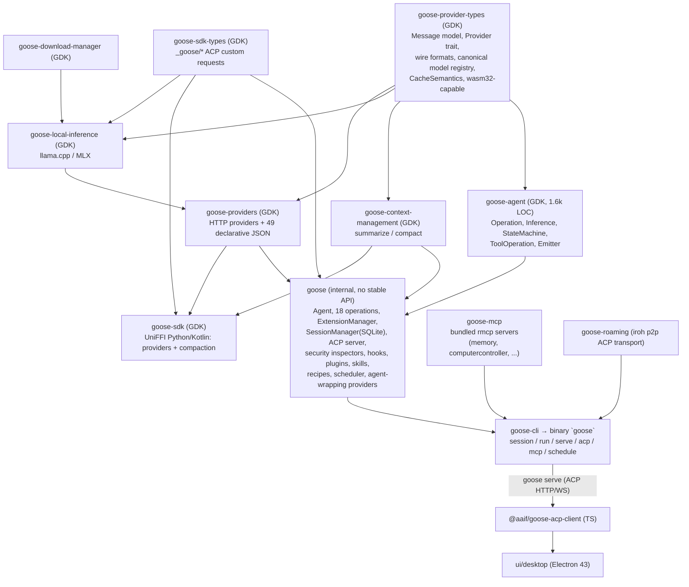

# Goose

> **Verdict.** Goose is a Rust agent product (CLI, Electron desktop, ACP server) that, at this pin, is partway through becoming a toolkit. The classic `while`-style reply loop was deleted days before the pin (GDK changelog entry #12760, 2026-10-13). `Agent::reply` now drives a **re-entrant state machine** from the new `goose-agent` crate: an ordered list of 18 `Operation`s plus one `Inference` step, evaluated first-match against the conversation that is persisted in SQLite. Every step's effects are written to the session store, and the session is reloaded before the next step. Extensions are MCP servers in four placements (in-process "platform" clients, bundled `rmcp` servers over in-memory pipes, stdio subprocesses, streamable HTTP with OAuth). The provider layer is one of the broadest in this study. About 36 native provider registrations and 49 declarative JSON providers sit under one `Provider` trait. That trait also wraps *other agents* (Claude Agent ACP, codex-acp, pi-acp, Amp, Copilot, Cursor) as "providers". The desktop no longer uses the bespoke `goosed` REST server. It spawns `goose serve` and speaks ACP over HTTP/WebSocket, with 83 `_goose/unstable/*` request methods plus a `_goose/unstable/session/update` notification. Safety is approval-centric and permissive by default: `GooseMode::Auto` is the default, the prompt-injection scanner is off by default, and there is no OS sandbox. Build on Goose if you want a batteries-included, MCP-native agent that you drive over ACP, or if you want to experiment with the GDK state-machine crates. Do not choose it for a small, stable, in-process library or for strong default isolation.

| | |
|---|---|
| Repo(s) | `aaif-goose/goose` @ `9686d674000a` (formerly `block/goose`; move announced in-repo 2026-04-07) |
| License | Apache-2.0 (workspace `Cargo.toml`; authors field `AAIF <ai-oss-tools@block.xyz>`) |
| Language(s) | Rust (edition 2021, MSRV 1.94.1) for the agent; TypeScript/React/Electron for the desktop; small Python eval tooling |
| Size | 2,525 tracked files. Rust in `crates/`: ~298k lines total, ~32.5k of them in `tests/` dirs (plus inline `#[cfg(test)]` modules in 307 files). By crate (non-`tests/` lines, inline tests included): `goose` 160,258 (agents 46.7k, providers 34.8k, acp 24.4k, session 10.3k); `goose-cli` 27,655; `goose-provider-types` 31,365 (+283k-line `canonical_models.json` data); `goose-providers` 16,360; `goose-local-inference` 10,347; `goose-mcp` 6,120; `goose-sdk` 3,023; `goose-sdk-types` 3,230; `goose-roaming` 2,308; **`goose-agent` 1,645** (the loop); `goose-context-management` 1,156. Desktop `ui/desktop/src` ~69.8k TS/TSX non-test lines; `@aaif/goose-acp-client` ~7.7k |
| Version at pin | Workspace 1.55.0 (bump commit 2026-10-14; latest published GitHub release is v1.54.0, 2026-10-08). GDK crates 0.1.0-alpha.12 |
| Release history | Repo created 2024-08-23 → v0.9.0 (2024-09-10, the original Python CLI era) → **v1.0.0 (2025-01-28)** → v1.20.0 (2026-01-16) → AAIF formed with goose as a founding project (Linux Foundation press release, 2025-12-09) → repo moved to `aaif-goose` (blog 2026-04-07) → v1.30.0 (2026-04-08; "goose 2.0 beta" ACP blog) → Q3 roadmap (2026-07-20, discussion #10579: "primary future of Goose is as a developer kit") → state-machine blog (2026-09-16) → legacy loop deleted (GDK 0.1.0-alpha.12, 2026-10-13) → 1.55.0 bump at pin |
| Category | `hybrid`: a product (CLI + desktop + server) deliberately being split into published GDK crates (`goose-agent`, `goose-providers`, `goose-context-management`, `goose-sdk`) |

## 1. Layering & package map



What each layer owns:

| Layer | Owns | Evidence |
|---|---|---|
| `goose-provider-types` | `Message`/`MessageContent`/`MessageMetadata`, `Conversation` projection helpers (`effective_role`, `fix_conversation`, `merge_consecutive_messages_for_request`), the `Provider` trait, format adapters (OpenAI chat, OpenAI Responses, Anthropic, Google, Databricks, Snowflake, Ollama), prompt-cache semantics, a bundled canonical model catalog | [`base.rs:L517-L539`](https://github.com/aaif-goose/goose/blob/9686d674000a5fbb8139214863289e4820714771/crates/goose-provider-types/src/base.rs#L517-L539), [`message.rs:L313-L330`](https://github.com/aaif-goose/goose/blob/9686d674000a5fbb8139214863289e4820714771/crates/goose-provider-types/src/conversation/message.rs#L313-L330) |
| `goose-agent` | The loop protocol only. It depends on nothing goose-specific beyond `goose-provider-types` and `rmcp` | [`goose-agent/Cargo.toml:L14-L25`](https://github.com/aaif-goose/goose/blob/9686d674000a5fbb8139214863289e4820714771/crates/goose-agent/Cargo.toml#L14-L25) |
| `goose` | The reference assembly of operations, extensions, sessions, ACP server, safety. Explicitly *not* a stable API | [`AGENTS.md:L83`](https://github.com/aaif-goose/goose/blob/9686d674000a5fbb8139214863289e4820714771/AGENTS.md#L83), [`state_machine/mod.rs:L1-L6`](https://github.com/aaif-goose/goose/blob/9686d674000a5fbb8139214863289e4820714771/crates/goose/src/agents/state_machine/mod.rs#L1-L6) |
| GDK release set | `release = true, version_group = "gdk"` for 8 crates | [`release-plz.toml:L1-L52`](https://github.com/aaif-goose/goose/blob/9686d674000a5fbb8139214863289e4820714771/release-plz.toml#L1-L52) |

`goose-mcp` is only a dev-dependency of `goose`. The CLI links it and registers `BUILTIN_EXTENSIONS` at runtime, so the core crate does not hard-depend on the bundled servers ([`goose-cli/src/cli.rs:L2801`](https://github.com/aaif-goose/goose/blob/9686d674000a5fbb8139214863289e4820714771/crates/goose-cli/src/cli.rs#L2801), [`goose-mcp/src/lib.rs:L89-L101`](https://github.com/aaif-goose/goose/blob/9686d674000a5fbb8139214863289e4820714771/crates/goose-mcp/src/lib.rs#L89-L101)).

## 2. Agent loop

### 2.1 The protocol (`goose-agent`)

The loop is a library-level protocol of about 1.6k lines:

- **`Operation<S, E>`**: `name`, `run`, `run_command` (slash commands), `inference_tools`, `prompt_parts`, `moim_parts`, `finalize_cancellation`, plus `set_message_meta`/`message_meta` that store *operation notes* on persisted messages ([`operation.rs:L78-L138`](https://github.com/aaif-goose/goose/blob/9686d674000a5fbb8139214863289e4820714771/crates/goose-agent/src/operation.rs#L78-L138)).
- **`Inference<S, E>`**: an `Operation` with `applies(conversation)`, `prepare_session`, and `infer(session, conversation, InferenceInput, emit)` ([`operation.rs:L140-L165`](https://github.com/aaif-goose/goose/blob/9686d674000a5fbb8139214863289e4820714771/crates/goose-agent/src/operation.rs#L140-L165)).
- **Results**: `OperationResult::{NotApplicable, Applied(StepResult)}`, where `RunStatus::{Continuing, Yielded, Cancelled}` ([`operation.rs:L167-L211`](https://github.com/aaif-goose/goose/blob/9686d674000a5fbb8139214863289e4820714771/crates/goose-agent/src/operation.rs#L167-L211)).
- **Effects vs events**: `ConversationEffect::{AppendMessage, ReplaceConversation, PatchToolRequestMeta, SetMessageVisibility}` are durable ([`operation.rs:L213-L229`](https://github.com/aaif-goose/goose/blob/9686d674000a5fbb8139214863289e4820714771/crates/goose-agent/src/operation.rs#L213-L229)). `AgentEvent::{Message, Usage, MessageUsage, McpNotification, HistoryReplaced}` are live, sent on an unbounded channel through `Emitter` ([`events.rs:L8-L18`](https://github.com/aaif-goose/goose/blob/9686d674000a5fbb8139214863289e4820714771/crates/goose-agent/src/events.rs#L8-L18), [`operation.rs:L260-L287`](https://github.com/aaif-goose/goose/blob/9686d674000a5fbb8139214863289e4820714771/crates/goose-agent/src/operation.rs#L260-L287)).
- **Host traits**: `MachineSession`, `SessionLoader<S>`, `EffectHandler<S, E>` ([`machine.rs:L18-L39`](https://github.com/aaif-goose/goose/blob/9686d674000a5fbb8139214863289e4820714771/crates/goose-agent/src/machine.rs#L18-L39)).

`StateMachine::step` walks the steps in order and returns the first one that applies. For the `Inference` step, it first collects `inference_tools`, `prompt_parts` and `moim_parts` from **every** step into an `InferenceInput`. Duplicate tool names across operations are a hard error ([`machine.rs:L121-L190`](https://github.com/aaif-goose/goose/blob/9686d674000a5fbb8139214863289e4820714771/crates/goose-agent/src/machine.rs#L121-L190), [`machine.rs:L94-L106`](https://github.com/aaif-goose/goose/blob/9686d674000a5fbb8139214863289e4820714771/crates/goose-agent/src/machine.rs#L94-L106)). `run` loops `load → step → apply` until the status is not `Continuing`, and it **reloads the session from the store on every iteration**; it never caches it ([`machine.rs:L211-L226`](https://github.com/aaif-goose/goose/blob/9686d674000a5fbb8139214863289e4820714771/crates/goose-agent/src/machine.rs#L211-L226)). "Turn" boundaries are re-derived from history: `messages_since_kickoff` finds the last user-visible, non-tool-response user message ([`operation.rs:L25-L36`](https://github.com/aaif-goose/goose/blob/9686d674000a5fbb8139214863289e4820714771/crates/goose-agent/src/operation.rs#L25-L36)).

### 2.2 Goose's pipeline

`build_state_machine` assembles the reference pipeline ([`state_machine_builder.rs:L43-L132`](https://github.com/aaif-goose/goose/blob/9686d674000a5fbb8139214863289e4820714771/crates/goose/src/agents/state_machine_builder.rs#L43-L132)):

```
SlashCommand → ToolApproval → Skill → Recipe → ToolExecution → RemainingToolCalls
→ Subagent → Steer → BangShell → [Compaction]* → ToolPairCompaction → Doctor
→ Project → Retry → EmptyResponse → StopHook → ExitOnError → MaxTurns → Inference("llm")
                     * omitted when provider.manages_own_context()
```

`SlashCommandOperation` fans `run_command` out to every operation plus a command-only `StatusOperation`, so each feature owns its own `/command` (`/compact`, `/clear`, `/goal`, `/grind`, `/skills`, `/prompts`, `/doctor`, `/status`) ([`state_machine_builder.rs:L121-L131`](https://github.com/aaif-goose/goose/blob/9686d674000a5fbb8139214863289e4820714771/crates/goose/src/agents/state_machine_builder.rs#L121-L131)). The effect type is extended to `GooseEffect::{Conversation, CompactConversation, SetRecipe, SetExtensionState, RecordUsage}` ([`effects.rs:L9-L22`](https://github.com/aaif-goose/goose/blob/9686d674000a5fbb8139214863289e4820714771/crates/goose/src/agents/state_machine/effects.rs#L9-L22)). `SessionManager` is the `EffectHandler`: each effect becomes a SQLite write (`add_message`, `replace_conversation`, `save_compacted_conversation`, `update_tool_request_meta`, ...), and live events are emitted only after the persistence pass ([`state_machine/session.rs:L40-L153`](https://github.com/aaif-goose/goose/blob/9686d674000a5fbb8139214863289e4820714771/crates/goose/src/agents/state_machine/session.rs#L40-L153)).

### 2.3 A turn, step by step

1. `Agent::reply` → `reply_impl`. Elicitation responses short-circuit here ([`agent.rs:L953-L1035`](https://github.com/aaif-goose/goose/blob/9686d674000a5fbb8139214863289e4820714771/crates/goose/src/agents/agent.rs#L953-L1035)). Then `reply_with_state_machine_inner` claims a per-session turn guard, **persists the user message**, spawns background session naming, and builds a fresh machine ([`agent.rs:L637-L695`](https://github.com/aaif-goose/goose/blob/9686d674000a5fbb8139214863289e4820714771/crates/goose/src/agents/agent.rs#L637-L695)).
2. `run_goose` fires `SessionStart`/`UserPromptSubmit` hooks once per kickoff, then calls `machine.run` ([`state_machine/session.rs:L253-L362`](https://github.com/aaif-goose/goose/blob/9686d674000a5fbb8139214863289e4820714771/crates/goose/src/agents/state_machine/session.rs#L253-L362)).
3. With a user tail, no earlier operation applies, so `Inference` runs. `InferenceRunner::applies` requires no trailing error and a user/tool effective tail ([`inference.rs:L377-L383`](https://github.com/aaif-goose/goose/blob/9686d674000a5fbb8139214863289e4820714771/crates/goose-agent/src/inference.rs#L377-L383)). It projects the agent-visible history, drops unanswered tool requests from *earlier* turns ([`inference.rs:L223-L253`](https://github.com/aaif-goose/goose/blob/9686d674000a5fbb8139214863289e4820714771/crates/goose-agent/src/inference.rs#L223-L253)), calls `provider.resume(provider_session_id)` for stateful providers ([`inference.rs:L423-L432`](https://github.com/aaif-goose/goose/blob/9686d674000a5fbb8139214863289e4820714771/crates/goose-agent/src/inference.rs#L423-L432)), and streams chunks out as `AgentEvent::Message` while accumulating them in operation-owned state ([`inference.rs:L443-L535`](https://github.com/aaif-goose/goose/blob/9686d674000a5fbb8139214863289e4820714771/crates/goose-agent/src/inference.rs#L443-L535)).
4. The assistant message, with `ToolRequest`s, is persisted. On the next step `ToolApproval` inspects pending requests (§7). It marks each request `goose.executable` true/false and, where needed, appends a user-only `ActionRequired` confirmation ([`ops_tool_approval.rs:L38-L148`](https://github.com/aaif-goose/goose/blob/9686d674000a5fbb8139214863289e4820714771/crates/goose/src/agents/state_machine/ops_tool_approval.rs#L38-L148)).
5. `ToolExecution` claims advertised requests that its extension lease knows about, then runs them (§4). `RemainingToolCalls` answers unclaimed requests with an error and **yields while any approval is outstanding**.
6. A tool response makes the tail `Tool`, so `Inference` runs again.
7. When the model answers without tool calls, `Inference` no longer applies. `StopHook` fires the `Stop` hook: `Allow` yields (the turn ends), and `Deny` appends a denial context message that forces another inference, capped by `GOOSE_STOP_HOOK_BLOCK_CAP` (default 8) ([`ops_stop_hook.rs:L80-L119`](https://github.com/aaif-goose/goose/blob/9686d674000a5fbb8139214863289e4820714771/crates/goose/src/agents/state_machine/ops_stop_hook.rs#L80-L119), [`agent.rs:L52-L53`](https://github.com/aaif-goose/goose/blob/9686d674000a5fbb8139214863289e4820714771/crates/goose/src/agents/agent.rs#L52-L53)).

**Stop conditions.** These are: natural end (stop hook allows), a yield for approval, `MaxTurnsOperation` (default `GOOSE_MAX_TURNS` = 1000 assistant turns; it also injects `<turn-budget>n/max used</turn-budget>` into the turn context once half is used) ([`ops_maxturns.rs:L14-L67`](https://github.com/aaif-goose/goose/blob/9686d674000a5fbb8139214863289e4820714771/crates/goose/src/agents/state_machine/ops_maxturns.rs#L14-L67)), `ExitOnError`, and cancellation.

**Steering.** `Agent::steer` pushes onto an in-memory per-session `VecDeque` ([`agent.rs:L293-L299`](https://github.com/aaif-goose/goose/blob/9686d674000a5fbb8139214863289e4820714771/crates/goose/src/agents/agent.rs#L293-L299)). `SteerOperation` drains it only "between turns", i.e. after a final assistant message or a tool response. It marks the messages `steer` and fires `UserPromptSubmit` ([`ops_steer.rs:L60-L97`](https://github.com/aaif-goose/goose/blob/9686d674000a5fbb8139214863289e4820714771/crates/goose/src/agents/state_machine/ops_steer.rs#L60-L97)). Over ACP this is `_goose/unstable/session/steer`, which must name the active run id ([`acp/server.rs:L2346-L2386`](https://github.com/aaif-goose/goose/blob/9686d674000a5fbb8139214863289e4820714771/crates/goose/src/acp/server.rs#L2346-L2386)). The blog concedes that pending steers are not durable until drained.

**Cancellation.** The machine races each step against the `CancellationToken` and drops the losing future ([`machine.rs:L159-L171`](https://github.com/aaif-goose/goose/blob/9686d674000a5fbb8139214863289e4820714771/crates/goose-agent/src/machine.rs#L159-L171)). `finalize` then saves the interrupted step's buffered output, answers every unanswered tool request since kickoff with `"Tool call was interrupted before completing"`, and runs every other operation's `finalize_cancellation` once ([`machine.rs:L69-L92`](https://github.com/aaif-goose/goose/blob/9686d674000a5fbb8139214863289e4820714771/crates/goose-agent/src/machine.rs#L69-L92), [`machine.rs:L228-L263`](https://github.com/aaif-goose/goose/blob/9686d674000a5fbb8139214863289e4820714771/crates/goose-agent/src/machine.rs#L228-L263)). The transcript therefore always stays provider-valid.

**Retries and recovery** happen at four layers:

| Layer | What it handles | Evidence |
|---|---|---|
| Provider | `ProviderRetry::with_retry`, exponential backoff (3 retries, 1 s initial, ×2, 30 s cap) | [`retry.rs:L14-L17`](https://github.com/aaif-goose/goose/blob/9686d674000a5fbb8139214863289e4820714771/crates/goose-provider-types/src/retry.rs#L14-L17), [`anthropic.rs:L190`](https://github.com/aaif-goose/goose/blob/9686d674000a5fbb8139214863289e4820714771/crates/goose-providers/src/anthropic.rs#L190) |
| Inference | Up to 3 empty-response retries, then a hidden marker message that recipe/final-output operations may claim | [`inference.rs:L75-L89`](https://github.com/aaif-goose/goose/blob/9686d674000a5fbb8139214863289e4820714771/crates/goose-agent/src/inference.rs#L75-L89) |
| Context overflow | A `ContextLengthExceeded` error triggers reactive compaction, at most `MAX_CONTEXT_ERROR_COMPACTIONS` = 2 times | [`ops_compaction.rs:L24`](https://github.com/aaif-goose/goose/blob/9686d674000a5fbb8139214863289e4820714771/crates/goose/src/agents/state_machine/ops_compaction.rs#L24) |
| Task level | Recipe `retry` (shell success `checks`, `on_failure` command, conversation reset to the kickoff), plus `/goal` (verify before finishing) and `/grind` (keep working to `max_turns`). Attempts are counted as operation notes on the kickoff message | [`ops_retry.rs:L42-L130`](https://github.com/aaif-goose/goose/blob/9686d674000a5fbb8139214863289e4820714771/crates/goose/src/agents/state_machine/ops_retry.rs#L42-L130), [`types.rs:L11-L25`](https://github.com/aaif-goose/goose/blob/9686d674000a5fbb8139214863289e4820714771/crates/goose/src/agents/types.rs#L11-L25) |

**Testing discipline.** `run_reconstructing_each_step` throws away the machine and the test harness after every applied step and rebuilds both from the persisted session ([`tests/pipeline.rs:L358-L395`](https://github.com/aaif-goose/goose/blob/9686d674000a5fbb8139214863289e4820714771/crates/goose/src/agents/state_machine/tests/pipeline.rs#L358-L395)). That is a direct check that no progress hides in locals. The state-machine test suite alone is 9k lines.

## 3. Model / provider abstraction

**Message model.** `MessageContent` (an alias of `MessageContentBlock`) has variants `Text`, `Image`, `Document`, `ToolRequest`, `ToolResponse`, `ToolConfirmationRequest`, `ActionRequired`, `Thinking`, `RedactedThinking`, `SystemNotification` and `Error` ([`message.rs:L313-L330`](https://github.com/aaif-goose/goose/blob/9686d674000a5fbb8139214863289e4820714771/crates/goose-provider-types/src/conversation/message.rs#L313-L330)). `MessageMetadata` carries separate `user_visible` and `agent_visible` flags. It also carries `inference` (provider, requested and resolved model, `provider_session_id`), `output_token_limit_reached`, `steer`, `turn_context`, per-message `usage`, and `operations` (the operation-notes map, "never sent to providers") ([`message.rs:L829-L854`](https://github.com/aaif-goose/goose/blob/9686d674000a5fbb8139214863289e4820714771/crates/goose-provider-types/src/conversation/message.rs#L829-L854)). The two visibility bits are the foundation of non-destructive compaction and of UI-only or agent-only messages.

**The `Provider` trait.** The only required method is `stream(model_config, system, messages, tools) -> MessageStream`. Optional methods include `provider_session_id`/`resume` (stateful backends), `get_context_limit`, `retry_config`, model discovery, canonical-model mapping, and `manages_own_context()` ([`base.rs:L517-L697`](https://github.com/aaif-goose/goose/blob/9686d674000a5fbb8139214863289e4820714771/crates/goose-provider-types/src/base.rs#L517-L697)). `manages_own_context` is how Goose treats a wrapped agent (Claude Code, Gemini CLI, ACP agents). When it is true, the builder drops `CompactionOperation` and tool-pair summarization ([`state_machine_builder.rs:L66-L99`](https://github.com/aaif-goose/goose/blob/9686d674000a5fbb8139214863289e4820714771/crates/goose/src/agents/state_machine_builder.rs#L66-L99)). The session lease also stops loading stdio/HTTP extensions locally, because the wrapped agent runs its own tool loop ([`extension_manager/mod.rs:L744-L769`](https://github.com/aaif-goose/goose/blob/9686d674000a5fbb8139214863289e4820714771/crates/goose/src/agents/extension_manager/mod.rs#L744-L769)).

**Coverage.** `init.rs` registers about 36 native providers. They include Anthropic, OpenAI, Azure, Azure Foundry, Bedrock, SageMaker, Vertex, Google, Databricks (v1/v2), Snowflake, OpenRouter, LiteLLM, Ollama, xAI (+OAuth), GitHub Copilot, ChatGPT-Codex OAuth, Gemini OAuth, HuggingFace, Tetrate, NanoGPT, local inference, and the agent wrappers below ([`providers/init.rs:L64-L183`](https://github.com/aaif-goose/goose/blob/9686d674000a5fbb8139214863289e4820714771/crates/goose/src/providers/init.rs#L64-L183)). Another 49 OpenAI-compatible endpoints are declarative JSON files in `goose-providers/src/declarative/definitions/` (DeepSeek, Groq, Mistral, Moonshot, Z.ai, Cerebras, Together, Vercel AI Gateway, OpenCode Zen/Go, LM Studio, ...). Users can add custom providers at runtime (`_goose/unstable/providers/custom/*`). `goose-local-inference` runs GGUF through `llama-cpp-2`, with optional MLX/CUDA/Vulkan backends ([`goose-local-inference/README.md:L1-L15`](https://github.com/aaif-goose/goose/blob/9686d674000a5fbb8139214863289e4820714771/crates/goose-local-inference/README.md#L1-L15)). For models without native tool calling, the **toolshim** sends the text output to a second "interpreter" model (Ollama structured output) that extracts tool calls ([`toolshim.rs:L1-L30`](https://github.com/aaif-goose/goose/blob/9686d674000a5fbb8139214863289e4820714771/crates/goose/src/providers/toolshim.rs#L1-L30)).

**Agents as providers.** `AcpProvider` launches an external ACP agent as a subprocess (`AcpProviderConfig { command, args, env, mcp_servers, session_mode_id, mode_mapping, ... }`). It maps `GooseMode` to the agent's session modes and passes Goose's extensions through as ACP `mcp_servers` ([`acp/provider.rs:L61-L76`](https://github.com/aaif-goose/goose/blob/9686d674000a5fbb8139214863289e4820714771/crates/goose/src/acp/provider.rs#L61-L76)). Concrete wrappers: `claude-acp` (binary `claude-agent-acp`, `GooseMode::Chat` → `"plan"`), `codex-acp`, `pi-acp`, `amp-acp`, `copilot-acp`, `cursor-agent`. CLI wrappers exist for `claude-code`, `codex` and `gemini-cli`, and the legacy ids `claude-code`/`codex`/`gemini-cli` are remapped to their ACP or OAuth successors ([`claude_acp.rs:L16-L18`](https://github.com/aaif-goose/goose/blob/9686d674000a5fbb8139214863289e4820714771/crates/goose/src/providers/claude_acp.rs#L16-L18), [`claude_acp.rs:L82`](https://github.com/aaif-goose/goose/blob/9686d674000a5fbb8139214863289e4820714771/crates/goose/src/providers/claude_acp.rs#L82), [`catalog_util.rs:L190-L192`](https://github.com/aaif-goose/goose/blob/9686d674000a5fbb8139214863289e4820714771/crates/goose/src/providers/catalog_util.rs#L190-L192)). One small defect: `pi_acp.rs` sets `PI_ACP_DOC_URL` to `https://github.com/anthropics/pi`, which is not Pi's repo. The setup metadata in the same file correctly points at `badlogic/pi-mono` ([`pi_acp.rs:L17-L45`](https://github.com/aaif-goose/goose/blob/9686d674000a5fbb8139214863289e4820714771/crates/goose/src/providers/pi_acp.rs#L17-L45)).

**Reasoning/thinking.** `Thinking`/`RedactedThinking` blocks persist with signatures. `InferenceRunner` drops thinking that repeats across tool-call chunks ([`inference.rs:L98-L115`](https://github.com/aaif-goose/goose/blob/9686d674000a5fbb8139214863289e4820714771/crates/goose-agent/src/inference.rs#L98-L115)). Thinking effort is a per-session config option (`thinking_effort`) settable over ACP.

**Prompt caching.** This is unusually deliberate. `CacheSemantics::{ExplicitBreakpoints{max_breakpoints}, ImplicitTolerant, ImplicitStrict, Uncached}` is declared per (provider, model) pair: Anthropic, MiniMax, Z.ai, Kimi Code and Claude-on-Bedrock/Vertex/Databricks/OpenRouter get 4 explicit breakpoints, and OpenAI Responses is strict-prefix ([`cache_semantics.rs:L1-L40`](https://github.com/aaif-goose/goose/blob/9686d674000a5fbb8139214863289e4820714771/crates/goose-provider-types/src/cache_semantics.rs#L1-L40)). A `prefix_invariance` test asserts that "the cache-relevant bytes a provider has already seen must never change" across consecutive requests ([`tests/prefix_invariance.rs:L1-L8`](https://github.com/aaif-goose/goose/blob/9686d674000a5fbb8139214863289e4820714771/crates/goose-provider-types/tests/prefix_invariance.rs#L1-L8)). The system prompt is built to cooperate (§5).

**Token and cost accounting.** `GooseEffect::RecordUsage` updates per-session counters (current and accumulated input/output/cache-read/cache-write tokens, `accumulated_cost`). It also appends to a `usage_ledger` table that records `cost_source` and `is_compaction` ([`session_manager.rs:L1139-L1217`](https://github.com/aaif-goose/goose/blob/9686d674000a5fbb8139214863289e4820714771/crates/goose/src/session/session_manager.rs#L1139-L1217)). Pricing comes from the bundled canonical catalog (`canonical_cost.rs`).

## 4. Tool system

**Definition API.** Every tool is an MCP `rmcp::model::Tool` (JSON Schema). Inside Goose, every tool source implements `McpClientTrait` (`list_tools`, `call_tool`, `get_instructions`, resources, prompts, `subscribe`, and `get_moim` for per-turn context), *including in-process Rust tools* ([`mcp_client.rs:L76-L140`](https://github.com/aaif-goose/goose/blob/9686d674000a5fbb8139214863289e4820714771/crates/goose/src/agents/mcp_client.rs#L76-L140)). In the GDK, `ToolOperation<S>` adapts `rmcp` `SyncTool`/`AsyncTool` implementations, or a dynamic `ToolProvider<S>`, into one operation ([`tool.rs:L119-L135`](https://github.com/aaif-goose/goose/blob/9686d674000a5fbb8139214863289e4820714771/crates/goose-agent/src/tool.rs#L119-L135), [`tool.rs:L193-L261`](https://github.com/aaif-goose/goose/blob/9686d674000a5fbb8139214863289e4820714771/crates/goose-agent/src/tool.rs#L193-L261)). The GDK `ToolOperation` executes calls **sequentially** ([`tool.rs:L328-L396`](https://github.com/aaif-goose/goose/blob/9686d674000a5fbb8139214863289e4820714771/crates/goose-agent/src/tool.rs#L328-L396)). Goose's own `ToolExecutionOperation` does not.

**Built-in tools** are platform extensions registered in `PLATFORM_EXTENSIONS` ([`platform_extensions/mod.rs:L31-L217`](https://github.com/aaif-goose/goose/blob/9686d674000a5fbb8139214863289e4820714771/crates/goose/src/agents/platform_extensions/mod.rs#L31-L217)):

| Extension | Default | Tools / role |
|---|---|---|
| `developer` | on, unprefixed | `write`, `edit`, `shell`, `tree`, `read_image` ([`developer/mod.rs:L109-L180`](https://github.com/aaif-goose/goose/blob/9686d674000a5fbb8139214863289e4820714771/crates/goose/src/agents/platform_extensions/developer/mod.rs#L109-L180)) |
| `analyze` (tree-sitter) | on, unprefixed | directory overview, file details, symbol call graphs |
| `summon` | on, unprefixed | `load` (knowledge/recipes/agents), `delegate` (subagents) |
| `skills` | on | `load_skill` (owned by `SkillOperation`) |
| `extensionmanager` | on | search/enable/disable extensions at runtime |
| `tom` (top of mind) | on | injects `GOOSE_MOIM_MESSAGE_TEXT/FILE` into every turn |
| `apps` | on | MCP Apps: HTML/JS apps in sandboxed windows |
| `scheduler` | on, hidden | recipe scheduling |
| `todo`, `chatrecall`, `summarize`, `code_execution` | off | todo list, past-session search, LLM file summaries, "code mode" (TypeScript via `pctx_code_mode`/V8) |

`goose-mcp` additionally bundles `memory`, `computercontroller` (with docx/xlsx/pdf, plus Peekaboo on macOS), `autovisualiser` and `tutorial` as real `rmcp` servers ([`goose-mcp/src/lib.rs:L89-L101`](https://github.com/aaif-goose/goose/blob/9686d674000a5fbb8139214863289e4820714771/crates/goose-mcp/src/lib.rs#L89-L101)).

**Execution pipeline** (`ToolExecutionOperation::run`, [`ops_toolcalling.rs:L910-L1106`](https://github.com/aaif-goose/goose/blob/9686d674000a5fbb8139214863289e4820714771/crates/goose/src/agents/state_machine/ops_toolcalling.rs#L910-L1106)):

1. Select pending requests that were actually **advertised** to the model in that inference. The LLM operation records `advertised_tools` as an operation note ([`ops_toolcalling.rs:L729-L755`](https://github.com/aaif-goose/goose/blob/9686d674000a5fbb8139214863289e4820714771/crates/goose/src/agents/state_machine/ops_toolcalling.rs#L729-L755)). Assign each a disposition `Execute | Decline | ParseError` ([`ops_toolcalling.rs:L664-L718`](https://github.com/aaif-goose/goose/blob/9686d674000a5fbb8139214863289e4820714771/crates/goose/src/agents/state_machine/ops_toolcalling.rs#L664-L718)).
2. In `GooseMode::Chat`, answer each call with a "skipped" success instead of executing it ([`ops_toolcalling.rs:L987-L1008`](https://github.com/aaif-goose/goose/blob/9686d674000a5fbb8139214863289e4820714771/crates/goose/src/agents/state_machine/ops_toolcalling.rs#L987-L1008)).
3. For each executable call, in order: run the blocking `PreToolUse` hook chain, emit the extended pre-hooks, then `lease.call(...)` ([`ops_toolcalling.rs:L397-L470`](https://github.com/aaif-goose/goose/blob/9686d674000a5fbb8139214863289e4820714771/crates/goose/src/agents/state_machine/ops_toolcalling.rs#L397-L470)). `call` returns a *lazy* future plus notification and action-required streams ([`lease.rs:L664-L729`](https://github.com/aaif-goose/goose/blob/9686d674000a5fbb8139214863289e4820714771/crates/goose/src/agents/extension_manager/lease.rs#L664-L729)).
4. All result streams are merged with `futures::stream::select_all`, so **tool calls in one assistant message execute concurrently**. Notifications are forwarded as `McpNotification` events, and the results are collected into one batched tool-response message ([`ops_toolcalling.rs:L1010-L1106`](https://github.com/aaif-goose/goose/blob/9686d674000a5fbb8139214863289e4820714771/crates/goose/src/agents/state_machine/ops_toolcalling.rs#L1010-L1106)).
5. Each result passes through `large_response_handler::process_tool_response` and then the `PostToolUse`/`PostToolUseFailure`/`AfterShellExecution`/`AfterFileEdit` hooks ([`ops_toolcalling.rs:L267-L350`](https://github.com/aaif-goose/goose/blob/9686d674000a5fbb8139214863289e4820714771/crates/goose/src/agents/state_machine/ops_toolcalling.rs#L267-L350)).

**Extension lease.** Before each inference, `GooseInferenceRequestPreparer::prepare_session` resolves an `ExtensionLease` for the session ([`inference_preparation.rs:L24-L35`](https://github.com/aaif-goose/goose/blob/9686d674000a5fbb8139214863289e4820714771/crates/goose/src/agents/state_machine/inference_preparation.rs#L24-L35)). The lease is a snapshot of extension slots with a lazily built, de-duplicated `ToolCatalog` ([`lease.rs:L119-L183`](https://github.com/aaif-goose/goose/blob/9686d674000a5fbb8139214863289e4820714771/crates/goose/src/agents/extension_manager/lease.rs#L119-L183)), so the tools the model saw are the tools that get dispatched. Tool names are `{extension_key}__{tool}` unless the extension is marked `unprefixed_tools`. A recovery path un-mangles names models garble ([`lease.rs:L573-L635`](https://github.com/aaif-goose/goose/blob/9686d674000a5fbb8139214863289e4820714771/crates/goose/src/agents/extension_manager/lease.rs#L573-L635)).

**Output truncation** has two tiers. The developer shell keeps 2,000 lines / 50 KB in context, with a 50-line / 10 KB preview, and writes the full output to rotating slot files ([`shell.rs:L159-L164`](https://github.com/aaif-goose/goose/blob/9686d674000a5fbb8139214863289e4820714771/crates/goose/src/agents/platform_extensions/developer/shell.rs#L159-L164)). Any tool text over `GOOSE_MAX_TOOL_RESPONSE_SIZE` (default 200,000 chars) is spilled to a temp file `goose_mcp_response_*.txt`, and the model receives the path instead ([`large_response_handler.rs:L5-L66`](https://github.com/aaif-goose/goose/blob/9686d674000a5fbb8139214863289e4820714771/crates/goose/src/agents/large_response_handler.rs#L5-L66)).

**Client-side tools over ACP.** When an ACP client advertises `fs` or `terminal` capabilities (e.g. Zed), `AcpTools` wraps the developer extension so that `read`/`write`/`edit`/`shell` execute *in the client* via `fs/read_text_file`, `fs/write_text_file` and `terminal/create` ([`acp/fs.rs:L66-L74`](https://github.com/aaif-goose/goose/blob/9686d674000a5fbb8139214863289e4820714771/crates/goose/src/acp/fs.rs#L66-L74), [`acp/fs.rs:L395-L440`](https://github.com/aaif-goose/goose/blob/9686d674000a5fbb8139214863289e4820714771/crates/goose/src/acp/fs.rs#L395-L440)).

## 5. Context management

**System prompt assembly.** `system.md` is short: identity, a MOIM explainer block, an optional extensions section, and response guidelines ([`prompts/system.md:L1-L39`](https://github.com/aaif-goose/goose/blob/9686d674000a5fbb8139214863289e4820714771/crates/goose/src/prompts/system.md#L1-L39)). `SystemPromptBuilder::build` sorts extensions by name "for multi session prompt caching". It sanitizes Unicode tag characters (a hidden-prompt-injection defence) from overrides, extension instructions and extras, and appends `# Additional Instructions` that contain hints and operation `prompt_parts` ([`prompt_manager.rs:L114-L182`](https://github.com/aaif-goose/goose/blob/9686d674000a5fbb8139214863289e4820714771/crates/goose/src/agents/prompt_manager.rs#L114-L182)). The timestamp is truncated to the hour to preserve cache hits ([`prompt_manager.rs:L186-L192`](https://github.com/aaif-goose/goose/blob/9686d674000a5fbb8139214863289e4820714771/crates/goose/src/agents/prompt_manager.rs#L186-L192)). Sessions may carry `system_prompt_override` and `system_prompt_extras` (used, for example, for subagent prompts).

**Turn context ("MOIM", message-of-immediate-moment).** Volatile per-turn data (current time, working directory, `<compaction>~Nk tokens remaining</compaction>`, `<turn-budget>`, top-of-mind text, extension `get_moim` output) is **not** put in the system prompt. Instead it is appended as an agent-only user message flagged `turn_context`, persisted, and reused byte-for-byte for the rest of the turn ([`moim.rs:L6-L24`](https://github.com/aaif-goose/goose/blob/9686d674000a5fbb8139214863289e4820714771/crates/goose/src/agents/moim.rs#L6-L24), [`moim.rs:L95-L111`](https://github.com/aaif-goose/goose/blob/9686d674000a5fbb8139214863289e4820714771/crates/goose/src/agents/moim.rs#L95-L111), [`inference_preparation.rs:L37-L90`](https://github.com/aaif-goose/goose/blob/9686d674000a5fbb8139214863289e4820714771/crates/goose/src/agents/state_machine/inference_preparation.rs#L37-L90)). It is skipped for models with context windows under 32k.

**Project instruction files.** `CONTEXT_FILE_NAMES` defaults to `[".goosehints", "AGENTS.md"]` ([`load_hints.rs:L10-L24`](https://github.com/aaif-goose/goose/blob/9686d674000a5fbb8139214863289e4820714771/crates/goose/src/hints/load_hints.rs#L10-L24)). `load_hint_files` merges two sources. Global hints come from the config dir plus `~/.agents/AGENTS.md`. Project hints come from every directory between the git root and the cwd, with `@file` imports expanded inside the git-root boundary and `.gitignore` respected ([`load_hints.rs:L232-L311`](https://github.com/aaif-goose/goose/blob/9686d674000a5fbb8139214863289e4820714771/crates/goose/src/hints/load_hints.rs#L232-L311)). `SubdirectoryHintTracker` lazily loads nested hint files for directories the agent touches. It scans `path` arguments and path-like shell tokens in tool calls ([`load_hints.rs:L26-L103`](https://github.com/aaif-goose/goose/blob/9686d674000a5fbb8139214863289e4820714771/crates/goose/src/hints/load_hints.rs#L26-L103)). `ToolExecutionOperation::prompt_parts` injects these hints, and when code mode is off it also injects per-extension instructions ([`ops_toolcalling.rs:L857-L908`](https://github.com/aaif-goose/goose/blob/9686d674000a5fbb8139214863289e4820714771/crates/goose/src/agents/state_machine/ops_toolcalling.rs#L857-L908)).

**Compaction.** The trigger is the effective threshold `min(GOOSE_AUTO_COMPACT_THRESHOLD (0.8), GOOSE_AUTO_COMPACT_TOKEN_LIMIT (225,000) / context_limit)`. The 225k cap is documented as headroom below OpenAI's long-context price tier ([`context_mgmt/mod.rs:L23-L42`](https://github.com/aaif-goose/goose/blob/9686d674000a5fbb8139214863289e4820714771/crates/goose/src/context_mgmt/mod.rs#L23-L42)). `CompactionOperation` runs only ahead of an inference. It uses reported session tokens plus a tiktoken estimate for unreported tool results, and it also runs reactively after `ContextLengthExceeded` ([`ops_compaction.rs:L230-L332`](https://github.com/aaif-goose/goose/blob/9686d674000a5fbb8139214863289e4820714771/crates/goose/src/agents/state_machine/ops_compaction.rs#L230-L332)). The algorithm (`compact_messages`) works as follows ([`context_mgmt/mod.rs:L87-L183`](https://github.com/aaif-goose/goose/blob/9686d674000a5fbb8139214863289e4820714771/crates/goose/src/context_mgmt/mod.rs#L87-L183)):

- The full history is summarized by the session model, using the `goose-context-management` templates (structured summary with `FileActivity`).
- **Every original message is kept but flipped to `agent_visible=false`.** The UI still shows the full history.
- The summary and a continuation instruction are added as agent-only messages.
- The latest real user prompt and the current turn-context event are re-appended.

The result is non-destructive compaction that needs no separate branch file. A second strategy, `ToolPairCompactionOperation`, summarizes old tool request/response pairs in batches beyond a cutoff of `clamp(3·effective_limit/20000, 10, 500)` pairs. It is opt-in via `GOOSE_TOOL_PAIR_SUMMARIZATION` ([`context_mgmt/mod.rs:L383-L391`](https://github.com/aaif-goose/goose/blob/9686d674000a5fbb8139214863289e4820714771/crates/goose/src/context_mgmt/mod.rs#L383-L391), [`context_mgmt/mod.rs:L44-L48`](https://github.com/aaif-goose/goose/blob/9686d674000a5fbb8139214863289e4820714771/crates/goose/src/context_mgmt/mod.rs#L44-L48)). `goose-context-management` exposes the same summarizer as a standalone layered API (`summarize`, trait-based `compact`, and a `CompactingProvider` wrapper), and that API is published to Python and Kotlin via `goose-sdk` ([`goose-context-management/README.md:L1-L57`](https://github.com/aaif-goose/goose/blob/9686d674000a5fbb8139214863289e4820714771/crates/goose-context-management/README.md#L1-L57)).

**Spill-to-disk and memory.** Spill-to-disk is covered in §4. For memory there is the `memory` MCP server, `chatrecall` (search over past sessions), and `tom`. No vector store sits in core.

## 6. State, sessions & durability

**Storage.** Sessions live in SQLite at `<data_dir>/sessions/sessions.db` (WAL mode), currently at `CURRENT_SCHEMA_VERSION = 17` with forward migrations ([`session_manager.rs:L32-L34`](https://github.com/aaif-goose/goose/blob/9686d674000a5fbb8139214863289e4820714771/crates/goose/src/session/session_manager.rs#L32-L34), [`session_manager.rs:L1068`](https://github.com/aaif-goose/goose/blob/9686d674000a5fbb8139214863289e4820714771/crates/goose/src/session/session_manager.rs#L1068)). There are three tables ([`session_manager.rs:L1139-L1217`](https://github.com/aaif-goose/goose/blob/9686d674000a5fbb8139214863289e4820714771/crates/goose/src/session/session_manager.rs#L1139-L1217)):

- `sessions`: working_dir, type, token counters, `recipe_json`, `provider_name`, `model_config_json`, `goose_mode`, `parent_session_id`, `system_prompt_override`, `container_id`, `extension_data` JSON.
- `messages`: `message_id`, role, `content_json`, `metadata_json`.
- `usage_ledger`.

`SessionType ∈ {User, Scheduled, SubAgent, Hidden, Terminal, Gateway, Acp}` ([`session_manager.rs:L52-L61`](https://github.com/aaif-goose/goose/blob/9686d674000a5fbb8139214863289e4820714771/crates/goose/src/session/session_manager.rs#L52-L61)). Per-feature state, such as enabled extensions or `GoalState{goal, grind}`, lives in `extension_data` under a versioned key and is written by `GooseEffect::SetExtensionState`.

**Resume, fork, branch.** The CLI supports `goose session --resume`. ACP supports `session/load`, `session/list`, `session/delete`, `session/close` and `session/fork`. Fork is `copy_session` followed by `truncate_conversation` at a timestamp ([`acp/server/fork_session.rs:L3-L45`](https://github.com/aaif-goose/goose/blob/9686d674000a5fbb8139214863289e4820714771/crates/goose/src/acp/server/fork_session.rs#L3-L45), [`session_manager.rs:L587-L604`](https://github.com/aaif-goose/goose/blob/9686d674000a5fbb8139214863289e4820714771/crates/goose/src/session/session_manager.rs#L587-L604)). Sessions can be exported (JSON, Markdown, HTML) and **imported from Claude Code, Codex and Pi `.jsonl` transcripts** ([`goose-cli/src/cli.rs:L579-L585`](https://github.com/aaif-goose/goose/blob/9686d674000a5fbb8139214863289e4820714771/crates/goose-cli/src/cli.rs#L579-L585), `session/import_formats/{claude_code,codex,pi}.rs`).

**Durable-execution semantics.** Because each step's effects are committed before the next step reads the store, the conversation records progress at step granularity. Approvals do not hold a coroutine. `ToolApproval` writes an `ActionRequired` message, `RemainingToolCalls` yields, and `Agent::submit_tool_confirmation` persists the decision ([`agent.rs:L463-L536`](https://github.com/aaif-goose/goose/blob/9686d674000a5fbb8139214863289e4820714771/crates/goose/src/agents/agent.rs#L463-L536)). After a process restart, ACP `session/load` calls `resume_state_machine_turn`. That finds pending or answered-but-unapplied confirmations in the persisted conversation and continues the turn ([`acp/server/load_session.rs:L255-L296`](https://github.com/aaif-goose/goose/blob/9686d674000a5fbb8139214863289e4820714771/crates/goose/src/acp/server/load_session.rs#L255-L296), [`agent.rs:L712-L766`](https://github.com/aaif-goose/goose/blob/9686d674000a5fbb8139214863289e4820714771/crates/goose/src/agents/agent.rs#L712-L766)). Subagent sessions persist their own recipe, provider, model and extension selection, so a subagent can be restarted from the store ([`subagent_handler.rs:L31-L78`](https://github.com/aaif-goose/goose/blob/9686d674000a5fbb8139214863289e4820714771/crates/goose/src/agents/subagent_handler.rs#L31-L78)).

**Limits.** There is no automatic re-drive of a turn that crashed mid-inference or mid-tool. On the next prompt, unanswered requests from earlier turns are simply dropped from the provider projection. Tool side effects are not idempotency-tracked, which the state-machine blog acknowledges. Steering queues are in memory. There are no file checkpoints or undo: a code search for checkpoint/undo/restore in `crates/goose/src` finds nothing relevant.

## 7. Safety & sandboxing

**Modes.** `GooseMode ∈ {Auto (default), Approve, SmartApprove, Chat}` ([`goose_mode.rs:L22-L32`](https://github.com/aaif-goose/goose/blob/9686d674000a5fbb8139214863289e4820714771/crates/goose-provider-types/src/goose_mode.rs#L22-L32)). The mode is stored per session. The SQLite column defaults to `'auto'`.

**Inspector chain.** `Agent::create_tool_inspection_manager` installs five inspectors in priority order ([`agent.rs:L331-L359`](https://github.com/aaif-goose/goose/blob/9686d674000a5fbb8139214863289e4820714771/crates/goose/src/agents/agent.rs#L331-L359)):

| Inspector | Behaviour | Default |
|---|---|---|
| `SecurityInspector` | `PromptInjectionScanner`: 36 regex `THREAT_PATTERNS` ([`patterns.rs:L48-L308`](https://github.com/aaif-goose/goose/blob/9686d674000a5fbb8139214863289e4820714771/crates/goose/src/security/patterns.rs#L48-L308)) plus optional ML command/prompt classifiers (model or endpoint). Above `SECURITY_PROMPT_THRESHOLD` it returns `RequireApproval` with a finding id ([`security_inspector.rs:L28-L52`](https://github.com/aaif-goose/goose/blob/9686d674000a5fbb8139214863289e4820714771/crates/goose/src/security/security_inspector.rs#L28-L52)) | **off** (`SECURITY_PROMPT_ENABLED` defaults false, [`security/mod.rs:L58-L72`](https://github.com/aaif-goose/goose/blob/9686d674000a5fbb8139214863289e4820714771/crates/goose/src/security/mod.rs#L58-L72)) |
| `EgressInspector` | Extracts URLs, hosts and git remotes from shell/web tool args and logs `security.event_type="egress"`. Always returns `Allow` ([`egress_inspector.rs:L317-L383`](https://github.com/aaif-goose/goose/blob/9686d674000a5fbb8139214863289e4820714771/crates/goose/src/security/egress_inspector.rs#L317-L383)) | on, log-only |
| `AdversaryInspector` | A second LLM reviews `shell` calls against `~/.config/goose/adversary.md` rules and returns `Deny` on BLOCK. **Fails open** on error ([`adversary_inspector.rs:L14-L51`](https://github.com/aaif-goose/goose/blob/9686d674000a5fbb8139214863289e4820714771/crates/goose/src/security/adversary_inspector.rs#L14-L51)) | off unless the file exists |
| `PermissionInspector` | Auto → Allow. Approve/SmartApprove → user `permission.yaml` level (`AlwaysAllow/NeverAllow/AskBefore`). In SmartApprove, `readOnlyHint` annotations auto-allow. `manage_extensions` always asks. SmartApprove otherwise asks an LLM judge ([`permission_inspector.rs:L159-L195`](https://github.com/aaif-goose/goose/blob/9686d674000a5fbb8139214863289e4820714771/crates/goose/src/permission/permission_inspector.rs#L159-L195)) | mode-dependent |
| `RepetitionInspector` | Blocks identical repeated calls | constructed with `None`, so it is inert ([`tool_monitor.rs:L34-L60`](https://github.com/aaif-goose/goose/blob/9686d674000a5fbb8139214863289e4820714771/crates/goose/src/tool_monitor.rs#L34-L60)) |

Non-permission results override the baseline: a `Deny` or `RequireApproval` from the security or adversary inspector applies **even in Auto mode** ([`tool_inspection.rs:L170-L220`](https://github.com/aaif-goose/goose/blob/9686d674000a5fbb8139214863289e4820714771/crates/goose/src/tool_inspection.rs#L170-L220)). The SmartApprove judge is a forced tool call, `platform__tool_by_tool_permission`, with a prompt that treats tool arguments as untrusted data ([`permission_judge.rs:L41-L43`](https://github.com/aaif-goose/goose/blob/9686d674000a5fbb8139214863289e4820714771/crates/goose/src/permission/permission_judge.rs#L41-L43), [`prompts/permission_judge.md:L1`](https://github.com/aaif-goose/goose/blob/9686d674000a5fbb8139214863289e4820714771/crates/goose/src/prompts/permission_judge.md#L1)). A "non-read-only" verdict is cached as `AskBefore`.

**Approval UX over ACP.** Confirmations become ACP `session/request_permission` with the options `allow_always`, `allow_once`, `reject_once` and `reject_always` ([`acp/server.rs:L1550-L1610`](https://github.com/aaif-goose/goose/blob/9686d674000a5fbb8139214863289e4820714771/crates/goose/src/acp/server.rs#L1550-L1610)). `AlwaysAllow`/`AlwaysDeny` answers are written back into `permission.yaml`.

**Hooks as policy.** A `PreToolUse` hook denies a call by exiting with code 2 or by printing `{"decision":"block"}` ([`hooks/mod.rs:L681-L686`](https://github.com/aaif-goose/goose/blob/9686d674000a5fbb8139214863289e4820714771/crates/goose/src/hooks/mod.rs#L681-L686)).

**Supply-chain and environment hygiene.** Before spawning a stdio extension, `deny_if_malicious_cmd_args` queries OSV (`api.osv.dev`) for `MAL-*` advisories on the npm/PyPI package in `npx`/`uvx` args. Unknown ecosystems fail open ([`extension_malware_check.rs:L44-L60`](https://github.com/aaif-goose/goose/blob/9686d674000a5fbb8139214863289e4820714771/crates/goose/src/agents/extension_malware_check.rs#L44-L60), [`stdio.rs:L14-L38`](https://github.com/aaif-goose/goose/blob/9686d674000a5fbb8139214863289e4820714771/crates/goose/src/agents/extension_manager/stdio.rs#L14-L38)). Extension configs cannot set 31 hijack-prone environment variables (`PATH`, `LD_PRELOAD`, `DYLD_INSERT_LIBRARIES`, `NODE_OPTIONS`, `PYTHONPATH`, ...) ([`extension.rs:L91-L128`](https://github.com/aaif-goose/goose/blob/9686d674000a5fbb8139214863289e4820714771/crates/goose/src/agents/extension.rs#L91-L128)). Secrets go to the system keyring, or to `secrets.yaml` when `GOOSE_DISABLE_KEYRING` is set. MCP OAuth tokens use a `GooseCredentialStore`.

**Sandbox.** There is no OS sandbox. A search for seatbelt/landlock/bubblewrap/seccomp across `crates` and `ui/desktop/src` returns nothing. The `--container <id>` option runs stdio and bundled extensions through `docker exec -i` in a user-supplied container ([`goose-cli/src/cli.rs:L141-L146`](https://github.com/aaif-goose/goose/blob/9686d674000a5fbb8139214863289e4820714771/crates/goose-cli/src/cli.rs#L141-L146), [`stdio.rs:L40-L53`](https://github.com/aaif-goose/goose/blob/9686d674000a5fbb8139214863289e4820714771/crates/goose/src/agents/extension_manager/stdio.rs#L40-L53)). However, `developer` is an in-process platform extension, and grep finds no `container` reference in `platform_extensions/developer/`. The shell implementation constructs a local process directly ([`developer/shell.rs:L540-L587`](https://github.com/aaif-goose/goose/blob/9686d674000a5fbb8139214863289e4820714771/crates/goose/src/agents/platform_extensions/developer/shell.rs#L540-L587)). *Inference:* containerizing MCP extension subprocesses does not confine these in-process developer tools.

**Network.** The ACP HTTP server requires `GOOSE_SERVER__SECRET_KEY` unless started with `--dangerously-unauthenticated`. It applies loopback-only CORS and WebSocket-origin checks by default and supports TLS with certificate pinning (`GOOSED_CERT_FINGERPRINT`) ([`acp/transport/mod.rs:L223-L247`](https://github.com/aaif-goose/goose/blob/9686d674000a5fbb8139214863289e4820714771/crates/goose/src/acp/transport/mod.rs#L223-L247)). There is no egress allowlist for tools.

## 8. Extensibility

**MCP is the primary mechanism.** `ExtensionConfig` is a tagged enum: `stdio {cmd,args,envs,env_keys,timeout,cwd,available_tools}`, `builtin`, `platform`, `streamable_http {uri,headers,socket (UDS),client_id,client_secret_key,scopes,...}` ([`extension.rs:L156-L257`](https://github.com/aaif-goose/goose/blob/9686d674000a5fbb8139214863289e4820714771/crates/goose/src/agents/extension.rs#L156-L257)). **SSE is gone.** Legacy `type: sse` entries produce a migration warning ([`config/extensions.rs:L291-L296`](https://github.com/aaif-goose/goose/blob/9686d674000a5fbb8139214863289e4820714771/crates/goose/src/config/extensions.rs#L291-L296)). `ExtensionManager::start` shows the four placements ([`extension_manager/mod.rs:L797-L866`](https://github.com/aaif-goose/goose/blob/9686d674000a5fbb8139214863289e4820714771/crates/goose/src/agents/extension_manager/mod.rs#L797-L866)):

- Platform clients are constructed in-process with a `PlatformExtensionContext` (provider/session/scheduler handles).
- Builtin `rmcp` servers run in-process over a pair of 64 KiB `tokio::io::duplex` pipes, or via `docker exec goose mcp <name>` ([`builtin.rs:L10-L41`](https://github.com/aaif-goose/goose/blob/9686d674000a5fbb8139214863289e4820714771/crates/goose/src/agents/extension_manager/builtin.rs#L10-L41)).
- Stdio servers get `AGENT_SESSION_ID` injected into their environment.
- HTTP servers support OAuth (CIMD/DCR or static client).

MCP client features include resources, prompts (exposed as `/prompts` and `/prompt`), elicitation (forwarded to the UI or ACP), MCP Apps (UI resources with untrusted `_meta` stripped), and progress notifications. **Sampling is deliberately not advertised** ([`mcp_client.rs:L1281-L1286`](https://github.com/aaif-goose/goose/blob/9686d674000a5fbb8139214863289e4820714771/crates/goose/src/agents/mcp_client.rs#L1281-L1286)). Extension discovery is moving from Goose's own `servers.json` directory to the official MCP Registry ([`AGENTS.md:L19-L28`](https://github.com/aaif-goose/goose/blob/9686d674000a5fbb8139214863289e4820714771/AGENTS.md#L19-L28)).

**Hooks.** Hooks are modelled on the Open Plugins hooks spec. `hooks/hooks.json` inside any enabled plugin maps an event to `{matcher (regex on tool name), hooks:[{type:"command", command}]}`. The JSON context arrives on stdin, with a 30 s default timeout ([`hooks/mod.rs:L1-L42`](https://github.com/aaif-goose/goose/blob/9686d674000a5fbb8139214863289e4820714771/crates/goose/src/hooks/mod.rs#L1-L42)). There are 12 events: `PreToolUse`, `PreToolUseResult`, `PostToolUse`, `PostToolUseFailure`, `SessionStart`, `SessionEnd`, `UserPromptSubmit`, `BeforeReadFile`, `AfterFileEdit`, `BeforeShellExecution`, `AfterShellExecution` and `Stop` ([`hooks/mod.rs:L54-L67`](https://github.com/aaif-goose/goose/blob/9686d674000a5fbb8139214863289e4820714771/crates/goose/src/hooks/mod.rs#L54-L67)). `PreToolUse` and `Stop` are blocking. `SessionStart` hooks can return banners.

**Plugins.** Plugins install from git into user scope or project scope (`<project>/.agents/plugins`), with optional 24 h auto-update. Two formats are accepted: **Open Plugins** (`.goose-plugin/plugin.json`, `.plugin/plugin.json`, `plugin.json`) and **Gemini CLI extensions** (`gemini-extension.json`) ([`plugins/mod.rs:L21-L41`](https://github.com/aaif-goose/goose/blob/9686d674000a5fbb8139214863289e4820714771/crates/goose/src/plugins/mod.rs#L21-L41), [`open_plugins.rs:L14-L18`](https://github.com/aaif-goose/goose/blob/9686d674000a5fbb8139214863289e4820714771/crates/goose/src/plugins/formats/open_plugins.rs#L14-L18), [`gemini.rs:L11`](https://github.com/aaif-goose/goose/blob/9686d674000a5fbb8139214863289e4820714771/crates/goose/src/plugins/formats/gemini.rs#L11)). A plugin contributes skills, hooks and MCP servers.

**Skills.** `SKILL.md` directories are discovered from `~/.agents/skills` (the canonical writable location), `<config>/skills`, `~/.claude/skills`, `~/.config/agents/skills`, plugin dirs, and project `.goose/skills`, `.claude/skills` and `.agents/skills` ([`skills/mod.rs:L46-L55`](https://github.com/aaif-goose/goose/blob/9686d674000a5fbb8139214863289e4820714771/crates/goose/src/skills/mod.rs#L46-L55), [`skills/mod.rs:L216-L247`](https://github.com/aaif-goose/goose/blob/9686d674000a5fbb8139214863289e4820714771/crates/goose/src/skills/mod.rs#L216-L247)). `SkillOperation` owns three things together: the `/skills` command, the `load_skill` tool ([`ops_skills.rs:L31`](https://github.com/aaif-goose/goose/blob/9686d674000a5fbb8139214863289e4820714771/crates/goose/src/agents/state_machine/ops_skills.rs#L31)), and the prompt listing. Skills accept arguments and supporting files.

**Recipes.** Recipes are YAML/JSON with these fields ([`recipe/mod.rs:L43-L87`](https://github.com/aaif-goose/goose/blob/9686d674000a5fbb8139214863289e4820714771/crates/goose/src/recipe/mod.rs#L43-L87)):

- `version`, `title`, `description`, `instructions` or `prompt`
- `extensions`, `settings` (provider/model/temperature/max_turns)
- `parameters` (minijinja templating), `response` (a JSON Schema that is enforced through a `final_output` tool)
- `sub_recipes`, `retry`, `activities`

Recipes can be shared as deeplinks, validated, scheduled, and run headless (`goose run --recipe`).

**Other extension points.** These include `system_prompt_override`, custom providers (declarative JSON), `!command` direct shell (`BangShellOperation`), and the GDK route of composing your own `Operation`s.

## 9. Multi-agent

**Subagents via `summon.delegate`.** The `delegate` tool accepts `instructions` and/or `source` (a recipe, sub-recipe or agent), plus `parameters`, `extensions` (omit to inherit all), `provider`, `model`, `temperature`, `max_turns`, `context`, and a `working_dir` that must stay inside the parent's ([`summon.rs:L460-L526`](https://github.com/aaif-goose/goose/blob/9686d674000a5fbb8139214863289e4820714771/crates/goose/src/agents/platform_extensions/summon.rs#L460-L526)). The tool *creates* a persisted `SessionType::SubAgent` session that records the parent id, the recipe and the model, and returns a marker (`foreground_subagent: true`, `subagent_session_id`). `SubagentOperation` then starts every pending delegate on a tokio `JoinSet`, so **multiple delegations from one assistant message run in parallel**. It forwards approval requests from the child to the parent UI and delivers each result as it finishes ([`ops_subagent.rs:L233-L301`](https://github.com/aaif-goose/goose/blob/9686d674000a5fbb8139214863289e4820714771/crates/goose/src/agents/state_machine/ops_subagent.rs#L233-L301)). On cancellation it aborts the children and records the cancelled ids ([`ops_subagent.rs:L199-L231`](https://github.com/aaif-goose/goose/blob/9686d674000a5fbb8139214863289e4820714771/crates/goose/src/agents/state_machine/ops_subagent.rs#L199-L231)). Each child is a full Goose state-machine run (`stream_subagent_turn`) with a generated subagent system prompt and a default of 25 turns ([`subagent_handler.rs:L108-L169`](https://github.com/aaif-goose/goose/blob/9686d674000a5fbb8139214863289e4820714771/crates/goose/src/agents/subagent_handler.rs#L108-L169), [`subagent_task_config.rs:L8`](https://github.com/aaif-goose/goose/blob/9686d674000a5fbb8139214863289e4820714771/crates/goose/src/agents/subagent_task_config.rs#L8)).

**Constraints.** Delegation is depth-1: "Delegated tasks cannot spawn further delegations", and subagents are not even offered the `delegate` tool ([`summon.rs:L851-L853`](https://github.com/aaif-goose/goose/blob/9686d674000a5fbb8139214863289e4820714771/crates/goose/src/agents/platform_extensions/summon.rs#L851-L853), [`summon.rs:L1378-L1395`](https://github.com/aaif-goose/goose/blob/9686d674000a5fbb8139214863289e4820714771/crates/goose/src/agents/platform_extensions/summon.rs#L1378-L1395)). Code comments note that background subagents were removed ([`ops_subagent.rs:L19-L25`](https://github.com/aaif-goose/goose/blob/9686d674000a5fbb8139214863289e4820714771/crates/goose/src/agents/state_machine/ops_subagent.rs#L19-L25)). There are no handoffs, no shared blackboard, and no worktree isolation. The tool description itself tells the model to "partition files strictly". The desktop directory switcher can list existing git worktrees as working dirs, but the harness never creates them.

**Workflow-ish features.** These are sub-recipes, recipe `retry` checks, `/goal`/`/grind`, and the cron scheduler. The scheduler is `tokio-cron-scheduler`, accepts 5- or 6-field cron, and runs recipes into `Scheduled` sessions ([`scheduler/full.rs:L137-L170`](https://github.com/aaif-goose/goose/blob/9686d674000a5fbb8139214863289e4820714771/crates/goose/src/scheduler/full.rs#L137-L170)). Two things are separate from the core. `goosetown` is a separate repo in the org for parallel "Gas Town"-style orchestration. The other is *peer agents*: `goose roam` lets one Goose drive another over an authenticated iroh p2p ACP transport.

## 10. Surfaces & integration

| Surface | Mechanism | Notes |
|---|---|---|
| CLI `goose session` / `goose run` | **In-process** `Agent::reply` (`goose-cli/src/session/mod.rs`) | Headless `run` with `--output-format text\|json\|stream-json`, `--no-session`, `--max-turns`, recipes ([`cli.rs:L313-L321`](https://github.com/aaif-goose/goose/blob/9686d674000a5fbb8139214863289e4820714771/crates/goose-cli/src/cli.rs#L313-L321)) |
| `goose acp` | ACP over stdio | For Zed and other ACP clients (`documentation/docs/gdk/acp/zed.md`) |
| `goose serve` | ACP over HTTP + WebSocket at `/acp`, plus `/health` and `/status` and an MCP-app proxy; TLS, token auth, CORS policy, optional `--roam` | Default port 3284 ([`cli.rs:L856-L912`](https://github.com/aaif-goose/goose/blob/9686d674000a5fbb8139214863289e4820714771/crates/goose-cli/src/cli.rs#L856-L912), [`transport/mod.rs:L101-L108`](https://github.com/aaif-goose/goose/blob/9686d674000a5fbb8139214863289e4820714771/crates/goose/src/acp/transport/mod.rs#L101-L108)) |
| Desktop (Electron 43) | Spawns `goose serve --platform desktop --enable-scheduler` and talks ACP via `@aaif/goose-acp-client` | [`gooseServe.ts:L365-L375`](https://github.com/aaif-goose/goose/blob/9686d674000a5fbb8139214863289e4820714771/ui/desktop/src/gooseServe.ts#L365-L375), [`ui/desktop/package.json:L52`](https://github.com/aaif-goose/goose/blob/9686d674000a5fbb8139214863289e4820714771/ui/desktop/package.json#L52) |
| TS TUI (`@aaif/goose`) | **Deprecated, source removed** | [`ui/text/README.md:L1-L16`](https://github.com/aaif-goose/goose/blob/9686d674000a5fbb8139214863289e4820714771/ui/text/README.md#L1-L16) |
| Gateway | `goose gateway` pairs Telegram users to sessions (`SessionType::Gateway`) | `crates/goose/src/gateway/telegram.rs` |
| Roaming | `goose-roaming`: iroh QUIC, mutual public-key trust, carries plain ACP | [`goose-roaming/README.md:L1-L25`](https://github.com/aaif-goose/goose/blob/9686d674000a5fbb8139214863289e4820714771/crates/goose-roaming/README.md#L1-L25) |
| GDK SDK | Rust crates. UniFFI Python (`goose-sdk` on PyPI, imports as `goose`) and Kotlin cover **providers, streaming, compaction and observability hooks**, not the agent loop | [`goose-sdk/README.md:L1-L13`](https://github.com/aaif-goose/goose/blob/9686d674000a5fbb8139214863289e4820714771/crates/goose-sdk/README.md#L1-L13) |
| `goose mcp <name>` | Runs a bundled MCP server on stdio | — |
| IDE | ACP (Zed) with client-side fs and terminal routing; separate `aaif-goose/vscode-goose` repo | §4 |

**ACP server details.** `initialize` advertises `loadSession`, session list/delete/close, image and embedded-context prompts, HTTP MCP servers, and an agent auth method ([`acp/server.rs:L1775-L1831`](https://github.com/aaif-goose/goose/blob/9686d674000a5fbb8139214863289e4820714771/crates/goose/src/acp/server.rs#L1775-L1831)). `session/prompt` registers one active run per session (enforced across connections) and propagates OTel trace context from the request `_meta`. It maps cancellation and output-token-limit to `StopReason` and returns usage ([`acp/server.rs:L2241-L2344`](https://github.com/aaif-goose/goose/blob/9686d674000a5fbb8139214863289e4820714771/crates/goose/src/acp/server.rs#L2241-L2344)). Mode, model, provider and thinking effort are set as session config options. Everything else, including config, providers, secrets, recipes, schedules, extensions, apps, dictation, diagnostics and steering, is reached through **83 `_goose/unstable/*` request methods** defined in `goose-sdk-types` (`custom_requests.rs` and `custom_requests/`), plus one custom notification, `_goose/unstable/session/update`. The Q3 roadmap says these will be audited and either upstreamed into ACP or marked as Goose-specific.

**Reuse and reshaping.** The cheapest integration is to run `goose serve` or `goose acp` and use any ACP client, which gets you sessions, approvals, MCP passthrough and steering. Embedding the full harness in-process means depending on the `goose` crate, which [`AGENTS.md:L83`](https://github.com/aaif-goose/goose/blob/9686d674000a5fbb8139214863289e4820714771/AGENTS.md#L83) says has no stable API. That is what the CLI does. Reshaping the loop is possible by assembling your own `goose-agent` pipeline, but Goose's 18 concrete operations are `pub(super)`, so you would re-implement approval, compaction and the rest, or fork. `goose-agent` builds for `wasm32-unknown-unknown` with `?Send` traits, which makes a browser-hosted loop feasible ([`goose-agent/README.md:L78-L94`](https://github.com/aaif-goose/goose/blob/9686d674000a5fbb8139214863289e4820714771/crates/goose-agent/README.md#L78-L94)).

## 11. Observability & evals

**Tracing.** Spans follow the GenAI semantic conventions:

- `invoke_agent` on `Agent::reply` ([`agent.rs:L938-L952`](https://github.com/aaif-goose/goose/blob/9686d674000a5fbb8139214863289e4820714771/crates/goose/src/agents/agent.rs#L938-L952))
- `chat` per inference, with `gen_ai.usage.*` including cache-read/creation tokens, `gen_ai.response.id` and `gen_ai.request.id` ([`inference.rs:L117-L206`](https://github.com/aaif-goose/goose/blob/9686d674000a5fbb8139214863289e4820714771/crates/goose-agent/src/inference.rs#L117-L206))
- `execute_tool` per call ([`ops_toolcalling.rs:L75-L88`](https://github.com/aaif-goose/goose/blob/9686d674000a5fbb8139214863289e4820714771/crates/goose/src/agents/state_machine/ops_toolcalling.rs#L75-L88))

Message content is captured only when `OTEL_INSTRUMENTATION_GENAI_CAPTURE_MESSAGE_CONTENT=true` ([`gen_ai_telemetry.rs:L9-L14`](https://github.com/aaif-goose/goose/blob/9686d674000a5fbb8139214863289e4820714771/crates/goose/src/agents/gen_ai_telemetry.rs#L9-L14)). The `otel` feature exports OTLP traces, metrics and logs, enabled by the standard `OTEL_EXPORTER_OTLP_*` environment variables ([`otel/otlp.rs:L226-L265`](https://github.com/aaif-goose/goose/blob/9686d674000a5fbb8139214863289e4820714771/crates/goose/src/otel/otlp.rs#L226-L265)). A Langfuse layer activates from `LANGFUSE_*` keys ([`langfuse_layer.rs:L155-L160`](https://github.com/aaif-goose/goose/blob/9686d674000a5fbb8139214863289e4820714771/crates/goose/src/tracing/langfuse_layer.rs#L155-L160)). Security decisions emit structured `security.*` events and monotonic counters. The GDK SDK adds typed `ObservabilityHook` callbacks (`onRequestStart/ResponseStart/RequestEnd`) whose payload capture is off by default.

**Product telemetry.** PostHog is **opt-in**: `is_telemetry_enabled` returns false until the user explicitly chooses ([`posthog.rs:L42-L52`](https://github.com/aaif-goose/goose/blob/9686d674000a5fbb8139214863289e4820714771/crates/goose/src/posthog.rs#L42-L52)).

**Cost.** Per-message `MessageUsage`, the session `usage_ledger`, `accumulated_cost`, and ACP usage updates (§3).

**Evals.** `evals/harbor` is a Python driver for Terminal-Bench 2 (89 tasks) that compares harnesses and Goose builds. Its README reports these figures (vendor-run, not verified here) ([`evals/harbor/README.md:L1-L45`](https://github.com/aaif-goose/goose/blob/9686d674000a5fbb8139214863289e4820714771/evals/harbor/README.md#L1-L45)):

| Configuration (all Claude Sonnet 4.6) | Score |
|---|---|
| Goose with code mode | 57.3% |
| Goose `developer,todo` | 50.6% |
| OpenCode | 52.8% |
| Pi | 47.2% |

There is also `goose-self-test.yaml`, a recipe the agent runs against itself, and recorded-MCP integration tests (`just record-mcp-tests`).

## 12. Notable design decisions & trade-offs

1. **The conversation is the program counter.** Every behaviour re-derives its decision from persisted history. `messages_since_kickoff`, `ends_turn` and `last_effective_role` replace loop locals, and anything an operation must remember goes into `MessageMetadata.operations` notes (retry attempts, stop-hook denials, delivered subagents, advertised tools). *Gain:* restartable approvals, multi-client continuation, and a testable pipeline. *Cost:* every step pays a SQLite load and write, and correctness depends on subtle history predicates. One example: unanswered tool requests from previous turns must be filtered out of provider projections ([`inference.rs:L223-L253`](https://github.com/aaif-goose/goose/blob/9686d674000a5fbb8139214863289e4820714771/crates/goose-agent/src/inference.rs#L223-L253)). Notes also become a compatibility surface: the `foreground_subagent` key cannot be renamed without re-delivering old results ([`ops_subagent.rs:L19-L23`](https://github.com/aaif-goose/goose/blob/9686d674000a5fbb8139214863289e4820714771/crates/goose/src/agents/state_machine/ops_subagent.rs#L19-L23)).
2. **First-match pipeline ordering is the semantics.** Approval must precede execution, steer must follow tool handling, and `MaxTurns` sits just before inference. Reordering `Vec<Step>` changes behaviour silently. The duplicate-tool check is the only structural guard.
3. **Everything is MCP, even in-process code.** Platform extensions implement `McpClientTrait`, and builtins speak MCP over in-memory pipes. This gives one tool catalog, one naming scheme and one approval path. The price is protocol overhead and a large "extension" vocabulary (platform/builtin/stdio/http, prefixed/unprefixed, hidden, first-class).
4. **Visibility bits instead of branches.** Compaction, steering, slash commands and hidden handoffs all use the `user_visible`/`agent_visible` flags. The user keeps the full transcript while the model sees the summary. There is no tree or branch structure: fork is copy plus truncate.
5. **Cache-first prompt engineering.** The system prompt is stable, with an hour-granular timestamp and sorted extensions. Volatile context goes into a persisted per-turn message, and breakpoint placement is declared per provider and covered by tests. This is among the most explicit cache engineering in the study.
6. **Goose as an aggregator of agents.** Because other agents (Claude, Codex, Pi, Amp, Copilot, Cursor) are wrapped as `Provider`s, Goose can be a UI and orchestration shell over competitors' harnesses. Goose's own compaction and tool loop are switched off in that case (`manages_own_context`).
7. **Permissive defaults.** Auto mode is the default, the scanner is off, egress is log-only, the adversary reviewer fails open, and there is no sandbox. This favours a low-friction desktop experience and pushes safety onto approval modes and hooks that users must opt into.
8. **Architecture churn.** Within six months the project announced a TS TUI and later deprecated it, announced a Tauri desktop (the pin is still Electron 43, [`ui/desktop/package.json:L149`](https://github.com/aaif-goose/goose/blob/9686d674000a5fbb8139214863289e4820714771/ui/desktop/package.json#L149)), removed `goosed`, removed SSE extensions, removed MCP sampling and background subagents, and replaced the loop. The CLI still embeds the agent in-process while the desktop uses ACP, so two integration paths remain even after "consolidation".

## 13. Scorecard

| Dimension | Score (1–5) | Rationale |
|---|---|---|
| Flexibility | 4 | The `goose-agent` protocol lets you compose your own `Operation`/`Inference`/`ToolProvider`/effect types, and the product is reshaped through MCP extensions, hooks, plugins, recipes, prompt overrides and custom providers. Not 5: Goose's 18 concrete operations are internal ([`state_machine/mod.rs:L1-L6`](https://github.com/aaif-goose/goose/blob/9686d674000a5fbb8139214863289e4820714771/crates/goose/src/agents/state_machine/mod.rs#L1-L6)), so changing the product pipeline means a fork. |
| Integration | 5 | CLI, Electron desktop, ACP stdio/HTTP/WS server with TLS and auth, cron scheduler, Telegram gateway, p2p roaming, local llama.cpp inference, dictation and voice, OAuth for providers and MCP, recipes, and an eval harness. Isolation is the weak spot and is scored under Safety. |
| Embeddability | 4 | First-class in-process Rust options exist: the `goose-agent` loop (wasm32-capable), the providers and compaction crates, and the `goose` crate itself as used by the CLI. Python/Kotlin bindings cover providers and compaction. Docked from 5 because the GDK is `0.1.0-alpha.12`, `goose` has no stable API ([`AGENTS.md:L83`](https://github.com/aaif-goose/goose/blob/9686d674000a5fbb8139214863289e4820714771/AGENTS.md#L83)), and the recommended full-harness path is ACP to a subprocess. |
| Durability | 4 | Effects are committed to SQLite (WAL) per step, the machine reloads state every step, approvals survive restarts and resume on `session/load`, subagents are persisted sessions, and fork/copy/truncate/import/export are available. No checkpoint replay of in-flight inference or tools, no idempotency for side effects, and no file checkpoints or undo. |
| Safety | 3 | Four modes, a per-tool `permission.yaml`, an LLM SmartApprove judge, overriding inspectors (pattern and ML scanner, LLM adversary), blocking `PreToolUse` hooks, OSV malware checks, an env-var denylist, and ACP server auth. But the default is Auto, the scanner is off, egress is log-only, there is no OS sandbox, and `--container` does not cover the in-process shell. |
| Extensibility | 5 | MCP client with four placements and OAuth, 12 hook events (two blocking), git-installed plugins in Open Plugins and Gemini formats, multi-root `SKILL.md` discovery (including `.claude/skills`), recipes with sub-recipes, prompts as slash commands, and MCP Apps. |
| Multi-agent | 3 | The `delegate` tool spawns persisted subagent sessions that run in parallel (`JoinSet`), with per-delegate provider/model/extensions and approval forwarding. Depth-1 only, no handoffs, no worktree isolation. Scheduler and sub-recipes provide light workflows. |
| Provider neutrality | 5 | About 36 native providers, 49 declarative JSON providers, runtime custom providers, local GGUF/MLX, toolshim for non-tool models, a canonical model registry, per-provider cache semantics, and external agents wrapped as providers over ACP. |
| Maturity | 4 | 1.x since 2025-01-28, frequent minor releases (v1.54.0 on 2026-10-08), about 55k stars, and Linux Foundation (AAIF) governance. Docked for heavy churn: the loop was rewritten days before the pin, the GDK is alpha, and announced clients were deprecated. |
| Minimalism | 2 | The loop crate is 1.6k readable lines, but the harness is about 160k Rust lines in `goose` alone (about 298k across crates) plus about 70k lines of desktop TypeScript, with a large configuration surface (`GOOSE_*` keys, feature flags, four extension kinds). |

## 14. When to build on it / when not to

**Build on Goose when:**
- You want a ready, MCP-native general agent (not only for coding) with a desktop app, a CLI and a scheduler, and you will integrate over **ACP**. `goose serve` or `goose acp` gives you sessions, approvals (`session/request_permission`), steering, fork/load and MCP passthrough with no Rust code.
- You need very broad model coverage, including local models and subscription-backed agents (Claude/Codex/Pi via their ACP adapters), behind one session store and UI.
- You want to study or prototype **re-entrant, persistence-first agent loops**. `goose-agent` is a small, well-commented protocol with a reconstruct-every-step test strategy, and it runs on wasm32.
- You want reusable provider and compaction components from Python or Kotlin (`goose-sdk`).

**Avoid or wrap it when:**
- You need a stable in-process library API today. The GDK is alpha and the `goose` crate disclaims stability.
- You need strong default isolation. There is no OS sandbox, defaults are permissive, and container placement excludes the built-in shell. Pair it with an external VM or container runtime, or use a harness with an OS sandbox.
- You need deep multi-agent orchestration (nested agents, handoffs, worktree-isolated parallel edits).
- You want a small core you can audit quickly.

## 15. Evidence index

**Loop and state machine (GDK)**
- [`crates/goose-agent/README.md`](https://github.com/aaif-goose/goose/blob/9686d674000a5fbb8139214863289e4820714771/crates/goose-agent/README.md) — design statement, cancellation and wasm semantics
- [`crates/goose-agent/CHANGELOG.md:L10-L24`](https://github.com/aaif-goose/goose/blob/9686d674000a5fbb8139214863289e4820714771/crates/goose-agent/CHANGELOG.md#L10-L24) — "Delete the legacy agent loop (#12760)", wasm32, per-inference lease
- [`crates/goose-agent/src/operation.rs`](https://github.com/aaif-goose/goose/blob/9686d674000a5fbb8139214863289e4820714771/crates/goose-agent/src/operation.rs), [`machine.rs`](https://github.com/aaif-goose/goose/blob/9686d674000a5fbb8139214863289e4820714771/crates/goose-agent/src/machine.rs), [`inference.rs`](https://github.com/aaif-goose/goose/blob/9686d674000a5fbb8139214863289e4820714771/crates/goose-agent/src/inference.rs), [`tool.rs`](https://github.com/aaif-goose/goose/blob/9686d674000a5fbb8139214863289e4820714771/crates/goose-agent/src/tool.rs), [`events.rs`](https://github.com/aaif-goose/goose/blob/9686d674000a5fbb8139214863289e4820714771/crates/goose-agent/src/events.rs)

**Goose assembly**
- [`crates/goose/src/agents/state_machine_builder.rs:L43-L132`](https://github.com/aaif-goose/goose/blob/9686d674000a5fbb8139214863289e4820714771/crates/goose/src/agents/state_machine_builder.rs#L43-L132) — pipeline order
- [`crates/goose/src/agents/state_machine/session.rs`](https://github.com/aaif-goose/goose/blob/9686d674000a5fbb8139214863289e4820714771/crates/goose/src/agents/state_machine/session.rs) — `EffectHandler` and runner
- [`crates/goose/src/agents/agent.rs`](https://github.com/aaif-goose/goose/blob/9686d674000a5fbb8139214863289e4820714771/crates/goose/src/agents/agent.rs) — `Agent::reply`, confirmations, inspectors
- [`ops_toolcalling.rs`](https://github.com/aaif-goose/goose/blob/9686d674000a5fbb8139214863289e4820714771/crates/goose/src/agents/state_machine/ops_toolcalling.rs), [`ops_tool_approval.rs`](https://github.com/aaif-goose/goose/blob/9686d674000a5fbb8139214863289e4820714771/crates/goose/src/agents/state_machine/ops_tool_approval.rs), [`ops_compaction.rs`](https://github.com/aaif-goose/goose/blob/9686d674000a5fbb8139214863289e4820714771/crates/goose/src/agents/state_machine/ops_compaction.rs), [`ops_subagent.rs`](https://github.com/aaif-goose/goose/blob/9686d674000a5fbb8139214863289e4820714771/crates/goose/src/agents/state_machine/ops_subagent.rs), [`ops_retry.rs`](https://github.com/aaif-goose/goose/blob/9686d674000a5fbb8139214863289e4820714771/crates/goose/src/agents/state_machine/ops_retry.rs), [`ops_steer.rs`](https://github.com/aaif-goose/goose/blob/9686d674000a5fbb8139214863289e4820714771/crates/goose/src/agents/state_machine/ops_steer.rs), [`ops_stop_hook.rs`](https://github.com/aaif-goose/goose/blob/9686d674000a5fbb8139214863289e4820714771/crates/goose/src/agents/state_machine/ops_stop_hook.rs)
- [`tests/pipeline.rs:L358-L395`](https://github.com/aaif-goose/goose/blob/9686d674000a5fbb8139214863289e4820714771/crates/goose/src/agents/state_machine/tests/pipeline.rs#L358-L395) — reconstruct-every-step runner

**Extensions, tools, context**
- [`agents/extension.rs`](https://github.com/aaif-goose/goose/blob/9686d674000a5fbb8139214863289e4820714771/crates/goose/src/agents/extension.rs), [`extension_manager/mod.rs`](https://github.com/aaif-goose/goose/blob/9686d674000a5fbb8139214863289e4820714771/crates/goose/src/agents/extension_manager/mod.rs), [`extension_manager/lease.rs`](https://github.com/aaif-goose/goose/blob/9686d674000a5fbb8139214863289e4820714771/crates/goose/src/agents/extension_manager/lease.rs), [`platform_extensions/mod.rs`](https://github.com/aaif-goose/goose/blob/9686d674000a5fbb8139214863289e4820714771/crates/goose/src/agents/platform_extensions/mod.rs), [`platform_extensions/summon.rs`](https://github.com/aaif-goose/goose/blob/9686d674000a5fbb8139214863289e4820714771/crates/goose/src/agents/platform_extensions/summon.rs)
- [`prompt_manager.rs`](https://github.com/aaif-goose/goose/blob/9686d674000a5fbb8139214863289e4820714771/crates/goose/src/agents/prompt_manager.rs), [`moim.rs`](https://github.com/aaif-goose/goose/blob/9686d674000a5fbb8139214863289e4820714771/crates/goose/src/agents/moim.rs), [`hints/load_hints.rs`](https://github.com/aaif-goose/goose/blob/9686d674000a5fbb8139214863289e4820714771/crates/goose/src/hints/load_hints.rs), [`context_mgmt/mod.rs`](https://github.com/aaif-goose/goose/blob/9686d674000a5fbb8139214863289e4820714771/crates/goose/src/context_mgmt/mod.rs), [`goose-context-management/src/lib.rs`](https://github.com/aaif-goose/goose/blob/9686d674000a5fbb8139214863289e4820714771/crates/goose-context-management/src/lib.rs)
- [`hooks/mod.rs`](https://github.com/aaif-goose/goose/blob/9686d674000a5fbb8139214863289e4820714771/crates/goose/src/hooks/mod.rs), [`plugins/mod.rs`](https://github.com/aaif-goose/goose/blob/9686d674000a5fbb8139214863289e4820714771/crates/goose/src/plugins/mod.rs), [`skills/mod.rs`](https://github.com/aaif-goose/goose/blob/9686d674000a5fbb8139214863289e4820714771/crates/goose/src/skills/mod.rs), [`recipe/mod.rs`](https://github.com/aaif-goose/goose/blob/9686d674000a5fbb8139214863289e4820714771/crates/goose/src/recipe/mod.rs)

**Providers**
- [`goose-provider-types/src/base.rs`](https://github.com/aaif-goose/goose/blob/9686d674000a5fbb8139214863289e4820714771/crates/goose-provider-types/src/base.rs), [`cache_semantics.rs`](https://github.com/aaif-goose/goose/blob/9686d674000a5fbb8139214863289e4820714771/crates/goose-provider-types/src/cache_semantics.rs), [`conversation/message.rs`](https://github.com/aaif-goose/goose/blob/9686d674000a5fbb8139214863289e4820714771/crates/goose-provider-types/src/conversation/message.rs)
- [`goose/src/providers/init.rs`](https://github.com/aaif-goose/goose/blob/9686d674000a5fbb8139214863289e4820714771/crates/goose/src/providers/init.rs), [`acp/provider.rs`](https://github.com/aaif-goose/goose/blob/9686d674000a5fbb8139214863289e4820714771/crates/goose/src/acp/provider.rs), [`providers/pi_acp.rs`](https://github.com/aaif-goose/goose/blob/9686d674000a5fbb8139214863289e4820714771/crates/goose/src/providers/pi_acp.rs), [`providers/claude_acp.rs`](https://github.com/aaif-goose/goose/blob/9686d674000a5fbb8139214863289e4820714771/crates/goose/src/providers/claude_acp.rs)

**Safety**
- [`security/`](https://github.com/aaif-goose/goose/tree/9686d674000a5fbb8139214863289e4820714771/crates/goose/src/security), [`permission/permission_inspector.rs`](https://github.com/aaif-goose/goose/blob/9686d674000a5fbb8139214863289e4820714771/crates/goose/src/permission/permission_inspector.rs), [`tool_inspection.rs`](https://github.com/aaif-goose/goose/blob/9686d674000a5fbb8139214863289e4820714771/crates/goose/src/tool_inspection.rs), [`extension_malware_check.rs`](https://github.com/aaif-goose/goose/blob/9686d674000a5fbb8139214863289e4820714771/crates/goose/src/agents/extension_malware_check.rs)

**Sessions and surfaces**
- [`session/session_manager.rs`](https://github.com/aaif-goose/goose/blob/9686d674000a5fbb8139214863289e4820714771/crates/goose/src/session/session_manager.rs)
- [`acp/server.rs`](https://github.com/aaif-goose/goose/blob/9686d674000a5fbb8139214863289e4820714771/crates/goose/src/acp/server.rs), [`acp/transport/mod.rs`](https://github.com/aaif-goose/goose/blob/9686d674000a5fbb8139214863289e4820714771/crates/goose/src/acp/transport/mod.rs), [`acp/fs.rs`](https://github.com/aaif-goose/goose/blob/9686d674000a5fbb8139214863289e4820714771/crates/goose/src/acp/fs.rs), [`goose-sdk-types/src/custom_requests.rs`](https://github.com/aaif-goose/goose/blob/9686d674000a5fbb8139214863289e4820714771/crates/goose-sdk-types/src/custom_requests.rs)
- [`goose-cli/src/cli.rs`](https://github.com/aaif-goose/goose/blob/9686d674000a5fbb8139214863289e4820714771/crates/goose-cli/src/cli.rs), [`ui/desktop/src/gooseServe.ts`](https://github.com/aaif-goose/goose/blob/9686d674000a5fbb8139214863289e4820714771/ui/desktop/src/gooseServe.ts)
- [`crates/goose-sdk/README.md`](https://github.com/aaif-goose/goose/blob/9686d674000a5fbb8139214863289e4820714771/crates/goose-sdk/README.md), [`crates/goose-roaming/README.md`](https://github.com/aaif-goose/goose/blob/9686d674000a5fbb8139214863289e4820714771/crates/goose-roaming/README.md), [`evals/harbor/README.md`](https://github.com/aaif-goose/goose/blob/9686d674000a5fbb8139214863289e4820714771/evals/harbor/README.md)

**External sources**
- Linux Foundation, "Linux Foundation announces the formation of the Agentic AI Foundation" (2025-12-09): goose, MCP and AGENTS.md are the founding projects. <https://www.linuxfoundation.org/press/linux-foundation-announces-the-formation-of-the-agentic-ai-foundation>
- In-repo blog "goose has a new home - the Agentic AI Foundation (AAIF)" (`documentation/blog/2026-04-07-goose-moves-to-aaif`): repo moved `block/goose` → `aaif-goose/goose`; docs moved to goose-docs.ai.
- In-repo blog "goose 2.0 beta - new architecture and clients" (2026-04-08): ACP unification, TS TUI, a planned Tauri desktop, removal of `goosed`. At the pin the TUI is deprecated and the desktop is still Electron.
- In-repo blog "Agentic State Machines" (2026-09-16): rationale for Operations, effects vs events, and the acknowledged limits (steer queue in memory, non-idempotent tool side effects).
- GitHub discussion #10579 "Goose Roadmap 2026 Q3" (2026-07-20, DOsinga): GDK as the "primary future", desktop as a reference client and workbench, an audit of `_goose` ACP routes, Swift bindings planned.
- GitHub releases via `gh release list -R aaif-goose/goose` (queried 2026-10-14): v0.9.0 2024-09-10, v1.0.0 2025-01-28, v1.54.0 2026-10-08. `gh api repos/aaif-goose/goose`: created 2024-08-23, about 55.3k stars.
- **Conflict flagged.** Some third-party summaries, e.g. aggregated results for "goose state machine" searches, say Block "donated the project in April 2026". The LF press release dates the donation and AAIF formation to 2025-12-09. April 2026 is when the *repository* moved to the `aaif-goose` org, per the in-repo blog.

## Verification notes

Independent continuation review on 2026-10-14 sampled 4 load-bearing claims: Restart continuation recognizes persisted approval requests or answers; No pending approval means resume_state_machine_turn returns None; Developer shell uses local process spawning; MCP container transport and in-process developer tools have distinct execution boundaries. Corrections: Replaced grep-only shell isolation inference with direct local spawn citation. The repository validator separately checks pinned file and line references; that is not semantic proof of every sentence. No harness was executed, and release chronology/approximate source-size calculations were not fully repeated.
