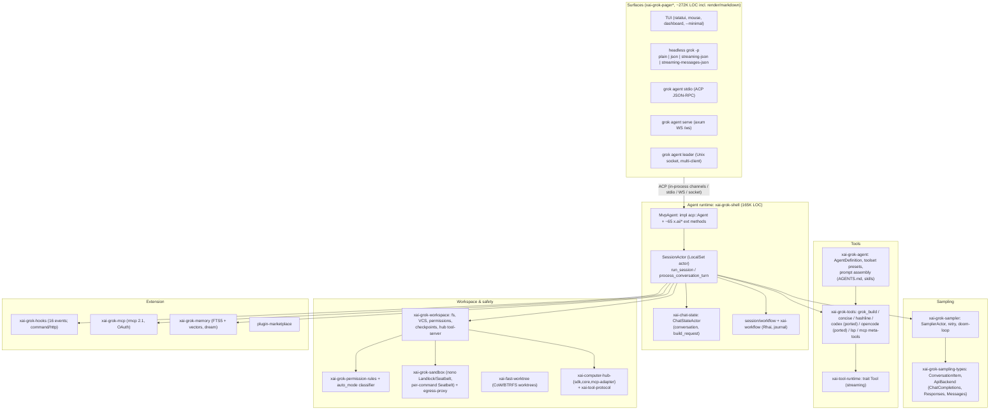

# Grok Build (xAI)

> **Verdict.** Grok Build is xAI's (branded "SpaceXAI" in the tree) terminal coding agent. It is a very large Rust monorepo export: about 808K production lines across 107 crates, plus about 1.17M lines of tests. Its center is an Agent Client Protocol (ACP) agent, `MvpAgent`. The fullscreen TUI, headless `grok -p`, `grok agent stdio`, the WebSocket `grok agent serve`, and the multi-client "leader" process are all ACP clients of it. In practice ACP plus about 65 `x.ai/*` extension methods is the product API. The harness is unusually deep where production traffic shows up:
> - server-side doom-loop signals, identical-tool-call stationarity detection, and length salvage;
> - two-pass compaction;
> - per-path write locks inside parallel tool batches;
> - an LLM permission classifier, process-wide Landlock/Seatbelt plus per-command Seatbelt grants;
> - a journaled, replayable Rhai workflow engine for orchestrating subagents.
>
> It is an `integrated-product`. You can reuse it as an ACP agent with no changes, but it cannot practically be forked as a library: crates are unpublished, the loop sits inside one 165K-line crate, and the repo takes no external PRs. Build on it if you want a fully featured, ACP-speaking coding agent to embed or orchestrate. Avoid it if you want a small, legible core or a provider-neutral foundation.

| | |
|---|---|
| Repo(s) | `xai-org/grok-build` @ `2bdd1d6a6369` (monorepo `SOURCE_REV` `559751fdcec0`) |
| License | Apache-2.0 for first-party code ([`LICENSE`](https://github.com/xai-org/grok-build/blob/2bdd1d6a6369de0e8c68132ea4539e9abd9e14a8/LICENSE)). Ported Codex (Apache-2.0) and OpenCode (MIT) tools and vendored Mermaid crates keep their own licenses |
| Language(s) | Rust (toolchain 1.94.0). Rhai for workflow scripts. Markdown/MiniJinja prompt templates |
| Size | 4,487 tracked files, 3,689 `.rs` files, 2.00M Rust lines total. About 620K lines are in test files/dirs and harness crates. About 551K lines are inline `#[cfg(test)]`. 26.5K are vendored `third_party/`. That leaves about **808K production lines**: about 272K TUI/rendering, 221K loop + protocol core (of which `xai-grok-shell` is 165K), 71K tools, 87K workspace/hub/worktree, 23K safety, 17K telemetry |
| Version at pin | 1.0.45 (`xai-grok-shell`, `xai-grok-pager-bin`). `agent-client-protocol` 0.10.4 with `unstable` |
| Release history | Early beta announced 2026-05-14 for SuperGrok Heavy (per Gigazine, citing xAI's X post). Broad beta for SuperGrok/X Premium+ on 2026-05-25 (x.ai). Source published 2026-07-15/16 (repo created 2026-07-14, first public commit 2026-07-16). **1.0.0 on 2026-08-07** (in-repo CHANGELOG). 1.0.45 on 2026-09-29. 51 "Synced from monorepo" commits. About 27.4K stars and 5.2K forks as of 2026-10-14 |
| Category | `integrated-product` |

---

## 1. Layering & package map

The public tree is an export of an internal monorepo. The README says the repo "is synced periodically from the SpaceXAI monorepo" and `SOURCE_REV` records the monorepo SHA ([`README.md:L31-L35`](https://github.com/xai-org/grok-build/blob/2bdd1d6a6369de0e8c68132ea4539e9abd9e14a8/README.md#L31-L35)). External PRs are refused ([`CONTRIBUTING.md:L3-L8`](https://github.com/xai-org/grok-build/blob/2bdd1d6a6369de0e8c68132ea4539e9abd9e14a8/CONTRIBUTING.md#L3-L8)). The export is visibly partial:
- `leader/cursor_worker_stub.rs` replaces a `cursor-worker` feature that is "not compiled in" ([`cursor_worker_stub.rs:L1-L3`](https://github.com/xai-org/grok-build/blob/2bdd1d6a6369de0e8c68132ea4539e9abd9e14a8/crates/codegen/xai-grok-shell/src/leader/cursor_worker_stub.rs#L1-L3)).
- `third_party/README.md` lists vendored `nfsserve`/`fuser` crates for "grove" that are absent from the tree ([`third_party/README.md:L8-L12`](https://github.com/xai-org/grok-build/blob/2bdd1d6a6369de0e8c68132ea4539e9abd9e14a8/third_party/README.md#L8-L12)).
- Toolset presets can be registered "out-of-tree" as public or *internal* ([`xai-grok-agent/src/config.rs:L20-L52`](https://github.com/xai-org/grok-build/blob/2bdd1d6a6369de0e8c68132ea4539e9abd9e14a8/crates/codegen/xai-grok-agent/src/config.rs#L20-L52)).

| Layer | Crates (production LOC, approx.) | Owns |
|---|---|---|
| Composition root | `xai-grok-pager-bin` (3.9K) | `main.rs` CLI dispatch, process identity, sandbox application before agent boot ([`main.rs:L2202`](https://github.com/xai-org/grok-build/blob/2bdd1d6a6369de0e8c68132ea4539e9abd9e14a8/crates/codegen/xai-grok-pager-bin/src/main.rs#L2202)) |
| Surfaces | `xai-grok-pager` (~169K), `-render` (~23K), `-minimal`, `xai-grok-markdown`, `xai-ratatui-*` | TUI. The pager calls itself "a clean-room implementation built on the v3 pager rendering engine" ([`lib.rs:L8-L10`](https://github.com/xai-org/grok-build/blob/2bdd1d6a6369de0e8c68132ea4539e9abd9e14a8/crates/codegen/xai-grok-pager/src/lib.rs#L8-L10)). Also headless, slash commands, the `mcp`/`plugin`/`sessions` subcommands |
| Agent runtime | `xai-grok-shell` (~165K) | ACP agent, session actor, turn loop, compaction, persistence, leader/relay/remote, plan mode, goals, workflows host |
| Agent definition | `xai-grok-agent` (~10K) | `AgentDefinition` (Markdown + YAML front matter), `AgentBuilder`, toolset presets, prompt templates, AGENTS.md/skills discovery |
| Conversation state | `xai-chat-state` (~5K) | An actor owning `Vec<ConversationItem>`, sampling config, token totals ([`lib.rs:L1-L25`](https://github.com/xai-org/grok-build/blob/2bdd1d6a6369de0e8c68132ea4539e9abd9e14a8/crates/codegen/xai-chat-state/src/lib.rs#L1-L25)) |
| Sampling | `xai-grok-sampler` (~8K), `xai-grok-sampling-types` (~7K) | HTTP/SSE streaming for three wire APIs, retries, doom-loop recovery |
| Tools | `xai-tool-runtime`, `xai-tool-protocol`, `xai-tool-types`, `xai-grok-tools` (~71K) | `Tool` trait, registry, built-ins, ported Codex/OpenCode tools, LSP, MCP meta-tools |
| Host | `xai-grok-workspace` (~44K), `xai-fast-worktree` (~17K), `xai-hunk-tracker`, `xai-computer-hub-*` | FS/VCS ops, permissions manager, rewind checkpoints, worktrees, the "Computer Hub" tool-server/harness WebSocket fabric |
| Safety | `xai-grok-sandbox`, `xai-grok-permission-rules`, `xai-grok-egress-proxy` (~23K) | OS sandboxing, rule engine, website-origin proxy |
| Shared with other xAI products | `crates/common/*` (e.g. `xai-grok-compaction`, `xai-interjection-core`) | Code explicitly shared with "Grok chat" and a "server-side agent loop" (§5, §12) |

---

## 2. Agent loop

**Process model.** `spawn_grok_shell` builds an `MvpAgent` and connects it to the caller through in-process ACP channels (`acp_channels()` → `AcpGatewaySender`). It does this the same way for the TUI and headless ([`acp/spawn.rs:L268-L345`](https://github.com/xai-org/grok-build/blob/2bdd1d6a6369de0e8c68132ea4539e9abd9e14a8/crates/codegen/xai-grok-pager/src/acp/spawn.rs#L268-L345)). "The agent runs on a single-threaded tokio LocalSet runtime" ([`spawn.rs:L363-L381`](https://github.com/xai-org/grok-build/blob/2bdd1d6a6369de0e8c68132ea4539e9abd9e14a8/crates/codegen/xai-grok-pager/src/acp/spawn.rs#L363-L381)). The ACP `Agent` impl is in [`acp_agent.rs:L125`](https://github.com/xai-org/grok-build/blob/2bdd1d6a6369de0e8c68132ea4539e9abd9e14a8/crates/codegen/xai-grok-shell/src/agent/mvp_agent/acp_agent.rs#L125). Each session is a `SessionActor` ([`acp_session.rs:L741`](https://github.com/xai-org/grok-build/blob/2bdd1d6a6369de0e8c68132ea4539e9abd9e14a8/crates/codegen/xai-grok-shell/src/session/acp_session.rs#L741)) driven by `run_session`. That function multiplexes `SessionCommand`s, `ChatStateEvent`s and session events ([`run_loop.rs:L354-L363`](https://github.com/xai-org/grok-build/blob/2bdd1d6a6369de0e8c68132ea4539e9abd9e14a8/crates/codegen/xai-grok-shell/src/session/acp_session_impl/run_loop.rs#L354-L363)). Conversation state lives in a separate `ChatStateActor`, and sampling in a `SamplerActor` ([`sampler/lib.rs:L1-L10`](https://github.com/xai-org/grok-build/blob/2bdd1d6a6369de0e8c68132ea4539e9abd9e14a8/crates/codegen/xai-grok-sampler/src/lib.rs#L1-L10)).

**The turn.** `process_conversation_turn_inner` ([`turn.rs:L2615-L2623`](https://github.com/xai-org/grok-build/blob/2bdd1d6a6369de0e8c68132ea4539e9abd9e14a8/crates/codegen/xai-grok-shell/src/session/acp_session_impl/turn.rs#L2615-L2623)) is a single `loop {}` of about 1,250 lines. One iteration:

1. **Pre-turn setup (once).** The function refreshes model metadata, compacts if a model switch shrank the window, prepares tool definitions (waiting on MCP or progressive) and injects MCP reminders. If `--json-schema` is set, it picks native structured output (Chat Completions/Responses) or a synthetic `StructuredOutput` tool for the Messages API ([`turn.rs:L2721-L2746`](https://github.com/xai-org/grok-build/blob/2bdd1d6a6369de0e8c68132ea4539e9abd9e14a8/crates/codegen/xai-grok-shell/src/session/acp_session_impl/turn.rs#L2721-L2746)).
2. **Stationarity guard.** If the last *N* sampling steps had identical canonicalized tool-call signatures, the loop either injects a nudge reminder or ends the turn with `TurnOutcome::StationarityEnded` ([`turn.rs:L2747-L2828`](https://github.com/xai-org/grok-build/blob/2bdd1d6a6369de0e8c68132ea4539e9abd9e14a8/crates/codegen/xai-grok-shell/src/session/acp_session_impl/turn.rs#L2747-L2828)). The thresholds are a nudge at 4 (Read/Plan-kind tools) or 8 (others), and a hard stop at 8 or 12 ([`turn.rs:L3884-L3912`](https://github.com/xai-org/grok-build/blob/2bdd1d6a6369de0e8c68132ea4539e9abd9e14a8/crates/codegen/xai-grok-shell/src/session/acp_session_impl/turn.rs#L3884-L3912)). Signatures sort keys recursively and sort the parallel calls, so reordering does not read as progress ([`turn.rs:L3943-L3958`](https://github.com/xai-org/grok-build/blob/2bdd1d6a6369de0e8c68132ea4539e9abd9e14a8/crates/codegen/xai-grok-shell/src/session/acp_session_impl/turn.rs#L3943-L3958)).
3. **Safe point.** The loop drains interjections, pending skill reminders and monitor events ([`turn.rs:L2829-L2833`](https://github.com/xai-org/grok-build/blob/2bdd1d6a6369de0e8c68132ea4539e9abd9e14a8/crates/codegen/xai-grok-shell/src/session/acp_session_impl/turn.rs#L2829-L2833)). It adds the first-turn memory reminder.
4. **Context budget.** It may spawn the background two-pass compaction "prefire", refresh the auth token, and run blocking auto-compaction when over threshold ([`turn.rs:L2853-L2879`](https://github.com/xai-org/grok-build/blob/2bdd1d6a6369de0e8c68132ea4539e9abd9e14a8/crates/codegen/xai-grok-shell/src/session/acp_session_impl/turn.rs#L2853-L2879)).
5. **Tool projection.** Subagents get `child_safe_tool_specs`. A `StructuredOutput` tool is appended if needed ([`turn.rs:L2925-L2956`](https://github.com/xai-org/grok-build/blob/2bdd1d6a6369de0e8c68132ea4539e9abd9e14a8/crates/codegen/xai-grok-shell/src/session/acp_session_impl/turn.rs#L2925-L2956)).
6. **Build request.** The `ChatStateActor` does this. The loop then stamps `x_grok_session_id`, turn index, agent id and deployment id, plus hosted tools and the length policy ([`turn.rs:L2966-L3026`](https://github.com/xai-org/grok-build/blob/2bdd1d6a6369de0e8c68132ea4539e9abd9e14a8/crates/codegen/xai-grok-shell/src/session/acp_session_impl/turn.rs#L2966-L3026)).
7. **Sample.** `run_turn_via_sampler` returns `Response`, `RetryTransient`, `CompactAndResubmit` or `RefreshAuthAndResubmit` ([`turn.rs:L3050-L3063`](https://github.com/xai-org/grok-build/blob/2bdd1d6a6369de0e8c68132ea4539e9abd9e14a8/crates/codegen/xai-grok-shell/src/session/acp_session_impl/turn.rs#L3050-L3063)). Transient errors back off with jitter and emit a `RetryState` notification ([`turn.rs:L3123-L3168`](https://github.com/xai-org/grok-build/blob/2bdd1d6a6369de0e8c68132ea4539e9abd9e14a8/crates/codegen/xai-grok-shell/src/session/acp_session_impl/turn.rs#L3123-L3168)). Context overflow compacts and resubmits ([`L3169-L3174`](https://github.com/xai-org/grok-build/blob/2bdd1d6a6369de0e8c68132ea4539e9abd9e14a8/crates/codegen/xai-grok-shell/src/session/acp_session_impl/turn.rs#L3169-L3174)). A 401 enters a schedule that separates "uncharged" resubmits (no credential was sent) from authenticated rejections, and includes a runaway guard ([`L3175-L3307`](https://github.com/xai-org/grok-build/blob/2bdd1d6a6369de0e8c68132ea4539e9abd9e14a8/crates/codegen/xai-grok-shell/src/session/acp_session_impl/turn.rs#L3175-L3307)).
8. **Response bookkeeping.** The loop records usage including `cached_prompt_tokens`, `reasoning_tokens` and `cost_usd_ticks`. If more than twice the cap of media-generation calls were requested, it resamples. It handles `ContentFilter` refusals.
9. **Length handling.** A `Length` stop with tool calls goes through a salvage streak with a reminder and fails after a cap ([`turn.rs:L3488-L3507`](https://github.com/xai-org/grok-build/blob/2bdd1d6a6369de0e8c68132ea4539e9abd9e14a8/crates/codegen/xai-grok-shell/src/session/acp_session_impl/turn.rs#L3488-L3507)). A text-only `Length` stop injects a "continue" reminder and loops ([`L3574-L3622`](https://github.com/xai-org/grok-build/blob/2bdd1d6a6369de0e8c68132ea4539e9abd9e14a8/crates/codegen/xai-grok-shell/src/session/acp_session_impl/turn.rs#L3574-L3622)).
10. **No tool calls.** These stops are ordinarily final. First, a **TodoGate** may push the model back if todos are still pending, up to `max_fires_per_prompt`. Late interjections or parent steers re-open the turn. Then `TurnOutcome::Completed{EndTurn|MaxTokens|Refusal}` is returned with optional schema-validated output ([`L3623-L3727`](https://github.com/xai-org/grok-build/blob/2bdd1d6a6369de0e8c68132ea4539e9abd9e14a8/crates/codegen/xai-grok-shell/src/session/acp_session_impl/turn.rs#L3623-L3727)).
11. **Tool calls.** `execute_tool_calls` runs them. A permission reject or cancel ends the turn, and a follow-up message re-enters the loop ([`L3797-L3851`](https://github.com/xai-org/grok-build/blob/2bdd1d6a6369de0e8c68132ea4539e9abd9e14a8/crates/codegen/xai-grok-shell/src/session/acp_session_impl/turn.rs#L3797-L3851)). Next come the `--max-turns` check ([`L3852-L3863`](https://github.com/xai-org/grok-build/blob/2bdd1d6a6369de0e8c68132ea4539e9abd9e14a8/crates/codegen/xai-grok-shell/src/session/acp_session_impl/turn.rs#L3852-L3863)) and a post-tool "preflight overflow" compaction when tool outputs pushed the estimate past the window ([`L3865-L3875`](https://github.com/xai-org/grok-build/blob/2bdd1d6a6369de0e8c68132ea4539e9abd9e14a8/crates/codegen/xai-grok-shell/src/session/acp_session_impl/turn.rs#L3865-L3875)).

**Stop conditions** are therefore: end turn (subject to the TodoGate and Stop hooks), max-turns, stationarity, refusal, permission reject/cancel, exhausted auth/length/transient budgets, and user cancel. Turn-end `Stop`/`SubagentStop` hooks may also force continuation, capped by `MAX_STOP_HOOK_CONTINUATIONS_PER_TURN = 8` ([`stop_gate.rs:L9`](https://github.com/xai-org/grok-build/blob/2bdd1d6a6369de0e8c68132ea4539e9abd9e14a8/crates/codegen/xai-grok-shell/src/session/acp_session_impl/stop_gate.rs#L9)). In `/goal` mode a regex "premature stop" detector sees "bail" phrasings and re-queues continuation ([`goal_stop_detector.rs:L1-L5`](https://github.com/xai-org/grok-build/blob/2bdd1d6a6369de0e8c68132ea4539e9abd9e14a8/crates/codegen/xai-grok-shell/src/session/goal_stop_detector.rs#L1-L5)).

**Steering.** Interjections (`x.ai/interject`), queued prompts (`x.ai/queue/*`) and parent→child messages have three delivery modes: `steer`, `queue` and `interject`. All are merged only at safe points. The buffer and formatting live in the shared `xai-interjection-core` "so the server-side agent loop can adopt the same behaviour" ([`interjection.rs:L6-L11`](https://github.com/xai-org/grok-build/blob/2bdd1d6a6369de0e8c68132ea4539e9abd9e14a8/crates/codegen/xai-grok-shell/src/session/acp_session_impl/interjection.rs#L6-L11)).

**Parallel tool calls.** A batch is split so `exit_plan_mode` calls run last ([`tool_calls.rs:L335-L400`](https://github.com/xai-org/grok-build/blob/2bdd1d6a6369de0e8c68132ea4539e9abd9e14a8/crates/codegen/xai-grok-shell/src/session/acp_session_impl/tool_calls.rs#L335-L400)). Each call is then *prepared* serially: parse, PreToolUse hooks, MCP argument coercion, plan gate, permission. Approved calls *dispatch concurrently* via `FuturesUnordered` ([`L1008-L1031`](https://github.com/xai-org/grok-build/blob/2bdd1d6a6369de0e8c68132ea4539e9abd9e14a8/crates/codegen/xai-grok-shell/src/session/acp_session_impl/tool_calls.rs#L1008-L1031)). Non-read-only calls on the same resolved path share a `tokio::sync::Mutex`, so same-file edits serialize while unrelated calls stay parallel ([`L612-L650`](https://github.com/xai-org/grok-build/blob/2bdd1d6a6369de0e8c68132ea4539e9abd9e14a8/crates/codegen/xai-grok-shell/src/session/acp_session_impl/tool_calls.rs#L612-L650), [`tool_dispatch.rs:L73-L76`](https://github.com/xai-org/grok-build/blob/2bdd1d6a6369de0e8c68132ea4539e9abd9e14a8/crates/codegen/xai-grok-shell/src/session/acp_session_impl/tool_dispatch.rs#L73-L76)). The 1.0.44 changelog announces this as "Parallel tool calls that edit the same file now run safely in sequence."

---

## 3. Model / provider abstraction

**Message model.** `xai-grok-sampling-types` defines `ConversationItem`/`ConversationRequest`/`ConversationResponse`. These are provider-neutral, and the request carries xAI-specific headers (`x_grok_*`). Three wire backends are supported ([`types.rs:L1104-L1134`](https://github.com/xai-org/grok-build/blob/2bdd1d6a6369de0e8c68132ea4539e9abd9e14a8/crates/codegen/xai-grok-sampling-types/src/types.rs#L1104-L1134)):

| `ApiBackend` | Endpoint | Native JSON schema | `prompt_cache_key` forwarded | Default body cap |
|---|---|---|---|---|
| `ChatCompletions` (default) | `/v1/chat/completions` | yes | no | 50 MiB |
| `Responses` | `/v1/responses` | yes | **yes** | 50 MiB |
| `Messages` (Anthropic) | `/v1/messages` | no (uses the `StructuredOutput` tool) | no | 30 MB |

The sampler is layered: `SamplingClient` produces raw chunks, `stream::{chat_completions,responses,messages}` produces `SamplingEvent`s, and `SamplerHandle` adds the actor with retry and cancel ([`sampler/lib.rs:L1-L10`](https://github.com/xai-org/grok-build/blob/2bdd1d6a6369de0e8c68132ea4539e9abd9e14a8/crates/codegen/xai-grok-sampler/src/lib.rs#L1-L10)). Retry defaults are `DEFAULT_MAX_RETRIES = 15`, a 30 s maximum backoff, and a rate-limit threshold of 2 ([`retry.rs:L5-L13`](https://github.com/xai-org/grok-build/blob/2bdd1d6a6369de0e8c68132ea4539e9abd9e14a8/crates/codegen/xai-grok-sampler/src/retry.rs#L5-L13)). There is also a per-chunk SSE idle deadline of 300 s by default, plus `use_concise` and a per-model `agent_type` ("grok-build", "codex") that selects the prompt template and toolset ([`agent/config.rs:L3349-L3359`](https://github.com/xai-org/grok-build/blob/2bdd1d6a6369de0e8c68132ea4539e9abd9e14a8/crates/codegen/xai-grok-shell/src/agent/config.rs#L3349-L3359)).

**Model-server co-design.** The Responses stream recognizes a server-emitted SSE event `response.doom_loop_check` ([`sampling-types/doom_loop.rs:L33`](https://github.com/xai-org/grok-build/blob/2bdd1d6a6369de0e8c68132ea4539e9abd9e14a8/crates/codegen/xai-grok-sampling-types/src/doom_loop.rs#L33)). Signals are collected per attempt ([`sampler/doom_loop.rs:L1-L6`](https://github.com/xai-org/grok-build/blob/2bdd1d6a6369de0e8c68132ea4539e9abd9e14a8/crates/codegen/xai-grok-sampler/src/doom_loop.rs#L1-L6)). A confident signal aborts the stream mid-flight. The retry replays capped reasoning/text, preserving `encrypted_content`, plus the reminder "Your messages have been flagged as looping…" ([`doom_loop_recovery.rs:L23`](https://github.com/xai-org/grok-build/blob/2bdd1d6a6369de0e8c68132ea4539e9abd9e14a8/crates/codegen/xai-grok-sampler/src/doom_loop_recovery.rs#L23)). This only works against an xAI backend that emits the event. Third-party providers get just the client-side stationarity guard.

**Catalog and providers.** Baked defaults: `grok-4.6` is the default and the web-search, image-description and session-summary model. It has 500K context, the `responses` backend, reasoning efforts `xhigh|high|medium|low`, and `auto_compact_threshold_percent: 80` ([`default_models.json:L1-L23`](https://github.com/xai-org/grok-build/blob/2bdd1d6a6369de0e8c68132ea4539e9abd9e14a8/crates/codegen/xai-grok-models/default_models.json#L1-L23)). The precedence order is CLI, env, `config.toml`, remote settings, then the prefetched `/v1/models`. Third-party models use `[model.<name>]` (base_url, api_key/env_key, `api_backend`, context_window(s), `max_request_bytes`). `[model_providers.<id>]` tables with `extra_headers`, `query_params`, `env_http_headers` and named `auth_provider` credential helpers are inherited by models ([`model_providers.rs:L9-L28`](https://github.com/xai-org/grok-build/blob/2bdd1d6a6369de0e8c68132ea4539e9abd9e14a8/crates/codegen/xai-grok-shell/src/agent/model_providers.rs#L9-L28)). Neither "grok-build-0.1" nor "grok-code-fast" appears in the baked catalog (`grok-code-fast-1` occurs only in tests and config examples). Third-party reports that the CLI runs "grok-build-0.1" refer to the beta and cannot be confirmed at this pin.

**Reasoning and caching.** Reasoning effort is per model with a menu of ids. Long-reasoning turns trigger a reminder. Cache accounting reads `cached_prompt_tokens` and `cache_creation_prompt_tokens` from usage, and `prompt_cache_key` is sent only on Responses. There is no explicit Anthropic `cache_control` breakpoint management in the paths reviewed (inference from the `forwards_prompt_cache_key` gate). **Cost** arrives as server-reported `cost_usd_ticks` and is persisted to `usage.json` (`grok usage`).

---

## 4. Tool system

**Definition API.** `xai_tool_runtime::Tool` has typed `Args: Deserialize + JsonSchema` (schemars), `Output: Serialize + ToolOutput`, `description(&ListToolsContext)`, `capabilities()`, `should_list()`, and a streaming `execute()` that returns `[Progress*, Terminal]`. Its default wraps `run()` ([`tool.rs:L37-L113`](https://github.com/xai-org/grok-build/blob/2bdd1d6a6369de0e8c68132ea4539e9abd9e14a8/crates/common/xai-tool-runtime/src/tool.rs#L37-L113)). Every tool has a `ToolKind` from a closed 36-variant taxonomy (Read, Edit, Execute, Plan, Task, Workflow, ImageGen, …) ([`types/tool.rs:L62-L101`](https://github.com/xai-org/grok-build/blob/2bdd1d6a6369de0e8c68132ea4539e9abd9e14a8/crates/codegen/xai-grok-tools/src/types/tool.rs#L62-L101)). Capability modes, stationarity tiers and prompt templating key off the kind, not the name.

**Renameable tools.** `ToolConfig` carries `name_override`, `params_name_overrides`, `description_override` and `behavior_version` ([`registry/types.rs:L57-L83`](https://github.com/xai-org/grok-build/blob/2bdd1d6a6369de0e8c68132ea4539e9abd9e14a8/crates/codegen/xai-grok-tools/src/registry/types.rs#L57-L83)). Descriptions are MiniJinja templates with `${{ tools.by_kind.read }}` delimiters, because "tool names are randomized for the model" ([`description.rs:L1-L12`](https://github.com/xai-org/grok-build/blob/2bdd1d6a6369de0e8c68132ea4539e9abd9e14a8/crates/codegen/xai-grok-tools/src/types/description.rs#L1-L12)). *Inference:* "toolchain randomization" exists for training and eval robustness. The tool layer serves both the product and xAI's model-development harnesses.

**Toolsets** are named presets ([`agent/config.rs:L199-L208`](https://github.com/xai-org/grok-build/blob/2bdd1d6a6369de0e8c68132ea4539e9abd9e14a8/crates/codegen/xai-grok-agent/src/config.rs#L199-L208)):

| Preset | Contents (abridged) |
|---|---|
| `grok-build` (default) | Core: `run_terminal_cmd`, `read_file`, `search_replace`, `list_dir`, `grep`, kill/output/wait task, `todo_write`, `spawn_subagent`, scheduler ×3, `monitor`, `search_tool`, `use_tool`, `update_goal`, `workflow` ([`L256-L289`](https://github.com/xai-org/grok-build/blob/2bdd1d6a6369de0e8c68132ea4539e9abd9e14a8/crates/codegen/xai-grok-agent/src/config.rs#L256-L289)). Plus OpenCode `write`, enter/exit plan mode, `ask_user_question`, `web_search`, image/video gen, `web_fetch`, memory search/get, `lsp` ([`L144-L162`](https://github.com/xai-org/grok-build/blob/2bdd1d6a6369de0e8c68132ea4539e9abd9e14a8/crates/codegen/xai-grok-agent/src/config.rs#L144-L162)) |
| `codex` | Bash plus **ported** Codex `read_file`, `apply_patch`, `list_dir`, `grep_files` ([`L340-L359`](https://github.com/xai-org/grok-build/blob/2bdd1d6a6369de0e8c68132ea4539e9abd9e14a8/crates/codegen/xai-grok-agent/src/config.rs#L340-L359)) |
| `grok-build-concise` | Concise bash/read/edit variants |
| `grok_build_hashline` | `hashline_read/edit/grep` with content-hash anchors and a built-in offline benchmark ([`hashline/mod.rs:L1-L10`](https://github.com/xai-org/grok-build/blob/2bdd1d6a6369de0e8c68132ea4539e9abd9e14a8/crates/codegen/xai-grok-tools/src/implementations/grok_build_hashline/mod.rs#L1-L10)). Hashline editing was popularized by Can Bölük's oh-my-pi, a fork of Pi (third-party sources). The tree's notices credit no port |
| `explore` / `plan` | Read-only, enforced by omitting shell and edit tools rather than by prompt ([`L360-L387`](https://github.com/xai-org/grok-build/blob/2bdd1d6a6369de0e8c68132ea4539e9abd9e14a8/crates/codegen/xai-grok-agent/src/config.rs#L360-L387)) |
| `grok-computer` | Workspace/sandbox preset for cloud computers |

**Ported code.** `src/implementations/codex/` comes from `openai/codex` `codex-rs/core/src/tools/handlers/` (Apache-2.0). `src/implementations/opencode/` (`bash, edit, glob, grep, read, skill, todowrite, write`) comes from `sst/opencode` (MIT) ([`THIRD_PARTY_NOTICES.md:L16-L42`](https://github.com/xai-org/grok-build/blob/2bdd1d6a6369de0e8c68132ea4539e9abd9e14a8/crates/codegen/xai-grok-tools/THIRD_PARTY_NOTICES.md#L16-L42)). Release builds embed ripgrep, and optionally ugrep and bfs, self-extracted to `~/.grok/vendor/` ([`L66-L78`](https://github.com/xai-org/grok-build/blob/2bdd1d6a6369de0e8c68132ea4539e9abd9e14a8/crates/codegen/xai-grok-tools/THIRD_PARTY_NOTICES.md#L66-L78)). The Codex system prompt is shipped too (`CODEX_PROMPT_ENC`, from `templates/apply_patch_prompt.md`). Selecting `agent_type = "codex"` therefore gives a model Codex's tool dialect and prompt inside Grok's loop.

**Bash.** The foreground timeout defaults to 120 s with a maximum of 300 s. `is_background` or `block_until_ms: 0` returns a task id and the agent is notified on completion. Schema parsing accepts numbers serialized as strings ([`bash/mod.rs:L220-L276`](https://github.com/xai-org/grok-build/blob/2bdd1d6a6369de0e8c68132ea4539e9abd9e14a8/crates/codegen/xai-grok-tools/src/implementations/grok_build/bash/mod.rs#L220-L276)). Output is capped by `[toolset.bash] output_byte_limit` (64 KB default per the shell README).

**MCP tools are lazy.** Rather than listing every MCP tool, the default toolset exposes the meta-tools `search_tool` (BM25 over a catalog keyed `server__tool`, descriptions truncated to 2,048 chars) and `use_tool` ([`search_tool/mod.rs:L1-L18`](https://github.com/xai-org/grok-build/blob/2bdd1d6a6369de0e8c68132ea4539e9abd9e14a8/crates/codegen/xai-grok-tools/src/implementations/search_tool/mod.rs#L1-L18)). This matches the "tool search" pattern in Claude Code.

**Execution pipeline.** Each call is prepared in this order:
1. Parse.
2. `PreToolUse` hooks, which may deny, ask, add context or *rewrite* arguments, and are re-run if MCP coercion changed the input ([`tool_calls.rs:L1633-L1712`](https://github.com/xai-org/grok-build/blob/2bdd1d6a6369de0e8c68132ea4539e9abd9e14a8/crates/codegen/xai-grok-shell/src/session/acp_session_impl/tool_calls.rs#L1633-L1712)).
3. Map to an `AccessKind` ([`permission-rules/types.rs:L4-L26`](https://github.com/xai-org/grok-build/blob/2bdd1d6a6369de0e8c68132ea4539e9abd9e14a8/crates/codegen/xai-grok-permission-rules/src/types.rs#L4-L26)).
4. Plan-mode edit gate ([`L1713-L1729`](https://github.com/xai-org/grok-build/blob/2bdd1d6a6369de0e8c68132ea4539e9abd9e14a8/crates/codegen/xai-grok-shell/src/session/acp_session_impl/tool_calls.rs#L1713-L1729)).
5. `permissions.request(...)` ([`L1849-L1857`](https://github.com/xai-org/grok-build/blob/2bdd1d6a6369de0e8c68132ea4539e9abd9e14a8/crates/codegen/xai-grok-shell/src/session/acp_session_impl/tool_calls.rs#L1849-L1857)).
6. Dispatch.
7. PostToolUse / PostToolUseFailure hooks.

The results are ACP `ToolCall`/`ToolCallUpdate` notifications.

---

## 5. Context management

**System prompt.** The base templates (`templates/prompt.md`, `subagent_prompt.md`, `apply_patch_prompt.md`) are plain text in the repo. The prompt begins "You are ${{ system_prompt_label }} released by xAI…" and switches on `is_non_interactive` ([`prompt.md:L1`](https://github.com/xai-org/grok-build/blob/2bdd1d6a6369de0e8c68132ea4539e9abd9e14a8/crates/codegen/xai-grok-agent/templates/prompt.md#L1)). They are compiled into the binary as XOR-obfuscated byte arrays generated by `scripts/encrypt_templates.py` ([`prompt_encrypted.rs:L1-L14`](https://github.com/xai-org/grok-build/blob/2bdd1d6a6369de0e8c68132ea4539e9abd9e14a8/crates/codegen/xai-grok-agent/src/prompt/prompt_encrypted.rs#L1-L14)). That is anti-scraping for the binary, not secrecy, since the source ships the plaintext. Agent definitions choose `promptMode: extend` (append to the base) or `full` (replace it).

**Project instructions.** `agents_md.rs` walks cwd → repo root plus `~/.grok/`, picking up `Agents.md`/`Claude.md`/`AGENT.md`/`AGENTS.md` and `*.md` in `.grok/rules`, `.claude/rules` and `.cursor/rules` ([`agents_md.rs:L1-L8`](https://github.com/xai-org/grok-build/blob/2bdd1d6a6369de0e8c68132ea4539e9abd9e14a8/crates/codegen/xai-grok-agent/src/prompt/agents_md.rs#L1-L8)). The content goes into a **user-turn `<system-reminder>`**, not the system prompt. The preamble "As you answer the user's questions, you can use the following context" is identical to Claude Code's. Embedded `<system-reminder>` tags are HTML-escaped so AGENTS.md cannot forge harness framing ([`agents_md.rs:L364-L412`](https://github.com/xai-org/grok-build/blob/2bdd1d6a6369de0e8c68132ea4539e9abd9e14a8/crates/codegen/xai-grok-agent/src/prompt/agents_md.rs#L364-L412)). Project-sourced files are dropped for untrusted folders (`InstructionSource::Project`).

**Compaction.** `crates/common/xai-grok-compaction` is a "transport-agnostic compaction engine" shared with **Grok chat**. It holds `code_compaction` (grok-build's full-replace) beside Grok chat's `intra_compaction` (tail-keep, per step) and `inter_compaction` (chunked, between turns) ([`compaction/lib.rs:L1-L40`](https://github.com/xai-org/grok-build/blob/2bdd1d6a6369de0e8c68132ea4539e9abd9e14a8/crates/common/xai-grok-compaction/src/lib.rs#L1-L40)). Grok Build keeps no tail. It "summarizes the whole conversation and rebuilds a fresh history from scratch" ([`code_compaction/mod.rs:L1-L12`](https://github.com/xai-org/grok-build/blob/2bdd1d6a6369de0e8c68132ea4539e9abd9e14a8/crates/common/xai-grok-compaction/src/code_compaction/mod.rs#L1-L12)).

There are four triggers:
- pre-sampling threshold: 85% by default per `CompactionPolicy`, 80% in the default model entry ([`agent/compaction.rs:L1-L35`](https://github.com/xai-org/grok-build/blob/2bdd1d6a6369de0e8c68132ea4539e9abd9e14a8/crates/codegen/xai-grok-agent/src/compaction.rs#L1-L35), [`session/compaction.rs:L2151-L2206`](https://github.com/xai-org/grok-build/blob/2bdd1d6a6369de0e8c68132ea4539e9abd9e14a8/crates/codegen/xai-grok-shell/src/session/compaction.rs#L2151-L2206));
- post-tool preflight overflow ([`L2208-L2234`](https://github.com/xai-org/grok-build/blob/2bdd1d6a6369de0e8c68132ea4539e9abd9e14a8/crates/codegen/xai-grok-shell/src/session/compaction.rs#L2208-L2234));
- a server context-length error (`CompactAndResubmit`);
- a model switch to a smaller window.

The policy also has a 300 s wall-clock budget per compaction and an optional memory-flush turn. **Two-pass compaction** is opt-in (`two_pass_enabled: false` by default). When usage reaches threshold minus 10% (`GROK_PREFIRE_LEAD_PERCENT`, [`compaction.rs:L62-L68`](https://github.com/xai-org/grok-build/blob/2bdd1d6a6369de0e8c68132ea4539e9abd9e14a8/crates/codegen/xai-grok-shell/src/session/compaction.rs#L62-L68)), a background pass summarizes the ~95% prefix into NOTE₁. At trigger time NOTE₁ and the ~5% tail are condensed into NOTE₂, which cuts blocking latency to the tail prefill. A prefix fingerprint invalidates NOTE₁ after rewinds or edits ([`two_pass.rs:L1-L19`](https://github.com/xai-org/grok-build/blob/2bdd1d6a6369de0e8c68132ea4539e9abd9e14a8/crates/codegen/xai-grok-shell/src/session/two_pass.rs#L1-L19)). Checkpoints land in `compaction_checkpoints/{id}.json`.

**Memory** (experimental, off by default). There are two isolated pipelines ([`memory/lib.rs:L1-L24`](https://github.com/xai-org/grok-build/blob/2bdd1d6a6369de0e8c68132ea4539e9abd9e14a8/crates/codegen/xai-grok-memory/src/lib.rs#L1-L24)):
- Legacy: Markdown `MEMORY.md` files (global and per-workspace) plus session logs, indexed in SQLite FTS5 with optional embeddings.
- v2: topics plus an observation inbox and consolidation, called "dream" and "batch dream".

Memory is injected on the first turn and after compaction, and exposed through the `memory_search`/`memory_get` tools. **Spill to disk:** large outputs and background tasks are surfaced through task-output tools. Compaction transcripts are stored under `compaction/` and can be re-read through `read_file` (`compaction_artifact_read`).

---

## 6. State, sessions & durability

**Layout.** `~/.grok/sessions/<encoded-cwd>/<session-id>/` holds:
- `summary.json`
- `updates.jsonl`, the ACP update stream that is authoritative for `/load`
- `chat_history.jsonl`, the model-facing items
- `plan.json`, `plan_mode.json`, `signals.json`, `usage.json`, `goal/state.json`
- `rewind_points.jsonl`, `compaction_checkpoints/`, `subagents/`

([`storage/mod.rs:L28-L38`](https://github.com/xai-org/grok-build/blob/2bdd1d6a6369de0e8c68132ea4539e9abd9e14a8/crates/codegen/xai-grok-shell/src/session/storage/mod.rs#L28-L38)). Whole-file writes use temp file + fsync + rename + parent-dir fsync ([`write_bytes_atomic` at L42](https://github.com/xai-org/grok-build/blob/2bdd1d6a6369de0e8c68132ea4539e9abd9e14a8/crates/codegen/xai-grok-shell/src/session/storage/mod.rs#L42)). `StorageMode::Writeback` adds an HTTP flush at end of turn to xAI's backend ([`config/mod.rs:L821-L827`](https://github.com/xai-org/grok-build/blob/2bdd1d6a6369de0e8c68132ea4539e9abd9e14a8/crates/codegen/xai-grok-shell/src/config/mod.rs#L821-L827)). Separately, `RelaySync` streams sessions to a grok.com relay with a disk cursor (`relay_sync.json`) ([`relay/mod.rs:L1-L9`](https://github.com/xai-org/grok-build/blob/2bdd1d6a6369de0e8c68132ea4539e9abd9e14a8/crates/codegen/xai-grok-shell/src/relay/mod.rs#L1-L9)).

**Resume, fork and branch.** Resume goes through ACP `session/load` and `session/resume` (unstable) and `x.ai/session/fork`; headless uses `-r/-c/-s`. Fork copies a session into a new cwd and id ([`fork.rs:L1-L2`](https://github.com/xai-org/grok-build/blob/2bdd1d6a6369de0e8c68132ea4539e9abd9e14a8/crates/codegen/xai-grok-shell/src/session/fork.rs#L1-L2)). `xai-grok-foreign-sessions` lists Claude Code and Codex sessions read-only for import ([`foreign-sessions/lib.rs:L8-L11`](https://github.com/xai-org/grok-build/blob/2bdd1d6a6369de0e8c68132ea4539e9abd9e14a8/crates/codegen/xai-grok-foreign-sessions/src/lib.rs#L8-L11)).

**Checkpoints and undo.** A `RewindPoint` per prompt stores *before* snapshots and *after* snapshots of touched files, and the after snapshots catch external modification ([`file_state.rs:L246-L259`](https://github.com/xai-org/grok-build/blob/2bdd1d6a6369de0e8c68132ea4539e9abd9e14a8/crates/codegen/xai-grok-workspace/src/session/file_state.rs#L246-L259)). A rewind checkpoint bundles the FS snapshot, a hunk-tracker delta and git HEAD/index, and "Restore reverts all enabled domains together" ([`checkpoint.rs:L1-L6`](https://github.com/xai-org/grok-build/blob/2bdd1d6a6369de0e8c68132ea4539e9abd9e14a8/crates/codegen/xai-grok-workspace/src/session/checkpoint.rs#L1-L6)). A durable mirror under `<cwd>/.grok/rewind-checkpoints/` sits behind a flag ([`checkpoint_store.rs:L1-L21`](https://github.com/xai-org/grok-build/blob/2bdd1d6a6369de0e8c68132ea4539e9abd9e14a8/crates/codegen/xai-grok-workspace/src/session/checkpoint_store.rs#L1-L21)).

**Crash recovery.** No mid-turn replay of an LLM call exists. On load, a turn the dead process never finished is marked `interrupted`, and "Committed tool results were kept" ([`interrupted_turn.rs:L1-L12`](https://github.com/xai-org/grok-build/blob/2bdd1d6a6369de0e8c68132ea4539e9abd9e14a8/crates/codegen/xai-grok-shell/src/session/interrupted_turn.rs#L1-L12)). Process-level survival comes from the **leader** (§10) and from `agent serve`, where "Session actors (and any in-flight prompts) therefore survive client disconnects" ([`server.rs:L1-L7`](https://github.com/xai-org/grok-build/blob/2bdd1d6a6369de0e8c68132ea4539e9abd9e14a8/crates/codegen/xai-grok-shell/src/agent/server.rs#L1-L7)).

**Durable execution.** The one replay-based durable component is the workflow engine. A `Journal` records each host call with `seq`, `kind` and `req_hash`. On restore the script is re-executed and recorded results are replayed. A different call raises `Divergence` ("the workflow script is nondeterministic or was edited mid-run"). The journal is capped at 64 MiB ([`journal.rs:L1-L45`](https://github.com/xai-org/grok-build/blob/2bdd1d6a6369de0e8c68132ea4539e9abd9e14a8/crates/codegen/xai-workflow/src/journal.rs#L1-L45)). It is a Temporal-style deterministic-replay design, but it covers workflows only, not the interactive loop.

---

## 7. Safety & sandboxing

**Permission modes.** The modes mirror Claude Code's: `default`, `acceptEdits`, `auto`, `dontAsk`, `bypassPermissions`, `plan` ([`agent/config.rs:L921-L940`](https://github.com/xai-org/grok-build/blob/2bdd1d6a6369de0e8c68132ea4539e9abd9e14a8/crates/codegen/xai-grok-agent/src/config.rs#L921-L940)). The docs map them to the product names Ask / Auto-review / Always-approve ([`22-permissions-and-safety.md:L31-L40`](https://github.com/xai-org/grok-build/blob/2bdd1d6a6369de0e8c68132ea4539e9abd9e14a8/crates/codegen/xai-grok-pager/docs/user-guide/22-permissions-and-safety.md#L31-L40)). Evaluation order is PreToolUse hooks → deny/ask/allow rules → remembered grants → built-in read-only auto-approvals → mode policy. Always-approve short-circuits after rules ([`L119-L138`](https://github.com/xai-org/grok-build/blob/2bdd1d6a6369de0e8c68132ea4539e9abd9e14a8/crates/codegen/xai-grok-pager/docs/user-guide/22-permissions-and-safety.md#L119-L138)).

Rules use `Bash(…)`/`Edit(…)`/`Read(…)`/`WebFetch(domain:…)`/`MCPTool(…)` globs. Claude's `Bash(cmd:*)` syntax and `.claude/settings.json` are accepted. `xai-grok-permission-rules` (~10K LOC) adds bash command splitting, `exec_risk`/`env_risk` analysis, and folder trust.

**Auto-review classifier.** `auto` mode calls an LLM classifier whose system prompt is `templates/auto_mode_classifier_system_prompt.md`. Output is constrained by a strict JSON schema `{thinking, shouldBlock, reason}` ([`auto_mode/mod.rs:L1113-L1139`](https://github.com/xai-org/grok-build/blob/2bdd1d6a6369de0e8c68132ea4539e9abd9e14a8/crates/codegen/xai-grok-workspace/src/permission/auto_mode/mod.rs#L1113-L1139)). Shell-parser "security findings" are injected as trusted system messages, and AGENTS.md is included only after its headings are neutralized. In non-interactive sessions a blocked call fails back to the model. Approvals that do reach a human go out as ACP `session/request_permission` to whichever client owns the session ([`prompter.rs:L771-L781`](https://github.com/xai-org/grok-build/blob/2bdd1d6a6369de0e8c68132ea4539e9abd9e14a8/crates/codegen/xai-grok-workspace/src/permission/prompter.rs#L771-L781)).

**Plan mode is an edit gate, not a sandbox.** `plan_mode_edit_gate` rejects `Edit`-kind access and `apply_patch` outside `plan.md`, in every permission mode ([`tool_calls.rs:L178-L198`](https://github.com/xai-org/grok-build/blob/2bdd1d6a6369de0e8c68132ea4539e9abd9e14a8/crates/codegen/xai-grok-shell/src/session/acp_session_impl/tool_calls.rs#L178-L198)). Bash is not inspected, and the docs say so: "plan mode blocks the edit tools, not shell redirection" ([`19-plan-mode.md:L136`](https://github.com/xai-org/grok-build/blob/2bdd1d6a6369de0e8c68132ea4539e9abd9e14a8/crates/codegen/xai-grok-pager/docs/user-guide/19-plan-mode.md#L136)).

**OS sandbox, layer 1 (whole process).** This uses `nono =0.53.0` ([`sandbox/Cargo.toml:L44`](https://github.com/xai-org/grok-build/blob/2bdd1d6a6369de0e8c68132ea4539e9abd9e14a8/crates/codegen/xai-grok-sandbox/Cargo.toml#L44)) to apply Landlock (Linux ≥ 5.13) or Seatbelt (macOS) **once, to the whole grok process, irreversibly**. Child network is blocked per subprocess with seccomp, and process network stays open for LLM calls ([`sandbox/lib.rs:L8-L19`](https://github.com/xai-org/grok-build/blob/2bdd1d6a6369de0e8c68132ea4539e9abd9e14a8/crates/codegen/xai-grok-sandbox/src/lib.rs#L8-L19), [`L192-L202`](https://github.com/xai-org/grok-build/blob/2bdd1d6a6369de0e8c68132ea4539e9abd9e14a8/crates/codegen/xai-grok-sandbox/src/lib.rs#L192-L202)). Profiles are `off` (default), `workspace`, `read-only`, `strict` and custom `sandbox.toml` profiles. `~/.ssh`, `~/.aws`, `~/.gnupg` and `~/.grok/auth` are always write-protected. Built-in profiles degrade to a warning when enforcement is unavailable, but custom profiles fail closed.

**OS sandbox, layer 2 (per command).** `command/` wraps individual child commands. A wrapper failure "is a refusal to run, never a silent unsandboxed launch". Denials decode into grantable `Violation`s backed by an expiring `GrantStore` ([`command/mod.rs:L1-L11`](https://github.com/xai-org/grok-build/blob/2bdd1d6a6369de0e8c68132ea4539e9abd9e14a8/crates/codegen/xai-grok-sandbox/src/command/mod.rs#L1-L11)). The only backend is `Seatbelt` ([`backend.rs:L20-L22`](https://github.com/xai-org/grok-build/blob/2bdd1d6a6369de0e8c68132ea4539e9abd9e14a8/crates/codegen/xai-grok-sandbox/src/command/backend.rs#L20-L22)). Rollout is `SandboxMode {Off, Observe, Enforce}`, which can be set remotely ([`sandbox_mode.rs:L38-L43`](https://github.com/xai-org/grok-build/blob/2bdd1d6a6369de0e8c68132ea4539e9abd9e14a8/crates/codegen/xai-grok-config/src/sandbox_mode.rs#L38-L43)). `xai-grok-egress-proxy` is a hidden HTTP/CONNECT proxy that enforces exact website-origin policy. It is explicitly *not* a boundary without a platform sandbox ([`egress-proxy/lib.rs:L1-L7`](https://github.com/xai-org/grok-build/blob/2bdd1d6a6369de0e8c68132ea4539e9abd9e14a8/crates/codegen/xai-grok-egress-proxy/src/lib.rs#L1-L7)). Windows has no OS sandbox.

**Managed policy.** Config layers run from `/etc/grok/managed_config.toml` up through `$GROK_HOME/config.toml`, an Ed25519-signed `requirements.toml`, `/etc/grok/requirements.toml` and macOS MDM. Requirements layers can opt into fail-closed startup ([`config/lib.rs:L1-L13`](https://github.com/xai-org/grok-build/blob/2bdd1d6a6369de0e8c68132ea4539e9abd9e14a8/crates/codegen/xai-grok-config/src/lib.rs#L1-L13)). `disable_bypass_permissions_mode` and `allow_managed_hooks_only` live there. Per-model auth-provider commands are honored only from trusted layers, and first-party credentials are stripped from their environment (shell README).

---

## 8. Extensibility

| Mechanism | Implementation |
|---|---|
| **Hooks** | 16 events: `SessionStart`, `UserPromptSubmit`, `PreToolUse`, `PostToolUse`, `PostToolUseFailure`, `PermissionDenied`, `Stop`, `StopFailure`, `StopCancelled`, `Notification`, `SubagentStart`, `SubagentStop`, `SubagentEnd`, `PreCompact`, `PostCompact`, `SessionEnd`. Aliases accept Claude Code *and* Cursor names (`beforeShellExecution`, `afterFileEdit`, `afterAgentResponse`, …) ([`hooks/event.rs:L78-L180`](https://github.com/xai-org/grok-build/blob/2bdd1d6a6369de0e8c68132ea4539e9abd9e14a8/crates/codegen/xai-grok-hooks/src/event.rs#L78-L180)). Runners are `command` and `http`. Hooks come from `.grok/hooks/`, config layers (`[[hooks.PreToolUse]]`), plugins and agent front matter. Project hooks require folder trust |
| **Skills** | `SKILL.md` directories gathered from local, repo, user, bundled, config-path and plugin sources, plus `~/.claude/skills` ([`skills.rs:L1-L4`](https://github.com/xai-org/grok-build/blob/2bdd1d6a6369de0e8c68132ea4539e9abd9e14a8/crates/codegen/xai-grok-agent/src/prompt/skills.rs#L1-L4)). Invoked by the model (skill tool) or as `/skill-name` |
| **Plugins** | `plugin.json`, falling back to `.grok-plugin/plugin.json` or **`.claude-plugin/plugin.json`**. Convention-based discovery of `skills/`, `agents/`, `commands/`, `.mcp.json`, `hooks/hooks.json`, `.lsp.json` ([`manifest.rs:L1-L9`](https://github.com/xai-org/grok-build/blob/2bdd1d6a6369de0e8c68132ea4539e9abd9e14a8/crates/codegen/xai-grok-agent/src/plugins/manifest.rs#L1-L9)). Git marketplaces with an installer (`xai-grok-plugin-marketplace`). Claude Code's `installed_plugins.json` and `known_marketplaces.json` are read |
| **MCP client** | `rmcp` 2.1 quarantined in `xai-grok-mcp` ([`shell/Cargo.toml:L54-L59`](https://github.com/xai-org/grok-build/blob/2bdd1d6a6369de0e8c68132ea4539e9abd9e14a8/crates/codegen/xai-grok-shell/Cargo.toml#L54-L59)). stdio and Streamable HTTP, OAuth, elicitation, token-file bearer rotation, per-tool timeouts. Read from `config.toml`, `.mcp.json`, `~/.claude.json` and agent front matter. Strategy is `Blocking` or `Progressive` init |
| **MCP server** | None. Grok is not exposed as an MCP server. `xai-computer-hub-mcp-adapter` bridges MCP servers *into* the hub tool fabric |
| **Agent definitions** | Markdown + YAML (`tools`, `disallowedTools`, `permissionMode`, `mcpServers`, `mcpInheritance`, `promptMode`) in `.grok/agents/`, `~/.grok/agents/` and `.claude/agents/`. Roles and personas are TOML |
| **Workflows** | Rhai scripts with `agent()`, `parallel()`, `phase()`, `pause()`, `complete()`, `budget()` and a journal ([`engine.rs:L490-L520`](https://github.com/xai-org/grok-build/blob/2bdd1d6a6369de0e8c68132ea4539e9abd9e14a8/crates/codegen/xai-workflow/src/engine.rs#L490-L520)). Bundled example: `deep_research.rhai` ([`L1-L11`](https://github.com/xai-org/grok-build/blob/2bdd1d6a6369de0e8c68132ea4539e9abd9e14a8/crates/codegen/xai-grok-shell/src/session/workflows/deep_research.rhai#L1-L11)) |
| **LSP** | `.grok/lsp.json`: passive diagnostics after edits plus an opt-in `lsp` tool |
| **Custom tools (code)** | Only by forking: implement `xai_tool_runtime::Tool` and register a preset (`register_toolset_preset`) |

There is also a migration layer for other agents. `xai-grok-external-agent-migration` and `claude_import.rs` import Claude permission rules and hooks. `grok inspect` reports which vendor directory (`claude` or `cursor`) each component came from.

---

## 9. Multi-agent

**Subagents.** `spawn_subagent` takes `prompt`, `description`, `run_in_background` (default `true`), `isolation: none|worktree`, `resume_from`, `cwd` and optionally `model`. Children receive a projected, child-safe toolset. Built-in types are `general-purpose`, `explore` and `plan`, and capability modes are `read-only`, `read-write`, `execute` and `all`. Personas carry input/output contracts. The internal request also carries a `/goal`-only `harness_agent_type` (examples given: `"cursor"`, `"grok-build-plan"`) that swaps the *harness flavor* (system prompt and toolset) for the child ([`task/types.rs:L222-L229`](https://github.com/xai-org/grok-build/blob/2bdd1d6a6369de0e8c68132ea4539e9abd9e14a8/crates/codegen/xai-grok-tools/src/implementations/grok_build/task/types.rs#L222-L229)).

**Limits (code vs claims).** `DEFAULT_MAX_CONCURRENT = 32` per session. Spawns beyond the limit **queue** by default or `fail` if configured, and the limit "can be adjusted but never disabled" ([`admission.rs:L1-L30`](https://github.com/xai-org/grok-build/blob/2bdd1d6a6369de0e8c68132ea4539e9abd9e14a8/crates/codegen/xai-grok-tools/src/implementations/grok_build/task/admission.rs#L1-L30)). `GROK_MAX_CONCURRENT_SUBAGENTS` and remote settings override it ([`config/mod.rs:L297-L312`](https://github.com/xai-org/grok-build/blob/2bdd1d6a6369de0e8c68132ea4539e9abd9e14a8/crates/codegen/xai-grok-shell/src/config/mod.rs#L297-L312)). Nesting depth defaults to 1, meaning only top-level spawns. It is configurable through `GROK_SUBAGENTS_MAX_DEPTH` ([`config/mod.rs:L248-L249`](https://github.com/xai-org/grok-build/blob/2bdd1d6a6369de0e8c68132ea4539e9abd9e14a8/crates/codegen/xai-grok-shell/src/config/mod.rs#L248-L249)), although the user guide says depth is fixed at one. A subagent sampling limit has a hard ceiling of 512 ([`subagent/mod.rs:L69`](https://github.com/xai-org/grok-build/blob/2bdd1d6a6369de0e8c68132ea4539e9abd9e14a8/crates/codegen/xai-grok-shell/src/agent/subagent/mod.rs#L69)). **Conflict:** a third-party write-up (Daniel Vaughan, 2026-08-01) says Grok Build launches "up to eight parallel subagents, each in its own Git worktree". The pinned code has a 32-concurrent default, and worktree isolation is opt-in, with `isolation` defaulting to `none` ([`16-subagents.md:L155`](https://github.com/xai-org/grok-build/blob/2bdd1d6a6369de0e8c68132ea4539e9abd9e14a8/crates/codegen/xai-grok-pager/docs/user-guide/16-subagents.md#L155)).

**Messaging.** `send_subagent_message` is feature-flagged off. With it on, parent↔child and child→sibling messages use `steer`, `queue` or `interject`, with quotas of 4 in flight per pair and 32 per attempt. `xai-message-delivery-core` types address, envelope and lifecycle.

**Worktrees.** `xai-fast-worktree` creates worktrees with `git worktree add --no-checkout` plus parallel copy-on-write cloning, BTRFS snapshots on Linux, and a worktree pool with SQLite metadata ([`fast-worktree/lib.rs:L8-L16`](https://github.com/xai-org/grok-build/blob/2bdd1d6a6369de0e8c68132ea4539e9abd9e14a8/crates/codegen/xai-fast-worktree/src/lib.rs#L8-L16)). It is exposed through `x.ai/git/worktree/*` (including apply/merge-back) and `grok worktree create`.

**Workflows.** These are the orchestration layer: scripts fan out with `parallel()` (at most 1,024 items) under an agent budget (default 128, maximum 1,024) and 10K host calls ([`xai-workflow/lib.rs:L1-L20`](https://github.com/xai-org/grok-build/blob/2bdd1d6a6369de0e8c68132ea4539e9abd9e14a8/crates/codegen/xai-workflow/src/lib.rs#L1-L20)). Concurrency defaults to 32 agents. A goal orchestrator (`/goal`, `update_goal`) adds planner, evaluator and strategist roles on top.

---

## 10. Surfaces & integration

**CLI surface.** `AgentCmd` has `Stdio`, `Headless` (connects *out* to a grok.com WebSocket relay), `Serve` and `Leader` ([`cli.rs:L328-L340`](https://github.com/xai-org/grok-build/blob/2bdd1d6a6369de0e8c68132ea4539e9abd9e14a8/crates/codegen/xai-grok-pager/src/app/cli.rs#L328-L340)). `Serve` binds `127.0.0.1:2419` with a secret (`GROK_AGENT_SECRET`) ([`L348-L363`](https://github.com/xai-org/grok-build/blob/2bdd1d6a6369de0e8c68132ea4539e9abd9e14a8/crates/codegen/xai-grok-pager/src/app/cli.rs#L348-L363)) and serves ACP over an axum WebSocket at `/ws` ([`server.rs:L621-L622`](https://github.com/xai-org/grok-build/blob/2bdd1d6a6369de0e8c68132ea4539e9abd9e14a8/crates/codegen/xai-grok-shell/src/agent/server.rs#L621-L622)). Other subcommands are `inspect`, `doctor`, `mcp`, `plugin`, `memory`, `models`, `sessions`, `usage`, `export`, `trace`, `worktree` and `wrap`/`ssh` (OSC 52 clipboard).

**Headless.** `run_single_turn` spawns the in-process agent and *drives it as an ACP client* through `NewSessionRequest`/`LoadSessionRequest` and `PromptRequest` ([`headless.rs:L803-L807`](https://github.com/xai-org/grok-build/blob/2bdd1d6a6369de0e8c68132ea4539e9abd9e14a8/crates/codegen/xai-grok-pager/src/headless.rs#L803-L807), [`L543`](https://github.com/xai-org/grok-build/blob/2bdd1d6a6369de0e8c68132ea4539e9abd9e14a8/crates/codegen/xai-grok-pager/src/headless.rs#L543), [`L1187`](https://github.com/xai-org/grok-build/blob/2bdd1d6a6369de0e8c68132ea4539e9abd9e14a8/crates/codegen/xai-grok-pager/src/headless.rs#L1187)). Output formats are `plain`, `json`, `streaming-json` (one ACP update per line) and **`streaming-messages-json`**, which is NDJSON "in the Anthropic Messages API wire format" ([`headless/cli.rs:L9-L19`](https://github.com/xai-org/grok-build/blob/2bdd1d6a6369de0e8c68132ea4539e9abd9e14a8/crates/codegen/xai-grok-pager/src/headless/cli.rs#L9-L19)). Other headless flags are `--json-schema`, `--tools`/`--disallowed-tools` (including `Agent(type)`), `--max-turns`, `--permission-mode` and `--effort`. The focus brief calls it "stream-json". The actual value names are `streaming-json` and `streaming-messages-json`.

**ACP.** `MvpAgent` implements `initialize`, `authenticate`, `new_session`, `load_session`, `list_sessions`, `resume_session`, `prompt`, `cancel`, `set_session_mode`, `set_session_model` and `set_session_config_option` ([`acp_agent.rs:L989-L1032`](https://github.com/xai-org/grok-build/blob/2bdd1d6a6369de0e8c68132ea4539e9abd9e14a8/crates/codegen/xai-grok-shell/src/agent/mvp_agent/acp_agent.rs#L989-L1032), [`L1878-L1983`](https://github.com/xai-org/grok-build/blob/2bdd1d6a6369de0e8c68132ea4539e9abd9e14a8/crates/codegen/xai-grok-shell/src/agent/mvp_agent/acp_agent.rs#L1878-L1983)). On top of these, `ext_method` handles 84 distinct `x.ai/*` literals (19 of them namespace prefixes). They cover sessions, models, workspaces, memory, skills, plugins, hooks, git/worktree, PR, review, rewind, queue/interject, billing, privacy, scheduler and cloud environments ([`L1983-L2000`](https://github.com/xai-org/grok-build/blob/2bdd1d6a6369de0e8c68132ea4539e9abd9e14a8/crates/codegen/xai-grok-shell/src/agent/mvp_agent/acp_agent.rs#L1983-L2000)). Standard ACP clients (Zed, CodeCompanion/avante.nvim, Emacs agent-shell, marimo per the shell README) get the core. The TUI's richer features depend on the unversioned extensions.

**Leader.** There is one leader per machine, which owns `MvpAgent` and routes ACP from multiple clients over `~/.grok/leader.sock` with namespaced request ids ([`leader/mod.rs:L1-L36`](https://github.com/xai-org/grok-build/blob/2bdd1d6a6369de0e8c68132ea4539e9abd9e14a8/crates/codegen/xai-grok-shell/src/leader/mod.rs#L1-L36)). It is off by default (`[cli] use_leader`).

**Computer Hub.** `xai-computer-hub-sdk` hosts both a `ToolServer` (tool providers) and a `ToolHarness` (tool callers) multiplexed over one WebSocket per `(url, principal)`, with reconnect and replay ([`hub-sdk/lib.rs:L1-L21`](https://github.com/xai-org/grok-build/blob/2bdd1d6a6369de0e8c68132ea4539e9abd9e14a8/crates/common/xai-computer-hub-sdk/src/lib.rs#L1-L21)). `xai-grok-workspace` registers a `workspace_rpc` tool-server, so tools and FS can be served remotely from cloud sandboxes (`x.ai/cloud/env/*`, `remote::SandboxClient`).

**What you can reuse, and how hard reshaping is:**

| Reuse path | Effort | Notes |
|---|---|---|
| `grok -p --output-format streaming-json \| streaming-messages-json` | Trivial | Anthropic-shaped output eases adapters; full Claude Code control-protocol compatibility was not established |
| `grok agent stdio` with any ACP SDK (TS/Rust/Python/Go/Kotlin) | Low | Full sessions, permissions via `request_permission`, plans and tool updates. `_meta.yoloMode` |
| `grok agent serve` (WS) / relay | Low–medium | Multi-client and reconnect-safe. Self-hosted only ("Grok's hosted cloud sandboxes do not run `grok agent serve`") |
| In-process Rust (`acp_channels` + `MvpAgent`) | High | It works (the TUI does it), but the crates are unpublished, the binary pins its toolchain and DotSlash `protoc`, and the internal APIs churn daily |
| Fork and reshape the loop | Very high | The loop is a ~1,250-line method on `SessionActor` with deep coupling to telemetry, auth, MCP and the hub. No upstream PRs |

**Community.** Forks and GUIs exist outside xAI. `happyfeetw/grok-cli` is a fork adding system-proxy support that merges upstream. `qingchencloud/grok-app` is an egui desktop client over ACP. `phuryn/grok-build-vscode` is a VS Code GUI (per web search; not verified). The "Kigi-CLI" fork named in the brief could not be found.

---

## 11. Observability & evals

- **Tracing.** Spans use `tracing` with rich fields (`session.process_conversation_turn` records tokens, ttft, stop reasons, agent and skill). An internal OTLP trace exporter sets `service.name = "grok-cli"` ([`otel/config.rs:L28-L50`](https://github.com/xai-org/grok-build/blob/2bdd1d6a6369de0e8c68132ea4539e9abd9e14a8/crates/codegen/xai-grok-otel/src/config.rs#L28-L50)). The trace pipeline can be repointed with `OTEL_EXPORTER_OTLP_ENDPOINT`.
- **Customer OTel.** `GROK_EXTERNAL_OTEL` is a double opt-in, content-redacted stream to the *customer's* collector. It is never registered globally and has no path that attaches xAI auth ([`external/mod.rs:L1-L18`](https://github.com/xai-org/grok-build/blob/2bdd1d6a6369de0e8c68132ea4539e9abd9e14a8/crates/codegen/xai-grok-telemetry/src/external/mod.rs#L1-L18)). It is gated fail-closed on fleet policy ([`otel_gate.rs:L1-L6`](https://github.com/xai-org/grok-build/blob/2bdd1d6a6369de0e8c68132ea4539e9abd9e14a8/crates/codegen/xai-grok-shell/src/agent/otel_gate.rs#L1-L6)).
- **Product telemetry.** Events go to an events URL and Mixpanel. Public-source builds bake in no defaults (`option_env!("GROK_TELEMETRY_BUILD_EVENTS_URL")`) ([`telemetry/config.rs:L187-L189`](https://github.com/xai-org/grok-build/blob/2bdd1d6a6369de0e8c68132ea4539e9abd9e14a8/crates/codegen/xai-grok-telemetry/src/config.rs#L187-L189)). There is also Sentry, a `unified_log` firehose (`--debug`), `sandbox-events.jsonl`, and `x.ai/privacy/setCodingDataRetention`. That setting follows the July 2026 data-upload controversy: Gigazine reports that xAI turned data upload off by default on 2026-07-12.
- **Cost.** `usage.json` per session, `grok usage`, `/usage`. Server `cost_usd_ticks`.
- **Evals and tests.** There is no public agentic-benchmark harness. The test infrastructure includes:
  - `xai-grok-pager-pty-harness`: PTY plus an `alacritty_terminal` screen model, a mock inference server, YAML scenarios and per-frame timing baselines ([`pty-harness/lib.rs:L1-L19`](https://github.com/xai-org/grok-build/blob/2bdd1d6a6369de0e8c68132ea4539e9abd9e14a8/crates/codegen/xai-grok-pager-pty-harness/src/lib.rs#L1-L19));
  - `session::testkit` for soak and load testing;
  - shell benches;
  - the hashline anchor benchmark.

  Telemetry events such as `ActionStationarityStop`, `TodoGateFired` and `GoalPrematureStopDetected` suggest online evaluation of harness interventions (inference).

---

## 12. Notable design decisions & trade-offs

1. **ACP as the internal bus.** Every surface, including the in-process TUI, talks to one `MvpAgent` over ACP. This yields cheap headless, IDE and remote modes, plus clean multi-client leader semantics. The cost is a very large surface of product-specific `x.ai/*` extensions, which makes "standard ACP" only a subset of the product.
2. **One harness, several "flavors".** Grok-native, Codex-ported (prompt plus tools), OpenCode-ported, concise and hashline toolsets coexist. Tool and parameter names are randomizable, and internal presets (a `"cursor"` harness flavor is referenced, along with Cursor-compat tools such as `CreatePlan`/`SwitchToAgent` in the plan-exit logic) are registered out of tree. *Inference:* the client harness doubles as xAI's training and eval environment for running Grok in other agents' tool dialects. That would explain why compatibility with Claude Code, Codex and Cursor is so thorough.
3. **Model-server co-design for loop pathologies.** Server doom-loop events, client stationarity hashing, the TodoGate, length salvage, a laziness classifier, goal-mode bail detection and uncharged-401 resubmits all come from production failure data (comments cite e.g. "224 identical todo_write calls in a turn"). This guard logic is unusually rich, and it adds turn complexity that small harnesses avoid.
4. **Full-replace compaction with speculative prefire.** Rebuilding history from a summary is simple and model-agnostic. The two-pass prefire hides latency, but it is off by default and adds cache-invalidation logic (fingerprints).
5. **Process-wide irreversible sandbox.** This is stronger than per-command wrapping against in-process tool bugs, but it cannot restrict the agent's own network. macOS network blocking is a no-op, and Windows is unsandboxed. The per-command Seatbelt layer with grant cards is the newer (1.0.44) direction.
6. **Shared code with xAI's server stack.** `xai-grok-compaction` (shared with Grok chat), `xai-interjection-core` ("server-side agent loop") and `prod/mc/cli-chat-proxy-types` (backend sandbox API types) show the CLI is one host among several. That favors consistency but leaks backend concepts (deployment ids, campaigns, remote settings) into the client.
7. **Source-available, not community-developed.** Apache-2.0 with no external PRs, periodic monorepo syncs, stripped features (cursor-worker, grove) and obfuscated prompt bytes. Forks must rebase on large opaque sync commits.

---

## 13. Scorecard

| Dimension | Score (1–5) | Rationale |
|---|---|---|
| Flexibility | 3 | Agent definitions (including full prompt override), toolset presets, custom models, hooks with argument rewrite, plugins and Rhai workflows let you reshape behavior a lot. The loop, compaction strategy and session actor are fixed inside `xai-grok-shell`, and code-level tools require a fork. |
| Integration | 5 | Full product: fullscreen TUI with dashboard, headless with four formats, ACP stdio/WS/relay, leader, OAuth/OIDC/external auth, OS sandbox, memory, LSP, worktrees, cloud sandboxes, managed/signed policy, auto-update. |
| Embeddability | 3 | The supported embedding is a subprocess speaking ACP (third-party SDKs in 5 languages) or the JSON stream. In-process `MvpAgent` over `acp_channels` exists, but the crates are unpublished and unstable. |
| Durability | 4 | Atomic JSONL session stores, resume/load/fork/rewind with FS plus git checkpoints, interrupted-turn markers, a leader and serve mode surviving client disconnects, and journaled deterministic-replay workflows. The interactive turn itself is not replayed after a crash. |
| Safety | 4 | Landlock/Seatbelt (nono) plus seccomp child-network blocking, per-command Seatbelt with expiring grants, an egress proxy, a rule engine with Claude syntax, an LLM auto-review classifier, folder trust and signed managed policy. The sandbox is off by default, macOS network is a no-op, Windows has no sandbox, and plan mode does not gate bash. |
| Extensibility | 5 | 16 hook events (command/http, Claude and Cursor aliases), skills, plugins with git marketplaces and Claude plugin compatibility, MCP client with OAuth and lazy `search_tool`, agent definitions, roles/personas, LSP and workflows. |
| Multi-agent | 5 | Background subagents (32 concurrent, queued), opt-in CoW worktree isolation with apply-back, steer/queue/interject messaging, `resume_from`, and a journaled Rhai `parallel()` workflow engine plus a goal orchestrator. |
| Provider neutrality | 3 | Chat Completions, Responses and Anthropic Messages backends with per-model base_url and credential helpers. Defaults, web search, memory embeddings, remote settings, doom-loop recovery and model listing (`XAI_API_KEY`) are xAI-centric. |
| Maturity | 4 | 1.0 since 2026-08-07, 45 patch releases in 7 weeks, and very heavy test investment (about 1.17M test lines). But it is about 5 months old, has unversioned `x.ai/*` APIs, and is drop-only open source. |
| Minimalism | 1 | About 808K production lines in 107 crates. The turn function alone is about 1,250 lines. |

---

## 14. When to build on it / when not to

**Build on it when:**
- You need a production-grade coding agent behind ACP or a JSON stream. Examples: an IDE/editor integration, a bot, a CI reviewer, or a multi-client orchestrator where `grok agent serve` or the leader keeps work alive across disconnects.
- You want Claude Code-compatible configuration (CLAUDE.md, `.claude/` skills, agents, plugins, hooks, permissions) without being tied to Anthropic, or you want to run Grok models. `streaming-messages-json` offers a Claude-shaped output stream; a consumer must still check event and control-protocol compatibility.
- You value enterprise controls: signed `requirements.toml`, MDM, OIDC and external auth helpers, customer OTel, and sandbox rollout modes.
- You want a reference implementation of production loop guards (stationarity, doom-loop recovery, length salvage, TodoGate), same-file write serialization, or replayable script-driven subagent workflows to copy into your own harness.

**Avoid it when:**
- You want a small, readable harness to understand or modify. Pi, mini-swe-agent and smolagents are closer to that.
- You want an in-process library with a stable API. The OpenAI Agents SDK, Vercel AI SDK, Pydantic AI and Pi's agent-core are built for that.
- You need provider-first neutrality. xAI-specific affordances such as backend search, doom-loop events, the model catalog and remote settings will not carry over.
- You need Windows OS sandboxing or network egress control of the agent process itself.
- You plan to contribute upstream: PRs are not accepted, and syncs arrive as large monorepo drops.

---

## 15. Evidence index

**Key files (pinned @ `2bdd1d6a6369`)**
- Provenance: [`README.md`](https://github.com/xai-org/grok-build/blob/2bdd1d6a6369de0e8c68132ea4539e9abd9e14a8/README.md), [`CONTRIBUTING.md`](https://github.com/xai-org/grok-build/blob/2bdd1d6a6369de0e8c68132ea4539e9abd9e14a8/CONTRIBUTING.md), [`SOURCE_REV`](https://github.com/xai-org/grok-build/blob/2bdd1d6a6369de0e8c68132ea4539e9abd9e14a8/SOURCE_REV), [`Cargo.toml` (ACP 0.10.4 at L123)](https://github.com/xai-org/grok-build/blob/2bdd1d6a6369de0e8c68132ea4539e9abd9e14a8/Cargo.toml#L123), [`xai-grok-shell/CHANGELOG.md`](https://github.com/xai-org/grok-build/blob/2bdd1d6a6369de0e8c68132ea4539e9abd9e14a8/crates/codegen/xai-grok-shell/CHANGELOG.md), [`xai-grok-shell/README.md`](https://github.com/xai-org/grok-build/blob/2bdd1d6a6369de0e8c68132ea4539e9abd9e14a8/crates/codegen/xai-grok-shell/README.md)
- Loop: [`turn.rs`](https://github.com/xai-org/grok-build/blob/2bdd1d6a6369de0e8c68132ea4539e9abd9e14a8/crates/codegen/xai-grok-shell/src/session/acp_session_impl/turn.rs), [`tool_calls.rs`](https://github.com/xai-org/grok-build/blob/2bdd1d6a6369de0e8c68132ea4539e9abd9e14a8/crates/codegen/xai-grok-shell/src/session/acp_session_impl/tool_calls.rs), [`run_loop.rs`](https://github.com/xai-org/grok-build/blob/2bdd1d6a6369de0e8c68132ea4539e9abd9e14a8/crates/codegen/xai-grok-shell/src/session/acp_session_impl/run_loop.rs), [`stop_gate.rs`](https://github.com/xai-org/grok-build/blob/2bdd1d6a6369de0e8c68132ea4539e9abd9e14a8/crates/codegen/xai-grok-shell/src/session/acp_session_impl/stop_gate.rs)
- ACP and surfaces: [`acp_agent.rs`](https://github.com/xai-org/grok-build/blob/2bdd1d6a6369de0e8c68132ea4539e9abd9e14a8/crates/codegen/xai-grok-shell/src/agent/mvp_agent/acp_agent.rs), [`acp/spawn.rs`](https://github.com/xai-org/grok-build/blob/2bdd1d6a6369de0e8c68132ea4539e9abd9e14a8/crates/codegen/xai-grok-pager/src/acp/spawn.rs), [`headless.rs`](https://github.com/xai-org/grok-build/blob/2bdd1d6a6369de0e8c68132ea4539e9abd9e14a8/crates/codegen/xai-grok-pager/src/headless.rs), [`app/cli.rs`](https://github.com/xai-org/grok-build/blob/2bdd1d6a6369de0e8c68132ea4539e9abd9e14a8/crates/codegen/xai-grok-pager/src/app/cli.rs), [`leader/mod.rs`](https://github.com/xai-org/grok-build/blob/2bdd1d6a6369de0e8c68132ea4539e9abd9e14a8/crates/codegen/xai-grok-shell/src/leader/mod.rs), [`agent/server.rs`](https://github.com/xai-org/grok-build/blob/2bdd1d6a6369de0e8c68132ea4539e9abd9e14a8/crates/codegen/xai-grok-shell/src/agent/server.rs)
- Model: [`sampling-types/types.rs`](https://github.com/xai-org/grok-build/blob/2bdd1d6a6369de0e8c68132ea4539e9abd9e14a8/crates/codegen/xai-grok-sampling-types/src/types.rs), [`sampler/`](https://github.com/xai-org/grok-build/blob/2bdd1d6a6369de0e8c68132ea4539e9abd9e14a8/crates/codegen/xai-grok-sampler/src/lib.rs), [`default_models.json`](https://github.com/xai-org/grok-build/blob/2bdd1d6a6369de0e8c68132ea4539e9abd9e14a8/crates/codegen/xai-grok-models/default_models.json), [`model_providers.rs`](https://github.com/xai-org/grok-build/blob/2bdd1d6a6369de0e8c68132ea4539e9abd9e14a8/crates/codegen/xai-grok-shell/src/agent/model_providers.rs)
- Tools: [`xai-tool-runtime/src/tool.rs`](https://github.com/xai-org/grok-build/blob/2bdd1d6a6369de0e8c68132ea4539e9abd9e14a8/crates/common/xai-tool-runtime/src/tool.rs), [`xai-grok-agent/src/config.rs`](https://github.com/xai-org/grok-build/blob/2bdd1d6a6369de0e8c68132ea4539e9abd9e14a8/crates/codegen/xai-grok-agent/src/config.rs), [`xai-grok-tools/THIRD_PARTY_NOTICES.md`](https://github.com/xai-org/grok-build/blob/2bdd1d6a6369de0e8c68132ea4539e9abd9e14a8/crates/codegen/xai-grok-tools/THIRD_PARTY_NOTICES.md)
- Context: [`agents_md.rs`](https://github.com/xai-org/grok-build/blob/2bdd1d6a6369de0e8c68132ea4539e9abd9e14a8/crates/codegen/xai-grok-agent/src/prompt/agents_md.rs), [`templates/prompt.md`](https://github.com/xai-org/grok-build/blob/2bdd1d6a6369de0e8c68132ea4539e9abd9e14a8/crates/codegen/xai-grok-agent/templates/prompt.md), [`xai-grok-compaction`](https://github.com/xai-org/grok-build/blob/2bdd1d6a6369de0e8c68132ea4539e9abd9e14a8/crates/common/xai-grok-compaction/src/lib.rs), [`session/compaction.rs`](https://github.com/xai-org/grok-build/blob/2bdd1d6a6369de0e8c68132ea4539e9abd9e14a8/crates/codegen/xai-grok-shell/src/session/compaction.rs), [`xai-grok-memory`](https://github.com/xai-org/grok-build/blob/2bdd1d6a6369de0e8c68132ea4539e9abd9e14a8/crates/codegen/xai-grok-memory/src/lib.rs)
- State: [`storage/mod.rs`](https://github.com/xai-org/grok-build/blob/2bdd1d6a6369de0e8c68132ea4539e9abd9e14a8/crates/codegen/xai-grok-shell/src/session/storage/mod.rs), [`file_state.rs`](https://github.com/xai-org/grok-build/blob/2bdd1d6a6369de0e8c68132ea4539e9abd9e14a8/crates/codegen/xai-grok-workspace/src/session/file_state.rs), [`xai-workflow/journal.rs`](https://github.com/xai-org/grok-build/blob/2bdd1d6a6369de0e8c68132ea4539e9abd9e14a8/crates/codegen/xai-workflow/src/journal.rs)
- Safety: [`xai-grok-sandbox`](https://github.com/xai-org/grok-build/blob/2bdd1d6a6369de0e8c68132ea4539e9abd9e14a8/crates/codegen/xai-grok-sandbox/src/lib.rs), [`permission/auto_mode/mod.rs`](https://github.com/xai-org/grok-build/blob/2bdd1d6a6369de0e8c68132ea4539e9abd9e14a8/crates/codegen/xai-grok-workspace/src/permission/auto_mode/mod.rs), [`xai-grok-config/src/lib.rs`](https://github.com/xai-org/grok-build/blob/2bdd1d6a6369de0e8c68132ea4539e9abd9e14a8/crates/codegen/xai-grok-config/src/lib.rs), [`22-permissions-and-safety.md`](https://github.com/xai-org/grok-build/blob/2bdd1d6a6369de0e8c68132ea4539e9abd9e14a8/crates/codegen/xai-grok-pager/docs/user-guide/22-permissions-and-safety.md), [`18-sandbox.md`](https://github.com/xai-org/grok-build/blob/2bdd1d6a6369de0e8c68132ea4539e9abd9e14a8/crates/codegen/xai-grok-pager/docs/user-guide/18-sandbox.md)
- Extensibility and multi-agent: [`hooks/event.rs`](https://github.com/xai-org/grok-build/blob/2bdd1d6a6369de0e8c68132ea4539e9abd9e14a8/crates/codegen/xai-grok-hooks/src/event.rs), [`plugins/manifest.rs`](https://github.com/xai-org/grok-build/blob/2bdd1d6a6369de0e8c68132ea4539e9abd9e14a8/crates/codegen/xai-grok-agent/src/plugins/manifest.rs), [`task/admission.rs`](https://github.com/xai-org/grok-build/blob/2bdd1d6a6369de0e8c68132ea4539e9abd9e14a8/crates/codegen/xai-grok-tools/src/implementations/grok_build/task/admission.rs), [`16-subagents.md`](https://github.com/xai-org/grok-build/blob/2bdd1d6a6369de0e8c68132ea4539e9abd9e14a8/crates/codegen/xai-grok-pager/docs/user-guide/16-subagents.md), [`xai-workflow/engine.rs`](https://github.com/xai-org/grok-build/blob/2bdd1d6a6369de0e8c68132ea4539e9abd9e14a8/crates/codegen/xai-workflow/src/engine.rs), [`xai-fast-worktree`](https://github.com/xai-org/grok-build/blob/2bdd1d6a6369de0e8c68132ea4539e9abd9e14a8/crates/codegen/xai-fast-worktree/src/lib.rs), [`xai-computer-hub-sdk`](https://github.com/xai-org/grok-build/blob/2bdd1d6a6369de0e8c68132ea4539e9abd9e14a8/crates/common/xai-computer-hub-sdk/src/lib.rs)

**Size measurement (static, at pin):** `git ls-files '*.rs' | xargs cat | wc -l` gives 2,004,495. Excluding test paths (`/tests/`, `*_tests.rs`, `*_test.rs`, test-support/pty-harness/test-utils crates) and `third_party/` leaves 2,472 files. Splitting those at the first `#[cfg(test)]` gives 807,790 production lines and 550,650 inline-test lines.

**External sources**
- GitHub `xai-org/grok-build` metadata via `gh repo view` (2026-10-14): created 2026-07-14, Apache-2.0, 27,370 stars, 5,156 forks, 51 commits.
- x.ai, "Grok Build" news page, 2026-05-25: beta for SuperGrok/X Premium+, plan mode, subagents in worktrees, headless `-p`, "full ACP support". <https://x.ai/news/grok-build-cli>
- Gigazine, 2026-05-15: early beta, xAI X post dated 2026-05-14. <https://gigazine.net/gsc_news/en/20260515-grok-build-beta/>
- Gigazine, 2026-07-16: open-sourcing (xAI post of 2026-07-15), data upload disabled by default on 2026-07-12. <https://gigazine.net/gsc_news/en/20260716-grok-build-open-source>
- Daniel Vaughan, 2026-08-01: "840,000-line Rust release", Codex/OpenCode tool ports, "up to eight parallel subagents, each in its own Git worktree" (**conflicts with code**, §9). <https://codex.danielvaughan.com/2026/08/01/grok-build-open-source-apache-2-codex-cli-architecture-acp-tool-porting-terminal-agent-wars/>
- pasqualepillitteri.it, "Grok Build 1.0: xAI Closes the Beta" (1.0 on 2026-08-07, consistent with the in-repo CHANGELOG). <https://pasqualepillitteri.it/en/news/10006/grok-build-1-0-xai-leaves-beta>
- mer.vin, 2026-05: beta runs "grok-build-0.1" (not confirmable at pin). <https://mer.vin/2026/05/grok-build-cli-xai-terminal-coding-agent-with-plan-mode-subagents-and-headless-ci/>
- Community: `happyfeetw/grok-cli` releases <https://github.com/happyfeetw/grok-cli/releases>. grok-app (`qingchencloud/grok-app`) <https://grok.qt.cool/>. `phuryn/grok-build-vscode` <https://github.com/phuryn/grok-build-vscode>.
- Hashline origin (oh-my-pi), third-party: <https://inventivehq.com/blog/oh-my-pi-hash-anchored-editing>

## Verification notes

Independent continuation review on 2026-10-14 sampled 4 load-bearing claims: Workflow journal records sequence, request hash and result; Replay divergence is detected and journal size is bounded; Interactive turn interruption is recorded separately from workflow replay; Messages-shaped output maps permission modes and event fields; full control compatibility is not established. Corrections: Removed unverified drop-in control-protocol compatibility claim. The repository validator separately checks pinned file and line references; that is not semantic proof of every sentence. No harness was executed, and release chronology/approximate source-size calculations were not fully repeated.
