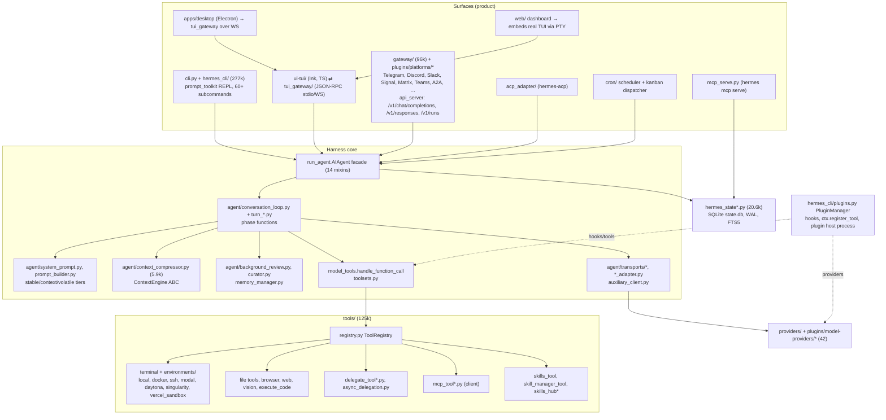

# Hermes Agent (Nous Research)

> Hermes Agent is a very large **integrated product**: a single-tenant personal agent that runs one synchronous, OpenAI-message-shaped agent core (`AIAgent`) behind every surface it ships. Those surfaces are a prompt_toolkit CLI, an Ink TUI, an Electron desktop app, a web dashboard, a messaging gateway with about 30 platform adapters, an OpenAI-compatible HTTP server, an ACP server, an MCP server and a cron scheduler. Two things set it apart from the coding-agent products in this study:
>
> 1. **A closed "learning loop".** At configured intervals after eligible turns, a forked copy of the agent reviews the transcript and writes `MEMORY.md`/`USER.md` entries and `SKILL.md` procedures. A background *curator* later archives and consolidates the skills the agent wrote.
> 2. **An operational treatment of prompt caching.** The system prompt is byte-stable per conversation. Compression is the only sanctioned cache break.
>
> The harness is not separated from the product. It has no published wheel, and its internal paths are not API. It is embeddable in-process only by importing `run_agent.AIAgent` from a source checkout. Its practical integration seams are its protocols: OpenAI-compatible HTTP plus `/v1/runs`, ACP, MCP, the TUI JSON-RPC, and A2A via a plugin. Build on Hermes when you want a batteries-included, always-on personal or team agent and are willing to extend it through plugins and skills. Do not build on it when you need a small, legible or stable library core. Its large source footprint makes it a substantial integrated platform rather than a small loop library.

| | |
|---|---|
| Repo(s) | `NousResearch/hermes-agent` @ `311155fade43` (commit date 2026-10-14, on `main` about 14 h after tag `v0.22.0`) |
| License | MIT ([`pyproject.toml:L13-L14`](https://github.com/NousResearch/hermes-agent/blob/311155fade43d1993ea968909a2ad36762345bbc/pyproject.toml#L13-L14)) |
| Language(s) | Python 3.14 runtime (`requires-python >=3.11,<3.15`; 3.11 is only an updater bridge). TypeScript/React for the Ink TUI, the Electron desktop app and the dashboard. |
| Size | 18,587 tracked files. **Non-test Python ≈ 933k lines.** Harness core: `run_agent.py` + `model_tools.py` + `toolsets.py` = 3.0k; `agent/` 137.9k (351 files), of which the turn loop proper (`conversation_loop.py` + `turn_*.py`) is ≈14.7k; `tools/` 125.3k (350 files, incl. terminal backends 7.3k and MCP client 11.3k); `hermes_state*.py` 20.6k; provider profiles 3.7k. Product: `hermes_cli/` 276.7k, `gateway/` 96.4k, `plugins/` 75.6k (platform adapters, kanban, …), `tui_gateway/` 44.1k, `cron/` 18.7k, `acp_adapter/` 4.5k, `pm/` 12.8k, `scripts/` 39.4k. TS/TSX: `apps/` ≈0.5M (desktop), `ui-tui/` 77.7k, `web/` 53.3k. Tests: 5,953 files and **1.34M lines** under `tests/`. Content: 58 bundled and 153 optional `SKILL.md` files; 614 plugin-catalog entries. The v0.22.0 notes claim "about 1.06M to 698K lines". Their counting basis is not stated and differs from the `git ls-files` count used here. |
| Version at pin | `pyproject.toml` says `0.0.0`. Versions come from an install stamp ([`hermes_cli/__init__.py:L5-L30`](https://github.com/NousResearch/hermes-agent/blob/311155fade43d1993ea968909a2ad36762345bbc/hermes_cli/__init__.py#L5-L30)). The latest release is **v0.22.0 "The Threshold Release"** (2026-10-13/14). |
| Release evidence | The first-party [v0.22.0 release](https://github.com/NousResearch/hermes-agent/releases/tag/v0.22.0), published 2026-10-14 UTC, was checked through GitHub release metadata. Earlier release chronology and popularity counts are not used to score the architecture. |
| Category | `integrated-product` |

> **Conflict flags (read before citing third-party material):**
> 1. **Atropos/RL is gone from the code.** The focus brief and the docs landing page still advertise "RL training with Atropos" ([`website/docs/index.mdx:L148`](https://github.com/NousResearch/hermes-agent/blob/311155fade43d1993ea968909a2ad36762345bbc/website/docs/index.mdx#L148)). However, PR #26106 (merged 2026-05-15, commit `5af672c75302`) "Remove[d] the entire Atropos RL training integration". That removal covered `environments/` (43 files), `rl_cli.py`, the 10 `rl_*` tools, the `tinker-atropos` submodule and the `[rl]` extra, about 15,700 lines in total (source: `gh pr view 26106`). At the pin, no Atropos code or dependency remains. Stale residue survives in a Dockerfile comment ([`Dockerfile:L250-L252`](https://github.com/NousResearch/hermes-agent/blob/311155fade43d1993ea968909a2ad36762345bbc/Dockerfile#L250-L252)), a doctor warning ([`hermes_cli/doctor_platform.py:L437`](https://github.com/NousResearch/hermes-agent/blob/311155fade43d1993ea968909a2ad36762345bbc/hermes_cli/doctor_platform.py#L437)) and an `"rl"` entry in `_AGENT_COMMANDS` ([`hermes_cli/main.py:L2876`](https://github.com/NousResearch/hermes-agent/blob/311155fade43d1993ea968909a2ad36762345bbc/hermes_cli/main.py#L2876)). Trajectory *export* for training (ShareGPT, Hermes tool-call XML) remains; see §11.
> 2. **The in-repo docs disagree with code defaults.** `agent/AGENTS.md` and `iteration_budget.py` say `max_iterations` defaults to 500 ([`agent/AGENTS.md:L15`](https://github.com/NousResearch/hermes-agent/blob/311155fade43d1993ea968909a2ad36762345bbc/agent/AGENTS.md#L15), [`agent/iteration_budget.py:L4`](https://github.com/NousResearch/hermes-agent/blob/311155fade43d1993ea968909a2ad36762345bbc/agent/iteration_budget.py#L4)). The constructor default is `sys.maxsize` ([`run_agent.py:L241`](https://github.com/NousResearch/hermes-agent/blob/311155fade43d1993ea968909a2ad36762345bbc/run_agent.py#L241)) and `agent.max_turns: None`, meaning unlimited ([`hermes_cli/config_defaults.py:L75-L78`](https://github.com/NousResearch/hermes-agent/blob/311155fade43d1993ea968909a2ad36762345bbc/hermes_cli/config_defaults.py#L75-L78)). `tools/AGENTS.md` gives delegation defaults of `max_concurrent_children` 3 and `max_spawn_depth` 2 ([`tools/AGENTS.md:L130-L138`](https://github.com/NousResearch/hermes-agent/blob/311155fade43d1993ea968909a2ad36762345bbc/tools/AGENTS.md#L130-L138)). The code defaults are 10 and 1 ([`tools/delegate_tool_config.py:L17-L21`](https://github.com/NousResearch/hermes-agent/blob/311155fade43d1993ea968909a2ad36762345bbc/tools/delegate_tool_config.py#L17-L21)).
> 3. **README vs code on search.** The README says "FTS5 session search with LLM summarization". `session_search` says "No LLM calls — every shape returns actual DB messages" ([`tools/session_search_tool.py:L1-L9`](https://github.com/NousResearch/hermes-agent/blob/311155fade43d1993ea968909a2ad36762345bbc/tools/session_search_tool.py#L1-L9)).
> 4. **Third-party descriptions of the learning loop are imprecise.** Several blogs say Hermes "runs a reflection step after each completed task" (e.g. postfa.st, kilo.ai). In the code, review fires only on counters: every `memory.nudge_interval` (10) user turns for memory, and after ≥`skills.creation_nudge_interval` (10) tool iterations for skills. It is suppressed for cron and interrupted turns (§5.4).
> 5. **OpenClaw's comparison page reviewed snapshot `6defe7eb6c` (2026-08-27).** It says Hermes "fast-forwards a Git branch (main by default)". v0.22.0 superseded that with tested SemVer release channels.

---

## 1. Layering & package map

Hermes follows a "facade + siblings" layout. Every former god-file is a facade, and the behaviour lives in `<stem>_<topic>.py` siblings. Code-health ratchets enforce CC ≤ 20 and ≤ 2,000 lines per file ([`AGENTS.md:L101-L117`](https://github.com/NousResearch/hermes-agent/blob/311155fade43d1993ea968909a2ad36762345bbc/AGENTS.md#L101-L117)). The same `AIAgent` is constructed by:

- the CLI ([`hermes_cli/cli_agent_setup_mixin.py:L646`](https://github.com/NousResearch/hermes-agent/blob/311155fade43d1993ea968909a2ad36762345bbc/hermes_cli/cli_agent_setup_mixin.py#L646))
- the gateway ([`gateway/run_turn_runner.py:L1115`](https://github.com/NousResearch/hermes-agent/blob/311155fade43d1993ea968909a2ad36762345bbc/gateway/run_turn_runner.py#L1115))
- the TUI/desktop backend ([`tui_gateway/server.py:L2680`](https://github.com/NousResearch/hermes-agent/blob/311155fade43d1993ea968909a2ad36762345bbc/tui_gateway/server.py#L2680))
- ACP ([`acp_adapter/session.py:L571`](https://github.com/NousResearch/hermes-agent/blob/311155fade43d1993ea968909a2ad36762345bbc/acp_adapter/session.py#L571))
- cron ([`cron/scheduler.py:L2468`](https://github.com/NousResearch/hermes-agent/blob/311155fade43d1993ea968909a2ad36762345bbc/cron/scheduler.py#L2468))



| Layer | Owns | Notes |
|---|---|---|
| `run_agent.AIAgent` | Public facade. Assembled from 14 mixins (`ClientLifecycleMixin`, `StreamDeliveryMixin`, `InterruptControlMixin`, `SessionPersistenceMixin`, `CompressionFacadeMixin`, `TurnFacadeMixin`, …) ([`run_agent.py:L214-L218`](https://github.com/NousResearch/hermes-agent/blob/311155fade43d1993ea968909a2ad36762345bbc/run_agent.py#L214-L218)) | `__init__` takes about 70 keyword parameters, including about 25 callbacks, and forwards them all to `agent.agent_init.init_agent` ([`run_agent.py:L236-L288`](https://github.com/NousResearch/hermes-agent/blob/311155fade43d1993ea968909a2ad36762345bbc/run_agent.py#L236-L288)) |
| `agent/` | Turn phases, provider transports, prompt assembly, compression, memory, learning loop, auxiliary-LLM routing | Turn loop ≈14.7k lines across about 30 phase files |
| `model_tools.py` / `toolsets.py` / `tools/registry.py` | Tool discovery, toolset resolution, schema post-processing, dispatch pipeline | Import-time `registry.register()` self-registration |
| `hermes_state*.py` | `SessionDB`: sessions, messages, usage, leases, async delegations | 30 sibling files |
| `providers/` + `plugins/model-providers/` | `ProviderProfile` registry: 42 bundled profiles, user-overridable | Discovered lazily |
| `gateway/`, `tui_gateway/`, `acp_adapter/`, `cron/`, `hermes_cli/` | Product shells | Each builds `AIAgent` with surface-specific callbacks |

---

## 2. Agent loop

**Where.** The loop lives in `agent/conversation_loop.py`. `AIAgent.run_conversation` reaches it after taking a durable cross-process *turn lease* ([`agent/turn_facade_lease.py:L1-L8`](https://github.com/NousResearch/hermes-agent/blob/311155fade43d1993ea968909a2ad36762345bbc/agent/turn_facade_lease.py#L1-L8)). The loop is **synchronous and thread-based**, with no asyncio in the core path. Each iteration phase is a free function in its own `turn_*.py` sibling ([`agent/AGENTS.md:L21-L50`](https://github.com/NousResearch/hermes-agent/blob/311155fade43d1993ea968909a2ad36762345bbc/agent/AGENTS.md#L21-L50)).

**The phase-function mechanism.** Loop locals live on a `_LoopState` dataclass. `_run_phase(fn, agent, state)` introspects each phase's signature with `inspect.signature`. It passes in the state fields the phase names, then copies the returned *verdict* dataclass fields back onto the state. `action` and `result` drive control flow (`return | break | continue`), and some fields are "latched" so they can only become True ([`agent/conversation_loop.py:L1476-L1494`](https://github.com/NousResearch/hermes-agent/blob/311155fade43d1993ea968909a2ad36762345bbc/agent/conversation_loop.py#L1476-L1494)). This is reflection-driven dependency injection. It keeps each phase small and testable in isolation. The cost is that data flow is implicit in parameter names.

**A turn, step by step** ([`agent/conversation_loop.py:L1547-L1706`](https://github.com/NousResearch/hermes-agent/blob/311155fade43d1993ea968909a2ad36762345bbc/agent/conversation_loop.py#L1547-L1706)):

```
run_conversation(user_message)                          conversation_loop.py:L1709
 ├─ refresh .env credentials; build_turn_context()      (prompt restore/build, preflight compaction,
 │                                                       persist user row, memory-nudge tick)
 ├─ api_mode == "codex_app_server" → hand whole turn to `codex app-server` subprocess  L1640-L1643
 ├─ play_prelude()  (scripted tool calls before first model call)
 └─ while (api_calls < max_iterations and iteration_budget.remaining > 0) or _budget_grace_call:
      begin_iteration → prepare_iteration → assemble_api_request → run_preflight_gate
      announce_api_call
      _run_api_retry_loop:  while retry < api_max_retries (3):            L1497-L1526
          nous_rate_limit_guard → build_api_request → perform_api_call → check_api_response
          except InterruptedError → handle_api_interrupt
          except Exception → handle_api_error (classify → rotate/fallback/compress/retry)
      apply_retry_restarts
      normalize_model_response
      tool_calls ? run_tool_round : finish_text_response
 finalize_turn()   (usage, memory sync, background review spawn, on_session_end hook)
 _close_durable_failed_turn()  (append assistant boundary if a failed turn left `user` as tail) L1813-L1856
```

**Stop conditions.**
- `max_iterations` and an `IterationBudget` that is thread-safe and refundable for `execute_code` turns ([`agent/iteration_budget.py:L25-L56`](https://github.com/NousResearch/hermes-agent/blob/311155fade43d1993ea968909a2ad36762345bbc/agent/iteration_budget.py#L25-L56)). Both are unlimited by default, plus an optional `budget_warning_ratio`.
- A wall-clock `run_budget_seconds`, which injects a wrap-up notice at 80% ([`hermes_cli/config_defaults.py:L79-L84`](https://github.com/NousResearch/hermes-agent/blob/311155fade43d1993ea968909a2ad36762345bbc/hermes_cli/config_defaults.py#L79-L84)).
- Interrupt, compression exhaustion (`max_attempts` 3), and a text response with no tool calls.
- `/goal` wraps turns in a judge-driven continuation loop capped at `goals.max_turns` 20.

**Steering, redirect and interrupt.** These are three distinct mechanisms in `InterruptControlMixin` ([`agent/interrupt_control.py:L125-L360`](https://github.com/NousResearch/hermes-agent/blob/311155fade43d1993ea968909a2ad36762345bbc/agent/interrupt_control.py#L125-L360)).

| Call | Effect |
|---|---|
| `steer(text)` | Queues text that is delivered as its own `user` row after the current tool batch. It never interrupts ([`L267-L278`](https://github.com/NousResearch/hermes-agent/blob/311155fade43d1993ea968909a2ad36762345bbc/agent/interrupt_control.py#L267-L278)). It is the one sanctioned exception to strict role alternation (`assistant(tool_calls) → tool → user`) ([`agent/AGENTS.md:L64-L69`](https://github.com/NousResearch/hermes-agent/blob/311155fade43d1993ea968909a2ad36762345bbc/agent/AGENTS.md#L64-L69)). A steer that arrives after the last tool batch is returned as `pending_steer` and becomes the next turn. |
| `redirect(text)` | Cancels only the in-flight *model request*. Completed messages are kept, the correction is appended as a real user message, and the loop retries. During tool execution it degrades to `steer` and asks foreground terminal workers to yield to the background registry. For Codex it uses native `turn/steer` ([`L280-L341`](https://github.com/NousResearch/hermes-agent/blob/311155fade43d1993ea968909a2ad36762345bbc/agent/interrupt_control.py#L280-L341)). |
| `interrupt(message, hard_cancel=…)` | Sets thread-scoped tool interrupt flags, aborts the active HTTP request, and propagates to every `_active_children` subagent. A hard cancel can fence an in-flight compression commit ([`L128-L230`](https://github.com/NousResearch/hermes-agent/blob/311155fade43d1993ea968909a2ad36762345bbc/agent/interrupt_control.py#L128-L230)). |

**Parallel tool calls.** `_execute_tool_calls` runs a *segment planner* ([`run_agent.py:L1299-L1333`](https://github.com/NousResearch/hermes-agent/blob/311155fade43d1993ea968909a2ad36762345bbc/run_agent.py#L1299-L1333)). It splits a batch into runs of parallel-safe calls separated by sequential barriers and executes them in emission order. The policy works as follows ([`agent/tool_dispatch_helpers.py:L29-L50`](https://github.com/NousResearch/hermes-agent/blob/311155fade43d1993ea968909a2ad36762345bbc/agent/tool_dispatch_helpers.py#L29-L50)):
- `_NEVER_PARALLEL_TOOLS` (`clarify`, `set_theme`, …) are always barriers.
- `_PARALLEL_SAFE_TOOLS` covers read-only tools (`web_search`, `read_file`, `session_search`, …).
- `read_file`/`search_files`/`write_file`/`patch` are admitted by **canonical path-overlap reservation**: readers may share a subtree, and a writer conflicts with any overlap.
- Batches run on a `DaemonThreadPoolExecutor` capped at `_MAX_TOOL_WORKERS = 8` ([`agent/tool_executor.py:L132`](https://github.com/NousResearch/hermes-agent/blob/311155fade43d1993ea968909a2ad36762345bbc/agent/tool_executor.py#L132)).
- `delegate_task` calls beyond `max_concurrent_children` are silently truncated ([`run_agent.py:L1174-L1192`](https://github.com/NousResearch/hermes-agent/blob/311155fade43d1993ea968909a2ad36762345bbc/run_agent.py#L1174-L1192)).

**Retries and recovery.** `handle_api_error` classifies every failure into a `FailoverReason`, which picks the strategy: rotate the credential, fall back to another model, compress, strip and retry, or abort. There are about 30 reasons, including `context_overflow`, `thinking_signature`, `role_alternation`, `invalid_encrypted_content`, `model_entitlement` and `upstream_rate_limit` ([`agent/error_classifier.py:L34-L64`](https://github.com/NousResearch/hermes-agent/blob/311155fade43d1993ea968909a2ad36762345bbc/agent/error_classifier.py#L34-L64)). Plugins and provider profiles can override classification. After `api_max_retries` (3) *and* the fallback chain are spent on a transient outage, an auto-recovery ladder parks the turn with a visible countdown. It runs up to 5 cycles on a jittered 15/30/60/60/60 s schedule, with `Retry-After` honoured up to 120 s ([`agent/turn_recovery_autorecover.py:L1-L12`](https://github.com/NousResearch/hermes-agent/blob/311155fade43d1993ea968909a2ad36762345bbc/agent/turn_recovery_autorecover.py#L1-L12)).

**Alternate loops.**
- `api_mode="codex_app_server"` hands the *entire turn* to OpenAI's `codex app-server` over newline-delimited JSON-RPC ([`agent/transports/codex_app_server.py:L1-L24`](https://github.com/NousResearch/hermes-agent/blob/311155fade43d1993ea968909a2ad36762345bbc/agent/transports/codex_app_server.py#L1-L24)). A curated subset of Hermes tools is exposed back to Codex as an MCP server named `hermes-tools` ([`agent/transports/hermes_tools_mcp_server.py:L1-L5`](https://github.com/NousResearch/hermes-agent/blob/311155fade43d1993ea968909a2ad36762345bbc/agent/transports/hermes_tools_mcp_server.py#L1-L5)). In this mode Hermes acts as a meta-harness wrapping Codex.
- `/moa` (Mixture-of-Agents) keeps the normal loop, but before each model iteration it gathers reference-model drafts in a `ThreadPoolExecutor` ([`agent/moa_loop.py:L1-L6`](https://github.com/NousResearch/hermes-agent/blob/311155fade43d1993ea968909a2ad36762345bbc/agent/moa_loop.py#L1-L6)).

---

## 3. Model / provider abstraction

**Internal message model.** The internal model is OpenAI Chat Completions dicts (`system|user|assistant|tool`), and reasoning is carried in `assistant_msg["reasoning"]` ([`agent/AGENTS.md:L47-L48`](https://github.com/NousResearch/hermes-agent/blob/311155fade43d1993ea968909a2ad36762345bbc/agent/AGENTS.md#L47-L48)). The only always-installed SDK is `openai==2.24.0` ([`pyproject.toml:L40`](https://github.com/NousResearch/hermes-agent/blob/311155fade43d1993ea968909a2ad36762345bbc/pyproject.toml#L40)). `anthropic`, `boto3`, `google-auth` and others are lazy extras. The OpenAI shape is the lingua franca, and every non-OpenAI path is an adapter around it.

| `api_mode` | Path | Evidence |
|---|---|---|
| `chat_completions` | OpenAI-compatible (OpenRouter, Nous Portal, DeepSeek, local llama.cpp/Ollama/LM Studio, …). The Gemini provider keeps this mode, and a shim rewrites calls to native `generateContent`. | [`agent/gemini_native_adapter.py:L1-L5`](https://github.com/NousResearch/hermes-agent/blob/311155fade43d1993ea968909a2ad36762345bbc/agent/gemini_native_adapter.py#L1-L5) |
| `anthropic_messages` | Native Anthropic, with a thinking-replay and signature policy | `agent/anthropic_*.py` |
| `codex_responses` | OpenAI Responses API, including ChatGPT-subscription OAuth | `agent/transports/codex.py` |
| `bedrock_converse` | AWS Bedrock | `agent/transports/bedrock.py` |
| `codex_app_server` | Whole-turn delegation to the Codex CLI | §2 |
| ACP-as-provider | `copilot --acp` driven as an "OpenAI-compatible shim". ACP has no tool channel, so tool schemas are rendered into the prompt text and calls are parsed back out. | [`agent/copilot_acp_client.py:L1-L5`](https://github.com/NousResearch/hermes-agent/blob/311155fade43d1993ea968909a2ad36762345bbc/agent/copilot_acp_client.py#L1-L5), [`agent/acp_openai_bridge.py:L1-L8`](https://github.com/NousResearch/hermes-agent/blob/311155fade43d1993ea968909a2ad36762345bbc/agent/acp_openai_bridge.py#L1-L8) |

A `ProviderTransport` ABC owns one api_mode's data path (`convert_messages`, `convert_tools`, `build_kwargs`, `normalize_response`, `extract_cache_stats`, `map_finish_reason`). The transport explicitly does *not* own client construction, streaming, credentials, caching, interrupts or retries, which stay on `AIAgent` ([`agent/transports/base.py:L1-L53`](https://github.com/NousResearch/hermes-agent/blob/311155fade43d1993ea968909a2ad36762345bbc/agent/transports/base.py#L1-L53)).

**Provider catalog.** Providers are declarative `ProviderProfile` dataclasses with these fields ([`providers/base.py:L42-L91`](https://github.com/NousResearch/hermes-agent/blob/311155fade43d1993ea968909a2ad36762345bbc/providers/base.py#L42-L91)):
- `name`, `api_mode`, `env_vars`, `base_url`
- `auth_type`: `api_key | oauth_device_code | oauth_external | copilot | aws_sdk`
- optional `auth_handler`, `refresh_credential` and `classify_api_error` callables

There are 42 bundled profiles under `plugins/model-providers/`, including openrouter, nous, anthropic, openai-codex, copilot, copilot-acp, gemini, vertex, bedrock, xai, deepseek, kimi-coding, zai, qwen-oauth, ollama-cloud, lmstudio, opencode-zen and kilocode. A user profile at `$HERMES_HOME/plugins/model-providers/<name>/` overrides a bundled one by last-writer-wins ([`plugins/model-providers/README.md:L1-L30`](https://github.com/NousResearch/hermes-agent/blob/311155fade43d1993ea968909a2ad36762345bbc/plugins/model-providers/README.md#L1-L30)). Context lengths and prices come from a cached **models.dev** registry with ETag refresh ([`agent/models_dev.py:L1-L8`](https://github.com/NousResearch/hermes-agent/blob/311155fade43d1993ea968909a2ad36762345bbc/agent/models_dev.py#L1-L8)). Credential *pools* rotate keys and OAuth rows per provider with per-model cooldowns (`agent/credential_pool.py`).

**Auxiliary models.** Side-LLM work goes through one router, `agent/auxiliary_client.py`. That covers compression summaries, the learning-loop fork, curator, vision, titles, smart approvals and MoA. Each task can pin its own provider, model and reasoning effort under `auxiliary:`. Aux calls fire `pre/post_auxiliary_call` hooks but never the turn-scoped `pre/post_api_request` ([`agent/AGENTS.md:L94-L107`](https://github.com/NousResearch/hermes-agent/blob/311155fade43d1993ea968909a2ad36762345bbc/agent/AGENTS.md#L94-L107)).

**Prompt caching** is a first-class concern.
- **Anthropic-style markers.** The default layout uses 4 `cache_control` breakpoints: the static system prefix, the end of the system prompt, and the last 2 non-system messages, all with one TTL of 5m or 1h ([`agent/prompt_caching.py:L1-L5`](https://github.com/NousResearch/hermes-agent/blob/311155fade43d1993ea968909a2ad36762345bbc/agent/prompt_caching.py#L1-L5)).
- **Implicit longest-prefix caches.** The system prompt is built in three tiers ordered from most to least stable (§5.1).
- **Relay affinity.** Headers such as `x-opencode-session` pin relays to one upstream so the cache stays warm ([`agent/opencode_affinity.py:L1-L8`](https://github.com/NousResearch/hermes-agent/blob/311155fade43d1993ea968909a2ad36762345bbc/agent/opencode_affinity.py#L1-L8)).

**Token and cost accounting.** Per-session input, output, cache-read, cache-write and reasoning tokens, plus `estimated_cost_usd`, `actual_cost_usd` and `pricing_version`, are columns on `sessions`. A `session_model_usage` table keys usage by `(model, billing_provider, base_url, mode, task)`, so auxiliary spend is attributed separately ([`hermes_state_common.py:L382-L502`](https://github.com/NousResearch/hermes-agent/blob/311155fade43d1993ea968909a2ad36762345bbc/hermes_state_common.py#L382-L502)).

---

## 4. Tool system

**Definition API.** Each `tools/*.py` calls `registry.register(name, toolset, schema, handler, check_fn, requires_env, …)` at import time. `discover_builtin_tools()` AST-scans `tools/` for modules containing such a call, so no manual import list is needed ([`tools/registry.py:L96`](https://github.com/NousResearch/hermes-agent/blob/311155fade43d1993ea968909a2ad36762345bbc/tools/registry.py#L96), [`L666-L735`](https://github.com/NousResearch/hermes-agent/blob/311155fade43d1993ea968909a2ad36762345bbc/tools/registry.py#L666-L735)).
- **Schemas** are hand-written JSON Schema dicts. There is no Pydantic or decorator layer.
- **Handlers** return a JSON string, or a `{"_multimodal": True, …}` envelope for pixels ([`tools/AGENTS.md:L7-L22`](https://github.com/NousResearch/hermes-agent/blob/311155fade43d1993ea968909a2ad36762345bbc/tools/AGENTS.md#L7-L22)).
- **`ToolEntry` metadata** carries a per-tool `max_result_size_chars` and a `dynamic_schema_overrides` callable that is merged at every `get_definitions()`. For example, `delegate_task`'s description reflects the live concurrency limits ([`tools/registry.py:L182-L197`](https://github.com/NousResearch/hermes-agent/blob/311155fade43d1993ea968909a2ad36762345bbc/tools/registry.py#L182-L197)).
- **Availability (`check_fn`)** answers reachability or opt-in. Results are TTL-cached process-wide and keyed by profile home.

**Toolsets.** A static `TOOLSETS` dict composes named groups. `_HERMES_CORE_TOOLS` is the default bundle every platform inherits ([`toolsets.py:L11-L39`](https://github.com/NousResearch/hermes-agent/blob/311155fade43d1993ea968909a2ad36762345bbc/toolsets.py#L11-L39)):
- web: `web_search`, `web_extract`
- terminal: `terminal`, `process_manage`
- files: `read_file`, `write_file`, `patch`, `search_files`
- vision and images: `vision_analyze`, `image_generate`
- skills: `skills_list`, `skill_view`, `skill_manage`
- 14 `browser_*` tools
- `text_to_speech`, `todo_list`, `memory`, `session_search`, `clarify`
- `execute_code`, `delegate_task`, `cronjob_manage`
- 13 `kanban_*` tools
- `computer_use`, `manage_connections`

Per-surface bundles derive from it:
- `hermes-acp` is the coding posture minus `clarify` ([`toolsets.py:L191-L195`](https://github.com/NousResearch/hermes-agent/blob/311155fade43d1993ea968909a2ad36762345bbc/toolsets.py#L191-L195)).
- `hermes-webhook` is restricted to `web_search`, `web_extract`, `vision_analyze` and `clarify`, because webhook payloads are untrusted ([`toolsets.py:L41-L42`](https://github.com/NousResearch/hermes-agent/blob/311155fade43d1993ea968909a2ad36762345bbc/toolsets.py#L41-L42)).
- GUI-only affordances (`desktop_ui`, `project`) are folded in per *session*, never per process env ([`tools/AGENTS.md:L157-L176`](https://github.com/NousResearch/hermes-agent/blob/311155fade43d1993ea968909a2ad36762345bbc/tools/AGENTS.md#L157-L176)).

The project's "footprint ladder" sets the order of preference for new capability: CLI + skill → service-gated tool → plugin → MCP → new core tool. It makes core tools deliberately scarce, because "every model tool is sent on every API call" ([`AGENTS.md:L24-L26`](https://github.com/NousResearch/hermes-agent/blob/311155fade43d1993ea968909a2ad36762345bbc/AGENTS.md#L24-L26), [`AGENTS.md:L56-L59`](https://github.com/NousResearch/hermes-agent/blob/311155fade43d1993ea968909a2ad36762345bbc/AGENTS.md#L56-L59)).

**Progressive disclosure ("Tool Search").** MCP/plugin tools and a curated set of rarely used core tools are removed from the model-visible array. Three bridge tools replace them: `tool_search` (BM25 with Snowball stemming), `tool_describe` and `tool_call`. The catalog is rebuilt from live definitions on every assembly ([`tools/tool_search.py:L1-L7`](https://github.com/NousResearch/hermes-agent/blob/311155fade43d1993ea968909a2ad36762345bbc/tools/tool_search.py#L1-L7)). v0.22.0 credits this with roughly halving the desktop tool schema.

**Execution pipeline.** `handle_function_call` runs these steps in order ([`model_tools.py:L873-L966`](https://github.com/NousResearch/hermes-agent/blob/311155fade43d1993ea968909a2ad36762345bbc/model_tools.py#L873-L966)):
1. Argument coercion and legacy alias mapping (`todo` → `todo_list`).
2. Tool Search bridge unwrapping, so hooks see the real tool name.
3. Connector gating.
4. Request middleware.
5. `_pre_dispatch_guards`: the `pre_tool_call` hooks and the approval and guardrail gates.
6. `_execute_tool`.
7. The `post_tool_call` observer.
8. The `transform_tool_result` hook.

Agent-level tools such as `todo` and `memory` are intercepted earlier through an `INLINE_TOOL_EXECUTORS` table ([`agent/AGENTS.md:L50-L53`](https://github.com/NousResearch/hermes-agent/blob/311155fade43d1993ea968909a2ad36762345bbc/agent/AGENTS.md#L50-L53)). Tool-call progress is flushed to SQLite *before* it is projected to any UI, because tool side effects can kill the process ([`agent/tool_executor.py:L198-L222`](https://github.com/NousResearch/hermes-agent/blob/311155fade43d1993ea968909a2ad36762345bbc/agent/tool_executor.py#L198-L222)).

**Output truncation and spill-to-disk.** Three layers protect the context ([`tools/tool_result_storage.py:L1-L6`](https://github.com/NousResearch/hermes-agent/blob/311155fade43d1993ea968909a2ad36762345bbc/tools/tool_result_storage.py#L1-L6), [`tools/budget_config.py:L8-L21`](https://github.com/NousResearch/hermes-agent/blob/311155fade43d1993ea968909a2ad36762345bbc/tools/budget_config.py#L8-L21)):
1. Per-tool caps.
2. `maybe_persist_tool_result`. Output above the tool's threshold (default 100,000 chars; 50,000 for `mcp_*` tools) goes to `$HERMES_HOME/cache/spillover/{id}.txt` and is replaced by a 1,500-char preview plus the path in a `<persisted-output>` tag.
3. A per-turn budget of 200,000 chars.

`read_file` is pinned to an infinite threshold to avoid persist → read → persist loops.

**Programmatic tool calling.** `execute_code` runs a model-written Python script in a persistent per-conversation kernel. The script calls Hermes tools over RPC (a Unix socket, or loopback TCP on Windows), and only its stdout returns to the model ([`tools/code_execution_tool.py:L1-L11`](https://github.com/NousResearch/hermes-agent/blob/311155fade43d1993ea968909a2ad36762345bbc/tools/code_execution_tool.py#L1-L11)). Its iterations are refunded from the iteration budget.

**Terminal backends.** There are seven built-in `BaseEnvironment` implementations: `local, docker, singularity, modal, daytona, vercel_sandbox, ssh` ([`tools/terminal_tool_backends.py:L54`](https://github.com/NousResearch/hermes-agent/blob/311155fade43d1993ea968909a2ad36762345bbc/tools/terminal_tool_backends.py#L54), [`L239-L241`](https://github.com/NousResearch/hermes-agent/blob/311155fade43d1993ea968909a2ad36762345bbc/tools/terminal_tool_backends.py#L239-L241)). Plugins can add more through `register_terminal_environment_provider`, but built-in names are reserved ([`agent/terminal_env_registry.py:L1-L10`](https://github.com/NousResearch/hermes-agent/blob/311155fade43d1993ea968909a2ad36762345bbc/agent/terminal_env_registry.py#L1-L10)). File tools are implemented on top of the shell contract, so on a remote backend they see only what the backend exposes.

---

## 5. Context management

### 5.1 System prompt assembly

`build_system_prompt_parts` emits three cache tiers, which are concatenated once and "never re-rendered mid-session" ([`agent/system_prompt.py:L730-L805`](https://github.com/NousResearch/hermes-agent/blob/311155fade43d1993ea968909a2ad36762345bbc/agent/system_prompt.py#L730-L805)):

| Tier | Contents |
|---|---|
| **stable** | Identity (SOUL.md or the default), help guidance, tool-use guidance, `/steer` note, model-family operational guidance, auto-loaded pinned skills, coding brief |
| **context** | Caller `system_message`, project context files, workspace snapshot |
| **volatile** | Skills index, MEMORY.md and USER.md snapshot, external-memory block, plugin sections, active profile line, timestamp, runtime environment |

The ordering is chosen so that the stable prefix stays byte-identical across profiles and worktrees. Per-call ephemeral prompts are injected at API time only.

**The caching invariant.** "Per-conversation prompt caching is sacred." Mutating past context, swapping toolsets, reloading memories or rebuilding the system prompt mid-conversation is forbidden. The one exception is compression ([`AGENTS.md:L18-L23`](https://github.com/NousResearch/hermes-agent/blob/311155fade43d1993ea968909a2ad36762345bbc/AGENTS.md#L18-L23), [`agent/AGENTS.md:L55-L63`](https://github.com/NousResearch/hermes-agent/blob/311155fade43d1993ea968909a2ad36762345bbc/agent/AGENTS.md#L55-L63)). Consequences:
- Slash commands that change prompt state defer to the next session unless invoked with `--now`.
- Skill slash commands inject as *user* messages.
- Subdirectory `AGENTS.md` hints discovered mid-session are appended to *tool results*, capped at 32k chars.

### 5.2 Project instruction files

Only **one** project-context type loads, first found wins ([`agent/prompt_builder.py:L1772-L1780`](https://github.com/NousResearch/hermes-agent/blob/311155fade43d1993ea968909a2ad36762345bbc/agent/prompt_builder.py#L1772-L1780), [`L1852-L1871`](https://github.com/NousResearch/hermes-agent/blob/311155fade43d1993ea968909a2ad36762345bbc/agent/prompt_builder.py#L1852-L1871)):
1. `.hermes.md`/`HERMES.md`, walking up to the git root.
2. The `AGENTS.md` chain from git root down to cwd. Per directory, `AGENTS.override.md` beats `AGENTS.md` beats `agents.md`. The comment cites the "same convention as earendil-works/pi#7681", which ties this convention to the Pi chapter ([`L1808-L1829`](https://github.com/NousResearch/hermes-agent/blob/311155fade43d1993ea968909a2ad36762345bbc/agent/prompt_builder.py#L1808-L1829)).
3. `CLAUDE.md`, cwd only.
4. `.cursorrules` plus `.cursor/rules/*.mdc`.

`SOUL.md` from `HERMES_HOME` loads independently as identity. Every file is threat-scanned. A hit in repo-supplied files is **blocked**, while a hit in the user's own `SOUL.md` only warns ([`L83-L95`](https://github.com/NousResearch/hermes-agent/blob/311155fade43d1993ea968909a2ad36762345bbc/agent/prompt_builder.py#L83-L95)). Each file is capped at `CONTEXT_FILE_MAX_CHARS = 20_000`, scaled by the context window ([`L1156`](https://github.com/NousResearch/hermes-agent/blob/311155fade43d1993ea968909a2ad36762345bbc/agent/prompt_builder.py#L1156)). Install-tree `AGENTS.md` is suppressed when cwd resolution fell back to the Hermes checkout.

### 5.3 Compaction

There are two layers: gateway "session hygiene" at 85%, and the agent `ContextCompressor` at a 50% default threshold ([`agent/AGENTS.md:L77-L92`](https://github.com/NousResearch/hermes-agent/blob/311155fade43d1993ea968909a2ad36762345bbc/agent/AGENTS.md#L77-L92)). `ContextCompressor.compress` runs four phases ([`agent/context_compressor.py:L5534-L5641`](https://github.com/NousResearch/hermes-agent/blob/311155fade43d1993ea968909a2ad36762345bbc/agent/context_compressor.py#L5534-L5641)):
1. **Prune** old tool-result bodies without an LLM call. Tool-call arguments are never rewritten.
2. **Choose boundaries** on the pruned copy: protect `protect_first_n` head messages plus a token-budgeted tail.
3. **Summarize** the middle with the auxiliary compression model. A feasibility and fallback-streak skip can replace this with a deterministic fallback summary.
4. **Assemble** head + summary + tail and clean orphaned tool pairs.

The summary uses a fixed structured template ([`L4124-L4178`](https://github.com/NousResearch/hermes-agent/blob/311155fade43d1993ea968909a2ad36762345bbc/agent/context_compressor.py#L4124-L4178)):
- `## Goal`, `## Constraints & Preferences`, `## Completed Actions` (format `N. ACTION target — outcome [tool: name]`), `## Active State`
- `## Blocked`, `## Key Decisions`, `## Errors & Fixes`, `## Resolved Questions`, `## Relevant Files`, `## Critical Context`
- A verbatim `[SKILL_PRUNED …]` section and a temporal-anchoring rule

Repeat compressions *update* the previous summary iteratively. `/compress` accepts a focus topic, and its comment says this was "Inspired by Claude Code's `/compact`".

Defaults ([`hermes_cli/config_defaults.py:L586-L659`](https://github.com/NousResearch/hermes-agent/blob/311155fade43d1993ea968909a2ad36762345bbc/hermes_cli/config_defaults.py#L586-L659)):

| Key | Default | Meaning |
|---|---|---|
| `threshold` | 0.50 | Floored at 0.75 for windows under 512K |
| `target_ratio` | 0.20 | |
| `tail_mode` | `"lean"` | Tail of 2.5% of the window, 10K floor / 25K cap, plus chunked digests and `session_search` pointers |
| `protect_last_n` | 20 | |
| `protect_first_n` | 3 | |
| `max_attempts` | 3 | |
| `proactive_prune_tokens` | 0 | Opt-in |
| `micro_compact` | `False` | Opt-in rolling fold, off because it breaks the cache every turn |
| `abort_on_summary_failure` | `False` | |

Codex models on the ChatGPT-OAuth route can use native server-side compaction (`agent/native_compaction.py`). The whole strategy is swappable through a `ContextEngine` ABC selected by `context.engine` ([`agent/context_engine.py:L1-L8`](https://github.com/NousResearch/hermes-agent/blob/311155fade43d1993ea968909a2ad36762345bbc/agent/context_engine.py#L1-L8)). Compression either splits sessions through `parent_session_id` chains or compacts in place under one session id, guarded by a `compression_locks` table.

### 5.4 Memory and the learning loop

The headline feature has four parts.

**(a) Built-in memory.** A single `memory` tool edits `memories/MEMORY.md` (agent notes on the environment) and `USER.md` (user profile). Entries are separated by `\n§\n`, with hard caps of 2,200 and 1,375 chars ([`hermes_cli/config_defaults.py:L1319-L1322`](https://github.com/NousResearch/hermes-agent/blob/311155fade43d1993ea968909a2ad36762345bbc/hermes_cli/config_defaults.py#L1319-L1322)). Both enter the system prompt as a **frozen snapshot at session start**. Writes hit disk but never change the live prompt ([`tools/memory_tool.py:L1-L5`](https://github.com/NousResearch/hermes-agent/blob/311155fade43d1993ea968909a2ad36762345bbc/tools/memory_tool.py#L1-L5)).

**External memory providers** implement the `MemoryProvider` ABC: `initialize`, `system_prompt_block`, `prefetch`/`queue_prefetch`, `sync_turn`, `get_tool_schemas`, `on_pre_compress`, `on_delegation`, `on_session_end`, `on_memory_write` and others ([`agent/memory_provider.py:L84-L204`](https://github.com/NousResearch/hermes-agent/blob/311155fade43d1993ea968909a2ad36762345bbc/agent/memory_provider.py#L84-L204)). Honcho, Mem0, Supermemory, Hindsight, OpenViking and Holographic moved out to catalog plugins in v0.22.0. Only `byterover` and `retaindb` remain in-tree.

**(b) Background review fork.** In `finalize_turn`, *after* the reply is delivered, the agent spawns a daemon thread when either counter fires ([`agent/turn_finalizer.py:L762-L790`](https://github.com/NousResearch/hermes-agent/blob/311155fade43d1993ea968909a2ad36762345bbc/agent/turn_finalizer.py#L762-L790)):
- the memory counter (user turns since the last `memory` call ≥ 10; [`agent/turn_context.py:L753-L762`](https://github.com/NousResearch/hermes-agent/blob/311155fade43d1993ea968909a2ad36762345bbc/agent/turn_context.py#L753-L762)), or
- the skill counter (tool iterations since the last `skill_manage` ≥ 10; [`agent/turn_iteration_prep.py:L166-L167`](https://github.com/NousResearch/hermes-agent/blob/311155fade43d1993ea968909a2ad36762345bbc/agent/turn_iteration_prep.py#L166-L167)).

Any explicit `memory`/`skill_manage` call resets its counter ([`agent/tool_executor.py:L746-L749`](https://github.com/NousResearch/hermes-agent/blob/311155fade43d1993ea968909a2ad36762345bbc/agent/tool_executor.py#L746-L749)). Review is skipped on interrupted turns and when `skip_background_review` is set; cron sets it because the fork "costs ~30K tokens / event".

The fork is a **cache-parity clone**: same provider, model, credentials and cached system prompt, so it hits the parent's prefix cache. It replays the transcript snapshot and is asked to act ([`agent/background_review.py:L1-L6`](https://github.com/NousResearch/hermes-agent/blob/311155fade43d1993ea968909a2ad36762345bbc/agent/background_review.py#L1-L6)). Its limits:
- `_REVIEW_MAX_ITERATIONS = 16`, and input capped at 75% of the context or 600k tokens ([`L173-L182`](https://github.com/NousResearch/hermes-agent/blob/311155fade43d1993ea968909a2ad36762345bbc/agent/background_review.py#L173-L182)).
- A **dispatch-side whitelist** limits it to the review toolsets plus `read_file`/`search_files` ([`L1080-L1120`](https://github.com/NousResearch/hermes-agent/blob/311155fade43d1993ea968909a2ad36762345bbc/agent/background_review.py#L1080-L1120)).
- Dangerous-command approvals are auto-denied.

The prompts are the "learning algorithm" ([`L440-L509`](https://github.com/NousResearch/hermes-agent/blob/311155fade43d1993ea968909a2ad36762345bbc/agent/background_review.py#L440-L509)):
- "Be ACTIVE — most sessions produce at least one skill update".
- Preference order: patch a currently-loaded skill → patch an existing umbrella → add a `references/`, `templates/` or `scripts/` support file → create a new **class-level** skill.
- User style corrections are a "FIRST-CLASS skill signal".
- An explicit "Do NOT capture" list: environment-dependent failures, negative claims about tools, unresolved dead-ends.
- An **enforced read-before-write** rule: `skill_manage` refuses a patch unless `skill_view` ran during this review.

Writes are tagged with a `background_review` provenance ContextVar ([`tools/skill_provenance.py:L1-L8`](https://github.com/NousResearch/hermes-agent/blob/311155fade43d1993ea968909a2ad36762345bbc/tools/skill_provenance.py#L1-L8)). That tag is how the curator later knows which skills it may touch.

**(c) Curator.** The curator is inactivity-triggered. It runs when the agent has been idle ≥ 2 h and the last run is ≥ 7 days old. It moves agent-created skills through `active → stale (14 d) → archived (30 d)` based on usage telemetry in `.usage.json` ([`agent/curator.py:L1-L7`](https://github.com/NousResearch/hermes-agent/blob/311155fade43d1993ea968909a2ad36762345bbc/agent/curator.py#L1-L7), [`L31-L35`](https://github.com/NousResearch/hermes-agent/blob/311155fade43d1993ea968909a2ad36762345bbc/agent/curator.py#L31-L35)). An *opt-in* LLM consolidation fork (`DEFAULT_CONSOLIDATE = False`) can merge overlapping skills and rewrite cron references to them. The invariants are ([`skills/AGENTS.md:L62-L79`](https://github.com/NousResearch/hermes-agent/blob/311155fade43d1993ea968909a2ad36762345bbc/skills/AGENTS.md#L62-L79)):
- it touches only `created_by: "agent"` skills
- it never deletes (archive is the maximum)
- pinned skills are exempt
- it takes pre-run tar.gz backups

**(d) Recall.** `session_search` does FTS5 discovery, deduplicated by lineage, plus scroll, read and browse modes over `state.db`, with no LLM calls (Conflict 3).

**Skill format.** `SKILL.md` with YAML frontmatter: `name`, `description` ≤ 60 chars, `version`, `platforms`, and `metadata.hermes.{tags,category,related_skills,config}` ([`skills/AGENTS.md:L16-L22`](https://github.com/NousResearch/hermes-agent/blob/311155fade43d1993ea968909a2ad36762345bbc/skills/AGENTS.md#L16-L22)). It is advertised as agentskills.io-compatible. The system prompt carries only the index ([`agent/system_prompt.py:L301-L314`](https://github.com/NousResearch/hermes-agent/blob/311155fade43d1993ea968909a2ad36762345bbc/agent/system_prompt.py#L301-L314)), and `skill_view` loads the full body. `skill_manage` actions are `create`, `edit`, `patch`, `delete`, `write_file` and `remove_file` ([`tools/skill_manager_tool.py:L720-L726`](https://github.com/NousResearch/hermes-agent/blob/311155fade43d1993ea968909a2ad36762345bbc/tools/skill_manager_tool.py#L720-L726)). Skills also load from `skills.external_dirs` (e.g. `~/.agents/skills`) and from *trusted* project `.hermes/skills`/`.agents/skills` ([`hermes_cli/config_defaults.py:L1448-L1460`](https://github.com/NousResearch/hermes-agent/blob/311155fade43d1993ea968909a2ad36762345bbc/hermes_cli/config_defaults.py#L1448-L1460)).

---

## 6. State, sessions & durability

**Storage.** `~/.hermes/state.db` (profile-scoped) is SQLite in **WAL** mode with FTS5, unicode and trigram indexes ([`hermes_state.py:L1-L5`](https://github.com/NousResearch/hermes-agent/blob/311155fade43d1993ea968909a2ad36762345bbc/hermes_state.py#L1-L5), [`L177`](https://github.com/NousResearch/hermes-agent/blob/311155fade43d1993ea968909a2ad36762345bbc/hermes_state.py#L177)). Key tables ([`hermes_state_common.py:L372-L610`](https://github.com/NousResearch/hermes-agent/blob/311155fade43d1993ea968909a2ad36762345bbc/hermes_state_common.py#L372-L610)):

| Table | Holds |
|---|---|
| `sessions` | About 60 columns: source tag (`cli`/`telegram`/…), `parent_session_id`, model config, `system_prompt_hash` (deduplicated into `system_prompts`), cwd/git metadata, tokens, costs, compression cooldown state, `rewind_count`, `pinned`/`archived` |
| `messages` | Role, content, `tool_calls`, `reasoning`, `reasoning_details`, `codex_reasoning_items`, `api_content` (the byte-stable request copy), `display_kind`, `message_uid`, `active`/`compacted` flags |
| `session_turn_leases`, `compression_locks` | Cross-process mutual exclusion |
| `async_delegations` | Background subagent results and delivery state |
| `gateway_routing`, `conversation_generations`, `gateway_heartbeats` | Gateway routing and liveness |

**Write discipline.** Persistence is append-only and incremental. Every tool result is flushed before it reaches a UI (§4). "Already-written rows must never be rewritten later."

**Resume, branch, undo and rollback.**

| Feature | Mechanism |
|---|---|
| Resume | `hermes chat --continue [NAME]` ([`hermes_cli/_parser.py:L185-L186`](https://github.com/NousResearch/hermes-agent/blob/311155fade43d1993ea968909a2ad36762345bbc/hermes_cli/_parser.py#L185-L186)); ACP `load_session`/`resume_session` |
| Branch | `/branch` (alias `/fork`) creates a new thread on Discord, Telegram, Slack or Matrix ([`hermes_cli/commands.py:L108-L109`](https://github.com/NousResearch/hermes-agent/blob/311155fade43d1993ea968909a2ad36762345bbc/hermes_cli/commands.py#L108-L109)); ACP `fork_session` ([`acp_adapter/server.py:L666`](https://github.com/NousResearch/hermes-agent/blob/311155fade43d1993ea968909a2ad36762345bbc/acp_adapter/server.py#L666)) |
| Undo / retry | `/undo` and `/retry` share one "carrier-aware" rewind implementation across CLI, gateway and TUI. The durable transcript is the authority ([`hermes_state_rewind.py:L1-L4`](https://github.com/NousResearch/hermes-agent/blob/311155fade43d1993ea968909a2ad36762345bbc/hermes_state_rewind.py#L1-L4)). |
| Filesystem rollback | `/rollback` restores **filesystem checkpoints**: a single shared shadow-git store under `~/.hermes/checkpoints/store` with per-project refs, snapshotted once per turn before `write_file`, `patch` or destructive terminal commands ([`tools/checkpoint_manager.py:L1-L25`](https://github.com/NousResearch/hermes-agent/blob/311155fade43d1993ea968909a2ad36762345bbc/tools/checkpoint_manager.py#L1-L25)). **Off by default** (`checkpoints.enabled: False`, 20 snapshots, 500 MB cap; [`hermes_cli/config_defaults.py:L499-L505`](https://github.com/NousResearch/hermes-agent/blob/311155fade43d1993ea968909a2ad36762345bbc/hermes_cli/config_defaults.py#L499-L505)). |

**Crash recovery.** The engineering here is extensive, but it is not durable *execution*. The pieces are:
- The **turn lease** gives one-writer-per-session across the Desktop, CLI, gateway and cron processes.
- A failed turn that leaves `user` as the durable tail gets a Hermes-authored assistant boundary appended, so the next prompt does not merge into it ([`agent/conversation_loop.py:L1813-L1856`](https://github.com/NousResearch/hermes-agent/blob/311155fade43d1993ea968909a2ad36762345bbc/agent/conversation_loop.py#L1813-L1856)).
- The gateway keeps a **delivery-obligation ledger** with states `pending` → `attempting` → `delivered`/`failed`. A crash between finalize and platform ACK redelivers "WITH a visible recovered marker" rather than silently duplicating ([`gateway/delivery_ledger.py:L1-L11`](https://github.com/NousResearch/hermes-agent/blob/311155fade43d1993ea968909a2ad36762345bbc/gateway/delivery_ledger.py#L1-L11)).
- Recurring cron occurrences advance the schedule before execution and use claim-based deduplication; finite one-shot jobs consume their configured dispatch budget (`repeat.times`) before execution, while unlimited one-shots bypass that counter. Unclaimed pending slots may be restored ([jobs.py:L2585–L2601](https://github.com/NousResearch/hermes-agent/blob/311155fade43d1993ea968909a2ad36762345bbc/cron/jobs.py#L2585-L2601), [scheduler.py:L3331–L3335](https://github.com/NousResearch/hermes-agent/blob/311155fade43d1993ea968909a2ad36762345bbc/cron/scheduler.py#L3331-L3335), [occurrences.py:L58–L69](https://github.com/NousResearch/hermes-agent/blob/311155fade43d1993ea968909a2ad36762345bbc/cron/occurrences.py#L58-L69)); the scheduling notes summarize this policy ([`cron/AGENTS.md:L22-L27`](https://github.com/NousResearch/hermes-agent/blob/311155fade43d1993ea968909a2ad36762345bbc/cron/AGENTS.md#L22-L27)).

There is no replay of an in-flight turn. A killed turn resumes from its last persisted tool row on the next user message. Background delegation is explicitly "process-local; work that must survive restart uses `cronjob`" ([`tools/AGENTS.md:L144-L146`](https://github.com/NousResearch/hermes-agent/blob/311155fade43d1993ea968909a2ad36762345bbc/tools/AGENTS.md#L144-L146)).

---

## 7. Safety & sandboxing

**Stated trust model.** `SECURITY.md` is unusually candid: "**The only security boundary against an adversarial LLM is the operating system.** Nothing inside the agent process constitutes containment — not the approval gate, not output redaction, not any pattern scanner, not any tool allowlist" ([`SECURITY.md:L58-L64`](https://github.com/NousResearch/hermes-agent/blob/311155fade43d1993ea968909a2ad36762345bbc/SECURITY.md#L58-L64)). It distinguishes two postures ([`L70-L119`](https://github.com/NousResearch/hermes-agent/blob/311155fade43d1993ea968909a2ad36762345bbc/SECURITY.md#L70-L119)):
- **Terminal-backend isolation.** Shell and file tools run in a container or remote host. This does *not* cover `execute_code`, MCP subprocesses, plugins, hooks or skill loading.
- **Whole-process wrapping.** The supported options are Hermes's Docker image or NVIDIA OpenShell.

The default backend is `local`, meaning the host.

**Approval gate** ([`tools/approval.py:L1-L11`](https://github.com/NousResearch/hermes-agent/blob/311155fade43d1993ea968909a2ad36762345bbc/tools/approval.py#L1-L11)). The layers are hardline patterns (always blocked), user `deny` fnmatch globs (block even under `--yolo`), a permanent `command_allowlist`, per-session approvals, and a human prompt. Config defaults ([`hermes_cli/config_defaults.py:L1665-L1701`](https://github.com/NousResearch/hermes-agent/blob/311155fade43d1993ea968909a2ad36762345bbc/hermes_cli/config_defaults.py#L1665-L1701)):
- `approvals.mode: "smart"`
- `timeout: 300` s, so a phone has time to answer
- `cron_mode`, `single_query_mode` and `unattended_mode` all default to `deny`
- `denial_breaker_threshold: 3`

"Smart" mode sends flagged commands to an auxiliary-LLM guardian that answers APPROVE/DENY/ESCALATE. Shell comments are stripped first, and the command is wrapped in delimiters as untrusted input. The comment says this was "Inspired by OpenAI Codex's Smart Approvals" ([`tools/approval_smart.py:L1-L31`](https://github.com/NousResearch/hermes-agent/blob/311155fade43d1993ea968909a2ad36762345bbc/tools/approval_smart.py#L1-L31)). `HERMES_YOLO_MODE` is frozen at import, so a skill cannot set it mid-process ([`tools/approval.py:L44-L46`](https://github.com/NousResearch/hermes-agent/blob/311155fade43d1993ea968909a2ad36762345bbc/tools/approval.py#L44-L46)). Approvals render as native buttons on Telegram, Discord and Slack, travel over TUI JSON-RPC server→client requests, use ACP permission requests, and can arrive as MCP elicitations.

**Containers and network.** The Docker backend runs with `--cap-drop ALL`, `no-new-privileges`, PID, CPU and memory limits, and optional `--network=none` ([`tools/environments/docker.py:L3`](https://github.com/NousResearch/hermes-agent/blob/311155fade43d1993ea968909a2ad36762345bbc/tools/environments/docker.py#L3), [`L305-L310`](https://github.com/NousResearch/hermes-agent/blob/311155fade43d1993ea968909a2ad36762345bbc/tools/environments/docker.py#L305-L310), [`L379`](https://github.com/NousResearch/hermes-agent/blob/311155fade43d1993ea968909a2ad36762345bbc/tools/environments/docker.py#L379)). An opt-in **egress credential firewall** (`hermes egress`, a pinned and GPG-checked `iron-proxy` binary) routes sandbox traffic through a host-side proxy that injects credentials, so secrets never enter the container. It also guards against `docker_env`/`extra_args` overrides that would bypass the proxy ([`tools/environments/docker_egress.py:L1-L6`](https://github.com/NousResearch/hermes-agent/blob/311155fade43d1993ea968909a2ad36762345bbc/tools/environments/docker_egress.py#L1-L6)).

**Secrets and in-process heuristics.**
- Subprocess environments are rebuilt by one env builder that strips provider keys.
- In multi-profile mode, `get_secret` fails closed with `UnscopedSecretError` outside a bound profile scope ([`agent/AGENTS.md:L134-L141`](https://github.com/NousResearch/hermes-agent/blob/311155fade43d1993ea968909a2ad36762345bbc/agent/AGENTS.md#L134-L141)).
- Output redaction runs with `force=True` at persistence boundaries.
- Context files are injection-scanned.
- Skills Guard scans hub installs.
- `plugins.isolation: host` runs non-bundled plugins in a per-profile child process over a framed JSON protocol ([`plugins/AGENTS.md:L104-L130`](https://github.com/NousResearch/hermes-agent/blob/311155fade43d1993ea968909a2ad36762345bbc/plugins/AGENTS.md#L104-L130)).

`SECURITY.md` §2.4–2.5 labels all of these as heuristics, not boundaries ([`SECURITY.md:L137-L165`](https://github.com/NousResearch/hermes-agent/blob/311155fade43d1993ea968909a2ad36762345bbc/SECURITY.md#L137-L165)).

---

## 8. Extensibility

**Plugin kinds** ([`plugins/AGENTS.md:L72-L80`](https://github.com/NousResearch/hermes-agent/blob/311155fade43d1993ea968909a2ad36762345bbc/plugins/AGENTS.md#L72-L80)):

| Kind | Discovery | Interface |
|---|---|---|
| General plugins | `plugins/`, `~/.hermes/plugins/`, `./.hermes/plugins/`, pip entry points; later wins | `register(ctx)` with `ctx.register_tool`, hooks, `register_cli_command`, locale packs |
| Memory providers | Bundled first | `MemoryProvider` ABC |
| Model providers | Last writer wins | `ProviderProfile` |
| Context engines, image/video-gen, web-search, browser, TTS/STT providers | Per-kind directories | One ABC each |
| Terminal-env providers | Plugin registration | `register_terminal_environment_provider` |
| Messaging platform adapters | `plugins/platforms/<name>/adapter.py` | Adapter class |

The policy is "Plugins never touch core": a plugin that needs more widens the generic `ctx` surface instead.

**Hooks.** `VALID_HOOKS` lists about 40 events ([`hermes_cli/plugins.py:L109-L175`](https://github.com/NousResearch/hermes-agent/blob/311155fade43d1993ea968909a2ad36762345bbc/hermes_cli/plugins.py#L109-L175)):

| Group | Events |
|---|---|
| Tool | `pre_tool_call` (can block), `post_tool_call`, `transform_tool_result`, `transform_terminal_output` |
| LLM | `pre_llm_call`, `post_llm_call`, `transform_llm_output`; streaming observers `on_stream_start`, `on_stream_delta`, `on_stream_end` |
| API | `pre_api_request`, `post_api_request`, `api_request_error`, `transform_api_error_classification`; `pre_auxiliary_call`, `post_auxiliary_call` |
| Verification | `pre_verify`, which can force continuation |
| Session | `on_session_start`, `on_session_end`, `on_session_finalize`, `on_session_reset` |
| Skills and subagents | `on_skill_lifecycle`, `subagent_start`, `subagent_stop` |
| Gateway | `pre_gateway_dispatch` (skip or rewrite inbound), `post_gateway_admission`, `agent_loop_stopped` |
| Approvals and input | `pre_approval_request`, `post_approval_response`, `on_human_input_*` |
| Other | `on_room_member_activity`, `pre_transcription`, kanban lifecycle events |

Hook payloads evolve by adding keyword fields. Callbacks are signature-inspected so that old handlers still work.

**Shell hooks.** `hooks:` entries in config.yaml run scripts with first-use consent. Stdin carries JSON `{hook_event_name, tool_name, tool_input, session_id, cwd}`. **Exit code 2 blocks `pre_tool_call` (Claude-Code / Cursor compatible)**, and both Hermes `action` and Claude-Code `decision` response dialects are accepted ([`agent/shell_hooks.py:L1-L5`](https://github.com/NousResearch/hermes-agent/blob/311155fade43d1993ea968909a2ad36762345bbc/agent/shell_hooks.py#L1-L5)). Outbound webhooks are a sibling mechanism.

**MCP client.** It connects to stdio, Streamable HTTP and SSE servers. One background asyncio loop in a daemon thread runs each server as a long-lived Task ([`tools/mcp_tool.py:L1-L10`](https://github.com/NousResearch/hermes-agent/blob/311155fade43d1993ea968909a2ad36762345bbc/tools/mcp_tool.py#L1-L10)). It supports OAuth (PKCE and device flow), sampling and elicitation handlers, a schema cache and liveness supervision. Trust records are kept per profile. It is pinned to `mcp==2.0.0`, which implements MCP revision 2026-07-28 ([`pyproject.toml:L395-L398`](https://github.com/NousResearch/hermes-agent/blob/311155fade43d1993ea968909a2ad36762345bbc/pyproject.toml#L395-L398)).

**MCP servers.** There are two:
- `hermes mcp serve` exposes *messaging conversations* to any MCP client (Claude Code, Cursor, Codex): list, read, send, poll events, approvals. It "Matches OpenClaw's 9-tool channel bridge surface plus the Hermes-specific channels_list" ([`mcp_serve.py:L1-L7`](https://github.com/NousResearch/hermes-agent/blob/311155fade43d1993ea968909a2ad36762345bbc/mcp_serve.py#L1-L7)).
- The `hermes-tools` server for the Codex runtime (§2).

**Skills distribution.** Skills Hub sources are official optional skills, GitHub, **ClawHub** (OpenClaw's registry; [`tools/skills_hub_clawhub.py:L1`](https://github.com/NousResearch/hermes-agent/blob/311155fade43d1993ea968909a2ad36762345bbc/tools/skills_hub_clawhub.py#L1)) and skills.sh. **Plugin distribution** goes through `plugin-catalog/`, which has 614 YAML entries, each pinned to a 40-hex SHA and human-reviewed. A `removed.yaml` kill list is enforced at install, update and load ([`plugins/AGENTS.md:L50-L68`](https://github.com/NousResearch/hermes-agent/blob/311155fade43d1993ea968909a2ad36762345bbc/plugins/AGENTS.md#L50-L68)).

---

## 9. Multi-agent

**`delegate_task`.** The basic shapes ([`tools/AGENTS.md:L125-L151`](https://github.com/NousResearch/hermes-agent/blob/311155fade43d1993ea968909a2ad36762345bbc/tools/AGENTS.md#L125-L151)):
- Single (`goal` + `context` + `toolsets`) or batch (`tasks: [...]`).
- Synchronous, or `background=true`, which returns a delegation id and re-enters the result through a completion queue backed by the `async_delegations` table.
- Background batches can split into per-`group` completion units.

Each child is a fresh `AIAgent` with `platform="subagent"`, `skip_context_files=True`, `skip_memory=True`, an ephemeral child system prompt, its own iteration budget, and its own `SessionDB` handle linked by `parent_session_id` ([`tools/delegate_tool.py:L274-L288`](https://github.com/NousResearch/hermes-agent/blob/311155fade43d1993ea968909a2ad36762345bbc/tools/delegate_tool.py#L274-L288)).

Children are blocked from `delegate_task`, `clarify`, `memory`, `send_message` and `cronjob_manage` ([`tools/delegate_tool_toolsets.py:L14-L22`](https://github.com/NousResearch/hermes-agent/blob/311155fade43d1993ea968909a2ad36762345bbc/tools/delegate_tool_toolsets.py#L14-L22)). An `orchestrator` role may delegate further when `max_spawn_depth` > 1 ([`tools/delegate_tool.py:L516-L520`](https://github.com/NousResearch/hermes-agent/blob/311155fade43d1993ea968909a2ad36762345bbc/tools/delegate_tool.py#L516-L520)).

Defaults in code ([`tools/delegate_tool_config.py:L17-L21`](https://github.com/NousResearch/hermes-agent/blob/311155fade43d1993ea968909a2ad36762345bbc/tools/delegate_tool_config.py#L17-L21)):
- up to 10 concurrent children
- depth 1 (flat)
- 250 iterations per child ([`hermes_cli/config_defaults.py:L1361`](https://github.com/NousResearch/hermes-agent/blob/311155fade43d1993ea968909a2ad36762345bbc/hermes_cli/config_defaults.py#L1361))

Worktree isolation is opt-in (`delegation.worktree_isolation`, local backend and git repo only). Each child gets a worktree off the parent's HEAD, which is inspected and pruned afterwards ([`tools/delegate_tool_config.py:L115-L119`](https://github.com/NousResearch/hermes-agent/blob/311155fade43d1993ea968909a2ad36762345bbc/tools/delegate_tool_config.py#L115-L119), [`tools/delegate_tool_child_run.py:L384-L400`](https://github.com/NousResearch/hermes-agent/blob/311155fade43d1993ea968909a2ad36762345bbc/tools/delegate_tool_child_run.py#L384-L400)). Children are visible and steerable live: v0.22.0 added F6/Ctrl+T panes, Steer/Stop buttons, and `/stop` fan-out to background units.

**Other coordination mechanisms.**

| Mechanism | What it is |
|---|---|
| **Kanban** | A durable SQLite board shared across *profiles*. A dispatcher, running inside the gateway by default every 60 s, reclaims stale claims, promotes ready tasks and spawns worker processes (`hermes -p <profile>`). Workers get a `kanban_*` toolset for structured handoff states: complete, block, request_review, request_changes, heartbeat ([`cron/AGENTS.md:L97-L118`](https://github.com/NousResearch/hermes-agent/blob/311155fade43d1993ea968909a2ad36762345bbc/cron/AGENTS.md#L97-L118)). This is a workflow engine for multi-agent work, not a single-loop feature. |
| **A2A** | A platform plugin implementing A2A protocol v1.0 in both directions. Inbound, it serves an Agent Card at `/.well-known/agent-card.json` and routes tasks into the *live* gateway session. Outbound, it adds `a2a_discover`, `a2a_call` and `a2a_orchestrate` tools for ADK, LangChain, OpenClaw and other peers ([`plugins/platforms/a2a/plugin.yaml:L1-L19`](https://github.com/NousResearch/hermes-agent/blob/311155fade43d1993ea968909a2ad36762345bbc/plugins/platforms/a2a/plugin.yaml#L1-L19)). |
| **Cron chaining** | `context_from` feeds job A's output into job B's prompt ([`cron/AGENTS.md:L7-L14`](https://github.com/NousResearch/hermes-agent/blob/311155fade43d1993ea968909a2ad36762345bbc/cron/AGENTS.md#L7-L14)). |
| **MoA** | Parallel reference models per iteration (§2). |
| **Internal forks** | The review fork and the curator fork (§5.4). |
| **Worktree sessions** | `hermes -w` runs a whole session in an isolated worktree ([`hermes_cli/_parser.py:L187-L188`](https://github.com/NousResearch/hermes-agent/blob/311155fade43d1993ea968909a2ad36762345bbc/hermes_cli/_parser.py#L187-L188)). |

---

## 10. Surfaces & integration

| Surface | Mechanism | Reuse value |
|---|---|---|
| CLI | `hermes` (prompt_toolkit), 60+ subcommands under `hermes_cli/subcommands/` | Product |
| Headless | `hermes chat -q "…" --oneshot` / `--query-file -`; on a non-TTY it answers and exits ([`hermes_cli/_parser.py:L231-L244`](https://github.com/NousResearch/hermes-agent/blob/311155fade43d1993ea968909a2ad36762345bbc/hermes_cli/_parser.py#L231-L244)); `batch_runner.py` for JSONL datasets | Scripting and CI |
| TUI | Ink renderer ⇄ `tui_gateway` Python backend over newline-delimited **JSON-RPC** on stdio, peer-to-peer. Server→client *requests* cover approval, clarify, sudo and secrets. Wire contracts are declared as Pydantic models and generated into TypeScript ([`tui_gateway/AGENTS.md:L7-L40`](https://github.com/NousResearch/hermes-agent/blob/311155fade43d1993ea968909a2ad36762345bbc/tui_gateway/AGENTS.md#L7-L40)) | **The richest embedding protocol**: typed, versioned in-repo, already consumed by three clients |
| Desktop | Electron app speaking the same JSON-RPC over WebSocket to a local, SSH, URL or Hermes Cloud backend | Product |
| Web dashboard | `hermes dashboard` embeds the *real* `hermes --tui` through a PTY bridge plus xterm.js ([`web/AGENTS.md:L7-L14`](https://github.com/NousResearch/hermes-agent/blob/311155fade43d1993ea968909a2ad36762345bbc/web/AGENTS.md#L7-L14)) | Product |
| Messaging gateway | One process per machine serving all profiles. Built-in adapters in `gateway/platforms/` (Signal, BlueBubbles/iMessage, WhatsApp Cloud, Weixin, QQ, Yuanbao, MS Graph webhook, generic webhook) plus `plugins/platforms/` (Telegram, Discord, Slack, Matrix, Mattermost, Teams, Feishu, DingTalk, WeCom, Google Chat, Email, SMS, IRC, LINE, ntfy, SimpleX, A2A, …). Two message guards, streaming contracts ([`gateway/AGENTS.md:L6-L26`](https://github.com/NousResearch/hermes-agent/blob/311155fade43d1993ea968909a2ad36762345bbc/gateway/AGENTS.md#L6-L26)) | Hard to lift out; best consumed as a deployed service |
| HTTP API | `api_server` platform (aiohttp, `:8642`, `API_SERVER_KEY`): `/v1/chat/completions`, `/v1/responses`, `/v1/models`, **`/v1/runs`** with `/events`, `/approval`, `/steer`, `/stop`, plus `/v1/skills`, `/v1/toolsets`, `/api/sessions`, artifacts; `/p/<profile>/…` for multiplexed profiles ([`gateway/platforms/api_server.py:L1-L6`](https://github.com/NousResearch/hermes-agent/blob/311155fade43d1993ea968909a2ad36762345bbc/gateway/platforms/api_server.py#L1-L6), [`L75-L102`](https://github.com/NousResearch/hermes-agent/blob/311155fade43d1993ea968909a2ad36762345bbc/gateway/platforms/api_server.py#L75-L102)) | **Best remote seam**: drop-in OpenAI client compatibility plus a run-control API with approval and steer |
| ACP | `hermes-acp` entry point ([`pyproject.toml:L556-L559`](https://github.com/NousResearch/hermes-agent/blob/311155fade43d1993ea968909a2ad36762345bbc/pyproject.toml#L556-L559)). `HermesACPAgent(acp.Agent)` implements `new_session`, `load_session`, `resume_session`, `fork_session`, `list_sessions`, `prompt`, `cancel`, `set_session_model` and `set_session_mode` with edit-approval policies ([`acp_adapter/server.py:L233`](https://github.com/NousResearch/hermes-agent/blob/311155fade43d1993ea968909a2ad36762345bbc/acp_adapter/server.py#L233), [`L616-L680`](https://github.com/NousResearch/hermes-agent/blob/311155fade43d1993ea968909a2ad36762345bbc/acp_adapter/server.py#L616-L680)); `agent-client-protocol==0.9.0` ([`pyproject.toml:L415`](https://github.com/NousResearch/hermes-agent/blob/311155fade43d1993ea968909a2ad36762345bbc/pyproject.toml#L415)) | Zed, JetBrains and VS Code-via-ACP |
| MCP server | `hermes mcp serve` (messaging bridge) | Lets other agents drive Hermes conversations |
| Python library | `from run_agent import AIAgent; AIAgent(model=…, quiet_mode=True).chat(…)` / `.run_conversation(…)`. Documented, but "Hermes does not publish a supported wheel or source distribution" ([`website/docs/guides/python-library.md:L13-L44`](https://github.com/NousResearch/hermes-agent/blob/311155fade43d1993ea968909a2ad36762345bbc/website/docs/guides/python-library.md#L13-L44)) | In-process but unstable: "internal paths are not API" ([`AGENTS.md:L116-L117`](https://github.com/NousResearch/hermes-agent/blob/311155fade43d1993ea968909a2ad36762345bbc/AGENTS.md#L116-L117)) |
| Deploy | Docker / Compose, Nix flake, Termux APT, signed MSIX/macOS packages, `hermes pm` hash-pinned environments, Hermes Cloud | — |

**Reuse and reshaping analysis.**

*Embedding the harness in-process* means importing `run_agent` from a PM-provisioned checkout. You inherit:
- a 70-parameter constructor
- process-global state (e.g. `_last_resolved_tool_names` in `model_tools.py`, approval module globals)
- profile/`HERMES_HOME` resolution and config.yaml loading

Hermes has none of the explicit "library mode" seams that Pi, Strands or Deep Agents expose.

*Driving Hermes as a service* is the practical path:
- `/v1/runs` gives runs, events, approval and steer over HTTP.
- ACP gives editor-style session control.
- The TUI JSON-RPC (with generated TS types in `apps/shared`) gives a full-fidelity client.

*Reshaping* happens through plugins: providers, memory, context engines, terminal backends, platforms and hooks. You cannot replace the loop itself, except wholesale with `codex_app_server`. Phase functions are internal. The tight coupling is deliberate: the root guide rejects "plugins that touch core files" ([`AGENTS.md:L41-L46`](https://github.com/NousResearch/hermes-agent/blob/311155fade43d1993ea968909a2ad36762345bbc/AGENTS.md#L41-L46)).

---

## 11. Observability & evals

- **Usage and cost.** Per session and per (model, provider, task) in SQLite (§3). `hermes insights`, `hermes usage` and `/usage` read it.
- **Telemetry.** "Shared metrics" are **opt-in with an explicit three-way consent**: collect and send to Nous, collect locally only, or no thanks. The messaging gateway never asks, because "a chat participant is not the install owner" ([`hermes_cli/observability/shared_metrics_consent.py:L1-L29`](https://github.com/NousResearch/hermes-agent/blob/311155fade43d1993ea968909a2ad36762345bbc/hermes_cli/observability/shared_metrics_consent.py#L1-L29)). Exported tool names are restricted to `BUILTIN_TOOL_NAMES`, so plugin and MCP names never leave the machine ([`toolsets.py:L249-L252`](https://github.com/NousResearch/hermes-agent/blob/311155fade43d1993ea968909a2ad36762345bbc/toolsets.py#L249-L252)).
- **OpenTelemetry.** The OTLP/HTTP exporter (optional `[otlp]` extra) maps **gateway monitoring events** to spans: "content-free service-health and redacted diagnostic events … no prompts, messages, tool args/results" ([`agent/monitoring/otlp_exporter.py:L1-L7`](https://github.com/NousResearch/hermes-agent/blob/311155fade43d1993ea968909a2ad36762345bbc/agent/monitoring/otlp_exporter.py#L1-L7), [`agent/monitoring/events.py:L1-L7`](https://github.com/NousResearch/hermes-agent/blob/311155fade43d1993ea968909a2ad36762345bbc/agent/monitoring/events.py#L1-L7)). There is **no built-in OTel GenAI tracing of turns or tool calls**. LLM tracing lives in the Langfuse catalog plugin, which subscribes to the hook bus.
- **Trace export.** `/share`-style upload of a session to a *private* Hugging Face dataset, "re-emitted in the **Claude Code JSONL** shape the HF Agent Trace Viewer auto-detects", with forced secret redaction ([`agent/trace_upload.py:L1-L6`](https://github.com/NousResearch/hermes-agent/blob/311155fade43d1993ea968909a2ad36762345bbc/agent/trace_upload.py#L1-L6)).
- **Training data (what survives of the RL story).** Four pieces remain:
  - `save_trajectories=True` appends ShareGPT-style `{"conversations": [{from, value}…]}` JSONL with file locking ([`agent/trajectory.py:L37-L56`](https://github.com/NousResearch/hermes-agent/blob/311155fade43d1993ea968909a2ad36762345bbc/agent/trajectory.py#L37-L56)). Tool calls are rendered in the **Hermes function-calling format** (`<tools>`, `<tool_call>{json}</tool_call>`, `<tool_response>`), the chat template of Nous's own Hermes models ([`agent/agent_runtime_helpers.py:L95-L107`](https://github.com/NousResearch/hermes-agent/blob/311155fade43d1993ea968909a2ad36762345bbc/agent/agent_runtime_helpers.py#L95-L107), [`L169-L195`](https://github.com/NousResearch/hermes-agent/blob/311155fade43d1993ea968909a2ad36762345bbc/agent/agent_runtime_helpers.py#L169-L195)).
  - `batch_runner.py` runs a JSONL prompt dataset through a multiprocessing pool with resumable checkpoints and toolset *distributions* sampled per prompt ([`batch_runner.py:L1-L37`](https://github.com/NousResearch/hermes-agent/blob/311155fade43d1993ea968909a2ad36762345bbc/batch_runner.py#L1-L37)).
  - `trajectory_compressor.py` compresses trajectories to a token budget without splitting call/response pairs ([`trajectory_compressor.py:L1-L11`](https://github.com/NousResearch/hermes-agent/blob/311155fade43d1993ea968909a2ad36762345bbc/trajectory_compressor.py#L1-L11)).
  - `mini_swe_runner.py` reuses mini-swe-agent's `MINI_SWE_AGENT_FINAL_OUTPUT` convention to emit Hermes-format SWE trajectories from local, Docker or Modal environments ([`mini_swe_runner.py:L1-L12`](https://github.com/NousResearch/hermes-agent/blob/311155fade43d1993ea968909a2ad36762345bbc/mini_swe_runner.py#L1-L12)).
- **Evals.** `evals/` (71 entries, about 21k lines) holds internal regression probes and benches rather than a public benchmark suite. One example is a compaction *recall* harness that generates recall questions from the region compaction removes and scores accuracy against tokens retained per policy (`evals/compaction/README.md`). The 1.34M-line pytest suite is the main quality instrument.

---

## 12. Notable design decisions & trade-offs

1. **Cache economics drive the architecture.**
   - *Gain:* making the prefix cache an invariant (byte-stable prompt, frozen memory snapshot, steer as a user row, deferred slash commands, three-tier prompt, 4-breakpoint Anthropic plan) makes long-running personal sessions cheap.
   - *Cost:* the agent cannot see its own memory writes until a new session or a compression. The many "defer to next session" behaviours are a recurring UX tax.
2. **Learning as an out-of-band forked agent.**
   - *Gain:* running memory and skill extraction in a cache-parity fork *after* delivery keeps latency off the user's path. The procedure is reviewable as prompt text plus a dispatch whitelist.
   - *Risk:* this is closed-loop self-modification of instructions that load into future system prompts. Hermes mitigates it with explicit "do not capture" rules, read-before-write enforcement, provenance tagging, a curator that only touches agent-authored skills and never deletes, and an opt-in `skills.guard_agent_created` scan.
   - *Gap:* OpenClaw's comparison page (third-party and non-independent) notes that built-in memory has "no source-session lineage or deletion tombstones". At the pin, `MEMORY.md` entries are plain `§`-delimited text, which is consistent with that claim.
3. **The phase-function loop.** Splitting a former mega-loop into about 30 phase files, with `inspect.signature`-driven state injection ([`agent/conversation_loop.py:L1476-L1494`](https://github.com/NousResearch/hermes-agent/blob/311155fade43d1993ea968909a2ad36762345bbc/agent/conversation_loop.py#L1476-L1494)), bounds each change to one file. It also makes the control flow non-local and the "API" of a phase its parameter names.
4. **One process, many profiles.** Multiplexing every profile through one gateway and backend (v0.22.0) required ContextVar-scoped secrets, homes and terminal scopes everywhere, and failure modes like "silent default-profile leak". A large share of `AGENTS.md` text guards this invariant ([`AGENTS.md:L128-L132`](https://github.com/NousResearch/hermes-agent/blob/311155fade43d1993ea968909a2ad36762345bbc/AGENTS.md#L128-L132)). This is operational complexity that a single-user harness never pays.
5. **An honest security stance over enforced sandboxing.** The OS is declared the only boundary, the default backend is the host, and the rich approval stack (smart guardian, hardline patterns, deny globs) is explicitly labelled a heuristic. This is more truthful than many products. In practice, safety depends on the operator choosing Docker, a remote backend, egress or OpenShell.
6. **OpenAI-shaped core with adapters at the edge.** Keeping OpenAI chat format internally and adapting Anthropic, Responses, Bedrock, Gemini-native and ACP at the transport gives very broad provider reach. The price is lossy round-tripping, handled through dozens of reasoning-replay and error-class special cases (`FailoverReason` alone has about 30 members).
7. **The pivot from research harness to consumer product.** Removing Atropos environments and RL tools in May 2026, while adding desktop onboarding, connectors, a free trial model and signed packages, marks Hermes's move from "agent for generating training data" to "personal agent". Trajectory export in the Hermes chat format is the vestigial research surface.
8. **Meta-harness ambitions.** Hermes can run Codex's loop (`codex_app_server`), use Copilot through ACP as a model, import Claude Code and Codex setups (`hermes import-agent`; [`hermes_cli/agent_import.py:L1-L6`](https://github.com/NousResearch/hermes-agent/blob/311155fade43d1993ea968909a2ad36762345bbc/hermes_cli/agent_import.py#L1-L6)), migrate OpenClaw homes, and speak A2A, ACP and MCP. It positions itself as the hub that wraps other harnesses rather than competing at the loop level.
9. **Process discipline as architecture.** It enforces:
   - per-unit complexity ratchets
   - exact-pinned dependencies, adopted after the "Mini Shai-Hulud" PyPI worm ([`pyproject.toml:L16-L34`](https://github.com/NousResearch/hermes-agent/blob/311155fade43d1993ea968909a2ad36762345bbc/pyproject.toml#L16-L34))
   - a 614-entry SHA-pinned plugin catalog with a kill list
   - a test suite larger than the code

   These counterbalance about 6,000 merged PRs per release cycle, but they make the codebase a moving target for anyone vendoring it.

---

## 13. Scorecard

| Dimension | Score (1–5) | Rationale |
|---|---|---|
| Flexibility | 4 | Nearly every edge is pluggable via ABC plus plugin: providers (42 profiles), memory, context engine, terminal backends, platforms, image/TTS/web providers. There are about 40 hooks, including transform and veto hooks, and a whole-loop swap to Codex app-server. The core turn loop and its phase functions are not replaceable, which is why this is not a 5. |
| Integration | 5 | Full product: CLI, TUI, Electron desktop, web dashboard, about 30 messaging adapters, cron, kanban, seven terminal backends including cloud sandboxes, OAuth for many providers, egress firewall, signed packages and Hermes Cloud. |
| Embeddability | 3 | `AIAgent` is importable in-process and documented. However, it has no wheel, a 70-parameter constructor, process-global state, and "internal paths are not API". The stable seams are protocols (HTTP `/v1/runs`, ACP, TUI JSON-RPC, MCP), which matches the "SDK over a server" anchor. |
| Durability | 4 | SQLite WAL session store with per-tool-result incremental flush, cross-process turn leases, resume/branch/undo, shadow-git file checkpoints (opt-in), a delivery-obligation ledger and claim/budget-controlled cron dispatch. There is no checkpoint replay of an in-flight turn, and background delegation is process-local. |
| Safety | 4 | A layered approval engine (hardline, deny globs, allowlist, LLM guardian, unattended deny defaults), a hardened Docker backend, an iron-proxy egress credential firewall, plugin process isolation and scoped secrets. The default backend is the bare host with no OS sandbox, and `SECURITY.md` concedes the in-process layers are heuristics. |
| Extensibility | 5 | Plugins of many kinds, about 40 hook events plus Claude-Code-compatible shell hooks, skills with hub sources (incl. ClawHub, skills.sh), MCP client (OAuth, sampling, elicitation) and two MCP servers, a 614-entry SHA-pinned catalog, and plugin-registered CLI commands. |
| Multi-agent | 5 | Parallel batch delegation (up to 10 children) with background completion units and live steer/stop, orchestrator roles with configurable depth, opt-in per-child git worktrees, a durable cross-profile kanban workflow with structured handoffs, MoA, A2A in both directions, and cron chaining. The defaults are conservative (flat depth, worktrees off). |
| Provider neutrality | 5 | An OpenAI-shaped core with transports for Chat Completions, Responses, Anthropic, Bedrock, native Gemini and ACP-as-provider. 42 provider profiles, local llama.cpp/Ollama/LM Studio, credential pools and fallback chains, and a models.dev catalog. Nous Portal is privileged in onboarding but not in the code paths. |
| Maturity | 4 | Tested SemVer release channels since v0.22.0, CI across OS/Docker/Nix, and an extensive test suite. It is still 0.x with extreme churn and no versioned library API, so it cannot be a 5. |
| Minimalism | 1 | About 933k non-test Python lines, about 140k in `agent/` alone, a turn loop spread over about 30 files, a 70-parameter constructor and about 60-column session rows. This is the opposite of an afternoon read. |

---

## 14. When to build on it / when not to

**Build on Hermes when:**
- You want a **turnkey always-on personal or team agent** reachable from chat apps, a desktop app, editors (ACP) and HTTP, with cron, memory and skills that accumulate per user. Few systems in this study match its surface area.
- Your extension needs fit its **plugin and skill model**: a new provider, memory backend, platform adapter, terminal sandbox, hook-based policy, or packaged skills.
- You need an **OpenAI-compatible agent endpoint with run control** (`/v1/runs` with approval and steer) in front of a tool-using agent, or an A2A-addressable agent.
- You want training data in the Hermes function-calling chat format. `batch_runner` and `trajectory_compressor` remain usable even though Atropos environments are gone.

**Do not build on Hermes when:**
- You need an **embeddable library** with a stable API. Pi-agent-core, Strands, Pydantic AI or the OpenAI Agents SDK are designed for that, and Hermes is explicitly not.
- You need to **change the loop itself**, for example a different control structure, durable step replay or custom stop semantics. The loop is internal, and Flue or pi-durable target that layer.
- You need **default-on sandboxing** for untrusted inputs without operator setup. Codex-style OS sandboxes are not the default here.
- You want a codebase you can audit or fork and track. The size and release velocity (about 24k commits between minors) make a fork expensive to maintain.

---

## 15. Evidence index

**Core loop and agent**
- [`run_agent.py`](https://github.com/NousResearch/hermes-agent/blob/311155fade43d1993ea968909a2ad36762345bbc/run_agent.py): `AIAgent` facade, mixins (L214-L218), constructor (L236-L288), tool batch dispatcher (L1299-L1333)
- [`agent/conversation_loop.py`](https://github.com/NousResearch/hermes-agent/blob/311155fade43d1993ea968909a2ad36762345bbc/agent/conversation_loop.py): `_run_phase` (L1476-L1494), retry loop (L1497-L1526), turn (L1547-L1706), failed-turn closer (L1813-L1856)
- [`agent/interrupt_control.py`](https://github.com/NousResearch/hermes-agent/blob/311155fade43d1993ea968909a2ad36762345bbc/agent/interrupt_control.py): interrupt, steer, redirect
- [`agent/tool_dispatch_helpers.py`](https://github.com/NousResearch/hermes-agent/blob/311155fade43d1993ea968909a2ad36762345bbc/agent/tool_dispatch_helpers.py), [`agent/tool_executor.py`](https://github.com/NousResearch/hermes-agent/blob/311155fade43d1993ea968909a2ad36762345bbc/agent/tool_executor.py): parallel planning and execution
- [`agent/error_classifier.py`](https://github.com/NousResearch/hermes-agent/blob/311155fade43d1993ea968909a2ad36762345bbc/agent/error_classifier.py), [`agent/turn_recovery_autorecover.py`](https://github.com/NousResearch/hermes-agent/blob/311155fade43d1993ea968909a2ad36762345bbc/agent/turn_recovery_autorecover.py)
- [`agent/transports/base.py`](https://github.com/NousResearch/hermes-agent/blob/311155fade43d1993ea968909a2ad36762345bbc/agent/transports/base.py), [`agent/transports/codex_app_server.py`](https://github.com/NousResearch/hermes-agent/blob/311155fade43d1993ea968909a2ad36762345bbc/agent/transports/codex_app_server.py), [`agent/transports/hermes_tools_mcp_server.py`](https://github.com/NousResearch/hermes-agent/blob/311155fade43d1993ea968909a2ad36762345bbc/agent/transports/hermes_tools_mcp_server.py)
- [`providers/base.py`](https://github.com/NousResearch/hermes-agent/blob/311155fade43d1993ea968909a2ad36762345bbc/providers/base.py), [`plugins/model-providers/README.md`](https://github.com/NousResearch/hermes-agent/blob/311155fade43d1993ea968909a2ad36762345bbc/plugins/model-providers/README.md)
- [`agent/prompt_caching.py`](https://github.com/NousResearch/hermes-agent/blob/311155fade43d1993ea968909a2ad36762345bbc/agent/prompt_caching.py), [`agent/system_prompt.py`](https://github.com/NousResearch/hermes-agent/blob/311155fade43d1993ea968909a2ad36762345bbc/agent/system_prompt.py), [`agent/prompt_builder.py`](https://github.com/NousResearch/hermes-agent/blob/311155fade43d1993ea968909a2ad36762345bbc/agent/prompt_builder.py)
- [`agent/context_compressor.py`](https://github.com/NousResearch/hermes-agent/blob/311155fade43d1993ea968909a2ad36762345bbc/agent/context_compressor.py), [`agent/context_engine.py`](https://github.com/NousResearch/hermes-agent/blob/311155fade43d1993ea968909a2ad36762345bbc/agent/context_engine.py)

**Learning loop**
- [`agent/background_review.py`](https://github.com/NousResearch/hermes-agent/blob/311155fade43d1993ea968909a2ad36762345bbc/agent/background_review.py), [`agent/turn_finalizer.py:L762-L790`](https://github.com/NousResearch/hermes-agent/blob/311155fade43d1993ea968909a2ad36762345bbc/agent/turn_finalizer.py#L762-L790)
- [`agent/curator.py`](https://github.com/NousResearch/hermes-agent/blob/311155fade43d1993ea968909a2ad36762345bbc/agent/curator.py), [`tools/skill_manager_tool.py`](https://github.com/NousResearch/hermes-agent/blob/311155fade43d1993ea968909a2ad36762345bbc/tools/skill_manager_tool.py), [`tools/skill_provenance.py`](https://github.com/NousResearch/hermes-agent/blob/311155fade43d1993ea968909a2ad36762345bbc/tools/skill_provenance.py)
- [`tools/memory_tool.py`](https://github.com/NousResearch/hermes-agent/blob/311155fade43d1993ea968909a2ad36762345bbc/tools/memory_tool.py), [`agent/memory_provider.py`](https://github.com/NousResearch/hermes-agent/blob/311155fade43d1993ea968909a2ad36762345bbc/agent/memory_provider.py), [`skills/AGENTS.md`](https://github.com/NousResearch/hermes-agent/blob/311155fade43d1993ea968909a2ad36762345bbc/skills/AGENTS.md)

**Tools**
- [`tools/registry.py`](https://github.com/NousResearch/hermes-agent/blob/311155fade43d1993ea968909a2ad36762345bbc/tools/registry.py), [`model_tools.py`](https://github.com/NousResearch/hermes-agent/blob/311155fade43d1993ea968909a2ad36762345bbc/model_tools.py), [`toolsets.py`](https://github.com/NousResearch/hermes-agent/blob/311155fade43d1993ea968909a2ad36762345bbc/toolsets.py), [`tools/AGENTS.md`](https://github.com/NousResearch/hermes-agent/blob/311155fade43d1993ea968909a2ad36762345bbc/tools/AGENTS.md)
- [`tools/tool_search.py`](https://github.com/NousResearch/hermes-agent/blob/311155fade43d1993ea968909a2ad36762345bbc/tools/tool_search.py), [`tools/tool_result_storage.py`](https://github.com/NousResearch/hermes-agent/blob/311155fade43d1993ea968909a2ad36762345bbc/tools/tool_result_storage.py), [`tools/code_execution_tool.py`](https://github.com/NousResearch/hermes-agent/blob/311155fade43d1993ea968909a2ad36762345bbc/tools/code_execution_tool.py)
- [`tools/terminal_tool_backends.py`](https://github.com/NousResearch/hermes-agent/blob/311155fade43d1993ea968909a2ad36762345bbc/tools/terminal_tool_backends.py), [`tools/environments/docker.py`](https://github.com/NousResearch/hermes-agent/blob/311155fade43d1993ea968909a2ad36762345bbc/tools/environments/docker.py), [`tools/environments/docker_egress.py`](https://github.com/NousResearch/hermes-agent/blob/311155fade43d1993ea968909a2ad36762345bbc/tools/environments/docker_egress.py)
- [`tools/delegate_tool.py`](https://github.com/NousResearch/hermes-agent/blob/311155fade43d1993ea968909a2ad36762345bbc/tools/delegate_tool.py), [`tools/delegate_tool_config.py`](https://github.com/NousResearch/hermes-agent/blob/311155fade43d1993ea968909a2ad36762345bbc/tools/delegate_tool_config.py), [`tools/delegate_tool_toolsets.py`](https://github.com/NousResearch/hermes-agent/blob/311155fade43d1993ea968909a2ad36762345bbc/tools/delegate_tool_toolsets.py)
- [`tools/approval.py`](https://github.com/NousResearch/hermes-agent/blob/311155fade43d1993ea968909a2ad36762345bbc/tools/approval.py), [`tools/approval_smart.py`](https://github.com/NousResearch/hermes-agent/blob/311155fade43d1993ea968909a2ad36762345bbc/tools/approval_smart.py), [`tools/checkpoint_manager.py`](https://github.com/NousResearch/hermes-agent/blob/311155fade43d1993ea968909a2ad36762345bbc/tools/checkpoint_manager.py), [`tools/mcp_tool.py`](https://github.com/NousResearch/hermes-agent/blob/311155fade43d1993ea968909a2ad36762345bbc/tools/mcp_tool.py)

**State**
- [`hermes_state.py`](https://github.com/NousResearch/hermes-agent/blob/311155fade43d1993ea968909a2ad36762345bbc/hermes_state.py), [`hermes_state_common.py:L372-L610`](https://github.com/NousResearch/hermes-agent/blob/311155fade43d1993ea968909a2ad36762345bbc/hermes_state_common.py#L372-L610), [`hermes_state_rewind.py`](https://github.com/NousResearch/hermes-agent/blob/311155fade43d1993ea968909a2ad36762345bbc/hermes_state_rewind.py)
- [`agent/turn_facade_lease.py`](https://github.com/NousResearch/hermes-agent/blob/311155fade43d1993ea968909a2ad36762345bbc/agent/turn_facade_lease.py), [`gateway/delivery_ledger.py`](https://github.com/NousResearch/hermes-agent/blob/311155fade43d1993ea968909a2ad36762345bbc/gateway/delivery_ledger.py)

**Surfaces**
- [`gateway/platforms/api_server.py`](https://github.com/NousResearch/hermes-agent/blob/311155fade43d1993ea968909a2ad36762345bbc/gateway/platforms/api_server.py), [`acp_adapter/server.py`](https://github.com/NousResearch/hermes-agent/blob/311155fade43d1993ea968909a2ad36762345bbc/acp_adapter/server.py), [`mcp_serve.py`](https://github.com/NousResearch/hermes-agent/blob/311155fade43d1993ea968909a2ad36762345bbc/mcp_serve.py)
- [`tui_gateway/AGENTS.md`](https://github.com/NousResearch/hermes-agent/blob/311155fade43d1993ea968909a2ad36762345bbc/tui_gateway/AGENTS.md), [`gateway/AGENTS.md`](https://github.com/NousResearch/hermes-agent/blob/311155fade43d1993ea968909a2ad36762345bbc/gateway/AGENTS.md), [`plugins/platforms/a2a/plugin.yaml`](https://github.com/NousResearch/hermes-agent/blob/311155fade43d1993ea968909a2ad36762345bbc/plugins/platforms/a2a/plugin.yaml)
- [`website/docs/guides/python-library.md`](https://github.com/NousResearch/hermes-agent/blob/311155fade43d1993ea968909a2ad36762345bbc/website/docs/guides/python-library.md)

**Extensibility**
- [`hermes_cli/plugins.py:L109-L175`](https://github.com/NousResearch/hermes-agent/blob/311155fade43d1993ea968909a2ad36762345bbc/hermes_cli/plugins.py#L109-L175), [`agent/shell_hooks.py`](https://github.com/NousResearch/hermes-agent/blob/311155fade43d1993ea968909a2ad36762345bbc/agent/shell_hooks.py), [`plugins/AGENTS.md`](https://github.com/NousResearch/hermes-agent/blob/311155fade43d1993ea968909a2ad36762345bbc/plugins/AGENTS.md)

**Migration and relations**
- [`hermes_cli/claw.py`](https://github.com/NousResearch/hermes-agent/blob/311155fade43d1993ea968909a2ad36762345bbc/hermes_cli/claw.py): `hermes claw migrate` from `~/.openclaw`, `.clawdbot`, `.moltbot`; [`optional-skills/migration/openclaw-migration/SKILL.md`](https://github.com/NousResearch/hermes-agent/blob/311155fade43d1993ea968909a2ad36762345bbc/optional-skills/migration/openclaw-migration/SKILL.md)
- [`hermes_cli/agent_import.py`](https://github.com/NousResearch/hermes-agent/blob/311155fade43d1993ea968909a2ad36762345bbc/hermes_cli/agent_import.py): Claude Code and Codex import
- [`tools/skills_hub_clawhub.py`](https://github.com/NousResearch/hermes-agent/blob/311155fade43d1993ea968909a2ad36762345bbc/tools/skills_hub_clawhub.py)

**Training and observability**
- [`agent/trajectory.py`](https://github.com/NousResearch/hermes-agent/blob/311155fade43d1993ea968909a2ad36762345bbc/agent/trajectory.py), [`batch_runner.py`](https://github.com/NousResearch/hermes-agent/blob/311155fade43d1993ea968909a2ad36762345bbc/batch_runner.py), [`trajectory_compressor.py`](https://github.com/NousResearch/hermes-agent/blob/311155fade43d1993ea968909a2ad36762345bbc/trajectory_compressor.py), [`mini_swe_runner.py`](https://github.com/NousResearch/hermes-agent/blob/311155fade43d1993ea968909a2ad36762345bbc/mini_swe_runner.py)
- [`agent/trace_upload.py`](https://github.com/NousResearch/hermes-agent/blob/311155fade43d1993ea968909a2ad36762345bbc/agent/trace_upload.py), [`agent/monitoring/otlp_exporter.py`](https://github.com/NousResearch/hermes-agent/blob/311155fade43d1993ea968909a2ad36762345bbc/agent/monitoring/otlp_exporter.py)

**Policy docs**
- [`AGENTS.md`](https://github.com/NousResearch/hermes-agent/blob/311155fade43d1993ea968909a2ad36762345bbc/AGENTS.md), [`agent/AGENTS.md`](https://github.com/NousResearch/hermes-agent/blob/311155fade43d1993ea968909a2ad36762345bbc/agent/AGENTS.md), [`SECURITY.md`](https://github.com/NousResearch/hermes-agent/blob/311155fade43d1993ea968909a2ad36762345bbc/SECURITY.md), [`cron/AGENTS.md`](https://github.com/NousResearch/hermes-agent/blob/311155fade43d1993ea968909a2ad36762345bbc/cron/AGENTS.md)

**External sources (accessed 2026-10-14)**
- GitHub releases, via `gh release list/view -R NousResearch/hermes-agent`: v0.2.0 notes (2026-03-12) and v0.22.0 "The Threshold Release" notes (2026-10-13).
- PR #26106 "chore: remove Atropos RL environments and tinker-atropos integration", merged 2026-05-15 (`gh pr view 26106`). `gh api repos/NousResearch/hermes-agent/commits?path=environments` shows commit `5af672c75302` as the last touching `environments/`.
- GitHub repo metadata (`gh api repos/NousResearch/hermes-agent`): created 2025-07-22; 253,733 stars and 55,038 forks on 2026-10-14.
- OpenClaw, "OpenClaw and Hermes Agent", https://docs.openclaw.ai/start/why-openclaw/openclaw-and-hermes-agent.md. Vendor comparison, not independent; reviewed Hermes snapshot `6defe7eb6c` from 2026-08-27; some claims superseded (Conflict 5).
- Third-party comparisons, for context only: https://blog.kilo.ai/p/hermes-vs-openclaw-when-to-reach and https://postfa.st/blog/hermes-agent-vs-openclaw. Their "reflection after each task" description conflicts with the code (Conflict 4).
- Hermes docs pages on Atropos environments and RL training (https://hermes-agent.nousresearch.com/docs/developer-guide/environments, `/docs/user-guide/features/rl-training`) still surface in web search but were deleted from the repo by PR #26106.

Final independent review qualified cron dispatch: recurring occurrence deduplication differs from finite one-shot dispatch budgets and unlimited one-shots. This does not establish exactly-once external tool effects.
