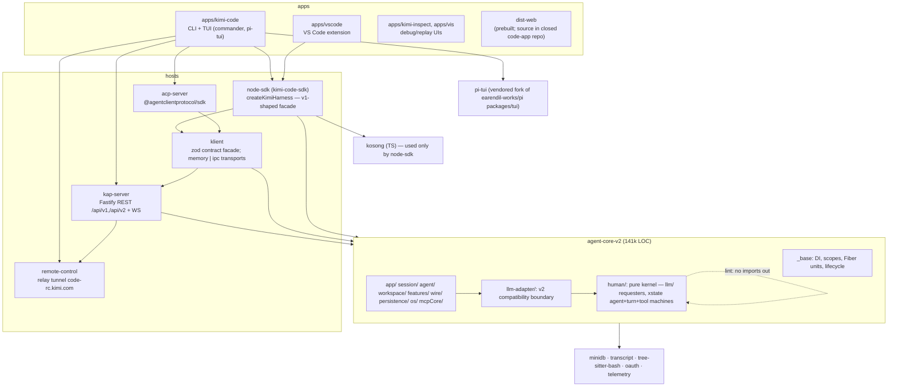

# Kimi Code CLI (Moonshot AI)

> **Verdict.** Kimi Code CLI is Moonshot AI's terminal coding agent. It is a TypeScript monorepo that replaced the Python `kimi-cli`, which was archived in September 2026. The harness is `@moonshot-ai/agent-core-v2`, a 141k-LOC engine. It is built from VS Code-style dependency injection over three lifecycle scopes (App → Session → Agent), and its turn loop is an **xstate** state machine. Around that engine the repo ships an unusually wide set of surfaces: a pi-tui-based TUI, `kimi -p` print mode with `stream-json`, an ACP server for Zed/JetBrains, a Fastify REST+WebSocket server with OpenAPI/AsyncAPI specs, a prebuilt web UI, a VS Code extension, and a cloud relay for remote control. Two engineering choices stand out. Parallel tools are scheduled by declared file-access conflicts. Compaction is followed by a "context recovery" footer that tells the model to grep its own on-disk event log. The weak points are size, the lack of an OS sandbox, and the packaging: every engine package is `private: true`, so the only supported way to reuse it is to fork the monorepo, or to drive the CLI over ACP, `stream-json` or the experimental HTTP API. It is an **integrated product** with a well-factored but unpublished core. Build *on* it as an ACP or HTTP backend. Build *from* it only if you are willing to vendor 280k LOC.

| | |
|---|---|
| Repo(s) | `MoonshotAI/kimi-code` @ `d4b9dc4a2d6f` (primary); `MoonshotAI/kimi-cli` @ `9ab1286b8fe4` (legacy Python, archived) |
| License | MIT (kimi-code, [`LICENSE`](https://github.com/MoonshotAI/kimi-code/blob/d4b9dc4a2d6ff72413964feda2563f0adf8e04d2/LICENSE#L1-L3)). Vendored `pi-tui` is MIT © Mario Zechner. Legacy kimi-cli is Apache-2.0 and reuses OpenAI Codex code ([`NOTICE`](https://github.com/MoonshotAI/kimi-cli/blob/9ab1286b8fe4e6bcd116949a27ce5e0ac3389c82/NOTICE#L1-L14)) |
| Language(s) | TypeScript on Node ≥ 24.15 (pnpm workspace; shipped as a single native binary or the npm package `@moonshot-ai/kimi-code`). Legacy: Python ≥ 3.12 |
| Size | 4,412 tracked files. **Harness core:** `packages/agent-core-v2/src` = 141,442 LOC in 1,051 non-test `.ts` files, plus 2.1k lines of prompt Markdown. **Engine tests:** 183,183 LOC. **Other packages (non-test):** kap-server 31.3k, minidb 23.2k, pi-tui 19.0k, node-sdk 13.1k, kosong 9.2k, klient 8.1k, oauth 6.7k, acp-server 5.6k, tree-sitter-bash 5.0k, migration-legacy 4.1k, transcript 4.0k, remote-control 2.0k, telemetry 1.3k (≈ 280k package LOC in total). **Apps:** CLI/TUI 69.9k (`src/tui` alone 52.7k), VS Code extension 19.8k, kimi-inspect 11.3k, vis 11.6k. A 21 MB minified web bundle (`apps/kimi-code/dist-web`, 525 files) is committed but its source is not in the repo |
| Version at pin | CLI `@moonshot-ai/kimi-code` 2.2.0 (2026-10-14). Engine `agent-core-v2` 0.5.0 (private). SDK `kimi-code-sdk` 0.21.0 (private). Legacy kimi-cli 1.52.0 (final, 2026-09-22) |
| Release history | Repo created 2026-05-22. 0.2.0 on 2026-05-26. 0.4.0 plugin system (2026-05-27). The v2 engine became default for `kimi web` in 0.24.0 (2026-07-14) and for every CLI surface in 0.33.0 (2026-08-05). 2.0.0 on 2026-09-17. 2.2.0 on 2026-10-14. 82 GitHub releases in under 5 months. Legacy Python kimi-cli: 0.33 (2025-10-21) to 1.52.0 (2026-09-22), then archived |
| Category | `integrated-product` |

---

## 1. Layering & package map

The repository holds **three generations** of harness, and only the newest one still runs code:

1. **Python `kimi-cli`** (legacy repo). Its core is the `KimiSoul` loop, the Python **kosong** LLM layer, and the **PyKAOS** OS-abstraction layer.
2. **TypeScript engine "v1"**, which used a `KimiCore` RPC pair. It has been deleted from the tree. Traces remain in `app/sessionLegacy/`, `app/authLegacy/`, and the v1-shaped SDK facade ([`sdk-rpc-client-v2.ts:L1-L6`](https://github.com/MoonshotAI/kimi-code/blob/d4b9dc4a2d6ff72413964feda2563f0adf8e04d2/packages/node-sdk/src/sdk-rpc-client-v2.ts#L1-L6)). Per the CHANGELOG, the v1 server package was removed in 0.24.0 and the CLI surfaces moved to v2 by default in 0.33.0.
3. **`agent-core-v2`**, the "DI × Scope" engine. It runs everything at this pin.



| Layer | Package / dir | Owns |
|---|---|---|
| DI substrate | `agent-core-v2/src/_base` (10.1k) | `createDecorator`, `InstantiationService`, `registerScopedService` and `overrideScopedService` ([`_base/di/scope.ts:L47-L82`](https://github.com/MoonshotAI/kimi-code/blob/d4b9dc4a2d6ff72413964feda2563f0adf8e04d2/packages/agent-core-v2/src/_base/di/scope.ts#L47-L82)), scope topology `App/Session/Agent` ([`app/scopes.ts:L3-L15`](https://github.com/MoonshotAI/kimi-code/blob/d4b9dc4a2d6ff72413964feda2563f0adf8e04d2/packages/agent-core-v2/src/app/scopes.ts#L3-L15)) |
| Pure kernel | `src/human` (18.9k non-test) | LLM requesters per protocol, xstate `agent`/`turn`/`tool` machines, event store. A lint rule forbids any import from v2 domains ([`scripts/check-import-boundaries.mjs:L161`](https://github.com/MoonshotAI/kimi-code/blob/d4b9dc4a2d6ff72413964feda2563f0adf8e04d2/packages/agent-core-v2/scripts/check-import-boundaries.mjs#L161)) |
| Compatibility boundary | `src/llm-adapter` (4.0k) | Model/provider catalog, credential recovery, request traces |
| Domains | `agent/` 35.5k, `app/` 23.7k, `features/` 22.7k, `workspace/` 7.0k, `session/` 5.8k | Loop service, tool executor, permission chain, compaction, MCP, plugins, skills, plan/goal/swarm/tower features |
| Persistence | `wire/`, `persistence/` | Per-agent append-only `wire.jsonl`, atomic docs, blobs, a minidb query store |
| Hosts | `node-sdk`, `klient`, `kap-server`, `acp-server` | In-process SDK; a zod contract facade with `memory` and `ipc` (NDJSON over a unix socket) transports ([`klient/AGENTS.md:L7-L26`](https://github.com/MoonshotAI/kimi-code/blob/d4b9dc4a2d6ff72413964feda2563f0adf8e04d2/packages/klient/AGENTS.md#L7-L26)); HTTP/WS server; ACP |
| Product | `apps/kimi-code`, `apps/vscode` | TUI, CLI subcommands, desktop launcher, VS Code webview |

Two documentation-versus-code drifts are worth recording.

- The root `AGENTS.md` says there are "Four `LifecycleScope` tiers — `App` / `Workspace` / `Session` / `Agent`" ([`AGENTS.md:L21`](https://github.com/MoonshotAI/kimi-code/blob/d4b9dc4a2d6ff72413964feda2563f0adf8e04d2/AGENTS.md#L21)). The enum declares only three ([`app/scopes.ts:L3-L7`](https://github.com/MoonshotAI/kimi-code/blob/d4b9dc4a2d6ff72413964feda2563f0adf8e04d2/packages/agent-core-v2/src/app/scopes.ts#L3-L7)). The workspace tier is a hand-composed "handler" in `program/program.ts`, not a DI scope.
- `AGENTS.md` still calls `packages/kosong` "the LLM / provider abstraction layer" ([`AGENTS.md:L23`](https://github.com/MoonshotAI/kimi-code/blob/d4b9dc4a2d6ff72413964feda2563f0adf8e04d2/AGENTS.md#L23)). The engine's import linter, however, says: "the kosong kernel is deleted … request/provider code lives in #human/llm" ([`check-import-boundaries.mjs:L15`, `L139`](https://github.com/MoonshotAI/kimi-code/blob/d4b9dc4a2d6ff72413964feda2563f0adf8e04d2/packages/agent-core-v2/scripts/check-import-boundaries.mjs#L135-L141)). The TS `kosong` package is consumed only by `node-sdk`, for types and the model-provider shim ([`node-sdk/src/model-provider.ts:L1-L6`](https://github.com/MoonshotAI/kimi-code/blob/d4b9dc4a2d6ff72413964feda2563f0adf8e04d2/packages/node-sdk/src/model-provider.ts#L1-L6)). The kosong *name* survives in config domains (`app/kosongConfig`) and in the `klient.global.kosong.*` facade.

`agent-core-v2`, `kap-server` and `transcript` are lint-enforced **comment-free zones** ([`AGENTS.md:L50`](https://github.com/MoonshotAI/kimi-code/blob/d4b9dc4a2d6ff72413964feda2563f0adf8e04d2/AGENTS.md#L50)). The design rationale therefore lives in `docs/`, the manifests and `AGENTS.md`, not in the code.

## 2. Agent loop

The loop has three layers.

1. **`IAgentLoopService`** ([`agent/loop/loop.ts:L205-L240`](https://github.com/MoonshotAI/kimi-code/blob/d4b9dc4a2d6ff72413964feda2563f0adf8e04d2/packages/agent-core-v2/src/agent/loop/loop.ts#L205-L240)) is the DI-facing API. It offers `submit`, `steer`, `cancel`, `notify`, `snapshot` and `settled`, three `OrderedHookSlot`s (`onWillBeginStep`, `onDidFinishStep`, `onBeforeSubmitPrompt`), and an ordered chain of `LoopErrorHandler`s with `before`/`after` placement ([`loopService.ts:L939-L961`](https://github.com/MoonshotAI/kimi-code/blob/d4b9dc4a2d6ff72413964feda2563f0adf8e04d2/packages/agent-core-v2/src/agent/loop/loopService.ts#L939-L961)). Its implementation, `loopService.ts`, is 2,294 lines.
2. **`MachineEngine`** ([`agent/loop/machine/engine.ts:L175-L192`](https://github.com/MoonshotAI/kimi-code/blob/d4b9dc4a2d6ff72413964feda2563f0adf8e04d2/packages/agent-core-v2/src/agent/loop/machine/engine.ts#L175-L192)) adapts the kernel machines. It projects a typed event union (`stepStarted`, `delta`, `retrying`, `recovering`, `toolStarted`, `toolAsync`, `promptSteered`, …; [`engine.ts:L35-L115`](https://github.com/MoonshotAI/kimi-code/blob/d4b9dc4a2d6ff72413964feda2563f0adf8e04d2/packages/agent-core-v2/src/agent/loop/machine/engine.ts#L35-L115)). The loop service feeds it a `gate` callback, a `promptGate`, a wire-backed journal and a tool executor ([`loopService.ts:L199-L228`](https://github.com/MoonshotAI/kimi-code/blob/d4b9dc4a2d6ff72413964feda2563f0adf8e04d2/packages/agent-core-v2/src/agent/loop/loopService.ts#L199-L228)).
3. **xstate machines in the pure kernel.** The `agent` machine (queue, notifications, background tools, abort scope) is in [`human/agent/machine.ts`](https://github.com/MoonshotAI/kimi-code/blob/d4b9dc4a2d6ff72413964feda2563f0adf8e04d2/packages/agent-core-v2/src/human/agent/machine.ts#L303-L445). It spawns a `turn` machine per turn ([`human/agent/turn.ts:L457-L885`](https://github.com/MoonshotAI/kimi-code/blob/d4b9dc4a2d6ff72413964feda2563f0adf8e04d2/packages/agent-core-v2/src/human/agent/turn.ts#L457-L885)) and a `tool` actor per tool call. `xstate2.ts` wraps `createActor` to publish inspection events and to swallow root abort errors ([`human/xstate2.ts:L17-L35`](https://github.com/MoonshotAI/kimi-code/blob/d4b9dc4a2d6ff72413964feda2563f0adf8e04d2/packages/agent-core-v2/src/human/xstate2.ts#L17-L35)).

Turn state machine (from `turn.ts`):

```
gating ──(onBeforeStep actor)──▶ thinking ──llm.done(no tool calls)──▶ done
   ▲                               │  ├─llm.done(tool calls)──▶ acting{running|aborting} ──all outcomes──▶ draining
   │                               │  ├─llm.failed.remote ─▶ turn.failure.evaluated
   │                               │  │      ├─recovery proposal ─▶ thinking (reenter, attempt=1)
   │                               │  │      ├─shouldRetry ─▶ retrying ─(after retryDelay)─▶ thinking
   │                               │  │      └─else ─▶ failed
   │                               │  └─llm.failed.syntax ─▶ failed
   └──────────── turn.notify (steers/reminders injected; maxSteps check) ◀── draining
```

**Step by step:**

- **Gating.** If an `onBeforeStep` actor exists, it runs first ([`turn.ts:L458-L475`](https://github.com/MoonshotAI/kimi-code/blob/d4b9dc4a2d6ff72413964feda2563f0adf8e04d2/packages/agent-core-v2/src/human/agent/turn.ts#L458-L475)). The loop service's `gate()` enforces `loop_control.max_steps_per_turn` unless a consumed notification bypasses the limit, allocates the step state, and runs the `onWillBeginStep` hook slot ([`loopService.ts:L970-L1039`](https://github.com/MoonshotAI/kimi-code/blob/d4b9dc4a2d6ff72413964feda2563f0adf8e04d2/packages/agent-core-v2/src/agent/loop/loopService.ts#L970-L1039)). Full compaction hooks in at this point (§5).
- **Thinking (streaming).** Entering this state creates a fresh `HistoryAccumulator` and an abort scope, then invokes `llmActor`. `llm.streaming.part|usage|finish|message_id` are folded into the accumulator and forwarded to the parent ([`turn.ts:L476-L571`](https://github.com/MoonshotAI/kimi-code/blob/d4b9dc4a2d6ff72413964feda2563f0adf8e04d2/packages/agent-core-v2/src/human/agent/turn.ts#L476-L571)). On `llm.done`, tool calls lead to `acting`. An empty response is re-raised as `llm.failed.remote` ([`turn.ts:L572-L621`](https://github.com/MoonshotAI/kimi-code/blob/d4b9dc4a2d6ff72413964feda2563f0adf8e04d2/packages/agent-core-v2/src/human/agent/turn.ts#L572-L621)).
- **Errors, recovery and retry.** Remote failures go through a pure `proposeRecovery` strategy chain first: credential refresh on a recoverable 401, then message-replacement strategies such as media degradation. Only then is `shouldRetry` with backoff consulted, honouring `Retry-After` ([`turn.ts:L632-L705`](https://github.com/MoonshotAI/kimi-code/blob/d4b9dc4a2d6ff72413964feda2563f0adf8e04d2/packages/agent-core-v2/src/human/agent/turn.ts#L632-L705), design in [`docs/en/llm.md:L11`](https://github.com/MoonshotAI/kimi-code/blob/d4b9dc4a2d6ff72413964feda2563f0adf8e04d2/packages/agent-core-v2/docs/en/llm.md#L11)). The accumulator is rolled back on each retry, so every attempt accumulates from zero. Context overflow is handled one level up, by a registered `LoopErrorHandler` (§5).
- **Acting (parallel tools).** `turn.spawn_tools` is signalled to the agent machine. The agent machine spawns **one child actor per tool call, all at once**, each with its own `withAbort` scope ([`human/agent/machine.ts:L376-L394`](https://github.com/MoonshotAI/kimi-code/blob/d4b9dc4a2d6ff72413964feda2563f0adf8e04d2/packages/agent-core-v2/src/human/agent/machine.ts#L376-L394)). Real concurrency is decided below that, by the executor's access scheduler (§4). Tools can **detach** into background tasks (`tool.detached` produces an async-ack outcome; [`turn.ts:L758-L774`](https://github.com/MoonshotAI/kimi-code/blob/d4b9dc4a2d6ff72413964feda2563f0adf8e04d2/packages/agent-core-v2/src/human/agent/turn.ts#L758-L774)). Abort enters `aborting`, which has a grace timer (`abortTimeout`, default 10 s; [`machine.ts:L427-L429`](https://github.com/MoonshotAI/kimi-code/blob/d4b9dc4a2d6ff72413964feda2563f0adf8e04d2/packages/agent-core-v2/src/human/agent/machine.ts#L427-L429)).
- **Draining, steering and queued input.** After the tools finish, the turn asks the parent to drain. Queued notifications, reminders and **steered prompts** are injected as `turn.notify` messages. If messages were injected, the machine's step counter resets to 1. Otherwise it increments and is checked against `maxSteps` ([`turn.ts:L825-L870`](https://github.com/MoonshotAI/kimi-code/blob/d4b9dc4a2d6ff72413964feda2563f0adf8e04d2/packages/agent-core-v2/src/human/agent/turn.ts#L825-L870)). User prompts sent mid-turn are queued as `PromptHandle`s. `steer(promptIds)` promotes specific queued prompts into the running turn ([`loopService.ts:L353-L390`](https://github.com/MoonshotAI/kimi-code/blob/d4b9dc4a2d6ff72413964feda2563f0adf8e04d2/packages/agent-core-v2/src/agent/loop/loopService.ts#L353-L390)). Tools also receive a `steerSignal`, so a long `WaitFor` can end as soon as a new message arrives.
- **Stop conditions.** The turn stops on a final assistant message with no tool calls, a tool `stopTurn`, max steps (an error whose message points to `/update-config`; [`loop.ts:L55-L62`](https://github.com/MoonshotAI/kimi-code/blob/d4b9dc4a2d6ff72413964feda2563f0adf8e04d2/packages/agent-core-v2/src/agent/loop/loop.ts#L55-L62)), abort, or exhausted retries. Configuration lives in `[loop_control]` (`max_steps_per_turn`, `max_attempts_per_step`, `reserved_context_size`, `compaction_trigger_ratio`, …), with env overrides `KIMI_LOOP_MAX_STEPS_PER_TURN` and `KIMI_LOOP_MAX_ATTEMPTS_PER_STEP` ([`agent/loop/configSection.ts:L9-L38`](https://github.com/MoonshotAI/kimi-code/blob/d4b9dc4a2d6ff72413964feda2563f0adf8e04d2/packages/agent-core-v2/src/agent/loop/configSection.ts#L9-L38)). `maxRalphIterations` is still accepted by the schema ([`configSection.ts:L16`](https://github.com/MoonshotAI/kimi-code/blob/d4b9dc4a2d6ff72413964feda2563f0adf8e04d2/packages/agent-core-v2/src/agent/loop/configSection.ts#L16)), but grep finds no consumer. *Inference:* it is a vestige of the legacy Python "Ralph" loop (`max_ralph_iterations` in [`kimi_cli/app.py:L143-L203`](https://github.com/MoonshotAI/kimi-cli/blob/9ab1286b8fe4e6bcd116949a27ce5e0ac3389c82/src/kimi_cli/app.py#L143-L203)), whose role the Goal feature (§9) has taken over.

## 3. Model / provider abstraction

**Message model.** Messages are split by role. Tool declarations are separate. `ContentPart` covers text, think, image, audio and video. `TokenUsage` is `{inputOther, output, inputCacheRead, inputCacheCreation}` ([`human/llm/usage.ts:L1-L7`](https://github.com/MoonshotAI/kimi-code/blob/d4b9dc4a2d6ff72413964feda2563f0adf8e04d2/packages/agent-core-v2/src/human/llm/usage.ts#L1-L7)). Tokens are tracked per step and per session. No USD cost is computed anywhere in the engine; only a legacy protocol type has a `total_cost_usd` field.

**Design.** The in-repo guide states the design ([`docs/en/llm.md:L1-L15`](https://github.com/MoonshotAI/kimi-code/blob/d4b9dc4a2d6ff72413964feda2563f0adf8e04d2/packages/agent-core-v2/docs/en/llm.md#L1-L15)), and the code follows it:

- The llm layer covers "a single request". `generate(config, content, control)` is a stateless function that emits a serializable event stream (`llm.sent`, `streaming.*`, `failed.syntax|remote`, `done`).
- There are **four protocol bases**: `openai` (chat completions), `openai_responses`, `anthropic` (plus `anthropic_beta`) and `google-genai` (including Vertex). Each base has a `contract`/`format`/`lower`/`patterns`/`trait`/`requester` split, and **per-protocol typed traits** carry the vendor customisations. Message conversion is an "MLIR-style Pattern Rewriter" (principle 9).
- A **"No silent fallback"** rule (principle 6) is enforced, for example, by splitting `anthropic` from `anthropic_beta` instead of degrading.
- Providers are data: `createProvider({id, protocols{base,trait,connection,classifyError}})`. The standard OpenAI, Anthropic and Google providers are in [`human/llm/provider/providers/standard.ts:L23-L44`](https://github.com/MoonshotAI/kimi-code/blob/d4b9dc4a2d6ff72413964feda2563f0adf8e04d2/packages/agent-core-v2/src/human/llm/provider/providers/standard.ts#L23-L44). **Kimi** is the same three bases with Kimi traits, quota-error classification and a media contribution that uploads images and video as file references ([`human/llm-kimi/provider.ts:L10-L33`](https://github.com/MoonshotAI/kimi-code/blob/d4b9dc4a2d6ff72413964feda2563f0adf8e04d2/packages/agent-core-v2/src/human/llm-kimi/provider.ts#L10-L33)).
- *Observation:* a second, older registry, `registerProviderDefinition`, still lives in `llm-adapter` and registers `kimi` three times, once per base protocol, with `modelSource: 'oauth-catalog'` ([`llm-adapter/provider/provider-definition.ts:L200-L256`](https://github.com/MoonshotAI/kimi-code/blob/d4b9dc4a2d6ff72413964feda2563f0adf8e04d2/packages/agent-core-v2/src/llm-adapter/provider/provider-definition.ts#L200-L256)). Two parallel provider definitions are a sign that the port is still in progress.

**Configuration and catalog.** `config.toml` has `[providers.<name>]` (`type`, `base_url`, `api_key[_env]`, `oauth{storage=file|keyring}`, `model_source = static|discover|oauth-catalog`) and `[models.<alias>]`, which includes `protocol`, context and output sizes, `capabilities`, `reasoning_key`, `support_efforts`, `adaptive_thinking` and `beta_api` ([`docs/config-manifest.toml:L265-L345`](https://github.com/MoonshotAI/kimi-code/blob/d4b9dc4a2d6ff72413964feda2563f0adf8e04d2/packages/agent-core-v2/docs/config-manifest.toml#L265-L345)). `kimi provider import` pulls from the **models.dev** catalog and falls back to a built-in snapshot. Vendors with undeclared protocols are imported as OpenAI-compatible, and Bedrock cannot be imported ([`docs/en/reference/kimi-command.md:L390`](https://github.com/MoonshotAI/kimi-code/blob/d4b9dc4a2d6ff72413964feda2563f0adf8e04d2/docs/en/reference/kimi-command.md#L390)).

**Thinking.** A `ThinkingStrategy` produces a contribution that is applied per protocol. Encrypted and hidden reasoning deltas survive into the engine's `thinking` delta type (`encrypted`, `reasoningKey`; [`engine.ts:L37-L44`](https://github.com/MoonshotAI/kimi-code/blob/d4b9dc4a2d6ff72413964feda2563f0adf8e04d2/packages/agent-core-v2/src/agent/loop/machine/engine.ts#L37-L44)). Effort levels come from the model's declared capabilities. The kosong CHANGELOG mentions fixing "phantom levels on Kimi K3" ([`packages/kosong/CHANGELOG.md:L19`](https://github.com/MoonshotAI/kimi-code/blob/d4b9dc4a2d6ff72413964feda2563f0adf8e04d2/packages/kosong/CHANGELOG.md#L19)).

**Prompt caching.**

- Anthropic: `cache_control: ephemeral` is set on the system block, the last tool and the last message block, and the cache key is passed as `metadata.user_id` ([`anthropic/format.ts:L53-L62`, `L225-L247`](https://github.com/MoonshotAI/kimi-code/blob/d4b9dc4a2d6ff72413964feda2563f0adf8e04d2/packages/agent-core-v2/src/human/llm/requester/bases/anthropic/format.ts#L225-L247)).
- OpenAI: `prompt_cache_key`, overridable by a trait's `encodeCacheKey` ([`openai/format.ts:L61-L63`](https://github.com/MoonshotAI/kimi-code/blob/d4b9dc4a2d6ff72413964feda2563f0adf8e04d2/packages/agent-core-v2/src/human/llm/requester/bases/openai/format.ts#L61-L63)).
- A `cacheProbe` service in `agent/usage/` measures cache behaviour.

**Model line.** The code is model-agnostic. Kimi models arrive at runtime through the OAuth catalog, behind the `kimi-for-coding` alias. In the source tree, `kimi-k3` appears only in test fixtures. Third-party reporting conflicts on the default model. AlphaSignal (2026-06-08) ties the rewrite to **Kimi K2.6**. rywalker.com describes K2.6 (released April 2026) as the backing model. Gigazine (2026-07-28) reports **Kimi K3** as an open-weights 2.8T-parameter MoE with a 1M-token context, released 2026-07-27. None of these claims is checkable in code beyond the K3 CHANGELOG mention.

## 4. Tool system

**Definition API.** A tool is an `ExecutableTool` whose `resolveExecution(input)` returns either an error result or a `RunnableToolExecution` with these fields ([`tool/toolContract.ts:L79-L94`](https://github.com/MoonshotAI/kimi-code/blob/d4b9dc4a2d6ff72413964feda2563f0adf8e04d2/packages/agent-core-v2/src/tool/toolContract.ts#L79-L94)):

- `accesses`: the declared resources.
- `display`: the UI rendering.
- `approvalRule`: a literal rule string used for "approve for session".
- `matchesRule`
- `stopBatchAfterThis`
- `execute(ctx)`

This split means **approval and scheduling happen before execution, using resolved, typed metadata.** Schemas are zod. Arguments are validated with Ajv against the JSON Schema ([`toolExecutorService.ts:L781-L805`](https://github.com/MoonshotAI/kimi-code/blob/d4b9dc4a2d6ff72413964feda2563f0adf8e04d2/packages/agent-core-v2/src/agent/toolExecutor/toolExecutorService.ts#L781-L805)). Tools are DI services registered per Agent scope with `registerAgentToolService` or replaced with `overrideAgentToolService` ([`agent/toolRegistry/toolContribution.ts:L35-L68`](https://github.com/MoonshotAI/kimi-code/blob/d4b9dc4a2d6ff72413964feda2563f0adf8e04d2/packages/agent-core-v2/src/agent/toolRegistry/toolContribution.ts#L35-L68)). Sources are `builtin | user | mcp`. Disclosure is `inline | deferred` ([`toolContract.ts:L96-L97`](https://github.com/MoonshotAI/kimi-code/blob/d4b9dc4a2d6ff72413964feda2563f0adf8e04d2/packages/agent-core-v2/src/tool/toolContract.ts#L96-L97)).

**Built-ins.** The default `agent` profile exposes:

- `Read`, `Write`, `Edit`, `Grep`, `Glob`, `Bash`
- `TaskList`/`TaskOutput`/`TaskStop`/`WaitFor` (background tasks)
- `CronCreate`/`CronList`/`CronDelete`
- `ReadMediaFile` (images and video), `TodoList`, `Skill`, `WebSearch`, `FetchURL`
- `Agent`, `AgentSwarm`, `AskUserQuestion`, `NotifyUser`
- `EnterPlanMode`/`ExitPlanMode`
- `CreateGoal`/`GetGoal`/`SetGoalBudget`/`UpdateGoal`
- `TowerInit`/`TowerStatus`/`TowerTeardown`
- `mcp__*`

The full list is in [`session/agentLifecycle/profile/profiles.ts:L11-L44`](https://github.com/MoonshotAI/kimi-code/blob/d4b9dc4a2d6ff72413964feda2563f0adf8e04d2/packages/agent-core-v2/src/session/agentLifecycle/profile/profiles.ts#L11-L44). Tower mode adds about ten more `Tower*` tools. MCP tools are named `mcp__<server>__<tool>` ([`mcpCore/tool-naming.ts:L1-L10`](https://github.com/MoonshotAI/kimi-code/blob/d4b9dc4a2d6ff72413964feda2563f0adf8e04d2/packages/agent-core-v2/src/mcpCore/tool-naming.ts#L1-L10)). An experimental `select_tools` meta-tool, gated by `KIMI_CODE_EXPERIMENTAL_TOOL_SELECT` and default off, keeps MCP tool schemas out of the top-level `tools[]` and loads them on demand ([`agent/toolSelect/flag.ts:L3-L16`](https://github.com/MoonshotAI/kimi-code/blob/d4b9dc4a2d6ff72413964feda2563f0adf8e04d2/packages/agent-core-v2/src/agent/toolSelect/flag.ts#L3-L16)).

**Execution pipeline** (`AgentToolExecutorService.execute`, [`toolExecutorService.ts:L178-L284`](https://github.com/MoonshotAI/kimi-code/blob/d4b9dc4a2d6ff72413964feda2563f0adf8e04d2/packages/agent-core-v2/src/agent/toolExecutor/toolExecutorService.ts#L178-L284)):

1. **Preflight** for unknown, unavailable and guarded tools, with describers and guards that can be registered.
2. **`resolveExecution`**. A `PathSecurityError` from path validation turns into a model-visible error.
3. **`onBeforeExecuteTool`** event. Listeners can `veto`, `pass`, `allow` or `waitUntil(...)`. The permission gate and plan mode both attach here.
4. **`onWillExecuteTool`**.
5. **Scheduling** through the `ToolScheduler`.
6. **`onDidExecuteTool`** ordered hook. It can rewrite the result or set `stopTurn`.
7. **Truncation** ([`toolExecutorService.ts:L385-L444`, `L628-L683`](https://github.com/MoonshotAI/kimi-code/blob/d4b9dc4a2d6ff72413964feda2563f0adf8e04d2/packages/agent-core-v2/src/agent/toolExecutor/toolExecutorService.ts#L385-L444)).

When a tool returns `stopBatchAfterThis`, the remaining calls in the batch are skipped with a synthetic error ([`L447-L456`](https://github.com/MoonshotAI/kimi-code/blob/d4b9dc4a2d6ff72413964feda2563f0adf8e04d2/packages/agent-core-v2/src/agent/toolExecutor/toolExecutorService.ts#L447-L456)). Results are yielded in completion order, not call order.

**Access-conflict scheduler.** This is the distinctive part. Each task declares `ToolAccesses`: `file{read|write|readwrite|search, path, recursive}` or `all`. Two tasks conflict when either one writes and their paths overlap; recursive accesses count as prefixes, and paths are compared case-folded ([`toolContract.ts:L123-L235`](https://github.com/MoonshotAI/kimi-code/blob/d4b9dc4a2d6ff72413964feda2563f0adf8e04d2/packages/agent-core-v2/src/tool/toolContract.ts#L123-L235)). `ToolScheduler` starts a task immediately unless it conflicts with an active task or with an *earlier queued* task. That preserves program order for conflicting calls and lets everything else run in parallel ([`toolExecutor/toolScheduler.ts:L17-L89`](https://github.com/MoonshotAI/kimi-code/blob/d4b9dc4a2d6ff72413964feda2563f0adf8e04d2/packages/agent-core-v2/src/agent/toolExecutor/toolScheduler.ts#L17-L89)). Examples:

- `Read` declares `readFile(path)` ([`readTool.ts:L225`](https://github.com/MoonshotAI/kimi-code/blob/d4b9dc4a2d6ff72413964feda2563f0adf8e04d2/packages/agent-core-v2/src/agent/tools/os/read/readTool.ts#L225)).
- `Edit` declares `readWriteFile(path)` ([`editTool.ts:L58`](https://github.com/MoonshotAI/kimi-code/blob/d4b9dc4a2d6ff72413964feda2563f0adf8e04d2/packages/agent-core-v2/src/agent/tools/edit/editTool.ts#L58)).
- `Grep` declares `searchTree(root)` ([`grepTool.ts:L104`](https://github.com/MoonshotAI/kimi-code/blob/d4b9dc4a2d6ff72413964feda2563f0adf8e04d2/packages/agent-core-v2/src/agent/tools/os/grep/grepTool.ts#L104)).
- `Bash` declares nothing ([`bashTool.ts:L137-L155`](https://github.com/MoonshotAI/kimi-code/blob/d4b9dc4a2d6ff72413964feda2563f0adf8e04d2/packages/agent-core-v2/src/agent/tools/os/bash/bashTool.ts#L137-L155)), so it defaults to `ToolAccesses.all()` ([`toolExecutorService.ts:L438`](https://github.com/MoonshotAI/kimi-code/blob/d4b9dc4a2d6ff72413964feda2563f0adf8e04d2/packages/agent-core-v2/src/agent/toolExecutor/toolExecutorService.ts#L438)) and serialises against every other tool.

Compare this with "all-parallel" (Codex-style read-only batching) or "all-serial" designs. It is a finer-grained, declarative middle ground.

**Bash.** Bash spawns `$SHELL -c 'cd <cwd> && <cmd>'` with `NO_COLOR`, `TERM=dumb` and `GIT_TERMINAL_PROMPT=0` ([`bashTool.ts:L157-L173`](https://github.com/MoonshotAI/kimi-code/blob/d4b9dc4a2d6ff72413964feda2563f0adf8e04d2/packages/agent-core-v2/src/agent/tools/os/bash/bashTool.ts#L157-L173)). On Windows it uses Git Bash. A foreground command that hits its timeout is **moved to the background** rather than killed (`bashAutoBackgroundOnTimeout`, default true; [`bashTool.ts:L118-L120`](https://github.com/MoonshotAI/kimi-code/blob/d4b9dc4a2d6ff72413964feda2563f0adf8e04d2/packages/agent-core-v2/src/agent/tools/os/bash/bashTool.ts#L118-L120)).

**Output truncation and spill.** The default model-visible cap is 50,000 characters ([`toolContract.ts:L7`](https://github.com/MoonshotAI/kimi-code/blob/d4b9dc4a2d6ff72413964feda2563f0adf8e04d2/packages/agent-core-v2/src/tool/toolContract.ts#L7)). Larger outputs are saved under the agent's `tool-results` scope, and the result carries an `output_path` preservation notice ([`toolResultTruncationService.ts:L43`, `L131-L136`](https://github.com/MoonshotAI/kimi-code/blob/d4b9dc4a2d6ff72413964feda2563f0adf8e04d2/packages/agent-core-v2/src/agent/toolResultTruncation/toolResultTruncationService.ts#L131-L136)). A `toolDedupe` service suppresses identical calls within a step and sends escalating reminders for repeats across steps.

## 5. Context management

**System prompt.** The prompt is an 82-line template, `app/agentProfileCatalog/system.md`, with slots for `${role_additional}`, `${reply_style_guide}`, `${os}`/`${shell}`, `${cwd_listing}`, `${agents_md}`, `${skills_section}` and `${plugin_sections}` ([`system.md:L1-L82`](https://github.com/MoonshotAI/kimi-code/blob/d4b9dc4a2d6ff72413964feda2563f0adf8e04d2/packages/agent-core-v2/src/app/agentProfileCatalog/system.md#L1-L82)). Profiles add role overlays: `coder` appends a handoff contract, and `explore` adds a git-context prefix ([`profiles.ts:L82-L125`](https://github.com/MoonshotAI/kimi-code/blob/d4b9dc4a2d6ff72413964feda2563f0adf8e04d2/packages/agent-core-v2/src/session/agentLifecycle/profile/profiles.ts#L82-L125)). Users can override the main system prompt with a user-level file. Dynamic state is not put into the system prompt. It arrives as `<system-reminder>` injections (`features/reminder`): plan-mode, goal, swarm and tower reminders in "full/sparse/re-entry" variants, date-change and todo reminders, and the **interruption reminder** that tells the model a previous turn was cut off.

**Project instruction files (AGENTS.md).** `loadAgentsMdForRoots` collects files in this order ([`agent/profile/context.ts:L137-L196`](https://github.com/MoonshotAI/kimi-code/blob/d4b9dc4a2d6ff72413964feda2563f0adf8e04d2/packages/agent-core-v2/src/agent/profile/context.ts#L137-L196)):

1. `~/.kimi-code/AGENTS.md`
2. `~/.agents/AGENTS.md|agents.md`
3. For every directory from the git root down to the cwd: `.kimi-code/AGENTS.md`, then `AGENTS.md` or `agents.md`

A warning fires above 32 KB in total. Note that `CLAUDE.md` is **not** read.

A file watcher re-injects AGENTS.md files that change on disk. `agentsMdReminder` also injects AGENTS.md files that apply to paths a tool touched but that were never in the system prompt, for example in subdirectories outside the cwd chain ([`agentsMdReminderService.ts:L355-L363`](https://github.com/MoonshotAI/kimi-code/blob/d4b9dc4a2d6ff72413964feda2563f0adf8e04d2/packages/agent-core-v2/src/agent/agentsMdReminder/agentsMdReminderService.ts#L355-L363)). This is lazy, path-scoped instruction loading.

**Compaction trigger.** `RuntimeCompactionStrategy` uses these defaults ([`fullCompaction/strategy.ts:L18-L28`](https://github.com/MoonshotAI/kimi-code/blob/d4b9dc4a2d6ff72413964feda2563f0adf8e04d2/packages/agent-core-v2/src/agent/fullCompaction/strategy.ts#L18-L28)):

- `triggerRatio` 0.85 and `blockRatio` 0.85
- `reservedContextSize` 50k: compaction also fires when `used + reserved ≥ max` ([`L116-L135`](https://github.com/MoonshotAI/kimi-code/blob/d4b9dc4a2d6ff72413964feda2563f0adf8e04d2/packages/agent-core-v2/src/agent/fullCompaction/strategy.ts#L116-L135))
- `maxOverflowCompactionAttempts` 3

The service attaches at three points ([`fullCompactionService.ts:L186-L204`](https://github.com/MoonshotAI/kimi-code/blob/d4b9dc4a2d6ff72413964feda2563f0adf8e04d2/packages/agent-core-v2/src/agent/fullCompaction/fullCompactionService.ts#L186-L204)):

- **`onWillBeginStep`**: check, then block the step until compaction finishes.
- **`onDidFinishStep`**: start compaction in the background when trigger ≠ block.
- **A `LoopErrorHandler`** for provider context-overflow errors: compact, then `retry()` the failed step. After three consecutive overflow compactions the turn fails with `CONTEXT_OVERFLOW` ([`L479-L510`](https://github.com/MoonshotAI/kimi-code/blob/d4b9dc4a2d6ff72413964feda2563f0adf8e04d2/packages/agent-core-v2/src/agent/fullCompaction/fullCompactionService.ts#L479-L510)).

**Compaction algorithm.**

- The summary request sends the stripped history plus a 73-line handoff instruction ([`compaction-instruction.md`](https://github.com/MoonshotAI/kimi-code/blob/d4b9dc4a2d6ff72413964feda2563f0adf8e04d2/packages/agent-core-v2/src/agent/fullCompaction/compaction-instruction.md#L1-L73)). The instruction says to write in the conversation's language, keep exact commands, paths and results, list unknowns, and give a forward plan. The TODO list is re-attached automatically.
- History is pre-shrunk to fit the window. On overflow of the summary request itself, history is shrunk up to three more times ([`fullCompactionService.ts:L642-L709`](https://github.com/MoonshotAI/kimi-code/blob/d4b9dc4a2d6ff72413964feda2563f0adf8e04d2/packages/agent-core-v2/src/agent/fullCompaction/fullCompactionService.ts#L642-L709)).
- The post-compaction shape is **kept user messages** (the first 2k tokens plus the last 20k tokens of user text, with an elision marker between them), then the summary as a user message, then a continuation message ([`contextMemory/compactionHandoff.ts:L10-L11`, `L63-L130`](https://github.com/MoonshotAI/kimi-code/blob/d4b9dc4a2d6ff72413964feda2563f0adf8e04d2/packages/agent-core-v2/src/agent/contextMemory/compactionHandoff.ts#L63-L130)).
- `COMPACT_USER_MESSAGE_MAX_TOKENS = 20_000` is the **same constant name and value** as Codex's [`codex-rs/core/src/compact.rs:L64`](https://github.com/openai/codex/blob/b7ba02f88095cd3c039709157618c03909d47a26/codex-rs/core/src/compact.rs#L64). Whether this is convergent design or borrowing is not provable from code. The legacy repo's `NOTICE` does acknowledge reusing Codex material.
- The split-point logic never cuts inside an open tool exchange ([`strategy.ts:L242-L266`](https://github.com/MoonshotAI/kimi-code/blob/d4b9dc4a2d6ff72413964feda2563f0adf8e04d2/packages/agent-core-v2/src/agent/fullCompaction/strategy.ts#L242-L266)).

**Context recovery (spill-to-disk for history).** After compaction, a footer gives the model the absolute path of its own `wire.jsonl` and explains the record schema. It covers `context.append_loop_event`, `context.apply_compaction` boundaries, and `context.undo` retractions, and gives grep/`sed -n 'Np' | jq` recipes ([`fullCompaction/context-recovery-footer.md:L1-L10`](https://github.com/MoonshotAI/kimi-code/blob/d4b9dc4a2d6ff72413964feda2563f0adf8e04d2/packages/agent-core-v2/src/agent/fullCompaction/context-recovery-footer.md#L1-L10)). So compaction is lossy in-context but **lossless on disk, and the model is told how to page old history back in**. That is cheap, effective "memory" that needs no vector store.

There is no long-term cross-session memory store. The legacy D-Mail checkpoint-rewind tool did not migrate (§12.A).

## 6. State, sessions & durability

**Layout.** Everything lives under `$KIMI_CODE_HOME` (default `~/.kimi-code`; [`app/bootstrap/bootstrap.ts:L168-L174`](https://github.com/MoonshotAI/kimi-code/blob/d4b9dc4a2d6ff72413964feda2563f0adf8e04d2/packages/agent-core-v2/src/app/bootstrap/bootstrap.ts#L168-L174)). Sessions are at `sessions/<workDirKey>/<sessionId>/` with a `state.json` and **one `agents/<agentId>/wire.jsonl` per agent, including every subagent** ([`workspace/sessionLifecycle/internal/addressing.ts:L7-L17`](https://github.com/MoonshotAI/kimi-code/blob/d4b9dc4a2d6ff72413964feda2563f0adf8e04d2/packages/agent-core-v2/src/workspace/sessionLifecycle/internal/addressing.ts#L7-L17); [`docs/en/guides/sessions.md:L5-L25`](https://github.com/MoonshotAI/kimi-code/blob/d4b9dc4a2d6ff72413964feda2563f0adf8e04d2/docs/en/guides/sessions.md#L5-L25)). Storage keys map directly to paths (`baseDir/scope/key`; [`persistence/backends/node-fs/fileStorageService.ts:L183-L189`](https://github.com/MoonshotAI/kimi-code/blob/d4b9dc4a2d6ff72413964feda2563f0adf8e04d2/packages/agent-core-v2/src/persistence/backends/node-fs/fileStorageService.ts#L183-L189)). Blobs, plan files, plan revisions and file-history backups live under the agent scope. A minidb-backed `session_index` serves search. Persistence sits behind interfaces (`IAppendLogStore`, `IAtomicDocumentStore`, `IBlobStore`, `IQueryStore`; [`persistence/interface/appendLogStore.ts:L44-L58`](https://github.com/MoonshotAI/kimi-code/blob/d4b9dc4a2d6ff72413964feda2563f0adf8e04d2/packages/agent-core-v2/src/persistence/interface/appendLogStore.ts#L44-L58)), with `node-fs`, `memory` and `minidb` backends.

**Wire format.**

- Each `wire.jsonl` starts with a `metadata` record carrying `protocol_version` (currently `"1.5"`). Records are typed JSON lines ([`wire/record.ts:L3-L44`](https://github.com/MoonshotAI/kimi-code/blob/d4b9dc4a2d6ff72413964feda2563f0adf8e04d2/packages/agent-core-v2/src/wire/record.ts#L3-L44); [`wire/migration/migration.ts:L19`](https://github.com/MoonshotAI/kimi-code/blob/d4b9dc4a2d6ff72413964feda2563f0adf8e04d2/packages/agent-core-v2/src/wire/migration/migration.ts#L19)).
- Older files are migrated on read through `v1.1`…`v1.5` migrators and rewritten.
- The log also carries a **request trace**: tool schemas, request params and MCP listings.
- **Branching inside one file.** An `agent.switched` record `{branch, base:{branch,line}}` starts a new segment. `activeChain()` walks base edges to reconstruct the live history, so an undo is an append, not a truncation ([`wire/tree/tree.ts:L3-L4`, `L68-L132`](https://github.com/MoonshotAI/kimi-code/blob/d4b9dc4a2d6ff72413964feda2563f0adf8e04d2/packages/agent-core-v2/src/wire/tree/tree.ts#L68-L132)).
- The machine engine journals its event store into the same wire, under its own domain (`wireStoreJournal(this.wire, ENGINE_JOURNAL_DOMAIN)`; [`loopService.ts:L207`](https://github.com/MoonshotAI/kimi-code/blob/d4b9dc4a2d6ff72413964feda2563f0adf8e04d2/packages/agent-core-v2/src/agent/loop/loopService.ts#L207)).

**Resume, fork and undo.**

- **Resume.** `-c/--continue` and `-S/--session [id]` ([`apps/kimi-code/src/cli/commands.ts:L42-L54`](https://github.com/MoonshotAI/kimi-code/blob/d4b9dc4a2d6ff72413964feda2563f0adf8e04d2/apps/kimi-code/src/cli/commands.ts#L42-L54)) restore by folding the wire records.
- **Fork.** Fork copies the session and appends a `forked` record. It is refused while a turn is running or queued ([`sessionLifecycleService.ts:L498-L540`, `L907-L909`](https://github.com/MoonshotAI/kimi-code/blob/d4b9dc4a2d6ff72413964feda2563f0adf8e04d2/packages/agent-core-v2/src/workspace/sessionLifecycle/sessionLifecycleService.ts#L498-L540)).
- **Conversational undo.** `context.undo` records retract the last N messages.
- **File history.** `fileHistory` backs up each edited file per turn into blobs and exposes `changes(turnId)` and `contentAt(turnId, path)` ([`features/fileHistory/fileHistory.ts:L42-L55`](https://github.com/MoonshotAI/kimi-code/blob/d4b9dc4a2d6ff72413964feda2563f0adf8e04d2/packages/agent-core-v2/src/features/fileHistory/fileHistory.ts#L42-L55)). The interface has no restore method; it feeds diff views (REST `/fileHistory`).
- **Export.** Sessions export as ZIP (`kimi export`).

**Crash recovery.** If the append log finds a corrupted or truncated tail, `repairWireJournal` writes `wire.jsonl.bak` and rewrites the valid prefix ([`wire/repair.ts:L16-L40`](https://github.com/MoonshotAI/kimi-code/blob/d4b9dc4a2d6ff72413964feda2563f0adf8e04d2/packages/agent-core-v2/src/wire/repair.ts#L16-L40)). Print mode explicitly flushes the wire's async persist queue before `process.exit` ([`run-v2-print.ts:L224-L227`](https://github.com/MoonshotAI/kimi-code/blob/d4b9dc4a2d6ff72413964feda2563f0adf8e04d2/apps/kimi-code/src/cli/v2/run-v2-print.ts#L224-L227)). **There are no durable-execution semantics**: an in-flight LLM call or tool is not replayed after a crash. On resume, the interruption reminder tells the model the previous turn was cut off.

## 7. Safety & sandboxing

**Permission modes.** There are three: `manual | yolo | auto` ([`permissionPolicy/types.ts:L6`](https://github.com/MoonshotAI/kimi-code/blob/d4b9dc4a2d6ff72413964feda2563f0adf8e04d2/packages/agent-core-v2/src/agent/permissionPolicy/types.ts#L6)). The CLI help text describes `-y/--yolo` as "Ask When Needed: … risky actions, questions, and plans still ask" and `--auto` as "Never Ask" ([`commands.ts:L56-L57`](https://github.com/MoonshotAI/kimi-code/blob/d4b9dc4a2d6ff72413964feda2563f0adf8e04d2/apps/kimi-code/src/cli/commands.ts#L56-L57)). Plan mode is a separate toggle.

**Policy engine.** `AgentPermissionPolicyService` is a **first-match chain of 13 policies**, each returning `approve | deny | ask` with a reason record ([`permissionPolicyService.ts:L39-L66`](https://github.com/MoonshotAI/kimi-code/blob/d4b9dc4a2d6ff72413964feda2563f0adf8e04d2/packages/agent-core-v2/src/agent/permissionPolicy/permissionPolicyService.ts#L39-L66)). In order:

| # | Policy | Effect |
|---|---|---|
| 1 | `auto-mode-ask-user-question-deny` | In `auto`, denies `AskUserQuestion` ("decide and continue"; [`L15-L23`](https://github.com/MoonshotAI/kimi-code/blob/d4b9dc4a2d6ff72413964feda2563f0adf8e04d2/packages/agent-core-v2/src/agent/permissionPolicy/policies/auto-mode-ask-user-question-deny.ts#L15-L23)) |
| 2 | `user-configured-deny` | `[permission].rules` with `decision=deny`. Scopes are `turn-override \| session-runtime \| project \| user` ([`config-manifest.toml:L317-L322`](https://github.com/MoonshotAI/kimi-code/blob/d4b9dc4a2d6ff72413964feda2563f0adf8e04d2/packages/agent-core-v2/docs/config-manifest.toml#L317-L322)) |
| 3 | `dangerous-command-ask` (interactive only) | Parses `Bash` commands with the in-house **pure-TS tree-sitter-bash**, under a budget of 500 ms and 10k nodes. It unwraps `sudo`/`env`/`nohup` and nested `sh -c` up to depth 4, and flags `shutdown`, `mkfs`, `dd` to devices, `rm` outside temp dirs, and similar. **Unparseable commands ask**, except in yolo mode. The policy is skipped in `auto` ([`dangerous-command-ask.ts:L129-L146`](https://github.com/MoonshotAI/kimi-code/blob/d4b9dc4a2d6ff72413964feda2563f0adf8e04d2/packages/agent-core-v2/src/agent/permissionPolicy/policies/dangerous-command-ask.ts#L129-L146)) |
| 4 | `auto-mode-approve` | `auto` approves everything that got this far |
| 5 | `session-approval-history` | Earlier "approve for session" decisions, keyed by `approvalRule` |
| 6–7 | `user-configured-ask` / `-allow` | Rule globs, matched by `matchesRule` |
| 8 | `sensitive-file-access-ask` | `.env*`, SSH keys and credential files: asks **even in yolo** ([`L12-L15`](https://github.com/MoonshotAI/kimi-code/blob/d4b9dc4a2d6ff72413964feda2563f0adf8e04d2/packages/agent-core-v2/src/agent/permissionPolicy/policies/sensitive-file-access-ask.ts#L12-L15)) |
| 9 | `git-control-path-access-ask` | Any file access touching a `.git` path component or the repository's git control directory, reads included |
| 10 | `yolo-mode-approve` | |
| 11 | `default-tool-approve` | A static allowlist of read-only and meta tools (`Read`, `Grep`, `Glob`, `WebSearch`, `FetchURL`, `Agent`, `Skill`, …; [`default-tool-approve.ts:L7-L32`](https://github.com/MoonshotAI/kimi-code/blob/d4b9dc4a2d6ff72413964feda2563f0adf8e04d2/packages/agent-core-v2/src/agent/permissionPolicy/policies/default-tool-approve.ts#L7-L32)) |
| 12 | `git-cwd-write-approve` | Approves `Write`/`Edit` when every write path is inside the workspace and the cwd is a git work tree, **POSIX only** ([`git-cwd-write-approve.ts:L14-L54`](https://github.com/MoonshotAI/kimi-code/blob/d4b9dc4a2d6ff72413964feda2563f0adf8e04d2/packages/agent-core-v2/src/agent/permissionPolicy/policies/git-cwd-write-approve.ts#L14-L54)). In the default `manual` mode, file edits inside a git repo therefore do not prompt; git is the undo mechanism. On Windows they fall through to `fallback-ask` |
| 13 | `fallback-ask` | |

The gate subscribes to `onBeforeExecuteTool`. It turns `ask` into `event.waitUntil(requestToolApproval)` and records a `permission_policy_decision` telemetry event for every decision ([`permissionGateService.ts:L30`, `L40-L65`](https://github.com/MoonshotAI/kimi-code/blob/d4b9dc4a2d6ff72413964feda2563f0adf8e04d2/packages/agent-core-v2/src/agent/permissionGate/permissionGateService.ts#L40-L65)). Path validation is separate from policy. The default path guard rejects relative workspace escapes but permits absolute paths outside the workspace; approval policy remains a separate gate. Sensitive-file checks are tool-specific (Grep and Glob disable them), so this is not uniform filesystem confinement. These checks occur at `resolveExecution` time and can raise `PathSecurityError` ([`tool/path-access.ts:L51-L76`, `L261-L283`](https://github.com/MoonshotAI/kimi-code/blob/d4b9dc4a2d6ff72413964feda2563f0adf8e04d2/packages/agent-core-v2/src/tool/path-access.ts#L261-L283)).

**No OS sandbox.** No OS sandbox implementation was identified in the reviewed engine and tool execution paths. The system prompt says so to the model: "The environment is not a sandbox", and "`Bash` enforces none of these guards — never use shell commands to read, copy, or transmit secret files" ([`system.md:L59-L63`](https://github.com/MoonshotAI/kimi-code/blob/d4b9dc4a2d6ff72413964feda2563f0adf8e04d2/packages/agent-core-v2/src/app/agentProfileCatalog/system.md#L59-L63)). The sensitive-file protection is therefore advisory for Bash. There is no network policy. `FetchURL` and `WebSearch` are auto-approved.

**Headless is permissive by construction.**

- `kimi -p` refuses `--yolo`, `--auto` and `--plan` ([`options.ts:L80-L86`](https://github.com/MoonshotAI/kimi-code/blob/d4b9dc4a2d6ff72413964feda2563f0adf8e04d2/apps/kimi-code/src/cli/options.ts#L80-L86)), and then **forces `auto`** for the run ([`run-v2-print.ts:L407-L418`](https://github.com/MoonshotAI/kimi-code/blob/d4b9dc4a2d6ff72413964feda2563f0adf8e04d2/apps/kimi-code/src/cli/v2/run-v2-print.ts#L407-L418)).
- It bootstraps with `nonInteractive: true` ([`L165-L183`](https://github.com/MoonshotAI/kimi-code/blob/d4b9dc4a2d6ff72413964feda2563f0adf8e04d2/apps/kimi-code/src/cli/v2/run-v2-print.ts#L165-L183)), which removes the dangerous-command policy from the chain altogether ([`permissionPolicyService.ts:L42-L44`](https://github.com/MoonshotAI/kimi-code/blob/d4b9dc4a2d6ff72413964feda2563f0adf8e04d2/packages/agent-core-v2/src/agent/permissionPolicy/permissionPolicyService.ts#L42-L44)).
- Only `[permission]` deny rules and path guards remain. CI users must supply their own isolation.

**Other controls.**

- **Workspace trust.** Project-level MCP servers in `.mcp.json` and `.kimi-code/mcp.json` are gated until the workspace is trusted, or `KIMI_CODE_TRUST_WORKSPACE` is set ([`workspaceTrustService.ts:L14`](https://github.com/MoonshotAI/kimi-code/blob/d4b9dc4a2d6ff72413964feda2563f0adf8e04d2/packages/agent-core-v2/src/workspace/workspaceTrust/workspaceTrustService.ts#L14)). Print mode warns on stderr when servers are gated.
- **Server exposure.** `kap-server` binds `127.0.0.1:58627` by default. It refuses non-loopback binds without TLS unless `--insecure-no-tls` is passed. Shutdown, terminal and debug endpoints are disabled off loopback. Requests need a bearer token, with an optional password hash ([`kap-server/src/start.ts:L142-L170`](https://github.com/MoonshotAI/kimi-code/blob/d4b9dc4a2d6ff72413964feda2563f0adf8e04d2/packages/kap-server/src/start.ts#L142-L170)).
- **Secrets.** OAuth tokens are stored in a file or the OS keyring. Telemetry redacts URLs, tokens and paths (CHANGELOG 0.2x).
- **ACP mode labels disagree with the engine.** ACP describes `auto` as "Auto-approve safe operations" and `yolo` as "Auto-approve everything" ([`acp-server/src/modes.ts:L22-L43`](https://github.com/MoonshotAI/kimi-code/blob/d4b9dc4a2d6ff72413964feda2563f0adf8e04d2/packages/acp-server/src/modes.ts#L22-L43)). The engine does the opposite: `auto` approves everything, and `yolo` still asks for dangerous commands, sensitive files and git internals. ACP's `plan` is labelled "no tool execution", yet Bash still runs under the normal permission mode in plan mode. **Zed and JetBrains users see inverted risk descriptions.**

## 8. Extensibility

| Mechanism | Implementation |
|---|---|
| **Plugins** | Manifest `kimi.plugin.json` or `.kimi-plugin/plugin.json`, and only those ([`app/plugin/manifest.ts:L16-L17`](https://github.com/MoonshotAI/kimi-code/blob/d4b9dc4a2d6ff72413964feda2563f0adf8e04d2/packages/agent-core-v2/src/app/plugin/manifest.ts#L16-L17)). Plugins contribute `skills`, `agents`, `mcpServers`, `hooks` and `commands` ([`L100-L139`](https://github.com/MoonshotAI/kimi-code/blob/d4b9dc4a2d6ff72413964feda2563f0adf8e04d2/packages/agent-core-v2/src/app/plugin/manifest.ts#L100-L139)). Installs come from the marketplace, GitHub (`github-resolver.ts`) or archives. The marketplace JSON lists `official` plugins (Kimi Datasource, Kimi Browser Extension) and `curated` third-party ones (obra/superpowers, vercel-plugin), and trust tiers are shown at install ([`plugins/marketplace.json`](https://github.com/MoonshotAI/kimi-code/blob/d4b9dc4a2d6ff72413964feda2563f0adf8e04d2/plugins/marketplace.json#L1-L40)). Plugins are **declarative**: there is no third-party code-level API into the engine |
| **Hooks** | 20 events: `PreToolUse`, `PostToolUse`, `PostToolUseFailure`, `PermissionRequest`, `PermissionResult`, `UserPromptSubmit`, `UserPromptQueued`, `TurnStarted`, `Stop`, `StopFailure`, `Interrupt`, `SessionStart`, `SessionEnd`, `SessionHeartbeat`, `SubagentStart`, `SubagentStop`, `TaskStarted`, `PreCompact`, `PostCompact`, `Notification` ([`externalHooks/internal/types.ts:L3-L24`](https://github.com/MoonshotAI/kimi-code/blob/d4b9dc4a2d6ff72413964feda2563f0adf8e04d2/packages/agent-core-v2/src/features/externalHooks/internal/types.ts#L3-L24)). Configured as `[[hooks]] event, matcher, command, timeout ≤ 600` ([`configSection.ts:L10-L17`](https://github.com/MoonshotAI/kimi-code/blob/d4b9dc4a2d6ff72413964feda2563f0adf8e04d2/packages/agent-core-v2/src/features/externalHooks/configSection.ts#L10-L17)). The process protocol: JSON on stdin; **exit 2 = block**; on exit 0, stdout may carry `hookSpecificOutput.permissionDecision: "deny"` ([`runHook.ts:L140-L200`](https://github.com/MoonshotAI/kimi-code/blob/d4b9dc4a2d6ff72413964feda2563f0adf8e04d2/packages/agent-core-v2/src/features/externalHooks/internal/runHook.ts#L140-L200)). *Inference:* the event names and protocol are modelled on Claude Code's hooks, which lets many existing scripts be reused. Internally, every service exposes `OrderedHookSlot`s (`onWillBeginStep`, `onDidExecuteTool`, `onWillCompact`, …), but those are in-process only and not wire-exposable ([`klient/AGENTS.md:L28-L32`](https://github.com/MoonshotAI/kimi-code/blob/d4b9dc4a2d6ff72413964feda2563f0adf8e04d2/packages/klient/AGENTS.md#L28-L32)) |
| **Skills** | `SKILL.md` roots: `~/.kimi-code/skills`, `~/.agents/skills`, `<project>/.kimi-code/skills`, `<project>/.agents/skills` ([`features/skill/catalog/skillRoots.ts:L8-L11`](https://github.com/MoonshotAI/kimi-code/blob/d4b9dc4a2d6ff72413964feda2563f0adf8e04d2/packages/agent-core-v2/src/features/skill/catalog/skillRoots.ts#L8-L11)). Plugin skills, and `--skills-dir`, which overrides discovery. Activated by the `Skill` tool and `/skill` prompts. Built-in skills include `mcp-config` (conversational MCP setup), `update-config`, `write-goal`, `custom-theme`, `check-kimi-code-docs` and **`import-from-cc-codex`**, which imports Claude Code and Codex setups |
| **Custom agents** | Markdown-with-frontmatter agent files in `.agents/agents` and `.kimi-code/agents`, or via `--agent-file`. Claude Code-style comma-separated `tools` lists and OpenCode-style files without `name` both load ([`docs/en/customization/agents.md:L126`](https://github.com/MoonshotAI/kimi-code/blob/d4b9dc4a2d6ff72413964feda2563f0adf8e04d2/docs/en/customization/agents.md#L126)) |
| **MCP client** | stdio, Streamable HTTP and SSE transports, plus an OAuth flow with a local callback server (`mcpCore/client-*.ts`, `mcpCore/oauth/`). Config is layered: `~/.kimi-code/mcp.json`, project-root `.mcp.json` (the Claude Code convention) and `.kimi-code/mcp.json` ([`app/mcpConfig/configLoader.ts:L23-L31`](https://github.com/MoonshotAI/kimi-code/blob/d4b9dc4a2d6ff72413964feda2563f0adf8e04d2/packages/agent-core-v2/src/app/mcpConfig/configLoader.ts#L23-L31)). One shared connection manager per workspace |
| **MCP server** | None. No `@modelcontextprotocol/sdk/server` import exists anywhere in the repo |
| **Engine extension points** (fork required) | `Feature` subclasses contribute tools, agent/session state models, config sections, commands and agent profiles through collection tokens ([`features/feature.ts:L38-L60`](https://github.com/MoonshotAI/kimi-code/blob/d4b9dc4a2d6ff72413964feda2563f0adf8e04d2/packages/agent-core-v2/src/features/feature.ts#L38-L60)). `overrideScopedService` replaces any service in any scope. Feature flags use `registerFlagDefinition` with `KIMI_CODE_EXPERIMENTAL_<NAME>` env vars ([`AGENTS.md:L64-L67`](https://github.com/MoonshotAI/kimi-code/blob/d4b9dc4a2d6ff72413964feda2563f0adf8e04d2/AGENTS.md#L64-L67)) |

## 9. Multi-agent

**`Agent` tool.** Subagents run as **same-process loop instances with their own context and their own `wire.jsonl`** ([`agent/tools/agent/agent.md:L1`](https://github.com/MoonshotAI/kimi-code/blob/d4b9dc4a2d6ff72413964feda2563f0adf8e04d2/packages/agent-core-v2/src/agent/tools/agent/agent.md#L1)). The tool's parameters are `prompt`, `description`, `subagent_type` (default `coder`), `resume`, `run_in_background`, `fork` and `model` ([`agent.ts:L10-L66`](https://github.com/MoonshotAI/kimi-code/blob/d4b9dc4a2d6ff72413964feda2563f0adf8e04d2/packages/agent-core-v2/src/agent/tools/agent/agent.ts#L10-L66)). `fork: true` starts the child with a snapshot of the parent's completed history and its type, tools and model. `model` selects any configured alias or `primary`. A configurable `secondary_model` provides cheaper subagent defaults.

Built-in profiles ([`profiles.ts:L46-L125`](https://github.com/MoonshotAI/kimi-code/blob/d4b9dc4a2d6ff72413964feda2563f0adf8e04d2/packages/agent-core-v2/src/session/agentLifecycle/profile/profiles.ts#L46-L125)):

| Profile | Tools | Notes |
|---|---|---|
| `coder` | Edit, Bash, MCP | The only editing subagent |
| `explore` | Bash, Read, Grep, Glob, Web | Its description says "prompt-enforced read-only", yet it has `Bash` |
| `plan` | | Contributed by the plan feature |

Subagents cannot spawn further `Agent`s, because `Agent` is missing from `CODER_TOOLS`.

**`AgentSwarm`.** One prompt template with an `{{item}}` placeholder fans out to up to **128 subagents**. Launches are queued, concurrency is capped by `KIMI_CODE_AGENT_SWARM_MAX_CONCURRENCY`, and the call can resume failed agents ([`agent-swarm.md:L1-L11`](https://github.com/MoonshotAI/kimi-code/blob/d4b9dc4a2d6ff72413964feda2563f0adf8e04d2/packages/agent-core-v2/src/features/swarm/tools/agent-swarm/agent-swarm.md#L1-L11); [`agentRunBatch.ts:L47`](https://github.com/MoonshotAI/kimi-code/blob/d4b9dc4a2d6ff72413964feda2563f0adf8e04d2/packages/agent-core-v2/src/features/swarm/session/agentRunBatch.ts#L47)). It must be the only tool call in its response. AlphaSignal relays Moonshot's claim that K2.6 "scales to 300 sub-agents"; the harness caps a single call at 128.

**Tower mode** (experimental: `KIMI_CODE_EXPERIMENTAL_TOWER`, default off, ~8k LOC; [`features/tower/flag.ts:L6-L17`](https://github.com/MoonshotAI/kimi-code/blob/d4b9dc4a2d6ff72413964feda2563f0adf8e04d2/packages/agent-core-v2/src/features/tower/flag.ts#L6-L17)). This is a deterministic orchestration protocol built on **git worktrees**, run by `git worktree add -b` and `git worktree remove --force` ([`tower/protocol/git.ts:L142-L157`](https://github.com/MoonshotAI/kimi-code/blob/d4b9dc4a2d6ff72413964feda2563f0adf8e04d2/packages/agent-core-v2/src/features/tower/protocol/git.ts#L142-L157)). Its tools are `TowerInit`, `TowerMission`, `TowerPlan`, `TowerSpawn`, `TowerSend`, `TowerInbox`, `TowerFinding`, `TowerReview`, `TowerComplete`, `TowerRebase`, `TowerMerge`, `TowerStatus` and `TowerTeardown`. Workers run missions in worktrees. Uncommitted work in the base checkout is snapshotted into the mission branch's first commit without touching the checkout. Independent reviewer agents return verdicts. A merge gate diffs from the snapshot ([`tower/tools/spawn/spawn.md`](https://github.com/MoonshotAI/kimi-code/blob/d4b9dc4a2d6ff72413964feda2563f0adf8e04d2/packages/agent-core-v2/src/features/tower/tools/spawn/spawn.md#L1-L9)). It combines worktree isolation, worker messaging, reviewer verdicts and merge gates in one experimental feature. Because it is flag-gated, it is not what users get by default.

**Goals and cron.**

- `CreateGoal` defines a durable multi-turn objective with a completion criterion, budget and deadline (`features/goal`, 2.4k LOC). Headless `kimi -p "/goal …"` runs goal turns until the goal settles and exits with a goal-specific code ([`run-v2-print.ts:L304-L326`](https://github.com/MoonshotAI/kimi-code/blob/d4b9dc4a2d6ff72413964feda2563f0adf8e04d2/apps/kimi-code/src/cli/v2/run-v2-print.ts#L304-L326)).
- Cron tasks fire prompts into a session on a schedule.
- `btw` asks a side question without polluting the main context.

There is **no cross-process handoff or delegation protocol** (no A2A). All agents share one Node process and one approval kernel.

## 10. Surfaces & integration

| Surface | Mechanism | Reuse value |
|---|---|---|
| **TUI** | `apps/kimi-code/src/tui` (52.7k LOC) on vendored **pi-tui**: differential rendering, CSI 2026 synchronized output, Kitty/iTerm images, mermaid rendering. Uses `@mariozechner/clipboard` ([`apps/kimi-code/package.json:L81`](https://github.com/MoonshotAI/kimi-code/blob/d4b9dc4a2d6ff72413964feda2563f0adf8e04d2/apps/kimi-code/package.json#L81)) | — |
| **Print / headless** | `kimi -p "<prompt>" [--output-format text\|stream-json]`. Native v2 runner: bootstrap, then resolve the session, subscribe to the main agent's `IEventBus`, await `Turn.result`, apply the background-task policy (`exit\|drain\|steer`) ([`run-v2-print.ts:L1-L15`](https://github.com/MoonshotAI/kimi-code/blob/d4b9dc4a2d6ff72413964feda2563f0adf8e04d2/apps/kimi-code/src/cli/v2/run-v2-print.ts#L1-L15)) | Subprocess embedding via NDJSON; forced `auto` permissions |
| **ACP** | `kimi acp`. `@agentclientprotocol/sdk` ^1.3. Advertises `loadSession`, list/resume/close/delete/**fork**, `additionalDirectories`, MCP http/sse and image prompts ([`acp-server/src/server.ts:L193-L240`](https://github.com/MoonshotAI/kimi-code/blob/d4b9dc4a2d6ff72413964feda2563f0adf8e04d2/packages/acp-server/src/server.ts#L193-L240)). File reads/writes and terminals are routed to the editor by **shadowing `IHostFileSystem` at Session scope** ([`acp-fs/acpFsService.ts:L1-L16`](https://github.com/MoonshotAI/kimi-code/blob/d4b9dc4a2d6ff72413964feda2563f0adf8e04d2/packages/acp-server/src/acp-fs/acpFsService.ts#L1-L16)). The engine runs in-process behind klient's memory transport ([`acp-server/src/start.ts:L112-L128`](https://github.com/MoonshotAI/kimi-code/blob/d4b9dc4a2d6ff72413964feda2563f0adf8e04d2/packages/acp-server/src/start.ts#L112-L128)) | The most complete external contract; Zed and JetBrains documented |
| **HTTP + WS server** | `kimi web` / `kap-server`: Fastify REST `/api/v1` (+ `/api/v2/sessions`, `/api/v2/mcp`), WS `/api/v1/ws`, live `GET /openapi.json` and `/asyncapi.json`, a `{code,msg,data,request_id}` envelope, multi-instance registry. Marked **experimental, no stability guarantee** ([`docs/en/reference/server-api.md:L1-L9`](https://github.com/MoonshotAI/kimi-code/blob/d4b9dc4a2d6ff72413964feda2563f0adf8e04d2/docs/en/reference/server-api.md#L1-L9)). The API surface is snapshot-tested | Good language-agnostic integration point, with versioning caveats |
| **Web UI** | `kimi web` serves `dist-web`, a committed prebuilt bundle. The source lives in a separate "code-app" repo that is not in this one ([`AGENTS.md:L18`](https://github.com/MoonshotAI/kimi-code/blob/d4b9dc4a2d6ff72413964feda2563f0adf8e04d2/AGENTS.md#L18)) | MIT license but no source for the UI |
| **Remote control** | `kimi rc` tunnels the local server through `code-rc.kimi.com` / `.ai` ([`remote-control/src/remote-control.ts:L19`](https://github.com/MoonshotAI/kimi-code/blob/d4b9dc4a2d6ff72413964feda2563f0adf8e04d2/packages/remote-control/src/remote-control.ts#L19)). Docs say it requires a paid membership ([`docs/en/guides/remote-control.md:L9-L13`](https://github.com/MoonshotAI/kimi-code/blob/d4b9dc4a2d6ff72413964feda2563f0adf8e04d2/docs/en/guides/remote-control.md#L9-L13)) | Vendor cloud |
| **In-process SDK** | `createKimiHarness()` / `KimiHarness` / `Session` ([`node-sdk/src/index.ts:L1-L9`](https://github.com/MoonshotAI/kimi-code/blob/d4b9dc4a2d6ff72413964feda2563f0adf8e04d2/packages/node-sdk/src/index.ts#L1-L9)) bootstraps the engine and wraps it in klient's memory transport, "so every call crosses the same contract validation and JSON round-trip as the networked transports" ([`sdk-rpc-client-v2.ts:L448-L467`](https://github.com/MoonshotAI/kimi-code/blob/d4b9dc4a2d6ff72413964feda2563f0adf8e04d2/packages/node-sdk/src/sdk-rpc-client-v2.ts#L448-L467)). Used by the TUI (`run-shell.ts`) and the VS Code extension ([`apps/vscode/src/runtime/kimi-runtime.ts:L1-L3`, `L62`](https://github.com/MoonshotAI/kimi-code/blob/d4b9dc4a2d6ff72413964feda2563f0adf8e04d2/apps/vscode/src/runtime/kimi-runtime.ts#L62)) | **`private: true`** ([`node-sdk/package.json:L4`](https://github.com/MoonshotAI/kimi-code/blob/d4b9dc4a2d6ff72413964feda2563f0adf8e04d2/packages/node-sdk/package.json#L4)). Not on npm, v1-shaped, with documented escape hatches into engine services |
| **IDE** | VS Code extension (webview, `vscode ^1.100`) on the in-process SDK. ACP covers Zed and JetBrains | — |
| **Desktop** | `kimi app [path]` opens the separate Kimi Code desktop app | — |
| **Distribution** | Single native binary built with Node SEA scripts (`scripts/native/*`), signed on Windows. Also the npm package, a Nix flake, and install scripts | — |

**Reshaping cost.** Through the supported, non-forking surfaces you can configure models and providers, add hooks, skills, plugins, MCP servers and agent files, set permission rules, and drive sessions over ACP, `stream-json` or HTTP. The loop, the policy chain, the compaction strategy and the tool set cannot be replaced without forking. *Inside* a fork, the DI design makes such replacements unusually cheap: override one scoped service.

## 11. Observability & evals

- **Telemetry.** A custom first-party pipeline (`@moonshot-ai/kimi-telemetry`) uses a region-aware endpoint and a typed event registry (`track2('tool_call' | 'permission_policy_decision' | …)`). Opt out with `telemetry = false` or `KIMI_DISABLE_TELEMETRY` ([`telemetry/src/bootstrap.ts:L6`, `L38-L47`](https://github.com/MoonshotAI/kimi-code/blob/d4b9dc4a2d6ff72413964feda2563f0adf8e04d2/packages/telemetry/src/bootstrap.ts#L38-L47)). **No OpenTelemetry**: no `@opentelemetry` dependency and no OTLP exporter.
- **Tracing.** Each LLM request has an `LLMRequestTrace` with a `traceId`, propagated into tool contexts and telemetry. The full request trace is written to `wire.jsonl`.
- **Debug tooling.** xstate inspection events are collected globally ([`human/xstateInspection.ts:L72`](https://github.com/MoonshotAI/kimi-code/blob/d4b9dc4a2d6ff72413964feda2563f0adf8e04d2/packages/agent-core-v2/src/human/xstateInspection.ts#L72)). `apps/vis` replays sessions. `apps/kimi-inspect` browses the `/api/v1/debug` reflection RPC: per-scope services, the DI unit graph, the "debug cascade" and the ledger (`src/debug/`). This is unusually deep introspection into the DI graph.
- **Evals.** None in-tree. The 183k LOC of engine tests include e2e suites run through klient transports ([`klient/AGENTS.md:L36-L47`](https://github.com/MoonshotAI/kimi-code/blob/d4b9dc4a2d6ff72413964feda2563f0adf8e04d2/packages/klient/AGENTS.md#L36-L47)) and scripted-provider ACP tests. No benchmark harness ships here. The legacy repo had a `tests_ai/` suite.

## 12. Notable design decisions & trade-offs

1. **Declarative access scheduling instead of a read-only flag.** Tools declare `ToolAccesses`, and a small conflict scheduler orders the overlapping ones. This beats a binary read-only/mutating split for parallel file edits. The cost: any tool that does not declare accesses (Bash, MCP tools) becomes a global barrier.
2. **"Lossless on disk" compaction.** The handoff summary plus kept user text is the in-context view. The append-only wire stays intact, and the model is told how to grep it ([`context-recovery-footer.md`](https://github.com/MoonshotAI/kimi-code/blob/d4b9dc4a2d6ff72413964feda2563f0adf8e04d2/packages/agent-core-v2/src/agent/fullCompaction/context-recovery-footer.md#L1-L10)). This turns the session log into retrieval memory at zero infrastructure cost. It relies on the model having Bash or Read access to `~/.kimi-code`.
3. **xstate kernel plus DI shell, split by a lint-enforced boundary.** `src/human` is a "pure LLM/agent kernel" that never imports v2 domains ([`check-import-boundaries.mjs:L161`](https://github.com/MoonshotAI/kimi-code/blob/d4b9dc4a2d6ff72413964feda2563f0adf8e04d2/packages/agent-core-v2/scripts/check-import-boundaries.mjs#L161)). Retry, recovery and abort semantics are explicit statecharts, which is testable and inspectable. The cost is two layers of event projection (machine events → `MachineEngineEvent` → domain `Event2` → klient contract or v1 SDK events). The SDK header even notes that the klient hub exposes only 13 of the bus event types ([`sdk-rpc-client-v2.ts:L103-L110`](https://github.com/MoonshotAI/kimi-code/blob/d4b9dc4a2d6ff72413964feda2563f0adf8e04d2/packages/node-sdk/src/sdk-rpc-client-v2.ts#L103-L110)).
4. **Migration debris is visible.** At this pin the repo carries a v1-shaped SDK over a v2 engine, two provider registries, an `src/human/compaction` xstate module with no importer outside `src/human` (*grep-based inference*), a `maxRalphIterations` key with no consumer, `sessionLegacy`/`authLegacy`, and `kosong` surviving as a name only. It works, but the 141k LOC hold noticeably more surface than one design would need.
5. **Policy chain over an OS sandbox.** The bash analysis is thoughtful: a pure-TS parser with a time and node budget, wrapper unwrapping, and fail-to-ask on unparseable input. But it is pattern policy, not containment. Print mode turns most of it off, and the ACP labels misdescribe it (§7).
6. **Comment-free core.** The no-comments rule keeps code terse but moves all intent into `docs/`, manifests, `AGENTS.md` and CHANGELOGs. Anyone forking it must read those.
7. **Everything private except the CLI.** The decision keeps API churn internal. Release cadence was 82 releases in about 5 months, and the CHANGELOG is full of engine-migration notes. The cost is that third parties cannot `npm install` the harness, unlike Pi's `pi-agent-core`, Codex's app-server, or the OpenAI and Claude agent SDKs.
8. **Ecosystem compatibility as strategy.** Kimi Code reads `.mcp.json`, `.agents/skills`, `.agents/agents` and `AGENTS.md`. It uses Claude Code-shaped hook events and exit codes. It loads Claude Code and OpenCode agent files, ships an `import-from-cc-codex` skill, and curates Claude-ecosystem plugins (superpowers). Users can switch to it cheaply.

### 12.A Legacy Python kimi-cli (archived) and what migrated

**Architecture.** The legacy `MoonshotAI/kimi-cli` was 52.6k LOC of Python in `src/kimi_cli`, plus a uv workspace with `packages/kosong` (6.2k), `packages/kaos` (1.0k), `sdks/kimi-sdk` and a 29k-LOC TS `web/` UI ([`pyproject.toml:L8-L39`, `L66-L76`](https://github.com/MoonshotAI/kimi-cli/blob/9ab1286b8fe4e6bcd116949a27ce5e0ac3389c82/pyproject.toml#L66-L76)). Its own `AGENTS.md` describes the architecture ([`AGENTS.md:L28-L62`](https://github.com/MoonshotAI/kimi-cli/blob/9ab1286b8fe4e6bcd116949a27ce5e0ac3389c82/AGENTS.md#L28-L62)):

- **`KimiSoul._agent_loop`** is a classic imperative step loop ([`soul/kimisoul.py:L937-L1109`](https://github.com/MoonshotAI/kimi-cli/blob/9ab1286b8fe4e6bcd116949a27ce5e0ac3389c82/src/kimi_cli/soul/kimisoul.py#L937-L1109)). Each step runs: a max-steps guard, then auto-compaction (`should_auto_compact` with a trigger ratio and reserved context), then a **checkpoint**, then `_step()`. A `BackToTheFuture` exception reverts to a checkpoint, and pending steers are consumed between steps.
- **kosong (Python)** provides `kosong.step(chat_provider, system_prompt, toolset, history)`. It **starts each tool as soon as its call is streamed**, overlapping execution with generation, and returns futures ([`packages/kosong/src/kosong/__init__.py:L104-L170`](https://github.com/MoonshotAI/kimi-cli/blob/9ab1286b8fe4e6bcd116949a27ce5e0ac3389c82/packages/kosong/src/kosong/__init__.py#L104-L170)). Providers covered `kimi`, `openai_legacy`, `openai_responses`, `anthropic`, `google_genai`/`gemini` and `vertexai`, plus `_echo`/`_chaos` test providers ([`kimi_cli/llm.py:L326-L455`](https://github.com/MoonshotAI/kimi-cli/blob/9ab1286b8fe4e6bcd116949a27ce5e0ac3389c82/src/kimi_cli/llm.py#L326-L455)).
- **KAOS** (PyKAOS) is a `Kaos` protocol (`readtext`, `writetext`, `exec`, `stat`, …) with **local and SSH backends** ([`packages/kaos/src/kaos/__init__.py:L133-L230`](https://github.com/MoonshotAI/kimi-cli/blob/9ab1286b8fe4e6bcd116949a27ce5e0ac3389c82/packages/kaos/src/kaos/__init__.py#L133-L230)). It also had an `ACPKaos` that routed IO through the editor ([`acp/kaos.py:L165`](https://github.com/MoonshotAI/kimi-cli/blob/9ab1286b8fe4e6bcd116949a27ce5e0ac3389c82/src/kimi_cli/acp/kaos.py#L165)).
- **Toolsets from YAML agent specs.** Tools were loaded by import path (`"kimi_cli.tools.shell:Shell"`), specs could `extend` others, and `subagents:` declared `coder`/`explore`/`plan` ([`agents/default/agent.yaml:L1-L36`](https://github.com/MoonshotAI/kimi-cli/blob/9ab1286b8fe4e6bcd116949a27ce5e0ac3389c82/src/kimi_cli/agents/default/agent.yaml#L1-L36)).
- **D-Mail.** `SendDMail` let the model send a message to an earlier `CHECKPOINT n` and fold everything after it into that message. It was explicitly context-only, with no filesystem rewind ([`soul/denwarenji.py:L6-L39`](https://github.com/MoonshotAI/kimi-cli/blob/9ab1286b8fe4e6bcd116949a27ce5e0ac3389c82/src/kimi_cli/soul/denwarenji.py#L6-L39), [`tools/dmail/dmail.md`](https://github.com/MoonshotAI/kimi-cli/blob/9ab1286b8fe4e6bcd116949a27ce5e0ac3389c82/src/kimi_cli/tools/dmail/dmail.md)). It was enabled only in the `okabe` agent spec ([`agents/okabe/agent.yaml:L6`](https://github.com/MoonshotAI/kimi-cli/blob/9ab1286b8fe4e6bcd116949a27ce5e0ac3389c82/src/kimi_cli/agents/okabe/agent.yaml#L6)). The default spec had it commented out. Checkpoints were `{"role":"_checkpoint"}` lines in `context.jsonl` ([`soul/context.py:L123-L133`](https://github.com/MoonshotAI/kimi-cli/blob/9ab1286b8fe4e6bcd116949a27ce5e0ac3389c82/src/kimi_cli/soul/context.py#L123-L133)).
- **Surfaces.** Shell TUI (prompt-toolkit and rich), `--print` with `stream-json`, `--acp` and `kimi acp` (ACP 0.8.0), a **`--wire` JSON-RPC stdio server** ([`wire/server.py:L82`](https://github.com/MoonshotAI/kimi-cli/blob/9ab1286b8fe4e6bcd116949a27ce5e0ac3389c82/src/kimi_cli/wire/server.py#L82)), and a FastAPI web UI. Approvals were `approve | approve_for_session | reject`, with `yolo` and `afk` flags ([`soul/approval.py:L19`, `L107-L121`](https://github.com/MoonshotAI/kimi-cli/blob/9ab1286b8fe4e6bcd116949a27ce5e0ac3389c82/src/kimi_cli/soul/approval.py#L107-L121)). There were 13 hook events ([`hooks/config.py:L5-L19`](https://github.com/MoonshotAI/kimi-cli/blob/9ab1286b8fe4e6bcd116949a27ce5e0ac3389c82/src/kimi_cli/hooks/config.py#L5-L19)) and `plugin.json` plugins.
- **End of life.** The final commit replaces every entry point with an installer redirect to Kimi Code ([`src/kimi_cli/__main__.py:L12-L30`](https://github.com/MoonshotAI/kimi-cli/blob/9ab1286b8fe4e6bcd116949a27ce5e0ac3389c82/src/kimi_cli/__main__.py#L12-L30)).

**What migrated.** `packages/migration-legacy` copies `~/.kimi` to `~/.kimi-code` for config, MCP, plans, skills and input history. It translates each `context.jsonl`/`wire.jsonl` session into `agents/main/wire.jsonl`, with subagents moved into per-agent wires ([`migration-legacy/src/sessions/subagents.ts:L37-L72`](https://github.com/MoonshotAI/kimi-code/blob/d4b9dc4a2d6ff72413964feda2563f0adf8e04d2/packages/migration-legacy/src/sessions/subagents.ts#L37-L72)). OAuth credentials and plugins are not migrated ([`docs/en/guides/migration.md:L32-L34`](https://github.com/MoonshotAI/kimi-code/blob/d4b9dc4a2d6ff72413964feda2563f0adf8e04d2/docs/en/guides/migration.md#L32-L34)).

| Legacy concept | TypeScript successor |
|---|---|
| `KimiSoul` step loop | xstate turn machine plus `IAgentLoopService` |
| kosong (Python) | `src/human/llm` (TS kosong survives only for the SDK) |
| KAOS local/SSH | `os/interface` (`IHostFileSystem`, `IHostProcess`, terminal) with only a `node-local` backend: **SSH remote execution was dropped** |
| `ACPKaos` | `acp-fs` / `acp-terminal` scope shadowing |
| Agent YAML specs (import-path tools) | Markdown agent files plus `registerAgentProfile` |
| `LaborMarket` subagents | `Agent` / `AgentSwarm` / Tower |
| D-Mail checkpoints | **Not migrated**; replaced by "context recovery" pointers plus `context.undo` |
| Ralph loop | Goals (the config key lingers unused) |
| 13 hook events | 20 hook events (added permission, queue, turn, interrupt, heartbeat and task events) |
| `--wire` JSON-RPC | kap-server REST/WS plus the klient ipc transport |

## 13. Scorecard

| Dimension | Score (1–5) | Rationale |
|---|---|---|
| Flexibility | 3 | Inside the codebase nearly everything is overridable (`overrideScopedService`, `overrideAgentToolService`, `Feature` contributions, loop hook slots and error-handler chain), as the ACP host's Session-scope `IHostFileSystem` shadow shows. But every engine package is `private: true`, so without a fork users get only config, plugins, hooks, skills, agents and MCP. The loop and policy chain are fixed. |
| Integration | 4 | TUI, print/`stream-json`, ACP, REST+WS with OpenAPI/AsyncAPI, web UI, VS Code extension, desktop launcher, remote-control relay, OAuth plus keyring, plugin marketplace, single signed binary. It loses a point for having no sandbox or container execution. |
| Embeddability | 3 | `createKimiHarness` runs the full engine in-process through klient's memory transport and powers the TUI and VS Code extension. But the SDK is unpublished, v1-shaped and has documented escape hatches. The HTTP API is explicitly experimental. |
| Durability | 3 | Per-agent append-only `wire.jsonl` with versioned migrations (protocol 1.5), in-file branch edges, fork, export, corrupted-tail repair with `.bak`, and per-turn file-history blobs. In-flight turns are not replayed and there is no checkpoint-restore of files. |
| Safety | 3 | A 13-policy first-match chain with tree-sitter-bash dangerous-command analysis, sensitive-file and git-internals guards, rule scopes, workspace trust for project MCP, and a hardened server bind. No OS sandbox and no network policy. Print mode forces `auto` and drops the dangerous-command policy. ACP mode descriptions are inverted. |
| Extensibility | 4 | Declarative plugins with marketplace trust tiers, 20 hook events using a Claude Code-style process protocol, four skill roots plus built-ins, custom agent files (CC/OpenCode-compatible), and an MCP client over stdio/HTTP/SSE with OAuth. It lacks a third-party code-level extension API and an MCP server mode. |
| Multi-agent | 4 | `Agent` (foreground, background, resume, context fork, per-call model), `AgentSwarm` (≤128, queued, concurrency cap), Goals and cron. Tower adds worktree missions, reviewers and a merge gate, but it is experimental and off by default. Everything runs in one process. |
| Provider neutrality | 4 | Four wire protocols (OpenAI chat and Responses, Anthropic plus beta, Gemini/Vertex) behind typed traits, models.dev catalog import, and an OpenAI-compatible fallback. Kimi OAuth catalog, Kimi media upload and quota classification are first-class; Bedrock cannot be imported. |
| Maturity | 3 | Public since May 2026, 2.x since 2026-09-17, 82 releases, about 7.9k stars, and a large test suite. The engine is a recent port (default since 0.33.0, Aug 2026), the server API is marked unstable, and the SDK is unpublished. |
| Minimalism | 1 | A 141k-LOC engine plus 183k LOC of tests, a custom DI framework, xstate machines, two provider registries, and a 2,294-line loop service. Not readable in an afternoon. |

### Legacy Python Kimi CLI scorecard

This historical record refers to the separately pinned Python predecessor, not the current TypeScript engine. Evidence is in §12's legacy comparison.

| Dimension | Score (1–5) | Rationale |
|---|---|---|
| Flexibility | 3 | Agent/tool configuration and the Kosong/KAOS seams; product loop is fixed. |
| Integration | 4 | Terminal, wire/ACP, web and session tooling in one product. |
| Embeddability | 3 | Internal Python APIs and protocol hosting, without a comparably stable independent harness SDK. |
| Durability | 3 | Context/session checkpoints and resume, without general effect replay. |
| Safety | 3 | Approvals and tool controls; no OS isolation provided by the local execution abstraction. |
| Extensibility | 4 | Tools, hooks, skills, agent specs and MCP. |
| Multi-agent | 3 | Subagent delegation; no current TypeScript Tower feature. |
| Provider neutrality | 4 | Kosong provider abstraction, with Kimi-oriented product defaults. |
| Maturity | 3 | Developed product, but archived/superseded at this pin. |
| Minimalism | 3 | Smaller imperative Python architecture than the current TypeScript product. |

## 14. When to build on it / when not to

**Build on it when:**

- You want a Kimi-first coding agent behind **ACP** (Zed/JetBrains) or behind your own UI through the **REST/WS server**. Both are documented, schema-generated, and run the full engine, including subagents, swarm, goals and fork.
- You need `kimi -p --output-format stream-json` as a scriptable subprocess, with your own container around it. The harness provides none and forces auto-approve.
- You are studying harness design. The access-conflict tool scheduler, the recovery-then-retry statechart, and the "context recovery" pointer are good patterns to lift. The DI × Scope pattern shows how to make one engine host CLI, ACP, server and IDE without forks.

**Do not build on it when:**

- You need an **embeddable library** with a stable, published API. Use pi-agent-core, the OpenAI Agents SDK, the Claude Agent SDK, or Codex's app-server protocol instead. Kimi's SDK is private and v1-shaped.
- You need **sandboxed execution** or network policy (compare Codex's Seatbelt or bubblewrap/seccomp, or OpenHands' containers).
- You need a small core you can audit. This one is about 30× the size of a minimal harness.
- You need remote or SSH execution. The legacy KAOS SSH backend did not survive the port.

## 15. Evidence index

**Primary (kimi-code @ `d4b9dc4a2d6f`)**

- Identity: [`README.md`](https://github.com/MoonshotAI/kimi-code/blob/d4b9dc4a2d6ff72413964feda2563f0adf8e04d2/README.md#L120-L122) (pi-tui acknowledgement), [`AGENTS.md`](https://github.com/MoonshotAI/kimi-code/blob/d4b9dc4a2d6ff72413964feda2563f0adf8e04d2/AGENTS.md#L15-L50), [`apps/kimi-code/package.json`](https://github.com/MoonshotAI/kimi-code/blob/d4b9dc4a2d6ff72413964feda2563f0adf8e04d2/apps/kimi-code/package.json#L1-L30), [`apps/kimi-code/CHANGELOG.md`](https://github.com/MoonshotAI/kimi-code/blob/d4b9dc4a2d6ff72413964feda2563f0adf8e04d2/apps/kimi-code/CHANGELOG.md#L1089) (v2 default in 0.33.0), [`packages/agent-core-v2/package.json`](https://github.com/MoonshotAI/kimi-code/blob/d4b9dc4a2d6ff72413964feda2563f0adf8e04d2/packages/agent-core-v2/package.json#L56-L92)
- DI/scopes: [`_base/di/scope.ts`](https://github.com/MoonshotAI/kimi-code/blob/d4b9dc4a2d6ff72413964feda2563f0adf8e04d2/packages/agent-core-v2/src/_base/di/scope.ts#L47-L82), [`app/scopes.ts`](https://github.com/MoonshotAI/kimi-code/blob/d4b9dc4a2d6ff72413964feda2563f0adf8e04d2/packages/agent-core-v2/src/app/scopes.ts#L3-L15), [`app/bootstrap/bootstrap.ts`](https://github.com/MoonshotAI/kimi-code/blob/d4b9dc4a2d6ff72413964feda2563f0adf8e04d2/packages/agent-core-v2/src/app/bootstrap/bootstrap.ts#L143-L174), [`features/feature.ts`](https://github.com/MoonshotAI/kimi-code/blob/d4b9dc4a2d6ff72413964feda2563f0adf8e04d2/packages/agent-core-v2/src/features/feature.ts#L38-L60), [`scripts/check-import-boundaries.mjs`](https://github.com/MoonshotAI/kimi-code/blob/d4b9dc4a2d6ff72413964feda2563f0adf8e04d2/packages/agent-core-v2/scripts/check-import-boundaries.mjs#L135-L171)
- Loop: [`agent/loop/loop.ts`](https://github.com/MoonshotAI/kimi-code/blob/d4b9dc4a2d6ff72413964feda2563f0adf8e04d2/packages/agent-core-v2/src/agent/loop/loop.ts#L205-L240), [`agent/loop/loopService.ts`](https://github.com/MoonshotAI/kimi-code/blob/d4b9dc4a2d6ff72413964feda2563f0adf8e04d2/packages/agent-core-v2/src/agent/loop/loopService.ts#L970-L1039), [`agent/loop/machine/engine.ts`](https://github.com/MoonshotAI/kimi-code/blob/d4b9dc4a2d6ff72413964feda2563f0adf8e04d2/packages/agent-core-v2/src/agent/loop/machine/engine.ts#L35-L192), [`human/agent/turn.ts`](https://github.com/MoonshotAI/kimi-code/blob/d4b9dc4a2d6ff72413964feda2563f0adf8e04d2/packages/agent-core-v2/src/human/agent/turn.ts#L457-L885), [`human/agent/machine.ts`](https://github.com/MoonshotAI/kimi-code/blob/d4b9dc4a2d6ff72413964feda2563f0adf8e04d2/packages/agent-core-v2/src/human/agent/machine.ts#L281-L445), [`agent/loop/configSection.ts`](https://github.com/MoonshotAI/kimi-code/blob/d4b9dc4a2d6ff72413964feda2563f0adf8e04d2/packages/agent-core-v2/src/agent/loop/configSection.ts#L9-L38)
- LLM: [`docs/en/llm.md`](https://github.com/MoonshotAI/kimi-code/blob/d4b9dc4a2d6ff72413964feda2563f0adf8e04d2/packages/agent-core-v2/docs/en/llm.md#L1-L15), [`human/llm/provider/providers/standard.ts`](https://github.com/MoonshotAI/kimi-code/blob/d4b9dc4a2d6ff72413964feda2563f0adf8e04d2/packages/agent-core-v2/src/human/llm/provider/providers/standard.ts#L23-L44), [`human/llm-kimi/provider.ts`](https://github.com/MoonshotAI/kimi-code/blob/d4b9dc4a2d6ff72413964feda2563f0adf8e04d2/packages/agent-core-v2/src/human/llm-kimi/provider.ts#L10-L33), [`llm-adapter/provider/provider-definition.ts`](https://github.com/MoonshotAI/kimi-code/blob/d4b9dc4a2d6ff72413964feda2563f0adf8e04d2/packages/agent-core-v2/src/llm-adapter/provider/provider-definition.ts#L200-L256), [`anthropic/format.ts`](https://github.com/MoonshotAI/kimi-code/blob/d4b9dc4a2d6ff72413964feda2563f0adf8e04d2/packages/agent-core-v2/src/human/llm/requester/bases/anthropic/format.ts#L225-L247), [`docs/config-manifest.toml`](https://github.com/MoonshotAI/kimi-code/blob/d4b9dc4a2d6ff72413964feda2563f0adf8e04d2/packages/agent-core-v2/docs/config-manifest.toml#L265-L345)
- Tools: [`tool/toolContract.ts`](https://github.com/MoonshotAI/kimi-code/blob/d4b9dc4a2d6ff72413964feda2563f0adf8e04d2/packages/agent-core-v2/src/tool/toolContract.ts#L79-L235), [`toolExecutor/toolScheduler.ts`](https://github.com/MoonshotAI/kimi-code/blob/d4b9dc4a2d6ff72413964feda2563f0adf8e04d2/packages/agent-core-v2/src/agent/toolExecutor/toolScheduler.ts#L17-L89), [`toolExecutor/toolExecutorService.ts`](https://github.com/MoonshotAI/kimi-code/blob/d4b9dc4a2d6ff72413964feda2563f0adf8e04d2/packages/agent-core-v2/src/agent/toolExecutor/toolExecutorService.ts#L178-L683), [`tools/os/bash/bashTool.ts`](https://github.com/MoonshotAI/kimi-code/blob/d4b9dc4a2d6ff72413964feda2563f0adf8e04d2/packages/agent-core-v2/src/agent/tools/os/bash/bashTool.ts#L137-L173), [`session/agentLifecycle/profile/profiles.ts`](https://github.com/MoonshotAI/kimi-code/blob/d4b9dc4a2d6ff72413964feda2563f0adf8e04d2/packages/agent-core-v2/src/session/agentLifecycle/profile/profiles.ts#L11-L125)
- Context: [`app/agentProfileCatalog/system.md`](https://github.com/MoonshotAI/kimi-code/blob/d4b9dc4a2d6ff72413964feda2563f0adf8e04d2/packages/agent-core-v2/src/app/agentProfileCatalog/system.md#L1-L82), [`agent/profile/context.ts`](https://github.com/MoonshotAI/kimi-code/blob/d4b9dc4a2d6ff72413964feda2563f0adf8e04d2/packages/agent-core-v2/src/agent/profile/context.ts#L79-L196), [`fullCompaction/strategy.ts`](https://github.com/MoonshotAI/kimi-code/blob/d4b9dc4a2d6ff72413964feda2563f0adf8e04d2/packages/agent-core-v2/src/agent/fullCompaction/strategy.ts#L18-L266), [`fullCompaction/fullCompactionService.ts`](https://github.com/MoonshotAI/kimi-code/blob/d4b9dc4a2d6ff72413964feda2563f0adf8e04d2/packages/agent-core-v2/src/agent/fullCompaction/fullCompactionService.ts#L186-L709), [`contextMemory/compactionHandoff.ts`](https://github.com/MoonshotAI/kimi-code/blob/d4b9dc4a2d6ff72413964feda2563f0adf8e04d2/packages/agent-core-v2/src/agent/contextMemory/compactionHandoff.ts#L10-L130), [`fullCompaction/context-recovery-footer.md`](https://github.com/MoonshotAI/kimi-code/blob/d4b9dc4a2d6ff72413964feda2563f0adf8e04d2/packages/agent-core-v2/src/agent/fullCompaction/context-recovery-footer.md#L1-L10)
- State: [`wire/record.ts`](https://github.com/MoonshotAI/kimi-code/blob/d4b9dc4a2d6ff72413964feda2563f0adf8e04d2/packages/agent-core-v2/src/wire/record.ts#L3-L44), [`wire/tree/tree.ts`](https://github.com/MoonshotAI/kimi-code/blob/d4b9dc4a2d6ff72413964feda2563f0adf8e04d2/packages/agent-core-v2/src/wire/tree/tree.ts#L68-L132), [`wire/repair.ts`](https://github.com/MoonshotAI/kimi-code/blob/d4b9dc4a2d6ff72413964feda2563f0adf8e04d2/packages/agent-core-v2/src/wire/repair.ts#L16-L40), [`sessionLifecycleService.ts`](https://github.com/MoonshotAI/kimi-code/blob/d4b9dc4a2d6ff72413964feda2563f0adf8e04d2/packages/agent-core-v2/src/workspace/sessionLifecycle/sessionLifecycleService.ts#L498-L540), [`docs/en/guides/sessions.md`](https://github.com/MoonshotAI/kimi-code/blob/d4b9dc4a2d6ff72413964feda2563f0adf8e04d2/docs/en/guides/sessions.md#L5-L25)
- Safety: [`permissionPolicyService.ts`](https://github.com/MoonshotAI/kimi-code/blob/d4b9dc4a2d6ff72413964feda2563f0adf8e04d2/packages/agent-core-v2/src/agent/permissionPolicy/permissionPolicyService.ts#L39-L66), [`dangerous-command-ask.ts`](https://github.com/MoonshotAI/kimi-code/blob/d4b9dc4a2d6ff72413964feda2563f0adf8e04d2/packages/agent-core-v2/src/agent/permissionPolicy/policies/dangerous-command-ask.ts#L129-L146), [`permissionGateService.ts`](https://github.com/MoonshotAI/kimi-code/blob/d4b9dc4a2d6ff72413964feda2563f0adf8e04d2/packages/agent-core-v2/src/agent/permissionGate/permissionGateService.ts#L40-L65), [`features/plan/planService.ts`](https://github.com/MoonshotAI/kimi-code/blob/d4b9dc4a2d6ff72413964feda2563f0adf8e04d2/packages/agent-core-v2/src/features/plan/planService.ts#L93-L140), [`acp-server/src/modes.ts`](https://github.com/MoonshotAI/kimi-code/blob/d4b9dc4a2d6ff72413964feda2563f0adf8e04d2/packages/acp-server/src/modes.ts#L22-L87), [`run-v2-print.ts`](https://github.com/MoonshotAI/kimi-code/blob/d4b9dc4a2d6ff72413964feda2563f0adf8e04d2/apps/kimi-code/src/cli/v2/run-v2-print.ts#L407-L418), [`kap-server/src/start.ts`](https://github.com/MoonshotAI/kimi-code/blob/d4b9dc4a2d6ff72413964feda2563f0adf8e04d2/packages/kap-server/src/start.ts#L142-L170)
- Extensibility: [`app/plugin/manifest.ts`](https://github.com/MoonshotAI/kimi-code/blob/d4b9dc4a2d6ff72413964feda2563f0adf8e04d2/packages/agent-core-v2/src/app/plugin/manifest.ts#L16-L139), [`externalHooks/internal/types.ts`](https://github.com/MoonshotAI/kimi-code/blob/d4b9dc4a2d6ff72413964feda2563f0adf8e04d2/packages/agent-core-v2/src/features/externalHooks/internal/types.ts#L3-L24), [`externalHooks/internal/runHook.ts`](https://github.com/MoonshotAI/kimi-code/blob/d4b9dc4a2d6ff72413964feda2563f0adf8e04d2/packages/agent-core-v2/src/features/externalHooks/internal/runHook.ts#L140-L200), [`skill/catalog/skillRoots.ts`](https://github.com/MoonshotAI/kimi-code/blob/d4b9dc4a2d6ff72413964feda2563f0adf8e04d2/packages/agent-core-v2/src/features/skill/catalog/skillRoots.ts#L8-L11), [`app/mcpConfig/configLoader.ts`](https://github.com/MoonshotAI/kimi-code/blob/d4b9dc4a2d6ff72413964feda2563f0adf8e04d2/packages/agent-core-v2/src/app/mcpConfig/configLoader.ts#L23-L31), [`plugins/marketplace.json`](https://github.com/MoonshotAI/kimi-code/blob/d4b9dc4a2d6ff72413964feda2563f0adf8e04d2/plugins/marketplace.json#L1-L40)
- Multi-agent: [`agent/tools/agent/agent.ts`](https://github.com/MoonshotAI/kimi-code/blob/d4b9dc4a2d6ff72413964feda2563f0adf8e04d2/packages/agent-core-v2/src/agent/tools/agent/agent.ts#L10-L66), [`swarm/tools/agent-swarm/agent-swarm.md`](https://github.com/MoonshotAI/kimi-code/blob/d4b9dc4a2d6ff72413964feda2563f0adf8e04d2/packages/agent-core-v2/src/features/swarm/tools/agent-swarm/agent-swarm.md#L1-L11), [`tower/flag.ts`](https://github.com/MoonshotAI/kimi-code/blob/d4b9dc4a2d6ff72413964feda2563f0adf8e04d2/packages/agent-core-v2/src/features/tower/flag.ts#L6-L17), [`tower/protocol/git.ts`](https://github.com/MoonshotAI/kimi-code/blob/d4b9dc4a2d6ff72413964feda2563f0adf8e04d2/packages/agent-core-v2/src/features/tower/protocol/git.ts#L142-L157)
- Surfaces: [`apps/kimi-code/src/cli/commands.ts`](https://github.com/MoonshotAI/kimi-code/blob/d4b9dc4a2d6ff72413964feda2563f0adf8e04d2/apps/kimi-code/src/cli/commands.ts#L42-L134), [`acp-server/src/server.ts`](https://github.com/MoonshotAI/kimi-code/blob/d4b9dc4a2d6ff72413964feda2563f0adf8e04d2/packages/acp-server/src/server.ts#L193-L240), [`acp-fs/acpFsService.ts`](https://github.com/MoonshotAI/kimi-code/blob/d4b9dc4a2d6ff72413964feda2563f0adf8e04d2/packages/acp-server/src/acp-fs/acpFsService.ts#L1-L16), [`node-sdk/src/sdk-rpc-client-v2.ts`](https://github.com/MoonshotAI/kimi-code/blob/d4b9dc4a2d6ff72413964feda2563f0adf8e04d2/packages/node-sdk/src/sdk-rpc-client-v2.ts#L1-L130), [`klient/AGENTS.md`](https://github.com/MoonshotAI/kimi-code/blob/d4b9dc4a2d6ff72413964feda2563f0adf8e04d2/packages/klient/AGENTS.md#L7-L32), [`docs/en/reference/server-api.md`](https://github.com/MoonshotAI/kimi-code/blob/d4b9dc4a2d6ff72413964feda2563f0adf8e04d2/docs/en/reference/server-api.md#L1-L30), [`remote-control/src/remote-control.ts`](https://github.com/MoonshotAI/kimi-code/blob/d4b9dc4a2d6ff72413964feda2563f0adf8e04d2/packages/remote-control/src/remote-control.ts#L19)
- Vendored pi-tui: [`packages/pi-tui/UPSTREAM.md`](https://github.com/MoonshotAI/kimi-code/blob/d4b9dc4a2d6ff72413964feda2563f0adf8e04d2/packages/pi-tui/UPSTREAM.md#L5-L12) (fork of `earendil-works/pi` `packages/tui` at upstream `53816d7d…`, 2026-09-14, v0.85.1+; 19 "keep" intent cards), [`packages/pi-tui/LICENSE`](https://github.com/MoonshotAI/kimi-code/blob/d4b9dc4a2d6ff72413964feda2563f0adf8e04d2/packages/pi-tui/LICENSE#L3), [`packages/pi-tui/AGENTS.md`](https://github.com/MoonshotAI/kimi-code/blob/d4b9dc4a2d6ff72413964feda2563f0adf8e04d2/packages/pi-tui/AGENTS.md#L3). A static diff against this study's Pi pin (`b45e0ebcc5ae`, `@earendil-works/pi-tui` 1.2.0) shows divergence in nearly every file. Most of it is upstream drift past the sync point: upstream later added `oklab.ts`, `wheel-scroll.ts` and `program-status.ts`. `paste-burst.ts` is the only Kimi-only file. The README still links the old `pi-mono` repo name.
- Observability: [`telemetry/src/bootstrap.ts`](https://github.com/MoonshotAI/kimi-code/blob/d4b9dc4a2d6ff72413964feda2563f0adf8e04d2/packages/telemetry/src/bootstrap.ts#L6-L47)
- Cross-reference: Codex [`codex-rs/core/src/compact.rs:L64`](https://github.com/openai/codex/blob/b7ba02f88095cd3c039709157618c03909d47a26/codex-rs/core/src/compact.rs#L64)

**Primary (kimi-cli legacy @ `9ab1286b8fe4`)**: [`AGENTS.md`](https://github.com/MoonshotAI/kimi-cli/blob/9ab1286b8fe4e6bcd116949a27ce5e0ac3389c82/AGENTS.md#L28-L95), [`pyproject.toml`](https://github.com/MoonshotAI/kimi-cli/blob/9ab1286b8fe4e6bcd116949a27ce5e0ac3389c82/pyproject.toml#L1-L76), [`NOTICE`](https://github.com/MoonshotAI/kimi-cli/blob/9ab1286b8fe4e6bcd116949a27ce5e0ac3389c82/NOTICE#L1-L14), [`soul/kimisoul.py`](https://github.com/MoonshotAI/kimi-cli/blob/9ab1286b8fe4e6bcd116949a27ce5e0ac3389c82/src/kimi_cli/soul/kimisoul.py#L937-L1109), [`soul/denwarenji.py`](https://github.com/MoonshotAI/kimi-cli/blob/9ab1286b8fe4e6bcd116949a27ce5e0ac3389c82/src/kimi_cli/soul/denwarenji.py#L6-L39), [`soul/context.py`](https://github.com/MoonshotAI/kimi-cli/blob/9ab1286b8fe4e6bcd116949a27ce5e0ac3389c82/src/kimi_cli/soul/context.py#L123-L133), [`soul/compaction.py`](https://github.com/MoonshotAI/kimi-cli/blob/9ab1286b8fe4e6bcd116949a27ce5e0ac3389c82/src/kimi_cli/soul/compaction.py#L60-L111), [`packages/kosong/src/kosong/__init__.py`](https://github.com/MoonshotAI/kimi-cli/blob/9ab1286b8fe4e6bcd116949a27ce5e0ac3389c82/packages/kosong/src/kosong/__init__.py#L104-L170), [`packages/kaos/src/kaos/__init__.py`](https://github.com/MoonshotAI/kimi-cli/blob/9ab1286b8fe4e6bcd116949a27ce5e0ac3389c82/packages/kaos/src/kaos/__init__.py#L133-L230), [`kimi_cli/llm.py`](https://github.com/MoonshotAI/kimi-cli/blob/9ab1286b8fe4e6bcd116949a27ce5e0ac3389c82/src/kimi_cli/llm.py#L326-L455), [`agents/default/agent.yaml`](https://github.com/MoonshotAI/kimi-cli/blob/9ab1286b8fe4e6bcd116949a27ce5e0ac3389c82/src/kimi_cli/agents/default/agent.yaml#L1-L36), [`hooks/config.py`](https://github.com/MoonshotAI/kimi-cli/blob/9ab1286b8fe4e6bcd116949a27ce5e0ac3389c82/src/kimi_cli/hooks/config.py#L5-L19), [`wire/server.py`](https://github.com/MoonshotAI/kimi-cli/blob/9ab1286b8fe4e6bcd116949a27ce5e0ac3389c82/src/kimi_cli/wire/server.py#L82-L113)

**Secondary**

- GitHub releases via `gh release list` (accessed 2026-10-14): kimi-code 0.2.0 (2026-05-26) to 2.2.0 (2026-10-14), 82 releases. kimi-cli 0.33 (2025-10-21) to 1.52.0 (2026-09-22). `gh api` repo metadata: kimi-code created 2026-05-22 with about 7.9k stars; kimi-cli archived with about 11.4k stars.
- AlphaSignal, "Moonshot AI's Kimi Code rewrites its CLI and ships video-to-code in one update" (2026-06-08), <https://alphasignal.ai/news/moonshot-ai-s-kimi-code-rewrites-its-cli-and-ships-video-to-code-in-one-update>. Covers the Python→TS rewrite, K2.6, plugins from v0.4.0, and Goal mode. It states the CLI is "Apache 2.0", which **conflicts with the repo's MIT `LICENSE`**; Apache-2.0 applies to the legacy kimi-cli.
- Ry Walker, "Kimi Code" research note (undated; accessed 2026-10-14), <https://rywalker.com/research/kimi-code>. Covers repo creation on 2026-05-22, v0.14.0 on 2026-06-10, and K2.6 (April 2026). These are third-party claims.
- Gigazine, "Kimi K3 open" (2026-07-28), <https://gigazine.net/gsc_news/en/20260728-kimi-k3-open/>. Covers the K3 release on 2026-07-27, 2.8T MoE, 1M context, Kimi K3 License. This is a third-party claim and is not verifiable in code.

## Verification notes

Independent continuation review on 2026-10-14 sampled 4 load-bearing claims: Policy evaluation stops at the first matching rule; Noninteractive mode omits the dangerous-command policy; Auto approval precedes sensitive-file ask policies; Provider source range ends at line 44. Corrections: Fixed two provider line ranges; Qualified absence and experimental worktree claims. The repository validator separately checks pinned file and line references; that is not semantic proof of every sentence. No harness was executed, and release chronology/approximate source-size calculations were not fully repeated.

Final independent review additionally corrected: Corrected default path guard: relative escapes denied, absolute outside-workspace paths allowed; sensitive-file checks vary by tool.
