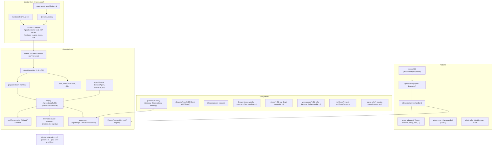

# Mastra

> Mastra is a TypeScript **agent framework**. It has also grown into a platform. At the bottom, `@mastra/core` owns its own agentic loop, message model, model router, processor pipeline and workflow engine. It reaches providers only at the AI SDK *provider-spec* level (`LanguageModelV2/V3/V4.doStream`) and bundles AI SDK v4–v7 into its own build. Above that sit the subsystems: memory (including "Observational Memory"), 31 storage adapters, MCP client and server, scorers, OTel-capable tracing, an HTTP server with framework adapters and deployers, and Studio. On top sits a complete coding-agent product, **Mastra Code**: a TUI built on Pi's `pi-tui`, a Code SDK, an ACP server, and "Factory". The most unusual architectural decision is that **the agent loop is itself a Mastra workflow** (`dowhile` over a ten-step iteration workflow). Tool approval, tool suspension, durable execution and crash recovery therefore all reuse the workflow snapshot machinery. Build on Mastra if you want an in-process TS framework with batteries for memory, durability, workflows, evals and deployment. Do not pick it if you want a small, legible harness: the core is ~310k LOC and `agent.ts` alone is 11,461 lines.

| | |
|---|---|
| Repo(s) | `mastra-ai/mastra` @ `a68b1a495033` (monorepo, 20,524 tracked files) |
| License | Apache-2.0, except directories named `ee/` (e.g. `@mastra/core/auth/ee`, `agent-builder/ee`), which are under a separate enterprise license ([`LICENSE.md`](https://github.com/mastra-ai/mastra/blob/a68b1a4950334fbfb08ede44237150970dac271b/LICENSE.md)) |
| Language(s) | TypeScript (Node ≥ 22.13 for the agent-SDK wrappers); React for Studio and Factory UI |
| Size | `packages/core/src`: **310,191** non-test LOC plus **524,711** test LOC (2,680 files). Harness-relevant core (`agent/`, `loop/`, `llm/`, `stream/`, `tools/`, `processors/`, `workflows/`, `memory/`) is ~169k LOC. `@mastra/memory` is 36k, `@mastra/mcp` 9.6k, `@mastra/server` 54k. Mastra Code: `sdk` 40k, `tui` 42k, `factory` 76k, `factory-ui` 54k. `stores/` adapters are 262k. Counts exclude `*.test.*` and `__tests__` |
| Version at pin | `@mastra/core` 1.78.0-alpha.2 (latest stable 1.77.0, 2026-10-14). `@mastra/memory` 1.37.1. `mastracode` 0.47.1-alpha.2. `@mastra/code-sdk` 1.14.0-alpha.2 |
| Release history | Repo created 2024-08. `@mastra/core` 0.1.0 published 2024-10-02 (npm). v1 beta announced 2025-11-06 ([blog](https://mastra.ai/blog/mastrav1)). **1.0.0 on npm 2026-01-20**. Observational Memory announced 2026-02-09 and Mastra Code 2026-02-24 ([blog](https://mastra.ai/blog/announcing-mastra-code)). `@mastra/code-sdk` first published 2026-07-06. Roughly weekly minor releases since then (1.30 May, 1.50 July, 1.77 2026-10-14; `gh release list`) |
| Category | `agent-framework`, with a `hybrid` product (Mastra Code) built on it |

---

## 1. Layering & package map

The monorepo is organised as a core package plus ring after ring of adapters. `@mastra/core` has 88 subpath exports (`./agent`, `./agent/durable`, `./loop`, `./workflows`, `./workflows/evented`, `./processors`, `./memory`, `./storage`, `./workspace`, `./agent-controller`, `./harness`, `./mcp`, `./evals`, `./observability`, …). Its runtime dependency list is short ([`packages/core/package.json:L903-L937`](https://github.com/mastra-ai/mastra/blob/a68b1a4950334fbfb08ede44237150970dac271b/packages/core/package.json#L903-L937)). The reason is that the AI SDK is vendored. `packages/_vendored/ai_v{4,5,6,7}` wrap `ai@4/5/6/7` as `@internal/ai-sdk-v*`. The tsdown config lists them in `alwaysBundle` ([`packages/core/tsdown.config.ts:L114-L126`](https://github.com/mastra-ai/mastra/blob/a68b1a4950334fbfb08ede44237150970dac271b/packages/core/tsdown.config.ts#L114-L126)). The v5 wrapper hard-overrides `allowSystemInMessages: false` on `generateText`/`streamText` ([`packages/_vendored/ai_v5/src/index.ts:L1-L16`](https://github.com/mastra-ai/mastra/blob/a68b1a4950334fbfb08ede44237150970dac271b/packages/_vendored/ai_v5/src/index.ts#L1-L16)).



| Layer | Owns | Key code |
|---|---|---|
| Composition root | `new Mastra({...})` registers agents, workflows, storage, vectors, memory, MCP servers, scorers, gateways, workers, scheduler and `recovery` | [`packages/core/src/mastra/index.ts:L280-L687`](https://github.com/mastra-ai/mastra/blob/a68b1a4950334fbfb08ede44237150970dac271b/packages/core/src/mastra/index.ts#L280-L687) |
| Agent | Config resolution (everything is a `DynamicArgument` of `requestContext`), tool assembly, versioning, signals, resume/approve APIs | [`packages/core/src/agent/agent.ts`](https://github.com/mastra-ai/mastra/blob/a68b1a4950334fbfb08ede44237150970dac271b/packages/core/src/agent/agent.ts) |
| Loop | The agentic loop as a workflow, plus streaming, timeouts and the run scope | `packages/core/src/loop/` (18.6k LOC) |
| Workflows | Step graph, suspend/resume, snapshots, engines | `packages/core/src/workflows/` (29.9k LOC) |
| Processors | All cross-cutting behaviour (memory, guardrails, skills, retries) | `packages/core/src/processors/` (20.8k LOC) |
| Controller | Multi-thread session runtime with modes, subagents, approvals and OM progress: the coding-agent harness layer | `packages/core/src/agent-controller/` (13.2k LOC) |
| Product | Mastra Code TUI, ACP, headless, plugins | `mastracode/` (240k LOC incl. Factory) |

Core's own contributor guide states the extension philosophy: "Before adding a feature, check whether it can be a processor" ([`packages/core/AGENTS.md:L14`](https://github.com/mastra-ai/mastra/blob/a68b1a4950334fbfb08ede44237150970dac271b/packages/core/AGENTS.md#L14)). It also says non-serializable per-run state belongs in `runScope`, never on step schemas ([`packages/core/AGENTS.md:L18`](https://github.com/mastra-ai/mastra/blob/a68b1a4950334fbfb08ede44237150970dac271b/packages/core/AGENTS.md#L18)).

## 2. Agent loop

### Call path

1. **`Agent.stream()`** ([`agent.ts:L10000-L10180`](https://github.com/mastra-ai/mastra/blob/a68b1a4950334fbfb08ede44237150970dac271b/packages/core/src/agent/agent.ts#L10000-L10180)) runs these steps in order:
   - Reroute to a standalone `DurableAgent` when `durable: true` (L10011-L10014).
   - Validate `requestContext` against `requestContextSchema`.
   - Deep-merge `defaultOptions` and resolve scopes.
   - Delegate to `runStreamUntilIdle` when `untilIdle` is set.
   - Run the FGA check.
   - Reject AI SDK v4 (`specificationVersion: 'v1'`) models.
   - Serialize concurrent runs on the same thread through `agentThreadStreamRuntime.waitForCrossAgentThreadRun` (L10102-L10109).
2. **`#execute()`** ([`agent.ts:L8251-L8724`](https://github.com/mastra-ai/mastra/blob/a68b1a4950334fbfb08ede44237150970dac271b/packages/core/src/agent/agent.ts#L8251-L8724)) does the following:
   - Resolves a *stored agent version* (Studio-edited variant) and re-dispatches to it (L8293-L8327).
   - Injects browser context.
   - Reads reserved `requestContext` thread/resource ids, which take precedence over body ids "for security" (L8399-L8416).
   - Opens the `AGENT_RUN` span.
   - Builds a **prepare-stream workflow** (L8623-L8666).
3. The **prepare-stream workflow** is `parallel([prepareToolsStep, prepareMemoryStep]) → map(mapResultsStep) → streamStep`. It has `shouldPersistSnapshot: () => false` because it is never resumable ([`agent/workflows/prepare-stream/index.ts:L219-L238`](https://github.com/mastra-ai/mastra/blob/a68b1a4950334fbfb08ede44237150970dac271b/packages/core/src/agent/workflows/prepare-stream/index.ts#L219-L238)).
4. `streamStep` calls `MastraLLMVNext.stream()`. That call turns `maxSteps` into a `stepCountIs` stop condition. Retry steps are not counted, and **the default is 5 steps** when neither `maxSteps` nor `stopWhen` is set ([`llm/model/model.loop.ts:L161-L172`](https://github.com/mastra-ai/mastra/blob/a68b1a4950334fbfb08ede44237150970dac271b/packages/core/src/llm/model/model.loop.ts#L161-L172)). It then calls **`loop()`** ([`loop/loop.ts:L14-L181`](https://github.com/mastra-ai/mastra/blob/a68b1a4950334fbfb08ede44237150970dac271b/packages/core/src/loop/loop.ts#L14-L181)). `loop()` wraps `workflowLoopStream()` in a `MastraModelOutput`, which is the object with `fullStream`, `text`, `toolCalls` and so on.
5. `workflowLoopStream` builds the agentic-loop workflow and registers it as an internal workflow on the Mastra instance. It then calls `run.start()`, or `run.resume()` / `run.resumeClaimed()` for approvals and suspensions ([`loop/workflows/stream.ts:L413-L468`](https://github.com/mastra-ai/mastra/blob/a68b1a4950334fbfb08ede44237150970dac271b/packages/core/src/loop/workflows/stream.ts#L413-L468)).

### The loop is a workflow

`AgenticLoopBuilder` ([`loop/loop-builder.ts:L82-L127`](https://github.com/mastra-ai/mastra/blob/a68b1a4950334fbfb08ede44237150970dac271b/packages/core/src/loop/loop-builder.ts#L82-L127)) "IS the main (in-process) agent loop". Every step is constructed through an overridable factory method so that the durable engine can subclass it (`DurableAgenticLoopBuilder extends AgenticLoopBuilder`, which swaps in `createEventedWorkflow` for `EventedAgent`; [`agent/durable/workflows/durable-loop-builder.ts:L213-L234`](https://github.com/mastra-ai/mastra/blob/a68b1a4950334fbfb08ede44237150970dac271b/packages/core/src/agent/durable/workflows/durable-loop-builder.ts#L213-L234)).

```
agentic-loop  = dowhile( executionWorkflow , continuationPredicate )           loop-builder.ts:L688-L723
executionWorkflow =                                                             loop-builder.ts:L263-L417
   llmExecutionStep            # processors → model.doStream → output processors; eager tool dispatch
 → map('map-tool-calls')       # recompute concurrency from emitted calls + approval verdicts
 → foreach(toolCallStep, {concurrency})
 → llmMappingStep              # tool results → MessageList / stream chunks
 → backgroundTaskCheckStep     # wait for/inject background tool completions
 → signalDrainStep             # drain queued user/state signals, seal+rotate message, force continue
 → isTaskCompleteStep          # optional completion scorers
 → goalStep                    # native "objective" judge
```

The **continuation predicate** ([`loop-builder.ts:L425-L682`](https://github.com/mastra-ai/mastra/blob/a68b1a4950334fbfb08ede44237150970dac271b/packages/core/src/loop/loop-builder.ts#L425-L682)) runs after every iteration and handles the following:

- **Resume seal-and-rotate.** On the first loop-back after an approval resume, it seals the persisted assistant message and rotates to a new response message id. The reason given in the code is that Anthropic rejects modified signed thinking blocks (L453-L473).
- **Inter-iteration signal draining** (L475-L497).
- **Signal preemption.** "A signal replaces the physical request, not the logical step or its budget" (L499-L502).
- **Abort**, which fires `onIterationComplete` and stops (L569-L579).
- **`decideContinuation`** covers two-phase feedback stop, `stopWhen`, `maxSteps` (retry steps excluded), delegation bail and `onIterationComplete` feedback injection (L583-L641).
- **`step-finish` emission** and the **tripwire** terminal (L653-L680).

Snapshot persistence for this workflow is restricted to `pending`/`paused`/`suspended` ([`loop-builder.ts:L325-L344`](https://github.com/mastra-ai/mastra/blob/a68b1a4950334fbfb08ede44237150970dac271b/packages/core/src/loop/loop-builder.ts#L325-L344)). The in-process loop is therefore *resumable after a suspension* but not crash-recoverable; see §6.

### Streaming, parallelism, retries, steering

- **Streaming.** Steps enqueue `ChunkType` objects on a `ReadableStream` controller (`emitChunk`, [`loop-builder.ts:L167-L169`](https://github.com/mastra-ai/mastra/blob/a68b1a4950334fbfb08ede44237150970dac271b/packages/core/src/loop/loop-builder.ts#L167-L169)). The durable subclass publishes through pubsub instead. The chunk protocol has ~87 chunk `type`s tagged with `ChunkFrom` `AGENT | USER | SYSTEM | WORKFLOW | NETWORK` ([`stream/types.ts:L32-L38`](https://github.com/mastra-ai/mastra/blob/a68b1a4950334fbfb08ede44237150970dac271b/packages/core/src/stream/types.ts#L32-L38)). The types include `tool-call-approval`, `tool-call-suspended`, `background-task-*`, `routing-agent-*`, `workflow-step-*` and `tripwire`.
- **Parallel tool calls.**
  - Tool calls run in a `foreach` with default concurrency **10** ([`tool-call-concurrency.ts:L15-L36`](https://github.com/mastra-ai/mastra/blob/a68b1a4950334fbfb08ede44237150970dac271b/packages/core/src/loop/workflows/agentic-execution/tool-call-concurrency.ts#L15-L36)).
  - Execution is forced sequential when any active tool requires approval or can suspend (`'available'` strategy), or when any *called* tool does (`'called'` strategy) ([L42-L66](https://github.com/mastra-ai/mastra/blob/a68b1a4950334fbfb08ede44237150970dac271b/packages/core/src/loop/workflows/agentic-execution/tool-call-concurrency.ts#L42-L66)).
  - **Eager tool execution** starts a call while the model is still streaming. It is limited to plain server-side calls in stream mode with the `'available'` strategy ([`loop-builder.ts:L285-L304`](https://github.com/mastra-ai/mastra/blob/a68b1a4950334fbfb08ede44237150970dac271b/packages/core/src/loop/loop-builder.ts#L285-L304)). `Agent` defaults it to `true` ([`agent.ts:L8640-L8645`](https://github.com/mastra-ai/mastra/blob/a68b1a4950334fbfb08ede44237150970dac271b/packages/core/src/agent/agent.ts#L8640-L8645)).
- **Retries.** Recovery from model errors is layered:
  1. `p-retry` around `model.doStream` uses `maxRetries` (default 2) with exponential backoff, honours `Retry-After` with a bounded cap, and applies separate `stepMs`/`firstChunkMs` timeouts ([`stream/aisdk/v5/execute.ts:L365-L460`](https://github.com/mastra-ai/mastra/blob/a68b1a4950334fbfb08ede44237150970dac271b/packages/core/src/stream/aisdk/v5/execute.ts#L365-L460)).
  2. **Model fallback chains** iterate the configured models. A `TripWire` or a *total* timeout is never laundered into a fallback ([`llm-execution-step.ts:L1156-L1218`](https://github.com/mastra-ai/mastra/blob/a68b1a4950334fbfb08ede44237150970dac271b/packages/core/src/loop/workflows/agentic-execution/llm-execution-step.ts#L1156-L1218)).
  3. **Error processors** (`processAPIError`) default to `ProviderHistoryCompat`, `PrefillErrorHandler` and `StreamErrorRetryProcessor` ([`agent/types.ts:L949-L968`](https://github.com/mastra-ai/mastra/blob/a68b1a4950334fbfb08ede44237150970dac271b/packages/core/src/agent/types.ts#L949-L968)).
  4. **Processor retries** (`abort({ retry: true })`) are bounded by `maxProcessorRetries`.
- **Steering and queued messages.** Agents expose `sendMessage`, `queueMessage`, `cancelQueuedMessages`, `sendStateSignal` and `subscribeThreadEvents` ([`agent.ts:L9664-L9718`](https://github.com/mastra-ai/mastra/blob/a68b1a4950334fbfb08ede44237150970dac271b/packages/core/src/agent/agent.ts#L9664-L9718)). Signals have categories `user | state | reactive | notification` ([`agent/signals.ts:L6`](https://github.com/mastra-ai/mastra/blob/a68b1a4950334fbfb08ede44237150970dac271b/packages/core/src/agent/signals.ts#L6)) and are persisted with `role: 'signal'`. A queued signal can **cancel an in-flight model request** that has so far produced only reasoning or metadata (`watchInterruptibleStream`, [`loop/shared/interruptible-stream.ts:L1-L40`](https://github.com/mastra-ai/mastra/blob/a68b1a4950334fbfb08ede44237150970dac271b/packages/core/src/loop/shared/interruptible-stream.ts#L1-L40)). Otherwise it is drained at the `signalDrainStep` boundary ([`loop-builder.ts:L206-L247`](https://github.com/mastra-ai/mastra/blob/a68b1a4950334fbfb08ede44237150970dac271b/packages/core/src/loop/loop-builder.ts#L206-L247)).

## 3. Model / provider abstraction

**Mastra uses the AI SDK as a provider-spec layer, not as its loop.** No `streamText` call drives agents. The loop calls `model.doStream`/`doGenerate` directly. `ModelRouterLanguageModel.doStream` resolves a gateway and auth, strips sampling parameters for models that reject them, optionally selects the OpenAI WebSocket Responses transport, and wraps the result as `AISDKV5/V6/V7LanguageModel` depending on whether the resolved model implements spec V2, V3 or V4 ([`llm/model/router.ts:L437-L503`](https://github.com/mastra-ai/mastra/blob/a68b1a4950334fbfb08ede44237150970dac271b/packages/core/src/llm/model/router.ts#L437-L503)). Agents accept magic strings (`'openai/gpt-5'`), config objects with `apiKey`/`url`, raw AI SDK model instances, dynamic resolvers and fallback arrays with per-entry `maxRetries`, `modelSettings` and `providerOptions` ([`agent/types.ts:L653-L735`](https://github.com/mastra-ai/mastra/blob/a68b1a4950334fbfb08ede44237150970dac271b/packages/core/src/agent/types.ts#L653-L735)).

- **Gateways.** The defaults are `NetlifyGateway`, `MastraGateway` and `ModelsDevGateway` ([`gateways/defaults.ts:L10-L14`](https://github.com/mastra-ai/mastra/blob/a68b1a4950334fbfb08ede44237150970dac271b/packages/core/src/llm/model/gateways/defaults.ts#L10-L14)). The models.dev gateway maps `providerId` to a concrete AI SDK factory: OpenAI Responses, Google, Anthropic, Mistral, Groq, OpenRouter, xAI, DeepSeek, Perplexity, Cerebras, Together, DeepInfra, Vercel gateway, Alibaba and Moonshot (served through the Anthropic-compatible endpoint). Everything else falls back to `createOpenAICompatible` ([`gateways/models-dev.ts:L380-L486`](https://github.com/mastra-ai/mastra/blob/a68b1a4950334fbfb08ede44237150970dac271b/packages/core/src/llm/model/gateways/models-dev.ts#L380-L486)). The baked-in `provider-registry.json` lists **215 providers and 8,164 models**, counted from the file at the pin. Mastra Code adds Bedrock, GitHub Copilot and its own gateway.
- **Message model.** The canonical persisted type is `MastraDBMessage`, whose `content: { format: 2, parts, ... }` is the AI SDK **v4 `UIMessage` shape extended** with provider metadata, v5 data parts and v6-only parts such as approval-aware tool invocations ([`agent/message-list/state/types.ts:L97-L127`](https://github.com/mastra-ai/mastra/blob/a68b1a4950334fbfb08ede44237150970dac271b/packages/core/src/agent/message-list/state/types.ts#L97-L127)). `MessageList` (2,713 LOC) renders this format to `aiV4`, `aiV5` and `aiV6` UI/model/prompt views through per-version adapters. It also tracks sources (`input | response | memory | context | system`) and adds a `signal` role.
- **Reasoning.** Reasoning parts keep their provider metadata (signatures). The cache layer has explicit reasoning-identity handling (`message-list/cache/reasoning-identity.ts`). Mastra Code adds a six-level thinking setting (`off…max`) mapped per provider (`mastracode/sdk/src/thinking.ts`).
- **Prompt caching.** There is no automatic cache-breakpoint insertion in core. Support is indirect:
  - System messages are ordered so instructions stay a stable prefix. MCP guidance goes in a separate tagged system message "so the base instructions remain a stable prefix for prompt caching" ([`prepare-memory-step.ts:L110-L120`](https://github.com/mastra-ai/mastra/blob/a68b1a4950334fbfb08ede44237150970dac271b/packages/core/src/agent/workflows/prepare-stream/prepare-memory-step.ts#L110-L120)).
  - Tools accept `providerOptions` such as `anthropic.cacheControl` ([`tools/tool.ts:L299-L312`](https://github.com/mastra-ai/mastra/blob/a68b1a4950334fbfb08ede44237150970dac271b/packages/core/src/tools/tool.ts#L299-L312)).
  - OM's buffered-observation activation can be aligned with the provider's cache TTL (`activateAfterIdle: 'auto'`, [`memory/types.ts:L889-L910`](https://github.com/mastra-ai/mastra/blob/a68b1a4950334fbfb08ede44237150970dac271b/packages/core/src/memory/types.ts#L889-L910)).
  - Mastra Code's Claude Max provider stamps `cacheControl` itself.
- **Tokens and cost.** Usage flows from step results into `MODEL_GENERATION`/`MODEL_STEP` spans. Cost *estimation* lives in `@mastra/observability` (`metrics/pricing-registry.ts`, `pricing-data.json`, a models.dev-based estimator), which emits `CostContext` rows ([`observability/types/metrics.ts:L86-L95`](https://github.com/mastra-ai/mastra/blob/a68b1a4950334fbfb08ede44237150970dac271b/packages/core/src/observability/types/metrics.ts#L86-L95)).

## 4. Tool system

**Definition.** `createTool({ id, description, inputSchema, outputSchema, execute, ... })` builds a `Tool` ([`tools/tool.ts:L193-L373`](https://github.com/mastra-ai/mastra/blob/a68b1a4950334fbfb08ede44237150970dac271b/packages/core/src/tools/tool.ts#L193-L373); factory at [L750](https://github.com/mastra-ai/mastra/blob/a68b1a4950334fbfb08ede44237150970dac271b/packages/core/src/tools/tool.ts#L750)).

- **Schemas.** Inputs and outputs are **Standard Schema** (`StandardSchemaWithJSON`). Zod 3 and Zod 4 are peer-compatible, and ArkType and Valibot are tested. JSON Schema is produced through `@mastra/schema-compat`, which carries provider-specific fixups.
- **Other `Tool` fields:**
  - `suspendSchema`/`resumeSchema` for human-in-the-loop (HITL) data;
  - `requireApproval` (boolean or async function) and the derived `needsApprovalFn`;
  - `strict` and `outputValidation: 'strict'|'warn'`;
  - `toModelOutput`, which gives the model a different view than application code sees;
  - `transform`, for display/transcript payload redaction;
  - `mcp` annotations;
  - the `onInputStart/Delta/Available` and `onOutput` streaming hooks;
  - `background` (`ToolBackgroundConfig`) for detached execution.
- AI SDK `tool()` objects and provider-defined tools are accepted as-is (`isVercelTool`, `provider-tool-utils`). An AI SDK v6 `ToolLoopAgent` can be converted wholesale into a Mastra `Agent` ([`tool-loop-agent/index.ts:L36-L47`](https://github.com/mastra-ai/mastra/blob/a68b1a4950334fbfb08ede44237150970dac271b/packages/core/src/tool-loop-agent/index.ts#L36-L47)).

**Tool assembly per run** ([`agent.ts:L7150-L7240`](https://github.com/mastra-ai/mastra/blob/a68b1a4950334fbfb08ede44237150970dac271b/packages/core/src/agent/agent.ts#L7150-L7240)) merges, in order:

- assigned tools and toolsets;
- client-side tools;
- sub-agent tools `agent-<name>` ([L5570](https://github.com/mastra-ai/mastra/blob/a68b1a4950334fbfb08ede44237150970dac271b/packages/core/src/agent/agent.ts#L5570));
- workflow tools `workflow-<name>` ([L6767](https://github.com/mastra-ai/mastra/blob/a68b1a4950334fbfb08ede44237150970dac271b/packages/core/src/agent/agent.ts#L6767));
- workspace tools;
- skill tools (`skill`, `skill_search`, `skill_read`);
- browser tools.

Tools are then wrapped with `ToolHooks` (`beforeToolCall` can short-circuit with an output; `afterToolCall`, [`tools/types.ts:L148-L158`](https://github.com/mastra-ai/mastra/blob/a68b1a4950334fbfb08ede44237150970dac271b/packages/core/src/tools/types.ts#L148-L158)).

**Built-ins.** Core ships no "coding tools" on a bare agent. They arrive with a `Workspace`, prefixed `mastra_workspace_` ([`workspace/constants/index.ts:L16-L54`](https://github.com/mastra-ai/mastra/blob/a68b1a4950334fbfb08ede44237150970dac271b/packages/core/src/workspace/constants/index.ts#L16-L54)):

| Group | Tools |
|---|---|
| Filesystem | `read_file`, `write_file`, `edit_file`, `list_files`, `delete`, `file_stat`, `mkdir`, `grep`, `ast_edit` (ast-grep) |
| Sandbox | `execute_command`, `get_process_output`, `kill_process` |
| Computer use | `screenshot`, `click`, `double_click`, `right_click`, `move_mouse`, `drag`, `type`, `press_key`, `scroll`, `get_screen_info`, `wait` |
| Search | `search`, `index` (BM25 and optional vector) |
| LSP | `lsp_inspect` |

Agent-agnostic built-ins live in `tools/builtin/`: `ask_user`, `submit_plan`, the `task_*` tools, `web_search` and `web_fetch`. **Code Mode** (`createCodeMode`) exposes a single `execute_typescript` tool that runs model-written TS in a workspace sandbox and bridges `external_*` calls back to real tools ([`tools/code-mode/code-mode.ts:L1-L21`](https://github.com/mastra-ai/mastra/blob/a68b1a4950334fbfb08ede44237150970dac271b/packages/core/src/tools/code-mode/code-mode.ts#L1-L21)). The isolated-vm and QuickJS runners are in `code-mode/`.

**Execution pipeline** (`toolCallStep`, 1,466 LOC):

1. Validate input.
2. Apply the approval gate. Approval decisions are accepted **only from the workflow resume boundary**, because "model-authored resumeData is untrusted and cannot grant or decline consent" ([`tool-call-step.ts:L535-L540`](https://github.com/mastra-ai/mastra/blob/a68b1a4950334fbfb08ede44237150970dac271b/packages/core/src/loop/workflows/agentic-execution/tool-call-step.ts#L535-L540)).
3. Run the `beforeApproval` hook. When there is no decision yet, emit a `tool-call-approval` chunk, flush messages to memory, and call workflow **`suspend()`** with `requireToolApproval`, the serialized stream state and `resumeLabel: toolCallId` ([L686-L758](https://github.com/mastra-ai/mastra/blob/a68b1a4950334fbfb08ede44237150970dac271b/packages/core/src/loop/workflows/agentic-execution/tool-call-step.ts#L686-L758)).
4. Tools can suspend themselves through the same path with `tool-call-suspended` ([L547-L672](https://github.com/mastra-ai/mastra/blob/a68b1a4950334fbfb08ede44237150970dac271b/packages/core/src/loop/workflows/agentic-execution/tool-call-step.ts#L547-L672)).
5. Callers resume with `agent.approveToolCall({ runId, toolCallId })`, which is literally `resumeStream({ approved: true })` ([`agent.ts:L10766-L10780`](https://github.com/mastra-ai/mastra/blob/a68b1a4950334fbfb08ede44237150970dac271b/packages/core/src/agent/agent.ts#L10766-L10780)).
6. After execution, `processToolResult` processors may redact or replace results, and `toModelOutput` shapes what the model sees.

**Output truncation** is per tool. Workspace tools truncate to `DEFAULT_MAX_OUTPUT_TOKENS = 2_000` (tokenx estimate) using tail, head or head+tail "sandwich" strategies ([`workspace/tools/output-helpers.ts:L10-L139`](https://github.com/mastra-ai/mastra/blob/a68b1a4950334fbfb08ede44237150970dac271b/packages/core/src/workspace/tools/output-helpers.ts#L10-L139)). There is no generic loop-level cap and no spill-to-disk.

## 5. Context management

**Prompt assembly.** `prepareMemoryStep` builds the `MessageList` in this order ([`prepare-memory-step.ts:L110-L120`](https://github.com/mastra-ai/mastra/blob/a68b1a4950334fbfb08ede44237150970dac271b/packages/core/src/agent/workflows/prepare-stream/prepare-memory-step.ts#L110-L120)):

1. agent `instructions` (dynamic per `requestContext`);
2. MCP server guidance (`mcp-guidance` tag);
3. `context` messages;
4. the user-provided `system`;
5. the input.

Memory and other processors then mutate the list. They run as `processInput` once per call, and as `processInputStep` before **every** model call, which may change `model`, `toolChoice`, active tools or messages.

**Memory is a processor stack.** `MastraMemory.getInputProcessors()` and `getOutputProcessors()` instantiate the following ([`memory/memory.ts:L757-L1100`](https://github.com/mastra-ai/mastra/blob/a68b1a4950334fbfb08ede44237150970dac271b/packages/core/src/memory/memory.ts#L757-L1100)):

- `WorkingMemory`: a Markdown template or schema, thread- or resource-scoped, updated through a tool or state signals;
- `MessageHistory` (`lastMessages`);
- `SemanticRecall`: vector `topK` with `messageRange`, `scope: thread|resource`.

The concrete `Memory` class lives in `@mastra/memory` ([`packages/memory/src/index.ts:L451`](https://github.com/mastra-ai/mastra/blob/a68b1a4950334fbfb08ede44237150970dac271b/packages/memory/src/index.ts#L451)).

**Observational Memory (OM)** is Mastra's answer to compaction. It does not summarize-and-replace on overflow. Instead:

- An **observer** LLM turns raw messages into dated, prioritised observations once unobserved history exceeds `messageTokens` (default **30,000**).
- A **reflector** LLM condenses observations past `observationTokens` (default **40,000**).
- Both default to `google/gemini-2.5-flash`.
- Async buffering is on by default: observations are pre-computed every 20% of the threshold and activated at 80% ([`observational-memory/constants.ts:L4-L43`](https://github.com/mastra-ai/mastra/blob/a68b1a4950334fbfb08ede44237150970dac271b/packages/memory/src/processors/observational-memory/constants.ts#L4-L43)).

It runs as `ObservationalMemoryProcessor`, which injects context in `processInputStep` and persists observations in `processOutputResult` ([`processor.ts:L139-L172`](https://github.com/mastra-ai/mastra/blob/a68b1a4950334fbfb08ede44237150970dac271b/packages/memory/src/processors/observational-memory/processor.ts#L139-L172)). Already-observed history is removed from the prompt, so the window stays bounded with a stable, cacheable prefix. Mastra Code enables OM with retrieval, temporal markers, an experimental "Subconscious" knowledge layer, `activateAfterIdle` aligned with its Anthropic cache TTL, and `activateOnProviderChange` ([`mastracode/sdk/src/agents/memory.ts:L355-L415`](https://github.com/mastra-ai/mastra/blob/a68b1a4950334fbfb08ede44237150970dac271b/mastracode/sdk/src/agents/memory.ts#L355-L415)). Mastra markets this as "a coding agent that never compacts". The vendor reports a LongMemEval figure for OM ([blog](https://mastra.ai/blog/observational-memory)); that benchmark claim is not verified here.

**Other context controls** are processors in `processors/processors/`:

- `TokenLimiter` and `ToolCallFilter`;
- `ToolSearch`, which defers tool definitions and loads them on demand;
- `SkillSearch` and `Skills`, which inject SKILL.md content eagerly or on demand (`skillsFormat: 'xml'` by default);
- `WorkspaceInstructions` and `BatchParts`.

**Instruction files.**
- Mastra Code loads `AGENTS.md`, falling back to `CLAUDE.md`, from global and project config locations ([`mastracode/sdk/src/agents/prompts/agent-instructions.ts:L13`](https://github.com/mastra-ai/mastra/blob/a68b1a4950334fbfb08ede44237150970dac271b/mastracode/sdk/src/agents/prompts/agent-instructions.ts#L13)).
- Core ships `ToolResultReminder`, which injects nested `AGENTS.md`/`CLAUDE.md`/`CONTEXT.md` reminders when a tool touches a path in that directory. It has an `isEnabled` hook so hosts can suppress attacker-controlled instruction files from untrusted checkouts ([`processors/tool-result-reminder.ts:L8-L66`](https://github.com/mastra-ai/mastra/blob/a68b1a4950334fbfb08ede44237150970dac271b/packages/core/src/processors/tool-result-reminder.ts#L8-L66)).

## 6. State, sessions & durability

**Storage.** `MastraCompositeStore` composes per-domain stores (`default`, `editor`, `domains`) ([`storage/base.ts:L396`](https://github.com/mastra-ai/mastra/blob/a68b1a4950334fbfb08ede44237150970dac271b/packages/core/src/storage/base.ts#L396)). About 25 domains are defined, including `memory` (threads, messages, resources, OM records), `workflows` (snapshots), `observability`, `scores`, `datasets`, `experiments`, `background-tasks`, `schedules`, `agents`/`skills`/`prompt-blocks` (Studio-edited, versioned), `mcp-clients`/`mcp-servers` and `thread-state`. Thirty-one adapters live in `stores/`, among them pg, libsql, mongodb, dynamodb, cloudflare-d1, clickhouse, redis, duckdb, convex, spanner and several vector DBs. Mastra Code uses a local LibSQL file by default and can switch to Postgres (`mastracode/sdk/src/utils/storage-factory.ts`).

**Sessions.** A *thread* (`threadId`) belongs to a *resource* (`resourceId`). `MastraMemory` exposes `cloneThread` (fork) and `listThreads` ([`memory/memory.ts:L454-L1112`](https://github.com/mastra-ai/mastra/blob/a68b1a4950334fbfb08ede44237150970dac271b/packages/core/src/memory/memory.ts#L454-L1112)). `AgentController`'s `Session` adds multi-thread registries, per-thread model and mode persistence, suspensions, follow-ups and approvals ([`agent-controller/session.ts:L298-L4048`](https://github.com/mastra-ai/mastra/blob/a68b1a4950334fbfb08ede44237150970dac271b/packages/core/src/agent-controller/session.ts#L298-L4048)).

**Workflow snapshots.** `WorkflowRunState` is a JSON document with these fields ([`workflows/types.ts:L405-L437`](https://github.com/mastra-ai/mastra/blob/a68b1a4950334fbfb08ede44237150970dac271b/packages/core/src/workflows/types.ts#L405-L437)):

- `status`;
- `context` (per-step results);
- `serializedStepGraph`;
- `activePaths`, `suspendedPaths` and `resumeLabels`;
- `waitingPaths`;
- `requestContext`;
- `tracingContext`, for linking resumed spans to the suspended span;
- `resumeClaimedAt`.

Statuses are `running | success | failed | tripwire | suspended | waiting | pending | canceled | bailed | paused | skipped` ([L297-L308](https://github.com/mastra-ai/mastra/blob/a68b1a4950334fbfb08ede44237150970dac271b/packages/core/src/workflows/types.ts#L297-L308)). Agent-loop snapshots go through `pruneAgentLoopSnapshot`, which strips anything a resume does not read.

**Three durability tiers:**

| Tier | Persists | Survives | Code |
|---|---|---|---|
| Plain `Agent` | Messages through the memory save queue, plus loop snapshots only when `pending/paused/suspended` | HITL suspension across processes (`resumeStream`, `approveToolCall`) | [`loop-builder.ts:L325-L344`](https://github.com/mastra-ai/mastra/blob/a68b1a4950334fbfb08ede44237150970dac271b/packages/core/src/loop/loop-builder.ts#L325-L344) |
| `DurableAgent` (`durable: true`) | Stream events in a cache (in-memory or Redis). `running` snapshots require `recovery.durableAgents: "auto"`, a custom persistence policy, or graceful shutdown; `EventedAgent` uses its own policy | Client disconnect; process recovery only when running snapshots actually exist (`recover(runId)`, `recoverActiveRuns()`) | [`durable-loop-builder.ts:L110-L131`](https://github.com/mastra-ai/mastra/blob/a68b1a4950334fbfb08ede44237150970dac271b/packages/core/src/agent/durable/workflows/durable-loop-builder.ts#L110-L131), [`durable-agent.ts:L3673-L3719`](https://github.com/mastra-ai/mastra/blob/a68b1a4950334fbfb08ede44237150970dac271b/packages/core/src/agent/durable/durable-agent.ts#L3673-L3719) |
| `InngestAgent`, Temporal | Step-level durability on an external engine (`InngestExecutionEngine extends DefaultExecutionEngine`) | Whatever the platform guarantees | [`workflows/inngest/src/execution-engine.ts:L61`](https://github.com/mastra-ai/mastra/blob/a68b1a4950334fbfb08ede44237150970dac271b/workflows/inngest/src/execution-engine.ts#L61) |

Crash recovery is protected by an **execution fence** ([`agent/durable/execution-fence.ts:L1-L37`](https://github.com/mastra-ai/mastra/blob/a68b1a4950334fbfb08ede44237150970dac271b/packages/core/src/agent/durable/execution-fence.ts#L1-L37)):

- Every `stream/generate/resume/recover` claims the run under a fresh execution id.
- Where the workflows store supports run fencing, storage rejects writes whose fence generation is stale.
- Otherwise a pubsub lease is used (30 s TTL, renewed every 10 s). This gives liveness only.
- `recover({ force: true })` supersedes a live owner, which then stops without writing.

The default `DurableAgent` policy persists `pending/paused/suspended` only during ordinary operation. It additionally persists `running` when `recovery.durableAgents` is `auto` or after `mastra.shutdown()` starts; a custom policy can override this ([`durable-agent.ts:L490-L512`](https://github.com/mastra-ai/mastra/blob/a68b1a4950334fbfb08ede44237150970dac271b/packages/core/src/agent/durable/durable-agent.ts#L490-L512), [`L2315-L2339`](https://github.com/mastra-ai/mastra/blob/a68b1a4950334fbfb08ede44237150970dac271b/packages/core/src/agent/durable/durable-agent.ts#L2315-L2339)). Thus `durable: true` alone does not guarantee hard-crash recovery. Boot-time recovery of durable agent runs is **off by default**, because it "re-issues LLM calls (real cost) and re-executes tool calls (must be idempotent)". Workflow restarts are `auto` by default, with concurrency 5 ([`mastra/index.ts:L661-L687`](https://github.com/mastra-ai/mastra/blob/a68b1a4950334fbfb08ede44237150970dac271b/packages/core/src/mastra/index.ts#L661-L687)). Workflows also support `run.restart()` and `run.timeTravel()`, which re-run from a chosen step with substituted inputs ([`workflows/workflow.ts:L4875`](https://github.com/mastra-ai/mastra/blob/a68b1a4950334fbfb08ede44237150970dac271b/packages/core/src/workflows/workflow.ts#L4875), [L5669](https://github.com/mastra-ai/mastra/blob/a68b1a4950334fbfb08ede44237150970dac271b/packages/core/src/workflows/workflow.ts#L5669)). There is no file-level undo or checkpointing of workspace edits.

## 7. Safety & sandboxing

| Mechanism | Where | Default |
|---|---|---|
| Tool approval (static or function, per tool or run-wide `requireToolApproval`) implemented as workflow suspend | `tools/tool.ts`, `tool-call-step.ts` | Off unless configured |
| Untrusted-resume guard: only the workflow resume boundary can approve | [`tool-call-step.ts:L535-L540`](https://github.com/mastra-ai/mastra/blob/a68b1a4950334fbfb08ede44237150970dac271b/packages/core/src/loop/workflows/agentic-execution/tool-call-step.ts#L535-L540) | Always |
| System role injection blocked in vendored AI SDK (`allowSystemInMessages: false`) | [`_vendored/ai_v5/src/index.ts:L5-L16`](https://github.com/mastra-ai/mastra/blob/a68b1a4950334fbfb08ede44237150970dac271b/packages/_vendored/ai_v5/src/index.ts#L5-L16) | Always |
| Reserved `requestContext` thread/resource ids override request bodies (anti-hijack) | [`agent.ts:L8399-L8416`](https://github.com/mastra-ai/mastra/blob/a68b1a4950334fbfb08ede44237150970dac271b/packages/core/src/agent/agent.ts#L8399-L8416) | Always |
| FGA permission checks on agent execution and memory read/write (`checkThreadFGA`), `ee/` auth providers | `auth/ee`, `memory/thread-fga.ts` | Opt-in |
| Guardrail processors: `PIIDetector`, `PromptInjectionDetector`, `ModerationProcessor`, `SystemPromptScrubber`, `RegexFilter`, `UnicodeNormalizer`, `TokenCostControl` | `processors/processors/` | Opt-in |
| Filesystem confinement: `LocalFilesystem` `basePath` + `allowedPaths`, throws `PermissionError` on escape | `workspace/filesystem/local-filesystem.ts` | On for workspace file tools |
| **OS sandbox**: `LocalSandbox` `isolation: 'seatbelt' \| 'bwrap'`, `allowNetwork` false when isolated, `readOnly`, custom SBPL/bwrap args | [`native-sandbox/types.ts:L13-L77`](https://github.com/mastra-ai/mastra/blob/a68b1a4950334fbfb08ede44237150970dac271b/packages/core/src/workspace/sandbox/native-sandbox/types.ts#L13-L77), [`bubblewrap.ts:L36-L60`](https://github.com/mastra-ai/mastra/blob/a68b1a4950334fbfb08ede44237150970dac271b/packages/core/src/workspace/sandbox/native-sandbox/bubblewrap.ts#L36-L60) | **`'none'`** ([`local-sandbox.ts:L231-L242`](https://github.com/mastra-ai/mastra/blob/a68b1a4950334fbfb08ede44237150970dac271b/packages/core/src/workspace/sandbox/local-sandbox.ts#L231-L242)) |
| Remote sandboxes: 21 `workspaces/*` providers (E2B, Daytona, Docker, Modal, Vercel, Cloudflare, Blaxel, apple-container, …) | `workspaces/` | Opt-in |

**Mastra Code** layers a category policy on top ([`mastracode/sdk/src/permissions.ts:L15-L218`](https://github.com/mastra-ai/mastra/blob/a68b1a4950334fbfb08ede44237150970dac271b/mastracode/sdk/src/permissions.ts#L15-L218)):

- Categories are `read | edit | execute | mcp`. Defaults are `read: allow` and `ask` for the other three ([L124-L130](https://github.com/mastra-ai/mastra/blob/a68b1a4950334fbfb08ede44237150970dac271b/mastracode/sdk/src/permissions.ts#L124-L130)).
- `ask_user`, the task tools, `submit_plan` and `request_access` are always allowed.
- Session- and thread-scoped grants are supported.
- `yolo` mode exists, but an explicit per-tool `deny` beats yolo ([`agent-controller/session.ts:L4603-L4634`](https://github.com/mastra-ai/mastra/blob/a68b1a4950334fbfb08ede44237150970dac271b/packages/core/src/agent-controller/session.ts#L4603-L4634)).
- File tools are confined to the project, the temp directory, the plans directory and paths the user approved through `request_access` ([`mastracode/sdk/src/agents/workspace.ts:L162-L166`](https://github.com/mastra-ai/mastra/blob/a68b1a4950334fbfb08ede44237150970dac271b/mastracode/sdk/src/agents/workspace.ts#L162-L166)).

**The gap:** Mastra Code constructs `new LocalSandbox({ workingDirectory, env })` without `isolation` ([L257-L260](https://github.com/mastra-ai/mastra/blob/a68b1a4950334fbfb08ede44237150970dac271b/mastracode/sdk/src/agents/workspace.ts#L257-L260)), and no `isolation` setting appears anywhere in `mastracode/sdk` or `mastracode/tui`. Once `execute_command` is approved it therefore runs unconfined on the host, and the path allowlist only binds the file tools. The OS sandbox exists in core, but the flagship product does not use it.

## 8. Extensibility

- **Processors** are the primary seam. The `Processor` interface ([`processors/index.ts:L625-L862`](https://github.com/mastra-ai/mastra/blob/a68b1a4950334fbfb08ede44237150970dac271b/packages/core/src/processors/index.ts#L625-L862)) has these phases:

  | Phase | When it runs |
  |---|---|
  | `processInput` | once per call |
  | `processInputStep` | before every model call; may swap model, tools or toolChoice |
  | `computeStateSignal` | per step; thread-scoped versioned state lanes |
  | `processLLMRequest` | rewrites the provider-shaped prompt for this call only; not persisted |
  | `processLLMResponse` | after each response; e.g. a response cache |
  | `processOutputStream` | per chunk; may drop or replace chunks |
  | `processOutputStep` | after each response, before tools; can `abort({retry:true})` |
  | `processToolResult` | after a tool returns |
  | `processOutputResult` | at the end |
  | `processAPIError` | on non-retryable 4xx; can modify the request and retry |

  A processor can also be a **workflow** (`createStep(processor)`), so a guardrail pipeline can branch and run in parallel. Memory, OM, skills, workspace instructions, task state and signal providers (`signals: [new GithubSignals()]`) are all implemented as processors.
- **Tool hooks.** `beforeToolCall`/`afterToolCall` exist at three levels: agent, call and workspace. There is also a global hook bus `AvailableHooks.ON_SCORER_RUN | ON_GENERATION | ON_EVALUATION` (`hooks/index.ts`).
- **MCP.**
  - `MCPClient` builds on the official `@modelcontextprotocol/client` 2.2 and supports stdio, Streamable HTTP and SSE, OAuth (`oauth-provider.ts`, callback server) and a URL policy. `listTools()` namespaces tools as `server_tool`, and `listToolsets()` returns them per request ([`packages/mcp/src/client/configuration.ts:L101-L1061`](https://github.com/mastra-ai/mastra/blob/a68b1a4950334fbfb08ede44237150970dac271b/packages/mcp/src/client/configuration.ts#L101-L1061)).
  - `MCPServer` exposes tools, **agents as `ask_<key>`** and **workflows as `run_<key>`** ([`packages/mcp/src/server/server.ts:L255-L293`](https://github.com/mastra-ai/mastra/blob/a68b1a4950334fbfb08ede44237150970dac271b/packages/mcp/src/server/server.ts#L255-L293)), over stdio or HTTP ([L1110-L1128](https://github.com/mastra-ai/mastra/blob/a68b1a4950334fbfb08ede44237150970dac271b/packages/mcp/src/server/server.ts#L1110-L1128)), plus resources, prompts and MCP Apps (`ext-apps`).
  - `mcp-docs-server` and `mcp-registry-registry` are separate packages.
- **Skills.**
  - SKILL.md directories or inline `createSkill()` ([`skills/create-skill.ts:L38`](https://github.com/mastra-ai/mastra/blob/a68b1a4950334fbfb08ede44237150970dac271b/packages/core/src/skills/create-skill.ts#L38)).
  - Skills are merged from the agent and the workspace, are versioned/publishable in storage, and are exposed through the `skill`/`skill_search`/`skill_read` tools ([`workspace/skills/tools.ts:L97-L183`](https://github.com/mastra-ai/mastra/blob/a68b1a4950334fbfb08ede44237150970dac271b/packages/core/src/workspace/skills/tools.ts#L97-L183)).
  - Configuration is per agent ([`agent/types.ts:L876-L881`](https://github.com/mastra-ai/mastra/blob/a68b1a4950334fbfb08ede44237150970dac271b/packages/core/src/agent/types.ts#L876-L881)).
- **Mastra Code product extension.**
  - Claude-Code-style **hooks** with the events `PreToolUse | PostToolUse | Stop | UserPromptSubmit | SessionStart | SessionEnd | Notification`; the first three are blocking ([`mastracode/sdk/src/hooks/types.ts:L9-L38`](https://github.com/mastra-ai/mastra/blob/a68b1a4950334fbfb08ede44237150970dac271b/mastracode/sdk/src/hooks/types.ts#L9-L38)).
  - **Plugins** declared in `.mastracode-plugin.json`, contributing tools, skills, commands and instructions ([`plugins/manifest.ts:L4`](https://github.com/mastra-ai/mastra/blob/a68b1a4950334fbfb08ede44237150970dac271b/mastracode/sdk/src/plugins/manifest.ts#L4)).
  - File-based slash commands.
  - MCP server configuration.
  - LSP.
- **Studio "editor".** Agents can hand `instructions`/`tools` ownership to Studio, which is enforced at the type level ([`agent/types.ts:L1021-L1044`](https://github.com/mastra-ai/mastra/blob/a68b1a4950334fbfb08ede44237150970dac271b/packages/core/src/agent/types.ts#L1021-L1044)). Stored versions are hot-switched per call ([`agent.ts:L8262-L8327`](https://github.com/mastra-ai/mastra/blob/a68b1a4950334fbfb08ede44237150970dac271b/packages/core/src/agent/agent.ts#L8262-L8327)).
- **Distribution** is plain npm packages. There is no marketplace format beyond the Mastra Code plugin manifest.

## 9. Multi-agent

1. **Sub-agents as tools.** `agents: { name: agent }` becomes `agent-<name>` tools. The tool strips the parent's tool parts from context, derives an isolated `RequestContext`, caps an LLM-supplied `maxSteps` at the sub-agent's own default, and supports suspension and approval bubbling (delegated resume) and background dispatch ([`agent.ts:L5513-L5600`](https://github.com/mastra-ai/mastra/blob/a68b1a4950334fbfb08ede44237150970dac271b/packages/core/src/agent/agent.ts#L5513-L5600)).
2. **Agent networks** (`agent.network()`, [`agent.ts:L9038-L9131`](https://github.com/mastra-ai/mastra/blob/a68b1a4950334fbfb08ede44237150970dac271b/packages/core/src/agent/agent.ts#L9038-L9131)). A **routing agent** chooses the next primitive with structured JSON. Execution is `routingStep → branch([agentStep, workflowStep, toolStep, finishStep])` ([`loop/network/index.ts:L2014-L2110`](https://github.com/mastra-ai/mastra/blob/a68b1a4950334fbfb08ede44237150970dac271b/packages/core/src/loop/network/index.ts#L2014-L2110)), wrapped in `dountil((llmComplete && validationPassed) || maxIterations)` ([L2700-L2707](https://github.com/mastra-ai/mastra/blob/a68b1a4950334fbfb08ede44237150970dac271b/packages/core/src/loop/network/index.ts#L2700-L2707)). Completion can be gated by scorers (`completion: { scorers, strategy: 'all' }`). Networks require memory and reject OM.
3. **Workflows.** The full engine API is `then`, `parallel`, `branch`, `dowhile`, `dountil`, `foreach`, `map`, `sleep`, `sleepUntil` and nested workflows ([`workflows/workflow.ts:L2064-L2853`](https://github.com/mastra-ai/mastra/blob/a68b1a4950334fbfb08ede44237150970dac271b/packages/core/src/workflows/workflow.ts#L2064-L2853)). Agents, tools, processors and classifiers can all become steps through `createStep` ([L504-L529](https://github.com/mastra-ai/mastra/blob/a68b1a4950334fbfb08ede44237150970dac271b/packages/core/src/workflows/workflow.ts#L504-L529)). Steps receive `suspend`, `bail`, `abort`, `getStepResult`, `state`/`setState`, `retryCount` and a `writer` ([`workflows/step.ts:L23-L71`](https://github.com/mastra-ai/mastra/blob/a68b1a4950334fbfb08ede44237150970dac271b/packages/core/src/workflows/step.ts#L23-L71)). `waitForEvent` was removed in favour of suspend/resume ([L2358-L2374](https://github.com/mastra-ai/mastra/blob/a68b1a4950334fbfb08ede44237150970dac271b/packages/core/src/workflows/workflow.ts#L2358-L2374)). Engines are `DefaultExecutionEngine`, which has override hooks for sleep, durable operations and conditions and is subclassed by Inngest ([`workflows/default.ts:L80-L200`](https://github.com/mastra-ai/mastra/blob/a68b1a4950334fbfb08ede44237150970dac271b/packages/core/src/workflows/default.ts#L80-L200)), and the pubsub-driven `EventedExecutionEngine`.
4. **AgentController subagents.** A single `subagent` tool takes `agentType`, `task`, an optional `modelId` and `forked`. A forked subagent clones the parent thread and reuses the parent's instructions and tools so the prompt cache prefix survives, and nesting is limited to one level ([`agent-controller/tools.ts:L118-L175`](https://github.com/mastra-ai/mastra/blob/a68b1a4950334fbfb08ede44237150970dac271b/packages/core/src/agent-controller/tools.ts#L118-L175)). Mastra Code defines `explore`, `plan` and `execute` subagents.
5. **Foreign agents as sub-agents.** `@mastra/claude` wraps the Claude Agent SDK `query()` ([`agent-sdks/claude/src/index.ts:L1-L3`](https://github.com/mastra-ai/mastra/blob/a68b1a4950334fbfb08ede44237150970dac271b/agent-sdks/claude/src/index.ts#L1-L3)). `@mastra/openai` wraps the OpenAI Agents SDK and `@mastra/cursor` the Cursor SDK. `@mastra/acp` wraps any ACP agent as a `SubAgent` ([`agent-sdks/acp/src/agent.ts:L49-L53`](https://github.com/mastra-ai/mastra/blob/a68b1a4950334fbfb08ede44237150970dac271b/agent-sdks/acp/src/agent.ts#L49-L53)). **A2A** v0.3 and v1 client and server are in core (`a2a/`) and `@mastra/server`.
6. **Background tasks.** Tools can run detached (`background`), and `stream({ untilIdle: true })` re-enters the loop when they complete.
7. **Worktrees.** None are created by core or Mastra Code. Mastra Code only *detects* a git worktree and scopes thread auto-resume to it (`utils/project.ts`). Isolation for parallel agents relies on remote workspace sandboxes; the Factory uses per-work-item branches.

## 10. Surfaces & integration

| Surface | What | Reuse notes |
|---|---|---|
| In-process SDK | `new Agent()`, `new Mastra()`, `createWorkflow()`; 88 subpath exports | Primary surface. Works standalone; an ephemeral Mastra is created lazily for the internal workflows |
| HTTP server | `@mastra/server` handlers: agents, workflows, memory, MCP, A2A, observability, scores, datasets, agent-controller. Served by Hono in `mastra dev/start` or mounted through `server-adapters/*` (express, fastify, koa, elysia, nestjs, next, tanstack-start) | REST plus streaming; `@mastra/client-js` and `@mastra/react` consume it |
| AI SDK UI bridge | `@mastra/ai-sdk` emits AI SDK UI-message streams for `useChat` | Drop-in for Vercel AI SDK front ends |
| Studio | `playground`/`playground-ui` (~212k LOC React): chat, traces, evals, workflow graphs, editor | Dev and ops UI |
| CLI / deploy | `mastra` CLI (`dev`, `build`, `deploy`, `studio`, `scorers`, `traces`, `migrate`, `worker`). Deployers: Vercel, Netlify, Cloudflare, Mastra Cloud, sandbox | Bundler analyses the `new Mastra()` entry |
| MCP / A2A | Expose agents and workflows as MCP tools or A2A agents | Cross-framework interop |
| Channels / voice | Slack, Discord, Teams, Telegram through the `chat` package. The `@chat-adapter/*` naming suggests Vercel's Chat SDK; that is an inference. `MastraVoice` (`speak`/`listen`/`connect`/`send`) with 18 providers including realtime ([`_internals/voice/src/voice/voice.ts:L83-L215`](https://github.com/mastra-ai/mastra/blob/a68b1a4950334fbfb08ede44237150970dac271b/packages/_internals/voice/src/voice/voice.ts#L83-L215)) | |
| **Mastra Code TUI** | `mastracode` binary, built on **`@earendil-works/pi-tui` 0.80.6** (Pi's TUI library) ([`mastracode/tui/package.json:L103`](https://github.com/mastra-ai/mastra/blob/a68b1a4950334fbfb08ede44237150970dac271b/mastracode/tui/package.json#L103)). Modes `build`/`plan`/`explore`; `/think` levels; OM | |
| Headless | `mastracode --prompt …` with `--output human\|json\|jsonl` ([`headless/flags.ts:L17`](https://github.com/mastra-ai/mastra/blob/a68b1a4950334fbfb08ede44237150970dac271b/mastracode/sdk/src/headless/flags.ts#L17)) | CI and scripting |
| **ACP** | `mastracode --acp`: newline-delimited JSON-RPC over stdio through `AgentSideConnection` ([`mastracode/sdk/src/acp/server.ts:L2-L26`](https://github.com/mastra-ai/mastra/blob/a68b1a4950334fbfb08ede44237150970dac271b/mastracode/sdk/src/acp/server.ts#L2-L26)). `loadSession: false`; HTTP MCP only ([`acp/agent.ts:L184`](https://github.com/mastra-ai/mastra/blob/a68b1a4950334fbfb08ede44237150970dac271b/mastracode/sdk/src/acp/agent.ts#L184)) | IDE embedding (Zed-class clients) |
| **Code SDK** | `@mastra/code-sdk`: `createMastraCodeAgentController()` / `mountAgentControllerOnMastra()` ([`mastracode/sdk/src/index.ts:L524-L1615`](https://github.com/mastra-ai/mastra/blob/a68b1a4950334fbfb08ede44237150970dac271b/mastracode/sdk/src/index.ts#L524-L1615), [L2022](https://github.com/mastra-ai/mastra/blob/a68b1a4950334fbfb08ede44237150970dac271b/mastracode/sdk/src/index.ts#L2022)) | Build your own UI on the coding agent |
| Factory | `@mastra/factory` + `factory-ui` + `web`: a hosted "software factory" with boards, review, supervisor and sandboxes | Product, not a library |

**How reshapeable is the product?** The coding-agent layer is mostly generic. `AgentController` (formerly `Harness`; [`packages/core/src/harness/index.ts:L1-L8`](https://github.com/mastra-ai/mastra/blob/a68b1a4950334fbfb08ede44237150970dac271b/packages/core/src/harness/index.ts#L1-L8) is now a deprecated alias) lives in **core**, not in the product. Modes, subagents, permission categories, OM config, workspace factory and gateways are all constructor arguments ([`mastracode/sdk/src/index.ts:L1587-L1615`](https://github.com/mastra-ai/mastra/blob/a68b1a4950334fbfb08ede44237150970dac271b/mastracode/sdk/src/index.ts#L1587-L1615)). A different coding agent can therefore be built either on `AgentController` directly or by reusing the Code SDK and swapping the UI. The controller sets `CONTROLLER_MAX_STEPS = 1000` for every run to escape the agent default of 5 ([`agent-controller/agent-controller.ts:L113-L123`](https://github.com/mastra-ai/mastra/blob/a68b1a4950334fbfb08ede44237150970dac271b/packages/core/src/agent-controller/agent-controller.ts#L113-L123)).

## 11. Observability & evals

- **Tracing model.** Mastra uses its own span model, with about 35 `SpanType`s ([`observability/types/tracing.ts:L36-L130`](https://github.com/mastra-ai/mastra/blob/a68b1a4950334fbfb08ede44237150970dac271b/packages/core/src/observability/types/tracing.ts#L36-L130)):
  - agent: `AGENT_RUN`, `AGENT_SIGNAL`;
  - model: `MODEL_GENERATION`, `MODEL_STEP`, `MODEL_INFERENCE`, `MODEL_CHUNK`;
  - tools: `TOOL_CALL`, `CLIENT_TOOL_CALL`, `PROVIDER_TOOL_CALL`, `MCP_TOOL_CALL`, `MCP_SERVER_REQUEST`;
  - processors: `PROCESSOR_RUN`;
  - workflows: `WORKFLOW_*`;
  - other: `MEMORY_OPERATION`, `WORKSPACE_ACTION`, `RAG_*`, `SKILL_*`, `SCORER_*`.

  Internal plumbing workflows, including the agentic loop itself, are marked `InternalSpans.WORKFLOW` so that exported traces show only user-meaningful spans ([`loop-builder.ts:L319-L324`](https://github.com/mastra-ai/mastra/blob/a68b1a4950334fbfb08ede44237150970dac271b/packages/core/src/loop/loop-builder.ts#L319-L324)). W3C trace-context propagation (`observability/w3c.ts`) carries spans across client tools and resumes; suspended-span links are persisted in the snapshot.
- **Exporters.** `@mastra/observability` provides the default exporter, sampling and metrics. Further exporters exist for OTel (`otel-exporter`, OTLP traces and logs) and as an **`otel-bridge`** that creates real OTel spans, plus Langfuse, LangSmith, Braintrust, Arize, Datadog, Sentry, PostHog, Laminar, Arthur and DeepEval.
- **Cost.** A pricing registry and estimator in `@mastra/observability/metrics` attach `estimatedCost` to usage metrics.
- **Evals.**
  - `createScorer` defines a four-stage pipeline `preprocess → analyze → generateScore → generateReason`, where each stage is a function or an LLM judge ([`evals/base.ts:L307-L314`](https://github.com/mastra-ai/mastra/blob/a68b1a4950334fbfb08ede44237150970dac271b/packages/core/src/evals/base.ts#L307-L314), [L1982-L2001](https://github.com/mastra-ai/mastra/blob/a68b1a4950334fbfb08ede44237150970dac271b/packages/core/src/evals/base.ts#L1982-L2001)).
  - Scorers attach to agents (`scorers`, sampled live), run in batch through `runEvals` ([`evals/run/index.ts:L230-L316`](https://github.com/mastra-ai/mastra/blob/a68b1a4950334fbfb08ede44237150970dac271b/packages/core/src/evals/run/index.ts#L230-L316)), or score stored traces after the fact (`scoreTraces`).
  - `@mastra/evals` ships about 17 LLM scorers (faithfulness, hallucination, tool-call accuracy, trajectory, rubric, multi-turn judge, …) and 8 code scorers.
  - Datasets and experiments are first-class storage domains.
  - There is a Vitest integration (`packages/evals/src/vitest`).
  - `packages/_llm-recorder` records and replays model traffic for tests.
- **Product telemetry.** PostHog usage telemetry is built into core, with opt-out through `MASTRA_TELEMETRY_DISABLED` ([`telemetry/posthog.ts:L7-L20`](https://github.com/mastra-ai/mastra/blob/a68b1a4950334fbfb08ede44237150970dac271b/packages/core/src/telemetry/posthog.ts#L7-L20)).

## 12. Notable design decisions & trade-offs

1. **The loop is a workflow.** `dowhile(executionWorkflow)` gives one mechanism for HITL approval, tool suspension, sub-agent delegated resume, durable execution, pubsub streaming and tracing. The cost shows up in three places:
   - Every agent call instantiates two workflows: prepare-stream and the agentic loop.
   - Non-serializable state has to be kept off step I/O in a side-channel `runScope` (hence `readScoped`/`writeScoped` everywhere).
   - The resume semantics are intricate. The seal-and-rotate fix for signed thinking blocks is one example ([`loop-builder.ts:L453-L473`](https://github.com/mastra-ai/mastra/blob/a68b1a4950334fbfb08ede44237150970dac271b/packages/core/src/loop/loop-builder.ts#L453-L473)).
2. **The AI SDK provides providers only.** Vendoring `ai` v4–v7 and calling `doStream` directly decouples Mastra from AI SDK loop semantics and lets it support four spec generations at once. In exchange, Mastra maintains its own retry, fallback, structured output (strict-mode schema rewriting), message conversion (`MessageList` plus per-version adapters) and timeouts.
3. **The message format is pinned to AI SDK v4 `UIMessage` (`format: 2`)** for storage compatibility, with newer parts layered on. Stored data stays stable across SDK upgrades, but every read path converts.
4. **Processors are the universal extension API.** The core guide pushes features into processors, so memory, OM, skills, guardrails, retries, signal providers and response caching all share one hook model with tracing built in. The hook surface (10+ phases) is large but uniform.
5. **Observational Memory instead of compaction.** OM replaces lossy one-shot summarization with continuous, buffered, background observation and reflection by a cheap model. This yields a stable, cacheable prefix. The trade-offs are an extra model dependency (Gemini by default), background work that must be `settled()` before shutdown, and incompatibility with agent networks.
6. **Durability is opt-in and tiered.** The in-process default persists only suspensions, which is cheap and avoids write amplification. `DurableAgent` adds fencing and recovery, with running snapshots enabled by recovery configuration or an explicit persistence policy, but recovery re-issues LLM calls and re-runs non-idempotent tools, which is why auto-recovery defaults to off.
7. **Everything is a `DynamicArgument` of `requestContext`** (model, tools, memory, workspace, instructions, processors). This makes multi-tenancy natural but makes static analysis of an agent impossible without a context.
8. **Size and churn.** About 78 minor releases in roughly 9 months after 1.0, an 11.5k-line `Agent` class, 88 export paths, and renamed concepts (`Harness` became `AgentController`; `waitForEvent` was removed). The 1.7:1 test-to-source ratio mitigates the regression risk.

## 13. Scorecard

| Dimension | Score (1–5) | Rationale |
|---|---|---|
| Flexibility | 4 | Model, storage domain, memory, workflow engine, sandbox, gateway, processors (10+ phases) and tool hooks are all swappable or composable, and the loop topology is an overridable `AgenticLoopBuilder`. The loop's step graph, however, is internal API (subclassed only by the durable engine), so reshaping the loop itself means forking. |
| Integration | 5 | End to end: Studio UI, HTTP server and 8 framework adapters, 5 deployers, auth providers, cloud, channels, voice, plus a full coding-agent product (TUI, headless, ACP, web Factory). |
| Embeddability | 5 | First-class in-process TS library (`new Agent`, `new Mastra`) on a semver-1.x API. A standalone Agent works without a server, and the Code SDK exposes the coding agent's controller in-process. |
| Durability | 5 | Workflow snapshots in pluggable stores; `DurableAgent` can persist running state when recovery/persistence is configured, fences executions (storage generations or leases), and offers `recover`/`recoverActiveRuns`/`force` takeover; Inngest/Temporal engines; workflow restart and time-travel. It is opt-in, and the default agent is resume-on-suspend only. |
| Safety | 4 | Approvals as suspend with an untrusted-resume guard, FGA, guardrail processors, path-confined file tools, opt-in seatbelt/bwrap isolation with network off, and 21 remote sandboxes. Docked one point because OS isolation defaults to `'none'` and Mastra Code never enables it, so approved shell commands run unconfined. |
| Extensibility | 5 | Processors, tool hooks, MCP client and server (agents/workflows exposed as MCP tools), SKILL.md skills, Claude-Code-style hooks, plugin manifest and slash commands in Mastra Code, and npm-distributed adapters for everything. |
| Multi-agent | 5 | Sub-agents as tools with delegated suspend/resume, routing-agent networks with scorer-gated completion, a full workflow engine (parallel/branch/foreach/loops), forked subagents, A2A, and wrappers for Claude Agent SDK, OpenAI Agents SDK, Cursor SDK and ACP agents. Lacks worktree isolation. |
| Provider neutrality | 5 | Model router over a baked models.dev registry (215 providers, 8,164 models), AI SDK spec V2/V3/V4 models, OpenAI-compatible fallback, custom gateways and fallback chains. |
| Maturity | 5 | `@mastra/core` stable 1.x since 2026-01-20 with weekly releases, ~28.8k GitHub stars, and 525k LOC of tests. Mastra Code itself is still 0.x and the API surface churns quickly. |
| Minimalism | 1 | ~310k LOC of core source; `agent.ts` is 11,461 lines; a single agent call composes two workflows and a ten-step iteration workflow. |

## 14. When to build on it / when not to

**Build on Mastra when:**
- You are writing a TypeScript service and want agents, workflows, memory, evals, tracing and an HTTP API from one dependency, with storage you already run (Postgres, LibSQL, Mongo, DynamoDB, D1, …).
- You need **HITL and durability** to be real: approvals that survive process restarts, crash-recoverable runs, and suspend/resume workflows, optionally on Inngest or Temporal.
- You want long-running conversational or coding agents with **bounded context without compaction** (OM). OM is also available to OpenCode users through `@mastra/opencode`.
- You want a **coding agent you can embed or re-skin**: the Code SDK, AgentController and ACP server give in-process, headless and IDE paths, and the TUI shows you can bring your own UI (it uses Pi's `pi-tui`).
- You want to orchestrate **foreign agents** (Claude Agent SDK, OpenAI Agents SDK, Cursor, ACP agents) alongside native ones.

**Avoid it when:**
- You want a small harness whose loop you can read and modify in an afternoon. Pi's agent core, mini-swe-agent or the AI SDK's own tool loop are far more legible.
- You run in Python, or need a non-JS runtime.
- You need an OS-sandboxed coding agent out of the box. You must enable `isolation` or use a remote workspace yourself.
- You are sensitive to API churn. The 1.x line ships minors weekly, and internal concepts move (Harness became AgentController, the loop was refactored onto `AgenticLoopBuilder`).
- You want a raw provider abstraction only. Use the AI SDK directly, since Mastra adds a large framework on top of it.

## 15. Evidence index

**Core loop and agent**
- [`packages/core/src/agent/agent.ts`](https://github.com/mastra-ai/mastra/blob/a68b1a4950334fbfb08ede44237150970dac271b/packages/core/src/agent/agent.ts): `stream` L10000-L10180, `#execute` L8251-L8724, sub-agent tools L5513-L5600, tool assembly L7150-L7240, signals L9664-L9718, `approveToolCall` L10766-L10780, `network` L9038-L9131
- [`packages/core/src/agent/types.ts:L625-L1019`](https://github.com/mastra-ai/mastra/blob/a68b1a4950334fbfb08ede44237150970dac271b/packages/core/src/agent/types.ts#L625-L1019): `AgentConfigBase`
- [`packages/core/src/agent/workflows/prepare-stream/index.ts:L219-L238`](https://github.com/mastra-ai/mastra/blob/a68b1a4950334fbfb08ede44237150970dac271b/packages/core/src/agent/workflows/prepare-stream/index.ts#L219-L238)
- [`packages/core/src/llm/model/model.loop.ts:L161-L172`](https://github.com/mastra-ai/mastra/blob/a68b1a4950334fbfb08ede44237150970dac271b/packages/core/src/llm/model/model.loop.ts#L161-L172): default 5-step stop
- [`packages/core/src/loop/loop.ts:L14-L181`](https://github.com/mastra-ai/mastra/blob/a68b1a4950334fbfb08ede44237150970dac271b/packages/core/src/loop/loop.ts#L14-L181)
- [`packages/core/src/loop/loop-builder.ts:L82-L723`](https://github.com/mastra-ai/mastra/blob/a68b1a4950334fbfb08ede44237150970dac271b/packages/core/src/loop/loop-builder.ts#L82-L723): `AgenticLoopBuilder`
- [`packages/core/src/loop/workflows/stream.ts:L413-L468`](https://github.com/mastra-ai/mastra/blob/a68b1a4950334fbfb08ede44237150970dac271b/packages/core/src/loop/workflows/stream.ts#L413-L468)
- [`packages/core/src/loop/workflows/agentic-execution/tool-call-step.ts:L535-L758`](https://github.com/mastra-ai/mastra/blob/a68b1a4950334fbfb08ede44237150970dac271b/packages/core/src/loop/workflows/agentic-execution/tool-call-step.ts#L535-L758)
- [`packages/core/src/loop/workflows/agentic-execution/tool-call-concurrency.ts:L15-L66`](https://github.com/mastra-ai/mastra/blob/a68b1a4950334fbfb08ede44237150970dac271b/packages/core/src/loop/workflows/agentic-execution/tool-call-concurrency.ts#L15-L66)
- [`packages/core/src/loop/workflows/agentic-execution/llm-execution-step.ts:L1156-L1218`](https://github.com/mastra-ai/mastra/blob/a68b1a4950334fbfb08ede44237150970dac271b/packages/core/src/loop/workflows/agentic-execution/llm-execution-step.ts#L1156-L1218)
- [`packages/core/src/loop/shared/interruptible-stream.ts:L1-L40`](https://github.com/mastra-ai/mastra/blob/a68b1a4950334fbfb08ede44237150970dac271b/packages/core/src/loop/shared/interruptible-stream.ts#L1-L40)
- [`packages/core/src/stream/aisdk/v5/execute.ts:L365-L460`](https://github.com/mastra-ai/mastra/blob/a68b1a4950334fbfb08ede44237150970dac271b/packages/core/src/stream/aisdk/v5/execute.ts#L365-L460)
- [`packages/core/src/loop/network/index.ts:L2014-L2110, L2700-L2707`](https://github.com/mastra-ai/mastra/blob/a68b1a4950334fbfb08ede44237150970dac271b/packages/core/src/loop/network/index.ts#L2014-L2110)

**Providers and messages**
- [`packages/core/src/llm/model/router.ts:L437-L503`](https://github.com/mastra-ai/mastra/blob/a68b1a4950334fbfb08ede44237150970dac271b/packages/core/src/llm/model/router.ts#L437-L503)
- [`packages/core/src/llm/model/gateways/models-dev.ts:L380-L486`](https://github.com/mastra-ai/mastra/blob/a68b1a4950334fbfb08ede44237150970dac271b/packages/core/src/llm/model/gateways/models-dev.ts#L380-L486)
- [`packages/core/src/llm/model/provider-registry.json`](https://github.com/mastra-ai/mastra/blob/a68b1a4950334fbfb08ede44237150970dac271b/packages/core/src/llm/model/provider-registry.json)
- [`packages/core/src/agent/message-list/state/types.ts:L97-L127`](https://github.com/mastra-ai/mastra/blob/a68b1a4950334fbfb08ede44237150970dac271b/packages/core/src/agent/message-list/state/types.ts#L97-L127)
- [`packages/_vendored/ai_v5/src/index.ts`](https://github.com/mastra-ai/mastra/blob/a68b1a4950334fbfb08ede44237150970dac271b/packages/_vendored/ai_v5/src/index.ts), [`packages/core/tsdown.config.ts:L114-L126`](https://github.com/mastra-ai/mastra/blob/a68b1a4950334fbfb08ede44237150970dac271b/packages/core/tsdown.config.ts#L114-L126)

**Tools, processors, memory**
- [`packages/core/src/tools/tool.ts:L193-L373`](https://github.com/mastra-ai/mastra/blob/a68b1a4950334fbfb08ede44237150970dac271b/packages/core/src/tools/tool.ts#L193-L373), [`tools/types.ts:L148-L158`](https://github.com/mastra-ai/mastra/blob/a68b1a4950334fbfb08ede44237150970dac271b/packages/core/src/tools/types.ts#L148-L158)
- [`packages/core/src/workspace/constants/index.ts:L16-L54`](https://github.com/mastra-ai/mastra/blob/a68b1a4950334fbfb08ede44237150970dac271b/packages/core/src/workspace/constants/index.ts#L16-L54), [`workspace/tools/output-helpers.ts`](https://github.com/mastra-ai/mastra/blob/a68b1a4950334fbfb08ede44237150970dac271b/packages/core/src/workspace/tools/output-helpers.ts#L10-L139)
- [`packages/core/src/processors/index.ts:L625-L862`](https://github.com/mastra-ai/mastra/blob/a68b1a4950334fbfb08ede44237150970dac271b/packages/core/src/processors/index.ts#L625-L862)
- [`packages/core/src/memory/memory.ts:L757-L1100`](https://github.com/mastra-ai/mastra/blob/a68b1a4950334fbfb08ede44237150970dac271b/packages/core/src/memory/memory.ts#L757-L1100)
- [`packages/memory/src/processors/observational-memory/constants.ts:L4-L43`](https://github.com/mastra-ai/mastra/blob/a68b1a4950334fbfb08ede44237150970dac271b/packages/memory/src/processors/observational-memory/constants.ts#L4-L43), [`processor.ts:L139-L172`](https://github.com/mastra-ai/mastra/blob/a68b1a4950334fbfb08ede44237150970dac271b/packages/memory/src/processors/observational-memory/processor.ts#L139-L172)
- [`packages/core/src/processors/tool-result-reminder.ts:L8-L66`](https://github.com/mastra-ai/mastra/blob/a68b1a4950334fbfb08ede44237150970dac271b/packages/core/src/processors/tool-result-reminder.ts#L8-L66)

**Workflows and durability**
- [`packages/core/src/workflows/workflow.ts`](https://github.com/mastra-ai/mastra/blob/a68b1a4950334fbfb08ede44237150970dac271b/packages/core/src/workflows/workflow.ts): builder L2064-L2853, `Run` L3682, restart L4875, timeTravel L5669
- [`packages/core/src/workflows/types.ts:L297-L437`](https://github.com/mastra-ai/mastra/blob/a68b1a4950334fbfb08ede44237150970dac271b/packages/core/src/workflows/types.ts#L297-L437), [`workflows/step.ts:L23-L71`](https://github.com/mastra-ai/mastra/blob/a68b1a4950334fbfb08ede44237150970dac271b/packages/core/src/workflows/step.ts#L23-L71), [`workflows/default.ts:L80-L480`](https://github.com/mastra-ai/mastra/blob/a68b1a4950334fbfb08ede44237150970dac271b/packages/core/src/workflows/default.ts#L80-L480)
- [`packages/core/src/agent/durable/index.ts:L1-L70`](https://github.com/mastra-ai/mastra/blob/a68b1a4950334fbfb08ede44237150970dac271b/packages/core/src/agent/durable/index.ts#L1-L70), [`execution-fence.ts:L1-L37`](https://github.com/mastra-ai/mastra/blob/a68b1a4950334fbfb08ede44237150970dac271b/packages/core/src/agent/durable/execution-fence.ts#L1-L37), [`durable-loop-builder.ts:L110-L234`](https://github.com/mastra-ai/mastra/blob/a68b1a4950334fbfb08ede44237150970dac271b/packages/core/src/agent/durable/workflows/durable-loop-builder.ts#L110-L234)
- [`packages/core/src/mastra/index.ts:L280-L687`](https://github.com/mastra-ai/mastra/blob/a68b1a4950334fbfb08ede44237150970dac271b/packages/core/src/mastra/index.ts#L280-L687), [`storage/base.ts:L396`](https://github.com/mastra-ai/mastra/blob/a68b1a4950334fbfb08ede44237150970dac271b/packages/core/src/storage/base.ts#L396)

**Safety**
- [`packages/core/src/workspace/sandbox/native-sandbox/types.ts`](https://github.com/mastra-ai/mastra/blob/a68b1a4950334fbfb08ede44237150970dac271b/packages/core/src/workspace/sandbox/native-sandbox/types.ts#L13-L77), [`bubblewrap.ts`](https://github.com/mastra-ai/mastra/blob/a68b1a4950334fbfb08ede44237150970dac271b/packages/core/src/workspace/sandbox/native-sandbox/bubblewrap.ts#L36-L60), [`local-sandbox.ts:L231-L242`](https://github.com/mastra-ai/mastra/blob/a68b1a4950334fbfb08ede44237150970dac271b/packages/core/src/workspace/sandbox/local-sandbox.ts#L231-L242)

**Extensibility, MCP, agent SDKs, evals**
- [`packages/mcp/src/server/server.ts:L255-L293, L1110-L1128`](https://github.com/mastra-ai/mastra/blob/a68b1a4950334fbfb08ede44237150970dac271b/packages/mcp/src/server/server.ts#L255-L293), [`packages/mcp/src/client/configuration.ts:L101`](https://github.com/mastra-ai/mastra/blob/a68b1a4950334fbfb08ede44237150970dac271b/packages/mcp/src/client/configuration.ts#L101)
- [`agent-sdks/claude/src/index.ts`](https://github.com/mastra-ai/mastra/blob/a68b1a4950334fbfb08ede44237150970dac271b/agent-sdks/claude/src/index.ts#L1-L3), [`agent-sdks/acp/src/agent.ts:L49-L53`](https://github.com/mastra-ai/mastra/blob/a68b1a4950334fbfb08ede44237150970dac271b/agent-sdks/acp/src/agent.ts#L49-L53), [`integrations/opencode/README.md`](https://github.com/mastra-ai/mastra/blob/a68b1a4950334fbfb08ede44237150970dac271b/integrations/opencode/README.md)
- [`packages/core/src/observability/types/tracing.ts:L36-L130`](https://github.com/mastra-ai/mastra/blob/a68b1a4950334fbfb08ede44237150970dac271b/packages/core/src/observability/types/tracing.ts#L36-L130), [`evals/base.ts:L307-L314, L1982-L2001`](https://github.com/mastra-ai/mastra/blob/a68b1a4950334fbfb08ede44237150970dac271b/packages/core/src/evals/base.ts#L307-L314), [`evals/run/index.ts:L230-L316`](https://github.com/mastra-ai/mastra/blob/a68b1a4950334fbfb08ede44237150970dac271b/packages/core/src/evals/run/index.ts#L230-L316)

**Mastra Code**
- [`packages/core/src/agent-controller/agent-controller.ts:L113-L189`](https://github.com/mastra-ai/mastra/blob/a68b1a4950334fbfb08ede44237150970dac271b/packages/core/src/agent-controller/agent-controller.ts#L113-L189), [`agent-controller/tools.ts:L118-L175`](https://github.com/mastra-ai/mastra/blob/a68b1a4950334fbfb08ede44237150970dac271b/packages/core/src/agent-controller/tools.ts#L118-L175), [`agent-controller/session.ts:L4603-L4634`](https://github.com/mastra-ai/mastra/blob/a68b1a4950334fbfb08ede44237150970dac271b/packages/core/src/agent-controller/session.ts#L4603-L4634)
- [`mastracode/sdk/src/index.ts:L1587-L1615`](https://github.com/mastra-ai/mastra/blob/a68b1a4950334fbfb08ede44237150970dac271b/mastracode/sdk/src/index.ts#L1587-L1615), [`permissions.ts`](https://github.com/mastra-ai/mastra/blob/a68b1a4950334fbfb08ede44237150970dac271b/mastracode/sdk/src/permissions.ts#L15-L218), [`agents/workspace.ts:L162-L260`](https://github.com/mastra-ai/mastra/blob/a68b1a4950334fbfb08ede44237150970dac271b/mastracode/sdk/src/agents/workspace.ts#L162-L260), [`agents/memory.ts:L355-L415`](https://github.com/mastra-ai/mastra/blob/a68b1a4950334fbfb08ede44237150970dac271b/mastracode/sdk/src/agents/memory.ts#L355-L415), [`hooks/types.ts:L9-L38`](https://github.com/mastra-ai/mastra/blob/a68b1a4950334fbfb08ede44237150970dac271b/mastracode/sdk/src/hooks/types.ts#L9-L38), [`acp/server.ts`](https://github.com/mastra-ai/mastra/blob/a68b1a4950334fbfb08ede44237150970dac271b/mastracode/sdk/src/acp/server.ts#L2-L26), [`mastracode/tui/package.json:L103`](https://github.com/mastra-ai/mastra/blob/a68b1a4950334fbfb08ede44237150970dac271b/mastracode/tui/package.json#L103)

**External sources (accessed 2026-10-14)**
- GitHub releases, `gh release list -R mastra-ai/mastra`: `@mastra/core@1.77.0` published 2026-10-14; 1.10.0 2026-03-09; 1.30.0 2026-05-01; 1.50.0 2026-07-08. `gh api repos/mastra-ai/mastra`: created 2024-08-06, ~28.8k stars.
- npm registry `time` field: `@mastra/core` 0.1.0 2024-10-02, 1.0.0 2026-01-20; `mastracode` first publish 2025-12-24; `@mastra/code-sdk` first publish 2026-07-06.
- Mastra blog, "Announcing Mastra v1 beta" (2025-11-06): https://mastra.ai/blog/mastrav1. Vendor statement that 1.0 stabilised existing APIs.
- Mastra blog, "Announcing Observational Memory" (2026-02-09): https://mastra.ai/blog/observational-memory. The LongMemEval score is a vendor claim, not verified here.
- Mastra blog, "Announcing Mastra Code: A coding agent that never compacts" (2026-02-24): https://mastra.ai/blog/announcing-mastra-code. The stack it names (pi-tui, ast-grep, LibSQL) is consistent with `mastracode/tui/package.json`.
- Show HN, "Mastra 1.0" (2026-01): https://hn.svelte.dev/item/46693959. The production users the vendor cites there (Replit, PayPal, Sanity) are self-reported.
