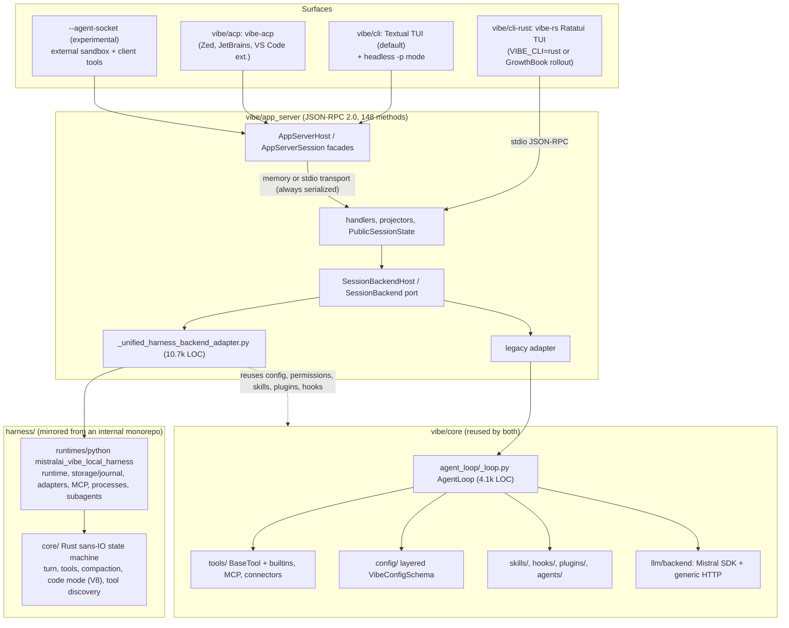
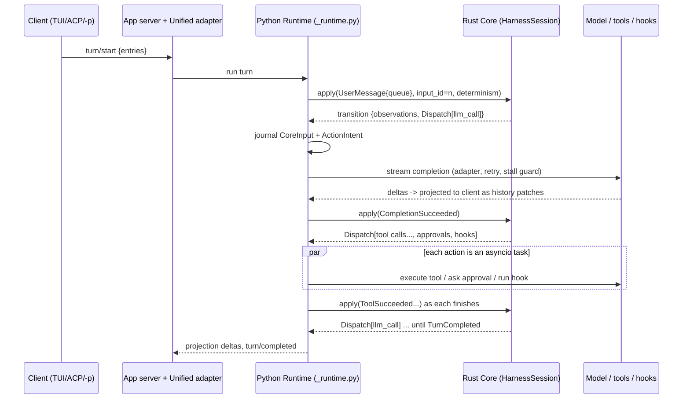

# Mistral Vibe

> Mistral Vibe is Mistral AI's open-source coding agent. Its first release (1.0.0, 2025-12-09) was a small Python Textual CLI. At the pinned commit (2.26.1, 2026-10-09) it is an **integrated product**: about 320k lines of non-test product code in Python and Rust, with **two complete harness engines** behind one JSON-RPC 2.0 "app server".
>
> - The **legacy engine** is a Python `AgentLoop`, now reachable only with `--legacy-harness`.
> - The **Unified Harness** is a deterministic, sans-IO Rust state machine (`mistralai-unified-harness`, loaded via PyO3) driven by a 50k-line Python runtime. It has been the unconditional default only since 2.26.0 (2026-10-05).
>
> The Unified Harness has three notable traits. It journals every step and recovers interrupted turns on resume. It makes **TypeScript "code mode"** (`run_typescript` in an embedded V8 isolate) the only route to MCP tools, connectors, subagents and background processes. And it reads plugins written for Claude Code, Codex, Kimi Code and OpenCode.
>
> Safety comes from permission analysis, not isolation: tree-sitter shell parsing, trusted folders, and an optional LLM classifier. There is no built-in default OS sandbox; callers can supply an external sandbox adapter. Build on Vibe if you want a Mistral-first coding agent you can drive over ACP, `vibe -p`, or its stdio app-server protocol. Do not build on it if you want a small embeddable library: the Rust core's API is crate-private, and the Python facades are not a versioned SDK.

| | |
|---|---|
| Repo(s) | `mistralai/mistral-vibe` @ `4ae5c5955da8` (tag `v2.26.1`, commit date 2026-10-09) |
| License | Apache-2.0 ([`pyproject.toml:L1-L8`](https://github.com/mistralai/mistral-vibe/blob/4ae5c5955da8e761318916bdb1a7f46f0b50c7d0/pyproject.toml#L1-L8), `LICENSE`). **Conflict:** the Rust TUI crate declares `license = "Proprietary"` ([`vibe/cli-rust/Cargo.toml:L1-L6`](https://github.com/mistralai/mistral-vibe/blob/4ae5c5955da8e761318916bdb1a7f46f0b50c7d0/vibe/cli-rust/Cargo.toml#L1-L6)). |
| Language(s) | Python 3.12+ (engine, app server, Textual TUI, ACP). Rust 2024 for the harness core (PyO3 and N-API bindings, `deno_core`/V8). Rust 2021 for the Ratatui TUI. |
| Size | 5,446 tracked files. Non-test product code is about **321k LOC**: legacy engine `vibe/core` 65.4k py; app server `vibe/app_server` 56.8k py; Unified core `harness/core/src` about 32.1k rs (51.7k with test modules); Unified runtime `harness/runtimes/python` 50.6k py; Python CLI/TUI `vibe/cli` 36.1k py (26.2k of it Textual UI); Rust TUI `vibe/cli-rust/src` 67.7k rs; ACP 5.4k; setup, utils and observability 6.6k. Tests: `tests/` 235.8k py, `client-e2e/` 20.6k py plus 2,299 goldens, Rust TUI tests 34.6k, harness tests about 19.2k rs. |
| Version at pin | `mistral-vibe` 2.26.1 ([`pyproject.toml:L3`](https://github.com/mistralai/mistral-vibe/blob/4ae5c5955da8e761318916bdb1a7f46f0b50c7d0/pyproject.toml#L3)). The harness crate is `0.1.0` and unpublished. The CHANGELOG tracks a separate "local harness runtime" line (v0.4.3 → v0.4.5). |
| Release history | **1.0.0 (2025-12-09)**, launched alongside Devstral 2. **2.0.0 (2026-01-27)**: subagents, `ask_user_question`, skills as slash commands, "modes" refactored into agents. 2.15.0 (06-12): experimental hooks. 2.21.0 (07-17): hooks stable. **2.23.0 (07-28)**: JSON-RPC app server becomes the single runtime owner. 2.23.2: standalone `vibe-app-server` binary. 2.25.x (Sept): Unified Harness bundled and un-labeled "experimental". **2.26.0 (10-05)**: Unified Harness is the hard default. 2.26.1 (10-09). The product release line and the unpublished harness crate have separate stability considerations. |
| Category | `integrated-product` (with a deliberately separable but not publicly packaged harness core, so it leans toward `hybrid`) |

> **Conflict flags.**
>
> 1. **Package description is stale.** The PyPI/GitHub description "Minimal CLI coding agent by Mistral" ([`pyproject.toml:L4`](https://github.com/mistralai/mistral-vibe/blob/4ae5c5955da8e761318916bdb1a7f46f0b50c7d0/pyproject.toml#L4)) is a holdover from 1.0.
> 2. **Contributor guide describes the old engine.** The in-repo `AGENTS.md` still says "`vibe/core` is the engine" ([`AGENTS.md:L5`](https://github.com/mistralai/mistral-vibe/blob/4ae5c5955da8e761318916bdb1a7f46f0b50c7d0/AGENTS.md#L5)). The code says otherwise: the launcher resolves every unflagged start to the Unified Harness ([`vibe/_experimental_harness.py:L123-L137`](https://github.com/mistralai/mistral-vibe/blob/4ae5c5955da8e761318916bdb1a7f46f0b50c7d0/vibe/_experimental_harness.py#L123-L137)), and the CHANGELOG confirms it ([`CHANGELOG.md:L151`](https://github.com/mistralai/mistral-vibe/blob/4ae5c5955da8e761318916bdb1a7f46f0b50c7d0/CHANGELOG.md#L151)).
> 3. **Third-party coverage is out of date.** Launch-era write-ups describe a Devstral-2-powered Python CLI (Mistral blog and VentureBeat, Dec 2025). The default model in code is now `mistral-vibe-cli-latest` with alias `mistral-medium-3.5` ([`vibe/core/config/vibe_schema.py:L134-L147`](https://github.com/mistralai/mistral-vibe/blob/4ae5c5955da8e761318916bdb1a7f46f0b50c7d0/vibe/core/config/vibe_schema.py#L134-L147)).

---

## 1. Layering & package map

Vibe is governed by 17 in-repo ADRs. The two central ones:

- ADR 0009 makes `vibe.app_server` "Vibe's harness and the only runtime boundary used by delivery surfaces" ([`docs/adr/0009-app-server-boundary.md:L3-L12`](https://github.com/mistralai/mistral-vibe/blob/4ae5c5955da8e761318916bdb1a7f46f0b50c7d0/docs/adr/0009-app-server-boundary.md#L3-L12)).
- ADR 0011 puts session execution behind a `SessionBackendHost`/`SessionBackend` port with two implementations, `legacy` and `unified` ([`docs/adr/0011-unified-harness-backend.md:L14-L20`](https://github.com/mistralai/mistral-vibe/blob/4ae5c5955da8e761318916bdb1a7f46f0b50c7d0/docs/adr/0011-unified-harness-backend.md#L14-L20)).



What each layer owns:

| Layer | Owns | Evidence |
|---|---|---|
| Surfaces (`vibe/cli`, `vibe/cli-rust`, `vibe/acp`) | Rendering, input, clipboard, audio, client-hosted fs/terminal. Never touches `AgentLoop`. | ADR 0009 ownership table ([`L54-L77`](https://github.com/mistralai/mistral-vibe/blob/4ae5c5955da8e761318916bdb1a7f46f0b50c7d0/docs/adr/0009-app-server-boundary.md#L54-L77)). The Rust TUI is a "thin client over the Python `vibe-app-server`" ([`docs/adr/0016-rust-cli-delivery-surface.md:L5-L9`](https://github.com/mistralai/mistral-vibe/blob/4ae5c5955da8e761318916bdb1a7f46f0b50c7d0/docs/adr/0016-rust-cli-delivery-surface.md#L5-L9)). |
| App server | Session identity, turn queue, callbacks, public projections, config custody, credential custody, resource RPCs | `SERVER_METHODS` ([`vibe/app_server/protocol.py:L108`](https://github.com/mistralai/mistral-vibe/blob/4ae5c5955da8e761318916bdb1a7f46f0b50c7d0/vibe/app_server/protocol.py#L108)) |
| `vibe/core` | Legacy loop, typed tools, permission analysis, config layering, skills, hooks, plugin adapters. Still imported by the Unified path. | `_provided_tools.py` imports the legacy `Todo` tool so "the two harnesses cannot drift" ([`vibe/app_server/_provided_tools.py:L1-L8`](https://github.com/mistralai/mistral-vibe/blob/4ae5c5955da8e761318916bdb1a7f46f0b50c7d0/vibe/app_server/_provided_tools.py#L1-L8)) |
| Unified runtime (Python) | All I/O for the Rust core: model adapters, tool handlers, MCP pool, process manager, durable store and journal, subagent controller | [`harness/runtimes/python/.../runtime.py:L198-L263`](https://github.com/mistralai/mistral-vibe/blob/4ae5c5955da8e761318916bdb1a7f46f0b50c7d0/harness/runtimes/python/python/mistralai_vibe_local_harness/runtime.py#L198-L263) |
| Unified core (Rust) | Turn state machine, tool batch planning, permission policy, compaction, large-output spill, code mode, tool discovery, checkpoint format | [`harness/core/src/python_binding.rs:L12-L117`](https://github.com/mistralai/mistral-vibe/blob/4ae5c5955da8e761318916bdb1a7f46f0b50c7d0/harness/core/src/python_binding.rs#L12-L117) |

**Packaging.** A single Maturin wheel ships both Python packages and the native module `mistralai_vibe_local_harness._native` ([`pyproject.toml:L154-L158`](https://github.com/mistralai/mistral-vibe/blob/4ae5c5955da8e761318916bdb1a7f46f0b50c7d0/pyproject.toml#L154-L158)). It installs three entry points: `vibe`, `vibe-acp` and `vibe-app-server` ([`pyproject.toml:L173-L176`](https://github.com/mistralai/mistral-vibe/blob/4ae5c5955da8e761318916bdb1a7f46f0b50c7d0/pyproject.toml#L173-L176)).

**Provenance.** The build backend names the source of `harness/`: an internal monorepo path `agents/harness/harness`, with a Buildkite pipeline ([`build_backend/maturin_backend.py:L1-L16`](https://github.com/mistralai/mistral-vibe/blob/4ae5c5955da8e761318916bdb1a7f46f0b50c7d0/build_backend/maturin_backend.py#L1-L16), [`L46-L59`](https://github.com/mistralai/mistral-vibe/blob/4ae5c5955da8e761318916bdb1a7f46f0b50c7d0/build_backend/maturin_backend.py#L46-L59)). So the public `harness/` tree is a mirror. Two further pieces of evidence:

- The harness modules cite "harness ADR 0004", which is not in this repo ([`_smart_approve.py:L15-L16`](https://github.com/mistralai/mistral-vibe/blob/4ae5c5955da8e761318916bdb1a7f46f0b50c7d0/harness/runtimes/python/python/mistralai_vibe_local_harness/vibe/_smart_approve.py#L15-L16)).
- The crate also builds an N-API Node binding (`node-binding` feature; [`harness/core/src/node_binding.rs:L11-L30`](https://github.com/mistralai/mistral-vibe/blob/4ae5c5955da8e761318916bdb1a7f46f0b50c7d0/harness/core/src/node_binding.rs#L11-L30)).

*Inference:* the same core probably backs other Mistral agent products. The CHANGELOG mentions a "vibe-work-harness" as early as 2.6.0 ([`CHANGELOG.md:L1705`](https://github.com/mistralai/mistral-vibe/blob/4ae5c5955da8e761318916bdb1a7f46f0b50c7d0/CHANGELOG.md#L1705)).

## 2. Agent loop

There are two loops. Each is described from its own code.

### 2a. Unified Harness (default): a step function plus a driver

The Rust core is a **pure, deterministic state machine**.

- `HarnessSession` exposes exactly `create`, `restore(config, checkpoint, resume_input_id)`, `apply(input_json) -> result_json`, `inspect`, `checkpoint` and `close` ([`python_binding.rs:L12-L117`](https://github.com/mistralai/mistral-vibe/blob/4ae5c5955da8e761318916bdb1a7f46f0b50c7d0/harness/core/src/python_binding.rs#L12-L117)). The process-wide `HarnessEngine` is a handle registry of `Mutex<HarnessSession>` slots ([`engine.rs:L41-L91`](https://github.com/mistralai/mistral-vibe/blob/4ae5c5955da8e761318916bdb1a7f46f0b50c7d0/harness/core/src/engine.rs#L41-L91)).
- Every input is a `HarnessInput { protocol_version, input_id, determinism, command }` ([`step_protocol/mod.rs:L38-L44`](https://github.com/mistralai/mistral-vibe/blob/4ae5c5955da8e761318916bdb1a7f46f0b50c7d0/harness/core/src/core/step_protocol/mod.rs#L38-L44)).
- The `DeterminismContext` is just `{time_unix_ms, random_seed}` ([`determinism.rs:L1-L7`](https://github.com/mistralai/mistral-vibe/blob/4ae5c5955da8e761318916bdb1a7f46f0b50c7d0/harness/core/src/core/step_protocol/determinism.rs#L1-L7)). The core never reads a clock or RNG itself, which makes replay possible.
- Inputs must arrive in `input_id` order. The core rejects `StaleInput`, `OutOfOrderInput`, `InputConflict`, `InvalidState` and `InvalidCorrelation` ([`step_protocol/mod.rs:L79-L104`](https://github.com/mistralai/mistral-vibe/blob/4ae5c5955da8e761318916bdb1a7f46f0b50c7d0/harness/core/src/core/step_protocol/mod.rs#L79-L104)).

The 19 `HarnessCommand`s are the events a runtime can feed back ([`step_protocol/mod.rs:L142-L214`](https://github.com/mistralai/mistral-vibe/blob/4ae5c5955da8e761318916bdb1a7f46f0b50c7d0/harness/core/src/core/step_protocol/mod.rs#L142-L214)):

- `UserMessage{mode: queue|steer}`
- `CompletionSucceeded/Failed`
- `ToolSucceeded/Failed`
- `ApprovalCompleted/Failed`
- `HookCompleted/Failed`
- `FilesystemSucceeded/Failed`
- `Compact`, `Reconfigure`, `Notification`, `Interrupt`, `FailTurn`, and others

A transition returns `Observation`s plus directives (`Dispatch | Keep | Refresh`) over six `Action` kinds: `approval`, `llm_call`, `runtime_builtin_tool_call`, `provided_tool_call`, `hook_call` and `filesystem` ([`action.rs:L90-L148`](https://github.com/mistralai/mistral-vibe/blob/4ae5c5955da8e761318916bdb1a7f46f0b50c7d0/harness/core/src/core/step_protocol/action.rs#L90-L148)).

Turn state is a closed enum. `TurnState::{Idle, Compacting, Active, Terminal}` holds an `ActiveTurn` that carries `pending_steer`, `model_input_ready` and a `queued` follow-up turn. Its `ActivePhase` is one of `AwaitingCompletion | AwaitingCompaction | AwaitingToolBatch | AwaitingHook` ([`state.rs:L506-L548`](https://github.com/mistralai/mistral-vibe/blob/4ae5c5955da8e761318916bdb1a7f46f0b50c7d0/harness/core/src/core/state.rs#L506-L548)). `turn::dispatch` matches each event against the current state and returns `invalid_state` for anything illegal ([`turn.rs:L98-L170`](https://github.com/mistralai/mistral-vibe/blob/4ae5c5955da8e761318916bdb1a7f46f0b50c7d0/harness/core/src/core/turn.rs#L98-L170)).



**Driver.** The production driver `_drive` keeps an `in_flight` dict of `asyncio.Task`s, one per dispatched action. It awaits whichever finishes first and applies that event under a lock. It then cancels any in-flight task whose action the core no longer lists as pending, for example after an interrupt or steer ([`vibe/_runtime.py:L1851-L1911`](https://github.com/mistralai/mistral-vibe/blob/4ae5c5955da8e761318916bdb1a7f46f0b50c7d0/harness/runtimes/python/python/mistralai_vibe_local_harness/vibe/_runtime.py#L1851-L1911), task creation at [`L1948-L1960`](https://github.com/mistralai/mistral-vibe/blob/4ae5c5955da8e761318916bdb1a7f46f0b50c7d0/harness/runtimes/python/python/mistralai_vibe_local_harness/vibe/_runtime.py#L1948-L1960)). A minimal reference driver, `InMemoryHarnessRuntime.run_turn`, shows the same pattern in about 40 lines ([`runtime.py:L272-L313`](https://github.com/mistralai/mistral-vibe/blob/4ae5c5955da8e761318916bdb1a7f46f0b50c7d0/harness/runtimes/python/python/mistralai_vibe_local_harness/runtime.py#L272-L313)).

**Parallel tools.** `start_tool_batch` turns every model tool call in a response into its own action at once. Each call is resolved in order:

1. Argument errors.
2. `search_tool_functions`.
3. `run_typescript` programs.
4. Direct tools, gated by `permission_resolution` → `Allow | Deny | Ask(GrantKey)`.

([`tools/execution/batch.rs:L51-L186`](https://github.com/mistralai/mistral-vibe/blob/4ae5c5955da8e761318916bdb1a7f46f0b50c7d0/harness/core/src/core/tools/execution/batch.rs#L51-L186)). Execution is concurrent in the runtime; results are committed in model order.

**Steering, queueing, interrupt.** A `steer` message only records `TurnSteeringReceived` and calls `defer_steer`. The text joins the model input at the next model-valid boundary, never between a `tool_use` and its `tool_result` ([`turn.rs:L813-L846`](https://github.com/mistralai/mistral-vibe/blob/4ae5c5955da8e761318916bdb1a7f46f0b50c7d0/harness/core/src/core/turn.rs#L813-L846)). A `queue` message during an active turn becomes the next turn. The app server layers a FIFO of stable-ID queued turns on top, with `session/turn/queue/{read,remove,replace,steer,resume}` and idempotency keys. An interrupted turn pauses draining ([`docs/adr/0009:L250-L300`](https://github.com/mistralai/mistral-vibe/blob/4ae5c5955da8e761318916bdb1a7f46f0b50c7d0/docs/adr/0009-app-server-boundary.md#L250-L300)).

**Stop conditions.** The core stops on `max_iterations`, which the app server sets to `max_turns or 1_000` ([`vibe/app_server/_runtime.py:L1847`](https://github.com/mistralai/mistral-vibe/blob/4ae5c5955da8e761318916bdb1a7f46f0b50c7d0/vibe/app_server/_runtime.py#L1847)). It also stops on a completion without tool calls, on interrupt, or on `FailTurn`.

**Retries.** Model retries live in the runtime adapters. One attempt covers request plus full stream. A mid-stream failure is retryable, and retry notices let the projection discard provisional output ([`adapters/_retry.py:L1-L10`](https://github.com/mistralai/mistral-vibe/blob/4ae5c5955da8e761318916bdb1a7f46f0b50c7d0/harness/runtimes/python/python/mistralai_vibe_local_harness/vibe/adapters/_retry.py#L1-L10)). An optional stall detector applies a shorter inter-item deadline once the model has produced output ([`adapters/_stream_idle.py:L1-L18`](https://github.com/mistralai/mistral-vibe/blob/4ae5c5955da8e761318916bdb1a7f46f0b50c7d0/harness/runtimes/python/python/mistralai_vibe_local_harness/vibe/adapters/_stream_idle.py#L1-L18)).

### 2b. Legacy `AgentLoop` (`--legacy-harness`)

`AgentLoop.act()` is an async generator of typed `BaseEvent`s. It refuses to start while another turn or a "holder" (a relocation, for instance) is active. It creates a file checkpoint, wraps the turn in an OTel `agent_span`, and seals the checkpoint at the end ([`agent_loop/_loop.py:L1676-L1739`](https://github.com/mistralai/mistral-vibe/blob/4ae5c5955da8e761318916bdb1a7f46f0b50c7d0/vibe/core/agent_loop/_loop.py#L1676-L1739)).

`_conversation_loop` repeats the following until the last message is not a tool result and no injections are pending ([`_loop.py:L2127-L2219`](https://github.com/mistralai/mistral-vibe/blob/4ae5c5955da8e761318916bdb1a7f46f0b50c7d0/vibe/core/agent_loop/_loop.py#L2127-L2219)):

1. Run `middleware_pipeline.run_before_turn`. Middleware results are `CONTINUE | STOP | COMPACT | INJECT_MESSAGE`.
2. Run `_perform_llm_turn`.
3. On `ContextTooLongError`, compact once ("self-heal") and retry.
4. Save messages.
5. Schedule title generation.
6. Drain pending injected messages (steering).
7. If the loop would end, run `post_agent` hooks, which can re-queue a retry message.

The pipeline is built in `_setup_middleware` ([`_loop.py:L1911-L1941`](https://github.com/mistralai/mistral-vibe/blob/4ae5c5955da8e761318916bdb1a7f46f0b50c7d0/vibe/core/agent_loop/_loop.py#L1911-L1941)). It contains `TurnLimitMiddleware`, `PriceLimitMiddleware`, `TokenLimitMiddleware`, `AutoCompactMiddleware`, `ContextWarningMiddleware` and `ReadOnlyAgentMiddleware` for plan mode ([`vibe/core/middleware.py:L49-L256`](https://github.com/mistralai/mistral-vibe/blob/4ae5c5955da8e761318916bdb1a7f46f0b50c7d0/vibe/core/middleware.py#L49-L256)). This "middleware" is a closed, internal set: config cannot register custom middleware.

All tool calls in one response run **concurrently with no read/write partitioning**. `_run_tools_concurrently` creates one task per call and multiplexes their events through a queue. It cancels and gathers on `CancelledError` ([`_loop.py:L2695-L2741`](https://github.com/mistralai/mistral-vibe/blob/4ae5c5955da8e761318916bdb1a7f46f0b50c7d0/vibe/core/agent_loop/_loop.py#L2695-L2741)). Approval decisions are serialized by `async with self._permission_store.lock` ([`_loop.py:L3025-L3072`](https://github.com/mistralai/mistral-vibe/blob/4ae5c5955da8e761318916bdb1a7f46f0b50c7d0/vibe/core/agent_loop/_loop.py#L3025-L3072)).

Two recovery helpers keep the history valid:

- `_fill_missing_tool_responses` inserts a synthetic "no response" `tool` message for any orphaned call before the next turn ([`_loop.py:L3485-L3530`](https://github.com/mistralai/mistral-vibe/blob/4ae5c5955da8e761318916bdb1a7f46f0b50c7d0/vibe/core/agent_loop/_loop.py#L3485-L3530)).
- `_record_interrupted_assistant` keeps partial text from a broken stream ([`_loop.py:L3456-L3465`](https://github.com/mistralai/mistral-vibe/blob/4ae5c5955da8e761318916bdb1a7f46f0b50c7d0/vibe/core/agent_loop/_loop.py#L3456-L3465)).

## 3. Model / provider abstraction

**Message model.**

- Legacy uses a Pydantic `LLMMessage` with `role`, `content`, `reasoning_content`, `tool_calls`, `images`, `injected`, `context_boundary` and `message_id` (`vibe/core/types.py`).
- The Unified core's wire `Message` uses **MCP's own content types**: `ContentBlock` and `ResourceContents` are re-exported from `rmcp::model` ([`core/wire/content.rs:L1-L8`](https://github.com/mistralai/mistral-vibe/blob/4ae5c5955da8e761318916bdb1a7f46f0b50c7d0/harness/core/src/core/wire/content.rs#L1-L8)). Images, audio, resource links and embedded resources are therefore first-class in history.

**Adapters.** There are two backend families.

- `Backend.MISTRAL` wraps the official `mistralai` SDK, with retry config on 429/5xx and `ThinkChunk` parsing ([`llm/backend/mistral.py:L1-L80`](https://github.com/mistralai/mistral-vibe/blob/4ae5c5955da8e761318916bdb1a7f46f0b50c7d0/vibe/core/llm/backend/mistral.py#L1-L80)).
- `Backend.GENERIC` is raw httpx. It dispatches on `ProviderConfig.api_style` ([`factory.py:L37-L40`](https://github.com/mistralai/mistral-vibe/blob/4ae5c5955da8e761318916bdb1a7f46f0b50c7d0/vibe/core/llm/backend/factory.py#L37-L40)). The five styles are `openai`, `reasoning`, `anthropic`, `openai-responses` and `vertex-anthropic` ([`generic.py:L221-L227`](https://github.com/mistralai/mistral-vibe/blob/4ae5c5955da8e761318916bdb1a7f46f0b50c7d0/vibe/core/llm/backend/generic.py#L221-L227)).

The Unified runtime re-implements the same five styles plus a Mistral adapter ([`adapters/generic/_execute.py:L135-L153`](https://github.com/mistralai/mistral-vibe/blob/4ae5c5955da8e761318916bdb1a7f46f0b50c7d0/harness/runtimes/python/python/mistralai_vibe_local_harness/vibe/adapters/generic/_execute.py#L135-L153)).

`ProviderConfig` adds `reasoning_field_name`, `emits_finish_reason` (so OpenAI-compatible servers without a finish reason are not treated as truncated), `project_id`/`region` for Vertex, and `extra_headers` ([`config/models.py:L127-L149`](https://github.com/mistralai/mistral-vibe/blob/4ae5c5955da8e761318916bdb1a7f46f0b50c7d0/vibe/core/config/models.py#L127-L149)). The shipped providers are `mistral` and a local `llamacpp` at `127.0.0.1:8080` ([`vibe_schema.py:L118-L132`](https://github.com/mistralai/mistral-vibe/blob/4ae5c5955da8e761318916bdb1a7f46f0b50c7d0/vibe/core/config/vibe_schema.py#L118-L132)).

**Reasoning.** Each `ModelConfig` has a `thinking` level and an offered `thinking_levels` set (off/low/medium/high/max) ([`config/models.py:L471-L546`](https://github.com/mistralai/mistral-vibe/blob/4ae5c5955da8e761318916bdb1a7f46f0b50c7d0/vibe/core/config/models.py#L471-L546)).

- On Mistral, levels map to `reasoning_effort` (`low → none`, otherwise `high`) ([`mistral.py:L257-L280`](https://github.com/mistralai/mistral-vibe/blob/4ae5c5955da8e761318916bdb1a7f46f0b50c7d0/vibe/core/llm/backend/mistral.py#L257-L280)).
- On Anthropic they map to `thinking: {type: "adaptive", display: "summarized"}` plus `output_config.effort`. Thinking is forced on at `medium` when history already contains thinking blocks ([`anthropic.py:L275-L300`](https://github.com/mistralai/mistral-vibe/blob/4ae5c5955da8e761318916bdb1a7f46f0b50c7d0/vibe/core/llm/backend/anthropic.py#L275-L300)).

**Prompt caching.**

- The Anthropic adapter sends `prompt-caching` and `context-1m` betas. It marks the system block and the last user content block `cache_control: ephemeral` ([`anthropic.py:L218-L273`](https://github.com/mistralai/mistral-vibe/blob/4ae5c5955da8e761318916bdb1a7f46f0b50c7d0/vibe/core/llm/backend/anthropic.py#L218-L273)).
- For Mistral, caching is implicit. Vibe reads `prompt_tokens_details.cached_tokens` ([`mistral.py:L104-L117`](https://github.com/mistralai/mistral-vibe/blob/4ae5c5955da8e761318916bdb1a7f46f0b50c7d0/vibe/core/llm/backend/mistral.py#L104-L117)) and sends `x-affinity: <session_id>` on every request ([`_loop.py:L2050-L2057`](https://github.com/mistralai/mistral-vibe/blob/4ae5c5955da8e761318916bdb1a7f46f0b50c7d0/vibe/core/agent_loop/_loop.py#L2050-L2057)). *Inference:* this pins a session to a cache-warm replica. The CHANGELOG notes that forks "keep their original cache affinity to improve prompt cache reuse" ([`CHANGELOG.md:L173`](https://github.com/mistralai/mistral-vibe/blob/4ae5c5955da8e761318916bdb1a7f46f0b50c7d0/CHANGELOG.md#L173)).

**Cost and tokens.** Per-model `input_price`, `output_price` and `cached_input_price` per million tokens feed `AgentStats`. `_update_stats` tracks per-turn and session totals and `context_tokens` ([`_loop.py:L3467-L3477`](https://github.com/mistralai/mistral-vibe/blob/4ae5c5955da8e761318916bdb1a7f46f0b50c7d0/vibe/core/agent_loop/_loop.py#L3467-L3477)). These drive `--max-price` and `--max-tokens`.

**Remote config.** Config can also change through Mistral-run services. A GrowthBook layer can inject `routed_default_model` and `routed_extra_models` ([`vibe_schema.py:L319-L337`](https://github.com/mistralai/mistral-vibe/blob/4ae5c5955da8e761318916bdb1a7f46f0b50c7d0/vibe/core/config/vibe_schema.py#L319-L337)). The default model can therefore change via A/B assignment when the user has not pinned one.

## 4. Tool system

**Definition API (shared by both engines).** A tool is `BaseTool[Args, Result, Config, State]` with Pydantic generics ([`tools/base.py:L156-L206`](https://github.com/mistralai/mistral-vibe/blob/4ae5c5955da8e761318916bdb1a7f46f0b50c7d0/vibe/core/tools/base.py#L156-L206)).

- `run()` is an async generator yielding `ToolStreamEvent`s and finally a result model. Args and result types are recovered from `run`'s annotations, and the JSON Schema comes from `model_json_schema()` with titles stripped ([`base.py:L343-L427`](https://github.com/mistralai/mistral-vibe/blob/4ae5c5955da8e761318916bdb1a7f46f0b50c7d0/vibe/core/tools/base.py#L343-L427)).
- The model-facing description is a sibling `prompts/<tool>.md` file ([`base.py:L220-L249`](https://github.com/mistralai/mistral-vibe/blob/4ae5c5955da8e761318916bdb1a7f46f0b50c7d0/vibe/core/tools/base.py#L220-L249)).
- Tools may override `resolve_permission` (per-call permission), `get_file_snapshot` (pre-write snapshot for rewind) and `get_result_extra` (extra model-only text) ([`base.py:L446-L487`](https://github.com/mistralai/mistral-vibe/blob/4ae5c5955da8e761318916bdb1a7f46f0b50c7d0/vibe/core/tools/base.py#L446-L487)).
- `BaseToolConfig` carries `permission` (`always|never|ask`), `allowlist`, `denylist` and `sensitive_patterns` ([`base.py:L132-L147`](https://github.com/mistralai/mistral-vibe/blob/4ae5c5955da8e761318916bdb1a7f46f0b50c7d0/vibe/core/tools/base.py#L132-L147)).

**Custom tools** are plain Python files in `~/.vibe/tools/`, a trusted project's `.vibe/tools/`, or `tool_paths`. They are `exec_module`'d into the process and every concrete `BaseTool` subclass is registered ([`tools/manager.py:L186-L264`](https://github.com/mistralai/mistral-vibe/blob/4ae5c5955da8e761318916bdb1a7f46f0b50c7d0/vibe/core/tools/manager.py#L186-L264)). Project tool directories are only consulted under a trusted root (§7).

**Built-ins in the legacy engine.** `bash` exists in several variants selected by `selection_priority` and rollouts: legacy `bash`, a managed `ExperimentalBash` with `bash_output`/`bash_stdin`/`bash_sessions`/`bash_log_file`, `git_bash` on Windows, and `powershell`. The others are `read_file`, `write_file`, `edit`, `grep`, `todo`, `task`, `skill`, `web_fetch`, `web_search`, `ask_user_question` and `exit_plan_mode` (`vibe/core/tools/builtins/`). `web_search` calls Mistral's Conversations API with a tool-enabled model and needs a Mistral key ([`web_search.py:L51-L84`](https://github.com/mistralai/mistral-vibe/blob/4ae5c5955da8e761318916bdb1a7f46f0b50c7d0/vibe/core/tools/builtins/web_search.py#L51-L84)).

**Built-ins in the Unified engine.** The model-facing catalog is fixed by the core:

- `build_top_level_tools` = `search_tool_functions` + `run_typescript` + direct built-ins ([`tools/resolved/mod.rs:L255-L260`](https://github.com/mistralai/mistral-vibe/blob/4ae5c5955da8e761318916bdb1a7f46f0b50c7d0/harness/core/src/core/tools/resolved/mod.rs#L255-L260)).
- Runtime built-ins carry stable qualified names (`file_system.read_file`, `file_system.search_replace`, `file_system.bash`, `skill.read`, `process.start|output|write|list|stop`, `subagent.list|spawn|wait|send_message|interrupt|stop`, `self.sleep`) ([`tools/external.rs:L8-L49`](https://github.com/mistralai/mistral-vibe/blob/4ae5c5955da8e761318916bdb1a7f46f0b50c7d0/harness/core/src/core/tools/external.rs#L8-L49)).
- Only the file tools, `bash` and `skill` have a **direct** model name. Process, subagent and sleep tools exist **only as code-mode functions** ([`external.rs:L78-L120`](https://github.com/mistralai/mistral-vibe/blob/4ae5c5955da8e761318916bdb1a7f46f0b50c7d0/harness/core/src/core/tools/external.rs#L78-L120)).
- Vibe adds "provided" tool groups: `vibe.todo` (direct and programmatic), `vibe.scratchpad` and `vibe.cron` ([`_provided_tools.py:L96-L149`](https://github.com/mistralai/mistral-vibe/blob/4ae5c5955da8e761318916bdb1a7f46f0b50c7d0/vibe/app_server/_provided_tools.py#L96-L149)), plus `ui.ask_user_question` ([`vibe/app_server/_runtime.py:L1928-L1951`](https://github.com/mistralai/mistral-vibe/blob/4ae5c5955da8e761318916bdb1a7f46f0b50c7d0/vibe/app_server/_runtime.py#L1928-L1951)).
- **Every MCP and connector tool is registered `exposure="programmatic"`** ([`_host.py:L4510-L4558`](https://github.com/mistralai/mistral-vibe/blob/4ae5c5955da8e761318916bdb1a7f46f0b50c7d0/harness/runtimes/python/python/mistralai_vibe_local_harness/vibe/_host.py#L4510-L4558)).

**Code mode** (`run_typescript`). The model writes `async function main()` and calls `tools.<group>.<fn>(...)`. The tool description spells out the contract ([`programmatic_tool_calling/tools.rs:L17-L82`](https://github.com/mistralai/mistral-vibe/blob/4ae5c5955da8e761318916bdb1a7f46f0b50c7d0/harness/core/src/core/features/programmatic_tool_calling/tools.rs#L17-L82)):

- no Node, fetch, DOM or network
- "Execution may pause while tool calls are pending and later replay from the beginning"
- `Date`, `Math.random`, `crypto.randomUUID` and `Promise.race/any` are recorded and replayed deterministically

The evaluator is `deno_core`/V8 behind an evaluator-neutral interface ([`code_mode/mod.rs:L1-L55`](https://github.com/mistralai/mistral-vibe/blob/4ae5c5955da8e761318916bdb1a7f46f0b50c7d0/harness/core/src/core/features/programmatic_tool_calling/code_mode/mod.rs#L1-L55)). Limits are a 2 s watchdog and a 4–16 MB heap ([`code_mode/v8.rs:L45-L57`](https://github.com/mistralai/mistral-vibe/blob/4ae5c5955da8e761318916bdb1a7f46f0b50c7d0/harness/core/src/core/features/programmatic_tool_calling/code_mode/v8.rs#L45-L57)). Vibe caps each program at `max_effects=128` and `max_operations=1024` ([`vibe/app_server/_runtime.py:L1910-L1913`](https://github.com/mistralai/mistral-vibe/blob/4ae5c5955da8e761318916bdb1a7f46f0b50c7d0/vibe/app_server/_runtime.py#L1910-L1913)).

Tool discovery uses three modes: `best_match`, `details` and `all_connector_capabilities` ([`tool_discovery/mod.rs:L23-L49`](https://github.com/mistralai/mistral-vibe/blob/4ae5c5955da8e761318916bdb1a7f46f0b50c7d0/harness/core/src/core/features/tool_discovery/mod.rs#L23-L49)). Ranking is BM25 ([`L693-L700`](https://github.com/mistralai/mistral-vibe/blob/4ae5c5955da8e761318916bdb1a7f46f0b50c7d0/harness/core/src/core/features/tool_discovery/mod.rs#L693-L700)), and the system prompt prescribes `best_match → details → run_typescript` ([`programmatic_tool_calling/prompt.rs:L14-L24`](https://github.com/mistralai/mistral-vibe/blob/4ae5c5955da8e761318916bdb1a7f46f0b50c7d0/harness/core/src/core/features/programmatic_tool_calling/prompt.rs#L14-L24)). This is the same "code mode / programmatic tool calling" idea found elsewhere in the study. Here it is the *mandatory* route to integrations, not an option.

**Result formatting and truncation.**

- Legacy renders a result model as `key: value` lines plus `get_result_extra` text, not JSON ([`_loop.py:L2965-L2973`](https://github.com/mistralai/mistral-vibe/blob/4ae5c5955da8e761318916bdb1a7f46f0b50c7d0/vibe/core/agent_loop/_loop.py#L2965-L2973)). `bash` caps stdout and stderr at `max_output_bytes=16_000` with a 300 s default timeout ([`bash.py:L410-L433`](https://github.com/mistralai/mistral-vibe/blob/4ae5c5955da8e761318916bdb1a7f46f0b50c7d0/vibe/core/tools/builtins/bash.py#L410-L433)).
- The Unified core has a `large_output::Policy::Filesystem` (default 10k tokens, hard inline cap 25k) ([`large_output/mod.rs:L10-L28`](https://github.com/mistralai/mistral-vibe/blob/4ae5c5955da8e761318916bdb1a7f46f0b50c7d0/harness/core/src/core/features/large_output/mod.rs#L10-L28)). Oversized results are **spilled to a workspace file** through a `filesystem` action. A TypeScript type is inferred for the spilled JSON (`type_inference.rs`) so a later `run_typescript` program can process it.

## 5. Context management

**System prompt (legacy).** `get_universal_system_prompt` concatenates these sections ([`system_prompt.py:L415-L486`](https://github.com/mistralai/mistral-vibe/blob/4ae5c5955da8e761318916bdb1a7f46f0b50c7d0/vibe/core/system_prompt.py#L415-L486)):

- the selected base prompt (`system_prompt_id`: `cli`, dated variants `cli_2026-07_v2`/`cli_2026-08_v3`, `explore`, `lean`, …)
- a headless-mode override
- a commit-signature rule ("Co-Authored-By: Mistral Vibe")
- the model name
- OS and shell guidance
- an `<available_skills>` XML block
- the subagent list
- the scratchpad dir
- git status and log (or a "dangerous directory" warning)
- extra roots
- AGENTS.md

**System prompt (Unified).** The Rust core builds a generic prompt first ([`prompt/system.rs:L34-L74`](https://github.com/mistralai/mistral-vibe/blob/4ae5c5955da8e761318916bdb1a7f46f0b50c7d0/harness/core/src/core/prompt/system.rs#L34-L74)): intro and autonomy text, the code-mode tool-use guide, background-process, subagent and skills rules, and a "current time" rule. It then appends Vibe's `system_instructions`, the tool-group inventory, the skill catalog and capability sections. A checked-in `insta` snapshot shows the full initial request (`core/prompt/snapshots/…initial_llm_request.snap`).

**Project instruction files.** Vibe reads only `AGENTS.md` (`instructions.md` support was removed in 2.0.0).

- `HarnessFilesManager.load_project_docs` walks up from each open project root to its *trust root*, collecting non-empty `AGENTS.md` files outermost-first ([`harness_files/_harness_manager.py:L230-L298`](https://github.com/mistralai/mistral-vibe/blob/4ae5c5955da8e761318916bdb1a7f46f0b50c7d0/vibe/core/config/harness_files/_harness_manager.py#L230-L298)). `$VIBE_HOME/AGENTS.md` provides user-level instructions.
- Subdirectory `AGENTS.md` files are injected lazily. When `read_file` touches a file below a root, `get_result_extra` appends any undiscovered docs wrapped in `<vibe_warning>`, once per directory ([`read_file.py:L127-L137`](https://github.com/mistralai/mistral-vibe/blob/4ae5c5955da8e761318916bdb1a7f46f0b50c7d0/vibe/core/tools/builtins/read_file.py#L127-L137)). The Unified runtime replicates this behaviour (CHANGELOG 2.25.7).
- Hosts can pass `instructions` (for example via the agent socket). These rank below file docs ([`system_prompt.py:L376-L412`](https://github.com/mistralai/mistral-vibe/blob/4ae5c5955da8e761318916bdb1a7f46f0b50c7d0/vibe/core/system_prompt.py#L376-L412)).

**Compaction.** The same algorithm exists in Python and Rust.

- **Trigger.** `AutoCompactMiddleware` fires when `context_tokens >= model.auto_compact_threshold` ([`middleware.py:L100-L106`](https://github.com/mistralai/mistral-vibe/blob/4ae5c5955da8e761318916bdb1a7f46f0b50c7d0/vibe/core/middleware.py#L100-L106)). By default the threshold derives from `max_context_length` via `AUTO_COMPACT_WINDOW_RATIO` ([`vibe_schema.py:L378-L389`](https://github.com/mistralai/mistral-vibe/blob/4ae5c5955da8e761318916bdb1a7f46f0b50c7d0/vibe/core/config/vibe_schema.py#L378-L389)). A provider "context too long" error triggers one reactive compaction per turn.
- **Algorithm.** `CompactionManager.compact` works on a *copy* of the current model context ([`compaction/manager.py:L89-L217`](https://github.com/mistralai/mistral-vibe/blob/4ae5c5955da8e761318916bdb1a7f46f0b50c7d0/vibe/core/compaction/manager.py#L89-L217)):
  1. **Primary.** It appends the compaction request to the live prefix to reuse the prompt cache, and requires a `<summary>…</summary>` with no tool calls.
  2. **Fallback.** On failure it runs a dedicated summarizer with a fresh system prompt, no tools and thinking off, over a rendered transcript.
  3. **Overflow.** If the summary call itself overflows, it drops the oldest "round" up to three times.
- **Envelope.** The result is an injected user message tagged `context_boundary="compaction"`. It contains a `<previous_user_messages>` block (real user turns, newest-first within a 20k-token budget, the overflow one middle-truncated) and a `<compaction_summary>` ([`compaction/context.py:L10-L87`](https://github.com/mistralai/mistral-vibe/blob/4ae5c5955da8e761318916bdb1a7f46f0b50c7d0/vibe/core/compaction/context.py#L10-L87), [`L201-L248`](https://github.com/mistralai/mistral-vibe/blob/4ae5c5955da8e761318916bdb1a7f46f0b50c7d0/vibe/core/compaction/context.py#L201-L248)).
- **Request selection.** `select_model_context` sends system messages plus everything from the latest boundary onward. The transcript is never rewritten ([`context.py:L144-L159`](https://github.com/mistralai/mistral-vibe/blob/4ae5c5955da8e761318916bdb1a7f46f0b50c7d0/vibe/core/compaction/context.py#L144-L159)). ADR 0006 makes "compaction keeps the session identity" a rule.
- **Rust port.** The Rust port uses the same 20k budget and `<summary>` contract, with a stricter "CRITICAL: Respond with text only" prompt ([`features/compaction/context.rs:L12-L25`](https://github.com/mistralai/mistral-vibe/blob/4ae5c5955da8e761318916bdb1a7f46f0b50c7d0/harness/core/src/core/features/compaction/context.rs#L12-L25)). It adds a `CompactionPolicy::{Disabled, Automatic{token_threshold}}` ([`compaction/mod.rs:L35-L38`](https://github.com/mistralai/mistral-vibe/blob/4ae5c5955da8e761318916bdb1a7f46f0b50c7d0/harness/core/src/core/features/compaction/mod.rs#L35-L38)).
- **Provider-safe reordering.** `reorder_for_tool_adjacency` moves steered messages that landed between a `tool_use` and its `tool_result` out of the gap. It runs on every request ([`context.py:L162-L198`](https://github.com/mistralai/mistral-vibe/blob/4ae5c5955da8e761318916bdb1a7f46f0b50c7d0/vibe/core/compaction/context.py#L162-L198)).

**Memory.** There is no long-term memory store.

- The session **scratchpad** is a per-session directory, auto-allowed for writes and shared with subagents ([`system_prompt.py:L334-L344`](https://github.com/mistralai/mistral-vibe/blob/4ae5c5955da8e761318916bdb1a7f46f0b50c7d0/vibe/core/system_prompt.py#L334-L344)). On Unified it is re-stated after compaction.
- **Todos** are deliberately not carried across compaction ([`_provided_tools.py:L1-L8`](https://github.com/mistralai/mistral-vibe/blob/4ae5c5955da8e761318916bdb1a7f46f0b50c7d0/vibe/app_server/_provided_tools.py#L1-L8)).

## 6. State, sessions & durability

**Legacy store.** Sessions live under `$VIBE_HOME/logs/session/<id>/`:

- `messages.jsonl` is append-only, opened `O_APPEND` with mode `0600` and `fsync`ed per write ([`session_logger.py:L386-L404`](https://github.com/mistralai/mistral-vibe/blob/4ae5c5955da8e761318916bdb1a7f46f0b50c7d0/vibe/core/session/session_logger.py#L386-L404)).
- Metadata is written atomically via temp file, `fsync` and `os.replace` ([`L350-L366`](https://github.com/mistralai/mistral-vibe/blob/4ae5c5955da8e761318916bdb1a7f46f0b50c7d0/vibe/core/session/session_logger.py#L350-L366)).

ADR 0006 states the limit plainly: a new process "does not restore an in-flight turn… Do not present live reconnect behavior as crash recovery" ([`docs/adr/0006-local-sessions.md:L26-L30`](https://github.com/mistralai/mistral-vibe/blob/4ae5c5955da8e761318916bdb1a7f46f0b50c7d0/docs/adr/0006-local-sessions.md#L26-L30)). That is true of the legacy engine.

**Unified store.** This is a real durable-execution design. It is `mistral.vibe.unified-session-store/v1`, minor 8. A minor-version history is documented inline, and readers reject higher minors ([`_storage.py:L87-L99`](https://github.com/mistralai/mistral-vibe/blob/4ae5c5955da8e761318916bdb1a7f46f0b50c7d0/harness/runtimes/python/python/mistralai_vibe_local_harness/vibe/_storage.py#L87-L99)). Layout under `<root>/unified/<session_id>/` ([`L1800-L1810`](https://github.com/mistralai/mistral-vibe/blob/4ae5c5955da8e761318916bdb1a7f46f0b50c7d0/harness/runtimes/python/python/mistralai_vibe_local_harness/vibe/_storage.py#L1800-L1810)); the default root is `~/.vibe/logs/session` ([`_host.py:L4659-L4663`](https://github.com/mistralai/mistral-vibe/blob/4ae5c5955da8e761318916bdb1a7f46f0b50c7d0/harness/runtimes/python/python/mistralai_vibe_local_harness/vibe/_host.py#L4659-L4663)):

```
unified/<session_id>/
  CURRENT                       # pointer to the published generation
  generations/<16-digit gen>/   # GenerationManifestV1: Core checkpoint, runtime state,
                                #   projection state, execution_state=quiescent|recoverable
  journal/<seq:016d>.jsonl      # recovery journal segment after the snapshot sequence
  chunks/<sha256>.json          # content-addressed transcript chunks (64 KiB sealing)
  quarantine/                   # journal tails that failed to replay, kept as evidence
```

What a generation records:

- The `GenerationManifestV1` ties a Rust checkpoint to the journal segment that follows it ([`_storage.py:L240-L253`](https://github.com/mistralai/mistral-vibe/blob/4ae5c5955da8e761318916bdb1a7f46f0b50c7d0/harness/runtimes/python/python/mistralai_vibe_local_harness/vibe/_storage.py#L240-L253)).
- Each `RuntimeActionV1` records a `request_sha256`, a state, and a **recovery mode**: `reconnect_or_fail | redeliver | idempotent_retry | reconcile | fail` ([`L331-L342`](https://github.com/mistralai/mistral-vibe/blob/4ae5c5955da8e761318916bdb1a7f46f0b50c7d0/harness/runtimes/python/python/mistralai_vibe_local_harness/vibe/_storage.py#L331-L342)).

Vibe assigns the modes as follows ([`vibe/_runtime.py:L4228-L4236`](https://github.com/mistralai/mistral-vibe/blob/4ae5c5955da8e761318916bdb1a7f46f0b50c7d0/harness/runtimes/python/python/mistralai_vibe_local_harness/vibe/_runtime.py#L4228-L4236)):

| Action kind | Recovery mode |
|---|---|
| Completions | `reconnect_or_fail` |
| Processes and child sessions | `reconcile` |
| Filesystem writes | `idempotent_retry` |
| Ordinary tools | `fail` |

The default `_recover` re-executes only the retryable kinds. Everything else reports "The interrupted effect cannot be reconnected safely" back to the model ([`L3406-L3413`](https://github.com/mistralai/mistral-vibe/blob/4ae5c5955da8e761318916bdb1a7f46f0b50c7d0/harness/runtimes/python/python/mistralai_vibe_local_harness/vibe/_runtime.py#L3406-L3413)).

**Resume after a crash.** On resume, the host restores the checkpoint, replays the journal through the deterministic core, readies MCP and connector routes, and calls `session.recover()`. Recovery **continues the in-flight turn** ([`_host.py:L855-L861`](https://github.com/mistralai/mistral-vibe/blob/4ae5c5955da8e761318916bdb1a7f46f0b50c7d0/harness/runtimes/python/python/mistralai_vibe_local_harness/vibe/_host.py#L855-L861); [`_runtime.py:L864-L905`](https://github.com/mistralai/mistral-vibe/blob/4ae5c5955da8e761318916bdb1a7f46f0b50c7d0/harness/runtimes/python/python/mistralai_vibe_local_harness/vibe/_runtime.py#L864-L905)).

**Divergent replay.** Replay diverges when a recorded transition shape no longer matches. `repair_diverged_generation` then republishes the longest replayable prefix as a "recoverable" generation and quarantines the tail ([`_storage.py:L2251-L2267`](https://github.com/mistralai/mistral-vibe/blob/4ae5c5955da8e761318916bdb1a7f46f0b50c7d0/harness/runtimes/python/python/mistralai_vibe_local_harness/vibe/_storage.py#L2251-L2267)).

**Cross-harness migration.** Both backends take the same OS-level session lease before touching a session. Unified can *import* a legacy session's committed history (new identity, recorded provenance), and its `/resume` list shows both stores ([`docs/adr/0011:L22-L50`](https://github.com/mistralai/mistral-vibe/blob/4ae5c5955da8e761318916bdb1a7f46f0b50c7d0/docs/adr/0011-unified-harness-backend.md#L22-L50)).

**Resume, fork, rewind and undo.**

- `--continue` and `--resume [ID]` are CLI flags ([`vibe/cli/entrypoint.py:L244-L259`](https://github.com/mistralai/mistral-vibe/blob/4ae5c5955da8e761318916bdb1a7f46f0b50c7d0/vibe/cli/entrypoint.py#L244-L259)). `session/fork`, `session/rewind` and `session/history/clear` are RPCs.
- Rewind is explicitly either *forked* (the source is preserved) or *in-place* (the tail is destroyed). ADR 0006 forbids inferring the destructive mode ([`docs/adr/0006:L32-L51`](https://github.com/mistralai/mistral-vibe/blob/4ae5c5955da8e761318916bdb1a7f46f0b50c7d0/docs/adr/0006-local-sessions.md#L32-L51)).
- File restoration uses `CheckpointRecorder`. Before each `write_file`/`edit`, the tool's `get_file_snapshot` is captured ([`_loop.py:L2924-L2928`](https://github.com/mistralai/mistral-vibe/blob/4ae5c5955da8e761318916bdb1a7f46f0b50c7d0/vibe/core/agent_loop/_loop.py#L2924-L2928)). Changes made through `bash` are therefore *not* snapshotted.
- `review/*` RPCs expose per-turn hunks for approve/revert.

## 7. Safety & sandboxing

**Approval model.** Each tool call resolves to `ALWAYS | NEVER | ASK`. Legacy records the source (`config | smart | user | bypass | never`) ([`_loop.py:L249-L271`](https://github.com/mistralai/mistral-vibe/blob/4ae5c5955da8e761318916bdb1a7f46f0b50c7d0/vibe/core/agent_loop/_loop.py#L249-L271)).

- "Allow always" stores scoped `ApprovedRule`s in the `PermissionStore`. The scopes are `command_pattern`, `outside_directory`, `file_pattern` and `url_pattern`. These can optionally be persisted to `[tools.<name>].allowlist` ([`_loop.py:L1168-L1200`](https://github.com/mistralai/mistral-vibe/blob/4ae5c5955da8e761318916bdb1a7f46f0b50c7d0/vibe/core/agent_loop/_loop.py#L1168-L1200); [`vibe/permissions.py:L31-L35`](https://github.com/mistralai/mistral-vibe/blob/4ae5c5955da8e761318916bdb1a7f46f0b50c7d0/vibe/permissions.py#L31-L35)).
- The Unified Runtime gates built-ins per tool mode (`allow/ask/deny/classify`). It binds the legacy `resolve_permission` machinery to its resolver seam, so "both backends decide approvals the same way, off the same code" ([`vibe/app_server/_unified_permissions.py:L1-L21`](https://github.com/mistralai/mistral-vibe/blob/4ae5c5955da8e761318916bdb1a7f46f0b50c7d0/vibe/app_server/_unified_permissions.py#L1-L21)).
- The Rust core has its own declarative `PermissionPolicy`: glob rules over stable tool IDs and public arguments, applied deny → sensitive → allowlist ([`permissions/policy.rs:L68-L112`](https://github.com/mistralai/mistral-vibe/blob/4ae5c5955da8e761318916bdb1a7f46f0b50c7d0/harness/core/src/core/features/permissions/policy.rs#L68-L112)).

**Agent profiles as approval modes** ([`agents/models.py:L17-L180`](https://github.com/mistralai/mistral-vibe/blob/4ae5c5955da8e761318916bdb1a7f46f0b50c7d0/vibe/core/agents/models.py#L17-L180)):

| Profile | Behaviour |
|---|---|
| `ask` | Everything asks |
| `accept-edits` (default) | `write_file`/`edit` always allowed |
| `plan` | `write_file`/`edit` `never` except the plans directory |
| `auto-approve` | `bypass_tool_permissions` |
| `smart-approve` | LLM classifier gate, Unified only |
| `explore` | Read-only subagent: `grep`, `read_file`, `skill` |

`-p` no longer auto-approves by default. `--auto-approve`/`--yolo` is explicit ([`entrypoint.py:L194-L199`](https://github.com/mistralai/mistral-vibe/blob/4ae5c5955da8e761318916bdb1a7f46f0b50c7d0/vibe/cli/entrypoint.py#L194-L199)).

**Smart approve.** A per-call risk classifier returns `ALLOW` or `PROMPT`. Errors count as risky, and a deterministic pre-check clears obviously safe commands without a model call ([`_smart_approve.py:L1-L17`](https://github.com/mistralai/mistral-vibe/blob/4ae5c5955da8e761318916bdb1a7f46f0b50c7d0/harness/runtimes/python/python/mistralai_vibe_local_harness/vibe/_smart_approve.py#L1-L17)). It ships dark behind GrowthBook flags ([`vibe_schema.py:L508-L525`](https://github.com/mistralai/mistral-vibe/blob/4ae5c5955da8e761318916bdb1a7f46f0b50c7d0/vibe/core/config/vibe_schema.py#L508-L525)).

**Shell analysis.** `bash.resolve_permission` and its guardrails parse commands with **tree-sitter-bash** ([`_shell_permission_analysis.py:L1-L8`](https://github.com/mistralai/mistral-vibe/blob/4ae5c5955da8e761318916bdb1a7f46f0b50c7d0/vibe/core/tools/builtins/_shell_permission_analysis.py#L1-L8)). They recurse into nested constructs, treat file redirections as approval reasons, and check workspace boundaries, including MSYS paths on Windows (ADR 0004).

The default allowlist is read-only commands plus `git diff/log/status`. The default denylist is *interactive* programs (`vim`, `tmux`, `bash -i`, …), not destructive ones. `sudo` is "sensitive" and always asks ([`bash.py:L111-L134`](https://github.com/mistralai/mistral-vibe/blob/4ae5c5955da8e761318916bdb1a7f46f0b50c7d0/vibe/core/tools/builtins/bash.py#L111-L134), [`L410-L433`](https://github.com/mistralai/mistral-vibe/blob/4ae5c5955da8e761318916bdb1a7f46f0b50c7d0/vibe/core/tools/builtins/bash.py#L410-L433)). File tools treat `**/.env*` and `**/.envrc*` as sensitive ([`tools/utils.py:L36-L43`](https://github.com/mistralai/mistral-vibe/blob/4ae5c5955da8e761318916bdb1a7f46f0b50c7d0/vibe/core/tools/utils.py#L36-L43)).

**Protected paths.** Writes to `.vibe/`, `.git/hooks`, `.git/config` or shell rc files always escalate to a human, whatever the classifier says. The module documents its own limit: "It is a heuristic, not a boundary… only an OS sandbox can make that a guarantee" ([`_protected_paths.py:L1-L15`](https://github.com/mistralai/mistral-vibe/blob/4ae5c5955da8e761318916bdb1a7f46f0b50c7d0/harness/runtimes/python/python/mistralai_vibe_local_harness/vibe/_protected_paths.py#L1-L15)).

**Trust.** Project-supplied config, hooks, tools, skills, agents and plugins are read only when the cwd is in `~/.vibe/trusted_folders.toml`, or for one invocation with `--trust`, `--add-dir` or `--worktree` ([`_harness_manager.py:L96-L142`](https://github.com/mistralai/mistral-vibe/blob/4ae5c5955da8e761318916bdb1a7f46f0b50c7d0/vibe/core/config/harness_files/_harness_manager.py#L96-L142)). This matters because custom tools are `exec_module`'d Python (§4).

**Enterprise control.** An `AdminConfigLayer` sits at the top of the config stack and "shadows every layer below it". It can enforce `allowed_models` and compaction thresholds ([`docs/adr/0005-layered-configuration.md:L22-L38`](https://github.com/mistralai/mistral-vibe/blob/4ae5c5955da8e761318916bdb1a7f46f0b50c7d0/docs/adr/0005-layered-configuration.md#L22-L38)).

**Sandboxing.** There is **no OS sandbox** (no seatbelt, bwrap, landlock or containers) for local sessions; a grep of `vibe/` and `harness/` for these mechanisms finds nothing. Isolation is *delegated* through the hidden, experimental `vibe -p --agent-socket`. A caller-run Unix-socket server answers `sandbox/execute` and `sandbox/readFile`, and Vibe runs file and shell tools there through a digest-checked, stdlib-only helper script ([`vibe/cli/agent_socket.py:L1-L50`](https://github.com/mistralai/mistral-vibe/blob/4ae5c5955da8e761318916bdb1a7f46f0b50c7d0/vibe/cli/agent_socket.py#L1-L50); [`_sandbox.py:L1-L30`](https://github.com/mistralai/mistral-vibe/blob/4ae5c5955da8e761318916bdb1a7f46f0b50c7d0/harness/runtimes/python/python/mistralai_vibe_local_harness/vibe/_sandbox.py#L1-L30)). Even then, model calls, MCP servers and hooks stay on the host (README "Sandboxed sessions").

**Network and secrets.**

- The only network policy is that remote MCP over plain `http` is refused unless loopback or explicitly allowed (`vibe/core/config/mcp_servers.py`).
- Credentials go to the OS keyring or `$VIBE_HOME/.env`, and only the server writes them (ADR 0009). Public config views expose env-var *names*, not values.
- OTel attribute redaction is configurable (`otel_redaction`).

## 8. Extensibility

| Mechanism | Format / location | Notes |
|---|---|---|
| Custom tools | `*.py` in `~/.vibe/tools`, `.vibe/tools`, `tool_paths`; description in `prompts/<name>.md` | In-process Python, full `BaseTool` API ([`manager.py:L186-L264`](https://github.com/mistralai/mistral-vibe/blob/4ae5c5955da8e761318916bdb1a7f46f0b50c7d0/vibe/core/tools/manager.py#L186-L264)) |
| MCP client | `[[mcp_servers]]` in TOML; `vibe mcp add`; stdio / http / streamable-http; OAuth login; MCP **sampling** routed through Vibe's backend | `vibe/core/tools/mcp/*`, `mcp_sampling.py`. Programmatic-only on Unified. |
| Connectors | Mistral-hosted integrations (Notion, Linear, Slack, GitHub, Gmail, Calendar, Drive, web search) | `tools/connectors/connector_registry.py`. CHANGELOG 2.25.0 ([`L562-L571`](https://github.com/mistralai/mistral-vibe/blob/4ae5c5955da8e761318916bdb1a7f46f0b50c7d0/CHANGELOG.md#L562-L571)). |
| Skills | Agent-Skills `SKILL.md` in `.vibe/skills`, `.agents/skills`, `~/.vibe/skills`, `~/.agents/skills`, `skill_paths`; user-invocable as `/name`; experimental Mistral skill registry with versions and aliases | `vibe/core/skills/*`. Skill catalog advertised in the prompt ([`system_prompt.py:L278-L318`](https://github.com/mistralai/mistral-vibe/blob/4ae5c5955da8e761318916bdb1a7f46f0b50c7d0/vibe/core/system_prompt.py#L278-L318)). |
| Hooks | `hooks.toml` (project then user): `pre_tool` (deny or rewrite input), `post_tool` (replace or append output), `post_agent` (force a retry); JSON on stdin, JSON on stdout; `strict` fail-closed | [`hooks/models.py:L20-L90`](https://github.com/mistralai/mistral-vibe/blob/4ae5c5955da8e761318916bdb1a7f46f0b50c7d0/vibe/core/hooks/models.py#L20-L90); Unified executors in [`_foreign_hooks.py:L1-L18`](https://github.com/mistralai/mistral-vibe/blob/4ae5c5955da8e761318916bdb1a7f46f0b50c7d0/harness/runtimes/python/python/mistralai_vibe_local_harness/vibe/_foreign_hooks.py#L1-L18). The core supports six points (`pre/post_agent_turn`, `pre/post_llm_call`, `pre/post_tool_call`) ([`core/hooks/mod.rs:L19-L26`](https://github.com/mistralai/mistral-vibe/blob/4ae5c5955da8e761318916bdb1a7f46f0b50c7d0/harness/core/src/core/hooks/mod.rs#L19-L26)), but users can declare only three. |
| Agents | `~/.vibe/agents/*.toml`, `.vibe/agents/*.toml` with arbitrary config overrides, `instructions`, `agent_type=subagent` | [`agents/models.py:L45-L60`](https://github.com/mistralai/mistral-vibe/blob/4ae5c5955da8e761318916bdb1a7f46f0b50c7d0/vibe/core/agents/models.py#L45-L60) |
| Plugins | `~/.vibe/plugins`, `.vibe/plugins`; native `plugin.json` on schema `agent-plugins.org/1.0.0`; **adapters for Codex, Claude Code, Kimi Code and OpenCode packages** | [`plugins/_compatibility.py:L18-L30`](https://github.com/mistralai/mistral-vibe/blob/4ae5c5955da8e761318916bdb1a7f46f0b50c7d0/vibe/core/plugins/_compatibility.py#L18-L30), [`L140-L184`](https://github.com/mistralai/mistral-vibe/blob/4ae5c5955da8e761318916bdb1a7f46f0b50c7d0/vibe/core/plugins/_compatibility.py#L140-L184). Hook protocols include `CLAUDE_CODE` and `KIMI_CODE` ([`hooks/models.py:L40-L43`](https://github.com/mistralai/mistral-vibe/blob/4ae5c5955da8e761318916bdb1a7f46f0b50c7d0/vibe/core/hooks/models.py#L40-L43)). |
| Client / host tools | App-server embedders and agent-socket servers can supply namespaced tools with `modelAccess: direct \| programmatic \| both` | [`_client_provided_tools.py:L1-L60`](https://github.com/mistralai/mistral-vibe/blob/4ae5c5955da8e761318916bdb1a7f46f0b50c7d0/vibe/app_server/_client_provided_tools.py#L1-L60) |
| Prompts | `system_prompt_id`, `compaction_prompt_id`, `title_prompt_id` resolved from `.vibe/prompts`/`~/.vibe/prompts` | `vibe_schema.py:L633-L651` |
| Config | 7-layer stack: default → GrowthBook → user/project TOML → `VIBE_*` env → runtime override → agent profile → admin | ADR 0005 ([`L22-L38`](https://github.com/mistralai/mistral-vibe/blob/4ae5c5955da8e761318916bdb1a7f46f0b50c7d0/docs/adr/0005-layered-configuration.md#L22-L38)) |

Vibe ships its own plugin, `vibe/plugins/builtins/vibe/plugin.json`, built on the agent-plugins schema. It contains the `vibe`, `skill-creator`, `create-plugin` and `worktree` skills. There is **no MCP server** mode: every `mcp` import is `mcp.client.*`.

## 9. Multi-agent

**Legacy.** The `task` tool spawns a registered `agent_type=subagent` profile (built-in: `explore`) as a child session. Depth is hard-capped at 1 ("Agent depth limit of 1 reached"). Only subagent-type profiles can be spawned, "a security constraint to prevent recursive spawning" ([`task.py:L90-L117`](https://github.com/mistralai/mistral-vibe/blob/4ae5c5955da8e761318916bdb1a7f46f0b50c7d0/vibe/core/tools/builtins/task.py#L90-L117)). `task` defaults to `ask`, with `explore` allowlisted ([`task.py:L24-L26`](https://github.com/mistralai/mistral-vibe/blob/4ae5c5955da8e761318916bdb1a7f46f0b50c7d0/vibe/core/tools/builtins/task.py#L24-L26)).

**Unified.** Subagents are **stateful, named, long-lived child sessions**, controlled only from code mode through `subagent.list|spawn|wait|send_message|interrupt|stop` with typed JSON schemas ([`features/subagents/tools.rs:L16-L56`](https://github.com/mistralai/mistral-vibe/blob/4ae5c5955da8e761318916bdb1a7f46f0b50c7d0/harness/core/src/core/features/subagents/tools.rs#L16-L56)).

- `agent_spawn` returns immediately. The parent `agent_wait`s with a timeout or receives a core `Notification` when the child finishes. A program can therefore fan out with `Promise.allSettled`.
- Limits are `max_depth=1`, `max_children=8`, `max_concurrent_turns=4` and `max_lifetime_names=128` ([`_subagents/_models.py:L506-L510`](https://github.com/mistralai/mistral-vibe/blob/4ae5c5955da8e761318916bdb1a7f46f0b50c7d0/harness/runtimes/python/python/mistralai_vibe_local_harness/vibe/_subagents/_models.py#L506-L510)).
- The "durable parent-side orchestration" controller persists command receipts and reconciles them after restart ([`_subagents/_controller.py:L1`](https://github.com/mistralai/mistral-vibe/blob/4ae5c5955da8e761318916bdb1a7f46f0b50c7d0/harness/runtimes/python/python/mistralai_vibe_local_harness/vibe/_subagents/_controller.py#L1)).
- Each child is a server-owned session with its own ID and public projection. The parent timeline links to it through a subagent effect (ADR 0007/0009).

**Other parallelism.**

- **Background processes** (`tools.process.*`) let a program start long-running commands and poll them.
- **Scheduled loops** (`/loop`, `vibe.cron`) re-inject prompts on an interval (minimum 30 s, at most 50 per session) ([`vibe/core/loop.py:L25-L26`](https://github.com/mistralai/mistral-vibe/blob/4ae5c5955da8e761318916bdb1a7f46f0b50c7d0/vibe/core/loop.py#L25-L26)).
- **Worktrees.** `--worktree [NAME]` creates or reuses a managed git worktree under `$VIBE_HOME/worktrees` on a `vibe/<name>` branch. It can be named by a model, is implicitly trusted, and is retention-limited by `worktree_limit` ([`entrypoint.py:L212-L223`](https://github.com/mistralai/mistral-vibe/blob/4ae5c5955da8e761318916bdb1a7f46f0b50c7d0/vibe/cli/entrypoint.py#L212-L223); `vibe/core/git/worktree/repository.py`). Worktrees are per *session*. Forks get independent worktrees, but subagents share the parent's.

There are no handoffs and no workflow engine.

## 10. Surfaces & integration

| Surface | Mechanism | Evidence |
|---|---|---|
| Textual TUI (default) | `vibe` → `vibe.cli.entrypoint`; in-process app server over the memory transport | [`launcher.py:L9-L34`](https://github.com/mistralai/mistral-vibe/blob/4ae5c5955da8e761318916bdb1a7f46f0b50c7d0/vibe/cli/launcher.py#L9-L34) |
| Rust TUI `vibe-rs` | `VIBE_CLI=rust`, or a cached GrowthBook `vibe_cli_rust_tui_rollout`; spawns `vibe-app-server` on stdio; pure `Action → reduce → Effect` architecture | [`launcher.py:L17-L30`](https://github.com/mistralai/mistral-vibe/blob/4ae5c5955da8e761318916bdb1a7f46f0b50c7d0/vibe/cli/launcher.py#L17-L30); ADR 0016 |
| Headless `-p` | `--output text\|json\|streaming` (NDJSON), `--max-turns/--max-price/--max-tokens/--time-limit`, `--output-dir` writes `export.json` and copies the session journal; exit codes 0/1/2/3/4 designed for eval runners ("score what it left") | [`entrypoint.py:L85-L181`](https://github.com/mistralai/mistral-vibe/blob/4ae5c5955da8e761318916bdb1a7f46f0b50c7d0/vibe/cli/entrypoint.py#L85-L181); README "Exit Codes" |
| App server | `vibe-app-server`: JSON-RPC 2.0 over NDJSON stdio, optionally multiplexed (Unified only); **148 methods**; server→client `callback/call` and `clientTool/*`; monotonic event IDs with gap → `session/read` resync | [`stdio.py:L34-L60`](https://github.com/mistralai/mistral-vibe/blob/4ae5c5955da8e761318916bdb1a7f46f0b50c7d0/vibe/app_server/stdio.py#L34-L60); ADR 0009 [`L136-L150`](https://github.com/mistralai/mistral-vibe/blob/4ae5c5955da8e761318916bdb1a7f46f0b50c7d0/docs/adr/0009-app-server-boundary.md#L136-L150) |
| In-process embedding | `LocalHarness(options).start() -> AppServerSession`; client and server talk over a `memory_transport_pair` of bounded queues that **always JSON-serialize** | [`app_server/local.py:L30-L80`](https://github.com/mistralai/mistral-vibe/blob/4ae5c5955da8e761318916bdb1a7f46f0b50c7d0/vibe/app_server/local.py#L30-L80); [`transport.py:L149-L179`](https://github.com/mistralai/mistral-vibe/blob/4ae5c5955da8e761318916bdb1a7f46f0b50c7d0/vibe/app_server/transport.py#L149-L179) |
| ACP | `vibe-acp` (ACP Python SDK 0.11.0): `load_session`, list/fork/close sessions, image and embedded-context prompts, browser or terminal auth methods, `ext_method` extensions (loops, trust, project links, voice); client-hosted fs/terminal via `AcpClientToolHandler` | [`acp/agent.py:L466-L536`](https://github.com/mistralai/mistral-vibe/blob/4ae5c5955da8e761318916bdb1a7f46f0b50c7d0/vibe/acp/agent.py#L466-L536); [`acp/tool_io.py:L21-L118`](https://github.com/mistralai/mistral-vibe/blob/4ae5c5955da8e761318916bdb1a7f46f0b50c7d0/vibe/acp/tool_io.py#L21-L118) |
| IDEs | Zed extension manifest ships per-platform `vibe-acp` archives; JetBrains AI Assistant via ACP; the Vibe VS Code extension uses the ACP subprocess | [`distribution/zed/extension.toml:L1-L30`](https://github.com/mistralai/mistral-vibe/blob/4ae5c5955da8e761318916bdb1a7f46f0b50c7d0/distribution/zed/extension.toml#L1-L30); [`CHANGELOG.md:L337`](https://github.com/mistralai/mistral-vibe/blob/4ae5c5955da8e761318916bdb1a7f46f0b50c7d0/CHANGELOG.md#L337) |
| Agent socket | Experimental external sandbox and host tools over a Unix socket | [`agent_socket.py:L1-L50`](https://github.com/mistralai/mistral-vibe/blob/4ae5c5955da8e761318916bdb1a7f46f0b50c7d0/vibe/cli/agent_socket.py#L1-L50) |
| CI | Composite GitHub Action (`action.yml`) running `vibe` with a prompt | `action.yml` |
| Cloud handoff | `/teleport`, `&prompt` push the session to "Vibe Code Web" (diff and summarized context) | `vibe/core/teleport/*`; `vibeCode/teleport/*` RPCs |

There is no HTTP server and no bundled web UI. `uvicorn`/`starlette` appear in the dependency pins but are not imported by `vibe/` or `harness/`. Voice (Voxtral realtime transcription, TTS narration) is a TUI and ACP feature.

**Reuse assessment.** For integrators the **app-server protocol** is the most valuable artifact. It is a typed, strict (`ProtocolModel` rejects unknown fields), Codex-app-server-like JSON-RPC with server-owned queueing, callbacks and projections, and both TUIs prove it out. ACP is the cheapest IDE path. `-p --output-dir` is a clean batch/eval interface.

Two embedding routes are weaker:

- **Python in-process embedding** via `LocalHarness`/`AppServerHost` works, but the package exports only five names lazily ([`vibe/app_server/__init__.py`](https://github.com/mistralai/mistral-vibe/blob/4ae5c5955da8e761318916bdb1a7f46f0b50c7d0/vibe/app_server/__init__.py)). `LocalHarness` itself sits in a public-looking module with no stability promise.
- **The Rust core** is the most interesting and least reusable piece. Its types are all `pub(crate)`. Its only exposed surfaces are the JSON-in/JSON-out `HarnessSession` (PyO3) and `HarnessEngine` (N-API) handles. *Inference:* reuse means speaking an undocumented, `protocol_version: 1` step protocol whose canonical schema lives in `mistralai_vibe_local_harness/protocol.py` (1,985 lines of Pydantic models).

## 11. Observability & evals

- **OTel tracing.** `enable_otel` is off by default and requires `enable_telemetry`. Spans follow GenAI semantic conventions: `invoke_agent mistral-vibe` with the conversation ID propagated as baggage, and `execute_tool <name>` with call ID and arguments ([`vibe/core/tracing.py:L211-L259`](https://github.com/mistralai/mistral-vibe/blob/4ae5c5955da8e761318916bdb1a7f46f0b50c7d0/vibe/core/tracing.py#L211-L259)). The default exporter is OTLP/HTTP to **Mistral's `/telemetry` endpoint**; `otel_endpoint` points it at your own collector ([`vibe_schema.py:L572-L593`](https://github.com/mistralai/mistral-vibe/blob/4ae5c5955da8e761318916bdb1a7f46f0b50c7d0/vibe/core/config/vibe_schema.py#L572-L593); [`tracing.py:L54-L70`](https://github.com/mistralai/mistral-vibe/blob/4ae5c5955da8e761318916bdb1a7f46f0b50c7d0/vibe/core/tracing.py#L54-L70)).
- **Unified metrics.** OTel histograms and counters cover session open/restore/replay/compaction, effect kinds, subagent operations and recovery failures ([`_observability.py:L1-L30`](https://github.com/mistralai/mistral-vibe/blob/4ae5c5955da8e761318916bdb1a7f46f0b50c7d0/harness/runtimes/python/python/mistralai_vibe_local_harness/vibe/_observability.py#L1-L30)).
- **Product telemetry.** This is **on by default** (`enable_telemetry = True`, [`vibe_schema.py:L632`](https://github.com/mistralai/mistral-vibe/blob/4ae5c5955da8e761318916bdb1a7f46f0b50c7d0/vibe/core/config/vibe_schema.py#L632)). Events go to `api.mistral.ai`: request sent, tool call finished, auto-compact, compaction failure. Sentry crash reporting is included, and GrowthBook experiments are evaluated remotely. ADR 0008 governs instrumentation.
- **Cost and limits.** Per-session price is computed from model prices. `--output-dir/export.json` records usage, cost, `steps`, stop reason and outcome.
- **Evals.** There is no in-repo benchmark harness. The `-p` contract (exit codes, `export.json`, `--time-limit`, agent socket for sandboxed tools) is plainly built for external eval runners. Vibe's own test pyramid is large:
  - 235.8k lines of pytest
  - Textual snapshot tests
  - a `client-e2e` golden suite (2,299 goldens) for the Rust TUI
  - Rust acceptance scenarios for the core (steering, compaction, permissions, recovery, programmatic tools)
  - `benchmark-engine` / `benchmark-tool-discovery` binaries behind a feature flag ([`harness/core/Cargo.toml:L18-L26`](https://github.com/mistralai/mistral-vibe/blob/4ae5c5955da8e761318916bdb1a7f46f0b50c7d0/harness/core/Cargo.toml#L18-L26))

## 12. Notable design decisions & trade-offs

1. **A sans-IO deterministic core with a separate I/O runtime.** All non-determinism (time, seeds, model output, tool results) enters as inputs with monotonic `input_id`s. The core is therefore a replayable fold, and durability becomes "journal the inputs, replay through the core".
   - *Cost:* every capability is a protocol change across the Rust/Python boundary.
   - *Cost:* replay divergence after an upgrade is a real failure mode, handled by the quarantine-and-repair path.
   - *Cost:* the runtime needed to drive it is large (Python runtime 50.6k + adapter 10.7k lines).
2. **Code mode as the integration bus.** Putting MCP, connectors, subagents and background processes behind `search_tool_functions` + `run_typescript` keeps the direct tool catalog tiny and stable (good for caching and small models). It lets one tool call do fan-out, filtering and aggregation. Replay-on-resume gives programs durable semantics.
   - *Cost:* the model must write correct TypeScript to reach any integration.
   - *Cost:* a 2 s CPU watchdog bounds local computation.
   - *Cost:* programs must be replay-safe. The prompt has to teach "local code can run more than once".
3. **A serialized boundary even in-process.** ADR 0009 forbids the memory transport from bypassing JSON serialization. This bought the clean dual-backend migration and a Rust TUI that needed no Python changes.
   - *Cost:* a 148-method protocol, projection code, and a 10.7k-line adapter for the Unified backend alone.
4. **Two engines and two TUIs at once.** The legacy `AgentLoop` remains the reference for permission and tool semantics; Unified imports legacy tool modules to avoid drift. Every TUI change must land in both Python and Rust in the same PR (`AGENTS.md`). This is a migration architecture, not an end state. The CHANGELOG is full of "Unified Harness: restore X, matching the legacy harness" parity fixes (e.g. [`CHANGELOG.md:L297-L314`](https://github.com/mistralai/mistral-vibe/blob/4ae5c5955da8e761318916bdb1a7f46f0b50c7d0/CHANGELOG.md#L297-L314)).
5. **Permission analysis instead of isolation.** Vibe spends effort on semantic shell analysis (tree-sitter, nested commands, redirects, path normalization), protected paths, scoped grants and an LLM classifier. It then admits in code that only an OS sandbox gives a guarantee, and delegates sandboxing to callers via the agent socket. The default `accept-edits` profile auto-approves all file writes inside the workspace.
6. **Ecosystem absorption.** Vibe reads plugins from Claude Code, Codex, Kimi Code and OpenCode, `.agents/skills`, and the vendor-neutral `agent-plugins.org` schema. Hooks can speak Claude-Code or Kimi protocols. Vibe positions itself as a host for other agents' extension ecosystems rather than inventing a parallel one.
7. **Vendor coupling at the edges.** The core is provider-pluggable. But `web_search`, connectors, the skills registry, the model catalog, telemetry, the OTel default endpoint, GrowthBook model routing and teleport all target Mistral services. A non-Mistral deployment loses those features.

## 13. Scorecard

| Dimension | Score (1–5) | Rationale |
|---|---|---|
| Flexibility | 3 | Seven config layers, agent-profile TOML, custom in-process Python tools, prompt overrides, multi-format plugins, hooks, and host-supplied tools reshape a lot without forking. But both loops are fixed: middleware is a closed internal list, user hooks cover 3 of the core's 6 points, and the Rust core's state machine is crate-private. |
| Integration | 4 | Very complete product: two TUIs, ACP for Zed, JetBrains and VS Code, a 148-method app server, `-p` with an eval-grade export, worktrees, file rewind and review, voice, keyring and browser auth, connectors, cloud teleport, GitHub Action. It lacks a built-in sandbox, so it falls short of 5. |
| Embeddability | 3 | Embeddable as a subprocess (`vibe-app-server`, `vibe-acp`) with strict typed protocols. In-process `LocalHarness`/`AppServerHost` exist but are undocumented and unversioned, and the Rust core is reachable only as a JSON step function with no public schema. |
| Durability | 5 | The Unified store is generations + recovery journal + content-addressed chunks, with deterministic core replay, per-action recovery modes, divergence repair with quarantine, and in-flight turn continuation on resume ([`_host.py:L855-L861`](https://github.com/mistralai/mistral-vibe/blob/4ae5c5955da8e761318916bdb1a7f46f0b50c7d0/harness/runtimes/python/python/mistralai_vibe_local_harness/vibe/_host.py#L855-L861)). Forked and in-place rewind are explicit. The legacy path alone would be a 3. |
| Safety | 3 | Strong approvals: tree-sitter shell analysis, scoped persistent grants, trusted folders, protected paths, admin-enforced config, LLM smart-approve, read-only plan and explore profiles. No OS sandbox and no network policy for local runs; isolation exists only via the experimental external agent socket. |
| Extensibility | 4 | MCP client (3 transports, OAuth, sampling), Agent-Skills plus a registry, `hooks.toml`, TOML agents, Python tools, `agent-plugins.org` plugins with Claude/Codex/Kimi/OpenCode adapters, and host-provided tool namespaces. No MCP server, a narrow user hook surface, and no programmatic extension API comparable to pi or Mastra. |
| Multi-agent | 4 | Unified subagents are durable, named, asynchronous child sessions (spawn/wait/message/interrupt/stop) with limits of 8 children and 4 concurrent turns, plus fan-out from code mode, background processes, scheduled loops and session worktrees. Depth is capped at 1; there are no handoffs, no workflow engine, and no per-subagent worktree. |
| Provider neutrality | 3 | Two backends with five API styles (OpenAI chat, reasoning chat, Anthropic, OpenAI Responses, Vertex-Anthropic) cover OpenAI-compatible servers and llama.cpp. There is no broad catalog, and web search, connectors, telemetry and model routing are Mistral-only. |
| Maturity | 3 | A 2.x line with a "Production/Stable" classifier and extensive tests. But the default engine switched to the Unified Harness 4 days before the pin, the Rust TUI is still in rollout, and the step protocol is version 1 and unpublished. |
| Minimalism | 1 | About 321k LOC of non-test product code across two engines and two TUIs. Single files reach 10.7k (Unified adapter), 4.7k (`_storage.py`, `_host.py`), 4.1k (`AgentLoop`) and 3.6k (V8 evaluator) lines. The "minimal CLI" label no longer applies. |

## 14. When to build on it / when not to

**Build on it when:**

- You want a production coding agent tuned for Mistral models (Medium 3.5, Devstral, Leanstral via the `lean` agent) with first-class ACP integration for Zed, JetBrains and VS Code.
- You need a batch or eval runner with clean exit codes and `export.json`. `vibe -p --output-dir --time-limit` is purpose-built for this. The experimental `--agent-socket` lets your harness supply the sandbox and extra tools.
- You want to drive an agent from another language without linking it. `vibe-app-server` gives a strict, well-specified JSON-RPC protocol with server-side queueing, callbacks, projections and resync. It is architecturally comparable to Codex's app server.
- You value crash-tolerant local sessions, or want to study a deterministic sans-IO harness core with journal replay and a durable code-mode evaluator. The `harness/` tree is one of the most rigorous designs in this study.
- Your team already has Claude Code, Codex or Kimi plugins and `.agents/skills`, and wants them to work in a second agent.

**Avoid it when:**

- You want a small, legible harness to fork or embed as a library. Prefer pi-agent-core, mini-swe-agent or a framework (OpenAI Agents SDK, Pydantic AI). Vibe's core is crate-private and its Python facades are unversioned.
- You need OS-level isolation or network egress control for local runs. Choose Codex or a sandboxed framework, or wrap Vibe with your own sandbox via the agent socket.
- You need broad provider coverage, or you need to avoid vendor telemetry and remote experiment assignment by default. Telemetry and GrowthBook are on unless configured off.
- You need stable internals today. The legacy and Unified engines and the Python and Rust TUIs are mid-migration, and behaviour differs between them (for example, plan mode is hidden from the Unified mode picker, [`vibe/app_server/_projection.py:L236-L239`](https://github.com/mistralai/mistral-vibe/blob/4ae5c5955da8e761318916bdb1a7f46f0b50c7d0/vibe/app_server/_projection.py#L236-L239)).

## 15. Evidence index

**Pinned source:** `mistralai/mistral-vibe` @ [`4ae5c5955da8e761318916bdb1a7f46f0b50c7d0`](https://github.com/mistralai/mistral-vibe/tree/4ae5c5955da8e761318916bdb1a7f46f0b50c7d0) (v2.26.1, 2026-10-09).

Key files:

| Area | File |
|---|---|
| Packaging and entry points | [`pyproject.toml`](https://github.com/mistralai/mistral-vibe/blob/4ae5c5955da8e761318916bdb1a7f46f0b50c7d0/pyproject.toml), [`build_backend/maturin_backend.py`](https://github.com/mistralai/mistral-vibe/blob/4ae5c5955da8e761318916bdb1a7f46f0b50c7d0/build_backend/maturin_backend.py), [`vibe/cli/launcher.py`](https://github.com/mistralai/mistral-vibe/blob/4ae5c5955da8e761318916bdb1a7f46f0b50c7d0/vibe/cli/launcher.py), [`vibe/_experimental_harness.py`](https://github.com/mistralai/mistral-vibe/blob/4ae5c5955da8e761318916bdb1a7f46f0b50c7d0/vibe/_experimental_harness.py) |
| Architecture docs | [`docs/adr/`](https://github.com/mistralai/mistral-vibe/tree/4ae5c5955da8e761318916bdb1a7f46f0b50c7d0/docs/adr) (0001–0017; esp. 0003, 0004, 0006, 0009, 0011, 0016), [`AGENTS.md`](https://github.com/mistralai/mistral-vibe/blob/4ae5c5955da8e761318916bdb1a7f46f0b50c7d0/AGENTS.md) |
| Legacy loop | [`vibe/core/agent_loop/_loop.py`](https://github.com/mistralai/mistral-vibe/blob/4ae5c5955da8e761318916bdb1a7f46f0b50c7d0/vibe/core/agent_loop/_loop.py), [`vibe/core/middleware.py`](https://github.com/mistralai/mistral-vibe/blob/4ae5c5955da8e761318916bdb1a7f46f0b50c7d0/vibe/core/middleware.py), [`vibe/core/agent_loop_hooks.py`](https://github.com/mistralai/mistral-vibe/blob/4ae5c5955da8e761318916bdb1a7f46f0b50c7d0/vibe/core/agent_loop_hooks.py) |
| Tools and permissions | [`vibe/core/tools/base.py`](https://github.com/mistralai/mistral-vibe/blob/4ae5c5955da8e761318916bdb1a7f46f0b50c7d0/vibe/core/tools/base.py), [`vibe/core/tools/manager.py`](https://github.com/mistralai/mistral-vibe/blob/4ae5c5955da8e761318916bdb1a7f46f0b50c7d0/vibe/core/tools/manager.py), [`vibe/core/tools/builtins/bash.py`](https://github.com/mistralai/mistral-vibe/blob/4ae5c5955da8e761318916bdb1a7f46f0b50c7d0/vibe/core/tools/builtins/bash.py), [`_shell_permission_analysis.py`](https://github.com/mistralai/mistral-vibe/blob/4ae5c5955da8e761318916bdb1a7f46f0b50c7d0/vibe/core/tools/builtins/_shell_permission_analysis.py), [`vibe/app_server/_unified_permissions.py`](https://github.com/mistralai/mistral-vibe/blob/4ae5c5955da8e761318916bdb1a7f46f0b50c7d0/vibe/app_server/_unified_permissions.py) |
| Providers | [`vibe/core/llm/backend/`](https://github.com/mistralai/mistral-vibe/tree/4ae5c5955da8e761318916bdb1a7f46f0b50c7d0/vibe/core/llm/backend), [`harness/runtimes/python/.../vibe/adapters/`](https://github.com/mistralai/mistral-vibe/tree/4ae5c5955da8e761318916bdb1a7f46f0b50c7d0/harness/runtimes/python/python/mistralai_vibe_local_harness/vibe/adapters) |
| Context | [`vibe/core/system_prompt.py`](https://github.com/mistralai/mistral-vibe/blob/4ae5c5955da8e761318916bdb1a7f46f0b50c7d0/vibe/core/system_prompt.py), [`vibe/core/compaction/`](https://github.com/mistralai/mistral-vibe/tree/4ae5c5955da8e761318916bdb1a7f46f0b50c7d0/vibe/core/compaction), [`vibe/core/config/harness_files/_harness_manager.py`](https://github.com/mistralai/mistral-vibe/blob/4ae5c5955da8e761318916bdb1a7f46f0b50c7d0/vibe/core/config/harness_files/_harness_manager.py) |
| Rust core | [`harness/core/src/python_binding.rs`](https://github.com/mistralai/mistral-vibe/blob/4ae5c5955da8e761318916bdb1a7f46f0b50c7d0/harness/core/src/python_binding.rs), [`engine.rs`](https://github.com/mistralai/mistral-vibe/blob/4ae5c5955da8e761318916bdb1a7f46f0b50c7d0/harness/core/src/engine.rs), [`core/step_protocol/`](https://github.com/mistralai/mistral-vibe/tree/4ae5c5955da8e761318916bdb1a7f46f0b50c7d0/harness/core/src/core/step_protocol), [`core/turn.rs`](https://github.com/mistralai/mistral-vibe/blob/4ae5c5955da8e761318916bdb1a7f46f0b50c7d0/harness/core/src/core/turn.rs), [`core/state.rs`](https://github.com/mistralai/mistral-vibe/blob/4ae5c5955da8e761318916bdb1a7f46f0b50c7d0/harness/core/src/core/state.rs), [`core/features/programmatic_tool_calling/`](https://github.com/mistralai/mistral-vibe/tree/4ae5c5955da8e761318916bdb1a7f46f0b50c7d0/harness/core/src/core/features/programmatic_tool_calling), [`core/features/tool_discovery/mod.rs`](https://github.com/mistralai/mistral-vibe/blob/4ae5c5955da8e761318916bdb1a7f46f0b50c7d0/harness/core/src/core/features/tool_discovery/mod.rs) |
| Unified runtime | [`runtime.py`](https://github.com/mistralai/mistral-vibe/blob/4ae5c5955da8e761318916bdb1a7f46f0b50c7d0/harness/runtimes/python/python/mistralai_vibe_local_harness/runtime.py), [`vibe/_runtime.py`](https://github.com/mistralai/mistral-vibe/blob/4ae5c5955da8e761318916bdb1a7f46f0b50c7d0/harness/runtimes/python/python/mistralai_vibe_local_harness/vibe/_runtime.py), [`vibe/_storage.py`](https://github.com/mistralai/mistral-vibe/blob/4ae5c5955da8e761318916bdb1a7f46f0b50c7d0/harness/runtimes/python/python/mistralai_vibe_local_harness/vibe/_storage.py), [`vibe/_host.py`](https://github.com/mistralai/mistral-vibe/blob/4ae5c5955da8e761318916bdb1a7f46f0b50c7d0/harness/runtimes/python/python/mistralai_vibe_local_harness/vibe/_host.py), [`vibe/_subagents/`](https://github.com/mistralai/mistral-vibe/tree/4ae5c5955da8e761318916bdb1a7f46f0b50c7d0/harness/runtimes/python/python/mistralai_vibe_local_harness/vibe/_subagents), [`vibe/_protected_paths.py`](https://github.com/mistralai/mistral-vibe/blob/4ae5c5955da8e761318916bdb1a7f46f0b50c7d0/harness/runtimes/python/python/mistralai_vibe_local_harness/vibe/_protected_paths.py) |
| App server | [`vibe/app_server/protocol.py`](https://github.com/mistralai/mistral-vibe/blob/4ae5c5955da8e761318916bdb1a7f46f0b50c7d0/vibe/app_server/protocol.py), [`_runtime.py`](https://github.com/mistralai/mistral-vibe/blob/4ae5c5955da8e761318916bdb1a7f46f0b50c7d0/vibe/app_server/_runtime.py), [`local.py`](https://github.com/mistralai/mistral-vibe/blob/4ae5c5955da8e761318916bdb1a7f46f0b50c7d0/vibe/app_server/local.py), [`transport.py`](https://github.com/mistralai/mistral-vibe/blob/4ae5c5955da8e761318916bdb1a7f46f0b50c7d0/vibe/app_server/transport.py), [`_provided_tools.py`](https://github.com/mistralai/mistral-vibe/blob/4ae5c5955da8e761318916bdb1a7f46f0b50c7d0/vibe/app_server/_provided_tools.py), [`_client_provided_tools.py`](https://github.com/mistralai/mistral-vibe/blob/4ae5c5955da8e761318916bdb1a7f46f0b50c7d0/vibe/app_server/_client_provided_tools.py) |
| Surfaces | [`vibe/cli/entrypoint.py`](https://github.com/mistralai/mistral-vibe/blob/4ae5c5955da8e761318916bdb1a7f46f0b50c7d0/vibe/cli/entrypoint.py), [`vibe/cli/agent_socket.py`](https://github.com/mistralai/mistral-vibe/blob/4ae5c5955da8e761318916bdb1a7f46f0b50c7d0/vibe/cli/agent_socket.py), [`vibe/acp/agent.py`](https://github.com/mistralai/mistral-vibe/blob/4ae5c5955da8e761318916bdb1a7f46f0b50c7d0/vibe/acp/agent.py), [`distribution/zed/extension.toml`](https://github.com/mistralai/mistral-vibe/blob/4ae5c5955da8e761318916bdb1a7f46f0b50c7d0/distribution/zed/extension.toml), [`vibe/cli-rust/Cargo.toml`](https://github.com/mistralai/mistral-vibe/blob/4ae5c5955da8e761318916bdb1a7f46f0b50c7d0/vibe/cli-rust/Cargo.toml) |
| Extensions | [`vibe/core/plugins/_compatibility.py`](https://github.com/mistralai/mistral-vibe/blob/4ae5c5955da8e761318916bdb1a7f46f0b50c7d0/vibe/core/plugins/_compatibility.py), [`vibe/core/hooks/models.py`](https://github.com/mistralai/mistral-vibe/blob/4ae5c5955da8e761318916bdb1a7f46f0b50c7d0/vibe/core/hooks/models.py), [`vibe/core/skills/`](https://github.com/mistralai/mistral-vibe/tree/4ae5c5955da8e761318916bdb1a7f46f0b50c7d0/vibe/core/skills), [`vibe/core/agents/models.py`](https://github.com/mistralai/mistral-vibe/blob/4ae5c5955da8e761318916bdb1a7f46f0b50c7d0/vibe/core/agents/models.py) |
| Observability | [`vibe/core/tracing.py`](https://github.com/mistralai/mistral-vibe/blob/4ae5c5955da8e761318916bdb1a7f46f0b50c7d0/vibe/core/tracing.py), [`vibe/core/telemetry/send.py`](https://github.com/mistralai/mistral-vibe/blob/4ae5c5955da8e761318916bdb1a7f46f0b50c7d0/vibe/core/telemetry/send.py) |
| History | [`CHANGELOG.md`](https://github.com/mistralai/mistral-vibe/blob/4ae5c5955da8e761318916bdb1a7f46f0b50c7d0/CHANGELOG.md), [`README.md`](https://github.com/mistralai/mistral-vibe/blob/4ae5c5955da8e761318916bdb1a7f46f0b50c7d0/README.md) |

Measurement commands (Git Bash, read-only):

- `git ls-files <dir>/*.py | xargs cat | wc -l` per package.
- Rust non-test lines: `git ls-files 'harness/core/src/*.rs' | grep -vE '/tests/|tests\.rs$|fixture_tests|testing\.rs$|benchmark' | xargs cat | wc -l` → 32,063.
- App-server method count from the `SERVER_METHODS` tuple → 148.

External sources (accessed 2026-10-14):

- Mistral AI, "Devstral 2 and Mistral Vibe CLI" (announcement, 2025-12-09): https://mistral.ai/news/devstral-2-vibe-cli/. Used for launch date and positioning. Its "Devstral 2 powers Vibe" framing predates the current `mistral-medium-3.5` default in code.
- VentureBeat, "Mistral launches powerful Devstral 2 coding model including open source" (Dec 2025): https://venturebeat.com/ai/mistral-launches-powerful-devstral-2-coding-model-including-open-source. Third-party, launch context only.
- Mistral docs, "Install the Vibe CLI": https://docs.mistral.ai/getting-started/quickstarts/vibe-code/install-cli.
- GitHub releases via `gh release list -R mistralai/mistral-vibe` (latest `v2.26.1`, 2026-10-09T14:56Z) and `gh api repos/mistralai/mistral-vibe` (created 2025-12-08; 5,120 stars, 738 forks at access time).
- DeepWiki summary of mistralai/mistral-vibe (third-party, unverified; consistent with the code on the Rust harness and Rust TUI): https://deepwiki.com/mistralai/mistral-vibe.
