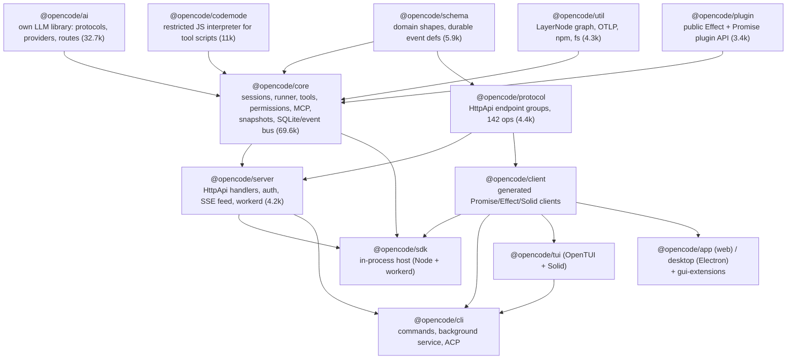

# OpenCode

> OpenCode at this pin is **OpenCode V2** (2.0.29). It is a ground-up rewrite on Effect 4 that replaced the V1 code this study's focus notes describe (`packages/opencode/src/session/*`, the AI SDK `streamText` loop, message→part tables, LSP diagnostics, share links). V2 is a local, multi-client **agent service**. One background server per user hosts many working directories. It persists every session as an **event-sourced SQLite log with transactional projections**, runs each turn as a process-local but crash-recoverable "drain", and exposes all of this through a 142-operation Effect `HttpApi`. The TUI, Electron desktop app, web UI, ACP bridge and an **in-process SDK** are all clients of that API. Almost every product feature is implemented as an internal plugin on the same plugin API third parties get: built-in tools, the agents, Plan mode, providers, compaction settings and policies. Model access no longer uses the Vercel AI SDK. It goes through OpenCode's own `@opencode/ai` library, with a bridge for AI SDK v6 provider packages. Build on it if you want a batteries-included coding agent you can drive from your own UI, embed in a Node or Cloudflare Durable Object host, or reshape with plugins. Avoid it if you need a small legible core, an OS sandbox, or API stability older than one month.

| | |
|---|---|
| Repo(s) | `anomalyco/opencode` @ `8ffbcc2c81d1` (default branch `dev`; formerly `sst/opencode`) |
| License | MIT |
| Language(s) | TypeScript on Effect 4.0.1 (`effect` catalog pin in root `package.json`). Bun-compiled CLI plus a Node 26 SEA build. SolidJS/OpenTUI TUI; Electron desktop |
| Size | 8,590 tracked files; ~573k non-test TS/TSX LOC repo-wide. **Harness core ≈ 136k LOC**: `core` 69.6k (incl. ~4.8k SQL migrations), `ai` 32.7k, `codemode` 11.0k, `schema` 5.9k, `protocol` 4.4k, `util` 4.3k, `server` 4.2k, `plugin` 3.4k. **Product/UI ≈ 360k**: `app` 133k, `tui` 62k, `gui-extensions` 58k, `ui` 36k, `session-ui` 23k, `console` 18.6k, `client` 17.2k (10.8k generated), `cli` 14.9k, `desktop` 12.1k. Tests: `core` 103k, `ai` 47k, `tui` 44k, `app` 44k |
| Version at pin | 2.0.29 (`CHANGELOG.md`, 2026-10-14) |
| Release history | Repo created 2025-04-30 → `v0.1.0` 2025-06-12 → `v1.0.0` 2025-10-31 → `v2.0.0` tag 2026-09-11 (Effect rewrite; npm `@opencode/cli`, `@opencode/sdk`) → `v1.19.0` 2026-10-11 (last V1; adds `opencode upgrade --major`) → `v2.0.29` 2026-10-14. V2 tags have **no GitHub Release objects** (`gh release view v2.0.0` → not found), so GitHub's "Latest" release is still V1. ~213k stars |
| Category | `hybrid` (see note below) |

**Classification note.** METHODOLOGY lists OpenCode as an `integrated-product`, which is accurate for V1. The V2 code is a deliberately layered product. The root `AGENTS.md` directs dependencies `Schema → Core/Protocol → Server`, forbids `Client` from depending on Core/Server, and has `sdk` compose `Client, Core, and Server`. `@opencode/sdk` and `@opencode/ai` are published as reusable libraries ([`AGENTS.md:L1-L4`](https://github.com/anomalyco/opencode/blob/8ffbcc2c81d1ff558618137204c36954797d7a6f/AGENTS.md#L1-L4)). That matches the `hybrid` definition. The product shell (TUI, desktop, Console) is still much larger than the reusable harness.

---

## 1. Layering & package map



Each layer owns the following:

* **`schema`** is the single source of public shapes and durable event payloads. `Event.durable({type, durable:{aggregate, version}, schema})` and `Event.ephemeral(...)` define every event type ([`packages/schema/src/event.ts:L90-L150`](https://github.com/anomalyco/opencode/blob/8ffbcc2c81d1ff558618137204c36954797d7a6f/packages/schema/src/event.ts#L90-L150)).
* **`core`** is the harness proper. All services are Effect `Layer`s wrapped in a `LayerNode` graph tagged `global` or `location` ([`packages/util/src/effect/app-node.ts:L1-L14`](https://github.com/anomalyco/opencode/blob/8ffbcc2c81d1ff558618137204c36954797d7a6f/packages/util/src/effect/app-node.ts#L1-L14)). A **Location** is `{directory, workspaceID?}` ([`packages/schema/src/location.ts:L8-L12`](https://github.com/anomalyco/opencode/blob/8ffbcc2c81d1ff558618137204c36954797d7a6f/packages/schema/src/location.ts#L8-L12)). Location-scoped services are tools, permissions, plugins, the runner, snapshots and MCP. They are built lazily per Location and cached in a `LayerMap` keyed by `Location.Ref` ([`packages/core/src/location-service-map.ts:L9-L18`](https://github.com/anomalyco/opencode/blob/8ffbcc2c81d1ff558618137204c36954797d7a6f/packages/core/src/location-service-map.ts#L9-L18)). One server process therefore serves many projects at once, each with its own service graph ([`packages/core/src/instance.ts:L90-L114`](https://github.com/anomalyco/opencode/blob/8ffbcc2c81d1ff558618137204c36954797d7a6f/packages/core/src/instance.ts#L90-L114)).
* **`protocol` + `server`** turn Core into an Effect `HttpApi` and serve OpenAPI at `/openapi.json` ([`packages/server/src/routes.ts:L177-L189`](https://github.com/anomalyco/opencode/blob/8ffbcc2c81d1ff558618137204c36954797d7a6f/packages/server/src/routes.ts#L177-L189)). The same router can be built without a password for embedding (`createEmbeddedRoutes`, [`routes.ts:L100-L106`](https://github.com/anomalyco/opencode/blob/8ffbcc2c81d1ff558618137204c36954797d7a6f/packages/server/src/routes.ts#L100-L106)).
* **`client`** is generated from the assembled `HttpApi` by the in-house `@opencode/httpapi-codegen`, not by an OpenAPI generator. `AGENTS.md` says "run `bun run generate` from `packages/client`. Do not edit generated client files". The generated Promise client is `client.ts` (2,309 lines) plus `types.ts` (6,830 lines).
* **Everything is a plugin.** `PluginInternal` registers ~35 internal plugins in `pre`/`post` order around user plugins. They include every built-in tool, `AgentPlugin`, `PlanPlugin`, provider plugins, model-specific prompt optimizers, and config-driven features such as compaction, snapshot, shell, MCP and policy ([`packages/core/src/plugin/internal.ts:L216-L274`](https://github.com/anomalyco/opencode/blob/8ffbcc2c81d1ff558618137204c36954797d7a6f/packages/core/src/plugin/internal.ts#L216-L274)).

V1 lineage: OpenCode's own tree no longer contains V1 session code. The Kilo Code fork still ships the V1-style `packages/opencode`, whose `session/llm.ts` imports `streamText` from `ai` ([Kilo `packages/opencode/src/session/llm.ts:L10`](https://github.com/Kilo-Org/kilocode/blob/4ee8d1b3b1f8cadefa925c9959dcbda7f87100da/packages/opencode/src/session/llm.ts#L10)). This confirms that V1 was an AI SDK loop and that V2 replaced it.

## 2. Agent loop

The loop is split across four cooperating pieces: **admission** (inbox), **execution ownership** (coordinator + write-ahead claim), the **drain loop** (`SessionRunner.drain`) and the **step attempt** (`SessionStep.attempt`).

```
client ── POST /api/session/:id/prompt ──► Session.prompt
            │  publish durable session.inbox.enqueued  (row in session_inbox, not yet model-visible)
            ▼
SessionExecution.wake(id) ──► SessionRunCoordinator (one busy-period fiber per session; wakes coalesce)
            │  publish session.execution.started  + commit write-ahead claim (session_v2.time_suspended)
            ▼
SessionRunner.drain ─ settle stale compactions/tool calls from a dead process
   loop:
     advanceToStep: handle control items (compaction | move) ─ promote steer/queue inbox items
                    (session.inbox.delivered → user message row) ─ fork title generation
     runStep(step):
       reload context from SQLite ─ auto-compact? ─ step-limit? ─ build request (+plugin hooks)
       SessionStep.attempt: stream LLMEvents; start each local tool fiber as soon as its call is published
       outcome ∈ {Completed, Retry, Continue, OutputLimit, Compacted, RecoverFull}
     until !needsContinuation and no promotable input
            ▼
session.execution.succeeded | failed | interrupted(reason)  + release claim (except shutdown)
```

**Admission.** A prompt is recorded as a durable `session.inbox.enqueued` fact before any execution is scheduled. Delivery is either `steer` (default; delivered at the next safe step boundary) or `queue` (delivered only at an idle boundary). Compaction and session moves travel through the same inbox as *control items* that steers cannot cross ([`specs/v2/session.md:L5-L23`](https://github.com/anomalyco/opencode/blob/8ffbcc2c81d1ff558618137204c36954797d7a6f/specs/v2/session.md#L5-L23)). `nextPromotable` always prefers the oldest pending steer and only considers queued items when the scope is `"input"` ([`packages/core/src/session/inbox.ts:L407-L425`](https://github.com/anomalyco/opencode/blob/8ffbcc2c81d1ff558618137204c36954797d7a6f/packages/core/src/session/inbox.ts#L407-L425)). The wire schema is `Delivery = "steer" | "queue"` ([`packages/schema/src/session-inbox.ts:L11-L12`](https://github.com/anomalyco/opencode/blob/8ffbcc2c81d1ff558618137204c36954797d7a6f/packages/schema/src/session-inbox.ts#L11-L12)).

**Ownership.** `SessionRunCoordinator` serializes execution per session ID and runs different sessions concurrently. A "doorbell" `wake` makes an active drain loop again instead of ending ([`packages/core/src/session/run-coordinator.ts:L6-L40`](https://github.com/anomalyco/opencode/blob/8ffbcc2c81d1ff558618137204c36954797d7a6f/packages/core/src/session/run-coordinator.ts#L6-L40)). `SessionExecution` publishes `Execution.Started` with a **write-ahead claim** committed in the same transaction. Success, failure and user interrupts release the claim. Shutdown interrupts deliberately keep it so the next boot resumes the turn ([`packages/core/src/session/execution.ts:L76-L150`](https://github.com/anomalyco/opencode/blob/8ffbcc2c81d1ff558618137204c36954797d7a6f/packages/core/src/session/execution.ts#L76-L150)). Interrupt reasons are `user | shutdown | superseded | inactivity` ([`packages/schema/src/session-event.ts:L239-L259`](https://github.com/anomalyco/opencode/blob/8ffbcc2c81d1ff558618137204c36954797d7a6f/packages/schema/src/session-event.ts#L239-L259)). `interrupt({resume:true})` re-wakes only steers and control items, so queued prompts stay parked ([`execution.ts:L156-L176`](https://github.com/anomalyco/opencode/blob/8ffbcc2c81d1ff558618137204c36954797d7a6f/packages/core/src/session/execution.ts#L156-L176)).

**Drain.** [`packages/core/src/session/runner/llm.ts:L57-L199`](https://github.com/anomalyco/opencode/blob/8ffbcc2c81d1ff558618137204c36954797d7a6f/packages/core/src/session/runner/llm.ts#L57-L199) first awaits plugin activation. It then fails any compaction left `running` and any tool call left `streaming`/`running` by a dead process ([`llm.ts:L332-L385`](https://github.com/anomalyco/opencode/blob/8ffbcc2c81d1ff558618137204c36954797d7a6f/packages/core/src/session/runner/llm.ts#L332-L385)), so ambiguous side effects are never replayed. `advanceToStep` runs under `uninterruptibleMask` and handles manual compaction and `move` control items. It promotes inbox input and forks title generation into a `FiberMap` so it never delays the model ([`llm.ts:L74-L189`](https://github.com/anomalyco/opencode/blob/8ffbcc2c81d1ff558618137204c36954797d7a6f/packages/core/src/session/runner/llm.ts#L74-L189)). The outer loop is just `advanceToStep → runStep → step++` ([`llm.ts:L191-L198`](https://github.com/anomalyco/opencode/blob/8ffbcc2c81d1ff558618137204c36954797d7a6f/packages/core/src/session/runner/llm.ts#L191-L198)).

**Step.** `runStep` ([`llm.ts:L209-L330`](https://github.com/anomalyco/opencode/blob/8ffbcc2c81d1ff558618137204c36954797d7a6f/packages/core/src/session/runner/llm.ts#L209-L330)) reloads context from the database on every physical attempt and runs auto-compaction. When the agent's `steps` limit is reached it appends `MAX_STEPS_PROMPT` and sets `toolChoice: "none"`, *keeping* tool definitions so the provider's cached prefix survives ([`llm.ts:L226-L247`](https://github.com/anomalyco/opencode/blob/8ffbcc2c81d1ff558618137204c36954797d7a6f/packages/core/src/session/runner/llm.ts#L226-L247); [`max-steps.ts:L1-L16`](https://github.com/anomalyco/opencode/blob/8ffbcc2c81d1ff558618137204c36954797d7a6f/packages/core/src/session/runner/max-steps.ts#L1-L16)). The six-way `Outcome` match encodes the recovery policy:

| Outcome | Trigger | Action |
|---|---|---|
| `Completed` | normal finish | continue if `needsContinuation` (tool results pending) |
| `Retry` | retryable error before any durable output | backoff, same assistant ID, no extra step charge |
| `Continue` | stream broke *after* durable output | keep partial, inject synthetic "continue from where you left off" ([`llm.ts:L35-L39`](https://github.com/anomalyco/opencode/blob/8ffbcc2c81d1ff558618137204c36954797d7a6f/packages/core/src/session/runner/llm.ts#L35-L39)), new assistant message |
| `OutputLimit` | `finish === "length"` | synthetic "break the remaining work into smaller pieces"; fails after three consecutive `length` finishes ([`llm.ts:L290-L319`](https://github.com/anomalyco/opencode/blob/8ffbcc2c81d1ff558618137204c36954797d7a6f/packages/core/src/session/runner/llm.ts#L290-L319)) |
| `Compacted` | provider context-overflow before output | one overflow compaction, rebuild same step |
| `RecoverFull` | transport says `retry-full` | one immediate full-context rebuild |

**Attempt and parallel tools.** `SessionStep.attempt` ([`packages/core/src/session/runner/step.ts:L73-L286`](https://github.com/anomalyco/opencode/blob/8ffbcc2c81d1ff558618137204c36954797d7a6f/packages/core/src/session/runner/step.ts#L73-L286)) forks a filesystem snapshot *concurrently* with the provider request ([`step.ts:L74-L76`](https://github.com/anomalyco/opencode/blob/8ffbcc2c81d1ff558618137204c36954797d7a6f/packages/core/src/session/runner/step.ts#L74-L76)). It consumes the `LLMEvent` stream and starts each non-provider-executed `tool-call` in its own scoped fiber **as soon as the call is durably published**, while the stream is still running. Tool output passes through `toolOutput.truncate` and then `publisher.toolExecution` ([`step.ts:L103-L138`](https://github.com/anomalyco/opencode/blob/8ffbcc2c81d1ff558618137204c36954797d7a6f/packages/core/src/session/runner/step.ts#L103-L138)). Settlement runs under `uninterruptibleMask`. If the stream was interrupted, tools are interrupted. User declines (`Permission.DeclinedError`, `QuestionTool.CancelledError`) are surfaced separately from defects by `classifyToolExits` and end the step with `Effect.interrupt` ([`step.ts:L207-L278`](https://github.com/anomalyco/opencode/blob/8ffbcc2c81d1ff558618137204c36954797d7a6f/packages/core/src/session/runner/step.ts#L207-L278), [`L297-L321`](https://github.com/anomalyco/opencode/blob/8ffbcc2c81d1ff558618137204c36954797d7a6f/packages/core/src/session/runner/step.ts#L297-L321)). A final snapshot computes the changed-file list and cost, and `session.step.ended` is published once ([`step.ts:L234-L261`](https://github.com/anomalyco/opencode/blob/8ffbcc2c81d1ff558618137204c36954797d7a6f/packages/core/src/session/runner/step.ts#L234-L261)). The spec states the design rule: "The runner never delegates orchestration to an in-memory tool loop" ([`specs/v2/session.md:L74-L80`](https://github.com/anomalyco/opencode/blob/8ffbcc2c81d1ff558618137204c36954797d7a6f/specs/v2/session.md#L74-L80)).

**Retries.** The schedule is jittered exponential from 2 s, capped at 10 s per gap, for `Schedule.recurs(10)`, i.e. up to 10 retries. Provider `retry-after` raises the delay up to 15 minutes, and timeout-class failures are capped at 3 retries ([`packages/core/src/session/runner/retry.ts:L32-L60`](https://github.com/anomalyco/opencode/blob/8ffbcc2c81d1ff558618137204c36954797d7a6f/packages/core/src/session/runner/retry.ts#L32-L60)). A plugin `session.retry` hook can override the decision. **Spec/code conflict:** `specs/v2/session.md` says "the initial request plus at most four retries" ([`L84`](https://github.com/anomalyco/opencode/blob/8ffbcc2c81d1ff558618137204c36954797d7a6f/specs/v2/session.md#L84)), but the code allows ten.

## 3. Model / provider abstraction

**Own library, not the AI SDK.** `@opencode/ai` is a schema-first Effect library with its own `LLMRequest`, `Message`, `LLMEvent`, `ToolDefinition` and `AIError` taxonomy. `LLM.generate`, `LLM.stream` and `LLM.generateObject` are its entry points. `generateObject` deliberately forces a synthetic `generate_object` tool call instead of provider JSON modes so behavior is uniform ([`packages/ai/src/llm.ts:L39-L84`](https://github.com/anomalyco/opencode/blob/8ffbcc2c81d1ff558618137204c36954797d7a6f/packages/ai/src/llm.ts#L39-L84), [`L156-L196`](https://github.com/anomalyco/opencode/blob/8ffbcc2c81d1ff558618137204c36954797d7a6f/packages/ai/src/llm.ts#L156-L196)). A model is bound to a *route*: protocol + endpoint + auth + framing, in `packages/ai/src/route/`. There are 49 protocol modules: OpenAI Chat/Responses, Anthropic Messages, Gemini, Google Interactions, Bedrock Converse with its own event-stream decoder, Mistral, Cohere, xAI, Z.ai, Alibaba, Meta, plus image, video, speech and transcription. There are 66 provider modules (~22k LOC combined). Its only runtime dependencies are AWS credential/signing helpers, `google-auth-library` and `effect` (`packages/ai/package.json`).

**AI SDK as a compatibility bridge.** The model catalog still names providers by AI SDK package (`npm: "@ai-sdk/anthropic"`). `AISDKNative` rewrites known packages to native routes, e.g. `@ai-sdk/anthropic → @opencode/ai/providers/anthropic` ([`packages/core/src/aisdk-native.ts:L59-L80`](https://github.com/anomalyco/opencode/blob/8ffbcc2c81d1ff558618137204c36954797d7a6f/packages/core/src/aisdk-native.ts#L59-L80)). It also rewrites per-host overrides, e.g. Moonshot or MiniMax `@ai-sdk/anthropic → providers/<host>/messages` ([`L88-L123`](https://github.com/anomalyco/opencode/blob/8ffbcc2c81d1ff558618137204c36954797d7a6f/packages/core/src/aisdk-native.ts#L88-L123)). Packages without a native route go through the `AISDK` bridge, which adapts a `LanguageModelV3` into an `@opencode/ai` model ([`packages/core/src/aisdk.ts:L228-L360`](https://github.com/anomalyco/opencode/blob/8ffbcc2c81d1ff558618137204c36954797d7a6f/packages/core/src/aisdk.ts#L228-L360)). `DynamicProviderPlugin` installs such packages at runtime through npm. An unversioned official `@ai-sdk/*` package is pinned to the `ai-v6` dist-tag "because the AI SDK bridge only supports AI SDK v6 providers" ([`packages/core/src/plugin/provider/sdk-factory.ts:L5-L24`](https://github.com/anomalyco/opencode/blob/8ffbcc2c81d1ff558618137204c36954797d7a6f/packages/core/src/plugin/provider/sdk-factory.ts#L5-L24), [`dynamic.ts:L6-L19`](https://github.com/anomalyco/opencode/blob/8ffbcc2c81d1ff558618137204c36954797d7a6f/packages/core/src/plugin/provider/dynamic.ts#L6-L19)). Plugins can intercept this through the `aisdk.sdk` / `aisdk.language` hooks ([`packages/plugin/src/effect/aisdk.ts:L5-L22`](https://github.com/anomalyco/opencode/blob/8ffbcc2c81d1ff558618137204c36954797d7a6f/packages/plugin/src/effect/aisdk.ts#L5-L22)).

**Catalog.** The catalog is models.dev, served from `https://models.opencode.ai`. A multi-MB snapshot is bundled as the boot-time floor ([`packages/core/src/models-dev.ts:L279-L295`](https://github.com/anomalyco/opencode/blob/8ffbcc2c81d1ff558618137204c36954797d7a6f/packages/core/src/models-dev.ts#L279-L295)) and refreshed every 5 minutes ([`L428-L433`](https://github.com/anomalyco/opencode/blob/8ffbcc2c81d1ff558618137204c36954797d7a6f/packages/core/src/models-dev.ts#L428-L433)). The pinned snapshot lists 226 providers. About 37 core provider plugins add auth or quirks, including GitHub Copilot, ChatGPT subscription, GitLab, Azure, Vertex ADC, Ollama, LM Studio, vLLM, SAP AI Core and Snowflake (`packages/core/src/plugin/provider/`).

**Request assembly.** `SessionModelRequest.prepare` builds the `LLMRequest` from `session.context` hook output. It attaches session-affinity headers (`x-opencode-session-id`, `x-session-affinity`, parent IDs) and a `promptCacheKey` derived from the session ([`packages/core/src/session/model-request.ts:L236-L302`](https://github.com/anomalyco/opencode/blob/8ffbcc2c81d1ff558618137204c36954797d7a6f/packages/core/src/session/model-request.ts#L236-L302)). It then runs the `model.request` hook (base URL and headers), optional `http.request`/`http.response` hooks that wrap every HTTP exchange, and experimental WebSocket hooks for models whose transport is a session-scoped socket ([`L305-L392`](https://github.com/anomalyco/opencode/blob/8ffbcc2c81d1ff558618137204c36954797d7a6f/packages/core/src/session/model-request.ts#L305-L392)).

**Prompt caching** is automatic. The default `"auto"` policy places up to four ephemeral breakpoints: last tool, first and last distinct system parts, and the conversation tail. Only protocols that honor inline hints get them. Gateway routes (OpenRouter, Vercel) get per-upstream policies, because a tail breakpoint on Gemini "writes a new cache every step and costs more than none" ([`packages/ai/src/cache-policy.ts:L1-L68`](https://github.com/anomalyco/opencode/blob/8ffbcc2c81d1ff558618137204c36954797d7a6f/packages/ai/src/cache-policy.ts#L1-L68)). Cache preservation shows up across the harness: the final step keeps tools, Plan reminders are appended near the tail, and date changes are emitted as chronological deltas rather than edits to the system prompt (§5).

**Reasoning and cost.** Assistant content has first-class `reasoning` parts with opaque provider `state` (signatures), plus `providerState` on messages and tools ([`packages/schema/src/session-message.ts:L161-L237`](https://github.com/anomalyco/opencode/blob/8ffbcc2c81d1ff558618137204c36954797d7a6f/packages/schema/src/session-message.ts#L161-L237)). Reasoning effort is selected through model *variants* (`provider/model#variant`). Cost is computed per step from models.dev pricing, including context-size tiers and cache read/write rates ([`packages/core/src/session/usage.ts:L21-L36`](https://github.com/anomalyco/opencode/blob/8ffbcc2c81d1ff558618137204c36954797d7a6f/packages/core/src/session/usage.ts#L21-L36)), and accumulated on the `session_v2` row.

**Model-specific behavior lives in plugins.** `OptimizePlugin` swaps the base system prompt for GPT (`gpt.txt`/`gpt-astra.txt`), Kimi, Arcee and Meta models, and *appends* `anthropic.txt` for Claude ([`packages/core/src/plugin/optimize.ts:L16-L29`](https://github.com/anomalyco/opencode/blob/8ffbcc2c81d1ff558618137204c36954797d7a6f/packages/core/src/plugin/optimize.ts#L16-L29)). `PatchTool` gives GPT-5-class models `patch` (apply_patch) and removes `edit`/`write`; everyone else gets `edit`/`write` ([`packages/core/src/tool/plugin/patch.ts:L296-L306`](https://github.com/anomalyco/opencode/blob/8ffbcc2c81d1ff558618137204c36954797d7a6f/packages/core/src/tool/plugin/patch.ts#L296-L306)).

## 4. Tool system

**Definition API.** A tool is `Tool.make({description, input, output?, execute})`. Schemas may be Effect Schema or any Standard Schema with Standard JSON Schema. A response carries three values: a validated `output` (the machine value, seen only by Code Mode), model-facing `content` (stored durably), and optional compact `metadata` for UI ([`specs/v2/tools.md:L5-L27`](https://github.com/anomalyco/opencode/blob/8ffbcc2c81d1ff558618137204c36954797d7a6f/specs/v2/tools.md#L5-L27)). Every call receives `{sessionID, agent, messageID, callID, progress}` ([`tools.md:L29-L47`](https://github.com/anomalyco/opencode/blob/8ffbcc2c81d1ff558618137204c36954797d7a6f/specs/v2/tools.md#L29-L47)). Registration is scope-owned with "latest active registration wins" overlay semantics ([`tools.md:L49-L82`](https://github.com/anomalyco/opencode/blob/8ffbcc2c81d1ff558618137204c36954797d7a6f/specs/v2/tools.md#L49-L82)).

**Built-in tools.** All are registered by internal plugins ([`internal.ts:L231-L249`](https://github.com/anomalyco/opencode/blob/8ffbcc2c81d1ff558618137204c36954797d7a6f/packages/core/src/plugin/internal.ts#L231-L249)):

| Tool | Exposure | Notes |
|---|---|---|
| `read` | direct | text/images/PDF/dir listings; injects nested `AGENTS.md` on read |
| `write`, `edit` | direct | `permission: "edit"`; non-GPT models |
| `patch` | direct | apply_patch format; GPT-5-class models |
| `glob`, `grep` | direct | ripgrep / `fff` search |
| `shell` | direct | tree-sitter–parsed approvals, background jobs, 2 min default timeout |
| `webfetch`, `websearch` | direct | websearch providers: Exa, Firecrawl, Parallel, Tavily, TinyFish, MCP |
| `question` | direct | structured question to the user (forms) |
| `skill` | direct | loads a skill into context |
| `subagent` | direct | child sessions (§9) |
| `execute` | direct | **Code Mode**: runs a JS-like program that calls every `codemode` tool |
| `opencode.session_rename/session_move/worktree_create/list/remove/models` | Code Mode only | namespace `opencode`, `codemode: true` ([`opencode.ts:L103-L187`](https://github.com/anomalyco/opencode/blob/8ffbcc2c81d1ff558618137204c36954797d7a6f/packages/core/src/tool/plugin/opencode.ts#L103-L187)) |
| `list_mcp_resources`, `read_mcp_resource` | Code Mode only | |
| MCP tools | Code Mode by default | `codemode: tool.codemode !== false` |

V1's `todowrite`, `list` and `lsp` tools do not exist in V2.

**Code Mode is the default exposure path.** At request time `Tool.snapshot` splits tools into `direct` (`codemode === false`) and Code Mode tools. The latter are not advertised individually but hidden behind a single `execute` tool with a rendered catalog ([`packages/core/src/tool.ts:L225-L290`](https://github.com/anomalyco/opencode/blob/8ffbcc2c81d1ff558618137204c36954797d7a6f/packages/core/src/tool.ts#L225-L290)). The name `execute` is reserved ([`L313-L314`](https://github.com/anomalyco/opencode/blob/8ffbcc2c81d1ff558618137204c36954797d7a6f/packages/core/src/tool.ts#L313-L314)). `@opencode/codemode` is not a JS sandbox. It is "a lightweight, pure interpreter for a JavaScript-like language built around calling tools", with no network, filesystem or process access except through host tools ([`packages/codemode/README.md:L1-L10`](https://github.com/anomalyco/opencode/blob/8ffbcc2c81d1ff558618137204c36954797d7a6f/packages/codemode/README.md#L1-L10)). A defaults plugin disables OpenCode Code Mode for MCP servers that are already Code Mode, such as `executor.sh`, and forces PostHog's MCP into "tools" mode so the two are never nested ([`packages/core/src/plugin/mcp-codemode-defaults.ts:L1-L40`](https://github.com/anomalyco/opencode/blob/8ffbcc2c81d1ff558618137204c36954797d7a6f/packages/core/src/plugin/mcp-codemode-defaults.ts#L1-L40)).

**Execution pipeline.** Per call the registry:

1. runs `tool.execute.before`, which may rewrite input or fail with `Tool.Error`;
2. verifies the name was advertised in *this* request;
3. decodes input;
4. executes with the runner-supplied context;
5. encodes output and normalizes content;
6. runs `tool.execute.after`.

([`tool.ts:L263-L284`](https://github.com/anomalyco/opencode/blob/8ffbcc2c81d1ff558618137204c36954797d7a6f/packages/core/src/tool.ts#L263-L284); [`tools.md:L127-L146`](https://github.com/anomalyco/opencode/blob/8ffbcc2c81d1ff558618137204c36954797d7a6f/specs/v2/tools.md#L127-L146)). Permission decisions are made *inside* trusted tools via `permission.assert`. The registry does not inject approvals.

**Output truncation and spill.** Text content over 2,000 lines or 50 KiB is cut, and the full text is written to `<data>/tool-output/tool_<id>` with a `[showing lines 1-N of M; full output saved to …]` marker. Retention is 7 days with hourly cleanup ([`packages/core/src/tool-output.ts:L13-L16`](https://github.com/anomalyco/opencode/blob/8ffbcc2c81d1ff558618137204c36954797d7a6f/packages/core/src/tool-output.ts#L13-L16), [`L67-L118`](https://github.com/anomalyco/opencode/blob/8ffbcc2c81d1ff558618137204c36954797d7a6f/packages/core/src/tool-output.ts#L67-L118)). **Spec/code conflict:** `tools.md` says "the default cut keeps a head-plus-tail split with the omission marker in the middle" ([`L152`](https://github.com/anomalyco/opencode/blob/8ffbcc2c81d1ff558618137204c36954797d7a6f/specs/v2/tools.md#L152)). The implementation keeps the **head only**.

**The shell tool** is notable. Commands go through `shell.create` with a `create.before` plugin hook. Env markers `AGENT=1`, `OPENCODE=1` and `OPENCODE_SESSION_ID` are set. Each command runs as a `Job` with crash-recovery metadata. `background: true`, or a user "background" action mid-run, detaches it, and completion arrives later as a **synthetic message** that wakes the session. The model is told not to poll ([`packages/core/src/tool/plugin/shell.ts:L157-L272`](https://github.com/anomalyco/opencode/blob/8ffbcc2c81d1ff558618137204c36954797d7a6f/packages/core/src/tool/plugin/shell.ts#L157-L272)).

## 5. Context management

**System prompt.** The base prompt is 15 lines ([`packages/core/src/session/runner/prompt/system.txt`](https://github.com/anomalyco/opencode/blob/8ffbcc2c81d1ff558618137204c36954797d7a6f/packages/core/src/session/runner/prompt/system.txt)) with tool-dependent guidance spliced in ([`packages/core/src/session/system-prompt.ts:L5-L28`](https://github.com/anomalyco/opencode/blob/8ffbcc2c81d1ff558618137204c36954797d7a6f/packages/core/src/session/system-prompt.ts#L5-L28)). Model-specific prompt plugins may replace it (§3), and an agent's own `system` overrides both.

**Instructions are content-addressed value deltas, not a rebuilt system prompt.** Each instruction source has a key, a codec, and `render.initial`/`render.changed`. Built-in sources are `core/date` and `core/environment` ([`packages/core/src/instructions/builtins.ts:L21-L54`](https://github.com/anomalyco/opencode/blob/8ffbcc2c81d1ff558618137204c36954797d7a6f/packages/core/src/instructions/builtins.ts#L21-L54)). Further sources are AGENTS.md discovery, selected-agent skill guidance, references, MCP server instructions and API-managed instruction entries. Before each physical attempt the runner reads all sources, hashes them (SHA-256 into `instruction_blob`), and admits one `session.instructions.updated {delta, text?}` event. The first delta forms the baseline. Later changes are rendered **once** as a chronological `System` message ("Today's date is now: …", or a unified diff of a changed AGENTS.md when shorter) instead of mutating the cached prefix ([`specs/v2/session.md:L90-L96`](https://github.com/anomalyco/opencode/blob/8ffbcc2c81d1ff558618137204c36954797d7a6f/specs/v2/session.md#L90-L96); [`packages/core/src/instruction-discovery.ts:L123-L149`](https://github.com/anomalyco/opencode/blob/8ffbcc2c81d1ff558618137204c36954797d7a6f/packages/core/src/instruction-discovery.ts#L123-L149); [`packages/schema/src/session-event.ts:L261-L275`](https://github.com/anomalyco/opencode/blob/8ffbcc2c81d1ff558618137204c36954797d7a6f/packages/schema/src/session-event.ts#L261-L275)).

**Project instruction files.** Only `AGENTS.md` is loaded: `<config>/AGENTS.md` (global) plus every `AGENTS.md` from the Location up to the project root, or up to `$HOME`. Files are watched and re-read after 100 ms debouncing ([`packages/core/src/config/plugin/instruction.ts:L36-L118`](https://github.com/anomalyco/opencode/blob/8ffbcc2c81d1ff558618137204c36954797d7a6f/packages/core/src/config/plugin/instruction.ts#L36-L118)). Deeper `AGENTS.md` files are injected lazily as durable synthetic instructions when `read` touches a file beneath them ([`packages/core/src/tool/plugin/read.ts:L82-L91`](https://github.com/anomalyco/opencode/blob/8ffbcc2c81d1ff558618137204c36954797d7a6f/packages/core/src/tool/plugin/read.ts#L82-L91)). `CLAUDE.md` is *not* an instruction source in V2. `.claude/` and `.agents/` directories are honored only for skills (§8).

**Compaction** ([`packages/core/src/session/compaction.ts`](https://github.com/anomalyco/opencode/blob/8ffbcc2c81d1ff558618137204c36954797d7a6f/packages/core/src/session/compaction.ts), 963 LOC):

* *Trigger.* Before every step, `due()` compares an estimate (the provider-measured prompt at the last assistant response plus estimated text since) to a ceiling of `window − max(10% of window, 16k)`, or `window − buffer` if configured. Unknown windows never auto-compact ([`L242-L251`](https://github.com/anomalyco/opencode/blob/8ffbcc2c81d1ff558618137204c36954797d7a6f/packages/core/src/session/compaction.ts#L242-L251), [`L905-L912`](https://github.com/anomalyco/opencode/blob/8ffbcc2c81d1ff558618137204c36954797d7a6f/packages/core/src/session/compaction.ts#L905-L912)). Defaults are `{auto: true, keep: 15_000}` tokens of verbatim recent context ([`L195-L203`](https://github.com/anomalyco/opencode/blob/8ffbcc2c81d1ff558618137204c36954797d7a6f/packages/core/src/session/compaction.ts#L195-L203)).
* *Algorithm.* This is a rolling checkpoint. Older exchanges plus the previous summary are summarized into a fixed template: Objective / Requirements / Decisions / Work State {Completed, Active, Blocked} / Next Move / Relevant Files (≤15) / Important Context. The newest `keep` tokens are retained as `<recent-context>` text. Later requests open with one `<conversation-checkpoint>` user message ([`L104-L135`](https://github.com/anomalyco/opencode/blob/8ffbcc2c81d1ff558618137204c36954797d7a6f/packages/core/src/session/compaction.ts#L104-L135), [`L253-L310`](https://github.com/anomalyco/opencode/blob/8ffbcc2c81d1ff558618137204c36954797d7a6f/packages/core/src/session/compaction.ts#L253-L310)). A reply that skips the template gets one "nudge" before failing. A "payload too large" rejection retries at 70/50/35 % of the size ([`L95`](https://github.com/anomalyco/opencode/blob/8ffbcc2c81d1ff558618137204c36954797d7a6f/packages/core/src/session/compaction.ts#L95)). The summary prompt tells the model to *omit* AGENTS.md and environment detail, because those are re-supplied as instructions ([`L145-L152`](https://github.com/anomalyco/opencode/blob/8ffbcc2c81d1ff558618137204c36954797d7a6f/packages/core/src/session/compaction.ts#L145-L152)).
* *Native compaction.* Models declaring `compaction.type === "native"` use the provider's own context compaction (`llm.compact`) and store an opaque provider window, guarded by provenance checks ([`L213-L233`](https://github.com/anomalyco/opencode/blob/8ffbcc2c81d1ff558618137204c36954797d7a6f/packages/core/src/session/compaction.ts#L213-L233); [`model-request.ts:L321-L335`](https://github.com/anomalyco/opencode/blob/8ffbcc2c81d1ff558618137204c36954797d7a6f/packages/core/src/session/model-request.ts#L321-L335)).
* The full transcript remains durable. Compaction only changes *active* history. A hidden `compaction` agent can be pointed at a cheaper model, and the `session.compaction` plugin hook can supply a result and skip the model call entirely.

**Memory.** There is no built-in long-term memory. Third parties fill the gap, e.g. Mastra's `@mastra/opencode` "OpenCode plugin for Mastra Observational Memory", which targets the **V1** plugin API ([Mastra `integrations/opencode/package.json:L1-L5`](https://github.com/mastra-ai/mastra/blob/a68b1a4950334fbfb08ede44237150970dac271b/integrations/opencode/package.json#L1-L5), [`L54-L56`](https://github.com/mastra-ai/mastra/blob/a68b1a4950334fbfb08ede44237150970dac271b/integrations/opencode/package.json#L54-L56)).

## 6. State, sessions & durability

**Storage.** Storage is a single SQLite database (`opencode.db`, or `opencode-<channel>.db`, overridable via `OPENCODE_DB`) opened in WAL mode with `busy_timeout = 5000` through Drizzle ([`packages/cli/src/database-path.ts:L4-L13`](https://github.com/anomalyco/opencode/blob/8ffbcc2c81d1ff558618137204c36954797d7a6f/packages/cli/src/database-path.ts#L4-L13); [`packages/core/src/database/database.ts:L40-L42`](https://github.com/anomalyco/opencode/blob/8ffbcc2c81d1ff558618137204c36954797d7a6f/packages/core/src/database/database.ts#L40-L42)). Bun, Node and Cloudflare Durable Object SQLite drivers exist (`database/sqlite.{bun,node,workerd}.ts`).

**Event sourcing.** Durable events have `{aggregateID, seq, version}` envelopes. `Bus.publish` runs, inside one `IMMEDIATE` transaction:

1. reads the aggregate's sequence;
2. runs every registered **projector** for that `type.version`;
3. bumps `event_sequence`;
4. appends to the `event` table.

Only then does it wake live subscribers. Replays are idempotent and detect divergence ("Replay diverged at aggregate … sequence …") and owner mismatch ([`packages/core/src/bus.ts:L314-L446`](https://github.com/anomalyco/opencode/blob/8ffbcc2c81d1ff558618137204c36954797d7a6f/packages/core/src/bus.ts#L314-L446); [`packages/core/src/event/sql.ts:L1-L26`](https://github.com/anomalyco/opencode/blob/8ffbcc2c81d1ff558618137204c36954797d7a6f/packages/core/src/event/sql.ts#L1-L26)). Text, reasoning and tool-input deltas are *ephemeral* and never stored. `session.log({after, follow})` replays durable session events from a sequence cursor with a sync marker, and is exposed as `GET /api/experimental/session/:id/log` ([`specs/v2/session.md:L106-L112`](https://github.com/anomalyco/opencode/blob/8ffbcc2c81d1ff558618137204c36954797d7a6f/specs/v2/session.md#L106-L112); [`packages/protocol/src/groups/session.ts:L726`](https://github.com/anomalyco/opencode/blob/8ffbcc2c81d1ff558618137204c36954797d7a6f/packages/protocol/src/groups/session.ts#L726)).

**Data model.** V2 replaced V1's session → message → **part** tables with **session → message**. A message is one of 11 tagged types: `agent-switched`, `model-switched`, `location-switched`, `user`, `synthetic`, `system`, `skill`, `shell`, `assistant`, `compaction`, `idle`. The `assistant` type holds an ordered `content[]` of `text | reasoning | tool`, and each tool carries a `streaming → running → completed | error` state machine ([`packages/schema/src/session-message.ts:L126-L159`](https://github.com/anomalyco/opencode/blob/8ffbcc2c81d1ff558618137204c36954797d7a6f/packages/schema/src/session-message.ts#L126-L159), [`L297-L321`](https://github.com/anomalyco/opencode/blob/8ffbcc2c81d1ff558618137204c36954797d7a6f/packages/schema/src/session-message.ts#L297-L321)). Projected tables are `session_v2` (cost, tokens, revert, permissions, execution claim `time_suspended`, `resume_attempts`), `session_message` (`seq`-ordered JSON rows), `session_pending`, `session_inbox`, `instruction_*`, `permission`, `project`, `worktree` and `workspace` ([`packages/core/src/session/sql.ts:L22-L98`](https://github.com/anomalyco/opencode/blob/8ffbcc2c81d1ff558618137204c36954797d7a6f/packages/core/src/session/sql.ts#L22-L98)). A V1 migrator reads the old `message`/`part` rows and transforms them ([`packages/core/src/database/v1-migration.bun.ts:L18-L38`](https://github.com/anomalyco/opencode/blob/8ffbcc2c81d1ff558618137204c36954797d7a6f/packages/core/src/database/v1-migration.bun.ts#L18-L38)).

**Crash recovery.** `SessionRestart.resumeSuspendedSessions` scans for unreleased claims at boot. It counts the resume attempt *durably before* resuming. A turn that dies more than 10 times is terminalized with "interrupted repeatedly and will not be resumed automatically" ([`packages/core/src/session/execution/restart.ts:L15-L33`](https://github.com/anomalyco/opencode/blob/8ffbcc2c81d1ff558618137204c36954797d7a6f/packages/core/src/session/execution/restart.ts#L15-L33)). Resumed turns get a synthetic "The server restarted while you were working" message. Background shell jobs and subagent jobs are also recovered and their outcomes delivered. The code says plainly "Recovery is at-least-once" ([`restart.ts:L46-L63`](https://github.com/anomalyco/opencode/blob/8ffbcc2c81d1ff558618137204c36954797d7a6f/packages/core/src/session/execution/restart.ts#L46-L63)). The embedded SDK defaults to `database.path = ":memory:"`; configure persistent storage before relying on restart recovery ([`host.ts:L34-L42`](https://github.com/anomalyco/opencode/blob/8ffbcc2c81d1ff558618137204c36954797d7a6f/packages/sdk/src/internal/host.ts#L34-L42)). It starts the same sweep on creation ([`packages/sdk/src/internal/host.ts:L54-L56`](https://github.com/anomalyco/opencode/blob/8ffbcc2c81d1ff558618137204c36954797d7a6f/packages/sdk/src/internal/host.ts#L54-L56)).

**Snapshots and undo use a separate git directory.** `Snapshot` creates a private git repository at `<data>/snapshot/<projectID>/<hash(worktree)>`, seeded from the project's repository, and captures **trees** rather than commits. Untracked files are capped at 2 MiB, and objects are packed at most every 10 minutes under a cross-process lock ([`packages/core/src/snapshot.ts:L90-L143`](https://github.com/anomalyco/opencode/blob/8ffbcc2c81d1ff558618137204c36954797d7a6f/packages/core/src/snapshot.ts#L90-L143)). Every step records `snapshot.{start, end, files}` on the assistant message. Revert is a three-phase durable operation. `stage(messageID)` restores, for each file changed by later assistant steps, the tree from that step's start and records the diff. `clear` restores the pre-revert state. `commit` publishes `session.revert.committed`, which truncates history ([`packages/core/src/session/revert.ts:L21-L114`](https://github.com/anomalyco/opencode/blob/8ffbcc2c81d1ff558618137204c36954797d7a6f/packages/core/src/session/revert.ts#L21-L114)). Snapshots are per step, not per edit. `FileMutation` still lists "Add snapshots / undo" and multi-file rollback as TODOs, so a failed multi-hunk `patch` reports partial application ([`packages/core/src/file-mutation.ts:L127-L133`](https://github.com/anomalyco/opencode/blob/8ffbcc2c81d1ff558618137204c36954797d7a6f/packages/core/src/file-mutation.ts#L127-L133)).

**Fork and move.** `session.fork` copies messages up to a boundary and adopts the parent's newest instruction values as its baseline ([`packages/core/src/session.ts:L319-L359`](https://github.com/anomalyco/opencode/blob/8ffbcc2c81d1ff558618137204c36954797d7a6f/packages/core/src/session.ts#L319-L359)). `session.move` relocates a live session to another directory or worktree at the next safe boundary as an inbox control item. Export and import exist under `experimental.session.*`.

## 7. Safety & sandboxing

**Permission model.** A rule is `{action, resource, effect: allow|deny|ask}` ([`packages/schema/src/permission.ts:L56-L67`](https://github.com/anomalyco/opencode/blob/8ffbcc2c81d1ff558618137204c36954797d7a6f/packages/schema/src/permission.ts#L56-L67)). Evaluation is **last-match-wins** over wildcard `action` and `resource`, and an unmatched request defaults to `ask` ([`packages/core/src/permission.ts:L87-L97`](https://github.com/anomalyco/opencode/blob/8ffbcc2c81d1ff558618137204c36954797d7a6f/packages/core/src/permission.ts#L87-L97)). The effective ruleset is the agent ruleset followed by the session ruleset. Configured `deny` is checked *before* saved approvals, so an "always" approval cannot override a deny. The `permission.evaluate` plugin hook has the final word ([`permission.ts:L158-L189`](https://github.com/anomalyco/opencode/blob/8ffbcc2c81d1ff558618137204c36954797d7a6f/packages/core/src/permission.ts#L158-L189)). `ask` creates a pending request (`permission.asked` event) and parks the fiber on a `Deferred`. Replies are `once | always | reject`:

* `always` persists `save` patterns per project in SQLite and resolves any other pending request that now evaluates to `allow`.
* `reject` cascades to every pending request in the session.
* `reject` *with a message* becomes `CorrectedError`, which surfaces as model-visible feedback so the turn continues.
* A plain decline is "tunnelled" as a defect so no tool can turn a user's "no" into model output ([`permission.ts:L231-L325`](https://github.com/anomalyco/opencode/blob/8ffbcc2c81d1ff558618137204c36954797d7a6f/packages/core/src/permission.ts#L231-L325); recovered at [`model-request.ts:L400-L418`](https://github.com/anomalyco/opencode/blob/8ffbcc2c81d1ff558618137204c36954797d7a6f/packages/core/src/session/model-request.ts#L400-L418)).

**Resources are derived semantically.** The shell tool parses commands with tree-sitter (bash/PowerShell WASM) into per-command resources, plus the directories they touch. It asserts `external_directory` for anything outside the Location and then `shell` for the commands. Approval is re-validated just before spawn ([`packages/core/src/tool/plugin/shell.ts:L117-L155`](https://github.com/anomalyco/opencode/blob/8ffbcc2c81d1ff558618137204c36954797d7a6f/packages/core/src/tool/plugin/shell.ts#L117-L155)). File tools resolve paths and gate out-of-tree access with `external_directory`, saving at the containing project root ([`packages/core/src/file-access.ts:L105-L161`](https://github.com/anomalyco/opencode/blob/8ffbcc2c81d1ff558618137204c36954797d7a6f/packages/core/src/file-access.ts#L105-L161)). A tool whose action is wholly denied (`action, "*", deny`) is removed from the advertised set ([`tool.ts:L292-L295`](https://github.com/anomalyco/opencode/blob/8ffbcc2c81d1ff558618137204c36954797d7a6f/packages/core/src/tool.ts#L292-L295)).

**Defaults are permissive.** `Agent.Info.default` is `allow *` except `ask` on `*.env`/`*.env.*` reads ([`packages/schema/src/agent.ts:L39-L54`](https://github.com/anomalyco/opencode/blob/8ffbcc2c81d1ff558618137204c36954797d7a6f/packages/schema/src/agent.ts#L39-L54)). The Build agent therefore runs shell and edits without prompting unless the user configures `permissions`. Plan mode denies `edit` except under `~/.opencode/plan/*`. Explore starts from `deny *` and re-allows `read`, `grep`, `glob`, `webfetch`, `websearch` and `shell`. Shell stays "read-only" only through its prompt, not through enforcement ([`packages/core/src/plugin/agent.ts:L98-L118`](https://github.com/anomalyco/opencode/blob/8ffbcc2c81d1ff558618137204c36954797d7a6f/packages/core/src/plugin/agent.ts#L98-L118)). `--auto`/`--yolo`/`--dangerously-skip-permissions` are client-side. The TUI simply replies `once` to every `ask` it sees ([`packages/tui/src/routes/session/index.tsx:L261-L278`](https://github.com/anomalyco/opencode/blob/8ffbcc2c81d1ff558618137204c36954797d7a6f/packages/tui/src/routes/session/index.tsx#L261-L278); [`packages/cli/src/commands/handlers/default.ts:L117`](https://github.com/anomalyco/opencode/blob/8ffbcc2c81d1ff558618137204c36954797d7a6f/packages/cli/src/commands/handlers/default.ts#L117)), so `deny` rules still apply.

**Policy layer.** Separate from permissions, `policies` statements cover `provider.use`, `tool.use` (`<action>:<resource>`) and `integration.use` (`mcp:`, `skill:`, `plugin:`). A terminal plugin applies them by removing providers, MCP servers and skills and forcing `deny` in `permission.evaluate`. Policy can only deny, never grant ([`packages/core/src/config/plugin/policy.ts:L11-L64`](https://github.com/anomalyco/opencode/blob/8ffbcc2c81d1ff558618137204c36954797d7a6f/packages/core/src/config/plugin/policy.ts#L11-L64); [`specs/v2/provider-policy.md:L1-L40`](https://github.com/anomalyco/opencode/blob/8ffbcc2c81d1ff558618137204c36954797d7a6f/specs/v2/provider-policy.md#L1-L40)). Statements are layered: repository < user < organization. Organization statements come from the OpenCode Console connection (`opencode.ai/console`, device-auth, SSO-aware), from macOS MDM plists (`ai.opencode.managed`), or from a system directory (`/etc/opencode`, `%ProgramData%\opencode`) ([`packages/core/src/config/discovery.ts:L27-L40`](https://github.com/anomalyco/opencode/blob/8ffbcc2c81d1ff558618137204c36954797d7a6f/packages/core/src/config/discovery.ts#L27-L40); [`packages/core/src/plugin/provider/opencode.ts:L20-L57`](https://github.com/anomalyco/opencode/blob/8ffbcc2c81d1ff558618137204c36954797d7a6f/packages/core/src/plugin/provider/opencode.ts#L20-L57)). Repository config cannot remove the policy or Console plugins (`guarded` IDs, [`internal.ts:L272-L274`](https://github.com/anomalyco/opencode/blob/8ffbcc2c81d1ff558618137204c36954797d7a6f/packages/core/src/plugin/internal.ts#L272-L274)).

**Isolation boundaries:**

* **No OS sandbox.** A grep finds no seatbelt, bubblewrap, landlock or seccomp, and no network egress policy.
* **No plugin isolation.** Plugins load in-process with full authority. npm packages are installed and `import()`ed ([`packages/core/src/plugin/module.ts:L98-L134`](https://github.com/anomalyco/opencode/blob/8ffbcc2c81d1ff558618137204c36954797d7a6f/packages/core/src/plugin/module.ts#L98-L134)). Code Mode programs are confined, but only to the tools they are given.
* **Isolation seam: Workspace/Environment drivers.** A `WorkspaceDriver` provisions a remote resource and returns an `EnvironmentDriver {spawner, files overrides}`. All process spawns and file operations of a Location bound to that workspace then run remotely ([`packages/core/src/workspace/driver.ts:L26-L62`](https://github.com/anomalyco/opencode/blob/8ffbcc2c81d1ff558618137204c36954797d7a6f/packages/core/src/workspace/driver.ts#L26-L62); [`packages/core/src/environment/environment.ts:L18-L40`](https://github.com/anomalyco/opencode/blob/8ffbcc2c81d1ff558618137204c36954797d7a6f/packages/core/src/environment/environment.ts#L18-L40)). No provider ships in this repo, and workspaces were removed from the public V2 HTTP API; they are SDK-only (`V2_HTTP_API_AUDIT.md`).

**Server auth.** When a password is set the server uses basic auth (`opencode` user). Pairing links mint HMAC-signed 30-day session tokens keyed from the password, so rotating the password revokes them ([`packages/server/src/auth.ts:L16-L61`](https://github.com/anomalyco/opencode/blob/8ffbcc2c81d1ff558618137204c36954797d7a6f/packages/server/src/auth.ts#L16-L61)).

## 8. Extensibility

**Plugin API.** One definition shape is offered in two flavors: Effect `define({id, effect: (ctx) => …})` and Promise `Plugin.define({id, setup: async (ctx) => cleanup})`, adapted by `PluginPromise.fromPromise` ([`packages/plugin/src/effect/plugin.ts:L26-L64`](https://github.com/anomalyco/opencode/blob/8ffbcc2c81d1ff558618137204c36954797d7a6f/packages/plugin/src/effect/plugin.ts#L26-L64); [`packages/plugin/src/README.md`](https://github.com/anomalyco/opencode/blob/8ffbcc2c81d1ff558618137204c36954797d7a6f/packages/plugin/src/README.md)). `ctx` exposes 20+ domains. Two kinds of hook exist:

* **Transforms** are synchronous editors over stateful catalogs and can be re-run via `reload()`. They cover `agent, command, integration, mcp, model, provider, reference, skill, tool, vcs, websearch`.
* **Runtime hooks** are mutable-event interceptors, dispatched in registration order. Optionally they are scoped to one `providerID` ([`packages/core/src/plugin/hooks.ts:L13-L19`](https://github.com/anomalyco/opencode/blob/8ffbcc2c81d1ff558618137204c36954797d7a6f/packages/core/src/plugin/hooks.ts#L13-L19), [`L88-L95`](https://github.com/anomalyco/opencode/blob/8ffbcc2c81d1ff558618137204c36954797d7a6f/packages/core/src/plugin/hooks.ts#L88-L95); [`packages/plugin/src/effect/registration.ts:L7-L27`](https://github.com/anomalyco/opencode/blob/8ffbcc2c81d1ff558618137204c36954797d7a6f/packages/plugin/src/effect/registration.ts#L7-L27)).

| Domain | Runtime hook events | Can do |
|---|---|---|
| `session` | `prompt`, `context`, `compaction`, `generate`, `title`, `model.request`, `http.request`, `http.response`, `experimental.ws.handshake/send/receive`, `retry` | rewrite prompt/delivery; edit system, messages, tool descriptions, delete tools, set generation/provider options; supply a compaction result or title and skip the model; change base URL/headers; rewrite raw HTTP or WS frames; veto/redelay retries ([`packages/plugin/src/effect/session.ts:L14-L151`](https://github.com/anomalyco/opencode/blob/8ffbcc2c81d1ff558618137204c36954797d7a6f/packages/plugin/src/effect/session.ts#L14-L151)) |
| `tool` | `execute.before` (may fail with `Tool.Error`), `execute.after` | rewrite input / reject; rewrite result or error ([`packages/plugin/src/effect/tool.ts:L20-L52`](https://github.com/anomalyco/opencode/blob/8ffbcc2c81d1ff558618137204c36954797d7a6f/packages/plugin/src/effect/tool.ts#L20-L52)) |
| `permission` | `evaluate` | override `allow/ask/deny` + message; plugins also get `ctx.permission.assert` ([`packages/plugin/src/effect/permission.ts:L10-L33`](https://github.com/anomalyco/opencode/blob/8ffbcc2c81d1ff558618137204c36954797d7a6f/packages/plugin/src/effect/permission.ts#L10-L33)) |
| `shell` | `create.before` | rewrite command, cwd, timeout, shell, env ([`packages/plugin/src/effect/shell.ts:L3-L17`](https://github.com/anomalyco/opencode/blob/8ffbcc2c81d1ff558618137204c36954797d7a6f/packages/plugin/src/effect/shell.ts#L3-L17)) |
| `aisdk` | `sdk`, `language` | inject an AI SDK provider instance / `LanguageModelV3` |
| `event` | `subscribe()` stream | observe all bus events |

Plan mode shows how much this surface can carry. It is ~100 lines that combine an agent transform, an `execute.after` hook rewriting permission errors, a `session.context` hook that re-inserts `<system-reminder>` text near the tail (so caches stay warm), and an event subscription that persists switch reminders ([`packages/core/src/plugin/plan.ts:L27-L98`](https://github.com/anomalyco/opencode/blob/8ffbcc2c81d1ff558618137204c36954797d7a6f/packages/core/src/plugin/plan.ts#L27-L98)).

**Distribution.**

* Config `plugins: ["pkg" | {package, options}]` installs via `@npmcli/arborist` and `pacote` ([`packages/schema/src/config/plugin.ts:L1-L13`](https://github.com/anomalyco/opencode/blob/8ffbcc2c81d1ff558618137204c36954797d7a6f/packages/schema/src/config/plugin.ts#L1-L13)).
* Local `.opencode/plugin(s)/` directories are scanned ([`packages/core/src/plugin/source-directory.ts:L7-L33`](https://github.com/anomalyco/opencode/blob/8ffbcc2c81d1ff558618137204c36954797d7a6f/packages/core/src/plugin/source-directory.ts#L7-L33)) and **hot-reloaded** when the SHA-256 digest of any imported file changes ([`packages/plugin/src/source.ts:L8-L50`](https://github.com/anomalyco/opencode/blob/8ffbcc2c81d1ff558618137204c36954797d7a6f/packages/plugin/src/source.ts#L8-L50)).
* A package may also carry `tui` and `rpc` entrypoints ([`module.ts:L135-L150`](https://github.com/anomalyco/opencode/blob/8ffbcc2c81d1ff558618137204c36954797d7a6f/packages/core/src/plugin/module.ts#L135-L150)).
* The official migration guide states "V1 plugin implementations do not run in V2" ([opencode.ai/v2/docs/migrate-v1](https://opencode.ai/v2/docs/migrate-v1), fetched 2026-10-14).

**Config discovery** walks up from the Location for `opencode.json(c)`, `.opencode/`, `.claude/` and `.agents/`, plus global, system and explicit files ([`packages/core/src/config/discovery.ts:L59-L142`](https://github.com/anomalyco/opencode/blob/8ffbcc2c81d1ff558618137204c36954797d7a6f/packages/core/src/config/discovery.ts#L59-L142)). The V2 schema keys are: `permissions`, `policies`, `agents`, `commands`, `skills`, `instructions`, `references`, `mcp`, `plugins`, `providers`, `compaction`, `tool_output`, `snapshots`, `worktree`, `lsp`, `share` and `experimental` ([`packages/schema/src/config.ts:L30-L113`](https://github.com/anomalyco/opencode/blob/8ffbcc2c81d1ff558618137204c36954797d7a6f/packages/schema/src/config.ts#L30-L113)).

**Agents and commands as markdown.** Agents come from `{agent,agents}/**/*.md` (subagents) and `{mode,modes}/*.md` (primary) under config directories ([`packages/core/src/config/plugin/agent.ts:L21-L26`](https://github.com/anomalyco/opencode/blob/8ffbcc2c81d1ff558618137204c36954797d7a6f/packages/core/src/config/plugin/agent.ts#L21-L26)), and commands from `{command,commands}/**/*.md` ([`command.ts:L144-L159`](https://github.com/anomalyco/opencode/blob/8ffbcc2c81d1ff558618137204c36954797d7a6f/packages/core/src/config/plugin/command.ts#L144-L159)). The built-in commands are `/init` (guided AGENTS.md setup) and `/review`. MCP prompts are surfaced as commands ([`packages/core/src/plugin/command.ts:L28-L60`](https://github.com/anomalyco/opencode/blob/8ffbcc2c81d1ff558618137204c36954797d7a6f/packages/core/src/plugin/command.ts#L28-L60)).

**Skills.** `SKILL.md` and `*.md` skills are loaded from config `skills` directories and, for Claude Code / cross-agent compatibility, from `.claude/skills` and `.agents/skills` ([`packages/core/src/config/plugin/compatibility.ts:L36-L55`](https://github.com/anomalyco/opencode/blob/8ffbcc2c81d1ff558618137204c36954797d7a6f/packages/core/src/config/plugin/compatibility.ts#L36-L55)). Remote skill indices can also be pulled into a cache (`SkillDiscovery.pull(url)`, [`packages/core/src/skill/discovery.ts:L47-L60`](https://github.com/anomalyco/opencode/blob/8ffbcc2c81d1ff558618137204c36954797d7a6f/packages/core/src/skill/discovery.ts#L47-L60)).

**MCP.** OpenCode is an MCP **client only**. It supports `local` (stdio) and remote Streamable-HTTP servers with startup timeouts and session-expiry handling ([`packages/core/src/mcp/client.ts:L246-L280`](https://github.com/anomalyco/opencode/blob/8ffbcc2c81d1ff558618137204c36954797d7a6f/packages/core/src/mcp/client.ts#L246-L280)), OAuth (`mcp/oauth.ts`, 532 LOC), server instructions as an instruction source, resources, and prompts as commands. No MCP server mode exists. `@modelcontextprotocol/server` is only a devDependency for tests.

**Two more UI extension systems** exist: TUI plugins (`@opencode/plugin/tui`) and desktop/web **GUI extensions**. The latter has its own SDK, and the terminal, review, browser, SSH, WSL and updater are all built on it ([`packages/gui-extensions/README.md:L1-L20`](https://github.com/anomalyco/opencode/blob/8ffbcc2c81d1ff558618137204c36954797d7a6f/packages/gui-extensions/README.md#L1-L20)).

## 9. Multi-agent

**Agents.** Built-ins are `build` (default, primary), `plan` (primary), `general` (subagent; cannot ask questions or spawn subagents), `explore` (search subagent with its own prompt; allows `shell` but is told to keep it read-only), and hidden `compaction`, `title` and `summary` agents ([`packages/core/src/plugin/agent.ts:L76-L143`](https://github.com/anomalyco/opencode/blob/8ffbcc2c81d1ff558618137204c36954797d7a6f/packages/core/src/plugin/agent.ts#L76-L143)). `Agent.Info` is `{model?, request, system?, mode: subagent|primary|all, hidden, steps?, permissions}` ([`packages/schema/src/agent.ts:L22-L38`](https://github.com/anomalyco/opencode/blob/8ffbcc2c81d1ff558618137204c36954797d7a6f/packages/schema/src/agent.ts#L22-L38)). Primary agents are switched in place (`session.switchAgent`), which records an `agent-switched` message.

**The `subagent` tool** ([`packages/core/src/tool/plugin/subagent.ts:L100-L268`](https://github.com/anomalyco/opencode/blob/8ffbcc2c81d1ff558618137204c36954797d7a6f/packages/core/src/tool/plugin/subagent.ts#L100-L268)):

* Creates a **child session** (`parentID`), so a subagent is a full durable session that clients can inspect.
* Enforces nesting depth with `experimental.subagent_depth` (default 1) ([`L117-L133`](https://github.com/anomalyco/opencode/blob/8ffbcc2c81d1ff558618137204c36954797d7a6f/packages/core/src/tool/plugin/subagent.ts#L117-L133)).
* Asserts permission `subagent:<agentID>`.
* Model precedence: explicit `model` > agent model > parent model.
* Can **continue** a previous child by `sessionID`.
* Runs foreground (blocks via `Job.block`) or `background: true`. Background completion is delivered later as a notification synthetic message ([`packages/core/src/session/subagent-job.ts:L30-L62`](https://github.com/anomalyco/opencode/blob/8ffbcc2c81d1ff558618137204c36954797d7a6f/packages/core/src/session/subagent-job.ts#L30-L62)). The user can also push a running foreground subagent to the background.
* Lists available subagents in the tool description per request through a `context` hook ([`L282-L306`](https://github.com/anomalyco/opencode/blob/8ffbcc2c81d1ff558618137204c36954797d7a6f/packages/core/src/tool/plugin/subagent.ts#L282-L306)).
* Orphaned subagent jobs are resumed after a crash (§6).

**Parallelism.** Multiple tool calls in one step run concurrently (§2). Several `subagent` calls therefore fan out in parallel, and background ones overlap with the parent's continued work.

**Worktrees.** `Worktree` has pluggable `WorktreeStrategies` (git by default) with a `worktree` table and HTTP endpoints. The model reaches them only through Code Mode (`tools.opencode.worktree_create`, then `session_move`) ([`opencode.ts:L155-L187`](https://github.com/anomalyco/opencode/blob/8ffbcc2c81d1ff558618137204c36954797d7a6f/packages/core/src/tool/plugin/opencode.ts#L155-L187); [`packages/core/src/worktree/strategies.ts:L15-L37`](https://github.com/anomalyco/opencode/blob/8ffbcc2c81d1ff558618137204c36954797d7a6f/packages/core/src/worktree/strategies.ts#L15-L37)). Subagents are **not** automatically isolated in worktrees, and there is no handoff protocol or workflow/graph engine.

## 10. Surfaces & integration

**Topology.** By default the CLI connects to (or spawns) **one elected background service per user** (`opencode serve --service`). The service is discovered through a registration file holding `{id, version, url, pid, password}` and is replaced on version mismatch ([`packages/client/src/service.ts:L1-L57`](https://github.com/anomalyco/opencode/blob/8ffbcc2c81d1ff558618137204c36954797d7a6f/packages/client/src/service.ts#L1-L57); [`packages/client/src/effect/service.ts:L45-L61`](https://github.com/anomalyco/opencode/blob/8ffbcc2c81d1ff558618137204c36954797d7a6f/packages/client/src/effect/service.ts#L45-L61); [`packages/cli/src/commands/handlers/default.ts:L35-L50`](https://github.com/anomalyco/opencode/blob/8ffbcc2c81d1ff558618137204c36954797d7a6f/packages/cli/src/commands/handlers/default.ts#L35-L50)). The Electron desktop app adopts the same service through `client.Service.ensure` ([`packages/desktop/src/main/service/background-service.ts:L44-L68`](https://github.com/anomalyco/opencode/blob/8ffbcc2c81d1ff558618137204c36954797d7a6f/packages/desktop/src/main/service/background-service.ts#L44-L68)). TUI tabs, desktop windows, the web UI and scripts therefore all see the same live sessions, and sessions keep running after the terminal closes.

| Surface | Mechanism | Evidence |
|---|---|---|
| TUI | OpenTUI + SolidJS client of the service; also a `mini` TUI | `packages/tui/package.json` (`@opentui/solid`) |
| Desktop | Electron 44 + `packages/app` + GUI extensions | [`packages/desktop/package.json:L53`](https://github.com/anomalyco/opencode/blob/8ffbcc2c81d1ff558618137204c36954797d7a6f/packages/desktop/package.json#L53) |
| Web UI | `packages/app` served by the CLI (`services/web-ui.ts`); remote device pairing via OpenTunnel (`@opentunnel/client`) | [`packages/cli/package.json:L40`](https://github.com/anomalyco/opencode/blob/8ffbcc2c81d1ff558618137204c36954797d7a6f/packages/cli/package.json#L40) |
| Headless | `opencode run [--format json] [--session/--continue/--fork] [--agent] [-m provider/model#variant]` emits JSONL events; `opencode api` raw calls; `serve --stdio` | [`packages/cli/src/commands/commands.ts:L376-L414`](https://github.com/anomalyco/opencode/blob/8ffbcc2c81d1ff558618137204c36954797d7a6f/packages/cli/src/commands/commands.ts#L376-L414) |
| HTTP API | 142 operations (`session.*`, `permission.*`, `form.*`, `pty.*`, `fs.*`, `vcs.*`, `mcp.*`, `rpc.call`, `event.subscribe`); OpenAPI at `/openapi.json` | [`packages/protocol/src/groups/session.ts:L182-L888`](https://github.com/anomalyco/opencode/blob/8ffbcc2c81d1ff558618137204c36954797d7a6f/packages/protocol/src/groups/session.ts#L182-L888) |
| Event stream | SSE `/api/event`: one encode per event, one 4,096-frame dropping queue per connection; overflow kills only that connection | [`packages/server/src/event-feed.ts:L8-L80`](https://github.com/anomalyco/opencode/blob/8ffbcc2c81d1ff558618137204c36954797d7a6f/packages/server/src/event-feed.ts#L8-L80); [`specs/v2/event-stream-architecture.md:L1-L60`](https://github.com/anomalyco/opencode/blob/8ffbcc2c81d1ff558618137204c36954797d7a6f/specs/v2/event-stream-architecture.md#L1-L60) |
| Generated clients | `@opencode/client` (Promise, Effect, Solid stores) | `packages/client/src/{promise,effect,solid}` |
| In-process SDK | `@opencode/sdk`: runs the Server router **in memory** behind an owned `fetch`, no listener; Node and Cloudflare **workerd** (Durable Object storage); per-session plugin instances | [`packages/sdk/src/internal/host.ts:L31-L72`](https://github.com/anomalyco/opencode/blob/8ffbcc2c81d1ff558618137204c36954797d7a6f/packages/sdk/src/internal/host.ts#L31-L72); [`packages/sdk/src/internal/fetch.ts:L3-L45`](https://github.com/anomalyco/opencode/blob/8ffbcc2c81d1ff558618137204c36954797d7a6f/packages/sdk/src/internal/fetch.ts#L3-L45); [`packages/sdk/README.md`](https://github.com/anomalyco/opencode/blob/8ffbcc2c81d1ff558618137204c36954797d7a6f/packages/sdk/README.md) |
| ACP | `opencode acp`: `@agentclientprotocol/sdk` 1.6.0 agent translating `initialize, authenticate, session/new\|load\|list\|delete\|resume\|close\|fork\|set_config_option\|set_mode\|prompt`, `session/cancel` onto the HTTP client; accepts client-supplied HTTP MCP servers | [`packages/cli/src/acp/agent.ts:L58-L119`](https://github.com/anomalyco/opencode/blob/8ffbcc2c81d1ff558618137204c36954797d7a6f/packages/cli/src/acp/agent.ts#L58-L119); [`acp/service.ts:L243-L246`](https://github.com/anomalyco/opencode/blob/8ffbcc2c81d1ff558618137204c36954797d7a6f/packages/cli/src/acp/service.ts#L243-L246) |
| VS Code | 98-line extension that opens OpenCode in a terminal and sends file paths | `sdks/vscode/src/extension.ts` |
| GitHub agent | Composite Action installs the **latest GitHub release (V1)**, runs `opencode github run`, drives it with the **V1** `@opencode-ai/sdk` 1.18.5, and posts share links | [`github/action.yml:L48-L70`](https://github.com/anomalyco/opencode/blob/8ffbcc2c81d1ff558618137204c36954797d7a6f/github/action.yml#L48-L70); [`github/package.json:L18`](https://github.com/anomalyco/opencode/blob/8ffbcc2c81d1ff558618137204c36954797d7a6f/github/package.json#L18); [`github/index.ts:L231-L236`](https://github.com/anomalyco/opencode/blob/8ffbcc2c81d1ff558618137204c36954797d7a6f/github/index.ts#L231-L236) |
| Share | **Not implemented in V2.** The `/share` command calls `unavailable("Sharing")`, there is no share operation among the 142, and the `share` config key survives only for V1 compatibility | [`packages/tui/src/routes/session/index.tsx:L909-L916`](https://github.com/anomalyco/opencode/blob/8ffbcc2c81d1ff558618137204c36954797d7a6f/packages/tui/src/routes/session/index.tsx#L909-L916); [`packages/schema/src/config.ts:L42-L44`](https://github.com/anomalyco/opencode/blob/8ffbcc2c81d1ff558618137204c36954797d7a6f/packages/schema/src/config.ts#L42-L44) |
| LSP | **Not implemented in V2.** Config key kept; edit/write carry "TODO: Add LSP notification and diagnostics after LSP runtime exists" | [`packages/core/src/tool/plugin/edit.ts:L204-L207`](https://github.com/anomalyco/opencode/blob/8ffbcc2c81d1ff558618137204c36954797d7a6f/packages/core/src/tool/plugin/edit.ts#L204-L207) |

**Documentation conflict (LSP).** The in-repo docs page still says "OpenCode can integrate with Language Server Protocol (LSP) servers to use diagnostics as feedback for the agent" ([`packages/web/src/content/docs/lsp.mdx:L1-L10`](https://github.com/anomalyco/opencode/blob/8ffbcc2c81d1ff558618137204c36954797d7a6f/packages/web/src/content/docs/lsp.mdx#L1-L10)). That describes V1. The official V2 migration guide confirms that V2 "does not run language servers, expose LSP tools, or produce LSP diagnostics" (fetched 2026-10-14), which matches the code.

**Reuse and reshaping options**, from least to most invasive:

| Goal | Path | Effort |
|---|---|---|
| Drive agents from another UI or service | HTTP API + `@opencode/client` + SSE / `session.log` replay | Low. The TUI uses exactly this |
| Editor integration | `opencode acp` | Low |
| Embed in a Node app or a Cloudflare Durable Object | `@opencode/sdk` / `@opencode/sdk/workerd`, with `plugins`, `database.path`, `instances.key(session)` | Low–medium. You inherit the whole core graph |
| Change tools, prompts, agents, providers, policy | Effect/Promise plugin (§8) | Low |
| Remote or containerized execution | `workspaceProviders: {name: WorkspaceDriver}` in the SDK | Medium. SDK-only API |
| Replace a core service (snapshot, DB, bus persistence) | `EmbedOptions.overrides: LayerNode.Replacements` | High. Internal, unversioned surface |
| Use only the LLM layer | `@opencode/ai` (Effect or `/promise`) | Low. Independent package |
| Replace the loop itself | fork `core/src/session/runner/*` | High |

## 11. Observability & evals

* **Tracing.** Nearly every core function is an `Effect.fn("Service.method")`, so spans are named, e.g. `SessionRunner.drain`, `SessionStep.attempt`, `Permission.assert`. `Observability.layer` exports traces and logs over OTLP whenever `OTEL_EXPORTER_OTLP_ENDPOINT` (and optionally `_HEADERS`) is set, and falls back to local file loggers ([`packages/util/src/observability.ts:L11-L58`](https://github.com/anomalyco/opencode/blob/8ffbcc2c81d1ff558618137204c36954797d7a6f/packages/util/src/observability.ts#L11-L58)). ACP requests get `cli.acp.*` spans.
* **Cost and usage.** Every step records tokens (input, output, reasoning, cache read/write) and USD. The session row accumulates totals. `experimental.session.stats` and `opencode stats [--json]` report them, and the desktop shows "family cost" across child sessions (CHANGELOG 2.0.29).
* **Telemetry.** A grep of core, cli, server and tui finds no product telemetry SDK. The web/desktop app initializes Sentry from `VITE_SENTRY_DSN` ([`packages/app/src/entry.tsx:L60`](https://github.com/anomalyco/opencode/blob/8ffbcc2c81d1ff558618137204c36954797d7a6f/packages/app/src/entry.tsx#L60)).
* **Evals and test infrastructure.**
  * `@opencode/ai/experimental/evaluation` defines LLM-judge question types (`choice`, `score`, `boolean`) ([`packages/ai/src/experimental/evaluation.ts:L1-L40`](https://github.com/anomalyco/opencode/blob/8ffbcc2c81d1ff558618137204c36954797d7a6f/packages/ai/src/experimental/evaluation.ts#L1-L40)).
  * `@opencode/http-recorder` records and replays provider HTTP/WebSocket cassettes with redaction for deterministic protocol tests.
  * `@opencode/simulation` provides scripted backends for UI tests and stories.
  * The tree has no SWE-bench or Terminal-Bench harness.
  * Test code is very heavy: 103k LOC of tests for 70k LOC of core.

## 12. Notable design decisions & trade-offs

1. **Event sourcing with transactional projections** (§6). Every durable fact is appended and projected in the same SQLite `IMMEDIATE` transaction. This yields exact-replay logs, idempotent client retries, multi-client consistency and crash recovery from database state alone ("recovery is a property of the database, never of a shutdown hook", [`execution.ts:L76-L80`](https://github.com/anomalyco/opencode/blob/8ffbcc2c81d1ff558618137204c36954797d7a6f/packages/core/src/session/execution.ts#L76-L80)). The costs are schema-versioned events (`type.version`), divergence checks, ~800 LOC of projector code (`session/projector.ts`), and the need to keep high-rate deltas ephemeral. Execution stays *process-local*. The spec notes that clustering would need a placement and fencing protocol that does not exist yet ([`session.md:L114-L118`](https://github.com/anomalyco/opencode/blob/8ffbcc2c81d1ff558618137204c36954797d7a6f/specs/v2/session.md#L114-L118)).
2. **At-least-once, not exactly-once.** Orphaned `running` tools are failed rather than replayed. The model is told the server restarted and must reconcile external side effects itself. This is honest and simpler than Temporal-style determinism, but tools are not idempotent by construction (`file-mutation.ts` TODO on crash idempotency, [`L127-L133`](https://github.com/anomalyco/opencode/blob/8ffbcc2c81d1ff558618137204c36954797d7a6f/packages/core/src/file-mutation.ts#L127-L133)).
3. **Leaving the AI SDK.** Owning protocols gives control over cache breakpoints, WebSocket transports, provider-native compaction, retry classification (`retry-full`, `rotate-and-retry-full`) and exact usage accounting. The cost is ~33k LOC that must track every provider. AI SDK compatibility is kept as a v6-only bridge, while upstream AI SDK has moved to v7 ([`sdk-factory.ts:L18-L24`](https://github.com/anomalyco/opencode/blob/8ffbcc2c81d1ff558618137204c36954797d7a6f/packages/core/src/plugin/provider/sdk-factory.ts#L18-L24)).
4. **Effect everywhere.** Typed errors, interruption-safe settlement (`uninterruptibleMask` around every terminal publish), scoped resources (plugin registrations disappear when their Scope closes), and the Location-scoped `LayerNode` graph are what make V2's recovery semantics tractable. They also make the code dense and hard to approach. `AGENTS.md` adds ast-grep lint rules just to enforce Effect idioms. Plugin authors can avoid Effect through the Promise API, but core contributors cannot.
5. **Dogfooded plugin API.** Built-in tools, agents, Plan mode, policies and provider quirks all use the public plugin surface. This keeps the API honest and lets users delete or replace built-ins. It also means behavior emerges from hook ordering across ~35 internal plugins (`pre` → user → `post`), so "why did my tool disappear?" can depend on plugin order. For example, `PatchTool` must run before `OptimizePlugin` ([`internal.ts:L231-L233`](https://github.com/anomalyco/opencode/blob/8ffbcc2c81d1ff558618137204c36954797d7a6f/packages/core/src/plugin/internal.ts#L231-L233)).
6. **Code Mode as the default tool path.** Advertising one `execute` tool instead of N MCP schemas keeps the prompt small and lets the model compose calls in a script. The price is a custom interpreter (11k LOC) and a second, less familiar calling convention. Administrative tools such as worktrees are reachable *only* this way.
7. **Cache-preserving context discipline.** Instruction changes are appended as chronological deltas, reminders are inserted near the tail, the final step keeps tool definitions, and the compaction summary excludes instruction files. The whole system optimizes for prompt-cache hit rate at the cost of a less inspectable "current system prompt".
8. **Feature regressions accepted for the rewrite.** LSP diagnostics, share links, `todowrite` and the V1 plugin API were dropped. The GitHub Action still runs V1. Spec/code drift exists in the retry count and the truncation shape (§2, §4).
9. **Permissive defaults and no sandbox.** Out-of-the-box Build allows shell and edits without prompting. Safety relies on users writing `permissions` and on the optional policy layer. There is no local OS sandbox to fall back on.

## 13. Scorecard

| Dimension | Score (1–5) | Rationale |
|---|---|---|
| Flexibility | 4 | Plugins can rewrite almost every input to the loop: tools, agents, providers, system/messages (`session.context`), compaction result, retry decisions, raw HTTP/WS frames, permission evaluation. The SDK accepts `LayerNode` overrides and workspace drivers. The runner state machine itself is not a plugin seam (§8, §10). |
| Integration | 5 | Background multi-client service, TUI, Electron desktop, web UI with remote pairing, ACP, headless JSON mode, Console-managed policy/MDM, OAuth MCP, 226-provider catalog, GitHub Action (V1). |
| Embeddability | 4 | `@opencode/sdk` is a true in-process host (in-memory router, no socket) for Node and Cloudflare workerd, with Promise and Effect APIs. It goes through an HTTP-shaped interface, pulls in the whole core graph, and its API is one month old with `experimental.*` groups. |
| Durability | 4 | Event-sourced SQLite log with transactional projections; write-ahead execution claims; automatic, bounded crash recovery of turns, shells and subagents; per-step snapshot trees; staged revert; fork; replayable `session.log`. Recovery can repeat external effects; event-log replay is not checkpoint replay of tool execution. The embedded SDK defaults to an in-memory database. |
| Safety | 3 | Rich rule-based approvals (last-match wildcard, tree-sitter shell parsing, `external_directory`, saved approvals, decline tunnelling) plus a deny-only managed policy layer. No OS sandbox, no network control, in-process unsandboxed plugins, and a permissive default agent. |
| Extensibility | 5 | Effect and Promise plugin APIs with 11 transform domains and 18 runtime hook events, npm and local distribution with hot reload, skills (incl. `.claude`/`.agents`), markdown agents and commands, MCP client with OAuth, TUI plugins and GUI extensions. |
| Multi-agent | 4 | Durable child-session subagents (foreground or background, resumable by ID, crash-recovered), parallel tool fan-out, per-subagent model override, worktree and session-move tools. No handoff protocol, workflow engine or automatic worktree isolation. |
| Provider neutrality | 5 | Own multi-protocol library (49 wire protocols, 66 provider modules), models.dev catalog of 226 providers, AI SDK v6 bridge for arbitrary npm providers, OpenAI-compatible routes, local runtimes. |
| Maturity | 4 | Very large user base and a heavily tested V1 lineage. V2 is 2.0.x, published to npm, with an audited HTTP API, but only ~5 weeks old with 29 patch releases. GitHub "Latest" is still V1, and LSP and share were removed. |
| Minimalism | 1 | ~136k LOC harness core in idiomatic Effect, ~573k LOC overall. The core loop alone spans 11k LOC across 50 session files. |

## 14. When to build on it / when not to

**Build on it when:**

* **You want a coding agent *service*.** One long-lived process can serve many directories, multiple clients and scripts, with durable sessions that survive client and server restarts, steer/queue inboxes, and an audited HTTP API with replayable event logs. This is the main reason to pick OpenCode over Codex/Claude Code-style single-process CLIs.
* **You need to embed a full agent in your own product.** Examples include a Slack bot or a per-thread Cloudflare Durable Object. `@opencode/sdk` gives you in-process sessions, plugins selected per session (`instances.key`), and SQLite or Durable Object persistence without running a server.
* **You want deep behavioral customization without forking.** Tool sets per model, custom compaction, prompt rewriting, policy enforcement, provider routing and auth injection are all plugin-level.
* **Provider breadth and cache-aware request shaping matter more than library size.**

**Avoid it when:**

* **You want a harness you can read and own.** Pi, mini-swe-agent or the AI SDK loop are orders of magnitude smaller. Effect fluency is effectively required to change core behavior.
* **You need OS-level isolation.** Codex's sandbox or Grok Build-style containers provide it. OpenCode offers only rule-based approvals and an SDK-only remote workspace seam. Its default agent is permissive.
* **You depend on V1 features or V1 plugins.** LSP diagnostics, share links and `@opencode-ai/plugin` plugins (e.g. Mastra's memory plugin) are affected. The GitHub Action still runs V1.
* **You need a long-stable API contract.** V2 endpoints are explicitly partitioned into stable and `experimental.*` and are weeks old.
* **You only need an LLM client.** Use `@opencode/ai` on its own rather than the whole harness.

## 15. Evidence index

**Core loop and state**

* Runner drain/step: [`packages/core/src/session/runner/llm.ts`](https://github.com/anomalyco/opencode/blob/8ffbcc2c81d1ff558618137204c36954797d7a6f/packages/core/src/session/runner/llm.ts), [`runner/step.ts`](https://github.com/anomalyco/opencode/blob/8ffbcc2c81d1ff558618137204c36954797d7a6f/packages/core/src/session/runner/step.ts), [`runner/retry.ts`](https://github.com/anomalyco/opencode/blob/8ffbcc2c81d1ff558618137204c36954797d7a6f/packages/core/src/session/runner/retry.ts), [`runner/index.ts`](https://github.com/anomalyco/opencode/blob/8ffbcc2c81d1ff558618137204c36954797d7a6f/packages/core/src/session/runner/index.ts)
* Execution and recovery: [`session/execution.ts`](https://github.com/anomalyco/opencode/blob/8ffbcc2c81d1ff558618137204c36954797d7a6f/packages/core/src/session/execution.ts), [`session/run-coordinator.ts`](https://github.com/anomalyco/opencode/blob/8ffbcc2c81d1ff558618137204c36954797d7a6f/packages/core/src/session/run-coordinator.ts), [`session/execution/restart.ts`](https://github.com/anomalyco/opencode/blob/8ffbcc2c81d1ff558618137204c36954797d7a6f/packages/core/src/session/execution/restart.ts), [`session/inbox.ts`](https://github.com/anomalyco/opencode/blob/8ffbcc2c81d1ff558618137204c36954797d7a6f/packages/core/src/session/inbox.ts)
* Event bus and storage: [`packages/core/src/bus.ts`](https://github.com/anomalyco/opencode/blob/8ffbcc2c81d1ff558618137204c36954797d7a6f/packages/core/src/bus.ts), [`event/sql.ts`](https://github.com/anomalyco/opencode/blob/8ffbcc2c81d1ff558618137204c36954797d7a6f/packages/core/src/event/sql.ts), [`session/sql.ts`](https://github.com/anomalyco/opencode/blob/8ffbcc2c81d1ff558618137204c36954797d7a6f/packages/core/src/session/sql.ts), [`session/projector.ts`](https://github.com/anomalyco/opencode/blob/8ffbcc2c81d1ff558618137204c36954797d7a6f/packages/core/src/session/projector.ts)
* Schemas: [`packages/schema/src/event.ts`](https://github.com/anomalyco/opencode/blob/8ffbcc2c81d1ff558618137204c36954797d7a6f/packages/schema/src/event.ts), [`session-event.ts`](https://github.com/anomalyco/opencode/blob/8ffbcc2c81d1ff558618137204c36954797d7a6f/packages/schema/src/session-event.ts), [`session-message.ts`](https://github.com/anomalyco/opencode/blob/8ffbcc2c81d1ff558618137204c36954797d7a6f/packages/schema/src/session-message.ts), [`session-inbox.ts`](https://github.com/anomalyco/opencode/blob/8ffbcc2c81d1ff558618137204c36954797d7a6f/packages/schema/src/session-inbox.ts), [`agent.ts`](https://github.com/anomalyco/opencode/blob/8ffbcc2c81d1ff558618137204c36954797d7a6f/packages/schema/src/agent.ts), [`permission.ts`](https://github.com/anomalyco/opencode/blob/8ffbcc2c81d1ff558618137204c36954797d7a6f/packages/schema/src/permission.ts), [`config.ts`](https://github.com/anomalyco/opencode/blob/8ffbcc2c81d1ff558618137204c36954797d7a6f/packages/schema/src/config.ts)
* Context: [`session/compaction.ts`](https://github.com/anomalyco/opencode/blob/8ffbcc2c81d1ff558618137204c36954797d7a6f/packages/core/src/session/compaction.ts), [`instruction-discovery.ts`](https://github.com/anomalyco/opencode/blob/8ffbcc2c81d1ff558618137204c36954797d7a6f/packages/core/src/instruction-discovery.ts), [`instructions/builtins.ts`](https://github.com/anomalyco/opencode/blob/8ffbcc2c81d1ff558618137204c36954797d7a6f/packages/core/src/instructions/builtins.ts), [`config/plugin/instruction.ts`](https://github.com/anomalyco/opencode/blob/8ffbcc2c81d1ff558618137204c36954797d7a6f/packages/core/src/config/plugin/instruction.ts), [`session/runner/prompt/system.txt`](https://github.com/anomalyco/opencode/blob/8ffbcc2c81d1ff558618137204c36954797d7a6f/packages/core/src/session/runner/prompt/system.txt)
* Snapshots and revert: [`packages/core/src/snapshot.ts`](https://github.com/anomalyco/opencode/blob/8ffbcc2c81d1ff558618137204c36954797d7a6f/packages/core/src/snapshot.ts), [`session/revert.ts`](https://github.com/anomalyco/opencode/blob/8ffbcc2c81d1ff558618137204c36954797d7a6f/packages/core/src/session/revert.ts)

**Tools, permissions, plugins**

* Tools: [`packages/core/src/tool.ts`](https://github.com/anomalyco/opencode/blob/8ffbcc2c81d1ff558618137204c36954797d7a6f/packages/core/src/tool.ts), [`tool-output.ts`](https://github.com/anomalyco/opencode/blob/8ffbcc2c81d1ff558618137204c36954797d7a6f/packages/core/src/tool-output.ts), [`tool/plugin/`](https://github.com/anomalyco/opencode/tree/8ffbcc2c81d1ff558618137204c36954797d7a6f/packages/core/src/tool/plugin), [`packages/codemode/README.md`](https://github.com/anomalyco/opencode/blob/8ffbcc2c81d1ff558618137204c36954797d7a6f/packages/codemode/README.md)
* Permissions and policy: [`packages/core/src/permission.ts`](https://github.com/anomalyco/opencode/blob/8ffbcc2c81d1ff558618137204c36954797d7a6f/packages/core/src/permission.ts), [`file-access.ts`](https://github.com/anomalyco/opencode/blob/8ffbcc2c81d1ff558618137204c36954797d7a6f/packages/core/src/file-access.ts), [`config/plugin/policy.ts`](https://github.com/anomalyco/opencode/blob/8ffbcc2c81d1ff558618137204c36954797d7a6f/packages/core/src/config/plugin/policy.ts)
* Plugin system: [`packages/core/src/plugin/internal.ts`](https://github.com/anomalyco/opencode/blob/8ffbcc2c81d1ff558618137204c36954797d7a6f/packages/core/src/plugin/internal.ts), [`plugin/hooks.ts`](https://github.com/anomalyco/opencode/blob/8ffbcc2c81d1ff558618137204c36954797d7a6f/packages/core/src/plugin/hooks.ts), [`plugin/module.ts`](https://github.com/anomalyco/opencode/blob/8ffbcc2c81d1ff558618137204c36954797d7a6f/packages/core/src/plugin/module.ts), [`plugin/plan.ts`](https://github.com/anomalyco/opencode/blob/8ffbcc2c81d1ff558618137204c36954797d7a6f/packages/core/src/plugin/plan.ts), [`plugin/agent.ts`](https://github.com/anomalyco/opencode/blob/8ffbcc2c81d1ff558618137204c36954797d7a6f/packages/core/src/plugin/agent.ts), [`packages/plugin/src/effect/`](https://github.com/anomalyco/opencode/tree/8ffbcc2c81d1ff558618137204c36954797d7a6f/packages/plugin/src/effect)

**Providers and surfaces**

* Providers: [`packages/ai/src/llm.ts`](https://github.com/anomalyco/opencode/blob/8ffbcc2c81d1ff558618137204c36954797d7a6f/packages/ai/src/llm.ts), [`ai/src/cache-policy.ts`](https://github.com/anomalyco/opencode/blob/8ffbcc2c81d1ff558618137204c36954797d7a6f/packages/ai/src/cache-policy.ts), [`core/src/aisdk.ts`](https://github.com/anomalyco/opencode/blob/8ffbcc2c81d1ff558618137204c36954797d7a6f/packages/core/src/aisdk.ts), [`core/src/aisdk-native.ts`](https://github.com/anomalyco/opencode/blob/8ffbcc2c81d1ff558618137204c36954797d7a6f/packages/core/src/aisdk-native.ts), [`core/src/models-dev.ts`](https://github.com/anomalyco/opencode/blob/8ffbcc2c81d1ff558618137204c36954797d7a6f/packages/core/src/models-dev.ts), [`session/model-request.ts`](https://github.com/anomalyco/opencode/blob/8ffbcc2c81d1ff558618137204c36954797d7a6f/packages/core/src/session/model-request.ts)
* Surfaces: [`packages/server/src/routes.ts`](https://github.com/anomalyco/opencode/blob/8ffbcc2c81d1ff558618137204c36954797d7a6f/packages/server/src/routes.ts), [`server/src/event-feed.ts`](https://github.com/anomalyco/opencode/blob/8ffbcc2c81d1ff558618137204c36954797d7a6f/packages/server/src/event-feed.ts), [`protocol/openapi.json`](https://github.com/anomalyco/opencode/blob/8ffbcc2c81d1ff558618137204c36954797d7a6f/packages/protocol/openapi.json), [`sdk/src/internal/host.ts`](https://github.com/anomalyco/opencode/blob/8ffbcc2c81d1ff558618137204c36954797d7a6f/packages/sdk/src/internal/host.ts), [`cli/src/acp/agent.ts`](https://github.com/anomalyco/opencode/blob/8ffbcc2c81d1ff558618137204c36954797d7a6f/packages/cli/src/acp/agent.ts), [`github/action.yml`](https://github.com/anomalyco/opencode/blob/8ffbcc2c81d1ff558618137204c36954797d7a6f/github/action.yml)

**In-repo design docs:** [`specs/v2/session.md`](https://github.com/anomalyco/opencode/blob/8ffbcc2c81d1ff558618137204c36954797d7a6f/specs/v2/session.md), [`specs/v2/tools.md`](https://github.com/anomalyco/opencode/blob/8ffbcc2c81d1ff558618137204c36954797d7a6f/specs/v2/tools.md), [`specs/v2/event-stream-architecture.md`](https://github.com/anomalyco/opencode/blob/8ffbcc2c81d1ff558618137204c36954797d7a6f/specs/v2/event-stream-architecture.md), [`specs/v2/provider-policy.md`](https://github.com/anomalyco/opencode/blob/8ffbcc2c81d1ff558618137204c36954797d7a6f/specs/v2/provider-policy.md), [`V2_HTTP_API_AUDIT.md`](https://github.com/anomalyco/opencode/blob/8ffbcc2c81d1ff558618137204c36954797d7a6f/V2_HTTP_API_AUDIT.md), [`CHANGELOG.md`](https://github.com/anomalyco/opencode/blob/8ffbcc2c81d1ff558618137204c36954797d7a6f/CHANGELOG.md), [`AGENTS.md`](https://github.com/anomalyco/opencode/blob/8ffbcc2c81d1ff558618137204c36954797d7a6f/AGENTS.md).

**Cross-repo evidence**

* Kilo CLI is a fork of OpenCode: [Kilo-Org/kilocode `README.md:L161`](https://github.com/Kilo-Org/kilocode/blob/4ee8d1b3b1f8cadefa925c9959dcbda7f87100da/README.md#L161). Its V1-style loop uses AI SDK `streamText`: [`packages/opencode/src/session/llm.ts:L10`](https://github.com/Kilo-Org/kilocode/blob/4ee8d1b3b1f8cadefa925c9959dcbda7f87100da/packages/opencode/src/session/llm.ts#L10).
* Mastra ships `@mastra/opencode`, an observational-memory plugin peer-depending on V1 `@opencode-ai/plugin`: [mastra `integrations/opencode/package.json`](https://github.com/mastra-ai/mastra/blob/a68b1a4950334fbfb08ede44237150970dac271b/integrations/opencode/package.json).

**External sources (accessed 2026-10-14)**

* GitHub releases/tags via `gh` (`v1.19.0` published 2026-10-11, "Run `opencode upgrade --major` to upgrade to OpenCode 2"; `v2.0.0` tag commit 2026-09-11; `v1.0.0` 2025-10-31; `v0.1.0` 2025-06-12) and repo metadata (created 2025-04-30, MIT, 213,473 stars).
* npm registry `@opencode/sdk`: dist-tag `latest` = 2.0.29.
* Official migration guide, [opencode.ai/v2/docs/migrate-v1](https://opencode.ai/v2/docs/migrate-v1). It confirms the V2 API redesign, the ordered `permissions` array (`bash→shell`, `task→subagent`, `write/patch→edit`), that V1 plugins don't run, and that there is no LSP runtime.
* Third-party coverage, attributed and not verified as fact: [byteiota](https://byteiota.com/?p=22352) and [byteiota](https://byteiota.com/?p=23518) report that V2 "scrapped Bun, swapped Tauri for Electron" and runs "a single Hono/SQLite server". **Conflicts with the code:**
  * The Electron switch is confirmed.
  * Bun is *not* gone. Release CI builds both a Bun-compiled CLI (`Bun.build({compile})`, [`packages/cli/script/build.ts:L156-L180`](https://github.com/anomalyco/opencode/blob/8ffbcc2c81d1ff558618137204c36954797d7a6f/packages/cli/script/build.ts#L156-L180)) and a Node 26 SEA CLI (`build-node.ts`, `.github/workflows/publish.yml` jobs `build-cli` and `build-node-cli`).
  * The V2 server is an Effect `HttpApi` ([`routes.ts:L177`](https://github.com/anomalyco/opencode/blob/8ffbcc2c81d1ff558618137204c36954797d7a6f/packages/server/src/routes.ts#L177)), not Hono. Hono appears only in the `enterprise` and `function` packages.

## Verification notes

Independent continuation review on 2026-10-14 sampled 6 load-bearing claims: Published SDK and AI manifests identify V2 packages; Embedded host routes requests in memory and defaults database to :memory:; Recovery claims are bounded by a durable attempt counter; Restart code explicitly allows repeated external effects; Interrupted background shell is reported cancelled rather than transparently replayed; SDK invokes restart sweep at creation. Corrections: Durability score 5 to 4: event replay is not tool execution checkpoint replay; Documented in-memory default of embedded host. The repository validator separately checks pinned file and line references; that is not semantic proof of every sentence. No harness was executed, and release chronology/approximate source-size calculations were not fully repeated.
