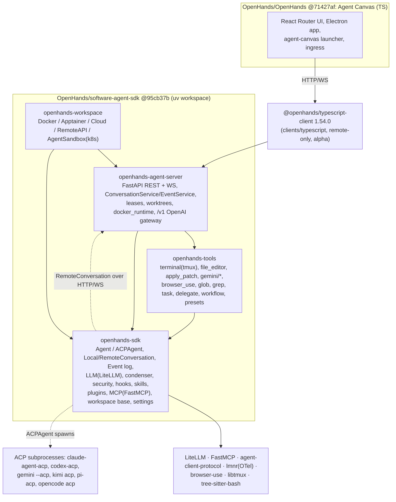

# OpenHands (V1 software-agent-sdk + app)

> **Verdict.** OpenHands V1 splits a harness from its product shell. `OpenHands/software-agent-sdk` is a Python uv workspace with four packages. `openhands-sdk` holds the agent loop, the event-sourced conversation, the LiteLLM-backed `LLM`, condensers, security analyzers, hooks, skills, plugins, MCP and an ACP bridge. `openhands-tools` holds the terminal, editors, browser and sub-agent tools. `openhands-workspace` holds the Docker, Apptainer, cloud and Kubernetes sandboxes. `openhands-agent-server` is a FastAPI REST/WebSocket server. At the pinned commit, `OpenHands/OpenHands` is no longer the Python app. It is **Agent Canvas**, a React/Electron front end that contains no Python. It reaches the SDK only over HTTP, through `@openhands/typescript-client`, and launches `openhands-agent-server` with `uvx`. The architecture has three defining traits:
>
> - **Event-sourced design.** Every action, observation, condensation and state change is a frozen Pydantic event, appended as one JSON file to a parent-linked tree.
> - **Stateless, serializable agents.** An `Agent` (or an `ACPAgent`, which drives Claude Code, Codex, Gemini CLI, Kimi Code, Pi or OpenCode as a subprocess) is plain configuration that round-trips through JSON. That JSON is the real integration contract.
> - **Sandboxing by relocation.** Isolation means running the same agent-server inside a container.
>
> Build on it if you want a Python harness with batteries included that you can embed in-process *or* run as a service, with a production UI on top. It is a poor fit if you want a small core you can read in a day, non-Python embedding, or strong default-on sandboxing.

| | |
|---|---|
| Repo(s) | `OpenHands/software-agent-sdk` @ `95cb37b7f04f`; `OpenHands/OpenHands` @ `71427af5b426` |
| License | MIT for both ([SDK `LICENSE`](https://github.com/OpenHands/software-agent-sdk/blob/95cb37b7f04ff281e92bfb3c3fc66573db2df38a/LICENSE), [app `LICENSE`](https://github.com/OpenHands/OpenHands/blob/71427af5b426b3f1270db86341dffe30a947d53c/LICENSE)) |
| Language(s) | Python ≥ 3.12 (SDK, server). TypeScript/React 19 + Electron (Agent Canvas, Node ≥ 24). There is also a TypeScript REST client in `clients/typescript`. |
| Size | **SDK repo**: 1,916 tracked files. Non-test Python is 135.1k LOC: `openhands-sdk` 80.7k (310 files), `openhands-agent-server` 34.0k (97), `openhands-tools` 17.3k (93), `openhands-workspace` 3.1k (14). Of that, the **harness core** is ~22.5k: agent loop + `LocalConversation` + state 12.4k, events 2.2k, context/condensers/prompts 3.9k, tool framework 4.0k. The **LLM layer** is another 13.5k, the **ACP bridge** 6.2k (`acp_agent.py` alone is 4,688), **security** 5.5k and **settings/profiles** 6.0k. Tests total 255.9k LOC (770 files), examples 12.8k (90 files), and the TS client 51.6k. **Agent Canvas**: 2,651 tracked files, 158.7k LOC of non-test TS/TSX in `src/`, ~222k LOC of tests, 11.8k of launcher scripts. |
| Version at pin | SDK packages **1.54.0** (lock-stepped: [`openhands-sdk/pyproject.toml:L2-L3`](https://github.com/OpenHands/software-agent-sdk/blob/95cb37b7f04ff281e92bfb3c3fc66573db2df38a/openhands-sdk/pyproject.toml#L2-L3)). Agent Canvas is **1.27.1** and pins agent-server 1.54.0 ([`config/defaults.json:L1-L12`](https://github.com/OpenHands/OpenHands/blob/71427af5b426b3f1270db86341dffe30a947d53c/config/defaults.json#L1-L12)). |
| Release history | **V0** began as OpenDevin (repo created 2024-03-13). The V0 line ended at 0.62.0 on 2025-11-11. On 2025-09-04 the "Path to OpenHands V1" blog announced the rewrite. SDK milestones: repo created 2025-08-23, 1.0.0a1 on 2025-10-14, **1.0.0 on 2025-11-06**, arXiv 2511.03690 on 2025-11-05 (v2 2026-04-22, MLSys 2026). App 1.0.0 shipped on 2025-12-16 ("New OpenHands 1.0.0 using the new software-agent-sdk"). The SDK then reached 1.10 (2026-01-26), 1.20 (05-04), 1.30 (07-01), 1.40 (08-01) and **1.54.0 (2026-10-09)**: 103 GitHub releases in about 11 months. The Python app line ended at 1.11.0 and `cloud-1.47.1` (July 2026). Agent Canvas history was then migrated into `OpenHands/OpenHands`, starting at v1.6.1 on 2026-07-28 and reaching v1.27.1 on 2026-10-12 (see Evidence index). |
| Category | `hybrid`: a reusable harness library plus server, deliberately split from a product shell (Agent Canvas) |

**Path conventions.** Links are permalinks to the pinned commits. Display paths abbreviate `openhands-sdk/openhands/sdk/` as `sdk/`, `openhands-tools/openhands/tools/` as `tools/`, `openhands-agent-server/openhands/agent_server/` as `server/` and `openhands-workspace/openhands/workspace/` as `workspace/`. A `canvas:` prefix means the `OpenHands/OpenHands` repo.

---

## 1. Layering & package map



| Layer | Owns | Key evidence |
|---|---|---|
| `openhands-sdk` | Typed components: `AgentBase`/`Agent`/`ACPAgent`, `LocalConversation`/`RemoteConversation`, `ConversationState` + `EventLog`, `LLM`, `CondenserBase`, `SecurityAnalyzerBase`/`ConfirmationPolicyBase`, `ToolDefinition`, hooks, skills, plugins, MCP client, `BaseWorkspace` | deps: `agent-client-protocol`, `fastmcp`, `litellm`, `lmnr` ([`openhands-sdk/pyproject.toml:L7-L28`](https://github.com/OpenHands/software-agent-sdk/blob/95cb37b7f04ff281e92bfb3c3fc66573db2df38a/openhands-sdk/pyproject.toml#L7-L28)) |
| `openhands-tools` | Concrete tools and presets. It depends on `browser-use`, `libtmux` and `tom-swe` | [`openhands-tools/pyproject.toml:L7-L18`](https://github.com/OpenHands/software-agent-sdk/blob/95cb37b7f04ff281e92bfb3c3fc66573db2df38a/openhands-tools/pyproject.toml#L7-L18) |
| `openhands-workspace` | Sandboxed workspaces. Note the **inverted dependency**: it depends on `openhands-agent-server`, because every sandbox runs the server image | [`openhands-workspace/pyproject.toml:L7-L11`](https://github.com/OpenHands/software-agent-sdk/blob/95cb37b7f04ff281e92bfb3c3fc66573db2df38a/openhands-workspace/pyproject.toml#L7-L11) |
| `openhands-agent-server` | REST/WS API, multi-conversation service, persistence, auth, Docker runtimes. Script entry point is `agent-server` | [`openhands-agent-server/pyproject.toml:L7-L19,L57-L58`](https://github.com/OpenHands/software-agent-sdk/blob/95cb37b7f04ff281e92bfb3c3fc66573db2df38a/openhands-agent-server/pyproject.toml#L7-L58) |
| Agent Canvas | UI, backend selection, local-stack orchestration. It "is not responsible for executing agent actions" | [`canvas: docs/architecture.md:L5-L19`](https://github.com/OpenHands/OpenHands/blob/71427af5b426b3f1270db86341dffe30a947d53c/docs/architecture.md#L5-L19) |

The SDK's root `AGENTS.md` states the ownership split. The SDK repo owns "the canonical REST/WebSocket API". `OpenHands/OpenHands` owns "Agent Canvas UI, frontend state, backend selection, and local-stack orchestration". Skills and plugins live in `OpenHands/extensions` and scheduling in `OpenHands/automation`. Changes flow "SDK/Agent Server → OpenAPI contract → `clients/typescript` → Agent Canvas" ([`AGENTS.md:L30-L36`](https://github.com/OpenHands/software-agent-sdk/blob/95cb37b7f04ff281e92bfb3c3fc66573db2df38a/AGENTS.md#L30-L36)).

**How the app consumes the SDK at the pin.** Canvas's `package.json` depends on `@openhands/typescript-client: 1.54.0` and on nothing Python ([`canvas: package.json:L2-L3,L27`](https://github.com/OpenHands/OpenHands/blob/71427af5b426b3f1270db86341dffe30a947d53c/package.json#L2-L27)). The launcher starts the backend as `uvx --from openhands-agent-server==<v> --with openhands-sdk==<v> --with openhands-tools==<v> --with openhands-workspace==<v> agent-server` ([`canvas: scripts/dev-safe.mjs:L484-L515`](https://github.com/OpenHands/OpenHands/blob/71427af5b426b3f1270db86341dffe30a947d53c/scripts/dev-safe.mjs#L484-L515)). Canvas builds agents as raw JSON specs, e.g. `{kind: "Agent", tools: [{name: "glob"}, …], condenser: {kind: "LLMSummarizingCondenser", …}}` for its planner ([`canvas: src/api/agent-server-adapter.ts:L1531-L1563`](https://github.com/OpenHands/OpenHands/blob/71427af5b426b3f1270db86341dffe30a947d53c/src/api/agent-server-adapter.ts#L1531-L1563)). That works because every SDK component is a `DiscriminatedUnionMixin` whose `kind` is the class name ([`sdk/utils/models.py:L197-L205`](https://github.com/OpenHands/software-agent-sdk/blob/95cb37b7f04ff281e92bfb3c3fc66573db2df38a/openhands-sdk/openhands/sdk/utils/models.py#L197-L205)). The previous Python app server (V0 `AgentController`, then the V1 "app-server") no longer lives in this repo. Release notes show Agent Canvas history being "migrated from OpenHands/agent-canvas" to seed `OpenHands/OpenHands`. Where the Python app server went is not verifiable from the clones. An `OpenHands/enterprise` repo exists, but this is inference.

---

## 2. Agent loop

There are two nested loops. The **conversation loop** in `LocalConversation._run()` decides *whether* to take another step. The **agent step**, `Agent.step()`, performs one LLM call plus at most one tool batch. Every async method has a sync twin (`run`/`arun`, `step`/`astep`, `completion`/`acompletion`), as the root `AGENTS.md` documents.

**Conversation loop** ([`sdk/conversation/impl/local_conversation.py:L1933-L2107`](https://github.com/OpenHands/software-agent-sdk/blob/95cb37b7f04ff281e92bfb3c3fc66573db2df38a/openhands-sdk/openhands/sdk/conversation/impl/local_conversation.py#L1933-L2107)):

1. `_ensure_agent_ready()` runs lazy one-time init: load plugins, then register file-based agents, then `agent._initialize()` (resolve tools, add MCP tools), then `agent.init_state()` (emit `SystemPromptEvent`), then register LLMs ([`L1551-L1614`](https://github.com/OpenHands/software-agent-sdk/blob/95cb37b7f04ff281e92bfb3c3fc66573db2df38a/openhands-sdk/openhands/sdk/conversation/impl/local_conversation.py#L1551-L1614)).
2. A fresh `CancellationToken` is created, and IDLE/PAUSED/ERROR/STUCK become RUNNING.
3. Each iteration holds the state's FIFO lock:
   - break on PAUSED or STUCK;
   - on FINISHED, run **Stop hooks**, which can veto stopping and inject feedback as an `environment`-sourced user message ([`L1963-L1991`](https://github.com/OpenHands/software-agent-sdk/blob/95cb37b7f04ff281e92bfb3c3fc66573db2df38a/openhands-sdk/openhands/sdk/conversation/impl/local_conversation.py#L1963-L1991));
   - run the stuck detector, or nudge;
   - clear WAITING_FOR_CONFIRMATION, because calling `run()` again *is* the approval;
   - call `agent.step()`.
4. After the step, break on WAITING_FOR_CONFIRMATION. Enforce `max_budget_per_run` against combined metrics, and `max_iteration_per_run` (default 500). Both emit `ConversationErrorEvent` codes `MaxBudgetReached`/`MaxIterationsReached` ([`L2032-L2062`](https://github.com/OpenHands/software-agent-sdk/blob/95cb37b7f04ff281e92bfb3c3fc66573db2df38a/openhands-sdk/openhands/sdk/conversation/impl/local_conversation.py#L2032-L2062)).

**Agent step** ([`sdk/agent/agent.py:L707-L896`](https://github.com/OpenHands/software-agent-sdk/blob/95cb37b7f04ff281e92bfb3c3fc66573db2df38a/openhands-sdk/openhands/sdk/agent/agent.py#L707-L896)):

1. **Pending actions first.** If the active branch has `ActionEvent`s with no observation, execute them and return. This is how confirmation mode resumes ([`L714-L723`](https://github.com/OpenHands/software-agent-sdk/blob/95cb37b7f04ff281e92bfb3c3fc66573db2df38a/openhands-sdk/openhands/sdk/agent/agent.py#L714-L723)).
2. A `UserPromptSubmit`-blocked message finishes the turn.
3. `resolve_runtime_metadata()` runs (route-aware context limits). Then `prepare_llm_messages(state.view, condenser, llm)` runs. If it returns a `Condensation`, the step emits only that event and returns ([`L746-L757`](https://github.com/OpenHands/software-agent-sdk/blob/95cb37b7f04ff281e92bfb3c3fc66573db2df38a/openhands-sdk/openhands/sdk/agent/agent.py#L746-L757)).
4. Image input to a non-vision model is rewritten into references to `inspect_image_with_vision`, or the step finishes with an explanatory message.
5. `llm.generate(..., add_security_risk_prediction=True, on_token=...)`. In `astep` the state lock is **released for the network wait**, so `send_message()` and state snapshots are not blocked ([`L997-L1009`](https://github.com/OpenHands/software-agent-sdk/blob/95cb37b7f04ff281e92bfb3c3fc66573db2df38a/openhands-sdk/openhands/sdk/agent/agent.py#L997-L1009)).
6. The response is classified by `classify_response()` into `TOOL_CALLS`, `CONTENT`, `REASONING_ONLY` or `EMPTY` ([`sdk/agent/response_dispatch.py:L45-L78`](https://github.com/OpenHands/software-agent-sdk/blob/95cb37b7f04ff281e92bfb3c3fc66573db2df38a/openhands-sdk/openhands/sdk/agent/response_dispatch.py#L45-L78)):
   - **Text content** ends the turn: `FINISHED`, awaiting the user ([`L259-L281`](https://github.com/OpenHands/software-agent-sdk/blob/95cb37b7f04ff281e92bfb3c3fc66573db2df38a/openhands-sdk/openhands/sdk/agent/response_dispatch.py#L259-L281)).
   - **Reasoning-only or empty** responses get a corrective nudge as a `source="environment"` user message ([`L375-L400`](https://github.com/OpenHands/software-agent-sdk/blob/95cb37b7f04ff281e92bfb3c3fc66573db2df38a/openhands-sdk/openhands/sdk/agent/response_dispatch.py#L375-L400)).
   - **Tool calls** become `ActionEvent`s: the risk analysis runs, then either the confirmation pause or execution ([`L154-L201`](https://github.com/OpenHands/software-agent-sdk/blob/95cb37b7f04ff281e92bfb3c3fc66573db2df38a/openhands-sdk/openhands/sdk/agent/response_dispatch.py#L154-L201)).
7. Each tool call is parsed, normalized (aliasing, terminal fallback) and repaired (`fix_malformed_tool_arguments`). `security_risk` and `summary` are popped from the arguments, the call is validated into the tool's `Action` type, optionally scored by a critic, and emitted. Unknown tools or invalid arguments become an `ActionEvent(action=None)` plus an `AgentErrorEvent`, so the model can self-correct ([`sdk/agent/agent.py:L1342-L1497`](https://github.com/OpenHands/software-agent-sdk/blob/95cb37b7f04ff281e92bfb3c3fc66573db2df38a/openhands-sdk/openhands/sdk/agent/agent.py#L1342-L1497)).
8. `_ActionBatch` truncates calls after `FinishTool`, partitions out hook-blocked actions (`state.pop_blocked_action`) and executes the rest. It then emits results **in original order**, and finalizes: either FINISHED, or a critic-driven "iterative refinement" follow-up message ([`L225-L412`](https://github.com/OpenHands/software-agent-sdk/blob/95cb37b7f04ff281e92bfb3c3fc66573db2df38a/openhands-sdk/openhands/sdk/agent/agent.py#L225-L412)).

**Parallel tool calls.** `tool_concurrency_limit` defaults to **1** (sequential) ([`sdk/agent/base.py:L314-L324`](https://github.com/OpenHands/software-agent-sdk/blob/95cb37b7f04ff281e92bfb3c3fc66573db2df38a/openhands-sdk/openhands/sdk/agent/base.py#L314-L324)). Above 1, `ParallelToolExecutor` uses a thread pool plus a `ResourceLockManager`. A tool's `declared_resources(action)` returns `DeclaredResources(keys, declared)`. An undeclared tool falls back to a tool-wide mutex ([`sdk/agent/parallel_executor.py:L51-L120`](https://github.com/OpenHands/software-agent-sdk/blob/95cb37b7f04ff281e92bfb3c3fc66573db2df38a/openhands-sdk/openhands/sdk/agent/parallel_executor.py#L51-L120); [`sdk/tool/tool.py:L251-L280`](https://github.com/OpenHands/software-agent-sdk/blob/95cb37b7f04ff281e92bfb3c3fc66573db2df38a/openhands-sdk/openhands/sdk/tool/tool.py#L251-L280)).

**Steering, pause and interrupt.**
- `send_message()` appends a user `MessageEvent` under the lock. It resets FINISHED/STUCK to IDLE, so a message that races with completion is picked up on the next iteration instead of being lost ([`local_conversation.py:L1822-L1885`](https://github.com/OpenHands/software-agent-sdk/blob/95cb37b7f04ff281e92bfb3c3fc66573db2df38a/openhands-sdk/openhands/sdk/conversation/impl/local_conversation.py#L1822-L1885); comment at [`L2018-L2025`](https://github.com/OpenHands/software-agent-sdk/blob/95cb37b7f04ff281e92bfb3c3fc66573db2df38a/openhands-sdk/openhands/sdk/conversation/impl/local_conversation.py#L2018-L2025)). Because the async path releases the lock during LLM I/O, a message sent mid-turn lands in the log and is part of the next step's view. This is effectively queued steering.
- `pause()` only takes effect between steps.
- `interrupt()` sets the cancellation token and then cancels the tracked `_arun_task` from any thread ([`L2735-L2793`](https://github.com/OpenHands/software-agent-sdk/blob/95cb37b7f04ff281e92bfb3c3fc66573db2df38a/openhands-sdk/openhands/sdk/conversation/impl/local_conversation.py#L2735-L2793)). `arun()` catches the `CancelledError`, back-fills a synthetic `AgentErrorEvent` for every orphaned tool call (providers reject unmatched `tool_use`), sets PAUSED and emits `InterruptEvent` ([`L2547-L2582`](https://github.com/OpenHands/software-agent-sdk/blob/95cb37b7f04ff281e92bfb3c3fc66573db2df38a/openhands-sdk/openhands/sdk/conversation/impl/local_conversation.py#L2547-L2582)).
- The server's `send_message(run=True)` adds ACP-specific *supersede* logic: it interrupts and restarts an in-flight ACP prompt when a new user message arrives ([`server/event_service.py:L842-L918`](https://github.com/OpenHands/software-agent-sdk/blob/95cb37b7f04ff281e92bfb3c3fc66573db2df38a/openhands-agent-server/openhands/agent_server/event_service.py#L842-L918)).

**Error recovery inside the step** ([`agent.py:L789-L872`](https://github.com/OpenHands/software-agent-sdk/blob/95cb37b7f04ff281e92bfb3c3fc66573db2df38a/openhands-sdk/openhands/sdk/agent/agent.py#L789-L872)):

| Error | Handling |
|---|---|
| `FunctionCallValidationError` | Sent back as a user message |
| `LLMContentPolicyViolationError` | Nudged to rephrase |
| `LLMContextWindowExceedError` | Emits `CondensationRequest` (next step condenses) |
| `LLMMalformedConversationHistoryError` | `state.rebuild_view()` (full property enforcement), then `CondensationRequest`. It is logged separately so event-stream bugs stay visible. |

The stuck detector watches four patterns: action-observation repeats (4), action-error repeats (3), monologue (3) and alternating patterns (6). Defaults are in [`sdk/conversation/types.py:L136-L161`](https://github.com/OpenHands/software-agent-sdk/blob/95cb37b7f04ff281e92bfb3c3fc66573db2df38a/openhands-sdk/openhands/sdk/conversation/types.py#L136-L161).

---

## 3. Model / provider abstraction

**`LLM` is a single Pydantic model** (`class LLM(BaseModel, RetryMixin, NonNativeToolCallingMixin)`). Its fields include model, keys, AWS/Bedrock settings, retries (`num_retries=5`, 8–64 s exponential backoff), `api_mode` (`auto|chat|responses`), `caching_prompt`, `reasoning_effort`/`reasoning_summary`, `extended_thinking_budget`, `litellm_extra_body` and `fallback_strategy` ([`sdk/llm/llm.py:L252-L660`](https://github.com/OpenHands/software-agent-sdk/blob/95cb37b7f04ff281e92bfb3c3fc66573db2df38a/openhands-sdk/openhands/sdk/llm/llm.py#L252-L660)). `generate()` dispatches to `responses()` (OpenAI Responses API) or `completion()` (Chat Completions) ([`L1684-L1714`](https://github.com/OpenHands/software-agent-sdk/blob/95cb37b7f04ff281e92bfb3c3fc66573db2df38a/openhands-sdk/openhands/sdk/llm/llm.py#L1684-L1714)). The transport is `litellm_completion` / `litellm.stream_chunk_builder` ([`L2521-L2545`](https://github.com/OpenHands/software-agent-sdk/blob/95cb37b7f04ff281e92bfb3c3fc66573db2df38a/openhands-sdk/openhands/sdk/llm/llm.py#L2521-L2545)). So **provider coverage is LiteLLM's**. LiteLLM is version-pinned workspace-wide (`litellm==1.93.0`) behind a 7-day `exclude-newer` supply-chain guardrail ([`pyproject.toml:L6-L23`](https://github.com/OpenHands/software-agent-sdk/blob/95cb37b7f04ff281e92bfb3c3fc66573db2df38a/pyproject.toml#L6-L23)).

**`completion()` wraps each attempt** in a tenacity decorator built from `LLM_RETRY_EXCEPTIONS` and transient-HTTP checks, excluding quota exhaustion ([`L1141-L1160`](https://github.com/OpenHands/software-agent-sdk/blob/95cb37b7f04ff281e92bfb3c3fc66573db2df38a/openhands-sdk/openhands/sdk/llm/llm.py#L1141-L1160)). On final failure it tries three things in order ([`L1836-L1880`](https://github.com/OpenHands/software-agent-sdk/blob/95cb37b7f04ff281e92bfb3c3fc66573db2df38a/openhands-sdk/openhands/sdk/llm/llm.py#L1836-L1880)):
1. retry without cache markers if the provider rejects a too-small cache prefix (Vertex);
2. one retry after an API-key refresh hook;
3. `FallbackStrategy`, which walks an ordered list of saved **LLM profile names** on transient errors, per call ([`sdk/llm/fallback_strategy.py:L45-L90`](https://github.com/OpenHands/software-agent-sdk/blob/95cb37b7f04ff281e92bfb3c3fc66573db2df38a/openhands-sdk/openhands/sdk/llm/fallback_strategy.py#L45-L90)).

Provider exceptions are then mapped into SDK types (`LLMContextWindowExceedError`, …) ([`L1014-L1038`](https://github.com/OpenHands/software-agent-sdk/blob/95cb37b7f04ff281e92bfb3c3fc66573db2df38a/openhands-sdk/openhands/sdk/llm/llm.py#L1014-L1038)).

**Message model.** `Message` carries `TextContent`/`ImageContent`, `tool_calls`, `reasoning_content`, `thinking_blocks` (Anthropic `ThinkingBlock`/`RedactedThinkingBlock`) and `responses_reasoning_item` (OpenAI encrypted reasoning). When parallel tool calls happen, these are stored only on the **first** `ActionEvent` of a batch. `events_to_messages()` rebuilds the original assistant message by grouping `ActionEvent`s with the same `llm_response_id` ([`sdk/event/base.py:L106-L159`](https://github.com/OpenHands/software-agent-sdk/blob/95cb37b7f04ff281e92bfb3c3fc66573db2df38a/openhands-sdk/openhands/sdk/event/base.py#L106-L159), [`L177-L199`](https://github.com/OpenHands/software-agent-sdk/blob/95cb37b7f04ff281e92bfb3c3fc66573db2df38a/openhands-sdk/openhands/sdk/event/base.py#L177-L199)). Secret masking deliberately skips `thinking_blocks` and `responses_reasoning_item`, because "rewriting them invalidates the signature replayed on the next request" ([`response_dispatch.py:L353-L373`](https://github.com/OpenHands/software-agent-sdk/blob/95cb37b7f04ff281e92bfb3c3fc66573db2df38a/openhands-sdk/openhands/sdk/agent/response_dispatch.py#L353-L373)).

**Capability registry, not branches.** Model quirks live in `ModelFeatures`: `supports_reasoning_effort`, `supports_prompt_cache`, `supports_stop_words`, `supports_responses_api`, `force_string_serializer`, `send_reasoning_content`, `supports_vision`, and so on ([`sdk/llm/utils/model_features.py:L50-L66`](https://github.com/OpenHands/software-agent-sdk/blob/95cb37b7f04ff281e92bfb3c3fc66573db2df38a/openhands-sdk/openhands/sdk/llm/utils/model_features.py#L50-L66)). The SDK `AGENTS.md` tells contributors to keep provider criteria out of `llm.py`. Models without native function calling get **prompt-mocked tool calling**. `NonNativeToolCallingMixin` rewrites the tool schemas into the prompt with in-context examples and parses the calls back ([`sdk/llm/mixins/non_native_fc.py:L27-L60`](https://github.com/OpenHands/software-agent-sdk/blob/95cb37b7f04ff281e92bfb3c3fc66573db2df38a/openhands-sdk/openhands/sdk/llm/mixins/non_native_fc.py#L27-L60)). This is a V0 inheritance that few harnesses in this study keep.

**Prompt caching.** The system message has two content blocks: a static block shared across conversations and a dynamic per-conversation block. `_apply_prompt_caching` marks only the static block and the last user/tool message (Anthropic-style breakpoints) ([`L2998-L3026`](https://github.com/OpenHands/software-agent-sdk/blob/95cb37b7f04ff281e92bfb3c3fc66573db2df38a/openhands-sdk/openhands/sdk/llm/llm.py#L2998-L3026)). The conversation ID is the default `prompt_cache_key`, and sub-agents reuse the parent's key ([`local_conversation.py:L303-L305`](https://github.com/OpenHands/software-agent-sdk/blob/95cb37b7f04ff281e92bfb3c3fc66573db2df38a/openhands-sdk/openhands/sdk/conversation/impl/local_conversation.py#L303-L305)).

**Routing and switching.**
- `RouterLLM` is itself an `LLM` subclass that picks among `llms_for_routing` per call. `MultimodalRouter` sends image-bearing turns to a secondary model ([`sdk/llm/router/base.py:L28-L95`](https://github.com/OpenHands/software-agent-sdk/blob/95cb37b7f04ff281e92bfb3c3fc66573db2df38a/openhands-sdk/openhands/sdk/llm/router/base.py#L28-L95)).
- The model can also switch models itself through the optional built-in tools `SwitchLLMTool` and `ClassifyAndSwitchLLMTool` (a classifier model maps the task to a profile) ([`sdk/tool/builtins/__init__.py:L51-L62`](https://github.com/OpenHands/software-agent-sdk/blob/95cb37b7f04ff281e92bfb3c3fc66573db2df38a/openhands-sdk/openhands/sdk/tool/builtins/__init__.py#L51-L62)).
- `LLM.subscription_login()` implements ChatGPT Plus/Pro OAuth (PKCE) for Codex models ([`L3437-L3460`](https://github.com/OpenHands/software-agent-sdk/blob/95cb37b7f04ff281e92bfb3c3fc66573db2df38a/openhands-sdk/openhands/sdk/llm/llm.py#L3437-L3460)).

**Cost and token accounting.** `Metrics` records `accumulated_cost`, per-call latency and `TokenUsage` with `cache_read_tokens` and `reasoning_tokens`, and exposes `cache_hit_rate` ([`sdk/llm/utils/metrics.py:L34-L113`](https://github.com/OpenHands/software-agent-sdk/blob/95cb37b7f04ff281e92bfb3c3fc66573db2df38a/openhands-sdk/openhands/sdk/llm/utils/metrics.py#L34-L113)). Per-`usage_id` metrics (agent, condenser, title, …) roll up into `ConversationStats`, which persists in `base_state.json`.

---

## 4. Tool system

**Definition API.** A tool is `ToolDefinition[ActionT, ObservationT]`, a frozen Pydantic model with five parts ([`sdk/tool/tool.py:L347-L449`](https://github.com/OpenHands/software-agent-sdk/blob/95cb37b7f04ff281e92bfb3c3fc66573db2df38a/openhands-sdk/openhands/sdk/tool/tool.py#L347-L449)):
- `description`;
- `action_type`/`observation_type`, which are Pydantic schemas;
- MCP-style `ToolAnnotations` (`readOnlyHint`, `destructiveHint`, `idempotentHint`, `openWorldHint`) ([`L215-L248`](https://github.com/OpenHands/software-agent-sdk/blob/95cb37b7f04ff281e92bfb3c3fc66573db2df38a/openhands-sdk/openhands/sdk/tool/tool.py#L215-L248));
- a runtime-only `executor: ToolExecutor`, with `__call__(action, conversation)`, `close()` and a thread-safe `interrupt()` ([`L283-L327`](https://github.com/OpenHands/software-agent-sdk/blob/95cb37b7f04ff281e92bfb3c3fc66573db2df38a/openhands-sdk/openhands/sdk/tool/tool.py#L283-L327));
- a classmethod factory `create(conv_state, **params) -> Sequence[Self]`.

Agents do not hold tool objects. `Agent.tools` is a list of serializable `Tool(name, params)` specs ([`sdk/tool/spec.py:L12-L32`](https://github.com/OpenHands/software-agent-sdk/blob/95cb37b7f04ff281e92bfb3c3fc66573db2df38a/openhands-sdk/openhands/sdk/tool/spec.py#L12-L32)). These are resolved at init time through a process-global registry ([`sdk/tool/registry.py:L130-L183`](https://github.com/OpenHands/software-agent-sdk/blob/95cb37b7f04ff281e92bfb3c3fc66573db2df38a/openhands-sdk/openhands/sdk/tool/registry.py#L130-L183)). `AgentBase._initialize` resolves specs in a 4-thread pool, applies `filter_tools_regex`, adds the `include_default_tools` (default `FinishTool`, `ThinkTool`), auto-attaches `InvokeSkillTool`/`VisionInspectTool` when relevant, and rejects duplicate names ([`sdk/agent/base.py:L571-L660`](https://github.com/OpenHands/software-agent-sdk/blob/95cb37b7f04ff281e92bfb3c3fc66573db2df38a/openhands-sdk/openhands/sdk/agent/base.py#L571-L660)). The schema is emitted for Chat Completions, the Responses API and MCP. **Every schema gets a synthetic `summary` field**, and every non-read-only tool also gets a `security_risk` enum ([`L713-L735`](https://github.com/OpenHands/software-agent-sdk/blob/95cb37b7f04ff281e92bfb3c3fc66573db2df38a/openhands-sdk/openhands/sdk/tool/tool.py#L713-L735), [`L876-L956`](https://github.com/OpenHands/software-agent-sdk/blob/95cb37b7f04ff281e92bfb3c3fc66573db2df38a/openhands-sdk/openhands/sdk/tool/tool.py#L876-L956)).

**Built-ins** (`openhands-tools`, 17.3k LOC):

| Tool / set | Notes |
|---|---|
| `TerminalTool` (4.7k LOC) | Persistent shell via tmux, with subprocess and Windows backends. Output is capped at `MAX_CMD_OUTPUT_SIZE = 30000` chars ([`tools/terminal/constants.py:L18`](https://github.com/OpenHands/software-agent-sdk/blob/95cb37b7f04ff281e92bfb3c3fc66573db2df38a/openhands-tools/openhands/tools/terminal/constants.py#L18)) |
| `FileEditorTool`, `PlanningFileEditorTool` | `str_replace`-style editor. The planning variant can view any file but only edit `PLAN.md` |
| `ApplyPatchTool`, `gemini/{read_file,write_file,edit,list_directory}` | **Model-native toolsets**: the `gpt5` preset uses Codex-style `apply_patch`, and the `gemini` preset mirrors Gemini CLI's tool names ([`tools/preset/gpt5.py:L43-L55`](https://github.com/OpenHands/software-agent-sdk/blob/95cb37b7f04ff281e92bfb3c3fc66573db2df38a/openhands-tools/openhands/tools/preset/gpt5.py#L43-L55)) |
| `BrowserToolSet` | `browser-use`-based browser. `is_usable()` gates it on Chromium being present |
| `GlobTool`, `GrepTool` | Uses `rg`, then system `grep`, then a Python fallback |
| `TaskTrackerTool`, `TaskToolSet`, `DelegateTool`, `WorkflowTool` | Planning and sub-agents (§9) |
| `ask_oracle`, `tom_consult` | Second-opinion and theory-of-mind consultation (via `tom-swe`) |

The default agent is `TerminalTool` + `FileEditorTool` + `TaskTrackerTool` + `BrowserToolSet` (no browser in CLI mode) + `LLMSummarizingCondenser` ([`tools/preset/default.py:L37-L104`](https://github.com/OpenHands/software-agent-sdk/blob/95cb37b7f04ff281e92bfb3c3fc66573db2df38a/openhands-tools/openhands/tools/preset/default.py#L37-L104)).

**Execution pipeline.** The path is `ActionEvent`, then security analysis and confirmation policy (§7), then PreToolUse hooks (recorded into `state.blocked_actions`), then `ParallelToolExecutor`, then `tool(action, conversation)` (optionally wrapped in a Laminar `TOOL` span). The result is an `ObservationEvent`. A `ValueError` becomes an `AgentErrorEvent` ([`sdk/agent/agent.py:L1499-L1561`](https://github.com/OpenHands/software-agent-sdk/blob/95cb37b7f04ff281e92bfb3c3fc66573db2df38a/openhands-sdk/openhands/sdk/agent/agent.py#L1499-L1561)).

**Truncation and spill-to-disk.** `maybe_truncate()` keeps head and tail around a `<response clipped>` notice. When it is given a `save_dir`, it writes the full content to a content-hashed file and tells the model the path and the line where truncation starts ([`sdk/utils/truncate.py:L12-L117`](https://github.com/OpenHands/software-agent-sdk/blob/95cb37b7f04ff281e92bfb3c3fc66573db2df38a/openhands-sdk/openhands/sdk/utils/truncate.py#L12-L117)). The terminal observation uses this with `full_output_save_dir` ([`tools/terminal/definition.py:L192-L199`](https://github.com/OpenHands/software-agent-sdk/blob/95cb37b7f04ff281e92bfb3c3fc66573db2df38a/openhands-tools/openhands/tools/terminal/definition.py#L192-L199)).

**Other notable mechanisms.**
- **Client tools** are declared as JSON in `POST /conversations`. Their executor only *acknowledges*. The real execution happens in the client (e.g. Canvas), which observes the `ActionEvent` over WebSocket ([`sdk/tool/client_tool.py:L1-L8`](https://github.com/OpenHands/software-agent-sdk/blob/95cb37b7f04ff281e92bfb3c3fc66573db2df38a/openhands-sdk/openhands/sdk/tool/client_tool.py#L1-L8)).
- **Structured output** comes from attaching a `response_schema` to a single-tool spec, typically `FinishTool` ([`registry.py:L160-L183`](https://github.com/OpenHands/software-agent-sdk/blob/95cb37b7f04ff281e92bfb3c3fc66573db2df38a/openhands-sdk/openhands/sdk/tool/registry.py#L160-L183)).
- **Tools are append-only across resume.** `AgentBase.verify()` rejects a resumed conversation whose runtime agent lacks a previously persisted tool, because "the LLM may have already been told about them" ([`base.py:L703-L769`](https://github.com/OpenHands/software-agent-sdk/blob/95cb37b7f04ff281e92bfb3c3fc66573db2df38a/openhands-sdk/openhands/sdk/agent/base.py#L703-L769)).

---

## 5. Context management

**System prompt assembly.** The built-in prompt is a typed **section registry** with two cache tiers ([`sdk/context/prompts/presets.py:L84-L141`](https://github.com/OpenHands/software-agent-sdk/blob/95cb37b7f04ff281e92bfb3c3fc66573db2df38a/openhands-sdk/openhands/sdk/context/prompts/presets.py#L84-L141)). The static tier has Persona/Soul/Role/Memory/Efficiency/FileSystem/CodeQuality/VersionControl/PullRequests/ProblemSolving/SelfDocumentation/Security/SecurityRiskAssessment/ToolGuidance/ExternalServices/EnvironmentSetup/Troubleshooting/ProcessManagement/ModelSpecific. The dynamic tier has RepoContext/MemoryContext/AvailableSkills/CustomSuffix/CustomSecrets/DateTime. `DateTime` comes last so the stable dynamic content still forms a cacheable prefix.

A `persona` replaces the persona and workflow sections but keeps the policy sections. An inline `system_prompt` replaces everything, and a custom Jinja filename takes the escape hatch ([`sdk/agent/base.py:L357-L392`](https://github.com/OpenHands/software-agent-sdk/blob/95cb37b7f04ff281e92bfb3c3fc66573db2df38a/openhands-sdk/openhands/sdk/agent/base.py#L357-L392)). `init_state` writes a `SystemPromptEvent` with the static text, the tool list and the `dynamic_context` (secret *names*, skills, date) as the first log event ([`sdk/agent/agent.py:L498-L601`](https://github.com/OpenHands/software-agent-sdk/blob/95cb37b7f04ff281e92bfb3c3fc66573db2df38a/openhands-sdk/openhands/sdk/agent/agent.py#L498-L601)).

**Project instruction files are skills.** `load_project_skills(work_dir)` searches the working directory and the git root. It first loads "third-party" files keyed by `PATH_TO_THIRD_PARTY_SKILL_NAME`: `.cursorrules`, `agents.md`, `agent.md`, `claude.md` and `gemini.md` ([`sdk/skills/skill.py:L346-L352`](https://github.com/OpenHands/software-agent-sdk/blob/95cb37b7f04ff281e92bfb3c3fc66573db2df38a/openhands-sdk/openhands/sdk/skills/skill.py#L346-L352)). Nested `server/AGENTS.md` files become **directory-scoped path rules**. It then reads `.agents/skills`, `.openhands/skills` and the legacy `.openhands/microagents` (V0's "microagents"), first match wins ([`L1072-L1160`](https://github.com/OpenHands/software-agent-sdk/blob/95cb37b7f04ff281e92bfb3c3fc66573db2df38a/openhands-sdk/openhands/sdk/skills/skill.py#L1072-L1160)). User skills come from `~/.agents/skills` etc. Public skills are git-cloned from `OpenHands/extensions`, filtered by a marketplace manifest ([`L1166`](https://github.com/OpenHands/software-agent-sdk/blob/95cb37b7f04ff281e92bfb3c3fc66573db2df38a/openhands-sdk/openhands/sdk/skills/skill.py#L1166)).

**Trigger semantics** ([`sdk/skills/trigger.py:L19-L47`](https://github.com/OpenHands/software-agent-sdk/blob/95cb37b7f04ff281e92bfb3c3fc66573db2df38a/openhands-sdk/openhands/sdk/skills/trigger.py#L19-L47)):
- **Repo skills** (no trigger) render into `<REPO_CONTEXT>`.
- **`KeywordTrigger`** skills are appended to the triggering user message's `extended_content` once per conversation, tracked in `state.activated_knowledge_skills` ([`local_conversation.py:L1856-L1885`](https://github.com/OpenHands/software-agent-sdk/blob/95cb37b7f04ff281e92bfb3c3fc66573db2df38a/openhands-sdk/openhands/sdk/conversation/impl/local_conversation.py#L1856-L1885)).
- **`PathTrigger`** rules are injected into the `ObservationEvent` of the first tool call that touches a matching file ([`L594-L621`](https://github.com/OpenHands/software-agent-sdk/blob/95cb37b7f04ff281e92bfb3c3fc66573db2df38a/openhands-sdk/openhands/sdk/conversation/impl/local_conversation.py#L594-L621)).
- **AgentSkills-format** skills use progressive disclosure: names and descriptions go into `<available_skills>`, and the body is fetched via `invoke_skill`.

**Memory.** Optional two-tier `MEMORY.md` indexes (`~/.openhands/memory/` and `<workspace>/.openhands/memory/`) are loaded into `<MEMORY_CONTEXT>` with a 6,000-char budget, top-truncated ([`sdk/context/memory.py:L1-L24`](https://github.com/OpenHands/software-agent-sdk/blob/95cb37b7f04ff281e92bfb3c3fc66573db2df38a/openhands-sdk/openhands/sdk/context/memory.py#L1-L24)).

**Compaction: tombstones over an append-only log.** The condenser README states the design ([`sdk/context/condenser/README.md:L1-L37`](https://github.com/OpenHands/software-agent-sdk/blob/95cb37b7f04ff281e92bfb3c3fc66573db2df38a/openhands-sdk/openhands/sdk/context/condenser/README.md#L1-L37)). A `Condensation` event lists `forgotten_event_ids` plus a `summary` and a `summary_offset` ([`sdk/event/condenser.py:L11-L35`](https://github.com/OpenHands/software-agent-sdk/blob/95cb37b7f04ff281e92bfb3c3fc66573db2df38a/openhands-sdk/openhands/sdk/event/condenser.py#L11-L35)). `View.append_event` applies condensations, and tracks `CondensationRequest` as `unhandled_condensation_request` ([`sdk/context/view/view.py:L111-L158`](https://github.com/OpenHands/software-agent-sdk/blob/95cb37b7f04ff281e92bfb3c3fc66573db2df38a/openhands-sdk/openhands/sdk/context/view/view.py#L111-L158)). The view also enforces four **properties** via "manipulation indices": batch atomicity, tool-call matching, tool-loop atomicity and observation uniqueness. A condensation can therefore never split a `tool_use`/`tool_result` pair. `ConversationState.view` is cached and extended incrementally in O(k). It is rebuilt only on branch switch or recovery ([`sdk/conversation/state.py:L339-L404`](https://github.com/OpenHands/software-agent-sdk/blob/95cb37b7f04ff281e92bfb3c3fc66573db2df38a/openhands-sdk/openhands/sdk/conversation/state.py#L339-L404)).

The SDK ships exactly three condensers: `NoOpCondenser`, `PipelineCondenser` and `LLMSummarizingCondenser`. V0's zoo (observation masking, amortized forgetting, LLM attention, …) is gone. `LLMSummarizingCondenser` works as follows ([`sdk/context/condenser/llm_summarizing_condenser.py:L54-L352`](https://github.com/OpenHands/software-agent-sdk/blob/95cb37b7f04ff281e92bfb3c3fc66573db2df38a/openhands-sdk/openhands/sdk/context/condenser/llm_summarizing_condenser.py#L54-L352)):

- **Triggers.** `REQUEST`, from the user's `condense()` or the agent's context-overflow handling. `TOKENS`, when the view exceeds `min(max_tokens, agent_llm.effective_max_input_tokens)`. `EVENTS`, when `len(view) > max_size`. TOKENS and REQUEST are **HARD** requirements; EVENTS alone is **SOFT**.
- **Algorithm.** It forgets from `max(keep_first, system_prompt_idx+1)` up to a tail target. The target is half the view (REQUEST), `max_size//2` (EVENTS), or enough events to fall to `max_tokens//2` (TOKENS); the strictest target wins. Both ends snap to manipulation indices. It summarizes with a separate condenser `LLM` (system + user message, streaming disabled) and inserts the summary at the start of the forgotten range. Earlier summaries are themselves summarized next time.
- **Failure modes** ([`sdk/context/condenser/base.py:L159-L198`](https://github.com/OpenHands/software-agent-sdk/blob/95cb37b7f04ff281e92bfb3c3fc66573db2df38a/openhands-sdk/openhands/sdk/context/condenser/base.py#L159-L198)). If fewer than `minimum_progress` (10%) of events would be forgotten, it raises `NoCondensationAvailableException`. SOFT requirements then pass the view through uncondensed. HARD requirements perform `hard_context_reset()`: summarize everything after the system prompt, retrying up to 5 times while shrinking each event string by ×0.8 ([`L355-L405`](https://github.com/OpenHands/software-agent-sdk/blob/95cb37b7f04ff281e92bfb3c3fc66573db2df38a/openhands-sdk/openhands/sdk/context/condenser/llm_summarizing_condenser.py#L355-L405)).
- **Defaults.** The class defaults are `max_size=240, keep_first=2`. The `default_condenser()` used by the default agent and by sub-agents is tighter: `max_size=80, keep_first=4` ([`L554-L562`](https://github.com/OpenHands/software-agent-sdk/blob/95cb37b7f04ff281e92bfb3c3fc66573db2df38a/openhands-sdk/openhands/sdk/context/condenser/llm_summarizing_condenser.py#L554-L562)).

**Side channel.** `ask_agent(question)` answers from the current view without recording events or touching execution status. It is thread-safe while `run()` executes ([`local_conversation.py:L2875-L2895`](https://github.com/OpenHands/software-agent-sdk/blob/95cb37b7f04ff281e92bfb3c3fc66573db2df38a/openhands-sdk/openhands/sdk/conversation/impl/local_conversation.py#L2875-L2895)).

---

## 6. State, sessions & durability

**On-disk format.** One directory per conversation (`<persistence_dir>/<conversation_id.hex>/`) contains:

```
base_state.json                      # ConversationState minus events (agent, workspace, status,
                                     # confirmation policy, analyzer, stats, secrets, leaf_event_id, …)
events/event-00000-<uuid>.json       # one frozen Event per file, 5+-digit index, atomic write
events/.eventlog.lock                # filelock for cross-process appends
events/.eventlog-len-<N>.marker      # O(1) "did anyone else append?" check
observations/                        # spilled full tool outputs
```

The names come from [`sdk/conversation/persistence_const.py:L1-L10`](https://github.com/OpenHands/software-agent-sdk/blob/95cb37b7f04ff281e92bfb3c3fc66573db2df38a/openhands-sdk/openhands/sdk/conversation/persistence_const.py#L1-L10) and [`sdk/conversation/event_store.py:L22-L27`](https://github.com/OpenHands/software-agent-sdk/blob/95cb37b7f04ff281e92bfb3c3fc66573db2df38a/openhands-sdk/openhands/sdk/conversation/event_store.py#L22-L27). `EventLog.append()` takes the file lock (30 s timeout) and syncs from disk only if the length marker is stale. It rejects duplicate IDs and unknown parents, writes, then advances the marker ([`L188-L238`](https://github.com/OpenHands/software-agent-sdk/blob/95cb37b7f04ff281e92bfb3c3fc66573db2df38a/openhands-sdk/openhands/sdk/conversation/event_store.py#L188-L238)). The docstring warns that `flock` "does NOT work reliably on NFS" ([`L34-L45`](https://github.com/OpenHands/software-agent-sdk/blob/95cb37b7f04ff281e92bfb3c3fc66573db2df38a/openhands-sdk/openhands/sdk/conversation/event_store.py#L34-L45)). `LocalFileStore.write` uses `atomic_write_text` with mode 0600. Storage is pluggable through the `FileStore` ABC (`write/read/list/delete/exists/lock`), and `InMemoryFileStore` is the non-persistent default.

**Autosave semantics.** `ConversationState.__setattr__` persists `base_state.json` on every public-field change, and emits a `ConversationStateUpdateEvent` to subscribers. Inside a `with state:` block, the save is deferred to `__exit__` ([`state.py:L596-L648`](https://github.com/OpenHands/software-agent-sdk/blob/95cb37b7f04ff281e92bfb3c3fc66573db2df38a/openhands-sdk/openhands/sdk/conversation/state.py#L596-L648), [`L743-L764`](https://github.com/OpenHands/software-agent-sdk/blob/95cb37b7f04ff281e92bfb3c3fc66573db2df38a/openhands-sdk/openhands/sdk/conversation/state.py#L743-L764)). Events are written immediately, but HEAD (`leaf_event_id`) is flushed later. The code explicitly handles a persisted HEAD that "can lag" the event files after a crash. Secrets are encrypted only when a `Cipher` is supplied. Otherwise they are **redacted and lost on restore**, with a warning ([`L430-L451`](https://github.com/OpenHands/software-agent-sdk/blob/95cb37b7f04ff281e92bfb3c3fc66573db2df38a/openhands-sdk/openhands/sdk/conversation/state.py#L430-L451)).

**Resume.** `ConversationState.create()` is open-or-create ([`L454-L593`](https://github.com/OpenHands/software-agent-sdk/blob/95cb37b7f04ff281e92bfb3c3fc66573db2df38a/openhands-sdk/openhands/sdk/conversation/state.py#L454-L593)). If `base_state.json` exists, it validates the persisted state and attaches the `EventLog`. It then rebuilds the view with full property enforcement, since old events "may come from an older code version or be corrupted". With `agent=None` it keeps the persisted agent, so a mid-conversation `switch_llm` survives reload. With an explicit agent it runs `verify()`: tools may be added, never removed. Old events must always load. The SDK `AGENTS.md` makes deprecated-field handlers permanent, and backward-compat tests are named after the last version that had a shape.

**Tree, fork and navigate.** Every `Event` has a `parent_id` ([`sdk/event/base.py:L20-L40`](https://github.com/OpenHands/software-agent-sdk/blob/95cb37b7f04ff281e92bfb3c3fc66573db2df38a/openhands-sdk/openhands/sdk/event/base.py#L20-L40)). `append_event()` is the single chokepoint: it stamps the parent, appends and advances `leaf_event_id` ([`state.py:L315-L337`](https://github.com/OpenHands/software-agent-sdk/blob/95cb37b7f04ff281e92bfb3c3fc66573db2df38a/openhands-sdk/openhands/sdk/conversation/state.py#L315-L337)). Legacy linear logs fall back to `idx-1` parents ([`event_store.py:L95-L130`](https://github.com/OpenHands/software-agent-sdk/blob/95cb37b7f04ff281e92bfb3c3fc66573db2df38a/openhands-sdk/openhands/sdk/conversation/event_store.py#L95-L130)). `navigate_to(event_id)` moves HEAD within the same log, so new appends become siblings and abandoned branches drop out of `state.view`. `fork(from_event_id=...)` copies `path_to_root` into a new conversation with a deep-copied agent ([`local_conversation.py:L804-L972`](https://github.com/OpenHands/software-agent-sdk/blob/95cb37b7f04ff281e92bfb3c3fc66573db2df38a/openhands-sdk/openhands/sdk/conversation/impl/local_conversation.py#L804-L972)). Both are exposed as `POST /api/conversations/{id}/fork` and `/navigate` ([`server/conversation_router.py:L781-L830`](https://github.com/OpenHands/software-agent-sdk/blob/95cb37b7f04ff281e92bfb3c3fc66573db2df38a/openhands-agent-server/openhands/agent_server/conversation_router.py#L781-L830)). Branching *within* a remote conversation is noted as unsupported (#3749).

**Server-side durability.**
- A **lease file** (`owner_lease.json`: owner instance, monotonic generation, expiry, host/pid) fences split-brain across replicas on shared storage. Takeover is allowed when the lease expired or the owner PID is dead on the same host ([`server/conversation_lease.py:L101-L161`](https://github.com/OpenHands/software-agent-sdk/blob/95cb37b7f04ff281e92bfb3c3fc66573db2df38a/openhands-agent-server/openhands/agent_server/conversation_lease.py#L101-L161)).
- On startup, the service hydrates only conversations whose status was RUNNING ([`server/conversation_service.py:L2016-L2062`](https://github.com/OpenHands/software-agent-sdk/blob/95cb37b7f04ff281e92bfb3c3fc66573db2df38a/openhands-agent-server/openhands/agent_server/conversation_service.py#L2016-L2062)). `EventService.start()` sets their status to **ERROR**. It appends an `AgentErrorEvent` ("A restart occurred while this tool was in progress…"), parented explicitly to the first orphaned action ([`server/event_service.py:L1328-L1372`](https://github.com/OpenHands/software-agent-sdk/blob/95cb37b7f04ff281e92bfb3c3fc66573db2df38a/openhands-agent-server/openhands/agent_server/event_service.py#L1328-L1372)).

The server marks the restored run as failed and records a non-retryable error for the first orphaned action. It does not automatically replay or resume that turn. This is **not an end-to-end at-most-once guarantee**: an interrupted tool may already have changed external state, multiple actions can be outstanding, and a later continuation may issue the operation again. In-process SDK users do not get this fix-up. On resume, `Agent.step` treats unmatched actions as *pending confirmation* and **executes them**, which amounts to at-least-once re-execution after a crash (inference from [`agent.py:L714-L723`](https://github.com/OpenHands/software-agent-sdk/blob/95cb37b7f04ff281e92bfb3c3fc66573db2df38a/openhands-sdk/openhands/sdk/agent/agent.py#L714-L723) plus `get_unmatched_actions` at [`state.py:L676-L716`](https://github.com/OpenHands/software-agent-sdk/blob/95cb37b7f04ff281e92bfb3c3fc66573db2df38a/openhands-sdk/openhands/sdk/conversation/state.py#L676-L716)). `rerun_actions()` deliberately replays every action, for environment reconstruction ([`local_conversation.py:L3037-L3060`](https://github.com/OpenHands/software-agent-sdk/blob/95cb37b7f04ff281e92bfb3c3fc66573db2df38a/openhands-sdk/openhands/sdk/conversation/impl/local_conversation.py#L3037-L3060)).

An observation on dependencies: `openhands-agent-server` declares `aiosqlite`, `alembic` and `sqlalchemy` ([`pyproject.toml:L8-L16`](https://github.com/OpenHands/software-agent-sdk/blob/95cb37b7f04ff281e92bfb3c3fc66573db2df38a/openhands-agent-server/pyproject.toml#L8-L16)), but no Python file in the repo imports them. All persistence is file-based. This looks like residue from the old app server (inference).

---

## 7. Safety & sandboxing

**There are two orthogonal knobs.** A `SecurityAnalyzerBase` maps each `ActionEvent` to `SecurityRisk ∈ {UNKNOWN, LOW, MEDIUM, HIGH}`. A `ConfirmationPolicyBase` decides whether a risk needs a human. The options are `AlwaysConfirm`, `NeverConfirm`, and `ConfirmRisky(threshold=HIGH, confirm_unknown=True)` ([`sdk/security/confirmation_policy.py:L9-L61`](https://github.com/OpenHands/software-agent-sdk/blob/95cb37b7f04ff281e92bfb3c3fc66573db2df38a/openhands-sdk/openhands/sdk/security/confirmation_policy.py#L9-L61)). The **default `ConversationState` is `NeverConfirm()` with no analyzer** ([`state.py:L123-L127`](https://github.com/OpenHands/software-agent-sdk/blob/95cb37b7f04ff281e92bfb3c3fc66573db2df38a/openhands-sdk/openhands/sdk/conversation/state.py#L123-L127)). The agent analyzes the whole batch, emits a `SecurityAnalysisEvent` (masked for secrets), and sets WAITING_FOR_CONFIRMATION if any action trips the policy ([`agent.py:L1131-L1202`](https://github.com/OpenHands/software-agent-sdk/blob/95cb37b7f04ff281e92bfb3c3fc66573db2df38a/openhands-sdk/openhands/sdk/agent/agent.py#L1131-L1202)). Approval means calling `run()` again. Rejection means `reject_pending_actions()`, which writes `UserRejectObservation`s ([`local_conversation.py:L2665-L2703`](https://github.com/OpenHands/software-agent-sdk/blob/95cb37b7f04ff281e92bfb3c3fc66573db2df38a/openhands-sdk/openhands/sdk/conversation/impl/local_conversation.py#L2665-L2703)). Approvals are therefore just data in the log, and they survive restarts.

**Analyzers:**

| Analyzer | Basis |
|---|---|
| `LLMSecurityAnalyzer` | Returns the `security_risk` value **the acting LLM put in its own tool call** ([`sdk/security/llm_analyzer.py:L10-L29`](https://github.com/OpenHands/software-agent-sdk/blob/95cb37b7f04ff281e92bfb3c3fc66573db2df38a/openhands-sdk/openhands/sdk/security/llm_analyzer.py#L10-L29)). The prompt's `SecurityRiskAssessmentSection` is on by default via `llm_security_analyzer=True` ([`agent.py:L483-L496`](https://github.com/OpenHands/software-agent-sdk/blob/95cb37b7f04ff281e92bfb3c3fc66573db2df38a/openhands-sdk/openhands/sdk/agent/agent.py#L483-L496)) |
| `PatternSecurityAnalyzer`, `PolicyRailSecurityAnalyzer` | Deterministic. The rails `fetch-to-exec`, `raw-disk-op` and `catastrophic-delete` are evaluated over a **tree-sitter-bash** AST, per pipeline segment. A fired rail maps to HIGH; unresolved shell structure maps to UNKNOWN ([`sdk/security/defense_in_depth/policy_rails.py:L1-L12`](https://github.com/OpenHands/software-agent-sdk/blob/95cb37b7f04ff281e92bfb3c3fc66573db2df38a/openhands-sdk/openhands/sdk/security/defense_in_depth/policy_rails.py#L1-L12), [`L891`](https://github.com/OpenHands/software-agent-sdk/blob/95cb37b7f04ff281e92bfb3c3fc66573db2df38a/openhands-sdk/openhands/sdk/security/defense_in_depth/policy_rails.py#L891)) |
| `GraySwanAnalyzer`, `ToolShieldLLMAnalyzer` | External guard models (optional `toolshield` extra) |
| `EnsembleSecurityAnalyzer` | Max-severity fusion. A crashing child counts as HIGH (**fail-closed**) ([`sdk/security/ensemble.py:L22-L101`](https://github.com/OpenHands/software-agent-sdk/blob/95cb37b7f04ff281e92bfb3c3fc66573db2df38a/openhands-sdk/openhands/sdk/security/ensemble.py#L22-L101)) |

**Hooks as policy.** A `PreToolUse` hook that denies an action records it in `state.blocked_actions`, and the batch turns it into a `UserRejectObservation(rejection_source="hook")` ([`sdk/hooks/conversation_hooks.py:L127-L177`](https://github.com/OpenHands/software-agent-sdk/blob/95cb37b7f04ff281e92bfb3c3fc66573db2df38a/openhands-sdk/openhands/sdk/hooks/conversation_hooks.py#L127-L177)).

**Sandboxing means moving the server.** `LocalWorkspace` runs commands directly on the host ([`sdk/workspace/local.py:L47-L72`](https://github.com/OpenHands/software-agent-sdk/blob/95cb37b7f04ff281e92bfb3c3fc66573db2df38a/openhands-sdk/openhands/sdk/workspace/local.py#L47-L72)). The isolated options all run the agent-server image somewhere else and drive it through `RemoteWorkspace`:
- `DockerWorkspace` publishes on `127.0.0.1:<port>` only ([`workspace/docker/workspace.py:L53-L120`](https://github.com/OpenHands/software-agent-sdk/blob/95cb37b7f04ff281e92bfb3c3fc66573db2df38a/openhands-workspace/openhands/workspace/docker/workspace.py#L53-L120), [`L218-L240`](https://github.com/OpenHands/software-agent-sdk/blob/95cb37b7f04ff281e92bfb3c3fc66573db2df38a/openhands-workspace/openhands/workspace/docker/workspace.py#L218-L240)).
- `ApptainerWorkspace`, `APIRemoteWorkspace`, `OpenHandsCloudWorkspace` and `AgentSandboxWorkspace` (kubernetes-sigs/agent-sandbox) work the same way.
- The agent-server can itself spawn **per-conversation Docker runtimes** (`conversation_runtime: "docker"`). These run with `--cap-drop ALL`, `--security-opt no-new-privileges`, `--ulimit core=0`, the host UID/GID, `--memory 4g`, `--cpus 2` and `--pids-limit 512`, and bind-mount only the conversation, persistence and workspace dirs ([`server/docker_runtime/registry.py:L432-L490`](https://github.com/OpenHands/software-agent-sdk/blob/95cb37b7f04ff281e92bfb3c3fc66573db2df38a/openhands-agent-server/openhands/agent_server/docker_runtime/registry.py#L432-L490); defaults in [`server/config.py:L385-L405`](https://github.com/OpenHands/software-agent-sdk/blob/95cb37b7f04ff281e92bfb3c3fc66573db2df38a/openhands-agent-server/openhands/agent_server/config.py#L385-L405)).

There is **no egress policy**. Containers get default networking plus `host.docker.internal`, and there are no OS-primitive sandboxes such as Seatbelt or Landlock (contrast the Codex chapter). Canvas's README warns that the non-Docker install gives the agent "full access to your filesystem" ([`canvas: README.md:L63-L66`](https://github.com/OpenHands/OpenHands/blob/71427af5b426b3f1270db86341dffe30a947d53c/README.md#L63-L66)).

**Server authentication.** `X-Session-API-Key` is checked against `session_api_keys`. If no key is configured, **all requests are accepted** ([`server/dependencies.py:L25-L37`](https://github.com/OpenHands/software-agent-sdk/blob/95cb37b7f04ff281e92bfb3c3fc66573db2df38a/openhands-agent-server/openhands/agent_server/dependencies.py#L25-L37)). To compensate, `__main__` defaults to a loopback bind when auth is off and warns on wildcard binds ([`server/__main__.py:L276-L292`](https://github.com/OpenHands/software-agent-sdk/blob/95cb37b7f04ff281e92bfb3c3fc66573db2df38a/openhands-agent-server/openhands/agent_server/__main__.py#L276-L292)).

**Secrets.** `SecretRegistry` injects secrets as environment variables only into the commands that reference them, and masks secret values in text output and token streams (`StreamOutputMask`) ([`sdk/conversation/secret_registry.py:L117-L163`](https://github.com/OpenHands/software-agent-sdk/blob/95cb37b7f04ff281e92bfb3c3fc66573db2df38a/openhands-sdk/openhands/sdk/conversation/secret_registry.py#L117-L163)). Only secret *names* reach the system prompt.

**Two blind spots.**
1. `ACPAgent.request_permission` **auto-approves** every permission request from the ACP subprocess ("Pick the first option"). Its default session mode is `bypassPermissions` for claude-agent-acp and `agent-full-access` for codex-acp ([`sdk/agent/acp_agent.py:L1606-L1623`](https://github.com/OpenHands/software-agent-sdk/blob/95cb37b7f04ff281e92bfb3c3fc66573db2df38a/openhands-sdk/openhands/sdk/agent/acp_agent.py#L1606-L1623), [`L1752-L1761`](https://github.com/OpenHands/software-agent-sdk/blob/95cb37b7f04ff281e92bfb3c3fc66573db2df38a/openhands-sdk/openhands/sdk/agent/acp_agent.py#L1752-L1761)). OpenHands confirmation policies therefore do not govern ACP turns, and only container isolation does.
2. The `WorkflowTool` executes LLM-written Python **in-process**, guarded only by AST validation and restricted `__builtins__`. Its own description says: "Treat running a workflow as approving generated code execution" ([`tools/workflow/definition.py:L55-L135`](https://github.com/OpenHands/software-agent-sdk/blob/95cb37b7f04ff281e92bfb3c3fc66573db2df38a/openhands-tools/openhands/tools/workflow/definition.py#L55-L135); [`tools/workflow/impl.py:L344-L500`](https://github.com/OpenHands/software-agent-sdk/blob/95cb37b7f04ff281e92bfb3c3fc66573db2df38a/openhands-tools/openhands/tools/workflow/impl.py#L344-L500)).

---

## 8. Extensibility

| Mechanism | Surface | Evidence |
|---|---|---|
| **Custom tools** | Subclass `ToolDefinition`, then `register_tool(name, cls_or_instance)`. Remote servers import the modules listed in `tool_module_qualnames` ([`sdk/conversation/request.py:L186-L193`](https://github.com/OpenHands/software-agent-sdk/blob/95cb37b7f04ff281e92bfb3c3fc66573db2df38a/openhands-sdk/openhands/sdk/conversation/request.py#L186-L193)). Client tools need no Python | `registry.py`, `client_tool.py` |
| **MCP client** | `mcp_config: dict[str, MCPServer]` (stdio / HTTP / SSE, OAuth). FastMCP is used only at the boundary. Tools are reconciled live via `MCPToolProvider`. Sub-agents inherit the parent's resolved servers | [`sdk/agent/base.py:L140-L155`](https://github.com/OpenHands/software-agent-sdk/blob/95cb37b7f04ff281e92bfb3c3fc66573db2df38a/openhands-sdk/openhands/sdk/agent/base.py#L140-L155), [`sdk/mcp/utils.py:L45-L75`](https://github.com/OpenHands/software-agent-sdk/blob/95cb37b7f04ff281e92bfb3c3fc66573db2df38a/openhands-sdk/openhands/sdk/mcp/utils.py#L45-L75) |
| **MCP server** | None. `to_mcp_tool()` exists for schema export, but nothing serves MCP | grep at pin |
| **Hooks** | Events `PreToolUse`, `PostToolUse`, `UserPromptSubmit`, `SessionStart`, `SessionEnd` and `Stop` ([`sdk/hooks/types.py:L9-L37`](https://github.com/OpenHands/software-agent-sdk/blob/95cb37b7f04ff281e92bfb3c3fc66573db2df38a/openhands-sdk/openhands/sdk/hooks/types.py#L9-L37)). Hook types are `command`, `prompt` (one LLM call returning `{"decision": …}`) and `agent` (a mini agent with tools, `max_iterations`); `async` is supported ([`sdk/hooks/config.py:L40-L66`](https://github.com/OpenHands/software-agent-sdk/blob/95cb37b7f04ff281e92bfb3c3fc66573db2df38a/openhands-sdk/openhands/sdk/hooks/config.py#L40-L66)). Loaded from `.openhands/hooks.json` or the user dir ([`L281-L296`](https://github.com/OpenHands/software-agent-sdk/blob/95cb37b7f04ff281e92bfb3c3fc66573db2df38a/openhands-sdk/openhands/sdk/hooks/config.py#L281-L296)). Command hooks get JSON on stdin; **exit code 2 blocks**, as in Claude Code ([`sdk/hooks/executor.py:L566`](https://github.com/OpenHands/software-agent-sdk/blob/95cb37b7f04ff281e92bfb3c3fc66573db2df38a/openhands-sdk/openhands/sdk/hooks/executor.py#L566)). They run sequentially with early exit, which the server code notes is "unlike Claude Code's parallel execution model" ([`server/event_service.py:L1191-L1192`](https://github.com/OpenHands/software-agent-sdk/blob/95cb37b7f04ff281e92bfb3c3fc66573db2df38a/openhands-agent-server/openhands/agent_server/event_service.py#L1191-L1192)) | |
| **Skills** | Repo / knowledge / AgentSkills formats, with keyword, path and task triggers. Sources are project, user, installed and the public registry (§5) | `sdk/skills/` (3.0k LOC) |
| **Plugins** | `ClaudeCodePluginFormat` is "OpenHands' original layout" and the universal fallback: `.claude-plugin/` or `.plugin/` holding `plugin.json`, plus `commands/`, `agents/`, `skills/`, `hooks/hooks.json` and `.mcp.json` ([`sdk/plugin/format/claude_code.py:L1-L60`](https://github.com/OpenHands/software-agent-sdk/blob/95cb37b7f04ff281e92bfb3c3fc66573db2df38a/openhands-sdk/openhands/sdk/plugin/format/claude_code.py#L1-L60)). Merge rules: skills override by name, MCP config overrides by key, hooks concatenate ([`local_conversation.py:L257-L262`](https://github.com/OpenHands/software-agent-sdk/blob/95cb37b7f04ff281e92bfb3c3fc66573db2df38a/openhands-sdk/openhands/sdk/conversation/impl/local_conversation.py#L257-L262)). Plugins come from `github:owner/repo`, git URLs or local paths, pinned by ref. There is a marketplace registry and `POST /{id}/load_plugin` | `sdk/plugin/`, `sdk/marketplace/` |
| **Sub-agent definitions** | Markdown with YAML frontmatter (`tools`, `skills`, `model`, `permission_mode`, `condenser`, `hooks`, `max_budget_per_run`…). Scanned from `.agents/agents` and `.openhands/agents` | [`sdk/subagent/AGENTS.md`](https://github.com/OpenHands/software-agent-sdk/blob/95cb37b7f04ff281e92bfb3c3fc66573db2df38a/openhands-sdk/openhands/sdk/subagent/AGENTS.md) |
| **Replaceable components** | `Agent` subclasses (custom `step`), `CondenserBase`, `SecurityAnalyzerBase`, `ConfirmationPolicyBase`, `CriticBase` (with `mode` and `iterative_refinement`), `RouterLLM`, `FileStore`, `BaseWorkspace`, `ConversationVisualizerBase`. All are `kind`-discriminated, so they serialize | `sdk/critic/base.py:L57-L70` etc. |
| **Settings schema** | `AgentSettings` (schema_version 8, migration chain, golden fixtures) and `export_settings_schema()` drive UI forms ([`sdk/settings/model.py:L497-L571`](https://github.com/OpenHands/software-agent-sdk/blob/95cb37b7f04ff281e92bfb3c3fc66573db2df38a/openhands-sdk/openhands/sdk/settings/model.py#L497-L571)) | |

---

## 9. Multi-agent

The **registry** (`openhands.sdk.subagent`) has "first registration wins" semantics. Precedence runs programmatic, then plugin, then project files, then user files. Built-ins come last: `default`, `bash_runner`, `code_explorer` and `web_researcher`, in `tools/preset/subagents/*.md` ([`tools/preset/default.py:L111-L171`](https://github.com/OpenHands/software-agent-sdk/blob/95cb37b7f04ff281e92bfb3c3fc66573db2df38a/openhands-tools/openhands/tools/preset/default.py#L111-L171)).

Four orchestration mechanisms sit on top of it:

1. **`TaskToolSet`**. The parent calls `task(prompt, subagent_type, resume=task_id)` and blocks ([`tools/task/definition.py:L47-L73`](https://github.com/OpenHands/software-agent-sdk/blob/95cb37b7f04ff281e92bfb3c3fc66573db2df38a/openhands-tools/openhands/tools/task/definition.py#L47-L73)). `TaskManager` builds a child `LocalConversation` in the **same workspace directory**. It persists the child under the parent's persistence dir, so tasks are resumable. The child inherits the parent's `LLMCallContext`, MCP provider and `prompt_cache_key`, and is tagged with delegate trace metadata ([`tools/task/manager.py:L307-L345`](https://github.com/OpenHands/software-agent-sdk/blob/95cb37b7f04ff281e92bfb3c3fc66573db2df38a/openhands-tools/openhands/tools/task/manager.py#L307-L345)). The sub-agent LLM is a non-streaming copy of the parent's with reset metrics. A `SubAgentScope` check refuses agents that would use tools the parent lacks ([`L367-L408`](https://github.com/OpenHands/software-agent-sdk/blob/95cb37b7f04ff281e92bfb3c3fc66573db2df38a/openhands-tools/openhands/tools/task/manager.py#L367-L408)). The child confirmation policy follows `permission_mode` or inherits the parent's, and confirmations bubble to a `ConfirmationHandler` ([`L463-L498`](https://github.com/OpenHands/software-agent-sdk/blob/95cb37b7f04ff281e92bfb3c3fc66573db2df38a/openhands-tools/openhands/tools/task/manager.py#L463-L498)). Non-FINISHED stops come back as errors with partial output.
2. **`DelegateTool`**. `spawn` named sub-agents, then `delegate` a `{id: task}` map, run in **parallel threads** ([`tools/delegate/impl.py:L318-L361`](https://github.com/OpenHands/software-agent-sdk/blob/95cb37b7f04ff281e92bfb3c3fc66573db2df38a/openhands-tools/openhands/tools/delegate/impl.py#L318-L361)).
3. **`WorkflowTool`**. The LLM writes `async def main(wf)` using `wf.run_agent`, `wf.map_agents` (semaphore-bounded, `max_concurrency` ≤ 64), `wf.reduce_agent` and `wf.pipeline` (no barrier between stages). It runs with a 1-hour timeout ([`tools/workflow/definition.py:L55-L135`](https://github.com/OpenHands/software-agent-sdk/blob/95cb37b7f04ff281e92bfb3c3fc66573db2df38a/openhands-tools/openhands/tools/workflow/definition.py#L55-L135)). This is a code-mode orchestrator comparable in intent to Claude Code's workflow scripts, minus a sandbox.
4. **ACP backends**. An `ACPAgent` is a drop-in `AgentBase`, so a conversation, or a sub-agent with `model`/agent settings, can be Claude Code, Codex, Gemini CLI, Kimi Code, Pi or OpenCode (§10).

**Worktrees and higher-level loops.**
- The agent-server creates a **per-conversation git worktree** when `worktree: true`. It lives under `/tmp/conversation-worktrees/<id>/<repo>` on branch `openhands/<id>`, from a start point resolved after `git fetch origin` ([`server/conversation_service.py:L186-L258`](https://github.com/OpenHands/software-agent-sdk/blob/95cb37b7f04ff281e92bfb3c3fc66573db2df38a/openhands-agent-server/openhands/agent_server/conversation_service.py#L186-L258); request field at [`sdk/conversation/request.py:L124-L131`](https://github.com/OpenHands/software-agent-sdk/blob/95cb37b7f04ff281e92bfb3c3fc66573db2df38a/openhands-sdk/openhands/sdk/conversation/request.py#L124-L131)). Forks share their source's worktree. Sub-agents do *not* get their own.
- The **`/goal` loop** is a `GoalController` judge that decides after each run whether to continue ([`sdk/conversation/goal/controller.py:L1-L8`](https://github.com/OpenHands/software-agent-sdk/blob/95cb37b7f04ff281e92bfb3c3fc66573db2df38a/openhands-sdk/openhands/sdk/conversation/goal/controller.py#L1-L8)).
- Agent Canvas's **Plan/Code mode** is two linked conversations. A planner `Agent` (glob, grep and a PLAN.md-only editor, with the planning condenser at 100/6) sits beside the code agent. The user toggles between them with `/plan` and `/code` ([`canvas: src/hooks/chat/use-plan-mode-interceptor.ts:L15-L30`](https://github.com/OpenHands/OpenHands/blob/71427af5b426b3f1270db86341dffe30a947d53c/src/hooks/chat/use-plan-mode-interceptor.ts#L15-L30)).

There are no handoffs in the OpenAI Agents SDK sense, meaning no transfer of control without a return.

---

## 10. Surfaces & integration

| Surface | What it is | Evidence |
|---|---|---|
| **In-process Python SDK** | `Conversation(agent, workspace)` returns a `LocalConversation`, or a `RemoteConversation` when `workspace` is a `RemoteWorkspace` ([`sdk/conversation/conversation.py:L34-L218`](https://github.com/OpenHands/software-agent-sdk/blob/95cb37b7f04ff281e92bfb3c3fc66573db2df38a/openhands-sdk/openhands/sdk/conversation/conversation.py#L34-L218)). Callbacks, token and stream callbacks, and a Rich visualizer are available. There are 58 standalone examples | `examples/01_standalone_sdk/` |
| **Remote client** | `RemoteConversation` talks REST plus a reconnecting WebSocket (`WebSocketCallbackClient`) with fatal-close-code handling ([`sdk/conversation/impl/remote_conversation.py:L148-L307`](https://github.com/OpenHands/software-agent-sdk/blob/95cb37b7f04ff281e92bfb3c3fc66573db2df38a/openhands-sdk/openhands/sdk/conversation/impl/remote_conversation.py#L148-L307)) | |
| **agent-server REST** | `/api/conversations` covers create (429 when capacity is full), search/count, run, pause, interrupt, goal, secrets, confirmation_policy, security_analyzer, switch_profile, switch_llm, load_plugin, switch_acp_model, ask_agent, condense, fork and navigate. There are also bash, git, file, vscode, skills, sub_agents, plugins, hooks, llm, acp, mcp, settings, profiles and workspaces routers ([`server/api.py:L454-L539`](https://github.com/OpenHands/software-agent-sdk/blob/95cb37b7f04ff281e92bfb3c3fc66573db2df38a/openhands-agent-server/openhands/agent_server/api.py#L454-L539)) | `conversation_router.py` |
| **WebSocket** | `/sockets/events/{id}` with `resend_mode=all\|since&after_timestamp=…` for gap-free history plus live tail ([`server/sockets.py:L228-L282`](https://github.com/OpenHands/software-agent-sdk/blob/95cb37b7f04ff281e92bfb3c3fc66573db2df38a/openhands-agent-server/openhands/agent_server/sockets.py#L228-L282)). `StreamingDeltaEvent`s are published but **never persisted** ([`sdk/event/streaming_delta.py:L5-L18`](https://github.com/OpenHands/software-agent-sdk/blob/95cb37b7f04ff281e92bfb3c3fc66573db2df38a/openhands-sdk/openhands/sdk/event/streaming_delta.py#L5-L18)) | |
| **OpenAI-compatible gateway** | `GET /v1/models`, `POST /v1/chat/completions`, `POST /v1/responses`. Each request is a fresh, stateless OpenHands conversation. `previous_response_id`, `store: true` and `stream: true` are rejected, and client `tools` are ignored ([`server/openai/README.md`](https://github.com/OpenHands/software-agent-sdk/blob/95cb37b7f04ff281e92bfb3c3fc66573db2df38a/openhands-agent-server/openhands/agent_server/openai/README.md)) | |
| **Concurrency & ops** | `max_concurrent_runs=10`, idle eviction, deferred init (warm-pool `POST /api/init`), and PyInstaller single-binary releases for 5 platforms (release assets) | [`server/config.py:L344-L351`](https://github.com/OpenHands/software-agent-sdk/blob/95cb37b7f04ff281e92bfb3c3fc66573db2df38a/openhands-agent-server/openhands/agent_server/config.py#L344-L351) |
| **ACP (client only)** | `ACPAgent` spawns an ACP server over stdio. "one ACP `step()` maps to one complete remote assistant turn", closed by a `FinishAction` ([`sdk/agent/acp_agent.py:L1-L13`](https://github.com/OpenHands/software-agent-sdk/blob/95cb37b7f04ff281e92bfb3c3fc66573db2df38a/openhands-sdk/openhands/sdk/agent/acp_agent.py#L1-L13)). Pinned providers: `@agentclientprotocol/claude-agent-acp` 0.63.0, `codex-acp` 1.10.0, `@google/gemini-cli` 0.46.0, `@moonshot-ai/kimi-code` 0.38.0, `pi-acp` 0.0.33 + `@earendil-works/pi-coding-agent` 0.83.0, `opencode-ai` 1.18.23 ([`sdk/settings/acp_install_catalog.py:L105-L175`](https://github.com/OpenHands/software-agent-sdk/blob/95cb37b7f04ff281e92bfb3c3fc66573db2df38a/openhands-sdk/openhands/sdk/settings/acp_install_catalog.py#L105-L175); registry [`sdk/settings/acp_providers.py:L552-L706`](https://github.com/OpenHands/software-agent-sdk/blob/95cb37b7f04ff281e92bfb3c3fc66573db2df38a/openhands-sdk/openhands/sdk/settings/acp_providers.py#L552-L706)). No ACP *server* (agent side) exists in either clone | |
| **TS client** | `@openhands/typescript-client`: browser-compatible, remote-only, "ALPHA … not stable" | `clients/typescript/README.md` |
| **Agent Canvas** | Web app, Electron desktop (dmg/exe/AppImage/deb), `npx @openhands/agent-canvas` full-stack launcher, Docker image `ghcr.io/openhands/agent-canvas`, and a library build with subpath exports. It runs the OpenHands agent or any ACP agent across local, Docker, VM and cloud backends, and switches between multiple backends ([`canvas: README.md:L1-L40`](https://github.com/OpenHands/OpenHands/blob/71427af5b426b3f1270db86341dffe30a947d53c/README.md#L1-L40); [`canvas: docs/ACP_AGENTS.md:L1-L30`](https://github.com/OpenHands/OpenHands/blob/71427af5b426b3f1270db86341dffe30a947d53c/docs/ACP_AGENTS.md#L1-L30)) | |
| **IDE** | The agent-server launches openvscode-server (`vscode_router`), and Canvas proxies it under `/vscode`. This is a browser IDE, not an editor extension | `config/defaults.json` |
| **CI / headless** | GitHub Actions examples (basic action, PR review, TODO management, Datadog/PostHog debugging) under `examples/03_github_workflows/`. A separate `OpenHands-CLI` repo is a declared client (`CONTRIBUTING.md`) | |

**Reuse analysis.** The cleanest seams are:
- **in-process `LocalConversation`** for Python hosts;
- **the agent-server's REST/WS contract** (OpenAPI is published as a release asset) for anything else;
- **the `/v1/responses` gateway** for OpenAI-shaped callers that just want "run an agent, get text".

Reshaping is cheap at the component level: swap the condenser, analyzer, LLM, router, workspace or tool set by JSON. It is expensive at the loop level. `LocalConversation` is 3,190 lines, and its run-loop invariants are coupled to plugins, hooks, ACP supersede logic and locking. A custom `AgentBase.step` is the supported override point. `ACPAgent` proves the point by replacing the whole step with a subprocess.

---

## 11. Observability & evals

- **Tracing.** `@observe` spans wrap `conversation.run`, `agent.step`, condensation, every tool (`span_type="TOOL"`) and sub-agent delegation, with parent-trace linkage. The backend is Laminar (`lmnr`). Export is enabled by `LMNR_PROJECT_API_KEY` **or any standard `OTEL_EXPORTER_OTLP_*` endpoint**, so this is OTLP-compatible OpenTelemetry ([`sdk/observability/laminar.py:L27-L32`](https://github.com/OpenHands/software-agent-sdk/blob/95cb37b7f04ff281e92bfb3c3fc66573db2df38a/openhands-sdk/openhands/sdk/observability/laminar.py#L27-L32), [`L155-L170`](https://github.com/OpenHands/software-agent-sdk/blob/95cb37b7f04ff281e92bfb3c3fc66573db2df38a/openhands-sdk/openhands/sdk/observability/laminar.py#L155-L170), [`L341-L356`](https://github.com/OpenHands/software-agent-sdk/blob/95cb37b7f04ff281e92bfb3c3fc66573db2df38a/openhands-sdk/openhands/sdk/observability/laminar.py#L341-L356)). Metadata, tags and parent span context can be injected through `OPENHANDS_OBSERVABILITY_*` env vars or request headers.
- **Telemetry and logs.** `LLM(log_completions=True)` writes raw completion logs, and the server can stream them as `LLMCompletionLogEvent`. The agent-server's product analytics exporter is an **optional** `posthog` extra. Canvas ships a PostHog key in `config/defaults.json`.
- **Cost.** Per-LLM `Metrics`, `ConversationStats`, `max_budget_per_run`, and parent roll-up of sub-agent metrics (§3).
- **Evals.** `tests/integration/tests/` holds LLM-in-the-loop suites:
  - `a01–a08`: API-compliance cases such as unmatched `tool_use`/`tool_result` and parallel ordering;
  - `b01–b05`: behavior, e.g. "no premature implementation";
  - `c01–c05`: condenser cases (thinking blocks, hard reset, token/size triggers);
  - `t01–t10`: tasks, including skills and plugins.

  Separately, `tests/agent_server/stress/` holds in-process stress budgets, and `TestLLM` provides scripted responses. Full benchmark runs (SWE-Bench, GAIA) live in `OpenHands/benchmarks` ("Evaluation harness for OpenHands V1"). The paper reports 72.8% on SWE-Bench Verified and 67.9% on GAIA (val) with Claude Sonnet 4.5. These are vendor-reported numbers and not verified here.

---

## 12. Notable design decisions & trade-offs

1. **The event log is the state.** Frozen events (`extra="forbid", frozen=True`) are written one file per event, and `base_state.json` is a snapshot that excludes events. This gives perfect inspectability, trivial `fork`/`navigate`, cross-process appends and a single source of truth for UI replay. The costs:
   - O(#events) files, plus a file lock per append;
   - an NFS caveat;
   - a two-phase write (event now, HEAD at lock exit) that needs explicit "HEAD lags" recovery code;
   - a permanent obligation to load every historical event shape. That obligation is enforced by policy, deprecation helpers and golden fixtures.
2. **Approvals and hooks are data, not callbacks.** "Pending confirmation" is simply an `ActionEvent` without an observation, and a hook block is an entry in `blocked_actions`. Persisted approval state can therefore survive a server restart. Crash behavior still depends on the host: the agent-server marks interrupted runs failed and inserts an error for the first orphan; a bare SDK continuation can execute unmatched actions. Neither establishes a general end-to-end execution guarantee.
3. **Frozen, shareable `Agent`/`LLM` with per-conversation `LLMCallContext`.** Interrupts work by cancelling an asyncio task rather than through per-layer interrupt APIs. Agents can serialize to JSON and run on another machine. The cost is a parallel sync and async implementation of every path (`step`/`astep`, `completion`/`acompletion`, `condense`/`acondense`).
4. **The acting model self-reports risk.** Injecting `security_risk` into every mutating tool schema is cheap and needs no extra model call. It is also only as trustworthy as the model being supervised. The deterministic tree-sitter rails and the fail-closed ensemble are the mitigation, and the default policy is still `NeverConfirm`.
5. **Sandbox = same server, elsewhere.** Local and remote execution are behaviorally identical, because the Docker, Apptainer, k8s and cloud workspaces all run the agent-server image. V0's mandatory two-process sandbox (the paper's motivation) became opt-in. The cost: isolation is container-grained, there is no network policy, and the safe path needs Docker.
6. **A harness that also hosts other harnesses.** `ACPAgent` makes OpenHands a control plane for Claude Code, Codex, Gemini CLI, Kimi Code, Pi and OpenCode, with pinned npm versions, model discovery, credential file bindings and session resume. ACP turns are opaque single steps that are auto-approved. Condensers, critics and analyzers do not apply to them (`supports_condenser` etc.), and the ACP layer is the single largest module in the SDK.
7. **Ecosystem imitation over invention.** OpenHands reads Claude Code's plugin layout, hook exit codes, AGENTS.md/CLAUDE.md/GEMINI.md/.cursorrules, AgentSkills and the `.agents/` directories. It even ships tool presets that mimic Codex's `apply_patch` and Gemini CLI's file tools for those model families. Portability is high. The semantics differ in small ways, such as sequential hooks.
8. **Velocity against stability tooling.** The project shipped 54 minor versions in 11 months, while also enforcing:
   - a deprecation runway of five minor releases for Python and REST APIs;
   - an API-breakage checker;
   - an `oasdiff` check on the REST contract;
   - `release-note-required` labels on default changes.

   The SDK is stable in *mechanism* but not in *surface area*, and the TS client is explicitly alpha.

---

## 13. Scorecard

| Dimension | Score (1–5) | Rationale |
|---|---|---|
| Flexibility | 4 | Almost every component is a `kind`-discriminated Pydantic union you can replace by JSON: agent, LLM/router, condenser, analyzer, policy, critic, workspace, `FileStore`, tools. `AgentBase.step` is overridable, and `ACPAgent` replaces it entirely. The `LocalConversation` run loop (3.2k LOC, with locking, hooks and plugin init) is fixed, so this is not a 5. |
| Integration | 5 | Full product: Agent Canvas web, desktop and library; agent-server with auth, leases and worktrees; Docker, Apptainer, k8s and cloud sandboxes; VSCode; browser; automations; OpenAI gateway; GitHub workflows. |
| Embeddability | 4 | A first-class in-process Python library (`Conversation(agent, workspace)`) with an enforced deprecation policy. It is held back by a heavy dependency closure (LiteLLM, FastMCP, lmnr, fakeredis, tree-sitter), Python-only in-process use, and an alpha, remote-only TS client. |
| Durability | 4 | Append-only per-event files, autosaved snapshot, resume with tool-compatibility checks, an event tree with fork and navigate, cross-replica leases, and crash recovery that repairs orphaned calls. There is no checkpoint replay or automatic resume of interrupted runs. |
| Safety | 4 | Pluggable risk analyzers (LLM self-report, tree-sitter policy rails, patterns, GraySwan, ToolShield, fail-closed ensemble), confirmation policies, PreToolUse hooks, secret masking, and hardened per-conversation containers. Against that: no egress control, `NeverConfirm` and host execution by default, auto-approved ACP turns, and in-process workflow scripts. |
| Extensibility | 5 | Custom and client tools, an MCP client with OAuth, 6 hook events × 3 hook types, skills with keyword, path and progressive triggers, Claude-Code-format plugins with a marketplace, and markdown sub-agents. |
| Multi-agent | 4 | Blocking resumable `task` sub-agents with scoped tools, parallel `delegate`, a map/reduce/pipeline `workflow` code-mode, ACP agents as sub-agents, and per-conversation worktrees. There are no handoffs and no per-sub-agent worktree isolation. |
| Provider neutrality | 5 | LiteLLM-wide coverage, Chat and Responses APIs, prompt-mocked tool calling for non-FC models, a capability registry, routers, profile-based fallback, model self-switching, plus external harnesses via ACP. |
| Maturity | 4 | SDK 1.54.0, with 103 releases since 1.0.0 (2025-11-06), a peer-reviewed design (MLSys 2026), a large user base (the `OpenHands/OpenHands` repo has ~91k stars), and enforced API policies. Breaking changes are allowed in minors at a very high cadence, Canvas is "beta", and the TS client is alpha. |
| Minimalism | 2 | The conceptual core (an `Agent.step` over a `View` of an event log) is small. The code is not: 135k LOC of non-test Python, `acp_agent.py` at 4.7k, `llm.py` at 3.5k, `local_conversation.py` at 3.2k, and duplicated sync/async paths. |

---

## 14. When to build on it / when not to

**Build on it when:**
- You want a **Python** agent you can run either in-process or behind a production REST/WS server, without rewriting. `LocalConversation` and `RemoteConversation` share the same API, and the workspace decides which one you get.
- You need multi-tenant hosting features you would otherwise build yourself: leases, idle eviction, run caps, per-conversation containers, worktrees, encrypted secrets, a typed settings schema and a ready-made UI (Agent Canvas).
- You want **one control plane for several coding agents**. ACP-hosted Claude Code, Codex, Gemini CLI, Pi, Kimi Code and OpenCode sit beside the native agent with shared UI, persistence and observability.
- You value inspectable, forkable conversation history, and you want composable safety (risk analyzers plus policies plus hooks) with OTel tracing out of the box.
- You already author Claude-Code-style plugins, hooks, AGENTS.md or AgentSkills, and want them honored by a second harness.

**Do not build on it when:**
- You need a **small, auditable core**, or a TypeScript or Rust in-process library. The TS client is remote-only and alpha. Pi, Flue and mini-swe-agent are lighter starting points.
- You need **default-on OS sandboxing and network egress control** (prefer Codex-style Seatbelt or bubblewrap + seccomp), or human approvals over *every* agent including ACP-hosted ones.
- You need automatic execution recovery from checkpoints after a crash. The agent-server surfaces the interrupted run as an error instead. Even a durable-execution runtime needs external idempotency or reconciliation to guarantee remote effects.
- You cannot absorb a fast-moving surface. Minor releases ship weekly, and some include behavioral default changes.

---

## 15. Evidence index

**Primary code (software-agent-sdk @ `95cb37b7f04f`)**
- Loop: [`sdk/agent/agent.py`](https://github.com/OpenHands/software-agent-sdk/blob/95cb37b7f04ff281e92bfb3c3fc66573db2df38a/openhands-sdk/openhands/sdk/agent/agent.py), [`sdk/agent/response_dispatch.py`](https://github.com/OpenHands/software-agent-sdk/blob/95cb37b7f04ff281e92bfb3c3fc66573db2df38a/openhands-sdk/openhands/sdk/agent/response_dispatch.py), [`sdk/agent/base.py`](https://github.com/OpenHands/software-agent-sdk/blob/95cb37b7f04ff281e92bfb3c3fc66573db2df38a/openhands-sdk/openhands/sdk/agent/base.py), [`sdk/agent/parallel_executor.py`](https://github.com/OpenHands/software-agent-sdk/blob/95cb37b7f04ff281e92bfb3c3fc66573db2df38a/openhands-sdk/openhands/sdk/agent/parallel_executor.py)
- Conversation and state: [`sdk/conversation/impl/local_conversation.py`](https://github.com/OpenHands/software-agent-sdk/blob/95cb37b7f04ff281e92bfb3c3fc66573db2df38a/openhands-sdk/openhands/sdk/conversation/impl/local_conversation.py), [`sdk/conversation/state.py`](https://github.com/OpenHands/software-agent-sdk/blob/95cb37b7f04ff281e92bfb3c3fc66573db2df38a/openhands-sdk/openhands/sdk/conversation/state.py), [`sdk/conversation/event_store.py`](https://github.com/OpenHands/software-agent-sdk/blob/95cb37b7f04ff281e92bfb3c3fc66573db2df38a/openhands-sdk/openhands/sdk/conversation/event_store.py), [`sdk/conversation/impl/remote_conversation.py`](https://github.com/OpenHands/software-agent-sdk/blob/95cb37b7f04ff281e92bfb3c3fc66573db2df38a/openhands-sdk/openhands/sdk/conversation/impl/remote_conversation.py), [`sdk/event/base.py`](https://github.com/OpenHands/software-agent-sdk/blob/95cb37b7f04ff281e92bfb3c3fc66573db2df38a/openhands-sdk/openhands/sdk/event/base.py)
- Context: [`sdk/context/condenser/llm_summarizing_condenser.py`](https://github.com/OpenHands/software-agent-sdk/blob/95cb37b7f04ff281e92bfb3c3fc66573db2df38a/openhands-sdk/openhands/sdk/context/condenser/llm_summarizing_condenser.py), [`sdk/context/view/view.py`](https://github.com/OpenHands/software-agent-sdk/blob/95cb37b7f04ff281e92bfb3c3fc66573db2df38a/openhands-sdk/openhands/sdk/context/view/view.py), [`sdk/context/prompts/presets.py`](https://github.com/OpenHands/software-agent-sdk/blob/95cb37b7f04ff281e92bfb3c3fc66573db2df38a/openhands-sdk/openhands/sdk/context/prompts/presets.py), [`sdk/skills/skill.py`](https://github.com/OpenHands/software-agent-sdk/blob/95cb37b7f04ff281e92bfb3c3fc66573db2df38a/openhands-sdk/openhands/sdk/skills/skill.py)
- LLM: [`sdk/llm/llm.py`](https://github.com/OpenHands/software-agent-sdk/blob/95cb37b7f04ff281e92bfb3c3fc66573db2df38a/openhands-sdk/openhands/sdk/llm/llm.py), [`sdk/llm/utils/model_features.py`](https://github.com/OpenHands/software-agent-sdk/blob/95cb37b7f04ff281e92bfb3c3fc66573db2df38a/openhands-sdk/openhands/sdk/llm/utils/model_features.py), [`sdk/llm/router/base.py`](https://github.com/OpenHands/software-agent-sdk/blob/95cb37b7f04ff281e92bfb3c3fc66573db2df38a/openhands-sdk/openhands/sdk/llm/router/base.py)
- Tools: [`sdk/tool/tool.py`](https://github.com/OpenHands/software-agent-sdk/blob/95cb37b7f04ff281e92bfb3c3fc66573db2df38a/openhands-sdk/openhands/sdk/tool/tool.py), [`sdk/tool/registry.py`](https://github.com/OpenHands/software-agent-sdk/blob/95cb37b7f04ff281e92bfb3c3fc66573db2df38a/openhands-sdk/openhands/sdk/tool/registry.py), [`tools/preset/default.py`](https://github.com/OpenHands/software-agent-sdk/blob/95cb37b7f04ff281e92bfb3c3fc66573db2df38a/openhands-tools/openhands/tools/preset/default.py), [`tools/task/manager.py`](https://github.com/OpenHands/software-agent-sdk/blob/95cb37b7f04ff281e92bfb3c3fc66573db2df38a/openhands-tools/openhands/tools/task/manager.py), [`tools/workflow/impl.py`](https://github.com/OpenHands/software-agent-sdk/blob/95cb37b7f04ff281e92bfb3c3fc66573db2df38a/openhands-tools/openhands/tools/workflow/impl.py)
- Safety, hooks and plugins: [`sdk/security/`](https://github.com/OpenHands/software-agent-sdk/tree/95cb37b7f04ff281e92bfb3c3fc66573db2df38a/openhands-sdk/openhands/sdk/security), [`sdk/hooks/`](https://github.com/OpenHands/software-agent-sdk/tree/95cb37b7f04ff281e92bfb3c3fc66573db2df38a/openhands-sdk/openhands/sdk/hooks), [`sdk/plugin/format/claude_code.py`](https://github.com/OpenHands/software-agent-sdk/blob/95cb37b7f04ff281e92bfb3c3fc66573db2df38a/openhands-sdk/openhands/sdk/plugin/format/claude_code.py)
- ACP: [`sdk/agent/acp_agent.py`](https://github.com/OpenHands/software-agent-sdk/blob/95cb37b7f04ff281e92bfb3c3fc66573db2df38a/openhands-sdk/openhands/sdk/agent/acp_agent.py), [`sdk/settings/acp_install_catalog.py`](https://github.com/OpenHands/software-agent-sdk/blob/95cb37b7f04ff281e92bfb3c3fc66573db2df38a/openhands-sdk/openhands/sdk/settings/acp_install_catalog.py)
- Server: [`server/api.py`](https://github.com/OpenHands/software-agent-sdk/blob/95cb37b7f04ff281e92bfb3c3fc66573db2df38a/openhands-agent-server/openhands/agent_server/api.py), [`server/conversation_service.py`](https://github.com/OpenHands/software-agent-sdk/blob/95cb37b7f04ff281e92bfb3c3fc66573db2df38a/openhands-agent-server/openhands/agent_server/conversation_service.py), [`server/event_service.py`](https://github.com/OpenHands/software-agent-sdk/blob/95cb37b7f04ff281e92bfb3c3fc66573db2df38a/openhands-agent-server/openhands/agent_server/event_service.py), [`server/docker_runtime/registry.py`](https://github.com/OpenHands/software-agent-sdk/blob/95cb37b7f04ff281e92bfb3c3fc66573db2df38a/openhands-agent-server/openhands/agent_server/docker_runtime/registry.py), [`server/conversation_lease.py`](https://github.com/OpenHands/software-agent-sdk/blob/95cb37b7f04ff281e92bfb3c3fc66573db2df38a/openhands-agent-server/openhands/agent_server/conversation_lease.py)
- Workspaces: [`workspace/docker/workspace.py`](https://github.com/OpenHands/software-agent-sdk/blob/95cb37b7f04ff281e92bfb3c3fc66573db2df38a/openhands-workspace/openhands/workspace/docker/workspace.py)
- Policy docs: [`AGENTS.md`](https://github.com/OpenHands/software-agent-sdk/blob/95cb37b7f04ff281e92bfb3c3fc66573db2df38a/AGENTS.md), [`openhands-sdk/openhands/sdk/AGENTS.md`](https://github.com/OpenHands/software-agent-sdk/blob/95cb37b7f04ff281e92bfb3c3fc66573db2df38a/openhands-sdk/openhands/sdk/AGENTS.md)

**Primary code (OpenHands/OpenHands @ `71427af5b426`, Agent Canvas)**
- [`package.json`](https://github.com/OpenHands/OpenHands/blob/71427af5b426b3f1270db86341dffe30a947d53c/package.json), [`config/defaults.json`](https://github.com/OpenHands/OpenHands/blob/71427af5b426b3f1270db86341dffe30a947d53c/config/defaults.json), [`scripts/dev-safe.mjs`](https://github.com/OpenHands/OpenHands/blob/71427af5b426b3f1270db86341dffe30a947d53c/scripts/dev-safe.mjs), [`src/api/agent-server-adapter.ts`](https://github.com/OpenHands/OpenHands/blob/71427af5b426b3f1270db86341dffe30a947d53c/src/api/agent-server-adapter.ts), [`docs/architecture.md`](https://github.com/OpenHands/OpenHands/blob/71427af5b426b3f1270db86341dffe30a947d53c/docs/architecture.md), [`docs/ACP_AGENTS.md`](https://github.com/OpenHands/OpenHands/blob/71427af5b426b3f1270db86341dffe30a947d53c/docs/ACP_AGENTS.md), [`docs/DefenseClaw.md`](https://github.com/OpenHands/OpenHands/blob/71427af5b426b3f1270db86341dffe30a947d53c/docs/DefenseClaw.md) (third-party Cisco DefenseClaw integration; DefenseClaw is "purpose-built around the OpenClaw runtime")

**Releases (retrieved 2026-10-14 via `gh release list/view`)**
- SDK: `1.0.0a1` 2025-10-14; `1.0.0` 2025-11-06; `v1.10.0` 2026-01-26; `v1.20.0` 2026-05-04; `v1.30.0` 2026-07-01; `v1.40.0` 2026-08-01; `v1.54.0` 2026-10-09 (assets: 5 PyInstaller `agent-server` binaries, `openapi.json`). 103 releases in total.
- App: `0.62.0` (2025-11-11, last V0); `1.0.0` (2025-12-16, "New OpenHands 1.0.0 using the new software-agent-sdk … OpenHands CLI has been moved to its own repo"); `1.11.0` (2026-07-09, "chore: bump SDK packages to v1.34.0"); `cloud-1.47.1` (2026-07-21); `v1.6.1` (2026-07-28, "Migrated from OpenHands/agent-canvas … to seed Agent Canvas release history in OpenHands/OpenHands"); `v1.27.1` (2026-10-12).

**External sources (attributed, not verified against code unless stated)**
- X. Wang et al., "The OpenHands Software Agent SDK: A Composable and Extensible Foundation for Production Agents", arXiv:2511.03690 (v1 2025-11-05, v2 2026-04-22; MLSys 2026): https://arxiv.org/abs/2511.03690. It frames V0's problems as mandatory two-process sandboxing, configuration sprawl ("140+ fields, 15 classes, and 2.8K lines of configuration code") and monorepo coupling. It describes four packages and the principles "optional isolation" and "stateless by default, one source of truth"; the code confirms both. The abstract claims production data shows fewer system-attributable failures than V0. A fetch of the v1 HTML found no quantified failure or overhead figures in the body, so that claim is unverified here.
- OpenHands blog, "The Path to OpenHands V1" (2025-09-04): https://openhands.dev/blog/the-path-to-openhands-v1. It describes replacing `AgentController`, says the V0 `EventStream` "is very confusing, causes all sorts of thread/async issues", plans a CLI that runs on the workstation by default, and notes a ~10 GB Docker image in V0.
- Third-party summaries (aiwiki.ai, Substack) repeat the 1.0.0 date and a V0 removal around April 2026. These are not used as fact.

## Verification notes

Independent continuation review on 2026-10-14 sampled 5 load-bearing claims: Default conversation confirmation policy is NeverConfirm; Persistent and in-memory FileStore selection is explicit; Restored RUNNING conversations are marked ERROR; Recovery appends an error to the first orphaned action; Agent.step executes unmatched actions on later continuation. Corrections: Removed end-to-end at-most-once claim; recovery handles first orphan and continuation can rerun actions. The repository validator separately checks pinned file and line references; that is not semantic proof of every sentence. No harness was executed, and release chronology/approximate source-size calculations were not fully repeated.

Final independent review additionally corrected: Removed residual at-most-once claims in insights and separated durable execution from exactly-once external effects.
