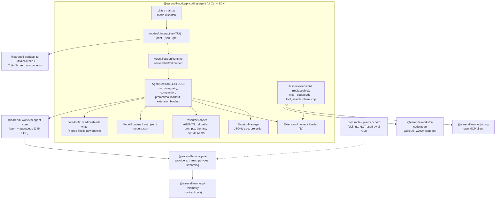

# Pi coding agent (pi CLI + pi-tui)

> **Verdict.** `pi` is a terminal coding agent built as a thin product shell over three reusable libraries from the same monorepo: `pi-ai` (provider abstraction), `pi-agent-core` (the turn loop), and `pi-tui` (a differential-rendering terminal toolkit). Its model-facing surface is small. Four tools are active by default, there is no permission system, and the default system prompt plus tool declarations come to roughly 1.3–1.5k tokens. The rest of the product sits behind a large in-process extension API with 41 hook events, tool, command, provider, and UI registration, and npm/git "pi packages". The product layer is not small: `packages/coding-agent/src` has about 76k lines of TypeScript, and its `AgentSession` class alone is 4.4k lines. Since 0.87 (September 2026) the append-only JSONL session tree has been the canonical source of model context. Since 0.99, MCP, codemode, and tool search ship as *replaceable built-in extensions*, reversing the author's 2025 "no MCP" stance. Build on pi if you want a hackable single-agent TUI/CLI that can also run headless, over JSONL RPC, or as an in-process TypeScript SDK. If you need built-in sandboxing, approvals, multi-agent orchestration, or durable execution, use something else or add them yourself; `pi-durable` in the same repo is a separate runtime.

| | |
|---|---|
| Repo(s) | `earendil-works/pi` @ `b45e0ebcc5ae` (monorepo; this chapter covers `packages/coding-agent` and `packages/tui`) |
| License | MIT (all packages) |
| Language(s) | TypeScript (Node ≥ 22.19, erasable-syntax-only so it runs from source under Node type stripping); optional Bun-compiled single binary; ~1k lines of C/Objective-C for native clipboard modules in pi-tui |
| Size | Repo: 1,922 tracked files. `coding-agent`: 797 files. `src` is 76.0k LOC: harness core `src/core` 35.5k (tools 4.6k, extension system 5.0k, compaction 1.7k, `agent-session.ts` 4.4k, `session-manager.ts` 2.0k); interactive TUI mode 21.9k; built-in extensions 7.5k (MCP 4.3k, llama.cpp 1.6k, codemode 1.4k, tool search 0.3k); RPC 1.8k; CLI and utils 5.2k. Tests 69.4k LOC; examples 16.0k LOC (80 example extensions, 14 SDK examples); docs about 102k words. `pi-tui`: 19.5k src, 20.2k tests. Direct deps in the same repo: `pi-agent-core` 2.5k, `pi-ai` 27.0k, `pi-mcp` 3.3k, `pi-codemode` 3.0k |
| Version at pin | 1.2.0 (2026-10-12). All workspace packages are versioned in lockstep and pinned exactly |
| Release history | GitHub repo created 2025-08-09. The CHANGELOG starts at 0.10.0, "Initial public release" (2025-11-25). 0.74.0 (2026-05-07) moved npm scope from `@mariozechner/*` to `@earendil-works/*`. 0.87.0 (2026-09-21): `SessionManager` canonical for context, `context_edit` entries. 0.99.0 (2026-09-29): codemode, tool search, and MCP as built-in extensions; virtual models. 1.0.0 (2026-10-01): fullscreen TUI by default. 1.1.0 (2026-10-07), 1.2.0 (2026-10-12) |
| Category | `hybrid`: a product deliberately split into reusable libraries (`pi-ai`, `pi-agent-core`, `pi-tui`, `pi-mcp`, `pi-codemode`) and a product shell that is itself embeddable as an SDK |

Citation convention: links point to the pinned commit. Display paths omit the leading `packages/`, except for repo-root files.

---

## 1. Layering & package map



| Layer | Owns | Evidence |
|---|---|---|
| `pi-ai` | `Message`/`SystemMessage` transcript types with `sections`, `toolsAdded`, `toolsRemoved`; provider adapters; `streamSimple`; usage and cost | [`ai/src/types.ts:L541-L557`](https://github.com/earendil-works/pi/blob/b45e0ebcc5ae2fc42a6f2f23104d10e656e6bedb/packages/ai/src/types.ts#L541-L557) |
| `pi-agent-core` | `Agent` (state, steering and follow-up queues, abort) and `runLoop` (turns, tool execution, hook points) | [`agent/src/agent-loop.ts:L163-L321`](https://github.com/earendil-works/pi/blob/b45e0ebcc5ae2fc42a6f2f23104d10e656e6bedb/packages/agent/src/agent-loop.ts#L163-L321) |
| `pi-coding-agent` core | Session tree and projection, compaction, prompt assembly, tool implementations, extension runtime, auth, settings, package manager | [`coding-agent/src/core/sdk.ts:L191-L487`](https://github.com/earendil-works/pi/blob/b45e0ebcc5ae2fc42a6f2f23104d10e656e6bedb/packages/coding-agent/src/core/sdk.ts#L191-L487) |
| Modes | Interactive TUI, print/JSON, RPC over stdin/stdout | [`coding-agent/src/main.ts:L112-L123`](https://github.com/earendil-works/pi/blob/b45e0ebcc5ae2fc42a6f2f23104d10e656e6bedb/packages/coding-agent/src/main.ts#L112-L123) |
| Built-in extensions | MCP client, codemode, tool search, llama.cpp provider, loaded as `builtin:<name>` and replaceable | [`coding-agent/src/extensions/index.ts:L7-L14`](https://github.com/earendil-works/pi/blob/b45e0ebcc5ae2fc42a6f2f23104d10e656e6bedb/packages/coding-agent/src/extensions/index.ts#L7-L14) |
| `pi-tui` | Component model, two renderers, editor, markdown, overlays, keys, images | [`tui/src/tui.ts:L117-L138`](https://github.com/earendil-works/pi/blob/b45e0ebcc5ae2fc42a6f2f23104d10e656e6bedb/packages/tui/src/tui.ts#L117-L138) |

The coding agent's direct workspace dependencies are `pi-agent-core`, `pi-ai`, `pi-codemode`, `pi-mcp`, and `pi-tui` ([`coding-agent/package.json:L42-L47`](https://github.com/earendil-works/pi/blob/b45e0ebcc5ae2fc42a6f2f23104d10e656e6bedb/packages/coding-agent/package.json#L42-L47)). It does **not** depend on `pi-durable`, `pi-env`, or `chord`; 1.2.0 explicitly removed the `chord` dependency together with an unreleased server/client/plugin stack ([`coding-agent/CHANGELOG.md:L80-L81`](https://github.com/earendil-works/pi/blob/b45e0ebcc5ae2fc42a6f2f23104d10e656e6bedb/packages/coding-agent/CHANGELOG.md#L80-L81)). Composition with agent-core is visible in `createAgentSession`, which constructs an `Agent` from pi-agent-core. Its `streamFn` routes through `ModelRuntime.streamSimple`, its `convertToLlm` filters coding-agent message roles, and its `transformContext` dispatches the extensions' `context` event ([`sdk.ts:L411-L446`](https://github.com/earendil-works/pi/blob/b45e0ebcc5ae2fc42a6f2f23104d10e656e6bedb/packages/coding-agent/src/core/sdk.ts#L411-L446)). The module also sets pi-ai's `streamSimple` as agent-core's default stream function for back-compat, because agent-core itself stays provider-agnostic ([`sdk.ts:L43-L46`](https://github.com/earendil-works/pi/blob/b45e0ebcc5ae2fc42a6f2f23104d10e656e6bedb/packages/coding-agent/src/core/sdk.ts#L43-L46)). Coding-agent-specific message roles (`bashExecution`, `custom`, `branchSummary`, `compactionSummary`) are added to agent-core's `AgentMessage` union through TypeScript declaration merging ([`coding-agent/src/core/messages.ts:L28-L77`](https://github.com/earendil-works/pi/blob/b45e0ebcc5ae2fc42a6f2f23104d10e656e6bedb/packages/coding-agent/src/core/messages.ts#L28-L77)).

## 2. Agent loop

The loop has two levels. pi-agent-core runs turns. `AgentSession` wraps each agent-core run in a driver that handles retries, overflow recovery, and extension "settle" boundaries.

**Inner engine (`pi-agent-core`).** `runLoop` is a double `while`. The inner loop runs while the last response had tool calls or steering messages are pending. The outer loop restarts when follow-up messages arrive after the agent would otherwise stop ([`agent-loop.ts:L163-L321`](https://github.com/earendil-works/pi/blob/b45e0ebcc5ae2fc42a6f2f23104d10e656e6bedb/packages/agent/src/agent-loop.ts#L163-L321)). Each iteration:

1. After the first turn, `prepareNextTurn(…)` may swap context, model, or thinking level, then steering is polled again ([L185-L207](https://github.com/earendil-works/pi/blob/b45e0ebcc5ae2fc42a6f2f23104d10e656e6bedb/packages/agent/src/agent-loop.ts#L185-L207)).
2. Queued and prepared messages are appended, preceded by a synthesized `system` message whenever the executable tool set differs from what the transcript has declared (`declareToolChanges`, [L333-L363](https://github.com/earendil-works/pi/blob/b45e0ebcc5ae2fc42a6f2f23104d10e656e6bedb/packages/agent/src/agent-loop.ts#L333-L363)).
3. `prepareRequest(…)` may replace the request context or model ([L219-L239](https://github.com/earendil-works/pi/blob/b45e0ebcc5ae2fc42a6f2f23104d10e656e6bedb/packages/agent/src/agent-loop.ts#L219-L239)).
4. `streamAssistantResponse` applies `transformContext` and `convertToLlm`, resolves the API key per request, and streams `message_start/update/end` events ([L381-L469](https://github.com/earendil-works/pi/blob/b45e0ebcc5ae2fc42a6f2f23104d10e656e6bedb/packages/agent/src/agent-loop.ts#L381-L469)).
5. `error`/`aborted` stop reasons end the run. A `length` stop fails every tool call in the message instead of executing possibly-truncated arguments ([L245-L272](https://github.com/earendil-works/pi/blob/b45e0ebcc5ae2fc42a6f2f23104d10e656e6bedb/packages/agent/src/agent-loop.ts#L245-L272), [L478-L503](https://github.com/earendil-works/pi/blob/b45e0ebcc5ae2fc42a6f2f23104d10e656e6bedb/packages/agent/src/agent-loop.ts#L478-L503)).
6. `finishTurn` returns `continue`/`end`, then `turn_end` is emitted ([L280-L298](https://github.com/earendil-works/pi/blob/b45e0ebcc5ae2fc42a6f2f23104d10e656e6bedb/packages/agent/src/agent-loop.ts#L280-L298)).

**Tool calls run in parallel by default.** The batch drops to sequential if the agent is configured that way or if *any* tool in the batch declares `executionMode: "sequential"` ([`agent-loop.ts:L508-L523`](https://github.com/earendil-works/pi/blob/b45e0ebcc5ae2fc42a6f2f23104d10e656e6bedb/packages/agent/src/agent-loop.ts#L508-L523)). In parallel mode, preparation (lookup → `prepareArguments` → schema validation → `beforeToolCall`) runs in order; executions then run concurrently, and result messages are emitted in the original call order ([L586-L660](https://github.com/earendil-works/pi/blob/b45e0ebcc5ae2fc42a6f2f23104d10e656e6bedb/packages/agent/src/agent-loop.ts#L586-L660), [L708-L777](https://github.com/earendil-works/pi/blob/b45e0ebcc5ae2fc42a6f2f23104d10e656e6bedb/packages/agent/src/agent-loop.ts#L708-L777)). A batch stops the run only if every result sets `terminate: true`. The default is `toolExecution: "parallel"`, and both queues default to `"one-at-a-time"` ([`agent/src/agent.ts:L247-L253`](https://github.com/earendil-works/pi/blob/b45e0ebcc5ae2fc42a6f2f23104d10e656e6bedb/packages/agent/src/agent.ts#L247-L253)). File writes stay safe under parallelism because `edit`/`write` go through `withFileMutationQueue`, which serializes mutations per `realpath` ([`tools/file-mutation-queue.ts:L29-L32`](https://github.com/earendil-works/pi/blob/b45e0ebcc5ae2fc42a6f2f23104d10e656e6bedb/packages/coding-agent/src/core/tools/file-mutation-queue.ts#L29-L32)).

**Outer driver (`AgentSession`).** The constructor installs one hook into each agent-core extension point: tool hooks, next-turn refresh, request projection, turn-end boundary, hidden-declaration projection, and forced-prompt projection ([`agent-session.ts:L486-L527`](https://github.com/earendil-works/pi/blob/b45e0ebcc5ae2fc42a6f2f23104d10e656e6bedb/packages/coding-agent/src/core/agent-session.ts#L486-L527)). A run then proceeds:

```
prompt(text)
 ├─ input handlers → skill/template expansion          (AgentSession.prompt, L2058+)
 ├─ if streaming: require streamingBehavior → steer|followUp queue   (L2102-L2116)
 ├─ _prepareRun: pre-prompt compaction check, before_agent_start,
 │   tool loadout + system-prompt section diff → system patch message (L1890-L1941)
 ├─ agent.prompt(messages)                               ── pi-agent-core runLoop
 │    ├─ prepareRequest  → re-project context from SessionManager each request (L788-L850)
 │    ├─ prepareNextTurn → threshold compaction between turns + prompt diff   (L899-L935)
 │    ├─ before/afterToolCall → extension tool_call / tool_result             (L653-L726)
 │    └─ finishTurn → actionable turn_end boundary                           (L887-L897)
 ├─ loop: _handlePostAgentRun (retry w/ backoff | overflow compaction) → agent.continue()
 │        _runBeforeSettleBoundary (extensions may force one more turn)       (L1862-L1881)
 └─ agent_settled
```

([`agent-session.ts:L1862-L1881`](https://github.com/earendil-works/pi/blob/b45e0ebcc5ae2fc42a6f2f23104d10e656e6bedb/packages/coding-agent/src/core/agent-session.ts#L1862-L1881), [`L1890-L1941`](https://github.com/earendil-works/pi/blob/b45e0ebcc5ae2fc42a6f2f23104d10e656e6bedb/packages/coding-agent/src/core/agent-session.ts#L1890-L1941), [`L2102-L2116`](https://github.com/earendil-works/pi/blob/b45e0ebcc5ae2fc42a6f2f23104d10e656e6bedb/packages/coding-agent/src/core/agent-session.ts#L2102-L2116).)

**Retries.** Retryable assistant errors (context overflow excluded) get exponential backoff. The defaults are `maxRetries: 3`, `baseDelayMs: 2000` ([`settings-defaults.ts:L18-L25`](https://github.com/earendil-works/pi/blob/b45e0ebcc5ae2fc42a6f2f23104d10e656e6bedb/packages/coding-agent/src/core/settings-defaults.ts#L18-L25)). The failed attempt is *kept in raw history but omitted from model projection* through a `context_edit` entry, not deleted ([`agent-session.ts:L3739-L3743`](https://github.com/earendil-works/pi/blob/b45e0ebcc5ae2fc42a6f2f23104d10e656e6bedb/packages/coding-agent/src/core/agent-session.ts#L3739-L3743), [`L3792-L3828`](https://github.com/earendil-works/pi/blob/b45e0ebcc5ae2fc42a6f2f23104d10e656e6bedb/packages/coding-agent/src/core/agent-session.ts#L3792-L3828)). Context overflow gets exactly one compact-and-retry, and recoverable `length` stops are treated the same way. A second failure surfaces as `compaction_end` carrying an error ([`L2977-L3115`](https://github.com/earendil-works/pi/blob/b45e0ebcc5ae2fc42a6f2f23104d10e656e6bedb/packages/coding-agent/src/core/agent-session.ts#L2977-L3115)).

**Persistence happens on events.** On `message_end`, the session appends user/assistant/toolResult/system messages as `message` entries and extension messages as `custom_message` entries. Context-only custom messages queued mid-run are flushed only at `turn_end`, so they can never land between a tool call and its result ([`agent-session.ts:L1148-L1199`](https://github.com/earendil-works/pi/blob/b45e0ebcc5ae2fc42a6f2f23104d10e656e6bedb/packages/coding-agent/src/core/agent-session.ts#L1148-L1199)).

## 3. Model / provider abstraction

pi-ai, which has its own chapter, supplies the message model. The important property for the coding agent is that **the system prompt and tool declarations live in the transcript.** A `SystemMessage` carries `content`, named `sections` (later messages replace sections by name; `null` deletes one), and `toolsAdded`/`toolsRemoved` ([`ai/src/types.ts:L541-L557`](https://github.com/earendil-works/pi/blob/b45e0ebcc5ae2fc42a6f2f23104d10e656e6bedb/packages/ai/src/types.ts#L541-L557)). The coding agent diffs the desired prompt sections against the sections replayed from the transcript and appends only a patch message ([`system-prompt.ts:L217-L229`](https://github.com/earendil-works/pi/blob/b45e0ebcc5ae2fc42a6f2f23104d10e656e6bedb/packages/coding-agent/src/core/system-prompt.ts#L217-L229), [`agent-session.ts:L1743-L1755`](https://github.com/earendil-works/pi/blob/b45e0ebcc5ae2fc42a6f2f23104d10e656e6bedb/packages/coding-agent/src/core/agent-session.ts#L1743-L1755)). As a result, enabling a tool, connecting an MCP server, or updating an `mcp_servers` summary mid-session leaves the cached prompt prefix intact. Custom providers receive this normalized transcript and must call `collapseSystemMessages` if their API does not accept mid-conversation system messages (docs: `custom-provider.md`).

Provider coverage comes from pi-ai: `ai/src/providers/` has about 45 provider modules and helpers (Anthropic, OpenAI, OpenAI Codex, Azure, Bedrock, Google/Vertex, Mistral, xAI, DeepSeek, Kimi, Qwen, MiniMax, Z.ai, OpenRouter, Vercel AI Gateway, Cloudflare, Groq, Cerebras, GitHub Copilot, OpenCode, …) over roughly two dozen wire-API adapters in `ai/src/api/`. The coding agent adds:

- **`ModelRuntime`** with `auth.json` (file mode `0600`, directory `0700`, `proper-lockfile` locking), OAuth `/login` flows, and `models.json` custom models ([`auth-storage.ts:L37`](https://github.com/earendil-works/pi/blob/b45e0ebcc5ae2fc42a6f2f23104d10e656e6bedb/packages/coding-agent/src/core/auth-storage.ts#L37), [`L71`](https://github.com/earendil-works/pi/blob/b45e0ebcc5ae2fc42a6f2f23104d10e656e6bedb/packages/coding-agent/src/core/auth-storage.ts#L71)).
- **Extension-registered providers** (`pi.registerProvider`, which takes a `streamSimple`, OAuth, `refreshModels`, image and classifier APIs) and **virtual models** (`pi.registerVirtualModel`) that route each request to a physical model. Routing happens inside the request-projection hook ([`extensions/types.ts:L1858-L1859`](https://github.com/earendil-works/pi/blob/b45e0ebcc5ae2fc42a6f2f23104d10e656e6bedb/packages/coding-agent/src/core/extensions/types.ts#L1858-L1859), [`L1911`](https://github.com/earendil-works/pi/blob/b45e0ebcc5ae2fc42a6f2f23104d10e656e6bedb/packages/coding-agent/src/core/extensions/types.ts#L1911), [`agent-session.ts:L815-L849`](https://github.com/earendil-works/pi/blob/b45e0ebcc5ae2fc42a6f2f23104d10e656e6bedb/packages/coding-agent/src/core/agent-session.ts#L815-L849)).
- **Thinking levels** `off|minimal|low|medium|high|xhigh|max`, defaulting to `medium` and clamped to model capability ([`sdk.ts:L253-L278`](https://github.com/earendil-works/pi/blob/b45e0ebcc5ae2fc42a6f2f23104d10e656e6bedb/packages/coding-agent/src/core/sdk.ts#L253-L278)). Level and model changes are recorded as `thinking_level_change`/`model_change` entries, so resume restores them.
- **Prompt-cache management.** Apart from the append-only prompt patches, a `CacheWarmer` replays the last request with a one-token cap at 90% of the cache TTL. It does so only when the expected saving is at least $0.05, assuming a measured 15% idle-continuation probability ([`cache-warmer.ts:L15-L32`](https://github.com/earendil-works/pi/blob/b45e0ebcc5ae2fc42a6f2f23104d10e656e6bedb/packages/coding-agent/src/core/cache-warmer.ts#L15-L32)). It warms only requests whose transcript is a prefix of current state ([`sdk.ts:L367-L381`](https://github.com/earendil-works/pi/blob/b45e0ebcc5ae2fc42a6f2f23104d10e656e6bedb/packages/coding-agent/src/core/sdk.ts#L367-L381)). Summarization calls explicitly use `cacheRetention: "none"` ([`compaction.ts:L619-L639`](https://github.com/earendil-works/pi/blob/b45e0ebcc5ae2fc42a6f2f23104d10e656e6bedb/packages/coding-agent/src/core/compaction/compaction.ts#L619-L639)).
- **Cost.** `Usage` (with `cost`) is attached to every assistant message. Non-context spend such as cache warming is stored as `usage` entries, and nested codemode calls fold their usage into the parent tool result ([`agent-session.ts:L1108-L1120`](https://github.com/earendil-works/pi/blob/b45e0ebcc5ae2fc42a6f2f23104d10e656e6bedb/packages/coding-agent/src/core/agent-session.ts#L1108-L1120)).

## 4. Tool system

**Definition API.** `ToolDefinition` uses TypeBox schemas and carries more than a name, description, and schema. Its fields are `promptSnippet` and `promptGuidelines` (both feed the system prompt), `exposure`, `namespace`, MCP-style `annotations`, `outputSchema`/`structuredContent`, `prepareArguments` (a compatibility shim), `executionMode`, `prepareLoadout` (rewrites how the loadout is presented), `reachesTools`, `constrainedSampling`, `defaultActive`, and TUI `renderCall`/`renderResult` ([`extensions/types.ts:L579-L668`](https://github.com/earendil-works/pi/blob/b45e0ebcc5ae2fc42a6f2f23104d10e656e6bedb/packages/coding-agent/src/core/extensions/types.ts#L579-L668)). `exposure` decides how the model reaches a tool ([`L501-L516`](https://github.com/earendil-works/pi/blob/b45e0ebcc5ae2fc42a6f2f23104d10e656e6bedb/packages/coding-agent/src/core/extensions/types.ts#L501-L516)):

| Exposure | Declared to model | Callable via `ctx.executeTool` (codemode) | Activated on register |
|---|---|---|---|
| `direct` (default) | while active | while active | yes |
| `model-only` | while active | never | yes |
| `codemode` | only if explicitly activated | always | no |
| `deferred` | after `tool_search` loads it | always (not listed) | no |
| `hidden` | never | never | no |

**Built-in tools.** Eight are implemented: `read`, `bash`, `powershell`, `edit`, `write`, `grep`, `find`, `ls` ([`tools/index.ts:L95-L105`](https://github.com/earendil-works/pi/blob/b45e0ebcc5ae2fc42a6f2f23104d10e656e6bedb/packages/coding-agent/src/core/tools/index.ts#L95-L105)). Only **four are on by default**: `DEFAULT_TOOL_NAMES = ["read", "bash", "edit", "write"]` ([`settings-manager.ts:L85`](https://github.com/earendil-works/pi/blob/b45e0ebcc5ae2fc42a6f2f23104d10e656e6bedb/packages/coding-agent/src/core/settings-manager.ts#L85), [`system-prompt.ts:L64`](https://github.com/earendil-works/pi/blob/b45e0ebcc5ae2fc42a6f2f23104d10e656e6bedb/packages/coding-agent/src/core/system-prompt.ts#L64)). The built-in extensions register `codemode` and `tool_search` *inactive* (`defaultActive: false`) ([`extensions/codemode/index.ts:L32-L47`](https://github.com/earendil-works/pi/blob/b45e0ebcc5ae2fc42a6f2f23104d10e656e6bedb/packages/coding-agent/src/extensions/codemode/index.ts#L32-L47), [`extensions/tool-search/index.ts:L12-L16`](https://github.com/earendil-works/pi/blob/b45e0ebcc5ae2fc42a6f2f23104d10e656e6bedb/packages/coding-agent/src/extensions/tool-search/index.ts#L12-L16)). MCP tools are registered as `mcp__<server>__<tool>`; the default server exposure `codemode` maps to tool exposure `deferred`, so they add **no** declarations until a script or `tool_search` reaches them ([`extensions/mcp/tools.ts:L41-L46`](https://github.com/earendil-works/pi/blob/b45e0ebcc5ae2fc42a6f2f23104d10e656e6bedb/packages/coding-agent/src/extensions/mcp/tools.ts#L41-L46)). `--tools +codemode,-write` edits the default set instead of replacing it ([`sdk.ts:L280-L294`](https://github.com/earendil-works/pi/blob/b45e0ebcc5ae2fc42a6f2f23104d10e656e6bedb/packages/coding-agent/src/core/sdk.ts#L280-L294)).

| Tool | Behaviour | Evidence |
|---|---|---|
| `read` | Text (head-truncated to 2,000 lines / 50 KB, continue with `offset`) or images as attachments, auto-resized per model `inputLimits` | [`read.ts:L20-L23`](https://github.com/earendil-works/pi/blob/b45e0ebcc5ae2fc42a6f2f23104d10e656e6bedb/packages/coding-agent/src/core/tools/read.ts#L20-L23), [`truncate.ts:L11-L12`](https://github.com/earendil-works/pi/blob/b45e0ebcc5ae2fc42a6f2f23104d10e656e6bedb/packages/coding-agent/src/core/tools/truncate.ts#L11-L12) |
| `bash` | `{command, timeout?}` with no default timeout. Output is tail-truncated to the same limits; the full output spills to a temp file whose path goes to the model. Exposes `PI_*` env vars. Pluggable `BashOperations.exec`, `commandPrefix`, `spawnHook` | [`bash.ts:L75-L94`](https://github.com/earendil-works/pi/blob/b45e0ebcc5ae2fc42a6f2f23104d10e656e6bedb/packages/coding-agent/src/core/tools/bash.ts#L75-L94), [`L214-L225`](https://github.com/earendil-works/pi/blob/b45e0ebcc5ae2fc42a6f2f23104d10e656e6bedb/packages/coding-agent/src/core/tools/bash.ts#L214-L225), [`L243-L258`](https://github.com/earendil-works/pi/blob/b45e0ebcc5ae2fc42a6f2f23104d10e656e6bedb/packages/coding-agent/src/core/tools/bash.ts#L243-L258) |
| `edit` | `{path, edits:[{oldText,newText}]}`. Each edit is matched against the original file; exact match first, then fuzzy (trailing whitespace, smart quotes). BOM and CRLF are preserved | [`edit.ts:L43-L51`](https://github.com/earendil-works/pi/blob/b45e0ebcc5ae2fc42a6f2f23104d10e656e6bedb/packages/coding-agent/src/core/tools/edit.ts#L43-L51), [`edit-diff.ts:L34`](https://github.com/earendil-works/pi/blob/b45e0ebcc5ae2fc42a6f2f23104d10e656e6bedb/packages/coding-agent/src/core/tools/edit-diff.ts#L34), [`L207-L225`](https://github.com/earendil-works/pi/blob/b45e0ebcc5ae2fc42a6f2f23104d10e656e6bedb/packages/coding-agent/src/core/tools/edit-diff.ts#L207-L225) |
| `write` | Create or overwrite, `mkdir -p` | [`write.ts:L16-L19`](https://github.com/earendil-works/pi/blob/b45e0ebcc5ae2fc42a6f2f23104d10e656e6bedb/packages/coding-agent/src/core/tools/write.ts#L16-L19) |
| `grep`/`find`/`ls` | Off by default. Respect `.gitignore`; caps of 100 matches / 1,000 paths / 500 entries | [`grep.ts:L41`](https://github.com/earendil-works/pi/blob/b45e0ebcc5ae2fc42a6f2f23104d10e656e6bedb/packages/coding-agent/src/core/tools/grep.ts#L41), [`find.ts:L41`](https://github.com/earendil-works/pi/blob/b45e0ebcc5ae2fc42a6f2f23104d10e656e6bedb/packages/coding-agent/src/core/tools/find.ts#L41), [`ls.ts:L23`](https://github.com/earendil-works/pi/blob/b45e0ebcc5ae2fc42a6f2f23104d10e656e6bedb/packages/coding-agent/src/core/tools/ls.ts#L23) |

Every built-in tool takes an `*Operations` interface (`ReadOperations`, `WriteOperations`, `BashOperations`, …). That interface is the seam for remote execution: the SSH example and the Gondolin micro-VM extension use it to run tools elsewhere while `pi` and credentials stay on the host.

**Execution pipeline.** `prepareArguments` → TypeBox validation (`validateToolArguments`) → `beforeToolCall` → `execute(id, params, signal, onUpdate, ctx)` → `afterToolCall`. Streaming partial results arrive through `onUpdate` and are surfaced as `tool_execution_update`. In the coding agent, `beforeToolCall` is the extension `tool_call` event and `afterToolCall` is `tool_result` followed by image normalization ([`agent-session.ts:L653-L726`](https://github.com/earendil-works/pi/blob/b45e0ebcc5ae2fc42a6f2f23104d10e656e6bedb/packages/coding-agent/src/core/agent-session.ts#L653-L726)). Tools that call other tools (codemode) use `runToolCall`, which applies the same hooks, so permission extensions also see nested calls; nested events carry `parentToolCallId` ([`agent-loop.ts:L802-L819`](https://github.com/earendil-works/pi/blob/b45e0ebcc5ae2fc42a6f2f23104d10e656e6bedb/packages/agent/src/agent-loop.ts#L802-L819)).

**Approvals.** There are none in core. `tool_call` handlers can `block` with a `reason`; the first blocking handler wins ([`extensions/runner.ts:L1249-L1267`](https://github.com/earendil-works/pi/blob/b45e0ebcc5ae2fc42a6f2f23104d10e656e6bedb/packages/coding-agent/src/core/extensions/runner.ts#L1249-L1267)). A handler that throws blocks the call, so the gate fails closed ([`agent-session.ts:L659-L683`](https://github.com/earendil-works/pi/blob/b45e0ebcc5ae2fc42a6f2f23104d10e656e6bedb/packages/coding-agent/src/core/agent-session.ts#L659-L683)).

**Model-facing size (measured).** The default prompt text was reconstructed from the source strings in `system-prompt.ts` and the four tools' `promptSnippet`/`promptGuidelines`. It is ≈2.7 KB, about half of it the `<docs>` section (1.3 KB). The four tool declarations as JSON Schema are another ≈2.7 KB. At ~4 characters per token, that is **≈1.3–1.5k tokens** before AGENTS.md and skills. This is an inference from string lengths, not a tokenizer run. The author's November 2025 post claims "system prompt and tool definitions together come in below 1000 tokens" (Zechner, 2025-11-30). The surface has grown since then, mainly through the self-documentation pointers and the multi-edit `edit` guidelines. The CHANGELOG states that a GPT-5.6 request with codemode active shrank from ≈5,300 to ≈3,300 tokens in 1.0.0 ([`CHANGELOG.md:L264`](https://github.com/earendil-works/pi/blob/b45e0ebcc5ae2fc42a6f2f23104d10e656e6bedb/packages/coding-agent/CHANGELOG.md#L264)).

## 5. Context management

**System prompt assembly.** `buildSystemPromptSections` produces ordered, tag-wrapped sections ([`system-prompt.ts:L128-L193`](https://github.com/earendil-works/pi/blob/b45e0ebcc5ae2fc42a6f2f23104d10e656e6bedb/packages/coding-agent/src/core/system-prompt.ts#L128-L193)):

| Section | Content |
|---|---|
| `preamble` | One sentence: "You are an expert coding assistant operating inside pi, a coding agent harness…" ([L155-L156](https://github.com/earendil-works/pi/blob/b45e0ebcc5ae2fc42a6f2f23104d10e656e6bedb/packages/coding-agent/src/core/system-prompt.ts#L155-L156)), or the `customPrompt` from `SYSTEM.md`/`--system-prompt` |
| `<tools>` | One-line `promptSnippet` per declared tool. Tools without a snippet are omitted |
| `<rules>` | Deduplicated tool guidelines plus "Be concise…" and "Show file paths…" ([L88-L125](https://github.com/earendil-works/pi/blob/b45e0ebcc5ae2fc42a6f2f23104d10e656e6bedb/packages/coding-agent/src/core/system-prompt.ts#L88-L125)) |
| `<docs>` | Paths to pi's own README/docs/examples, used when the user asks pi to extend itself ([L162-L169](https://github.com/earendil-works/pi/blob/b45e0ebcc5ae2fc42a6f2f23104d10e656e6bedb/packages/coding-agent/src/core/system-prompt.ts#L162-L169)) |
| `<addendum>`, `<project_context>`, `<skills>`, `<cwd>`, extension `sections` (e.g. `mcp_servers`) | [L172-L186](https://github.com/earendil-works/pi/blob/b45e0ebcc5ae2fc42a6f2f23104d10e656e6bedb/packages/coding-agent/src/core/system-prompt.ts#L172-L186) |

A `before_agent_start` handler may set `forceSystemPrompt`, which replaces the whole prompt as opaque text ([`L199-L205`](https://github.com/earendil-works/pi/blob/b45e0ebcc5ae2fc42a6f2f23104d10e656e6bedb/packages/coding-agent/src/core/system-prompt.ts#L199-L205)). `SYSTEM.md` replaces the default prefix and `APPEND_SYSTEM.md` appends to it. Each is looked up first in project `.pi/` (only if the project is trusted) and then globally ([`resource-loader.ts:L1213-L1239`](https://github.com/earendil-works/pi/blob/b45e0ebcc5ae2fc42a6f2f23104d10e656e6bedb/packages/coding-agent/src/core/resource-loader.ts#L1213-L1239)).

**Project instruction files.** Each directory contributes its first match in the order `AGENTS.override.md`, `AGENTS.md`, `AGENTS.MD`, `CLAUDE.md`, `CLAUDE.MD`. The global agent-dir file comes first, then every ancestor from the filesystem root down to cwd. A nested git worktree's copy shadows the main repo's copy ([`resource-loader.ts:L184-L203`](https://github.com/earendil-works/pi/blob/b45e0ebcc5ae2fc42a6f2f23104d10e656e6bedb/packages/coding-agent/src/core/resource-loader.ts#L184-L203), [`L232-L274`](https://github.com/earendil-works/pi/blob/b45e0ebcc5ae2fc42a6f2f23104d10e656e6bedb/packages/coding-agent/src/core/resource-loader.ts#L232-L274)). These files load *regardless of project trust*.

**Skills** follow the Agent Skills format (`SKILL.md` + frontmatter, `disable-model-invocation`). Only `name/description/location` enter the prompt as `<available_skills>`; the model loads the body with `read` or `bash` when needed, and `/skill:name` invokes one explicitly ([`skills.ts:L358-L388`](https://github.com/earendil-works/pi/blob/b45e0ebcc5ae2fc42a6f2f23104d10e656e6bedb/packages/coding-agent/src/core/skills.ts#L358-L388)). **Prompt templates** are Markdown files with bash-style argument substitution (`$1`, `$@`, `${N:-default}`, `${@:N:L}`) ([`prompt-templates.ts:L66-L109`](https://github.com/earendil-works/pi/blob/b45e0ebcc5ae2fc42a6f2f23104d10e656e6bedb/packages/coding-agent/src/core/prompt-templates.ts#L66-L109)).

**Compaction** has two triggers:

- **Threshold:** `contextTokens > contextWindow − reserveTokens` ([`compaction.ts:L267-L270`](https://github.com/earendil-works/pi/blob/b45e0ebcc5ae2fc42a6f2f23104d10e656e6bedb/packages/coding-agent/src/core/compaction/compaction.ts#L267-L270)), with defaults `reserveTokens: 16384`, `keepRecentTokens: 20000` ([`L126-L130`](https://github.com/earendil-works/pi/blob/b45e0ebcc5ae2fc42a6f2f23104d10e656e6bedb/packages/coding-agent/src/core/compaction/compaction.ts#L126-L130)). The check runs after a run, before a prompt, and between turns inside a run ([`agent-session.ts:L777-L786`](https://github.com/earendil-works/pi/blob/b45e0ebcc5ae2fc42a6f2f23104d10e656e6bedb/packages/coding-agent/src/core/agent-session.ts#L777-L786)).
- **Overflow:** a provider overflow error or a recoverable length stop triggers compaction and one retry.

The algorithm in `prepareCompaction` works on the projected session ([`L872-L936`](https://github.com/earendil-works/pi/blob/b45e0ebcc5ae2fc42a6f2f23104d10e656e6bedb/packages/coding-agent/src/core/compaction/compaction.ts#L872-L936)):

1. Walk back from the newest entry, accumulating estimated tokens until `keepRecentTokens` is reached.
2. Cut at a user or assistant message, never at a tool result.
3. If the cut splits a turn, summarize the turn prefix separately with a dedicated prompt ([`L942-L955`](https://github.com/earendil-works/pi/blob/b45e0ebcc5ae2fc42a6f2f23104d10e656e6bedb/packages/coding-agent/src/core/compaction/compaction.ts#L942-L955)).
4. Serialize the history to text inside `<conversation>` tags so the summarizer does not continue it, and request a fixed Markdown checkpoint (Goal / Constraints / Progress Done-In-Progress-Blocked / Key Decisions / Next Steps / Critical Context) ([`L507-L538`](https://github.com/earendil-works/pi/blob/b45e0ebcc5ae2fc42a6f2f23104d10e656e6bedb/packages/coding-agent/src/core/compaction/compaction.ts#L507-L538)).
5. If a previous summary exists, run an *update* prompt that merges into it instead of re-summarizing ([`L540-L579`](https://github.com/earendil-works/pi/blob/b45e0ebcc5ae2fc42a6f2f23104d10e656e6bedb/packages/coding-agent/src/core/compaction/compaction.ts#L540-L579)).
6. Append cumulative read and modified file lists, carried over from prior compactions.

The summary is capped at `0.8 × reserveTokens` output tokens and rejected if it hits `length` or tries to call a tool. The `CompactionEntry` stores `firstKeptEntryId`, `tokensBefore`, `details`, and a snapshot `systemMessage` of the full prompt and tool state at the boundary ([`session-manager.ts:L91-L104`](https://github.com/earendil-works/pi/blob/b45e0ebcc5ae2fc42a6f2f23104d10e656e6bedb/packages/coding-agent/src/core/session-manager.ts#L91-L104)). Extensions can cancel the compaction or supply their own summary through `session_before_compact`.

**Branch summarization.** When `/tree` navigates elsewhere, pi can summarize the abandoned path (old leaf → common ancestor) and insert a `branch_summary` entry at the target ([`compaction/branch-summarization.ts:L108-L146`](https://github.com/earendil-works/pi/blob/b45e0ebcc5ae2fc42a6f2f23104d10e656e6bedb/packages/coding-agent/src/core/compaction/branch-summarization.ts#L108-L146), [`agent-session.ts:L3994-L4168`](https://github.com/earendil-works/pi/blob/b45e0ebcc5ae2fc42a6f2f23104d10e656e6bedb/packages/coding-agent/src/core/agent-session.ts#L3994-L4168)). **Context edits** (`context_edit` with `replacement: null` or new content) let extensions prune or rewrite what the model sees without touching raw history. **Spill-to-disk** is limited to bash/codemode full output in temp files. There is **no built-in memory** beyond AGENTS.md.

## 6. State, sessions & durability

**Format.** Sessions are JSONL, version 3, stored at `~/.pi/agent/sessions/--<cwd with separators → '-'>--/<ISO-ts>_<uuidv7>.jsonl` ([`session-manager.ts:L589-L594`](https://github.com/earendil-works/pi/blob/b45e0ebcc5ae2fc42a6f2f23104d10e656e6bedb/packages/coding-agent/src/core/session-manager.ts#L589-L594), [`L1057-L1083`](https://github.com/earendil-works/pi/blob/b45e0ebcc5ae2fc42a6f2f23104d10e656e6bedb/packages/coding-agent/src/core/session-manager.ts#L1057-L1083)). Line 1 is a `session` header `{version, id, timestamp, cwd, parentSession?}`. Every later line is an entry with `{type, id (8-hex), parentId, timestamp}` ([`L41-L62`](https://github.com/earendil-works/pi/blob/b45e0ebcc5ae2fc42a6f2f23104d10e656e6bedb/packages/coding-agent/src/core/session-manager.ts#L41-L62)). The entry union ([`L64-L194`](https://github.com/earendil-works/pi/blob/b45e0ebcc5ae2fc42a6f2f23104d10e656e6bedb/packages/coding-agent/src/core/session-manager.ts#L64-L194)):

| `type` | In model context? | Purpose |
|---|---|---|
| `message` | yes | Any `AgentMessage`, including `system` prompt/tool patches |
| `custom_message` | yes (as user-role text) | Extension-injected context, `display` flag for TUI |
| `compaction` | yes (summary + system snapshot) | `summary`, `firstKeptEntryId`, `tokensBefore`, `details`, `systemMessage` |
| `branch_summary` | yes | Summary of an abandoned branch (`fromId`) |
| `context_edit` | modifies target | Append-only omission/replacement of an earlier entry's content |
| `model_change`, `thinking_level_change` | state | Restored on resume |
| `usage` | no | Out-of-context spend (e.g. cache warming) |
| `custom` | no | Extension state persistence (`customType`, `data`) |
| `label` | no | Bookmarks on entries |
| `session_info` | no | Display name |

**Tree semantics.** The file is append-only. `branch(id)` moves the leaf pointer and the next append becomes a child, so abandoned branches stay in the file. `branchWithSummary` does the same and also writes a `branch_summary` ([`L1579-L1625`](https://github.com/earendil-works/pi/blob/b45e0ebcc5ae2fc42a6f2f23104d10e656e6bedb/packages/coding-agent/src/core/session-manager.ts#L1579-L1625)). `createBranchedSession` (behind `/fork` and `/clone`) writes a *new* file holding only the root→leaf path. It re-chains `parentId`s around removed `label` entries and sets `parentSession` ([`L1632-L1748`](https://github.com/earendil-works/pi/blob/b45e0ebcc5ae2fc42a6f2f23104d10e656e6bedb/packages/coding-agent/src/core/session-manager.ts#L1632-L1748)). Context is rebuilt by walking leaf→root, keeping the newest compaction, then entries from `firstKeptEntryId`, then everything after the compaction, and applying `context_edit`s ([`L476-L573`](https://github.com/earendil-works/pi/blob/b45e0ebcc5ae2fc42a6f2f23104d10e656e6bedb/packages/coding-agent/src/core/session-manager.ts#L476-L573)).

**Canonical projection.** Since 0.87, `AgentSession` rebuilds the request context from `SessionManager.buildSessionProjection()` before *every* provider request ([`agent-session.ts:L788-L812`](https://github.com/earendil-works/pi/blob/b45e0ebcc5ae2fc42a6f2f23104d10e656e6bedb/packages/coding-agent/src/core/agent-session.ts#L788-L812)). Assigning `agent.state.messages` no longer changes what is sent ([`CHANGELOG.md:L458`](https://github.com/earendil-works/pi/blob/b45e0ebcc5ae2fc42a6f2f23104d10e656e6bedb/packages/coding-agent/CHANGELOG.md#L458)). The session file is the source of truth and the in-memory agent state is a cache.

**Durability limits.** Writes are synchronous `appendFileSync` per entry. A file is created only once the first user or assistant message exists; the user prompt is persisted even if the first turn never completes ([`L1166-L1189`](https://github.com/earendil-works/pi/blob/b45e0ebcc5ae2fc42a6f2f23104d10e656e6bedb/packages/coding-agent/src/core/session-manager.ts#L1166-L1189)). Assistant messages are persisted at `message_end`, so a crash mid-stream loses the partial response and any in-flight tool work. The next `--continue` resumes from the last complete entry. Old formats migrate in place (v1 linear → v2 tree → v3 role rename) ([`L286-L347`](https://github.com/earendil-works/pi/blob/b45e0ebcc5ae2fc42a6f2f23104d10e656e6bedb/packages/coding-agent/src/core/session-manager.ts#L286-L347)). There is **no file checkpoint/undo** in core: tree navigation rewinds the conversation, not the working tree. The `git-checkpoint.ts` example stashes per turn to fill that gap. There is no durable-execution replay; the sibling `pi-durable` package provides that, but it is a separate runtime built on `pi-ai` + `pi-codemode` + `chord`, not on the coding agent. `SessionManager.inMemory()` serves hosts that store history elsewhere ([`L1804-L1806`](https://github.com/earendil-works/pi/blob/b45e0ebcc5ae2fc42a6f2f23104d10e656e6bedb/packages/coding-agent/src/core/session-manager.ts#L1804-L1806)).

## 7. Safety & sandboxing

The stance is written down: "Pi does not include a built-in permission system for restricting filesystem, process, network, or credential access" ([`README.md:L90`](https://github.com/earendil-works/pi/blob/b45e0ebcc5ae2fc42a6f2f23104d10e656e6bedb/README.md#L90)). The security doc tells users to treat model output as untrusted and to rely on OS or VM isolation ([`coding-agent/docs/security.md:L1-L7`](https://github.com/earendil-works/pi/blob/b45e0ebcc5ae2fc42a6f2f23104d10e656e6bedb/packages/coding-agent/docs/security.md#L1-L7)). The author's 2025 post calls this "full YOLO mode" and describes other agents' checks as mostly "security theater" (Zechner, 2025-11-30). The built-in controls are:

| Control | What it does | Evidence |
|---|---|---|
| Project trust | Gates loading of `.pi/settings.json`, `.pi/mcp.json`, `.pi/extensions/skills/prompts/themes`, `.pi/SYSTEM.md`, project packages. Decision order: `--approve/--no-approve`, then a `project_trust` extension handler, then saved `~/.pi/agent/trust.json`, then `defaultProjectTrust` (`"ask"`). Headless modes skip project resources unless trust is `always`. Does **not** cover AGENTS.md or tool actions | [`docs/security.md:L27-L57`](https://github.com/earendil-works/pi/blob/b45e0ebcc5ae2fc42a6f2f23104d10e656e6bedb/packages/coding-agent/docs/security.md#L27-L57), [`trust-manager.ts:L210-L214`](https://github.com/earendil-works/pi/blob/b45e0ebcc5ae2fc42a6f2f23104d10e656e6bedb/packages/coding-agent/src/core/trust-manager.ts#L210-L214) |
| Tool allow/deny lists | `--tools` patterns, `excludeTools`, `--no-tools`, `--no-builtin-tools` | [`sdk.ts:L64-L92`](https://github.com/earendil-works/pi/blob/b45e0ebcc5ae2fc42a6f2f23104d10e656e6bedb/packages/coding-agent/src/core/sdk.ts#L64-L92) |
| Hook gates | `tool_call` block (fails closed), `user_bash` override, `input` interception | [`agent-session.ts:L659-L683`](https://github.com/earendil-works/pi/blob/b45e0ebcc5ae2fc42a6f2f23104d10e656e6bedb/packages/coding-agent/src/core/agent-session.ts#L659-L683) |
| Credential storage | `auth.json` 0600; MCP `auth.provider` bearer tokens only from global config and only over https except loopback | [`auth-storage.ts:L37`](https://github.com/earendil-works/pi/blob/b45e0ebcc5ae2fc42a6f2f23104d10e656e6bedb/packages/coding-agent/src/core/auth-storage.ts#L37) |

**Adding gates is an extension exercise.** `permission-gate.ts` is a 34-line `tool_call` handler: it regex-matches `rm -rf`/`sudo`/`chmod 777`, asks with `ctx.ui.select`, and blocks when `!ctx.hasUI` ([`examples/extensions/permission-gate.ts:L10-L33`](https://github.com/earendil-works/pi/blob/b45e0ebcc5ae2fc42a6f2f23104d10e656e6bedb/packages/coding-agent/examples/extensions/permission-gate.ts#L10-L33)). `examples/extensions/sandbox/` *replaces* the built-in `bash` tool with one that wraps commands in `@anthropic-ai/sandbox-runtime` (sandbox-exec on macOS, bubblewrap on Linux), with domain allowlists and read/write deny lists ([`sandbox/index.ts:L1-L42`](https://github.com/earendil-works/pi/blob/b45e0ebcc5ae2fc42a6f2f23104d10e656e6bedb/packages/coding-agent/examples/extensions/sandbox/index.ts#L1-L42)). The `gondolin` example routes built-in tools into a local Linux micro-VM. `ToolAnnotations` (`readOnlyHint`, `destructiveHint`, …) exist so permission extensions can decide which calls to confirm, but core never acts on them ([`extensions/types.ts:L518-L531`](https://github.com/earendil-works/pi/blob/b45e0ebcc5ae2fc42a6f2f23104d10e656e6bedb/packages/coding-agent/src/core/extensions/types.ts#L518-L531)). Extensions themselves run unsandboxed in-process.

## 8. Extensibility

**Extension model.** An extension is a TypeScript or JavaScript module whose default export is `(pi: ExtensionAPI) => void | Promise<void>`. It is loaded with **jiti**, so no build step is needed. In bundled or compiled builds, pi's own packages are supplied as virtual modules so extensions import `@earendil-works/pi-coding-agent` and friends without installing them ([`extensions/loader.ts:L559-L590`](https://github.com/earendil-works/pi/blob/b45e0ebcc5ae2fc42a6f2f23104d10e656e6bedb/packages/coding-agent/src/core/extensions/loader.ts#L559-L590)). Discovery covers `.pi/extensions/` (trusted projects), `~/.pi/agent/extensions/`, configured paths, and `-e` flags. Within each directory it picks up `*.ts|js`, `*/index.ts`, or a `package.json` with a `pi.extensions` manifest, one level deep ([`loader.ts:L791-L875`](https://github.com/earendil-works/pi/blob/b45e0ebcc5ae2fc42a6f2f23104d10e656e6bedb/packages/coding-agent/src/core/extensions/loader.ts#L791-L875)).

**API surface** ([`extensions/types.ts:L1592-L1918`](https://github.com/earendil-works/pi/blob/b45e0ebcc5ae2fc42a6f2f23104d10e656e6bedb/packages/coding-agent/src/core/extensions/types.ts#L1592-L1918)):

- **41 events** ([`L1597-L1664`](https://github.com/earendil-works/pi/blob/b45e0ebcc5ae2fc42a6f2f23104d10e656e6bedb/packages/coding-agent/src/core/extensions/types.ts#L1597-L1664)). Trust/resources: `project_trust`, `resources_discover`. Session lifecycle: `session_start`, `session_before_switch|fork|compact|tree`, `session_compact(_failed)`, `session_tree`, `session_shutdown`, `session_info_changed`. Context: `context`, `context_with_system`, `before_agent_start`. Provider: `before_provider_request` (can rewrite the payload), `before_provider_headers`, `after_provider_response`, `provider_stream_event`, `cache_warming_decision`. Loop: `agent_start|end`, `agent_before_settle` (can force continuation), `agent_settled`, `turn_start|end` (actionable boundary), `message_*`, `tool_execution_*`, `tool_call` (block or mutate input), `tool_result` (rewrite). UI and input: `input`, `user_bash`, `ui_prompt_start|end`, `model_select`, `thinking_level_select`, `mcp_servers_change`.
- **Registration.** `registerTool`, `registerCommand`, `registerShortcut`, `registerFlag`, `registerMessageRenderer`, `registerEntryRenderer`, `registerToolRenderer`, `registerMarkdownTransformer`, `registerProvider`/`unregisterProvider`, `registerVirtualModel`, `registerMcpServer`.
- **Actions.** `sendMessage` (`steer|followUp|nextTurn`, optional `triggerTurn`), `sendUserMessage`, `appendEntry`, `setActiveTools`, `setModel`, `setThinkingLevel`, `exec`, `events` (an inter-extension bus).
- **UI.** `ctx.ui` provides `select/confirm/input/editor/notify`, widgets, a custom footer and header, overlays with arbitrary pi-tui `Component`s, and editor replacement ([`L149`](https://github.com/earendil-works/pi/blob/b45e0ebcc5ae2fc42a6f2f23104d10e656e6bedb/packages/coding-agent/src/core/extensions/types.ts#L149)). In RPC mode these become `extension_ui_request` messages.

The `examples/extensions/` directory holds 80 extensions, including plan mode, subagents, todo, permission gates, protected paths, custom compaction, git checkpoints, an SSH backend, custom providers, and games. These examples are how pi supplies features other harnesses build in, and the system prompt points the model at them ([`system-prompt.ts:L162-L169`](https://github.com/earendil-works/pi/blob/b45e0ebcc5ae2fc42a6f2f23104d10e656e6bedb/packages/coding-agent/src/core/system-prompt.ts#L162-L169)).

**Distribution.** Pi packages bundle extensions, skills, prompts, and themes. They install from `npm:`, `git:`, URL, or local path (`pi install`, `pi list`, `pi update`). Specs are pinned and recorded in global or project `settings.json`, and project packages load only after trust is granted (`docs/packages.md`; `DefaultPackageManager` in [`package-manager.ts:L818`](https://github.com/earendil-works/pi/blob/b45e0ebcc5ae2fc42a6f2f23104d10e656e6bedb/packages/coding-agent/src/core/package-manager.ts#L818)).

**MCP: from "never" to replaceable built-in.** In November 2025 the author wrote that "pi does not and will not support MCP," citing context cost (Zechner, 2025-11-30). At the pin, MCP is a built-in extension (`builtin:mcp`) using pi's own `pi-mcp` client, which does not use the official SDK. It supports stdio and streamable HTTP, rejects SSE, and handles OAuth, configured through `~/.pi/agent/mcp.json`, `.pi/mcp.json`, `pi mcp add`, and `/mcp` ([`CHANGELOG.md:L355`](https://github.com/earendil-works/pi/blob/b45e0ebcc5ae2fc42a6f2f23104d10e656e6bedb/packages/coding-agent/CHANGELOG.md#L355)). The reversal keeps the original concern. By default MCP tools are not declared to the model at all. They are reachable from `codemode` scripts, a QuickJS-WASM sandbox whose only capability is calling injected tools, or through `tool_search`. A one-line-per-server `mcp_servers` prompt section is appended rather than rewritten when it changes. The built-ins are marked `replaceable`: an extension that registers `codemode`, `tool_search`, or `/mcp` takes over instead of conflicting ([`extensions/index.ts:L9-L13`](https://github.com/earendil-works/pi/blob/b45e0ebcc5ae2fc42a6f2f23104d10e656e6bedb/packages/coding-agent/src/extensions/index.ts#L9-L13)). Pi is **not** an MCP server.

## 9. Multi-agent

There are no subagents, handoffs, worktrees, or workflow engine in core. The README says pi "skips features like sub-agents and plan mode" ([`README.md:L19`](https://github.com/earendil-works/pi/blob/b45e0ebcc5ae2fc42a6f2f23104d10e656e6bedb/README.md#L19)), and a grep of `coding-agent/src` finds no subagent implementation. The canonical pattern is the `subagent` example extension, which spawns a separate `pi --mode json -p --no-session` **process** per subagent and parses its JSONL events. It supports single, parallel, and chain (`{previous}` substitution) modes, with agent definitions loaded from Markdown files ([`examples/extensions/subagent/index.ts:L1-L13`](https://github.com/earendil-works/pi/blob/b45e0ebcc5ae2fc42a6f2f23104d10e656e6bedb/packages/coding-agent/examples/extensions/subagent/index.ts#L1-L13), [`L298-L304`](https://github.com/earendil-works/pi/blob/b45e0ebcc5ae2fc42a6f2f23104d10e656e6bedb/packages/coding-agent/examples/extensions/subagent/index.ts#L298-L304)). Process isolation gives each subagent a clean context window but no shared state. `ctx.executeTool()` nested calls and codemode `Promise.allSettled` batching give parallel *tool* fan-out inside one agent, not parallel agents. Multi-agent systems are expected to sit outside pi and drive it over RPC or the SDK.

## 10. Surfaces & integration

| Surface | Mechanism | Evidence |
|---|---|---|
| Interactive TUI | `InteractiveMode` (7.1k LOC) on pi-tui; fullscreen alt-screen by default since 1.0, `tuiMode: "regular"` for scrollback | [`main.ts:L949-L984`](https://github.com/earendil-works/pi/blob/b45e0ebcc5ae2fc42a6f2f23104d10e656e6bedb/packages/coding-agent/src/main.ts#L949-L984), [`CHANGELOG.md:L260`](https://github.com/earendil-works/pi/blob/b45e0ebcc5ae2fc42a6f2f23104d10e656e6bedb/packages/coding-agent/CHANGELOG.md#L260) |
| Print (`-p`, or automatic when stdin/stdout is not a TTY) | Final text only. Non-zero exit on error, abort, or truncated output | [`modes/print-mode.ts:L1-L8`](https://github.com/earendil-works/pi/blob/b45e0ebcc5ae2fc42a6f2f23104d10e656e6bedb/packages/coding-agent/src/modes/print-mode.ts#L1-L8), [`main.ts:L112-L123`](https://github.com/earendil-works/pi/blob/b45e0ebcc5ae2fc42a6f2f23104d10e656e6bedb/packages/coding-agent/src/main.ts#L112-L123) |
| JSON (`--mode json`) | Session header plus every `AgentSessionEvent` as JSONL; `message_update` carries deltas; `agent_settled` marks the end | [`print-mode.ts:L108-L112`](https://github.com/earendil-works/pi/blob/b45e0ebcc5ae2fc42a6f2f23104d10e656e6bedb/packages/coding-agent/src/modes/print-mode.ts#L108-L112) |
| RPC (`--mode rpc`) | Long-lived; 33 commands (`prompt`, `steer`, `follow_up`, `abort`, `fork`, `clone`, `get_tree`, `compact`, `bash`, `set_model`, …) and a 9-method `extension_ui_request/response` sub-protocol. Strict LF-only JSONL (readline is deliberately avoided because it splits on U+2028/2029). A TypeScript `RpcClient` is exported | [`rpc/rpc-types.ts:L22-L74`](https://github.com/earendil-works/pi/blob/b45e0ebcc5ae2fc42a6f2f23104d10e656e6bedb/packages/coding-agent/src/modes/rpc/rpc-types.ts#L22-L74), [`L253-L297`](https://github.com/earendil-works/pi/blob/b45e0ebcc5ae2fc42a6f2f23104d10e656e6bedb/packages/coding-agent/src/modes/rpc/rpc-types.ts#L253-L297), [`rpc/jsonl.ts:L4-L21`](https://github.com/earendil-works/pi/blob/b45e0ebcc5ae2fc42a6f2f23104d10e656e6bedb/packages/coding-agent/src/modes/rpc/jsonl.ts#L4-L21) |
| SDK | `createAgentSession()`; `AgentSessionRuntime` for new/switch/fork/import. Every service (ModelRuntime, SettingsManager, SessionManager, ResourceLoader, tools) is injectable | [`sdk.ts:L48-L106`](https://github.com/earendil-works/pi/blob/b45e0ebcc5ae2fc42a6f2f23104d10e656e6bedb/packages/coding-agent/src/core/sdk.ts#L48-L106), [`agent-session-runtime.ts:L29-L42`](https://github.com/earendil-works/pi/blob/b45e0ebcc5ae2fc42a6f2f23104d10e656e6bedb/packages/coding-agent/src/core/agent-session-runtime.ts#L29-L42) |
| Distribution | npm `bin: pi`; `./rpc-entry` export; Bun `--compile` binary; pinned installer lock; Nix flake | [`coding-agent/package.json:L9-L10`](https://github.com/earendil-works/pi/blob/b45e0ebcc5ae2fc42a6f2f23104d10e656e6bedb/packages/coding-agent/package.json#L9-L10), [`rpc-entry.ts:L1-L13`](https://github.com/earendil-works/pi/blob/b45e0ebcc5ae2fc42a6f2f23104d10e656e6bedb/packages/coding-agent/src/rpc-entry.ts#L1-L13) |
| Not present | ACP, HTTP server (the experimental server/client/protocol stack was removed in 1.2.0), IDE plugin, web UI (HTML export and `/share` to gist or Radius only) | [`CHANGELOG.md:L80`](https://github.com/earendil-works/pi/blob/b45e0ebcc5ae2fc42a6f2f23104d10e656e6bedb/packages/coding-agent/CHANGELOG.md#L80) |

**Embedding analysis.** Four integration depths are available:

1. **`pi-ai` alone**, for provider abstraction. DeepSeek Harness ships a `llm-pi-ai` adapter ([`deepseek-harness/packages/llm/llm-pi-ai/package.json:L46`](https://github.com/deepseek-ai/deepseek-harness/blob/571902028a75c64c1d767f4ae5fd099485f0ddf0/packages/llm/llm-pi-ai/package.json#L46)).
2. **`pi-agent-core` + `pi-ai`**, for a bare loop with hooks. Flue's runtime builds on exactly this pair ([`flue/packages/runtime/package.json:L87-L88`](https://github.com/withastro/flue/blob/deee93b40d275ecc9a50c50af2158f20089d54bc/packages/runtime/package.json#L87-L88)).
3. **The coding-agent SDK**, which adds sessions, compaction, extensions, tools, and auth. The cost is the full 76k-LOC product package and its filesystem conventions (`~/.pi/agent`, `.pi/`). Any of these can be redirected through `agentDir`, `SessionManager.inMemory()`, an in-memory `SettingsManager`, or a custom `ResourceLoader`.
4. **RPC subprocess**, for language-neutral control with process isolation.

Note that SDK sessions do *not* get codemode, tool search, or MCP automatically; hosts add `createCodemodeExtension()` and the others explicitly (docs/sdk.md).

**OpenClaw case study (conflict flagged).** Pi's README still points to OpenClaw as "a real-world integration" ([`README.md:L21`](https://github.com/earendil-works/pi/blob/b45e0ebcc5ae2fc42a6f2f23104d10e656e6bedb/README.md#L21)). OpenClaw historically embedded `pi-coding-agent` in-process through `createAgentSession()`. Its changelogs refer to an "embedded pi-coding-agent runtime" (OpenClaw `CHANGELOG/2026.5.22.md`) and to tracking `pi-coding-agent` 0.66.1 event names (`CHANGELOG/2026.4.20.md`). Ronacher's January 2026 post describes pi as "the minimal agent within OpenClaw." At OpenClaw's pinned commit, however, its own docs state "OpenClaw owns the built-in agent runtime… No external agent framework packages remain," and only `@earendil-works/pi-tui` remains as a dependency ([`openclaw/docs/agent-runtime-architecture.md:L6`](https://github.com/openclaw/openclaw/blob/f13a8d0ac04d3b0284ada075978ad19677cf67a2/docs/agent-runtime-architecture.md#L6), [`L23-L25`](https://github.com/openclaw/openclaw/blob/f13a8d0ac04d3b0284ada075978ad19677cf67a2/docs/agent-runtime-architecture.md#L23-L25), [`openclaw/package.json:L2288`](https://github.com/openclaw/openclaw/blob/f13a8d0ac04d3b0284ada075978ad19677cf67a2/package.json#L2288)). OpenClaw's `packages/agent-core` (`agent.ts`, `agent-loop.ts`, steering, tool-batch admission) mirrors pi-agent-core's file structure. OpenClaw directly credits adapted Pi/pi-mono code in [`THIRD_PARTY_NOTICES.md:L7-L10`](https://github.com/openclaw/openclaw/blob/f13a8d0ac04d3b0284ada075978ad19677cf67a2/THIRD_PARTY_NOTICES.md#L7-L10), while its current runtime is owned by internal OpenClaw packages. The SDK embedding path is real and was used at scale, but at the pin the most prominent embedding is historical.

### pi-tui: differential rendering

The **component model** is minimal and retained-mode. A `Component` implements `render(width): string[]`, which returns ANSI-styled lines, plus optional `handleInput`, `handleMouse`, and `invalidate` ([`tui/src/tui.ts:L117-L138`](https://github.com/earendil-works/pi/blob/b45e0ebcc5ae2fc42a6f2f23104d10e656e6bedb/packages/tui/src/tui.ts#L117-L138)). The `TUI` interface provides children, focus, overlays, input listeners, and terminal colour queries, and has two interchangeable renderers ([`L464-L495`](https://github.com/earendil-works/pi/blob/b45e0ebcc5ae2fc42a6f2f23104d10e656e6bedb/packages/tui/src/tui.ts#L464-L495)). `requestRender()` coalesces through `process.nextTick` and throttles to one frame per 16 ms. User input takes an immediate path that preempts a throttled frame ([`L518`](https://github.com/earendil-works/pi/blob/b45e0ebcc5ae2fc42a6f2f23104d10e656e6bedb/packages/tui/src/tui.ts#L518), [`L1001-L1053`](https://github.com/earendil-works/pi/blob/b45e0ebcc5ae2fc42a6f2f23104d10e656e6bedb/packages/tui/src/tui.ts#L1001-L1053)).

- **`TuiMainScreen`** (regular mode, keeps native scrollback) ([`tui-main-screen.ts:L247-L476`](https://github.com/earendil-works/pi/blob/b45e0ebcc5ae2fc42a6f2f23104d10e656e6bedb/packages/tui/src/tui-main-screen.ts#L247-L476)):
  1. Render all lines, composite overlays, and extract the cursor marker.
  2. Find the first and last differing lines against `previousLines`.
  3. Move the cursor to the first changed line and rewrite from there.

  The whole update is wrapped in synchronized output (`CSI ?2026h … ?2026l`) and chunked by a `BoundedTerminalWriter`. A full clear-and-redraw (`2J H 3J`) happens only on width change, height change (except Termux), opt-in clear-on-shrink, or when the first changed line has scrolled above the viewport, since diffs cannot touch scrollback ([`L338-L361`](https://github.com/earendil-works/pi/blob/b45e0ebcc5ae2fc42a6f2f23104d10e656e6bedb/packages/tui/src/tui-main-screen.ts#L338-L361), [`L450-L456`](https://github.com/earendil-works/pi/blob/b45e0ebcc5ae2fc42a6f2f23104d10e656e6bedb/packages/tui/src/tui-main-screen.ts#L450-L456)). Kitty image placements expand the changed range so images are redrawn atomically.
- **`TuiAltScreen`** (fullscreen, the default since 1.0) enters the alternate buffer (`?1049h`) and owns scrolling, selection, search, and a scrollbar. Each frame lays out a fixed-height viewport, diffs **per row** against `previousScreen`, and rewrites only changed rows with absolute cursor addressing (`CSI row;1H` + `2K`) inside synchronized output. There are workarounds for WezTerm/Kitty image erasure ([`tui-alt-screen.ts:L202-L205`](https://github.com/earendil-works/pi/blob/b45e0ebcc5ae2fc42a6f2f23104d10e656e6bedb/packages/tui/src/tui-alt-screen.ts#L202-L205), [`L1679-L1785`](https://github.com/earendil-works/pi/blob/b45e0ebcc5ae2fc42a6f2f23104d10e656e6bedb/packages/tui/src/tui-alt-screen.ts#L1679-L1785)). On exit it prints the final transcript to the main buffer.

Built-in components: `Text`, `TruncatedText`, `Input`, `Editor` (2.5k LOC with kill ring, undo, and autocomplete), `Markdown` (via `marked`, plus LaTeX and streaming mermaid), `SelectList`, `SettingsList`, `Image` (Kitty/iTerm2), `Box`, `Container`, `VStack`/`HStack`, `ScrollView`, `MouseRegion`, `Loader`. Input supports the Kitty keyboard protocol ([`terminal.ts:L20`](https://github.com/earendil-works/pi/blob/b45e0ebcc5ae2fc42a6f2f23104d10e656e6bedb/packages/tui/src/terminal.ts#L20)), bracketed paste, and OSC 52/native clipboard through N-API prebuilds. Its only runtime dependencies are `get-east-asian-width` and `marked`. **Consumers outside pi:** OpenClaw (`pi-tui` 1.0.3) and Mastra Code's TUI (`pi-tui` 0.80.6, [`mastra/mastracode/tui/package.json:L103`](https://github.com/mastra-ai/mastra/blob/a68b1a4950334fbfb08ede44237150970dac271b/mastracode/tui/package.json#L103)). These consumers demonstrate reuse of the TUI independently from the coding-agent loop.

## 11. Observability & evals

- **Tracing.** There is no OpenTelemetry. `pi-telemetry` defines a vendor-neutral span/context contract with no exporter, and pi-ai accepts an optional `telemetryContext`. The coding agent wires none of it; its `telemetry.ts` only governs "install telemetry" ([`core/telemetry.ts:L1-L13`](https://github.com/earendil-works/pi/blob/b45e0ebcc5ae2fc42a6f2f23104d10e656e6bedb/packages/coding-agent/src/core/telemetry.ts#L1-L13)). When `enableInstallTelemetry` is on (the default), install telemetry adds attribution headers for OpenRouter, NVIDIA NIM, Cloudflare, and OpenCode ([`provider-attribution.ts:L37-L66`](https://github.com/earendil-works/pi/blob/b45e0ebcc5ae2fc42a6f2f23104d10e656e6bedb/packages/coding-agent/src/core/provider-attribution.ts#L37-L66)). `enableAnalytics` defaults to false ([`settings-defaults.ts:L32-L33`](https://github.com/earendil-works/pi/blob/b45e0ebcc5ae2fc42a6f2f23104d10e656e6bedb/packages/coding-agent/src/core/settings-defaults.ts#L32-L33)).
- **Instrumentation by hooks.** `provider_stream_event` exposes raw provider events before normalization. `before_provider_request` and `after_provider_response` cover payloads, status codes, and headers. The JSON and RPC event streams carry everything the TUI sees. Together these make an external tracer a small extension, but none ships.
- **Cost and usage.** Per-message `usage.cost`, `/session` stats with cost per physical model, `usage` entries, HTML export, and `PI_TUI_DEBUG_REDRAW` redraw logs.
- **Evals.** `packages/evals` (private) runs `vitest-evals` host evals plus *documentation-lift* evals, which compare the same tasks in Docker containers with and without pi's docs. The coding-agent test suite uses a faux provider harness (`test/suite/harness.ts`) so it runs without real API calls. There is no SWE-bench-style harness in-repo.

## 12. Notable design decisions & trade-offs

1. **Prompt state is transcript state.** Prompt sections and tool loadouts are diffed and appended as `system` messages rather than rebuilt per request ([`agent-loop.ts:L333-L363`](https://github.com/earendil-works/pi/blob/b45e0ebcc5ae2fc42a6f2f23104d10e656e6bedb/packages/agent/src/agent-loop.ts#L333-L363), [`system-prompt.ts:L217-L229`](https://github.com/earendil-works/pi/blob/b45e0ebcc5ae2fc42a6f2f23104d10e656e6bedb/packages/coding-agent/src/core/system-prompt.ts#L217-L229)). Mid-session tool or MCP changes then preserve the provider prompt cache, and `/tree`, resume, and fork replay exactly what the model saw. The cost: every provider adapter must handle mid-conversation system messages or collapse them, and the "current prompt" is a fold over history instead of a field.
2. **The session file is canonical.** Re-projecting from the JSONL tree on every request makes branching, context edits, retries-by-omission, and compaction composable as append-only operations, with raw history never rewritten. The cost is a linear projection per request, and an `AgentSession` that has to reconcile two views. Many of its 4.4k lines are boundary bookkeeping (`_entryIdsByMessage`, boundary drafts, deferred settle actions).
3. **Minimalism moved from code size to model surface.** The original pitch was a tiny harness. At 1.2.0 the *model-facing* surface is still small: 4 tools and a ≈1.4k-token prompt, with MCP tools undeclared by default. The *codebase* is not small: 76k LOC in the product package, 5k in the extension system alone. Minimal defaults plus opt-in breadth is a coherent position, but the "read it in an afternoon" property now applies only to `pi-agent-core`.
4. **The MCP reversal was done in keeping with the original concern.** MCP arrived (0.99) as a replaceable extension with `codemode` exposure by default. The context-bloat objection from 2025 is addressed by not declaring MCP tools at all, letting scripts discover them via `searchTools()`, and keeping the codemode description stable when servers connect.
5. **YOLO by default, gates by extension.** There is no approval UX to maintain, and the docs are explicit that only OS or VM isolation is a boundary. The cost is that every security property lives outside core. Project trust protects against *repo-supplied code* loading, not against model actions, and AGENTS.md is always loaded.
6. **Extensions run in-process with full power.** Through jiti they can replace built-in tools (the sandbox example replaces `bash`), the editor, providers, compaction, and the prompt. That is maximal flexibility, with no isolation from a malicious package. Supply-chain hygiene (pinned installs, a reviewed install-lock, `--ignore-scripts`) is pushed into the repo's own process (`AGENTS.md`) instead.
7. **Two renderers behind one interface.** Fullscreen alt-screen became the default in 1.0 because main-screen diffing cannot repaint scrollback, which forces full redraws whenever an edit lands above the viewport. App-owned scrolling costs native terminal scrollback and search, which pi-tui reimplements: selection, search, and the scrollbar account for much of `tui-alt-screen.ts`'s 1.8k LOC.
8. **Lockstep versions and fast churn.** All packages ship together at exact versions. 1.2.0, two weeks after 1.0.0, already has a "Breaking Changes" section (`BeforeAgentStartEvent` became a union; run-start busy semantics changed) ([`CHANGELOG.md:L19-L34`](https://github.com/earendil-works/pi/blob/b45e0ebcc5ae2fc42a6f2f23104d10e656e6bedb/packages/coding-agent/CHANGELOG.md#L19-L34)). SDK embedders should pin exactly.

## 13. Scorecard

| Dimension | Score (1–5) | Rationale |
|---|---|---|
| Flexibility | 4 | Nearly every layer can be swapped without forking: tools (via `*Operations` or re-registration), prompt (`SYSTEM.md`, `forceSystemPrompt`, sections), compaction (`session_before_compact`), providers and virtual models, context (`context`/`context_with_system`), UI components. Below that, agent-core exposes `prepareRequest/finishTurn/beforeToolCall` hooks. Not 5: `AgentSession` and the JSONL `SessionManager` are concrete classes, not interfaces. |
| Integration | 4 | A full product: TUI, OAuth logins across many providers, sessions with tree navigation, compaction, MCP with OAuth, package manager, HTML export and share, installers and Nix. No sandbox, cloud, IDE, or web surface. |
| Embeddability | 4 | First-class in-process SDK (`createAgentSession`, `AgentSessionRuntime`) with injectable services, plus a strict JSONL RPC with a TS client. Docked one point for API churn inside 1.x (breaking changes in 1.2.0) and for coupling to Node and filesystem conventions by default. |
| Durability | 3 | Append-only JSONL tree with resume, fork, clone, branch summaries, context edits, and migrations. No mid-run checkpointing (partial assistant output is lost on crash), no file undo, no durable replay; `pi-durable` is separate. |
| Safety | 2 | No permission system or built-in sandbox by design. Project trust gates repo-supplied code, tool allowlists exist, and `tool_call` hooks fail closed, but approvals and OS sandboxing exist only as example extensions. |
| Extensibility | 5 | 41 hook events; registration of tools, commands, shortcuts, flags, providers, MCP servers, virtual models, and renderers; deep UI API; skills, prompt templates, themes; pi packages from npm or git; replaceable built-ins. |
| Multi-agent | 2 | Nothing in core. Subagents (process-per-agent via JSON mode) and plan mode are example extensions. RPC and SDK make external orchestration easy, but none ships. |
| Provider neutrality | 5 | pi-ai declares 42 provider IDs over 10 chat wire APIs (plus image and classifier APIs), with OAuth subscriptions, `models.json`, extension-registered providers, and per-request virtual-model routing. |
| Maturity | 4 | Stable 1.x line with a large user base (≈115k GitHub stars at the pin date via `gh api`; CHANGELOG issue references reach #10,870), releases every few days, 69k LOC of tests. Breaking changes still land in minor releases. |
| Minimalism | 3 | The model-facing surface is minimal (4 tools, ≈1.4k-token prompt) and `pi-agent-core` is readable in an afternoon. The product package is 76k LOC with a 4.4k-line session class. |

## 14. When to build on it / when not to

**Build on it when**

- You want a personal or team coding agent that you reshape in TypeScript: custom tools, gates, compaction, UI widgets, or providers in a single file with no build step, shared as an npm or git package.
- You need one engine across interactive, scripted (`-p`, `--mode json`), and programmatic use (RPC, or in-process SDK with an in-memory `SessionManager`).
- You care about prompt-cache economics and context discipline: append-only prompt patches, a cache warmer, undeclared-by-default MCP tools, structured iterative compaction.
- You need a reusable terminal UI toolkit. `pi-tui` is independently valuable and already reused by OpenClaw and Mastra Code.
- You want only part of the stack. Take `pi-ai` and `pi-agent-core` (as Flue does) and skip the product.

**Look elsewhere when**

- You need enforceable safety in the box: approvals, policy, OS sandbox, network control. Codex, Claude Code, or Gemini CLI ship these; pi expects containers, VMs, or your own extension.
- You need built-in multi-agent orchestration, worktree isolation, or plan mode as product features.
- You need crash-safe, resumable long-running execution (see `pi-durable` or durable-execution frameworks), or a server or ACP surface for IDE/editor integration.
- You need a frozen embedding API. Pin exact versions, because the SDK surface still changes across 1.x minors.

## 15. Evidence index

**Core (pinned `b45e0ebcc5ae`)**

- Loop: [`agent/src/agent-loop.ts`](https://github.com/earendil-works/pi/blob/b45e0ebcc5ae2fc42a6f2f23104d10e656e6bedb/packages/agent/src/agent-loop.ts), [`agent/src/agent.ts`](https://github.com/earendil-works/pi/blob/b45e0ebcc5ae2fc42a6f2f23104d10e656e6bedb/packages/agent/src/agent.ts)
- Session driver: [`coding-agent/src/core/agent-session.ts`](https://github.com/earendil-works/pi/blob/b45e0ebcc5ae2fc42a6f2f23104d10e656e6bedb/packages/coding-agent/src/core/agent-session.ts), [`agent-session-runtime.ts`](https://github.com/earendil-works/pi/blob/b45e0ebcc5ae2fc42a6f2f23104d10e656e6bedb/packages/coding-agent/src/core/agent-session-runtime.ts), [`sdk.ts`](https://github.com/earendil-works/pi/blob/b45e0ebcc5ae2fc42a6f2f23104d10e656e6bedb/packages/coding-agent/src/core/sdk.ts)
- Sessions: [`session-manager.ts`](https://github.com/earendil-works/pi/blob/b45e0ebcc5ae2fc42a6f2f23104d10e656e6bedb/packages/coding-agent/src/core/session-manager.ts), [`messages.ts`](https://github.com/earendil-works/pi/blob/b45e0ebcc5ae2fc42a6f2f23104d10e656e6bedb/packages/coding-agent/src/core/messages.ts), [`docs/session-format.md`](https://github.com/earendil-works/pi/blob/b45e0ebcc5ae2fc42a6f2f23104d10e656e6bedb/packages/coding-agent/docs/session-format.md)
- Compaction: [`compaction/compaction.ts`](https://github.com/earendil-works/pi/blob/b45e0ebcc5ae2fc42a6f2f23104d10e656e6bedb/packages/coding-agent/src/core/compaction/compaction.ts), [`compaction/branch-summarization.ts`](https://github.com/earendil-works/pi/blob/b45e0ebcc5ae2fc42a6f2f23104d10e656e6bedb/packages/coding-agent/src/core/compaction/branch-summarization.ts)
- Prompt and context: [`system-prompt.ts`](https://github.com/earendil-works/pi/blob/b45e0ebcc5ae2fc42a6f2f23104d10e656e6bedb/packages/coding-agent/src/core/system-prompt.ts), [`resource-loader.ts`](https://github.com/earendil-works/pi/blob/b45e0ebcc5ae2fc42a6f2f23104d10e656e6bedb/packages/coding-agent/src/core/resource-loader.ts), [`skills.ts`](https://github.com/earendil-works/pi/blob/b45e0ebcc5ae2fc42a6f2f23104d10e656e6bedb/packages/coding-agent/src/core/skills.ts), [`prompt-templates.ts`](https://github.com/earendil-works/pi/blob/b45e0ebcc5ae2fc42a6f2f23104d10e656e6bedb/packages/coding-agent/src/core/prompt-templates.ts)
- Tools: [`core/tools/`](https://github.com/earendil-works/pi/tree/b45e0ebcc5ae2fc42a6f2f23104d10e656e6bedb/packages/coding-agent/src/core/tools)
- Extensions: [`core/extensions/types.ts`](https://github.com/earendil-works/pi/blob/b45e0ebcc5ae2fc42a6f2f23104d10e656e6bedb/packages/coding-agent/src/core/extensions/types.ts), [`loader.ts`](https://github.com/earendil-works/pi/blob/b45e0ebcc5ae2fc42a6f2f23104d10e656e6bedb/packages/coding-agent/src/core/extensions/loader.ts), [`runner.ts`](https://github.com/earendil-works/pi/blob/b45e0ebcc5ae2fc42a6f2f23104d10e656e6bedb/packages/coding-agent/src/core/extensions/runner.ts), [`src/extensions/`](https://github.com/earendil-works/pi/tree/b45e0ebcc5ae2fc42a6f2f23104d10e656e6bedb/packages/coding-agent/src/extensions), [`examples/extensions/`](https://github.com/earendil-works/pi/tree/b45e0ebcc5ae2fc42a6f2f23104d10e656e6bedb/packages/coding-agent/examples/extensions)
- Modes: [`modes/rpc/`](https://github.com/earendil-works/pi/tree/b45e0ebcc5ae2fc42a6f2f23104d10e656e6bedb/packages/coding-agent/src/modes/rpc), [`modes/print-mode.ts`](https://github.com/earendil-works/pi/blob/b45e0ebcc5ae2fc42a6f2f23104d10e656e6bedb/packages/coding-agent/src/modes/print-mode.ts), [`main.ts`](https://github.com/earendil-works/pi/blob/b45e0ebcc5ae2fc42a6f2f23104d10e656e6bedb/packages/coding-agent/src/main.ts)
- TUI: [`tui/src/tui.ts`](https://github.com/earendil-works/pi/blob/b45e0ebcc5ae2fc42a6f2f23104d10e656e6bedb/packages/tui/src/tui.ts), [`tui-main-screen.ts`](https://github.com/earendil-works/pi/blob/b45e0ebcc5ae2fc42a6f2f23104d10e656e6bedb/packages/tui/src/tui-main-screen.ts), [`tui-alt-screen.ts`](https://github.com/earendil-works/pi/blob/b45e0ebcc5ae2fc42a6f2f23104d10e656e6bedb/packages/tui/src/tui-alt-screen.ts)
- Docs: [`docs/security.md`](https://github.com/earendil-works/pi/blob/b45e0ebcc5ae2fc42a6f2f23104d10e656e6bedb/packages/coding-agent/docs/security.md), [`docs/sdk.md`](https://github.com/earendil-works/pi/blob/b45e0ebcc5ae2fc42a6f2f23104d10e656e6bedb/packages/coding-agent/docs/sdk.md), [`docs/mcp.md`](https://github.com/earendil-works/pi/blob/b45e0ebcc5ae2fc42a6f2f23104d10e656e6bedb/packages/coding-agent/docs/mcp.md), [`docs/compaction.md`](https://github.com/earendil-works/pi/blob/b45e0ebcc5ae2fc42a6f2f23104d10e656e6bedb/packages/coding-agent/docs/compaction.md), [`CHANGELOG.md`](https://github.com/earendil-works/pi/blob/b45e0ebcc5ae2fc42a6f2f23104d10e656e6bedb/packages/coding-agent/CHANGELOG.md)

**Cross-repo (pinned per `SOURCES.md`)**

- OpenClaw runtime ownership: [`docs/agent-runtime-architecture.md:L6-L25`](https://github.com/openclaw/openclaw/blob/f13a8d0ac04d3b0284ada075978ad19677cf67a2/docs/agent-runtime-architecture.md#L6-L25); `pi-tui` dependency: [`package.json:L2288`](https://github.com/openclaw/openclaw/blob/f13a8d0ac04d3b0284ada075978ad19677cf67a2/package.json#L2288)
- Flue → pi-agent-core + pi-ai: [`packages/runtime/package.json:L87-L88`](https://github.com/withastro/flue/blob/deee93b40d275ecc9a50c50af2158f20089d54bc/packages/runtime/package.json#L87-L88)
- DeepSeek Harness → pi-ai: [`packages/llm/llm-pi-ai/package.json:L46`](https://github.com/deepseek-ai/deepseek-harness/blob/571902028a75c64c1d767f4ae5fd099485f0ddf0/packages/llm/llm-pi-ai/package.json#L46)
- Mastra Code → pi-tui: [`mastracode/tui/package.json:L103`](https://github.com/mastra-ai/mastra/blob/a68b1a4950334fbfb08ede44237150970dac271b/mastracode/tui/package.json#L103)

**External (attributed, accessed 2026-10-14)**

- Mario Zechner, "What I learned building an opinionated and minimal coding agent," 2025-11-30: <https://mariozechner.at/posts/2025-11-30-pi-coding-agent/>. The "<1000 tokens," "will not support MCP," "full YOLO mode," and no-subagent/plan-mode stances come from here; the code at the pin contradicts the MCP claim.
- Armin Ronacher, "Pi: The Minimal Agent Within OpenClaw," 2026-01-31: <https://lucumr.pocoo.org/2026/1/31/pi/>
- OpenClaw docs, "Agent runtime architecture": <https://docs.openclaw.ai/pi>. It states the runtime is OpenClaw-owned, which conflicts with pi's README claim of OpenClaw as an integration.
- The New Stack coverage of pi's MCP/codemode change (via search, not independently verified): <https://thenewstack.io/?p=22839237>
- implicator.ai, "pi is not a claude code rival, it is a harness rebellion" (reports the Earendil acquisition, April 2026; unverified, though consistent with the `@earendil-works` scope move in 0.74.0, [`CHANGELOG.md:L2119-L2123`](https://github.com/earendil-works/pi/blob/b45e0ebcc5ae2fc42a6f2f23104d10e656e6bedb/packages/coding-agent/CHANGELOG.md#L2119-L2123)): <https://www.implicator.ai/pi-is-not-a-claude-code-rival-it-is-a-harness-rebellion/>
- GitHub releases: `gh release list -R earendil-works/pi` (v1.2.0 2026-10-12, v1.0.0 2026-10-01, v0.99.0 2026-09-29); repo `created_at` 2025-08-09 via `gh api`.
