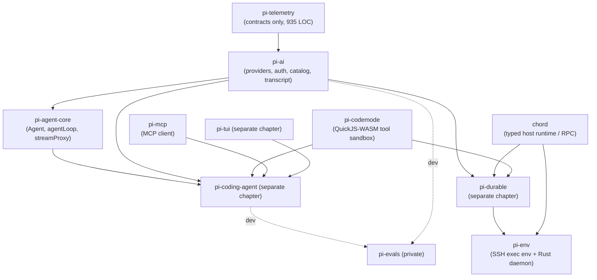

# Pi core toolkit (pi-ai + pi-agent-core) and the v1 release

> **Verdict.** `@earendil-works/pi-ai` is a broad, browser-safe, provider-neutral LLM layer: 10 chat wire APIs and 42 provider ids, OAuth logins, a generated model catalog, cost accounting, and an unusual transcript model where the system prompt and the tool set are *events in the message list*, which keeps provider prompt caches intact. `@earendil-works/pi-agent-core` is a deliberately tiny (2,519 LOC) in-process agent loop on top of it, with steering and follow-up queues, parallel tool execution, and seven lifecycle hooks. The v1.0.0 release (2026-10-01) was mostly a *subtraction*: commit `7fd478a` deleted 105,456 lines and moved the experimental `AgentHarness`, sessions, compaction, skills and the "pico3" durable runtime out of agent-core. Durable execution now lives in `@earendil-works/pi-durable`, which does **not** depend on agent-core. Build on pi-ai if you want a broad typed provider layer in TypeScript. Build on pi-agent-core if you want to own sessions, compaction, tools and safety yourself, around a loop you can read in an hour. Do not expect batteries: there are no built-in tools, no persistence, no permission system and no tracing producers in the core.

| | |
|---|---|
| Repo(s) | `earendil-works/pi` @ `b45e0ebcc5ae` (formerly `badlogic/pi-mono`, then `earendil-works/pi-mono`; both redirect) |
| License | MIT (package authors differ: agent-core lists Mario Zechner; pi-durable lists Earendil Works) |
| Language(s) | TypeScript (ESM, Node ≥ 22.19, erasable-syntax-only); Rust for the `pi-env` daemon |
| Size | Monorepo 1,922 tracked files. In-scope `src/` LOC: pi-ai 26,706 (+43,348 test), pi-agent-core **2,519** (+4,058 test), pi-codemode 3,037, chord 13,166, pi-mcp 3,277, pi-env 2,346 TS + 4,986 Rust, pi-telemetry 935, pi-evals 1,446 (private). For context: pi-durable 25,188, pi-tui 19,540, pi-coding-agent 76,000 |
| Version at pin | 1.2.0 for all packages (lockstep), plus an `[Unreleased]` section |
| Release history | Repo created 2025-08-09 → pi-ai 0.9.4 (2025-11-26, earliest changelog entry) → 0.31.0 (2026-01-02, agent loop split out of pi-ai into pi-agent-core) → 0.74.0 (2026-05-07, `@mariozechner/*` → `@earendil-works/*`, repo → `earendil-works/pi-mono`) → 0.84.0 (2026-08-06, lane-based `AgentHarness`/`Session` promoted into agent-core) → repo renamed `earendil-works/pi` (links updated 2026-09-07) → 0.99.0 (2026-09-29, image/classifier models unified; codemode + MCP packages first released) → **1.0.0 (2026-10-01)** → 1.0.1–1.0.4 (10-03 to 10-05) → 1.1.0 (10-07) → 1.2.0 (10-12) |
| Category | `llm-library`. By this study's definitions the 1.x toolkit is "provider abstraction plus a primitive tool loop". METHODOLOGY lists pi-agent-core as a `harness-library` example, but that describes the pre-1.0 package, which still carried tools, compaction and sessions (§1.3) |

## 1. Layering & package map

### 1.1 Dependency graph at the pin



Evidence: agent-core's only runtime deps are `@earendil-works/pi-ai` and `typebox` ([`packages/agent/package.json:L25-L28`](https://github.com/earendil-works/pi/blob/b45e0ebcc5ae2fc42a6f2f23104d10e656e6bedb/packages/agent/package.json#L25-L28)). pi-ai depends on the vendor SDKs (`@anthropic-ai/sdk`, `@aws-sdk/client-bedrock-runtime`, `@google/genai`, `openai`), `partial-json`, `typebox`, and `pi-telemetry` for a type ([`packages/ai/package.json:L69-L80`](https://github.com/earendil-works/pi/blob/b45e0ebcc5ae2fc42a6f2f23104d10e656e6bedb/packages/ai/package.json#L69-L80)). pi-durable depends on chord, pi-ai and pi-codemode, and **not** on agent-core ([`packages/durable/package.json:L145-L148`](https://github.com/earendil-works/pi/blob/b45e0ebcc5ae2fc42a6f2f23104d10e656e6bedb/packages/durable/package.json#L145-L148)). Its generation loop imports pi-ai's `utils/overflow`, `utils/retry` and `utils/transcript` directly ([`packages/durable/src/harness/generation.ts:L1-L14`](https://github.com/earendil-works/pi/blob/b45e0ebcc5ae2fc42a6f2f23104d10e656e6bedb/packages/durable/src/harness/generation.ts#L1-L14)). The coding agent pins agent-core at 1.2.0 ([`packages/coding-agent/package.json:L43`](https://github.com/earendil-works/pi/blob/b45e0ebcc5ae2fc42a6f2f23104d10e656e6bedb/packages/coding-agent/package.json#L43)).

### 1.2 What each package owns

| Package | npm | Owns | Not owned |
|---|---|---|---|
| **pi-ai** | `@earendil-works/pi-ai` | `Message`/`AssistantMessageEvent` protocol; `Provider`/`Models` runtime; 10 chat APIs + image + 4 classifier APIs; OAuth/API-key auth and `CredentialStore`; generated catalogs; cost; tool-arg validation; retry and overflow *classifiers*; a `pi-ai` login CLI | Loop, tools, persistence |
| **pi-agent-core** | `@earendil-works/pi-agent-core` | `Agent` (stateful wrapper), `agentLoop`/`agentLoopContinue`/`runToolCall`, `streamProxy`, event types | Tools, sessions, compaction, prompts, permissions |
| **pi-codemode** | `@earendil-works/pi-codemode` | Runs model-written JS in QuickJS→WASM where the only capability is calling injected tools; Node/Bun worker, inline, and Cloudflare Durable Object sandboxes | No pi deps at all |
| **pi-mcp** | `@earendil-works/pi-mcp` | Standalone MCP client: stdio and Streamable HTTP transports, OAuth (discovery, PKCE, CIMD), `toLlmContent()` | No MCP server; no official SDK dependency |
| **chord** | `@earendil-works/chord` | Typed host runtime: TypeBox contracts, objects with principals, replicated JSON state with deltas, RPC over memory/IPC/WebSocket links, hot reload | Used only by pi-durable and pi-env since 1.2.0 |
| **pi-env** | `@earendil-works/pi-env` | Remote `ExecutionEnv` for pi-durable over SSH; Rust daemon with framed stdin/stdout protocol, PTYs, file watching | Not used by agent-core |
| **pi-telemetry** | `@earendil-works/pi-telemetry` | `TelemetryContext`/`TelemetrySpan` callback contract, no-op and in-memory adapters, typed span schemas, conformance tests | No exporter and, at this pin, no span producers |
| **pi-evals** | `@earendil-works/pi-evals` (private) | vitest-evals harness for the coding agent; Docker "documentation-lift" A/B runner | Not published |

The pi-ai root entrypoint is described in code as "Core only, side-effect free: no generated catalogs, no provider factories, no api-registry, no OAuth implementations, no compat" ([`packages/ai/src/index.ts:L4-L8`](https://github.com/earendil-works/pi/blob/b45e0ebcc5ae2fc42a6f2f23104d10e656e6bedb/packages/ai/src/index.ts#L4-L8)). Provider factories are exposed under `./providers/*`, raw API implementations under `./api/*`, and the old global API under `./compat` ([`packages/ai/package.json:L13-L50`](https://github.com/earendil-works/pi/blob/b45e0ebcc5ae2fc42a6f2f23104d10e656e6bedb/packages/ai/package.json#L13-L50)). pi-ai's 27,015 LOC split as follows: `api/` 13,295 (43 files: the wire adapters, of which `openai-completions.ts` 1,736, `openai-codex-responses.ts` 1,700 and `anthropic-messages.ts` 1,689 are the largest), `auth/` 3,832, `providers/` 3,821 (42 thin factories plus `*.models.ts` stubs), `utils/` 2,454, and top-level 3,613 (`models.ts` 1,269, `types.ts` 893). Model *data* is not in git. `src/providers/data/` is gitignored and hydrated by `scripts/generate-models.ts` (4,318 LOC of scripts merging models.dev, OpenRouter and gateway catalogs with hand corrections). Each `*.models.ts` file only imports `./data/<provider>.json` ([`packages/ai/src/providers/anthropic.models.ts:L4-L8`](https://github.com/earendil-works/pi/blob/b45e0ebcc5ae2fc42a6f2f23104d10e656e6bedb/packages/ai/src/providers/anthropic.models.ts#L4-L8)).

### 1.3 The v1 release line, precisely

All published packages are versioned in lockstep. `version:*` runs `npm version --workspaces` and `scripts/sync-versions.js`, which "Validates lockstep versions for published packages" ([`package.json:L42-L44`](https://github.com/earendil-works/pi/blob/b45e0ebcc5ae2fc42a6f2f23104d10e656e6bedb/package.json#L42-L44), [`scripts/sync-versions.js:L1-L6`](https://github.com/earendil-works/pi/blob/b45e0ebcc5ae2fc42a6f2f23104d10e656e6bedb/scripts/sync-versions.js#L1-L6)). A version number therefore says nothing about whether a given package changed. The GitHub release notes are the coding-agent changelog. The table below is assembled from the per-package CHANGELOGs and `gh release view`.

| Version | Date (GitHub release) | pi-ai | pi-agent-core | Supporting packages |
|---|---|---|---|---|
| 0.99.0 | 2026-09-29 | **Breaking:** image models folded into `Provider`/`Models`; catalog schema v6 with `type` per entry; new classifier API (`Models.classify()`, Jev/System One); `onProviderStreamEvent`; `AssistantMessage.thinkingLevel` | `onProviderStreamEvent` option; loop records `thinkingLevel` | pi-codemode and pi-mcp first released |
| 0.99.2 | 2026-09-30 | Light `@earendil-works/pi-ai/models` entrypoint; Anthropic workload identity federation | — | — |
| **1.0.0** | **2026-10-01** | Anthropic copy-code OAuth login; fix replaying grammar tool calls (e.g. `codemode`) across providers | **Breaking: experimental harness removed** (below) | pi-durable 1.0.0 initial release; experimental client/server ported to pi-durable |
| 1.0.1 | 2026-10-03 | Anthropic native mid-conversation tool changes via `inline-tools-2026-09-15` beta (`tool_addition` blocks); `@anthropic-ai/sdk` 0.129.0; `hasToolRedefinitions()` deprecated; Cloudflare Clef classifiers; more retryable errors | empty | — |
| 1.0.2 | 2026-10-04 | `samplingParamsByThinkingLevel` for OpenAI-compatible APIs | empty | — |
| 1.0.3 | 2026-10-05 | **Breaking in a patch:** provider `azure-openai-responses` renamed `azure` (adds Chat Completions/Foundry); OAuth refresh now completes even when the request is cancelled | empty | — |
| 1.0.4 | 2026-10-05 | Bedrock stalled-HTTP/2 retry | empty | pi-env initial release (Rust daemon over SSH) |
| 1.1.0 | 2026-10-07 | **Breaking (types):** a stream function must return `AssistantMessageEventStream`; `durationMs` on `AssistantMessage`/`ToolResultMessage`; `openai-decisions` classifier API; Claude Haiku 5.5; `LoginOptions.agentName`; chars/token estimate 4 → 3.5 | `durationMs` on tool results, `AgentToolCallOutcome`, `tool_execution_end`; `streamProxy()` returns `AssistantMessageEventStream` | — |
| 1.2.0 | 2026-10-12 | `personalizeOpenRouterCatalog()`; `RefreshModelsContext.baseUrl`; Anthropic strict-tool fallback retry; Mistral header-only timeout | empty | **chord: breaking rewrite** (facet/service runtime replaced by typed host runtime); `pi-client`/`pi-protocol`/`pi-server` packages removed; coding-agent drops chord |
| Unreleased | — | **Breaking:** `AssistantMessageFrame`, `AssistantMessageFrameEncoder`, `reduceAssistantMessageFrames()` removed ("only used by the removed experimental agent harness") | — | codemode: worker settlement semantics changed (breaking) |

Sources: [`packages/agent/CHANGELOG.md:L5-L29`](https://github.com/earendil-works/pi/blob/b45e0ebcc5ae2fc42a6f2f23104d10e656e6bedb/packages/agent/CHANGELOG.md#L5-L29), [`packages/ai/CHANGELOG.md:L3-L7`](https://github.com/earendil-works/pi/blob/b45e0ebcc5ae2fc42a6f2f23104d10e656e6bedb/packages/ai/CHANGELOG.md#L3-L7), [`L39-L43`](https://github.com/earendil-works/pi/blob/b45e0ebcc5ae2fc42a6f2f23104d10e656e6bedb/packages/ai/CHANGELOG.md#L39-L43), [`L77-L81`](https://github.com/earendil-works/pi/blob/b45e0ebcc5ae2fc42a6f2f23104d10e656e6bedb/packages/ai/CHANGELOG.md#L77-L81), [`packages/chord/CHANGELOG.md:L57-L64`](https://github.com/earendil-works/pi/blob/b45e0ebcc5ae2fc42a6f2f23104d10e656e6bedb/packages/chord/CHANGELOG.md#L57-L64), [`packages/coding-agent/CHANGELOG.md:L76-L81`](https://github.com/earendil-works/pi/blob/b45e0ebcc5ae2fc42a6f2f23104d10e656e6bedb/packages/coding-agent/CHANGELOG.md#L76-L81).

**What 1.0 actually changed in the core.** The 1.0.0 agent-core changelog entry reads: removed "`AgentHarness`, sessions and session storage, the durable runtime, pico3, harness tools, compaction, skills, prompt templates, system prompt helpers, telemetry schemas, the search service types, and the `uuidv7` and pi-telemetry re-exports. The `./node`, `./harness/*`, and `./experimental/pico3` subpath exports are gone… Use `@earendil-works/pi-durable` for durable sessions" ([`packages/agent/CHANGELOG.md:L25-L29`](https://github.com/earendil-works/pi/blob/b45e0ebcc5ae2fc42a6f2f23104d10e656e6bedb/packages/agent/CHANGELOG.md#L25-L29)). The size of the change, measured with `gh api`:

- `packages/agent/src` at tag `v0.99.2`: **117 files, 1,149,463 bytes**, with eight subpath exports (`./node`, `./harness/context`, `./experimental/pico3`, `./harness/env/nodejs`, `./harness/runtime/reducer`, `./harness/session`, `./harness/session/testing`). Runtime deps were chord, pi-ai, pi-telemetry, diff, ignore, typebox and yaml. Sub-trees included `harness/runtime/lane.ts` (67,893 B), `harness/pico3/session.ts` (58,000 B), JSONL session repos with a legacy-v3 codec, compaction and branch summarization, and session-repo conformance suites.
- At tag `v1.0.0`: **6 files, ~82 KB** (`agent-loop.ts`, `agent.ts`, `index.ts`, `proxy.ts`, `stream-fn.ts`, `types.ts`). The recorded file sizes match their v0.99.2 counterparts; equal sizes alone do not prove identical contents. The changelog establishes removal of the surrounding experimental harness, not a byte-for-byte audit of the loop.
- Commit `7fd478a2e888` ("feat(agent): remove the experimental harness from pi-agent-core", Mario Zechner, 2026-10-01): **+12 / −105,456 lines**. It also deleted `packages/session-backends` and the experimental "mini" and "micro" coding-agent frontends. The 1.0.0 release commit `a13d35a` is authored by Armin Ronacher.

At 1.0, agent-core was rolled *back* to its pre-harness shape. The previous six releases had grown it into a lane-based durable harness (0.84.0 "Promoted the v2 session and `AgentHarness` API from the experimental entrypoint to the default package export", [`packages/agent/CHANGELOG.md:L124-L147`](https://github.com/earendil-works/pi/blob/b45e0ebcc5ae2fc42a6f2f23104d10e656e6bedb/packages/agent/CHANGELOG.md#L124-L147)). That work became pi-durable, rebuilt on pi-ai and chord rather than on the `Agent` class. Since 1.0, agent-core's public API has changed only additively (`durationMs` in 1.1.0). Its changelog sections for 1.0.1–1.0.4 and 1.2.0 are empty.

**Scope and repo moves (before 1.0).** The npm scope moved at 0.74.0 (2026-05-07): "Updated repository links and package references for the move to `earendil-works/pi-mono` and `@earendil-works/*` package scopes" ([`packages/coding-agent/CHANGELOG.md:L2119-L2123`](https://github.com/earendil-works/pi/blob/b45e0ebcc5ae2fc42a6f2f23104d10e656e6bedb/packages/coding-agent/CHANGELOG.md#L2119-L2123)). 0.73.1 had added self-update support for the rename from `@mariozechner/pi-coding-agent`. The `pi-mono` → `pi` repo rename happened later. Commit `aa23e784` (2026-09-07) updated links "to use `earendil-works/pi` instead of `earendil-works/pi-mono`". `badlogic/pi-mono` and `earendil-works/pi-mono` both redirect to `earendil-works/pi` (GitHub API, 2026-10-14). Stale traces remain in the code: a doc example in agent-core still says `declare module "@mariozechner/agent"` ([`packages/agent/src/types.ts:L351-L367`](https://github.com/earendil-works/pi/blob/b45e0ebcc5ae2fc42a6f2f23104d10e656e6bedb/packages/agent/src/types.ts#L351-L367)).

**Ownership context.** The code establishes the `@earendil-works/*` scope and repository move. Acquisition dates and company-founder claims are outside this source review and are not used to assess the architecture.

## 2. Agent loop

The loop lives in [`packages/agent/src/agent-loop.ts:L163-L321`](https://github.com/earendil-works/pi/blob/b45e0ebcc5ae2fc42a6f2f23104d10e656e6bedb/packages/agent/src/agent-loop.ts#L163-L321) (`runLoop`). It has two entry points. `agentLoop(prompts, context, config, signal, streamFn)` returns an `EventStream<AgentEvent, AgentMessage[]>` ([`L38-L61`](https://github.com/earendil-works/pi/blob/b45e0ebcc5ae2fc42a6f2f23104d10e656e6bedb/packages/agent/src/agent-loop.ts#L38-L61)). `agentLoopContinue` refuses an empty context or a trailing assistant message ([`L71-L100`](https://github.com/earendil-works/pi/blob/b45e0ebcc5ae2fc42a6f2f23104d10e656e6bedb/packages/agent/src/agent-loop.ts#L71-L100)). The `Agent` class is a stateful wrapper that calls the `run*` variants with an awaited event sink.

```
runLoop(context, config)
  pending ← getSteeringMessages()                         # user may have typed while idle
  loop (outer: follow-ups)
    loop (inner: while toolCalls || pending)
      if a turn completed: prepareNextTurn(turn) → {context?, messages?, model?, thinkingLevel?}
                           re-poll steering if empty; emit turn_start
      declareToolChanges(context, prepared+pending)       # tool-set diff → SystemMessage{toolsAdded/Removed}
      emit message_start/end for each, append
      prepareRequest({context, model, thinkingLevel}) → replace any
      msg ← streamAssistantResponse()                     # transformContext → convertToLlm → normalizeContext → streamFn
      if msg.stopReason ∈ {error, aborted}: finishTurn (decision ignored); turn_end; agent_end; RETURN
      if toolCalls: stopReason=="length" ? fail all : executeToolCalls(sequential|parallel)
                    hasMore ← !batch.terminate
      decision ← finishTurn(turn); emit turn_end
      if decision=end: agent_end; RETURN
      pending ← getSteeringMessages()
    followUps ← getFollowUpMessages(); if any: pending ← followUps; continue
    if decision=continue was requested and nothing else scheduled: one context-only turn
  emit agent_end
```

Step by step, with the details that matter:

1. **Request preparation.** `prepareNextTurn` runs only when another turn will happen. Its return can replace context, model and thinking level. Steering is re-polled afterwards because "Preparation can be long-running (for example, compaction)" ([`L185-L208`](https://github.com/earendil-works/pi/blob/b45e0ebcc5ae2fc42a6f2f23104d10e656e6bedb/packages/agent/src/agent-loop.ts#L185-L208)). `prepareRequest` then runs before *every* provider request, including the first, and does not poll queues ([`L219-L239`](https://github.com/earendil-works/pi/blob/b45e0ebcc5ae2fc42a6f2f23104d10e656e6bedb/packages/agent/src/agent-loop.ts#L219-L239)).
2. **Streaming.** `streamAssistantResponse` applies `transformContext` (AgentMessage→AgentMessage), then `convertToLlm` (AgentMessage→Message), then `normalizeContext`, and resolves `getApiKey(provider)` per call for expiring OAuth tokens. It pushes the `start` partial into `context.messages` and *replaces it in place* on every delta, so the context always ends in the live partial ([`L381-L469`](https://github.com/earendil-works/pi/blob/b45e0ebcc5ae2fc42a6f2f23104d10e656e6bedb/packages/agent/src/agent-loop.ts#L381-L469)). The final message gets `thinkingLevel` stamped "whichever stream function answered".
3. **Stop conditions.** The run ends when there are no tool calls, no steering and no follow-ups; when every result in the batch carries `terminate: true` ([`L690-L692`](https://github.com/earendil-works/pi/blob/b45e0ebcc5ae2fc42a6f2f23104d10e656e6bedb/packages/agent/src/agent-loop.ts#L690-L692)); when `finishTurn` returns `{action:"end"}`; or on an `error`/`aborted` response, which is a hard exit ([`L245-L256`](https://github.com/earendil-works/pi/blob/b45e0ebcc5ae2fc42a6f2f23104d10e656e6bedb/packages/agent/src/agent-loop.ts#L245-L256)). **There is no max-turns or max-steps limit** anywhere in agent-core, pi-ai or coding-agent (grep for `maxTurns|maxSteps|maxIterations` returns nothing). A runaway tool loop is bounded only by the host's `finishTurn` or abort.
4. **Truncated output.** If `stopReason === "length"`, *every* tool call in the message is failed rather than executed. Because the streaming JSON salvage parser can yield arguments that "parse and validate but are silently incomplete", the model is told to re-issue them ([`L478-L503`](https://github.com/earendil-works/pi/blob/b45e0ebcc5ae2fc42a6f2f23104d10e656e6bedb/packages/agent/src/agent-loop.ts#L478-L503)).
5. **Steering vs. follow-up.** Steering is drained after a turn's tool batch completes. It never preempts running tools, and "Tool calls from the current assistant message are not skipped" ([`packages/agent/src/types.ts:L282-L306`](https://github.com/earendil-works/pi/blob/b45e0ebcc5ae2fc42a6f2f23104d10e656e6bedb/packages/agent/src/types.ts#L282-L306)). Follow-ups are drained only when the agent would otherwise stop. Both queues default to `"one-at-a-time"` ([`packages/agent/src/agent.ts:L247-L248`](https://github.com/earendil-works/pi/blob/b45e0ebcc5ae2fc42a6f2f23104d10e656e6bedb/packages/agent/src/agent.ts#L247-L248)) through a small `PendingMessageQueue` ([`L143-L174`](https://github.com/earendil-works/pi/blob/b45e0ebcc5ae2fc42a6f2f23104d10e656e6bedb/packages/agent/src/agent.ts#L143-L174)). `Agent.continue()` on a trailing assistant message consumes queued steering, then follow-ups, before failing ([`L384-L411`](https://github.com/earendil-works/pi/blob/b45e0ebcc5ae2fc42a6f2f23104d10e656e6bedb/packages/agent/src/agent.ts#L384-L411)).
6. **`finishTurn` semantics** (added 0.87.0, replacing `shouldStopAfterTurn`). The hook runs after tool results but *before* `turn_end`, and the decision is applied *after* `turn_end`. `{action:"continue"}` guarantees one more request, which existing tool, steering or follow-up scheduling may satisfy ([`L286-L317`](https://github.com/earendil-works/pi/blob/b45e0ebcc5ae2fc42a6f2f23104d10e656e6bedb/packages/agent/src/agent-loop.ts#L286-L317); [`packages/agent/CHANGELOG.md:L44-L72`](https://github.com/earendil-works/pi/blob/b45e0ebcc5ae2fc42a6f2f23104d10e656e6bedb/packages/agent/CHANGELOG.md#L44-L72)).
7. **Parallel tools.** The default is `toolExecution: "parallel"` ([`agent.ts:L253`](https://github.com/earendil-works/pi/blob/b45e0ebcc5ae2fc42a6f2f23104d10e656e6bedb/packages/agent/src/agent.ts#L253)). Calls are *prepared sequentially* (lookup, `prepareArguments`, validation, `beforeToolCall`), then allowed calls execute concurrently. `tool_execution_end` is emitted in completion order, and tool-result messages are emitted in assistant source order ([`L586-L660`](https://github.com/earendil-works/pi/blob/b45e0ebcc5ae2fc42a6f2f23104d10e656e6bedb/packages/agent/src/agent-loop.ts#L586-L660)). A single tool with `executionMode: "sequential"` downgrades the whole batch ([`L508-L523`](https://github.com/earendil-works/pi/blob/b45e0ebcc5ae2fc42a6f2f23104d10e656e6bedb/packages/agent/src/agent-loop.ts#L508-L523)). Because preflight is sequential, an approval prompt inside `beforeToolCall` sees calls one at a time, in order.
8. **Errors and retries.** The loop does **not** retry. The `StreamFn` contract forbids throwing: failures must be encoded as a final `AssistantMessage` with `stopReason: "error"|"aborted"` ([`types.ts:L19-L37`](https://github.com/earendil-works/pi/blob/b45e0ebcc5ae2fc42a6f2f23104d10e656e6bedb/packages/agent/src/types.ts#L19-L37)). If something throws anyway, `Agent.runWithLifecycle` synthesizes an error assistant message plus `turn_end`/`agent_end` ([`agent.ts:L507-L548`](https://github.com/earendil-works/pi/blob/b45e0ebcc5ae2fc42a6f2f23104d10e656e6bedb/packages/agent/src/agent.ts#L507-L548)). Retry policy is provided as reusable pieces in pi-ai: `RetryPolicy`, `retryAssistantCall()` with exponential backoff and abort normalization, and `isRetryableAssistantError()`, a regex classifier with a non-retryable quota/billing deny-list ([`packages/ai/src/utils/retry.ts:L120-L136`](https://github.com/earendil-works/pi/blob/b45e0ebcc5ae2fc42a6f2f23104d10e656e6bedb/packages/ai/src/utils/retry.ts#L120-L136), [`L195-L261`](https://github.com/earendil-works/pi/blob/b45e0ebcc5ae2fc42a6f2f23104d10e656e6bedb/packages/ai/src/utils/retry.ts#L195-L261)). The coding agent and pi-durable apply them ([`packages/coding-agent/src/core/agent-session.ts:L3741-L3742`](https://github.com/earendil-works/pi/blob/b45e0ebcc5ae2fc42a6f2f23104d10e656e6bedb/packages/coding-agent/src/core/agent-session.ts#L3741-L3742)). SDK-level retries (`maxRetries`, `maxRetryDelayMs` capped at 60 s by default) live in `ProviderRequestOptions` ([`packages/ai/src/types.ts:L157-L210`](https://github.com/earendil-works/pi/blob/b45e0ebcc5ae2fc42a6f2f23104d10e656e6bedb/packages/ai/src/types.ts#L157-L210)).
9. **Back-pressure.** `Agent.processEvents` reduces state, then *awaits each listener in subscription order* ([`agent.ts:L565-L612`](https://github.com/earendil-works/pi/blob/b45e0ebcc5ae2fc42a6f2f23104d10e656e6bedb/packages/agent/src/agent.ts#L565-L612)). A slow listener (for example one persisting to disk) throttles the loop. `waitForIdle()` resolves only after `agent_end` listeners settle. The design guarantees ordering and accepts this throttling as the cost.

The `AgentEvent` union has 10 variants: `agent_start/end`, `turn_start/end`, `message_start/update/end`, and `tool_execution_start/update/end` ([`types.ts:L516-L539`](https://github.com/earendil-works/pi/blob/b45e0ebcc5ae2fc42a6f2f23104d10e656e6bedb/packages/agent/src/types.ts#L516-L539)).

## 3. Model / provider abstraction

**Message model.** `Message = SystemMessage | UserMessage | AssistantMessage | ToolResultMessage`. Assistant content is `TextContent | ThinkingContent | ToolCall`. Provider continuity data rides along as `textSignature`, `thinkingSignature` (including `redacted`), the Google-specific `thoughtSignature`, and the OpenAI Responses `namespace` ([`packages/ai/src/types.ts:L408-L444`](https://github.com/earendil-works/pi/blob/b45e0ebcc5ae2fc42a6f2f23104d10e656e6bedb/packages/ai/src/types.ts#L408-L444)). `AssistantMessage` records `api`, `provider`, `model`, `responseModel`, `providerThinkingLevel`, `thinkingLevel`, `usage`, `stopReason`, `deferred`, `diagnostics` and `durationMs` ([`L565-L596`](https://github.com/earendil-works/pi/blob/b45e0ebcc5ae2fc42a6f2f23104d10e656e6bedb/packages/ai/src/types.ts#L565-L596)). `ToolResultMessage<TDetails>` is gated at compile time by an `IsJsonCompatible` type, so `details` must be JSON-representable for persistence ([`L620-L637`](https://github.com/earendil-works/pi/blob/b45e0ebcc5ae2fc42a6f2f23104d10e656e6bedb/packages/ai/src/types.ts#L620-L637)). `StopReason` includes `"pending"` and `"deferred"` ([`L469`](https://github.com/earendil-works/pi/blob/b45e0ebcc5ae2fc42a6f2f23104d10e656e6bedb/packages/ai/src/types.ts#L469)).

**System prompt and tools as transcript events.** This is the most distinctive design in the core. `SystemMessage` has `content`, named `sections` (patched by name, where `null` removes a section), `toolsAdded: Tool[]` and `toolsRemoved: ToolReference[]` ([`types.ts:L531-L557`](https://github.com/earendil-works/pi/blob/b45e0ebcc5ae2fc42a6f2f23104d10e656e6bedb/packages/ai/src/types.ts#L531-L557)). Providers never see `Context.systemPrompt`/`Context.tools`. A branded `TranscriptContext` that only `normalizeContext()` can produce folds them into a leading system message ([`types.ts:L772-L783`](https://github.com/earendil-works/pi/blob/b45e0ebcc5ae2fc42a6f2f23104d10e656e6bedb/packages/ai/src/types.ts#L772-L783), [`utils/transcript.ts:L30-L34`](https://github.com/earendil-works/pi/blob/b45e0ebcc5ae2fc42a6f2f23104d10e656e6bedb/packages/ai/src/utils/transcript.ts#L30-L34)). Replay helpers compute the current prompt and tool set. For models without mid-conversation system support, `resolveTranscript` collapses all system messages into one leading message ([`transcript.ts:L58-L120`](https://github.com/earendil-works/pi/blob/b45e0ebcc5ae2fc42a6f2f23104d10e656e6bedb/packages/ai/src/utils/transcript.ts#L58-L120)). On the agent side, `declareToolChanges` diffs `context.tools` (what can execute) against the transcript's declarations (what the model was told) before each request, and inserts a system message with the delta ([`agent-loop.ts:L323-L363`](https://github.com/earendil-works/pi/blob/b45e0ebcc5ae2fc42a6f2f23104d10e656e6bedb/packages/agent/src/agent-loop.ts#L323-L363)). As a result, `AgentState.systemPrompt` is read-only and derived: "to change the prompt, append a system message" ([`agent/src/types.ts:L382-L421`](https://github.com/earendil-works/pi/blob/b45e0ebcc5ae2fc42a6f2f23104d10e656e6bedb/packages/agent/src/types.ts#L382-L421)).

The payoff is cache preservation. On Anthropic models with `supportsMidConvoToolChanges`, the top-level tool list is frozen as the initial tools plus a never-callable `__pi_deferred_placeholder__` with `defer_loading: true`. The placeholder keeps Anthropic's hidden scaffolding in the cached prefix ("measured: full miss without it"). Later tools are sent by value in `tool_addition` blocks under the `inline-tools-2026-09-15` beta ([`packages/ai/src/api/anthropic-messages.ts:L195-L209`](https://github.com/earendil-works/pi/blob/b45e0ebcc5ae2fc42a6f2f23104d10e656e6bedb/packages/ai/src/api/anthropic-messages.ts#L195-L209), [`L1255-L1267`](https://github.com/earendil-works/pi/blob/b45e0ebcc5ae2fc42a6f2f23104d10e656e6bedb/packages/ai/src/api/anthropic-messages.ts#L1255-L1267)). OpenAI Responses models anchor additions with `additional_tools`/tool search. `resolveTranscriptTools` decides whether additions can be anchored or the full list must be resent ([`transcript.ts:L213-L237`](https://github.com/earendil-works/pi/blob/b45e0ebcc5ae2fc42a6f2f23104d10e656e6bedb/packages/ai/src/utils/transcript.ts#L213-L237)).

**Provider / Models runtime.** A `Provider` owns `id`, `auth` (required: `apiKey` and/or `oauth`), sync `getModels()`, optional `refreshModels()` for dynamic catalogs, `filterModels()` for credential-specific availability, `stream`/`streamSimple`, optional `fetchDeferred`/`cancelDeferred`, `generateImages`, and `classify` ([`packages/ai/src/models.ts:L144-L244`](https://github.com/earendil-works/pi/blob/b45e0ebcc5ae2fc42a6f2f23104d10e656e6bedb/packages/ai/src/models.ts#L144-L244)). `Models` is the collection: lookups, `refresh`, `checkAuth`/`getAuth`/`login`/`logout`, stream/complete variants, deferred, image and classify ([`L246-L364`](https://github.com/earendil-works/pi/blob/b45e0ebcc5ae2fc42a6f2f23104d10e656e6bedb/packages/ai/src/models.ts#L246-L364)). `createModels()` defaults to in-memory credential and model stores ([`L395-L407`](https://github.com/earendil-works/pi/blob/b45e0ebcc5ae2fc42a6f2f23104d10e656e6bedb/packages/ai/src/models.ts#L395-L407)). `Models.stream()` normalizes the context synchronously, then returns a `lazyStream` that resolves auth and dispatches ([`L883-L922`](https://github.com/earendil-works/pi/blob/b45e0ebcc5ae2fc42a6f2f23104d10e656e6bedb/packages/ai/src/models.ts#L883-L922)). `applyAuth` merges per-field: explicit options win, then `transformHeaders` runs last, and the resolved `baseUrl` overrides the model's ([`L849-L881`](https://github.com/earendil-works/pi/blob/b45e0ebcc5ae2fc42a6f2f23104d10e656e6bedb/packages/ai/src/models.ts#L849-L881)). `createProvider()` builds a provider from a single `api` or an `api` map keyed by `model.api`, overlays fetched models on the static baseline, and publishes refreshes transactionally ([`L1002-L1188`](https://github.com/earendil-works/pi/blob/b45e0ebcc5ae2fc42a6f2f23104d10e656e6bedb/packages/ai/src/models.ts#L1002-L1188)). Built-in and `models.json` custom providers both go through it.

**Coverage.** There are 10 `KnownApi` wire protocols: `openai-completions`, `openai-responses`, `azure-openai-responses`, `openai-codex-responses`, `anthropic-messages`, `bedrock-converse-stream`, `google-generative-ai`, `google-vertex`, `mistral-conversations` and `pi-messages`. The `Api` type is open (`string & {}`) for custom APIs. There are also 42 `KnownProvider` ids ([`types.ts:L61-L130`](https://github.com/earendil-works/pi/blob/b45e0ebcc5ae2fc42a6f2f23104d10e656e6bedb/packages/ai/src/types.ts#L61-L130)) and 42 factories in `providers/all.ts` ([`L1-L53`](https://github.com/earendil-works/pi/blob/b45e0ebcc5ae2fc42a6f2f23104d10e656e6bedb/packages/ai/src/providers/all.ts#L1-L53)). Many providers (Groq, Cerebras, DeepSeek, Fireworks, Together, Moonshot, Z.AI, Qwen and Xiaomi token plans) are thin factories over the OpenAI- or Anthropic-compatible adapters, with `compat` overrides typed per API ([`types.ts:L834-L867`](https://github.com/earendil-works/pi/blob/b45e0ebcc5ae2fc42a6f2f23104d10e656e6bedb/packages/ai/src/types.ts#L834-L867)). Image models (`openrouter-images`) and classifier models (`typesafe-system-one`, `cloudflare-workers-ai-system-one`, `llama-cpp-classify`, `openai-decisions`) share `BaseModel` with chat models, and the operation is chosen by `type` ([`L869-L893`](https://github.com/earendil-works/pi/blob/b45e0ebcc5ae2fc42a6f2f23104d10e656e6bedb/packages/ai/src/types.ts#L869-L893)). The classifier contract (`choice`/`score`/`bool` questions with probabilities) is unusual in an LLM library ([`L662-L723`](https://github.com/earendil-works/pi/blob/b45e0ebcc5ae2fc42a6f2f23104d10e656e6bedb/packages/ai/src/types.ts#L662-L723)).

**Lazy loading.** Each API module is wrapped by `lazyApi(() => import("./anthropic-messages.ts"))`. The stream is returned synchronously and the setup (module load, auth) runs behind it, with failures surfacing as `error` events ([`packages/ai/src/api/lazy.ts:L41-L99`](https://github.com/earendil-works/pi/blob/b45e0ebcc5ae2fc42a6f2f23104d10e656e6bedb/packages/ai/src/api/lazy.ts#L41-L99), [`anthropic-messages.lazy.ts:L4`](https://github.com/earendil-works/pi/blob/b45e0ebcc5ae2fc42a6f2f23104d10e656e6bedb/packages/ai/src/api/anthropic-messages.lazy.ts#L4)). Importing a provider factory does not pull in its vendor SDK.

**Event protocol.** `AssistantMessageEvent` has `start`, `{text,thinking,toolcall}_{start,delta,end}`, `done` and `error`. Every event carries the live `partial` ([`types.ts:L785-L817`](https://github.com/earendil-works/pi/blob/b45e0ebcc5ae2fc42a6f2f23104d10e656e6bedb/packages/ai/src/types.ts#L785-L817)). `EventStream` is a small two-stack FIFO async iterable with a `result()` promise. `AssistantMessageEventStream` stamps a monotonic `durationMs` on the terminal message ([`utils/event-stream.ts:L26-L130`](https://github.com/earendil-works/pi/blob/b45e0ebcc5ae2fc42a6f2f23104d10e656e6bedb/packages/ai/src/utils/event-stream.ts#L26-L130)).

**Reasoning.** There is one provider-neutral `ThinkingLevel` (`off|minimal|low|medium|high|xhigh|max`) and a per-model `thinkingLevelMap`, where `null` marks a level as unsupported. `clampThinkingLevel` rounds up first, then down ([`models.ts:L1228-L1260`](https://github.com/earendil-works/pi/blob/b45e0ebcc5ae2fc42a6f2f23104d10e656e6bedb/packages/ai/src/models.ts#L1228-L1260)). Token-budget providers get `DEFAULT_THINKING_BUDGETS` (1k/2k/8k/16k), and `maxTokens` is clamped to the remaining context window minus a 4,096-token safety margin ([`api/simple-options.ts:L15-L75`](https://github.com/earendil-works/pi/blob/b45e0ebcc5ae2fc42a6f2f23104d10e656e6bedb/packages/ai/src/api/simple-options.ts#L15-L75)). Anthropic "managed effort" models always use `thinking: {type: "adaptive", block_binding: {prefix_mismatch_behavior: "drop_block"}}`, so that changing effort mid-conversation does not 400 ([`anthropic-messages.ts:L1269-L1289`](https://github.com/earendil-works/pi/blob/b45e0ebcc5ae2fc42a6f2f23104d10e656e6bedb/packages/ai/src/api/anthropic-messages.ts#L1269-L1289)).

**Prompt caching.** Retention is `CacheRetention` (default `"short"`; `PI_CACHE_RETENTION=long` maps to a 1h TTL where supported) ([`anthropic-messages.ts:L66-L93`](https://github.com/earendil-works/pi/blob/b45e0ebcc5ae2fc42a6f2f23104d10e656e6bedb/packages/ai/src/api/anthropic-messages.ts#L66-L93)). Anthropic breakpoints go on the system blocks, the last tool, and the last block of the last user/system message ([`L1528-L1552`](https://github.com/earendil-works/pi/blob/b45e0ebcc5ae2fc42a6f2f23104d10e656e6bedb/packages/ai/src/api/anthropic-messages.ts#L1528-L1552)). `sessionId` feeds session-affinity and cache keys on other providers ([`types.ts:L243-L249`](https://github.com/earendil-works/pi/blob/b45e0ebcc5ae2fc42a6f2f23104d10e656e6bedb/packages/ai/src/types.ts#L243-L249)).

**Cost.** `Usage` tracks input, output, cacheRead, cacheWrite, cacheWrite1h, reasoning and a cost breakdown ([`types.ts:L446-L467`](https://github.com/earendil-works/pi/blob/b45e0ebcc5ae2fc42a6f2f23104d10e656e6bedb/packages/ai/src/types.ts#L446-L467)). `calculateCost` applies prompt-length pricing tiers and charges 1h Anthropic cache writes at 2× input ([`models.ts:L1206-L1226`](https://github.com/earendil-works/pi/blob/b45e0ebcc5ae2fc42a6f2f23104d10e656e6bedb/packages/ai/src/models.ts#L1206-L1226)).

**Cross-provider handoff.** `transformMessages` converts another model's thinking into plain text and drops redacted thinking and foreign `thoughtSignature`s. It normalizes tool-call ids (OpenAI Responses ids can be 450+ characters; Anthropic needs `^[a-zA-Z0-9_-]+$` up to 64), skips errored/aborted assistant turns, synthesizes `"No result provided"` error results for orphaned tool calls, and holds system messages until pending tool results close ([`api/transform-messages.ts:L59-L235`](https://github.com/earendil-works/pi/blob/b45e0ebcc5ae2fc42a6f2f23104d10e656e6bedb/packages/ai/src/api/transform-messages.ts#L59-L235)). Switching models mid-session is therefore a first-class operation.

**Auth.** `CredentialStore` has a single serialized write path, `modify(providerId, fn)`, with per-provider mutual exclusion "cross-process too where the backing store supports it". `AuthContext` abstracts env/file access for browsers and tests ([`auth/types.ts:L56-L101`](https://github.com/earendil-works/pi/blob/b45e0ebcc5ae2fc42a6f2f23104d10e656e6bedb/packages/ai/src/auth/types.ts#L56-L101)). There are nine OAuth flows (Anthropic, GitHub Copilot, OpenAI Codex, Sign in with ChatGPT, Kimi Coding, OpenRouter, Radius, xAI, Meta). The Anthropic API-key resolver tries a stored key, `ANTHROPIC_AUTH_TOKEN`, `ANTHROPIC_OAUTH_TOKEN`/`ANTHROPIC_API_KEY`, then workload identity federation ([`providers/anthropic.ts:L19-L72`](https://github.com/earendil-works/pi/blob/b45e0ebcc5ae2fc42a6f2f23104d10e656e6bedb/packages/ai/src/providers/anthropic.ts#L19-L72)). With an Anthropic *subscription OAuth token*, the adapter impersonates Claude Code. It sends `user-agent: claude-cli/2.1.280` and `x-app: cli` ([`anthropic-messages.ts:L1046-L1066`](https://github.com/earendil-works/pi/blob/b45e0ebcc5ae2fc42a6f2f23104d10e656e6bedb/packages/ai/src/api/anthropic-messages.ts#L1046-L1066)). It prepends "You are Claude Code, Anthropic's official CLI for Claude." as the first system block ([`L1218-L1226`](https://github.com/earendil-works/pi/blob/b45e0ebcc5ae2fc42a6f2f23104d10e656e6bedb/packages/ai/src/api/anthropic-messages.ts#L1218-L1226)). It also remaps tool names to Claude Code's canonical casing, under a comment that reads "Stealth mode" ([`L95-L132`](https://github.com/earendil-works/pi/blob/b45e0ebcc5ae2fc42a6f2f23104d10e656e6bedb/packages/ai/src/api/anthropic-messages.ts#L95-L132)).

**Earendil's own wire protocol.** `pi-messages` POSTs `{model, context, options}` to `<baseUrl>/messages` and reads back serialized pi events over SSE. It is "the wire protocol spoken by the Radius gateway, but any backend implementing it can be used" ([`api/pi-messages.ts:L1-L10`](https://github.com/earendil-works/pi/blob/b45e0ebcc5ae2fc42a6f2f23104d10e656e6bedb/packages/ai/src/api/pi-messages.ts#L1-L10)). `radiusProvider()` replaces its shipped baseline with the org's gateway catalog once one is known ([`providers/radius.ts:L21-L42`](https://github.com/earendil-works/pi/blob/b45e0ebcc5ae2fc42a6f2f23104d10e656e6bedb/packages/ai/src/providers/radius.ts#L21-L42)). agent-core's older `streamProxy` uses a *different* path and shape (`POST {proxyUrl}/api/stream`, with `partial` stripped from events) ([`packages/agent/src/proxy.ts:L20-L46`](https://github.com/earendil-works/pi/blob/b45e0ebcc5ae2fc42a6f2f23104d10e656e6bedb/packages/agent/src/proxy.ts#L20-L46), [`L146-L159`](https://github.com/earendil-works/pi/blob/b45e0ebcc5ae2fc42a6f2f23104d10e656e6bedb/packages/agent/src/proxy.ts#L146-L159)).

**Deferred responses.** `SimpleStreamOptions.deferred` and `DeferredHandle` define a contract for background/batch requests that return a durable handle ([`types.ts:L519-L529`](https://github.com/earendil-works/pi/blob/b45e0ebcc5ae2fc42a6f2f23104d10e656e6bedb/packages/ai/src/types.ts#L519-L529)). At this pin only the faux provider implements `fetchDeferred`/`cancelDeferred` ([`providers/faux.ts:L704-L727`](https://github.com/earendil-works/pi/blob/b45e0ebcc5ae2fc42a6f2f23104d10e656e6bedb/packages/ai/src/providers/faux.ts#L704-L727)). No built-in API module exports them.

## 4. Tool system

**Definition.** `Tool<TParameters extends TSchema>` is `{name, description, parameters, constrainedSampling?}`. TypeBox 1.x is the schema technology, and the provider-side constraint can be `json_schema` strict (`"prefer"|"require"`) or a `grammar` with `openai_lark`/`openai_regex` variants ([`packages/ai/src/types.ts:L725-L754`](https://github.com/earendil-works/pi/blob/b45e0ebcc5ae2fc42a6f2f23104d10e656e6bedb/packages/ai/src/types.ts#L725-L754)). `AgentTool` adds `label`, `prepareArguments` (a compatibility shim before validation), `outputSchema` with `structuredContent` (machine-readable, not sent to the model), `execute(toolCallId, params, signal, onUpdate)`, `executionMode`, and `replay?: "never"|"safe"`, the "recovery policy for an effect whose durable intent exists but whose outcome is unknown" ([`packages/agent/src/types.ts:L465-L499`](https://github.com/earendil-works/pi/blob/b45e0ebcc5ae2fc42a6f2f23104d10e656e6bedb/packages/agent/src/types.ts#L465-L499)). Nothing in agent-core reads `replay`. It is a hint for durable hosts. The provider-neutral `ToolChoice` is only `"auto" | "none"` ([`types.ts:L132`](https://github.com/earendil-works/pi/blob/b45e0ebcc5ae2fc42a6f2f23104d10e656e6bedb/packages/ai/src/types.ts#L132)). Forcing a specific tool requires provider-specific options.

**Built-in tools: none.** The six-file agent-core ships no tools. `read`/`bash`/`edit`/`write`/`grep`/`find`/`ls`/`powershell` live in `packages/coding-agent/src/core/tools/`, and pi-durable has its own set.

**Execution pipeline** (`prepareToolCall` → `executePreparedToolCall` → `finalizeExecutedToolCall`):

1. Lookup by name. An unknown tool produces an immediate error result ([`agent-loop.ts:L708-L723`](https://github.com/earendil-works/pi/blob/b45e0ebcc5ae2fc42a6f2f23104d10e656e6bedb/packages/agent/src/agent-loop.ts#L708-L723)).
2. `prepareArguments`, then `validateToolArguments`. Validation `structuredClone`s the arguments, normalizes optional `null`s, runs TypeBox `Value.Convert`, coerces plain JSON Schemas, and compiles validators cached in a `WeakMap`. Failures produce a path-formatted message that includes the received arguments ([`packages/ai/src/utils/validation.ts:L271-L350`](https://github.com/earendil-works/pi/blob/b45e0ebcc5ae2fc42a6f2f23104d10e656e6bedb/packages/ai/src/utils/validation.ts#L271-L350)). Validation runs in eval-restricted runtimes such as Cloudflare Workers.
3. `beforeToolCall({assistantMessage, toolCall, args, context}, signal)` can return `{block, reason, terminate}` ([`types.ts:L60-L74`](https://github.com/earendil-works/pi/blob/b45e0ebcc5ae2fc42a6f2f23104d10e656e6bedb/packages/agent/src/types.ts#L60-L74)). The signal is re-checked after the hook.
4. `execute` with a scoped `onUpdate` that drops updates after settlement, timed by `performance.now()` ([`agent-loop.ts:L821-L857`](https://github.com/earendil-works/pi/blob/b45e0ebcc5ae2fc42a6f2f23104d10e656e6bedb/packages/agent/src/agent-loop.ts#L821-L857)). A thrown error becomes `isError: true`. Tools may also return `isError: true` to keep `details`/`structuredContent` for the UI.
5. `afterToolCall` overrides fields one by one, with no deep merge. Replacing `content` drops `structuredContent` unless it is re-supplied ([`L859-L910`](https://github.com/earendil-works/pi/blob/b45e0ebcc5ae2fc42a6f2f23104d10e656e6bedb/packages/agent/src/agent-loop.ts#L859-L910); contract at [`types.ts:L76-L104`](https://github.com/earendil-works/pi/blob/b45e0ebcc5ae2fc42a6f2f23104d10e656e6bedb/packages/agent/src/types.ts#L76-L104)).

**`runToolCall()`** exposes the same pipeline (preparation, validation, both hooks) without events or transcript writes. Its doc comment says: "Tools that call other tools use this so the hooks (for example permission checks) apply to those calls too" ([`agent-loop.ts:L790-L819`](https://github.com/earendil-works/pi/blob/b45e0ebcc5ae2fc42a6f2f23104d10e656e6bedb/packages/agent/src/agent-loop.ts#L790-L819)). The coding agent wires codemode's nested calls through it with the session's own `_beforeToolCall`/`_afterToolCall` ([`packages/coding-agent/src/core/agent-session.ts:L740-L754`](https://github.com/earendil-works/pi/blob/b45e0ebcc5ae2fc42a6f2f23104d10e656e6bedb/packages/coding-agent/src/core/agent-session.ts#L740-L754)). pi-ai records the results as `NestedToolCalls` on the parent `ToolResultMessage` (bounded, not sent to the model) ([`types.ts:L598-L618`](https://github.com/earendil-works/pi/blob/b45e0ebcc5ae2fc42a6f2f23104d10e656e6bedb/packages/ai/src/types.ts#L598-L618)).

**Truncation:** none in core. Output limiting is a tool concern; the coding-agent tools use `truncate.ts` and spill files. **Approvals:** only via `beforeToolCall`.

**pi-codemode.** This package is the core's answer to "too many tools". The model writes an async JS body that calls `tools.<name>(args)`. Nested calls "never enter the LLM context; only the script's output and return value do" ([`packages/codemode/README.md:L1-L5`](https://github.com/earendil-works/pi/blob/b45e0ebcc5ae2fc42a6f2f23104d10e656e6bedb/packages/codemode/README.md#L1-L5)). The VM is `quickjs-wasi` with `memoryLimit`, `maxStackSize`, an interrupt handler, and an optional *deterministic* mode with a virtual clock, a seed, and `WeakRef` removed ([`packages/codemode/src/runtime/vm.ts:L160-L179`](https://github.com/earendil-works/pi/blob/b45e0ebcc5ae2fc42a6f2f23104d10e656e6bedb/packages/codemode/src/runtime/vm.ts#L160-L179)). Its only dependency is `quickjs-wasi` ([`packages/codemode/package.json:L69-L71`](https://github.com/earendil-works/pi/blob/b45e0ebcc5ae2fc42a6f2f23104d10e656e6bedb/packages/codemode/package.json#L69-L71)). The deterministic mode is what makes replay under pi-durable possible (inference from the API; the durable side is covered in its own chapter).

## 5. Context management

- **Prompt assembly** is the caller's job. agent-core seeds a leading system message from `initialState.systemPrompt` + `tools` ([`packages/agent/src/agent.ts:L77-L111`](https://github.com/earendil-works/pi/blob/b45e0ebcc5ae2fc42a6f2f23104d10e656e6bedb/packages/agent/src/agent.ts#L77-L111)). Prompt changes are appended system messages (§3). `reset()` keeps the replayed system baseline ([`L354-L368`](https://github.com/earendil-works/pi/blob/b45e0ebcc5ae2fc42a6f2f23104d10e656e6bedb/packages/agent/src/agent.ts#L354-L368)).
- **Two transform seams:** `transformContext(messages, signal)` (AgentMessage-level: pruning, injection) and the required `convertToLlm` (custom roles → LLM roles). Both must not throw ([`types.ts:L196-L244`](https://github.com/earendil-works/pi/blob/b45e0ebcc5ae2fc42a6f2f23104d10e656e6bedb/packages/agent/src/types.ts#L196-L244)). The default `convertToLlm` keeps `system|user|assistant|toolResult` ([`agent.ts:L38-L46`](https://github.com/earendil-works/pi/blob/b45e0ebcc5ae2fc42a6f2f23104d10e656e6bedb/packages/agent/src/agent.ts#L38-L46)). Custom message types are added by declaration merging into `CustomAgentMessages` ([`types.ts:L365-L374`](https://github.com/earendil-works/pi/blob/b45e0ebcc5ae2fc42a6f2f23104d10e656e6bedb/packages/agent/src/types.ts#L365-L374)).
- **Project instruction files** (AGENTS.md etc.): not read by the core. That is a coding-agent feature.
- **Compaction:** removed from core at 1.0. What remains are primitives: `isContextOverflow()`, which handles three overflow styles (error-pattern, "silent" overflow where input exceeds the window, and Xiaomi-style `length` with zero output), plus `isRecoverableLength()` ([`packages/ai/src/utils/overflow.ts:L137-L181`](https://github.com/earendil-works/pi/blob/b45e0ebcc5ae2fc42a6f2f23104d10e656e6bedb/packages/ai/src/utils/overflow.ts#L137-L181)), and token estimation at 3.5 chars/token ([`utils/estimate.ts:L15`](https://github.com/earendil-works/pi/blob/b45e0ebcc5ae2fc42a6f2f23104d10e656e6bedb/packages/ai/src/utils/estimate.ts#L15)). The coding agent shows the intended pattern. It compacts inside `prepareNextTurnWithContext`, then rebuilds the prompt and tool loadout as an appended update message ([`packages/coding-agent/src/core/agent-session.ts:L899-L930`](https://github.com/earendil-works/pi/blob/b45e0ebcc5ae2fc42a6f2f23104d10e656e6bedb/packages/coding-agent/src/core/agent-session.ts#L899-L930)).
- **Spill-to-disk, memory:** none in core.

## 6. State, sessions & durability

`AgentState` is in-memory. It holds `messages`/`tools` behind copy-on-assign accessors, plus `model`, `thinkingLevel`, `isStreaming`, `streamingMessage`, `pendingToolCalls` and `errorMessage` ([`packages/agent/src/types.ts:L376-L421`](https://github.com/earendil-works/pi/blob/b45e0ebcc5ae2fc42a6f2f23104d10e656e6bedb/packages/agent/src/types.ts#L376-L421)). The loop works on a snapshot copy ([`agent.ts:L460-L465`](https://github.com/earendil-works/pi/blob/b45e0ebcc5ae2fc42a6f2f23104d10e656e6bedb/packages/agent/src/agent.ts#L460-L465)). `Agent` appends to state only on `message_end` ([`L575-L578`](https://github.com/earendil-works/pi/blob/b45e0ebcc5ae2fc42a6f2f23104d10e656e6bedb/packages/agent/src/agent.ts#L575-L578)), so a crash mid-stream loses the partial. There is no session format, storage, fork/branch or checkpoint in the core. Messages and `Model`s are plain JSON (README "Context Serialization"). A host can therefore persist `state.messages` and resume with `continue()`, which is exactly what `agentLoopContinue` is for: "Used for retries - context already has user message or tool results" ([`agent-loop.ts:L63-L100`](https://github.com/earendil-works/pi/blob/b45e0ebcc5ae2fc42a6f2f23104d10e656e6bedb/packages/agent/src/agent-loop.ts#L63-L100)).

The 1.0 decision draws a hard line. The JSONL session repos, lanes, operation records and crash recovery that agent-core carried from 0.84 to 0.99 were moved out (§1.3). Durable semantics now belong to pi-durable (SQLite/JSONL storage, checkpointed model and tool calls), a sibling runtime. Two pieces of residue in the core hint at what durable hosts need: `AgentTool.replay` and pi-ai's `DeferredHandle`. The coding agent keeps its own JSONL `SessionManager` (separate chapter).

## 7. Safety & sandboxing

- **Permission model: none.** The repo README states it outright: "Pi does not include a built-in permission system for restricting filesystem, process, network, or credential access" ([`README.md:L88-L90`](https://github.com/earendil-works/pi/blob/b45e0ebcc5ae2fc42a6f2f23104d10e656e6bedb/README.md#L88-L90)). The core's only gate is `beforeToolCall`, which `runToolCall` also applies to nested calls. A blocked call can set `terminate`.
- **Language-level sandbox:** pi-codemode scripts have "no timers, `fetch`, `process`, `require`, modules, or `WebAssembly`". They get only injected tools, a memory cap, a timeout, and output caps (16 Mi chars or 100,000 items per the 1.0.1 notes). Built-ins are frozen before the script runs (1.0.4). This is a capability sandbox, not an OS sandbox: the injected tools run with full host privileges.
- **Input hygiene:** truncated (`length`) tool calls are never executed (§2). Tool arguments are validated before hooks. Unicode surrogates are sanitized in Anthropic payloads.
- **Secrets:** `CredentialStore.list()` "must not execute configured API-key commands while listing" ([`auth/types.ts:L72-L76`](https://github.com/earendil-works/pi/blob/b45e0ebcc5ae2fc42a6f2f23104d10e656e6bedb/packages/ai/src/auth/types.ts#L72-L76)). Provider-scoped `env` overrides `process.env` per request ([`types.ts:L146-L173`](https://github.com/earendil-works/pi/blob/b45e0ebcc5ae2fc42a6f2f23104d10e656e6bedb/packages/ai/src/types.ts#L146-L173)). Browsers get `dangerouslyAllowBrowser` clients, and the README warns about key exposure.
- **pi-env** (durable-only) is the most security-engineered part of the toolkit. It runs `ssh` in `BatchMode` with strict host-key checking against an app-owned known_hosts under a fixed alias and no forwarding, and it ships daemon binaries "named by its SHA-256 and verified before every start" ([`packages/env/README.md:L1-L35`](https://github.com/earendil-works/pi/blob/b45e0ebcc5ae2fc42a6f2f23104d10e656e6bedb/packages/env/README.md#L1-L35)).
- **Policy risk:** the Claude Code impersonation for subscription OAuth (§3) carries provider-terms risk for anyone embedding pi-ai.

## 8. Extensibility

| Seam | Mechanism | Evidence |
|---|---|---|
| Custom model runtime | `StreamFn`; `setDefaultStreamFn()` lets a host install one without agent-core depending on a catalog | [`stream-fn.ts:L1-L20`](https://github.com/earendil-works/pi/blob/b45e0ebcc5ae2fc42a6f2f23104d10e656e6bedb/packages/agent/src/stream-fn.ts#L1-L20) |
| Custom providers / APIs | `createProvider({api \| api-map, images, classifiers, fetchModels, filterModels})`; open `Api` string type | [`models.ts:L1002-L1188`](https://github.com/earendil-works/pi/blob/b45e0ebcc5ae2fc42a6f2f23104d10e656e6bedb/packages/ai/src/models.ts#L1002-L1188) |
| Payload / transport hooks | `onPayload` (inspect/replace provider body), `onResponse`, `onProviderStreamEvent`, `transformHeaders`, custom `fetch` | [`types.ts:L157-L223`](https://github.com/earendil-works/pi/blob/b45e0ebcc5ae2fc42a6f2f23104d10e656e6bedb/packages/ai/src/types.ts#L157-L223) |
| Loop hooks | `prepareRequest`, `prepareNextTurn(WithContext)`, `finishTurn`, `beforeToolCall`, `afterToolCall`, `transformContext`, `convertToLlm`, `getApiKey` | [`types.ts:L193-L342`](https://github.com/earendil-works/pi/blob/b45e0ebcc5ae2fc42a6f2f23104d10e656e6bedb/packages/agent/src/types.ts#L193-L342) |
| Custom messages | declaration merging into `CustomAgentMessages` | [`types.ts:L365-L374`](https://github.com/earendil-works/pi/blob/b45e0ebcc5ae2fc42a6f2f23104d10e656e6bedb/packages/agent/src/types.ts#L365-L374) |
| Test doubles | `fauxProvider()` with scripted responses, deferred states, and a cache-usage estimate | [`faux.ts:L704-L727`](https://github.com/earendil-works/pi/blob/b45e0ebcc5ae2fc42a6f2f23104d10e656e6bedb/packages/ai/src/providers/faux.ts#L704-L727) |
| MCP | `pi-mcp` client (protocol `2025-11-25`, accepts back to `2024-11-05`) + `toLlmContent()`; example wiring in `packages/agent/examples/mcp-codemode` | [`packages/mcp/src/protocol/types.ts:L4-L9`](https://github.com/earendil-works/pi/blob/b45e0ebcc5ae2fc42a6f2f23104d10e656e6bedb/packages/mcp/src/protocol/types.ts#L4-L9) |

The hooks are single-slot properties, not event buses. The coding agent chains them by capturing the previous value ([`agent-session.ts:L887-L897`](https://github.com/earendil-works/pi/blob/b45e0ebcc5ae2fc42a6f2f23104d10e656e6bedb/packages/coding-agent/src/core/agent-session.ts#L887-L897)). Composing several independent extensions therefore requires a host-level dispatcher. The coding agent's `ExtensionRunner` is one; it is described in that chapter. pi-mcp is written from scratch ("does not depend on the official MCP SDK or other pi packages", [`packages/mcp/README.md:L1-L5`](https://github.com/earendil-works/pi/blob/b45e0ebcc5ae2fc42a6f2f23104d10e656e6bedb/packages/mcp/README.md#L1-L5)), but it ships the MCP TypeScript SDK's MIT notice in `LICENSES/`, which suggests some adapted code (inference). There is no skills, plugin or distribution mechanism in the core. **chord** is a plugin *host runtime* (contracts, principals, replicated state, hot reload: [`packages/chord/README.md:L1-L11`](https://github.com/earendil-works/pi/blob/b45e0ebcc5ae2fc42a6f2f23104d10e656e6bedb/packages/chord/README.md#L1-L11)), but nothing in pi-ai or agent-core uses it, and it broke its whole API at 1.2.0.

## 9. Multi-agent

None in the core. There are no subagent tool, handoff, orchestration or worktree primitives. Multiple `Agent` instances can be composed by hand, since the class is cheap and isolated. The repository README lists sub-agents among the features Pi deliberately "skips" ([`README.md:L19`](https://github.com/earendil-works/pi/blob/b45e0ebcc5ae2fc42a6f2f23104d10e656e6bedb/README.md#L19)). Codemode's nested tool calls are parallel *tool* fan-out inside one turn, not agents. Multi-conversation orchestration (tasks, parallel conversations, branching, several clients steering one run) is pi-durable's remit, built on chord rather than agent-core.

## 10. Surfaces & integration

- **In-process library** is the primary surface. agent-core exports one entry point with no subpaths ([`packages/agent/src/index.ts:L1-L5`](https://github.com/earendil-works/pi/blob/b45e0ebcc5ae2fc42a6f2f23104d10e656e6bedb/packages/agent/src/index.ts#L1-L5)). pi-ai's root is side-effect free and browser-bundleable. Bedrock fails at runtime in browsers, and OAuth flows are Node-only but lazy.
- **Browser apps** use `streamProxy` against a server the app writes. No server is shipped.
- **`pi-ai` CLI** (`bin: pi-ai`) only performs OAuth logins into `./auth.json` ([`packages/ai/src/cli.ts:L9-L30`](https://github.com/earendil-works/pi/blob/b45e0ebcc5ae2fc42a6f2f23104d10e656e6bedb/packages/ai/src/cli.ts#L9-L30)).
- **Compat entrypoint** `@earendil-works/pi-ai/compat` keeps the pre-`Models` global API (`stream`, `getModel`, the API registry). It is labelled temporary: "deleted with the coding-agent ModelManager migration" ([`packages/ai/src/compat.ts:L1-L11`](https://github.com/earendil-works/pi/blob/b45e0ebcc5ae2fc42a6f2f23104d10e656e6bedb/packages/ai/src/compat.ts#L1-L11)).
- **No** HTTP server, ACP, IDE integration, TUI, or headless CLI in the core. Those belong to pi-coding-agent (print/JSON/RPC modes, SDK) and pi-tui.

**How the product layers use the core.** `createAgentSession` builds `new Agent({ initialState, convertToLlm, streamFn: (…) => modelRuntime.streamSimple(…), onPayload, onResponse, onProviderStreamEvent, transformContext: runner.emitContext, steeringMode, followUpMode, transport, thinkingBudgets, maxRetryDelayMs })` ([`packages/coding-agent/src/core/sdk.ts:L411-L446`](https://github.com/earendil-works/pi/blob/b45e0ebcc5ae2fc42a6f2f23104d10e656e6bedb/packages/coding-agent/src/core/sdk.ts#L411-L446)). `AgentSession` then installs `beforeToolCall`/`afterToolCall` for extension `tool_call` events ([`agent-session.ts:L654-L655`](https://github.com/earendil-works/pi/blob/b45e0ebcc5ae2fc42a6f2f23104d10e656e6bedb/packages/coding-agent/src/core/agent-session.ts#L654-L655)), `finishTurn` for turn boundaries, and `prepareNextTurnWithContext` for compaction. The product harness is roughly 4,400 lines of `agent-session.ts` wrapped around a 2,500-line core.

**Downstream consumers (from the study's pinned clones):**

| Project | Relation | Evidence |
|---|---|---|
| **Flue** | Builds its runtime on `Agent` from pi-agent-core `^1.1.0` and pi-ai `^1.1.0` | `flue/packages/runtime/package.json:L87-L88`; `src/session.ts:L17`, `L2276` (`new Agent({`) |
| **DeepSeek Harness** | `@deepseek-ai/dsh-llm-pi-ai` adapter routes its LLM service through pi-ai `^1.1.0` catalogs | `deepseek-harness/packages/llm/llm-pi-ai/package.json:L46` |
| **Vercel AI SDK** | `packages/harness-pi` wraps the *coding agent* SDK (`pi-coding-agent ^1.0.3`, pi-ai 0.74.2) | `ai-sdk/packages/harness-pi/package.json:L40-L41` |
| **OpenClaw** | Internalized its agent core as `@openclaw/agent-core`/`@openclaw/ai`. Its docs say "No external agent framework packages remain" and "The legacy alias `pi` normalizes to `openclaw`", and it keeps `@earendil-works/pi-tui` 1.0.3 as the only pi dependency. Its Pi derivation is explicitly credited in [`THIRD_PARTY_NOTICES.md:L7-L10`](https://github.com/openclaw/openclaw/blob/f13a8d0ac04d3b0284ada075978ad19677cf67a2/THIRD_PARTY_NOTICES.md#L7-L10); this is historical lineage, not a current pi-agent-core dependency | `openclaw/package.json:L2288`; `docs/agent-runtime-architecture.md:L14`, `L23-L25`, `L46` |
| **Kimi Code** | Vendors a fork of pi-tui as `@moonshot-ai/pi-tui`, synced to upstream `53816d7` (2026-09-14, v0.85.1+), and depends on `@mariozechner/clipboard` | `kimi-code/packages/pi-tui/UPSTREAM.md:L9-L12`, `package.json:L2-L3` |
| **Mastra Code** | Uses `@earendil-works/pi-tui` 0.80.6 | `mastra/mastracode/tui/package.json:L103` |

pi-ai and agent-core are consumed as libraries by other harness projects in this study (Flue, DeepSeek Harness). pi-tui also has independent consumers and derivatives (OpenClaw, Kimi Code, Mastra). No studied project uses chord, pi-codemode or pi-mcp standalone.

## 11. Observability & evals

- **Event-level observability** is good. Every event carries full messages. Since 1.1.0, `durationMs` is measured with monotonic clocks on assistant messages and tool results, excluding hooks. `Usage` includes cache split and cost. Assistant messages carry redacted `diagnostics` for failures and recoveries. `onPayload`/`onResponse`/`onProviderStreamEvent` expose raw request bodies, HTTP status and headers, and pre-normalization provider events ([`packages/ai/src/types.ts:L174-L223`](https://github.com/earendil-works/pi/blob/b45e0ebcc5ae2fc42a6f2f23104d10e656e6bedb/packages/ai/src/types.ts#L174-L223)).
- **Tracing: contract without producers.** pi-telemetry defines `TelemetryContext.startSpan(options, callback)` and `TelemetrySpan.{addEvent,setAttributes,setStatus}` ([`packages/telemetry/src/index.ts:L1-L22`](https://github.com/earendil-works/pi/blob/b45e0ebcc5ae2fc42a6f2f23104d10e656e6bedb/packages/telemetry/src/index.ts#L1-L22)), typed span schemas, and an adapter conformance suite, with "no exporter, global current-span state, or dependency on a telemetry backend" ([`packages/telemetry/README.md:L1-L12`](https://github.com/earendil-works/pi/blob/b45e0ebcc5ae2fc42a6f2f23104d10e656e6bedb/packages/telemetry/README.md#L1-L12)). pi-ai forwards `telemetryContext` through `buildBaseOptions` ([`api/simple-options.ts:L48`](https://github.com/earendil-works/pi/blob/b45e0ebcc5ae2fc42a6f2f23104d10e656e6bedb/packages/ai/src/api/simple-options.ts#L48)). However, `grep startSpan packages/*/src` matches only the telemetry package itself. **No pi package emits a span at this pin.** The AI-request and harness span schemas left agent-core with the 1.0 removal. OTel or Sentry is therefore BYO adapter and BYO instrumentation.
- **Evals.** pi-evals (private) runs vitest-evals suites against the coding agent. Its main instrument is a *documentation-lift* A/B. The same packed workspace is built into `without_docs` and `with_docs` Docker images, each `(case, variant, model, run)` arm runs in a fresh container under an unprivileged UID, arms are paired, and lift is withheld when any pair is blocked ([`packages/evals/README.md:L1-L20`](https://github.com/earendil-works/pi/blob/b45e0ebcc5ae2fc42a6f2f23104d10e656e6bedb/packages/evals/README.md#L1-L20), [`L71-L93`](https://github.com/earendil-works/pi/blob/b45e0ebcc5ae2fc42a6f2f23104d10e656e6bedb/packages/evals/README.md#L71-L93)). It measures whether the agent can use its own docs. It does not benchmark task success, and nothing evaluates agent-core directly. The core's correctness relies on unit tests: 77 `it/test` cases in agent-core, plus 179 pi-ai test files where e2e cases activate only when provider env vars are present.

## 12. Notable design decisions & trade-offs

1. **The transcript is the only source of truth for prompt and tools.** Encoding the system prompt, named sections and tool-set deltas as `SystemMessage`s makes the history replayable and lets adapters preserve the provider cache when tools change mid-session. The Anthropic adapter even includes a measured placeholder-tool trick for this. The cost is complexity: every adapter must implement collapse/anchor logic, `AgentState.systemPrompt` becomes derived, and a host that "just sets the prompt" must append a message instead.
2. **1.0 as subtraction.** Removing about 1.1 MB of experimental harness from agent-core instead of stabilizing it kept the 1.x API small (six files; additive-only changes since). The cost was a hard break for anyone who adopted 0.84–0.99's `AgentHarness`/`Session` APIs, and a *second* agent runtime (pi-durable) that shares no loop code with agent-core. Bug fixes in one loop do not reach the other.
3. **Lockstep 1.x is not strict semver.** pi-ai shipped a breaking provider-id rename in a patch (1.0.3), a type-level break in a minor (1.1.0), and a pending removal in `[Unreleased]`. chord replaced its whole API at 1.2.0. Each changelog uses an explicit "Breaking Changes" section, so the breaks are documented, but consumers should pin exact versions. The repo's own AGENTS.md requires exact internal pins.
4. **No guardrails in the loop.** There is no turn cap and no retry in the loop. Errors are values, and the run is aborted or continued by hooks. This keeps the loop small and policy-free, but every embedder must add budget limits.
5. **Errors as values, never throws.** `StreamFn`, `convertToLlm` and `transformContext` must not throw. Providers encode failures in the stream (`lazyStream` turns setup exceptions into `error` events). The result is a uniform event sequence in exchange for a contract that is easy to violate in custom code.
6. **Awaited, ordered listeners.** Deterministic event ordering and "idle means listeners settled" make persistence-on-event safe, at the price of loop throughput.
7. **Subscription OAuth reuse.** Supporting Claude, ChatGPT, Copilot, Kimi and other subscriptions makes pi-ai attractive for personal agents. For Anthropic it relies on presenting as Claude Code (§3), which is a policy dependency outside the authors' control.
8. **Commercial gravity.** `pi-messages`/Radius is a first-class API and provider pointing at `radius.pi.dev`. It is optional, and the protocol is documented as usable by any backend, but it shows where Earendil intends to monetize (gateway, policy rewrites via `PiMessagesRewriteImpact`).

## 13. Scorecard

Scope: the aggregate `pi-ai` + `pi-agent-core` toolkit. The MCP client and QuickJS code mode are optional sibling packages discussed for composition; neither is an agent-core dependency. The feature matrix marks those optional capabilities as partial.

| Dimension | Score (1–5) | Rationale |
|---|---|---|
| Flexibility | 5 | Every layer is replaceable: `StreamFn`, `createProvider`/custom `Api`, `convertToLlm`/`transformContext`, seven loop hooks, custom message types, and low-level `agentLoop`/`runToolCall` for hosts that want their own loop ([`types.ts:L193-L342`](https://github.com/earendil-works/pi/blob/b45e0ebcc5ae2fc42a6f2f23104d10e656e6bedb/packages/agent/src/types.ts#L193-L342)). |
| Integration | 2 | Beyond a bare loop: 42 providers, OAuth, catalog, MCP client, codemode sandbox. But there are no tools, sessions, compaction, CLI or UI in the core ([`index.ts:L1-L5`](https://github.com/earendil-works/pi/blob/b45e0ebcc5ae2fc42a6f2f23104d10e656e6bedb/packages/agent/src/index.ts#L1-L5)). |
| Embeddability | 5 | First-class in-process ESM library with a side-effect-free, browser-capable root, lazy provider SDKs, and agent-core's 1.0–1.2 changelog records additive changes after the 1.0 removal. Flue embeds `Agent` directly. |
| Durability | 1 | In-memory only. JSON-serializable transcripts plus `continue()` let hosts build resume, but storage, checkpoints and recovery were removed at 1.0 and live in pi-durable. |
| Safety | 2 | `beforeToolCall` gating (also for nested calls), refusal of truncated tool calls, and a QuickJS capability sandbox for codemode. No permission model, OS sandbox or network policy; the README disclaims one. |
| Extensibility | 3 | Custom tools (TypeBox), providers, APIs, message types, payload hooks, and an MCP client package. Hooks are single-slot, and there is no plugin, skill or distribution mechanism in the core. |
| Multi-agent | 1 | No subagents, handoffs or orchestration. Deliberately out of scope ([`README.md:L19`](https://github.com/earendil-works/pi/blob/b45e0ebcc5ae2fc42a6f2f23104d10e656e6bedb/README.md#L19)). |
| Provider neutrality | 5 | 10 wire APIs, 42 provider ids, an open `Api` type, a unified thinking-level map, and cross-provider handoff in `transformMessages`. Image and classifier models sit under the same `Models` surface. |
| Maturity | 4 | Stable 1.x, about 10 months of public releases, very large user base (115k GitHub stars; Earendil claims "hundreds of thousands" of weekly users, unverified), and used by other harnesses. Docked one point because lockstep 1.x releases have broken pi-ai and chord APIs in patch and minor versions. |
| Minimalism | 4 | agent-core is 2,519 LOC in six files and readable in an afternoon. pi-ai is about 26.7k LOC, mostly adapter code, which is moderate but necessary weight. |

## 14. When to build on it / when not to

**Build on pi-ai when** you need one typed TypeScript surface over many vendors, including subscription OAuth, Bedrock/Vertex/Azure, OpenAI-compatible local servers and gateways. Also choose it when cache-preserving mid-session prompt and tool changes matter, when you want model handoff without transcript corruption, or when you need browser-compatible bundles with per-provider tree shaking. It is a strong alternative to the Vercel AI SDK's provider layer, with a more agent-specific message model (signatures, redacted thinking, deferred handles).

**Build on pi-agent-core when** you are writing your own harness and want a correct, small loop with real steering and follow-up semantics, parallel tools with ordered results, and hook points for compaction, approvals and model routing, while you own persistence, tools and policy. This is how Flue and Pi's own coding agent use it.

**Look elsewhere when** you want batteries: built-in tools, sessions, compaction, skills, MCP wiring and a permission model. For those, use pi-coding-agent's SDK or other harness-libraries in this study (Deep Agents, Strands). Look elsewhere too for durable, crash-recoverable, multi-conversation execution (pi-durable, Eve, or durable-workflow frameworks), for subagent orchestration (OpenAI Agents SDK, Mastra, ADK), or for OTel traces out of the box (the telemetry package has no producers). If you are a commercial embedder, check the Anthropic subscription-OAuth path against provider terms before shipping it.

## 15. Evidence index

**Core code (pinned `b45e0ebcc5ae`)**

- Agent loop: [`packages/agent/src/agent-loop.ts`](https://github.com/earendil-works/pi/blob/b45e0ebcc5ae2fc42a6f2f23104d10e656e6bedb/packages/agent/src/agent-loop.ts) (`runLoop` L163-L321, `declareToolChanges` L333-L363, `streamAssistantResponse` L381-L469, tool pipeline L478-L944)
- Agent class: [`packages/agent/src/agent.ts`](https://github.com/earendil-works/pi/blob/b45e0ebcc5ae2fc42a6f2f23104d10e656e6bedb/packages/agent/src/agent.ts) (queues L143-L174, lifecycle L507-L612)
- Types and contracts: [`packages/agent/src/types.ts`](https://github.com/earendil-works/pi/blob/b45e0ebcc5ae2fc42a6f2f23104d10e656e6bedb/packages/agent/src/types.ts)
- Proxy stream: [`packages/agent/src/proxy.ts`](https://github.com/earendil-works/pi/blob/b45e0ebcc5ae2fc42a6f2f23104d10e656e6bedb/packages/agent/src/proxy.ts)
- pi-ai types: [`packages/ai/src/types.ts`](https://github.com/earendil-works/pi/blob/b45e0ebcc5ae2fc42a6f2f23104d10e656e6bedb/packages/ai/src/types.ts)
- Provider/Models runtime: [`packages/ai/src/models.ts`](https://github.com/earendil-works/pi/blob/b45e0ebcc5ae2fc42a6f2f23104d10e656e6bedb/packages/ai/src/models.ts)
- Transcript replay: [`packages/ai/src/utils/transcript.ts`](https://github.com/earendil-works/pi/blob/b45e0ebcc5ae2fc42a6f2f23104d10e656e6bedb/packages/ai/src/utils/transcript.ts)
- Handoff transform: [`packages/ai/src/api/transform-messages.ts`](https://github.com/earendil-works/pi/blob/b45e0ebcc5ae2fc42a6f2f23104d10e656e6bedb/packages/ai/src/api/transform-messages.ts)
- Anthropic adapter: [`packages/ai/src/api/anthropic-messages.ts`](https://github.com/earendil-works/pi/blob/b45e0ebcc5ae2fc42a6f2f23104d10e656e6bedb/packages/ai/src/api/anthropic-messages.ts)
- pi-messages / Radius: [`packages/ai/src/api/pi-messages.ts`](https://github.com/earendil-works/pi/blob/b45e0ebcc5ae2fc42a6f2f23104d10e656e6bedb/packages/ai/src/api/pi-messages.ts), [`packages/ai/src/providers/radius.ts`](https://github.com/earendil-works/pi/blob/b45e0ebcc5ae2fc42a6f2f23104d10e656e6bedb/packages/ai/src/providers/radius.ts)
- Retry / overflow / validation: [`utils/retry.ts`](https://github.com/earendil-works/pi/blob/b45e0ebcc5ae2fc42a6f2f23104d10e656e6bedb/packages/ai/src/utils/retry.ts), [`utils/overflow.ts`](https://github.com/earendil-works/pi/blob/b45e0ebcc5ae2fc42a6f2f23104d10e656e6bedb/packages/ai/src/utils/overflow.ts), [`utils/validation.ts`](https://github.com/earendil-works/pi/blob/b45e0ebcc5ae2fc42a6f2f23104d10e656e6bedb/packages/ai/src/utils/validation.ts)
- Event streams / lazy APIs: [`utils/event-stream.ts`](https://github.com/earendil-works/pi/blob/b45e0ebcc5ae2fc42a6f2f23104d10e656e6bedb/packages/ai/src/utils/event-stream.ts), [`api/lazy.ts`](https://github.com/earendil-works/pi/blob/b45e0ebcc5ae2fc42a6f2f23104d10e656e6bedb/packages/ai/src/api/lazy.ts)
- Supporting: [`packages/codemode/src/runtime/vm.ts`](https://github.com/earendil-works/pi/blob/b45e0ebcc5ae2fc42a6f2f23104d10e656e6bedb/packages/codemode/src/runtime/vm.ts), [`packages/mcp/src/client.ts`](https://github.com/earendil-works/pi/blob/b45e0ebcc5ae2fc42a6f2f23104d10e656e6bedb/packages/mcp/src/client.ts), [`packages/chord/README.md`](https://github.com/earendil-works/pi/blob/b45e0ebcc5ae2fc42a6f2f23104d10e656e6bedb/packages/chord/README.md), [`packages/env/README.md`](https://github.com/earendil-works/pi/blob/b45e0ebcc5ae2fc42a6f2f23104d10e656e6bedb/packages/env/README.md), [`packages/telemetry/src/index.ts`](https://github.com/earendil-works/pi/blob/b45e0ebcc5ae2fc42a6f2f23104d10e656e6bedb/packages/telemetry/src/index.ts), [`packages/evals/README.md`](https://github.com/earendil-works/pi/blob/b45e0ebcc5ae2fc42a6f2f23104d10e656e6bedb/packages/evals/README.md)
- Product wiring: [`packages/coding-agent/src/core/sdk.ts:L411-L446`](https://github.com/earendil-works/pi/blob/b45e0ebcc5ae2fc42a6f2f23104d10e656e6bedb/packages/coding-agent/src/core/sdk.ts#L411-L446), [`packages/coding-agent/src/core/agent-session.ts`](https://github.com/earendil-works/pi/blob/b45e0ebcc5ae2fc42a6f2f23104d10e656e6bedb/packages/coding-agent/src/core/agent-session.ts)
- Changelogs: [`packages/agent/CHANGELOG.md`](https://github.com/earendil-works/pi/blob/b45e0ebcc5ae2fc42a6f2f23104d10e656e6bedb/packages/agent/CHANGELOG.md), [`packages/ai/CHANGELOG.md`](https://github.com/earendil-works/pi/blob/b45e0ebcc5ae2fc42a6f2f23104d10e656e6bedb/packages/ai/CHANGELOG.md), [`packages/chord/CHANGELOG.md`](https://github.com/earendil-works/pi/blob/b45e0ebcc5ae2fc42a6f2f23104d10e656e6bedb/packages/chord/CHANGELOG.md)

**Git history (via `gh api`, read 2026-10-14)**

- Tree comparison `v0.99.2` (117 files / 1,149,463 B in `packages/agent/src`) vs `v1.0.0` (6 files). `compare/v0.99.2...v1.0.0`: 46 commits.
- [`7fd478a2e888`](https://github.com/earendil-works/pi/commit/7fd478a2e888ebc28869566f33a186303d372838): "remove the experimental harness from pi-agent-core", +12/−105,456, 2026-10-01.
- [`48dd1e2f0f9d`](https://github.com/earendil-works/pi/commit/48dd1e2f0f9dc7a767d7e5ee693bc85a4d6db38c): "port the experimental client/server to pi-durable", 2026-10-01.
- [`a13d35a742c6`](https://github.com/earendil-works/pi/commit/a13d35a742c6ef8462812a28fbe1d8c8b7431c32): "Release v1.0.0" (Armin Ronacher), 2026-10-01.
- [`aa23e784c647`](https://github.com/earendil-works/pi/commit/aa23e784c647d713e775a8adcaf3c219e84f5068): repo links `pi-mono` → `pi`, 2026-09-07.
- [`97195ec3c4a4`](https://github.com/earendil-works/pi/commit/97195ec3c4a40665a9008c3658e67b0782f33b18): shared root config with `pi-private`, 2026-10-11.

**Releases:** [v1.0.0](https://github.com/earendil-works/pi/releases/tag/v1.0.0) (2026-10-01), [v1.0.1](https://github.com/earendil-works/pi/releases/tag/v1.0.1) (10-03), [v1.0.2](https://github.com/earendil-works/pi/releases/tag/v1.0.2) (10-04), [v1.0.3](https://github.com/earendil-works/pi/releases/tag/v1.0.3) (10-05), [v1.0.4](https://github.com/earendil-works/pi/releases/tag/v1.0.4) (10-05), [v1.1.0](https://github.com/earendil-works/pi/releases/tag/v1.1.0) (10-07), [v1.2.0](https://github.com/earendil-works/pi/releases/tag/v1.2.0) (10-12).

**Downstream (pinned clones listed in SOURCES.md):** Flue `packages/runtime/package.json` and `src/session.ts`; DeepSeek Harness `packages/llm/llm-pi-ai/package.json`; AI SDK `packages/harness-pi/package.json`; OpenClaw `package.json` and `docs/agent-runtime-architecture.md`; Kimi Code `packages/pi-tui/UPSTREAM.md`; Mastra `mastracode/tui/package.json`.

**External (attributed, not code-verified)**

- Earendil, "Pi 1.0", 2026-10-01: https://earendil.com/posts/pi-1-0/ (self-description, "hundreds of thousands" of weekly users, Pi Durable install line).
- Trending Topics, J. Steinschaden, 2026-10-02: https://www.trendingtopics.eu/pi-1-0-earendil-en/ (founders, investors, spring-2026 acquisition; co-founder naming conflicts with other secondary sources).
- Techzine, M. Dees, 2026-10-02: https://www.techzine.eu/news/devops/144715/pi-1-0-will-include-mcp-and-a-dedicated-layer-for-long-running-ai-agents/ (MCP via Codemode, Durable kept separate to keep Pi small).
- Launch coverage claims pi-durable is "about 15,000 lines". This matches v1.0.0 (≈595 KB of non-test `src`), but the package has grown to 22,253 non-test LOC at the pin.
