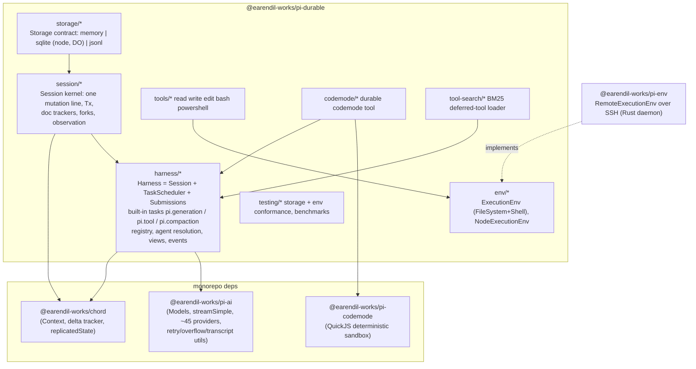

# Pi Durable (@earendil-works/pi-durable)

> **Verdict.** Pi Durable is a durable-execution harness library. Everything an agent does is a durable task in a single-writer transactional store: each model turn, each tool call, each compaction, and any task you define. Every transcript entry, task checkpoint and piece of JSON state is committed atomically before anything becomes observable. A crashed process is recovered by reopening the store and reconciling live tasks from their last checkpoints, subject to replay and abandon-on-restart policies. It is a **sibling** of the Pi coding agent, not a layer under it. It builds on `pi-ai` (models), `chord` (JSON delta tracking and cancellation contexts) and `pi-codemode` (QuickJS). It does not use `pi-agent-core`, and the coding agent does not use it. Its task checkpoints support recovery inside a turn, beyond transcript-only session resume. A real structured-concurrency task model sits underneath: ownership trees, joins, bottom-up abort, and versioned task migration. Unfinished unsafe tools are not automatically rerun; safe tools may rerun. External side effects are not guaranteed exactly once. There is no UI, CLI, MCP client, skills system or sandbox. The API is explicitly experimental. Build on it if you are writing a server-side, multi-conversation agent product that must survive restarts (bots, hosted agents, Durable Objects). Do not build on it if you want a finished coding agent.

| | |
|---|---|
| Repo(s) | `earendil-works/pi` @ `b45e0ebcc5ae` (package `packages/durable`) |
| License | MIT ([`package.json:L136`](https://github.com/earendil-works/pi/blob/b45e0ebcc5ae2fc42a6f2f23104d10e656e6bedb/packages/durable/package.json#L136)) |
| Language(s) | TypeScript (ESM), Node ≥ 22.19 ([`package.json:L142-L144`](https://github.com/earendil-works/pi/blob/b45e0ebcc5ae2fc42a6f2f23104d10e656e6bedb/packages/durable/package.json#L142-L144)). Portable cores also run on Bun and Cloudflare Durable Objects. |
| Size | 203 tracked files: 82 in `src/`, 114 in `test/`. `src/` has 25,188 LOC. Of that, the **harness core** is ~16.0k: session kernel 2,513, storage backends 3,224, harness 8,512, root types/docs/entries ~1,760. The **batteries** are ~6.2k: env 2,299, tools 1,756, codemode 1,698, images 390, tool-search 99. The conformance/benchmark kit in `src/testing` is 2,935. Tests and examples come to 39,080 LOC (64 `*.test.ts`, 32 runnable examples). The normative spec `docs/spec.md` is 5,352 lines. Hard dependency `chord`: 13.4k LOC (non-test). |
| Version at pin | 1.2.0 + unreleased fixes ([`CHANGELOG.md:L3-L10`](https://github.com/earendil-works/pi/blob/b45e0ebcc5ae2fc42a6f2f23104d10e656e6bedb/packages/durable/CHANGELOG.md#L3-L10)) |
| Release history | 1.0.0 on 2026-10-01, released as "experimental" alongside Pi 1.0 ([`CHANGELOG.md:L132-L136`](https://github.com/earendil-works/pi/blob/b45e0ebcc5ae2fc42a6f2f23104d10e656e6bedb/packages/durable/CHANGELOG.md#L132-L136)). 1.0.2 persisted a per-conversation provider session UUID. 1.0.3/1.0.4 changed env contracts (`watch`, binary/dir readers, PowerShell). 1.1.0 (10-07) added the **Cloudflare Durable Object SQLite adapter**, scan order, and the context cache. 1.2.0 (10-12) brought nested tool calls, structured output, durable code mode, deferred tools/`tool_search`, `abandonOnRestart`, fatal-storage-error semantics, and bounded memory. Four of the six releases after 1.0.0 (1.0.3, 1.0.4, 1.1.0, 1.2.0) carry "Breaking Changes" sections. |
| Category | `harness-library`, with a durable-execution kernel underneath it |

Citations are permalinks to the pinned commit. Display paths are relative to `packages/durable/` unless they start with `packages/`.

---

## 1. Layering & package map



| Layer | Owns | Key files |
|---|---|---|
| **Storage** | Atomic batch commit, global monotonic ID minting, cursor scans, base+delta document materialization, fork `document.copy` | [`src/types.ts:L1059-L1154`](https://github.com/earendil-works/pi/blob/b45e0ebcc5ae2fc42a6f2f23104d10e656e6bedb/packages/durable/src/types.ts#L1059-L1154) (the `Storage` interface). Backends: `storage/memory.ts`, `storage/sqlite/*`, `storage/jsonl/*` |
| **Session kernel** | Single serialized mutation line. `Tx` table/document writes. Chord document trackers with use-bounded eviction. Commit publication. Fatal-failure latch. | [`src/session/session.ts:L96-L111`](https://github.com/earendil-works/pi/blob/b45e0ebcc5ae2fc42a6f2f23104d10e656e6bedb/packages/durable/src/session/session.ts#L96-L111), `session/transaction.ts` |
| **Harness** | Conversations, submissions/inbox, run control, the task scheduler, the three built-in tasks, extension registry, agent resolution, views/events/task graph | [`src/harness/harness.ts:L168-L216`](https://github.com/earendil-works/pi/blob/b45e0ebcc5ae2fc42a6f2f23104d10e656e6bedb/packages/durable/src/harness/harness.ts#L168-L216), `harness/scheduler.ts` (1,953 LOC) |
| **Batteries** (subpath exports) | Coding tools, code mode, tool search, Photon image processing, Node env | `package.json` `exports` map ([`package.json:L8-L106`](https://github.com/earendil-works/pi/blob/b45e0ebcc5ae2fc42a6f2f23104d10e656e6bedb/packages/durable/package.json#L8-L106)) |

**Dependencies.** The package depends on `chord`, `pi-ai`, `pi-codemode`, Photon, `diff` and TypeBox, all pinned to 1.2.0 for monorepo packages ([`package.json:L145-L152`](https://github.com/earendil-works/pi/blob/b45e0ebcc5ae2fc42a6f2f23104d10e656e6bedb/packages/durable/package.json#L145-L152)). There is **no dependency on `@earendil-works/pi-agent-core`** and none on `pi-mcp`/`pi-tui`. In the other direction, `pi-coding-agent` depends on `pi-agent-core`, `pi-ai`, `pi-codemode`, `pi-mcp` and `pi-tui`, but not on durable ([`packages/coding-agent/package.json:L42-L48`](https://github.com/earendil-works/pi/blob/b45e0ebcc5ae2fc42a6f2f23104d10e656e6bedb/packages/coding-agent/package.json#L42-L48)). The only consumer in the monorepo is `pi-env` ([`packages/env/package.json:L49`](https://github.com/earendil-works/pi/blob/b45e0ebcc5ae2fc42a6f2f23104d10e656e6bedb/packages/env/package.json#L49)). It implements the durable `ExecutionEnv` over an SSH-launched Rust daemon. Durable imports only three Chord modules: the root (`Context`, `copyJson`, `replicatedState`), `chord/context` and `chord/delta`. It does not use Chord's object hosts or links.

**Lineage.** Many choices are explicitly "as in the coding agent": the compaction prompts, the `tool_search` tool, codemode output layout and agent-event shapes. The code is copied, not imported. The summarization system prompt string appears both in `packages/coding-agent/src/core/compaction/utils.ts:L161` and in durable's [`src/harness/compaction.ts:L68`](https://github.com/earendil-works/pi/blob/b45e0ebcc5ae2fc42a6f2f23104d10e656e6bedb/packages/durable/src/harness/compaction.ts#L68). The two harnesses also converge on vocabulary. `pi-agent-core`'s `AgentTool` declares a `replay?: "never" | "safe"` field described as a "recovery policy for an effect whose durable intent exists" ([`packages/agent/src/types.ts:L489-L490`](https://github.com/earendil-works/pi/blob/b45e0ebcc5ae2fc42a6f2f23104d10e656e6bedb/packages/agent/src/types.ts#L489-L490)). A grep of `packages/agent/src` finds no reader of that field at this pin. The launch post says lessons from Durable "will flow back into Pi the coding agent" (see Evidence index). This field looks like the first such seam (an inference).

## 2. Agent loop

**There is no loop function.** A run is a *chain of durable tasks* linked by run control in the `pi.live` document:

```text
submit(input) ── admitSubmission ──► pi.user entry + pi.live.run = {taskId: G1, inputs:[s1]}  (one commit)
G1 pi.generation: prepare ─► request ─► classify
   toolUse ─► (one commit) pi.assistant + N pi.tool tasks owned by G1 + G1 state = waiting(on tools, allSettled)
   tools phase (G1 resumes) ─► (one commit) postTools boundary, create G2, handOver(run G1→G2), G1 terminal
G2 pi.generation: ... stop ─► (one commit) pi.assistant + final boundary + settle inputs done, delete run
```

The README states this shape as its core model ([`README.md:L94-L101`](https://github.com/earendil-works/pi/blob/b45e0ebcc5ae2fc42a6f2f23104d10e656e6bedb/packages/durable/README.md#L94-L101)). The code confirms it. `finishToolRound` creates the next generation and hands the run over ([`src/harness/generation.ts:L668-L681`](https://github.com/earendil-works/pi/blob/b45e0ebcc5ae2fc42a6f2f23104d10e656e6bedb/packages/durable/src/harness/generation.ts#L668-L681)). New runs are started by `startRun`/`createGeneration` ([`src/harness/generation.ts:L697-L715`](https://github.com/earendil-works/pi/blob/b45e0ebcc5ae2fc42a6f2f23104d10e656e6bedb/packages/durable/src/harness/generation.ts#L697-L715)). Every turn is therefore a fresh task record with its own checkpoint, outcome and abort handler. This is the key structural difference from pi-agent-core and most harnesses in this study, which run an in-memory `while` loop and persist the transcript afterwards.

**Generation phases.** `GenerationCheckpoint` is a tagged union, `prepare | request | retry | poll | tools` ([`src/harness/generation.ts:L52-L93`](https://github.com/earendil-works/pi/blob/b45e0ebcc5ae2fc42a6f2f23104d10e656e6bedb/packages/durable/src/harness/generation.ts#L52-L93)):

1. **`prepare`** ([`L129-L195`](https://github.com/earendil-works/pi/blob/b45e0ebcc5ae2fc42a6f2f23104d10e656e6bedb/packages/durable/src/harness/generation.ts#L129-L195)). Resolves the agent once for the phase. Fails `no_model` if the model is unknown. Re-checks a blocking compaction's outcome. Reads the committed context and renders the prompt sections, then plans `pi.system` diff entries (§5). Checks the compaction thresholds. One commit then appends the system entries and moves to `request`, pinning `model`, `thinkingLevel`, `streamOptions` and the `cutoff` entry ID.
2. **`request`** ([`L196-L222`](https://github.com/earendil-works/pi/blob/b45e0ebcc5ae2fc42a6f2f23104d10e656e6bedb/packages/durable/src/harness/generation.ts#L196-L222)). Converts any committed partial left by a crashed attempt into an aborted assistant entry. Reads the context `at: cutoff` and runs `beforeRequest` hooks. Streams through `models.streamSimple()` with the invocation's abort signal and the persisted provider `sessionId`.
3. **Streaming.** `streamResponse` commits the in-flight partial into `pi.live.generation.message` at most every `partialIntervalMs` (default 100 ms), with one commit in flight. Its `finally` stops the throttle and awaits that commit, so no stale partial lands after the outcome ([`L393-L445`](https://github.com/earendil-works/pi/blob/b45e0ebcc5ae2fc42a6f2f23104d10e656e6bedb/packages/durable/src/harness/generation.ts#L393-L445)). A crash loses at most one throttle window ([`README.md:L406`](https://github.com/earendil-works/pi/blob/b45e0ebcc5ae2fc42a6f2f23104d10e656e6bedb/packages/durable/README.md#L406)).
4. **`classify`** ([`L448-L535`](https://github.com/earendil-works/pi/blob/b45e0ebcc5ae2fc42a6f2f23104d10e656e6bedb/packages/durable/src/harness/generation.ts#L448-L535)) maps the stop reason to one atomic commit:
   - `deferred` → `poll`, a provider batch/background handle with `pollAt`.
   - `toolUse` with calls → tool round.
   - `stop`/`length` → `answer`.
   - Context overflow, recognized by pi-ai `isContextOverflow` → append the error, create a blocking compaction owned by the generation, and wait on it.
   - Retryable error → `retry` with `until = now + retryDelayMs(policy, attempt)`.
   - Anything else → settle the inputs `unanswered/model_error` and end `failed`.

   Overflow is deliberately never retried ([`L506-L513`](https://github.com/earendil-works/pi/blob/b45e0ebcc5ae2fc42a6f2f23104d10e656e6bedb/packages/durable/src/harness/generation.ts#L506-L513)).
5. **`retry`/`poll`** sleep until the persisted deadline, then return to `prepare` with `attempt + 1`, or call `models.fetchDeferred()` ([`L223-L244`](https://github.com/earendil-works/pi/blob/b45e0ebcc5ae2fc42a6f2f23104d10e656e6bedb/packages/durable/src/harness/generation.ts#L223-L244)). Defaults are `maxRetries: 3`, `baseDelayMs: 2000` and `maxAgentDelayMs: 60000` ([`src/harness/agent.ts:L20-L25`](https://github.com/earendil-works/pi/blob/b45e0ebcc5ae2fc42a6f2f23104d10e656e6bedb/packages/durable/src/harness/agent.ts#L20-L25)).

**Tool rounds and parallelism.** `startToolRound` replays the tool set the request actually offered, using pi-ai `getCurrentTools` over the committed context. A call to an unoffered tool gets a `tool_unavailable` result entry with no task. Every other call becomes a `pi.tool` task owned by the generation. Rounds run in parallel unless `settings.toolExecution === "sequential"` or any called tool declares `executionMode: "sequential"`. In that case only the first task is created and the rest wait in `pending` ([`src/harness/generation.ts:L574-L620`](https://github.com/earendil-works/pi/blob/b45e0ebcc5ae2fc42a6f2f23104d10e656e6bedb/packages/durable/src/harness/generation.ts#L574-L620)). The generation commits `waiting` with `allSettled` and runs no code until all are terminal.

**Stop conditions and tool control.** When every result of a round returns `control.terminate`, the run ends without another request. Any `control.handoff` appends a `pi.reset` entry with `head: "self"` and the handoff text, then ends the run. `control.addTools` writes names into the stored `pi.agent.tools`/`modelTools` filters ([`src/harness/generation.ts:L626-L682`](https://github.com/earendil-works/pi/blob/b45e0ebcc5ae2fc42a6f2f23104d10e656e6bedb/packages/durable/src/harness/generation.ts#L626-L682)). An `onYield` hook can return `{ continue }`. That appends a `pi.user` entry and hands the run to a successor generation, keeping the inputs open ([`L542-L567`](https://github.com/earendil-works/pi/blob/b45e0ebcc5ae2fc42a6f2f23104d10e656e6bedb/packages/durable/src/harness/generation.ts#L542-L567)). There is no max-turns cap in the harness. A host would implement one with `onYield` or `afterTools`.

**Steering, follow-ups and interrupts.** Submitting to a busy conversation queues an item in the `pi.inbox` document as `steer`, `followUp` or `write`. Boundaries place queued items deterministically by ID. A `postTools` boundary places writes and steers. A `final` boundary also places follow-ups. `steeringMode`/`followUpMode` choose between `one-at-a-time` and `all` ([spec `docs/spec.md:L2360-L2373`](https://github.com/earendil-works/pi/blob/b45e0ebcc5ae2fc42a6f2f23104d10e656e6bedb/packages/durable/docs/spec.md#L2360-L2373)). A display-only write (`kind` + `data`, no model content) is appended and settled immediately even mid-run ([`src/harness/submissions.ts:L189-L197`](https://github.com/earendil-works/pi/blob/b45e0ebcc5ae2fc42a6f2f23104d10e656e6bedb/packages/durable/src/harness/submissions.ts#L189-L197)). `whenBusy: "reject"` throws `ConversationBusy` ([`L200`](https://github.com/earendil-works/pi/blob/b45e0ebcc5ae2fc42a6f2f23104d10e656e6bedb/packages/durable/src/harness/submissions.ts#L200)). Interrupt is `Conversation.abort()`. It withdraws queued inputs, durably abort-marks every live non-background task reachable through the ownership tree, and waits for idle ([`src/harness/scheduler.ts:L391-L414`](https://github.com/earendil-works/pi/blob/b45e0ebcc5ae2fc42a6f2f23104d10e656e6bedb/packages/durable/src/harness/scheduler.ts#L391-L414)). The generation's abort handler cancels a deferred handle and converts the partial. It writes `aborted` results for unstarted sequential calls and settles the inputs `unanswered/aborted` ([`src/harness/generation.ts:L265-L293`](https://github.com/earendil-works/pi/blob/b45e0ebcc5ae2fc42a6f2f23104d10e656e6bedb/packages/durable/src/harness/generation.ts#L265-L293)).

**The scheduler underneath.** `TaskScheduler` reserves eligible tasks in one commit and runs phase handlers *off* the mutation line. Before every phase it runs a synchronous "step" decision *on* the line ([`src/harness/scheduler.ts:L1317-L1338`](https://github.com/earendil-works/pi/blob/b45e0ebcc5ae2fc42a6f2f23104d10e656e6bedb/packages/durable/src/harness/scheduler.ts#L1317-L1338), [`L1402-L1432`](https://github.com/earendil-works/pi/blob/b45e0ebcc5ae2fc42a6f2f23104d10e656e6bedb/packages/durable/src/harness/scheduler.ts#L1402-L1432)). `#decide` applies the precedence rules ([`L1340-L1383`](https://github.com/earendil-works/pi/blob/b45e0ebcc5ae2fc42a6f2f23104d10e656e6bedb/packages/durable/src/harness/scheduler.ts#L1340-L1383)):
- An abort mark ends the run invocation.
- An uncaught throw writes `faulted`.
- A phase that returns **without changing its checkpoint** is `faulted` ("returned without durable progress").
- A changed definition object in the registry triggers a **handover**: the task goes back to `pending` and the next reservation runs it under the new code. That handover is how hot reload reaches running tasks.

## 3. Model / provider abstraction

Durable has **no model adapter of its own**. It takes a pi-ai `Models` object in `HarnessOptions.models` ([`src/harness/types.ts:L576-L595`](https://github.com/earendil-works/pi/blob/b45e0ebcc5ae2fc42a6f2f23104d10e656e6bedb/packages/durable/src/harness/types.ts#L576-L595)). Generation calls `models.getModel`, `streamSimple`, `fetchDeferred` and `cancelDeferred` directly ([spec `docs/spec.md:L3728-L3735`](https://github.com/earendil-works/pi/blob/b45e0ebcc5ae2fc42a6f2f23104d10e656e6bedb/packages/durable/docs/spec.md#L3728-L3735)). Provider coverage is therefore pi-ai's: `packages/ai/src/providers/` holds 95 files, roughly 45 provider modules plus model catalogs. They include Anthropic, OpenAI, Google/Vertex, Bedrock, Azure, Mistral, DeepSeek, Groq, Cerebras, Fireworks, Cloudflare Workers AI/Gateway, Copilot, Kimi, MiniMax and a `faux` test provider. Tools and hooks get the same `models` through `ToolExecutionApi.models` (added in 1.1.0).

The message model is pi-ai's `Message` union plus the transcript `SystemMessage` with `sections`, `toolsAdded` and `toolsRemoved` ([spec `docs/spec.md:L121-L141`](https://github.com/earendil-works/pi/blob/b45e0ebcc5ae2fc42a6f2f23104d10e656e6bedb/packages/durable/docs/spec.md#L121-L141)). Entries store messages verbatim in `model: Message[]`. Every response becomes a `pi.assistant` entry, including failed and aborted ones, and context derivation drops stop reasons `aborted`/`error`/`deferred` from later requests ([`src/harness/context.ts:L10`](https://github.com/earendil-works/pi/blob/b45e0ebcc5ae2fc42a6f2f23104d10e656e6bedb/packages/durable/src/harness/context.ts#L10)).

**Reasoning** is passed as pi-ai `reasoning: thinkingLevel` and omitted for `off` ([`src/harness/generation.ts:L213-L218`](https://github.com/earendil-works/pi/blob/b45e0ebcc5ae2fc42a6f2f23104d10e656e6bedb/packages/durable/src/harness/generation.ts#L213-L218)). Compaction strips thinking from the material it summarizes ([`src/harness/compaction.ts:L357-L388`](https://github.com/earendil-works/pi/blob/b45e0ebcc5ae2fc42a6f2f23104d10e656e6bedb/packages/durable/src/harness/compaction.ts#L357-L388)).

**Prompt caching** is designed in rather than bolted on:
- Each conversation persists a UUIDv7 in `pi.provider` and forwards it as `sessionId` for cache and session affinity. Forks get a fresh one (`fork: "initial"`) ([`src/harness/provider.ts:L12-L39`](https://github.com/earendil-works/pi/blob/b45e0ebcc5ae2fc42a6f2f23104d10e656e6bedb/packages/durable/src/harness/provider.ts#L12-L39)).
- System prompt and tool changes are positional diffs, so unchanged prefixes stay byte-identical (§5).
- Compaction requests send `cacheRetention: "none"` ([`src/harness/compaction.ts:L172-L180`](https://github.com/earendil-works/pi/blob/b45e0ebcc5ae2fc42a6f2f23104d10e656e6bedb/packages/durable/src/harness/compaction.ts#L172-L180)).

**Token and cost accounting.** The `pi.usage` document keeps per-`provider/model` and per-tool `Usage` totals. Every built-in writer of an assistant entry goes through `appendAssistant`, which records usage in the same commit ([`src/harness/generation.ts:L684-L695`](https://github.com/earendil-works/pi/blob/b45e0ebcc5ae2fc42a6f2f23104d10e656e6bedb/packages/durable/src/harness/generation.ts#L684-L695)). Failed attempts and summarization calls count. Forks start at zero. `Harness.usage()` sums across conversations ([`src/harness/harness.ts:L294-L305`](https://github.com/earendil-works/pi/blob/b45e0ebcc5ae2fc42a6f2f23104d10e656e6bedb/packages/durable/src/harness/harness.ts#L294-L305)).

## 4. Tool system

**Definition API.** A `ToolRegistration` is a pi-ai `Tool` with a TypeBox `parameters` schema plus durable fields ([`src/harness/types.ts:L293-L333`](https://github.com/earendil-works/pi/blob/b45e0ebcc5ae2fc42a6f2f23104d10e656e6bedb/packages/durable/src/harness/types.ts#L293-L333)):

| Field | Meaning |
|---|---|
| `replay` | `"safe"` or `"unsafe"`, default `unsafe` |
| `executionMode` | Per-tool parallel/sequential override |
| `prepareArguments` | Pure argument repair before validation |
| `structuredOutputSchema` | Schema for the value returned to programs |
| `callers` | `"model"`, `"tools"`, or both |
| `deferred` | Hidden from the model until loaded |
| `outputLimits` | `{maxBytes, maxLines, retain: head\|tail}` |
| `execute(args, api, ctx)` | The implementation |

A result has three channels: `output` for the model, `structuredOutput` for calling programs, and `details` for UIs. It can also carry `diagnostics`, `usage` and `control` ([`src/harness/types.ts:L150-L170`](https://github.com/earendil-works/pi/blob/b45e0ebcc5ae2fc42a6f2f23104d10e656e6bedb/packages/durable/src/harness/types.ts#L150-L170)). The `ToolExecutionApi` handed to `execute` exposes ([`src/harness/types.ts:L201-L287`](https://github.com/earendil-works/pi/blob/b45e0ebcc5ae2fc42a6f2f23104d10e656e6bedb/packages/durable/src/harness/types.ts#L201-L287)):
- streaming `output()` and `details()`, plus `diagnostic()`
- `commit(tx => ...)`, a full transactional write into the session, `memo()` and `createTask()`
- `conversation(id)`
- `executeTool()` for nested calls
- `env`, `models` and `agent`

**Built-ins.** `CodingTools` bundles `read`, `write`, `edit` and `bash`. `createPowerShellTool` adds `powershell` ([`src/tools/index.ts:L27-L39`](https://github.com/earendil-works/pi/blob/b45e0ebcc5ae2fc42a6f2f23104d10e656e6bedb/packages/durable/src/tools/index.ts#L27-L39)). The `bash` tool keeps a tail window, spills beyond 50 KiB / 2,000 lines to a file reported as `fullOutputPath`, and returns `{output, truncated, fullOutputPath?, exitCode}` as structured output ([`src/tools/bash.ts:L145-L159`](https://github.com/earendil-works/pi/blob/b45e0ebcc5ae2fc42a6f2f23104d10e656e6bedb/packages/durable/src/tools/bash.ts#L145-L159)). `read` returns images as image blocks, optionally normalized by a Photon WASM processor. Separate subpaths provide `tool_search`, which BM25-searches deferred tools and loads matches via `control.addTools`, and the durable `codemode` tool. Neither is auto-installed. Tools touch files and processes only through the per-call `ExecutionEnv` (§7).

**Execution pipeline** (`pi.tool`, version 2, [`src/harness/tool.ts:L113-L200`](https://github.com/earendil-works/pi/blob/b45e0ebcc5ae2fc42a6f2f23104d10e656e6bedb/packages/durable/src/harness/tool.ts#L113-L200)):

```text
call:  readCall (from assistant entry or nested input)
    → resolveTool (agent.tools for model calls; agent.callable for nested)
    → prepareArguments → validateToolArguments (pi-ai)
    → beforeTool hooks (first block wins; may rewrite args; a throw BLOCKS)
    → validate again
    → INTENT COMMIT: checkpoint {phase:"execute", arguments, replay}, slot status "running"
    → env = HarnessOptions.env(...) → execute() with throttled progress commits
    → afterTool hooks → finalResult (bound content, validate structuredOutput)
    → settle: abort left-running nested calls; append pi.tool-result (or NestedCallDoc result); terminal
execute (recovery only): rerun iff stored replay=="safe" AND current declaration replay=="safe",
                         else commit "interrupted" result from the durable partial output → failed
```

The intent commit is at [`L156-L165`](https://github.com/earendil-works/pi/blob/b45e0ebcc5ae2fc42a6f2f23104d10e656e6bedb/packages/durable/src/harness/tool.ts#L156-L165). The recovery rule is at [`L169-L186`](https://github.com/earendil-works/pi/blob/b45e0ebcc5ae2fc42a6f2f23104d10e656e6bedb/packages/durable/src/harness/tool.ts#L169-L186). The abort handler distinguishes a user `aborted` from a restart `interrupted`/`abandoned` ([`L188-L199`](https://github.com/earendil-works/pi/blob/b45e0ebcc5ae2fc42a6f2f23104d10e656e6bedb/packages/durable/src/harness/tool.ts#L188-L199)).

**Output truncation.** The default limits are 50 KiB / 2,000 lines, keeping the head ([`src/truncate.ts:L11-L12`](https://github.com/earendil-works/pi/blob/b45e0ebcc5ae2fc42a6f2f23104d10e656e6bedb/packages/durable/src/truncate.ts#L11-L12)). `Progress` commits running output adaptively: the first change commits at once, and later commits are delayed by at least `outputIntervalMs` and by their size at 100 KiB/s ([`src/harness/output.ts:L261-L275`](https://github.com/earendil-works/pi/blob/b45e0ebcc5ae2fc42a6f2f23104d10e656e6bedb/packages/durable/src/harness/output.ts#L261-L275)). Output is assigned as one string field so Chord diffs it into an append, or a trim plus an append, rather than rewriting the window ([`src/harness/tool.ts:L435-L483`](https://github.com/earendil-works/pi/blob/b45e0ebcc5ae2fc42a6f2f23104d10e656e6bedb/packages/durable/src/harness/tool.ts#L435-L483)).

**Nested calls (`executeTool`).** Each nested call is its own `pi.tool` task owned by the caller and keyed by position, or by an explicit `key`. The commit that creates it also creates a `NestedCallDoc` family member, which is task-scoped and retires with the caller ([`src/harness/tool.ts:L91-L102`](https://github.com/earendil-works/pi/blob/b45e0ebcc5ae2fc42a6f2f23104d10e656e6bedb/packages/durable/src/harness/tool.ts#L91-L102)). A reused key with the same tool and arguments reattaches to the existing task. A reused key with a different tool or arguments throws ([`L673-L732`](https://github.com/earendil-works/pi/blob/b45e0ebcc5ae2fc42a6f2f23104d10e656e6bedb/packages/durable/src/harness/tool.ts#L673-L732)). Child tasks created by a non-replay-safe tool default to `abandonOnRestart` ([`L340-L353`](https://github.com/earendil-works/pi/blob/b45e0ebcc5ae2fc42a6f2f23104d10e656e6bedb/packages/durable/src/harness/tool.ts#L340-L353)).

**Durable code mode** applies a Temporal-style mechanism *inside one tool*. The `codemode` tool (`replay: "safe"`, `callers: ["model"]`) runs model-written JS in pi-codemode's deterministic QuickJS sandbox: virtual clock, seeded randomness, UTC. It journals every result delivered to the VM *before* delivery. After a restart it re-executes the script, feeding the journal back in order, and reattaches nested calls by key (`c<vmCallId>`). It refuses to continue if the module version or sandbox fingerprint changed, the deadline passed, or the script diverges ([`src/codemode/codemode.ts:L1-L35`](https://github.com/earendil-works/pi/blob/b45e0ebcc5ae2fc42a6f2f23104d10e656e6bedb/packages/durable/src/codemode/codemode.ts#L1-L35), [`L231-L243`](https://github.com/earendil-works/pi/blob/b45e0ebcc5ae2fc42a6f2f23104d10e656e6bedb/packages/durable/src/codemode/codemode.ts#L231-L243); [spec `docs/spec.md:L3663-L3716`](https://github.com/earendil-works/pi/blob/b45e0ebcc5ae2fc42a6f2f23104d10e656e6bedb/packages/durable/docs/spec.md#L3663-L3716)).

**Approvals.** There is no approval prompt. `beforeTool` can block a call (`{ block: reason }`) or rewrite its arguments, and a throwing hook blocks ([`src/harness/tool.ts:L136-L150`](https://github.com/earendil-works/pi/blob/b45e0ebcc5ae2fc42a6f2f23104d10e656e6bedb/packages/durable/src/harness/tool.ts#L136-L150)). A human-in-the-loop approval would have to be built by the host, for example as a tool that waits on a submission or document.

## 5. Context management

**System prompt as transcript.** Durable never stores a "current system prompt". Every prompt part is a named **section** contributed by the selected extensions, followed by the conversation's `instructions`. Before each request, `prepare` renders the sections and `planSystemEntries` appends `pi.system` entries whose `SystemMessage.sections` patch (string = set, `null` = delete) and `toolsAdded`/`toolsRemoved` turn the replayed state into the desired state. It emits a full baseline after a head marker such as a compaction or reset ([`src/harness/prompt.ts:L54-L93`](https://github.com/earendil-works/pi/blob/b45e0ebcc5ae2fc42a6f2f23104d10e656e6bedb/packages/durable/src/harness/prompt.ts#L54-L93)). Tool changes are diffed by declaration equality. If keeping retained tools in place would produce the wrong order, it emits a remove-all/re-add-all pair ([`L95-L119`](https://github.com/earendil-works/pi/blob/b45e0ebcc5ae2fc42a6f2f23104d10e656e6bedb/packages/durable/src/harness/prompt.ts#L95-L119)). Two consequences follow. A recovered request resends exactly the prompt the first attempt sent. And a section whose text changes every turn, such as one embedding the time, defeats caching, which the spec lists as a footgun ([spec `docs/spec.md:L5319-L5324`](https://github.com/earendil-works/pi/blob/b45e0ebcc5ae2fc42a6f2f23104d10e656e6bedb/packages/durable/docs/spec.md#L5319-L5324)).

**Project instruction files.** Durable has no AGENTS.md/CLAUDE.md discovery. Instruction loading is a host concern, written as a `section()` that reads through `input.env` or `input.read`.

**Context derivation** is a pure function of immutable entries ([spec `docs/spec.md:L267-L302`](https://github.com/earendil-works/pi/blob/b45e0ebcc5ae2fc42a6f2f23104d10e656e6bedb/packages/durable/docs/spec.md#L267-L302)):
- Find the newest **head marker**. Its `head` is the range start.
- Apply per-target `ContextEdit`s (`omit` / `replace`).
- Move tool results directly after their call, and synthesize an error result for any call that lacks one ([`src/harness/context.ts:L295-L333`](https://github.com/earendil-works/pi/blob/b45e0ebcc5ae2fc42a6f2f23104d10e656e6bedb/packages/durable/src/harness/context.ts#L295-L333)).
- Lead with the baseline system message.

The scheduler caches each conversation's last range and scans only newer entries when the head marker is unchanged ([`src/harness/context.ts:L68-L109`](https://github.com/earendil-works/pi/blob/b45e0ebcc5ae2fc42a6f2f23104d10e656e6bedb/packages/durable/src/harness/context.ts#L68-L109)). Idle conversations drop the cache after `contextRetentionMs`.

**Compaction** is a durable task, `pi.compaction`, with phases `select → summarize → retry` ([`src/harness/compaction.ts:L110-L235`](https://github.com/earendil-works/pi/blob/b45e0ebcc5ae2fc42a6f2f23104d10e656e6bedb/packages/durable/src/harness/compaction.ts#L110-L235)).

*Triggers.* Generation's `prepare` estimates context size: the last assistant `usage` that postdates the head, plus `estimateMessageTokens` of everything after it ([`L309-L329`](https://github.com/earendil-works/pi/blob/b45e0ebcc5ae2fc42a6f2f23104d10e656e6bedb/packages/durable/src/harness/compaction.ts#L309-L329)). From that estimate:
- Above `contextWindow − reserveTokens`, a **blocking** compaction starts, owned by the generation, which waits on it.
- Above that threshold minus `backgroundTokens`, a **background** conversation-owned compaction starts and the run does not wait ([`src/harness/generation.ts:L317-L339`](https://github.com/earendil-works/pi/blob/b45e0ebcc5ae2fc42a6f2f23104d10e656e6bedb/packages/durable/src/harness/generation.ts#L317-L339)).
- A provider overflow error starts one blocking compaction and one retry.
- `compact()` starts a manual compaction.

Defaults are `reserveTokens` 16,384, `keepRecentTokens` 20,000 and `backgroundTokens` 32,768 ([`src/harness/agent.ts:L27-L32`](https://github.com/earendil-works/pi/blob/b45e0ebcc5ae2fc42a6f2f23104d10e656e6bedb/packages/durable/src/harness/agent.ts#L27-L32)).

*Algorithm.* `selectCut` walks back from the tail until `keepRecentTokens` is reached. It then cuts at the next user/assistant entry that does not split a call from its results ([`src/harness/compaction.ts:L256-L302`](https://github.com/earendil-works/pi/blob/b45e0ebcc5ae2fc42a6f2f23104d10e656e6bedb/packages/durable/src/harness/compaction.ts#L256-L302)). The prefix, including the previous summary, is serialized as `[User]:` / `[Assistant]:` / `[Tool result]:` text, with tool results truncated to 2,000 characters. It is summarized with the coding agent's structured-checkpoint prompt, with `maxTokens = min(0.8 × reserveTokens, model.maxTokens)` ([`L141-L181`](https://github.com/earendil-works/pi/blob/b45e0ebcc5ae2fc42a6f2f23104d10e656e6bedb/packages/durable/src/harness/compaction.ts#L141-L181)). A `beforeCompact` hook can decline or supply its own summary.

*Placement.* The summary is a `pi.compaction` entry whose `head` is the first kept entry. A blocking compaction appends it directly. A conversation-owned one admits it as a write submission with `requestId: compaction:<taskId>`, so it lands at the next boundary or settles `stale` if a later cut already superseded it ([`L411-L447`](https://github.com/earendil-works/pi/blob/b45e0ebcc5ae2fc42a6f2f23104d10e656e6bedb/packages/durable/src/harness/compaction.ts#L411-L447); [spec `docs/spec.md:L2375-L2392`](https://github.com/earendil-works/pi/blob/b45e0ebcc5ae2fc42a6f2f23104d10e656e6bedb/packages/durable/docs/spec.md#L2375-L2392)). Concurrent compactions therefore need no lock. The stale rule orders them by cut position. History is never deleted.

**Spill-to-disk and memory.** Large tool output spills to an env temp file, and codemode writes `output.txt` / `image-<n>` under a run-recorded `outputDir`. There is no long-term memory subsystem. Typed **documents** (§6) are the intended place for durable app or agent state such as todos and plans, and the example `27-plan-mode.ts` uses them.

## 6. State, sessions & durability

This is the package's reason to exist, and the code backs the README's headline ([`README.md:L5`](https://github.com/earendil-works/pi/blob/b45e0ebcc5ae2fc42a6f2f23104d10e656e6bedb/packages/durable/README.md#L5)). The spec's core rule reads: "A Session atomically commits immutable entries, full task records, and Chord-tracked documents. Only committed state is observable" ([spec `docs/spec.md:L41-L44`](https://github.com/earendil-works/pi/blob/b45e0ebcc5ae2fc42a6f2f23104d10e656e6bedb/packages/durable/docs/spec.md#L41-L44)). Eight invariants follow, including "There is no volatile publication path" and "External effects do not run inside the Session mutation transaction" ([spec `docs/spec.md:L63-L78`](https://github.com/earendil-works/pi/blob/b45e0ebcc5ae2fc42a6f2f23104d10e656e6bedb/packages/durable/docs/spec.md#L63-L78)).

### 6.1 Data model

| Record | Shape | Mutability |
|---|---|---|
| `ConversationRecord` | `id`, optional `parent {conversationId, at}` (fork), optional `owner {conversationId, taskId}` (subagent) | Immutable. Root ID is reserved as `1`. |
| `EntryRecord` | `kind`, `model?: Message[]`, `data?`, `head?` (context start marker), `edits?: ContextEdit[]`, `byTaskId?` | Immutable. IDs are global and ordered. |
| `TaskRecord` | `kind`, `version`, `input`, `owner?`, `background`, `abortRequested`, `abortReason?`, `abandonOnRestart?`, `startedAt/endedAt`, `state`, `memos?` | Whole-record replacement |
| `SubmissionRecord` | `type: input\|write`, `status: queued\|placed\|done\|unanswered`, `requestId?` | Replaced |
| Document | Typed JSON object at `(kind, scope, key?)`, scope `session\|conversation\|task`; conversation docs declare `history: latest\|rewindable` and `fork: initial\|current\|asOf` | Chord ops (delta) or full base |

Sources: [spec `docs/spec.md:L85-L229`](https://github.com/earendil-works/pi/blob/b45e0ebcc5ae2fc42a6f2f23104d10e656e6bedb/packages/durable/docs/spec.md#L85-L229), [`src/types.ts:L41-L78`](https://github.com/earendil-works/pi/blob/b45e0ebcc5ae2fc42a6f2f23104d10e656e6bedb/packages/durable/src/types.ts#L41-L78), [`src/types.ts:L464-L537`](https://github.com/earendil-works/pi/blob/b45e0ebcc5ae2fc42a6f2f23104d10e656e6bedb/packages/durable/src/types.ts#L464-L537).

The task state machine is `pending → running → (waiting ↔ running)* → completing? → terminal`, with outcomes `completed | failed | aborted | orphaned | faulted`. `orphaned` means the abort ran with no task code available, so "external effects the task started may remain uncleaned" ([spec `docs/spec.md:L2096-L2109`](https://github.com/earendil-works/pi/blob/b45e0ebcc5ae2fc42a6f2f23104d10e656e6bedb/packages/durable/docs/spec.md#L2096-L2109)).

There are five built-in conversation documents, all created in the conversation's creating commit ([`src/harness/harness.ts:L360-L372`](https://github.com/earendil-works/pi/blob/b45e0ebcc5ae2fc42a6f2f23104d10e656e6bedb/packages/durable/src/harness/harness.ts#L360-L372)):

| Document | Contents | History / fork policy |
|---|---|---|
| `pi.agent` | Model, thinking level, extensions, tools, `modelTools`, instructions, `cwd` | Rewindable, `fork: asOf` |
| `pi.live` | Run control, streamed partial, tool slots, compaction status | — |
| `pi.inbox` | Queued submissions | — |
| `pi.usage` | Token and cost totals | — |
| `pi.provider` | Session UUID | — |

### 6.2 Storage

The Storage contract is small: 15 methods. `commit(writes)` is atomic and returns a `Seq`. `mintId()` hands out IDs from one global monotone namespace. The rest are keyed lookups, cursor scans, `findLatestHeadMarker`, and `document(id, at)` materialization ([`src/types.ts:L1059-L1154`](https://github.com/earendil-works/pi/blob/b45e0ebcc5ae2fc42a6f2f23104d10e656e6bedb/packages/durable/src/types.ts#L1059-L1154)). Storage trusts the Session for semantics and enforces atomicity, ID uniqueness and detached values ([spec `docs/spec.md:L4940-L4976`](https://github.com/earendil-works/pi/blob/b45e0ebcc5ae2fc42a6f2f23104d10e656e6bedb/packages/durable/docs/spec.md#L4940-L4976)).

| Backend | Mechanics | Durability |
|---|---|---|
| `MemoryStorage` | Reference semantics; copies on read and write to simulate the serialization boundary | None |
| **SQLite** (`openNodeSqliteStorage`) | `node:sqlite` `DatabaseSync`. Tables `conversations`, `entries`, `tasks`, `submissions`, `documents`, `document_revisions(base\|delta)`, `record_ids`, `durable_metadata` ([`src/storage/sqlite/migrations.ts:L9-L85`](https://github.com/earendil-works/pi/blob/b45e0ebcc5ae2fc42a6f2f23104d10e656e6bedb/packages/durable/src/storage/sqlite/migrations.ts#L9-L85)). One SQL transaction per commit ([`src/storage/sqlite/storage.ts:L175-L198`](https://github.com/earendil-works/pi/blob/b45e0ebcc5ae2fc42a6f2f23104d10e656e6bedb/packages/durable/src/storage/sqlite/storage.ts#L175-L198)). Tasks upsert one row. Current-only documents delete older revisions when a base lands ([`L899-L927`](https://github.com/earendil-works/pi/blob/b45e0ebcc5ae2fc42a6f2f23104d10e656e6bedb/packages/durable/src/storage/sqlite/storage.ts#L899-L927)). | WAL, `synchronous=NORMAL`, `busy_timeout` 5 s ([`src/storage/sqlite/node.ts:L180-L201`](https://github.com/earendil-works/pi/blob/b45e0ebcc5ae2fc42a6f2f23104d10e656e6bedb/packages/durable/src/storage/sqlite/node.ts#L180-L201)). Survives process crashes; the newest commit may be lost on power loss. |
| **Cloudflare DO** (`openDurableObjectSqliteStorage(ctx.storage)`) | Same `SqliteStorage` over a structural `ctx.storage.sql` facade. Commits map to `ctx.storage.transaction()`, and a serial queue orders operations ([`src/storage/sqlite/cloudflare.ts:L93-L139`](https://github.com/earendil-works/pi/blob/b45e0ebcc5ae2fc42a6f2f23104d10e656e6bedb/packages/durable/src/storage/sqlite/cloudflare.ts#L93-L139)). | DO storage guarantees |
| **JSONL** (`openNodeJsonlStorage`) | `main.jsonl` commit markers plus `doc-<id>.jsonl` and `task-<id>.jsonl` sidecars. Sidecars are appended first, then the marker; torn tails are truncated on recovery. A full `MemoryStorage` mirror holds everything in RAM ([`src/storage/jsonl/storage.ts:L241-L307`](https://github.com/earendil-works/pi/blob/b45e0ebcc5ae2fc42a6f2f23104d10e656e6bedb/packages/durable/src/storage/jsonl/storage.ts#L241-L307)). | Process-crash consistent; `fsync: true` flushes sidecars before the marker |

**Working set versus disk.** The launch post says that on SQLite "only the working set" is in memory. The code supports that only at 1.2.0.
- The Session document cache evicts unobserved documents after `documentRetentionMs`, default 10 minutes ([`src/session/session.ts:L77-L91`](https://github.com/earendil-works/pi/blob/b45e0ebcc5ae2fc42a6f2f23104d10e656e6bedb/packages/durable/src/session/session.ts#L77-L91)).
- The scheduler's ownership indexes are bounded by live work.

The 1.2.0 changelog says that before this fix the cache "held every conversation and session document ever touched … for the life of the process" ([`CHANGELOG.md:L47-L48`](https://github.com/earendil-works/pi/blob/b45e0ebcc5ae2fc42a6f2f23104d10e656e6bedb/packages/durable/CHANGELOG.md#L47-L48)). The post's claim was therefore aspirational at 1.0.0 and is true at the pin. The JSONL backend still keeps all history in memory, which the README documents ([`README.md:L662`](https://github.com/earendil-works/pi/blob/b45e0ebcc5ae2fc42a6f2f23104d10e656e6bedb/packages/durable/README.md#L662)).

**Document checkpoints.** Each document definition decides when a write becomes a full base instead of a Chord delta, through `checkpointWhen(value, ops, {deltasSinceBase})`. The predicate is evaluated last in transaction assembly ([`src/session/transaction.ts:L834-L846`](https://github.com/earendil-works/pi/blob/b45e0ebcc5ae2fc42a6f2f23104d10e656e6bedb/packages/durable/src/session/transaction.ts#L834-L846)). `pi.live` writes a base whenever nothing is running, so its delta chain spans at most one generation or one tool round ([`src/harness/live.ts:L111-L127`](https://github.com/earendil-works/pi/blob/b45e0ebcc5ae2fc42a6f2f23104d10e656e6bedb/packages/durable/src/harness/live.ts#L111-L127)). `pi.inbox` writes a base when the inbox is empty ([`src/harness/inbox.ts:L21-L29`](https://github.com/earendil-works/pi/blob/b45e0ebcc5ae2fc42a6f2f23104d10e656e6bedb/packages/durable/src/harness/inbox.ts#L21-L29)). Storage invents no heuristics, and a definition that never checkpoints grows without bound, which the spec calls "a definition bug" ([spec `docs/spec.md:L1452-L1502`](https://github.com/earendil-works/pi/blob/b45e0ebcc5ae2fc42a6f2f23104d10e656e6bedb/packages/durable/docs/spec.md#L1452-L1502)).

### 6.3 Execution model: what is journaled, and replay semantics

Durable is **checkpoint-based, not history-replay-based**. A task's durable state is its *latest full checkpoint*: `state.checkpoint`, plus first-writer-wins `memos`. There is no event log to re-run. Each phase handler follows the **effect sandwich**: commit intent, perform the effect outside the transaction, commit the outcome or next phase ([spec `docs/spec.md:L1934-L1950`](https://github.com/earendil-works/pi/blob/b45e0ebcc5ae2fc42a6f2f23104d10e656e6bedb/packages/durable/docs/spec.md#L1934-L1950)). `runtime.commit()` re-reads and gates the task on the mutation line. It rejects if the invocation ended, the task is not `running`, or a run invocation carries an abort mark ([`src/harness/scheduler.ts:L1786-L1809`](https://github.com/earendil-works/pi/blob/b45e0ebcc5ae2fc42a6f2f23104d10e656e6bedb/packages/durable/src/harness/scheduler.ts#L1786-L1809)). `memo(name, candidate)` is one gated commit that returns the durable winner ([`L1640-L1655`](https://github.com/earendil-works/pi/blob/b45e0ebcc5ae2fc42a6f2f23104d10e656e6bedb/packages/durable/src/harness/scheduler.ts#L1640-L1655)). Hooks share the task's memo namespace through `HookApi.memo` ([`src/harness/types.ts:L744-L752`](https://github.com/earendil-works/pi/blob/b45e0ebcc5ae2fc42a6f2f23104d10e656e6bedb/packages/durable/src/harness/types.ts#L744-L752)), so a hook decision made before a crash is reused afterwards.

What a crash mid-turn costs, per checkpoint:

| Interrupted in | On reopen |
|---|---|
| `prepare` (before its commit) | Rerun from scratch. Nothing durable happened. |
| `request` / streaming | Committed partial becomes an aborted `pi.assistant`. The **same** committed messages are resent with the pinned model, thinking level and stream options. `beforeRequest` reruns. |
| `retry` / `poll` | Sleep until the persisted `until`/`pollAt`, then continue. Deferred handles are polled again. |
| `pi.tool` `call` (before intent) | Rerun validation and `beforeTool`, then execute once. |
| `pi.tool` `execute` (after intent) | Replay only if stored *and* current `replay === "safe"`. Otherwise an `interrupted` error result with the durable partial output, and the task ends `failed`. |
| `tools` phase of generation | Rerun. It reads tool outcomes from terminal receipts. |
| compaction `summarize` | Resend the pinned summarization request. |

These rows are taken from the phase code above and the recovery test names in [`test/harness-generation-recovery.test.ts:L41-L270`](https://github.com/earendil-works/pi/blob/b45e0ebcc5ae2fc42a6f2f23104d10e656e6bedb/packages/durable/test/harness-generation-recovery.test.ts#L41-L270) and [`test/harness-tools-recovery.test.ts:L109-L366`](https://github.com/earendil-works/pi/blob/b45e0ebcc5ae2fc42a6f2f23104d10e656e6bedb/packages/durable/test/harness-tools-recovery.test.ts#L109-L366).

**Crash recovery procedure.**
1. `Harness.open` checks that the registry holds the built-in tasks, then calls `openTasks` ([`src/harness/harness.ts:L445-L470`](https://github.com/earendil-works/pi/blob/b45e0ebcc5ae2fc42a6f2f23104d10e656e6bedb/packages/durable/src/harness/harness.ts#L445-L470)).
2. `TaskScheduler.open` scans every live status in one commit. It flips surviving `running` records back to `pending`, keeping the checkpoint and abort mark, and queues `failFast` checks and abandoned tasks ([`src/harness/scheduler.ts:L288-L315`](https://github.com/earendil-works/pi/blob/b45e0ebcc5ae2fc42a6f2f23104d10e656e6bedb/packages/durable/src/harness/scheduler.ts#L288-L315)).
3. A reconcile commit re-derives abort cascades that a crash left unapplied and finalizes `completing` holders ([`L573-L628`](https://github.com/earendil-works/pi/blob/b45e0ebcc5ae2fc42a6f2f23104d10e656e6bedb/packages/durable/src/harness/scheduler.ts#L573-L628)).
4. Scheduling starts only on `resume()`, or on the first submit or wait. An inspection-only open therefore marks and runs nothing ([`src/harness/types.ts:L700-L706`](https://github.com/earendil-works/pi/blob/b45e0ebcc5ae2fc42a6f2f23104d10e656e6bedb/packages/durable/src/harness/types.ts#L700-L706)).
5. The first reservation pass abort-marks every `abandonOnRestart` task with `abortReason: "restart"` before anything runs ([`L1118-L1135`](https://github.com/earendil-works/pi/blob/b45e0ebcc5ae2fc42a6f2f23104d10e656e6bedb/packages/durable/src/harness/scheduler.ts#L1118-L1135)).

**Versioned task code.** At reservation, a stored task is matched to its registered definition:
- A missing definition, or a stored version newer than the code, leaves the task `pending` and **blocked**. It is never auto-terminated.
- An older stored version runs the definition's `migrate(input, checkpoint, fromVersion)`, atomically with the move to `running` ([`src/harness/scheduler.ts:L1209-L1236`](https://github.com/earendil-works/pi/blob/b45e0ebcc5ae2fc42a6f2f23104d10e656e6bedb/packages/durable/src/harness/scheduler.ts#L1209-L1236)). `pi.tool` v2 migrates v1 tasks this way ([`src/harness/tool.ts:L113-L121`](https://github.com/earendil-works/pi/blob/b45e0ebcc5ae2fc42a6f2f23104d10e656e6bedb/packages/durable/src/harness/tool.ts#L113-L121)).

This is the analogue of Temporal workflow versioning, at checkpoint granularity rather than history granularity.

### 6.4 The exactly-once caveat

Durable deduplicates admission by request ID, but does **not** make external effects exactly once. At a recorded tool intent, safe tools may be rerun, whereas unsafe tools are not automatically re-executed; this describes runtime dispatch policy, not a universal at-most-once guarantee for the remote service:
- *Submissions:* `requestId` deduplicates per conversation inside the admission commit, so a retried submit returns the existing submission ([`src/harness/submissions.ts:L179-L187`](https://github.com/earendil-works/pi/blob/b45e0ebcc5ae2fc42a6f2f23104d10e656e6bedb/packages/durable/src/harness/submissions.ts#L179-L187)). After a storage error, the README tells hosts to reopen and resubmit with the same `requestId` ([`README.md:L698`](https://github.com/earendil-works/pi/blob/b45e0ebcc5ae2fc42a6f2f23104d10e656e6bedb/packages/durable/README.md#L698)).
- *Tools declare replay safety*, with `replay` defaulting to `unsafe` ([spec `docs/spec.md:L2927-L2930`](https://github.com/earendil-works/pi/blob/b45e0ebcc5ae2fc42a6f2f23104d10e656e6bedb/packages/durable/docs/spec.md#L2927-L2930)). The policy is frozen in the intent checkpoint. A current `unsafe` declaration can veto a stored `safe` one, but never the reverse ([spec `docs/spec.md:L3376-L3382`](https://github.com/earendil-works/pi/blob/b45e0ebcc5ae2fc42a6f2f23104d10e656e6bedb/packages/durable/docs/spec.md#L3376-L3382)). Recovery reuses the stored final arguments without rerunning `beforeTool` ([spec `docs/spec.md:L3231-L3239`](https://github.com/earendil-works/pi/blob/b45e0ebcc5ae2fc42a6f2f23104d10e656e6bedb/packages/durable/docs/spec.md#L3231-L3239)).
- *Nested calls:* a replay-safe caller that reruns reattaches to its finished nested calls. But "This is not exactly-once execution: a nested call interrupted by a crash before its result commits follows its own replay policy … a replay-safe tool with external effects still needs its own idempotency" ([spec `docs/spec.md:L2976-L2988`](https://github.com/earendil-works/pi/blob/b45e0ebcc5ae2fc42a6f2f23104d10e656e6bedb/packages/durable/docs/spec.md#L2976-L2988)).
- **Notable at the pin.** None of the built-in coding tools declares `replay`. `read`, `write`, `edit`, `bash` and `powershell` are therefore all `unsafe` (`createReadTool`, [`src/tools/read.ts:L89-L95`](https://github.com/earendil-works/pi/blob/b45e0ebcc5ae2fc42a6f2f23104d10e656e6bedb/packages/durable/src/tools/read.ts#L89-L95); `createBashTool`, [`src/tools/bash.ts:L145-L159`](https://github.com/earendil-works/pi/blob/b45e0ebcc5ae2fc42a6f2f23104d10e656e6bedb/packages/durable/src/tools/bash.ts#L145-L159)). Even an interrupted `read` comes back to the model as `interrupted`. Only `tool_search` ([`src/tool-search/tool-search.ts:L58-L62`](https://github.com/earendil-works/pi/blob/b45e0ebcc5ae2fc42a6f2f23104d10e656e6bedb/packages/durable/src/tool-search/tool-search.ts#L58-L62)) and `codemode` declare `safe`. The default is conservative. Hosts wanting transparent rerun of idempotent tools must wrap them, for example with `wrapTool(read, t => ({...t, replay: "safe"}))`.

### 6.5 Concurrency and locking

Inside one process, every commit and on-line read is serialized through a single promise chain, `#enqueue` ([`src/session/session.ts:L854-L861`](https://github.com/earendil-works/pi/blob/b45e0ebcc5ae2fc42a6f2f23104d10e656e6bedb/packages/durable/src/session/session.ts#L854-L861)). The commit pipeline is: callback, then `settleSuccess`, then `Storage.commit` (uncancellable once admitted), then adopt, then publish ([`L690-L742`](https://github.com/earendil-works/pi/blob/b45e0ebcc5ae2fc42a6f2f23104d10e656e6bedb/packages/durable/src/session/session.ts#L690-L742)). Handlers for many conversations run concurrently off the line. A transaction forbids table reads after its first table write (`ReadAfterWrite`, [`src/session/transaction.ts:L922-L930`](https://github.com/earendil-works/pi/blob/b45e0ebcc5ae2fc42a6f2f23104d10e656e6bedb/packages/durable/src/session/transaction.ts#L922-L930)). New owned work is validated against a live, un-aborted owner ([`L852-L874`](https://github.com/earendil-works/pi/blob/b45e0ebcc5ae2fc42a6f2f23104d10e656e6bedb/packages/durable/src/session/transaction.ts#L852-L874)).

**Across processes there is no lock.** "One process owns a storage at a time; there is no cross-process locking" ([`README.md:L665`](https://github.com/earendil-works/pi/blob/b45e0ebcc5ae2fc42a6f2f23104d10e656e6bedb/packages/durable/README.md#L665)). There is no lease, fencing token or heartbeat, so two workers opening the same SQLite file would both reconcile and run the same tasks. That conclusion is drawn from the absence of any such mechanism in `storage/` and `session/`. On Cloudflare, the DO single-writer model supplies the missing lock.

**Failure semantics are fail-stop.** Any error thrown by a `Storage` method fails the whole Session. `GuardedStorage` latches the error, all later calls reject with `SessionFailed`, and the Session closes itself. Nothing is retried ([`src/session/session.ts:L906-L934`](https://github.com/earendil-works/pi/blob/b45e0ebcc5ae2fc42a6f2f23104d10e656e6bedb/packages/durable/src/session/session.ts#L906-L934); [spec `docs/spec.md:L5052-L5089`](https://github.com/earendil-works/pi/blob/b45e0ebcc5ae2fc42a6f2f23104d10e656e6bedb/packages/durable/docs/spec.md#L5052-L5089)). The host reopens. This semantics became the rule in 1.2.0 ([`CHANGELOG.md:L17`](https://github.com/earendil-works/pi/blob/b45e0ebcc5ae2fc42a6f2f23104d10e656e6bedb/packages/durable/CHANGELOG.md#L17)).

### 6.6 Resume, fork, branch, undo

- **Resume.** Reopen the same storage. `harness.root()` returns conversation 1, and `harness.submission(id)` reacquires a submission handle.
- **Fork.** `fork(entryId)` creates a child that sees parent entries up to `E` *without copying them*. Ancestry is followed in `scanEntries`. Conversation documents are copied per policy (`asOf` = value at `E`'s commit, `current`, or `initial`) through backend-side `document.copy` ([spec `docs/spec.md:L1539-L1587`](https://github.com/earendil-works/pi/blob/b45e0ebcc5ae2fc42a6f2f23104d10e656e6bedb/packages/durable/docs/spec.md#L1539-L1587); [`src/session/forks.ts:L25-L60`](https://github.com/earendil-works/pi/blob/b45e0ebcc5ae2fc42a6f2f23104d10e656e6bedb/packages/durable/src/session/forks.ts#L25-L60)). Tasks and task documents are never copied.
- **Context-level undo.** `reset()` writes a `pi.reset` head marker, and `Conversation.context({at})` gives the as-of view without forking. Raw history is append-only.
- **No filesystem undo.** There is no checkpoint/rewind of workspace files, unlike Claude Code or Codex.

### 6.7 Comparison with durable-execution systems

| | **Pi Durable** | Temporal | DBOS | Cloudflare Workflows | Vercel Workflow (WDK) | LangGraph checkpointer |
|---|---|---|---|---|---|---|
| Unit of durability | Task checkpoint (full replacement) + Chord-delta documents + immutable entries, in one atomic commit | Event history | Step outputs in a Postgres system DB | `step.do` results | Step results in an event log | Graph state per super-step (+ pending writes) |
| Recovery | Resume each task's current phase from its checkpoint; phase code reruns | Deterministic replay of workflow code against history | Re-run workflow fn; completed steps return recorded outputs | Re-run workflow; completed steps memoized | Replay workflow fn against the event log; deterministic sandbox | Reload latest checkpoint for `thread_id`; rerun the interrupted super-step |
| Determinism required? | **No**, except inside `codemode` scripts | Yes (workflow code) | Yes (workflow fn) | Yes-ish (outside steps) | Yes (seeded `Math.random`/`Date`) | No (nodes rerun) |
| Side-effect guarantee | Intent-before-effect. Rerun only if `replay: "safe"`; otherwise settle with `interrupted` and do not automatically rerun that intent. No built-in idempotency keys for tools. | Activities at-least-once with retries | Steps at-least-once; completed steps never re-run | Steps retried; at-least-once | Steps at-least-once | Nodes at-least-once |
| Agent semantics | Native: transcript, inbox/steering, compaction, prompt-cache-aware system diffs, subagent ownership | None (build it) | None | None | None | Graph-level; agent semantics in prebuilt nodes |
| Infra | In-process library; SQLite/JSONL/DO; single-writer per store | Server cluster | Library + Postgres | Managed (on DOs) | Managed / self-host "worlds" | Library + saver (SQLite/Postgres/...) |

The other systems' columns summarize their public documentation; links are in the Evidence index. They were not re-verified against their code for this chapter. Durable sits closest to **DBOS and LangGraph checkpointers**: a state-machine checkpoint, no deterministic replay of host code. It borrows Temporal's two-tier model only in `codemode`, where a deterministic script plus a journal of results are re-executed. Its distinctive contributions relative to all of them are:
1. Structured-concurrency ownership with bottom-up abort, `completing` holds, and wait-cycle rejection.
2. Agent-specific durable primitives: throttled durable streaming partials, positional prompt entries, stale-ordered compaction summaries.
3. A pluggable 15-method storage contract with a shipped conformance suite ([`src/testing/storage-conformance.ts`](https://github.com/earendil-works/pi/blob/b45e0ebcc5ae2fc42a6f2f23104d10e656e6bedb/packages/durable/src/testing/storage-conformance.ts), 1,663 LOC).

## 7. Safety & sandboxing

- **Permission model.** Tool exposure is filtered per conversation by `pi.agent.tools` (enabled) and `modelTools` (offered to the model). `callers` restricts who may call a tool at all ([`src/harness/types.ts:L404-L426`](https://github.com/earendil-works/pi/blob/b45e0ebcc5ae2fc42a6f2f23104d10e656e6bedb/packages/durable/src/harness/types.ts#L404-L426)). Generation rejects calls to tools the request did not offer with `tool_unavailable`.
- **Policy hooks.** `beforeTool` blocks or rewrites arguments, `afterTool` redacts results, and a throwing `beforeTool` *blocks*, which is the safe default. There are no approval modes, no allow/deny rule language, and no interactive prompts. The spec warns that guards are scoped by extension selection: "a conversation with an array selection that omits a guard extension … runs without it" ([spec `docs/spec.md:L5305-L5307`](https://github.com/earendil-works/pi/blob/b45e0ebcc5ae2fc42a6f2f23104d10e656e6bedb/packages/durable/docs/spec.md#L5305-L5307)).
- **Sandboxing.** There is no OS sandbox. `NodeExecutionEnv` spawns local processes with `detached` process groups and kills process trees on cleanup ([`src/env/node.ts:L603-L605`](https://github.com/earendil-works/pi/blob/b45e0ebcc5ae2fc42a6f2f23104d10e656e6bedb/packages/durable/src/env/node.ts#L603-L605), [`L1221-L1224`](https://github.com/earendil-works/pi/blob/b45e0ebcc5ae2fc42a6f2f23104d10e656e6bedb/packages/durable/src/env/node.ts#L1221-L1224)). Isolation is delegated to the `HarnessOptions.env` factory, which runs per call with the conversation's `cwd` and committed state. Example `29-sandbox-per-conversation.ts` maps each conversation to its own directory or container. `pi-env` moves execution to a remote host over SSH with pinned host keys. The `codemode` QuickJS sandbox is a language-level sandbox with memory limits; it does not confine processes.
- **Network policy and secrets.** Neither exists. Credentials live in the host-constructed pi-ai `Models`. Codemode strips configured `headers` from the model catalog it exposes to scripts ([spec `docs/spec.md:L3639-L3642`](https://github.com/earendil-works/pi/blob/b45e0ebcc5ae2fc42a6f2f23104d10e656e6bedb/packages/durable/docs/spec.md#L3639-L3642)).
- **Robustness under faults** is unusually strong. A task bug faults one task. A storage error stops the Session (fail-stop). A throwing listener is contained ([`README.md:L696-L710`](https://github.com/earendil-works/pi/blob/b45e0ebcc5ae2fc42a6f2f23104d10e656e6bedb/packages/durable/README.md#L696-L710)). These are reliability properties, not security ones.

## 8. Extensibility

**The extension model.** An `Extension` is a named bundle of `tools`, `sections`, `hooks`, `wraps` (decorators of a tool or section by name) and `tasks`, meaning custom durable task definitions ([`src/harness/types.ts:L364-L374`](https://github.com/earendil-works/pi/blob/b45e0ebcc5ae2fc42a6f2f23104d10e656e6bedb/packages/durable/src/harness/types.ts#L364-L374)). Extensions live in an application-owned `Registry` that is **not persisted**. Conversations store extension *names*, resolved against the current registry snapshot at each phase ([`src/harness/registry.ts:L60-L114`](https://github.com/earendil-works/pi/blob/b45e0ebcc5ae2fc42a6f2f23104d10e656e6bedb/packages/durable/src/harness/registry.ts#L60-L114)).

**Hot reload.** Re-installing an extension under the same name replaces it in place. Running tool calls finish on their old code, and the next phase hands over to the new definition (§2). The built-in tasks `pi.generation`, `pi.tool` and `pi.compaction` "cannot be removed or replaced" ([`src/harness/registry.ts:L9-L10`](https://github.com/earendil-works/pi/blob/b45e0ebcc5ae2fc42a6f2f23104d10e656e6bedb/packages/durable/src/harness/registry.ts#L9-L10)).

**Hooks.** Hooks are typed by the task they attach to via `hook(Task, handlers)` ([`src/harness/types.ts:L756-L812`](https://github.com/earendil-works/pi/blob/b45e0ebcc5ae2fc42a6f2f23104d10e656e6bedb/packages/durable/src/harness/types.ts#L756-L812)):

| Task | Hooks |
|---|---|
| Generation | `beforeRequest` (replace messages for one request), `afterResponse`, `onYield` (continue), `afterTools` |
| Tool | `beforeTool` (block/rewrite), `afterTool` (replace result) |
| Compaction | `beforeCompact` (decline or supply summary) |

Custom tasks can declare their own hook interface `H`. Hooks run inside the asking task's invocation, are reported and skipped if they throw (except `beforeTool`), and are resolved once per phase from the agent's selected extensions ([`src/harness/scheduler.ts:L1601-L1614`](https://github.com/earendil-works/pi/blob/b45e0ebcc5ae2fc42a6f2f23104d10e656e6bedb/packages/durable/src/harness/scheduler.ts#L1601-L1614)).

**Custom state.** `defineDoc`/`defineDocFamily` declare typed JSON with scope, history, fork, migration and checkpoint policy. `HarnessOptions.conversationCreated` runs in every creating commit, so every conversation can carry app documents.

**MCP.** There is no MCP client or server in the package. A grep of `src/` finds MCP only in comments. The design anticipates host-side MCP bridging:
- tools declared `callers: ["tools"]` are hidden from the model but callable from codemode;
- `deferred: true` with `tool_search` handles large MCP tool sets;
- codemode `namespaces` group tools by prefix such as `mcp__github__` ([`src/harness/types.ts:L312-L322`](https://github.com/earendil-works/pi/blob/b45e0ebcc5ae2fc42a6f2f23104d10e656e6bedb/packages/durable/src/harness/types.ts#L312-L322); [`src/codemode/codemode.ts:L210-L221`](https://github.com/earendil-works/pi/blob/b45e0ebcc5ae2fc42a6f2f23104d10e656e6bedb/packages/durable/src/codemode/codemode.ts#L210-L221)).

The coding agent's `pi-mcp` is not a dependency.

**Skills, slash commands and plugin distribution.** None of these exist. Extensions are plain in-process objects with no loader, manifest or package discovery.

## 9. Multi-agent

There is no shipped subagent tool. Multi-agent behavior is built from first-class **ownership** primitives ([spec `docs/spec.md:L2173-L2269`](https://github.com/earendil-works/pi/blob/b45e0ebcc5ae2fc42a6f2f23104d10e656e6bedb/packages/durable/docs/spec.md#L2173-L2269)):

- **Owned conversations.** A tool creates a child conversation with `ownership: {kind:"task", taskId}` inside `api.commit()`, then drives it through an invocation-bound handle ([`src/harness/harness.ts:L405-L440`](https://github.com/earendil-works/pi/blob/b45e0ebcc5ae2fc42a6f2f23104d10e656e6bedb/packages/durable/src/harness/harness.ts#L405-L440)). The child starts with a copy of the owner's `pi.agent`. A replay-safe subagent tool finds its existing child after a crash through the `ownerTaskId` scan index ([`README.md:L538-L568`](https://github.com/earendil-works/pi/blob/b45e0ebcc5ae2fc42a6f2f23104d10e656e6bedb/packages/durable/README.md#L538-L568)).
- **Structured concurrency.**
  - *Waits.* Tasks own child tasks and wait with `allSettled` or `failFast`. `failFast` abort-marks the siblings.
  - *Holds.* A task whose owned work is still live holds as `completing`.
  - *Abort.* Abort cascades downward and handlers run bottom-up.
  - *Background boundaries.* `background: true` tasks are boundaries that outlive an ordinary abort.

  Code: `#commitState`/`#validateWait` ([`src/harness/scheduler.ts:L1448-L1507`](https://github.com/earendil-works/pi/blob/b45e0ebcc5ae2fc42a6f2f23104d10e656e6bedb/packages/durable/src/harness/scheduler.ts#L1448-L1507)) and `#finalize` ([`L639-L674`](https://github.com/earendil-works/pi/blob/b45e0ebcc5ae2fc42a6f2f23104d10e656e6bedb/packages/durable/src/harness/scheduler.ts#L639-L674)).
- **Deadlock prevention.** A durable wait that would close a cycle in the wait-for graph is rejected at commit and the cycle is named. The graph includes "owned work holds owner" edges ([`src/harness/scheduler.ts:L1509-L1554`](https://github.com/earendil-works/pi/blob/b45e0ebcc5ae2fc42a6f2f23104d10e656e6bedb/packages/durable/src/harness/scheduler.ts#L1509-L1554)).
- **Patterns as examples.** `22-subagent-foreground.ts` runs a blocking subagent. `23-subagent-background.ts` runs persistent subagents behind a background anchor task: spawn, steer, stop, list, with answers reported back as follow-up inputs. `24-child-tasks.ts` is a checkout with four `failFast` payments. `28-reviewer.ts` is a reviewer loop. The examples are not exported; they live in `test/examples`.
- **Parallelism and scale.** Each conversation's runs are independent, so many conversations run concurrently in one Harness. The 1.2.0 changelog reports one tool making 8,000 parallel nested calls in 2.7 s and 20,000-task owned chains settling in 1.5 s ([`CHANGELOG.md:L46`](https://github.com/earendil-works/pi/blob/b45e0ebcc5ae2fc42a6f2f23104d10e656e6bedb/packages/durable/CHANGELOG.md#L46)). These are vendor benchmark claims; the benchmark scripts exist, but the numbers were not re-run here.
- **Not present.** Agent-to-agent handoff in the OpenAI-Agents sense (`control.handoff` is a *context reset*, not a transfer to another agent), worktree isolation, a graph/workflow DSL.

## 10. Surfaces & integration

**Surfaces shipped.** There is no TUI, CLI binary, HTTP server, ACP endpoint or IDE integration. The package is an in-process library, and the hosts provide the surfaces:

- **In-process SDK.** `Harness.open(storage, {models, registry, settings, env, now, onReport, conversationCreated})` returns the `Harness` and `Conversation` handles. Every async call takes a Chord `Context` for cancellation.
- **State streaming for UIs and remote clients.**
  - `viewState()` returns a Chord replicated state of `{conversation, entries, docs}`.
  - `watch()` delivers exact Chord ops per commit, at most 100 buffered frames, and then collapses to a full frame ([`src/session/observation.ts:L16`](https://github.com/earendil-works/pi/blob/b45e0ebcc5ae2fc42a6f2f23104d10e656e6bedb/packages/durable/src/session/observation.ts#L16)).
  - `watchEvents()` (experimental) derives coding-agent-shaped events from commits: `message_update` deltas, `tool_execution_*`, `compaction_*`, `auto_retry_*` ([`src/harness/events.ts:L60-L99`](https://github.com/earendil-works/pi/blob/b45e0ebcc5ae2fc42a6f2f23104d10e656e6bedb/packages/durable/src/harness/events.ts#L60-L99)).
  - `taskGraph()` gives a live task panel.

  Late joiners start from current state; nothing is replayed ([`README.md:L404`](https://github.com/earendil-works/pi/blob/b45e0ebcc5ae2fc42a6f2f23104d10e656e6bedb/packages/durable/README.md#L404)). The "multiplayer" claim in the launch post is a host pattern built on this API: several clients attach to the one owning process.
- **Headless.** Examples `18-print.ts` and `19-json.ts` implement print and JSON modes, but in host code, not in a shipped CLI.

**Deployment targets.**

| Target | How |
|---|---|
| Node | `node:sqlite` or JSONL plus `NodeExecutionEnv` |
| Bun | The portable SQLite core with a `SqliteDatabase` facade |
| Cloudflare Durable Objects | `openDurableObjectSqliteStorage(ctx.storage)`, added in 1.1.0 ([`CHANGELOG.md:L65`](https://github.com/earendil-works/pi/blob/b45e0ebcc5ae2fc42a6f2f23104d10e656e6bedb/packages/durable/CHANGELOG.md#L65)), with Photon images via `/images/cloudflare` and a `RemoteCodemodeSandbox` |
| Remote tool execution | `pi-env` `RemoteExecutionEnv`, or any custom `ExecutionEnv` checked by `registerEnvConformance` |

On Workers, the kernel avoids timers it cannot unreference, so context and document caches expire only on commits ([`src/harness/scheduler.ts:L532-L563`](https://github.com/earendil-works/pi/blob/b45e0ebcc5ae2fc42a6f2f23104d10e656e6bedb/packages/durable/src/harness/scheduler.ts#L532-L563)). **There is no DO alarm integration.** A grep for `alarm`/`setAlarm` finds nothing, and `runtime.sleep` is an in-memory `setTimeout` loop against a persisted deadline ([`L1811-L1823`](https://github.com/earendil-works/pi/blob/b45e0ebcc5ae2fc42a6f2f23104d10e656e6bedb/packages/durable/src/harness/scheduler.ts#L1811-L1823)). The likely consequence (an inference) is that an evicted DO with a pending retry backoff or deferred poll resumes only when something wakes it and calls `resume()`. Hosts must arrange that themselves, for example with their own alarm. The launch post's "timers survive restarts" is true for the persisted deadline, not for the wake-up.

**Reuse and reshape.**

| You want to… | Difficulty |
|---|---|
| Embed a durable chat or agent in a server | Low. This is the primary use. |
| Swap storage (Postgres, KV) | Medium. Implement the 15-method `Storage` and pass `registerStorageConformance`. The post frames Postgres/KV as possible, not shipped. |
| Run tools in containers or over SSH | Low. Implement `ExecutionEnv`, or use `pi-env`. |
| Replace the agent loop | Hard within `Harness`, because built-ins are fixed. Feasible below it with `createSession()` and your own task definitions on the kernel. |
| Reuse it as a coding-agent backend | Medium-high. Add AGENTS.md sections, MCP bridge, approvals and a UI yourself. Pi's coding agent does not run on it. |

## 11. Observability & evals

- **Tracing.** There is no OpenTelemetry. pi-ai accepts a `telemetryContext` in its stream options (`packages/ai/src/types.ts:L159-L160`), but durable's curated `ConversationStreamOptions` cannot carry it ([`src/harness/types.ts:L476-L487`](https://github.com/earendil-works/pi/blob/b45e0ebcc5ae2fc42a6f2f23104d10e656e6bedb/packages/durable/src/harness/types.ts#L476-L487)), so durable never propagates telemetry. A host could wrap the `Models` object it injects; that is an inference, not a feature.
- **Built-in introspection** is strong and purely state-based:
  - `harness.inspect()` lists every live task with derived state: `running`, `ready`, `waiting(on)`, `completing`, or `blocked(missing_task|task_too_old|migration_failed)` ([`src/harness/types.ts:L597-L625`](https://github.com/earendil-works/pi/blob/b45e0ebcc5ae2fc42a6f2f23104d10e656e6bedb/packages/durable/src/harness/types.ts#L597-L625)).
  - `taskGraph()` shows the live task tree.
  - Task records carry `startedAt`/`endedAt`, and tool results and assistant messages carry `durationMs`.
  - `pi.live.compactionFailure` keeps the newest compaction failure visible.
  - `onReport` receives every contained error.
- **Cost tracking.** The `pi.usage` ledger is kept per conversation, model and tool (§3).
- **Evals.** There is no eval harness in the package. The monorepo's `pi-evals` depends on `pi-coding-agent`, not durable. Testing assets include storage and env **conformance suites** exported for third-party backends and environments (`/testing`), a faux provider used throughout the examples, and eight benchmark scripts (`bench:*` in `package.json`) for storage, scheduler fan-out/memory, document cache, tool output and codemode.

## 12. Notable design decisions & trade-offs

1. **Every turn is a task; there is no loop.** Turns, tool calls and compactions are separate durable state machines linked by `pi.live.run` handover. Recovery granularity is therefore one phase, and a crashed turn never replays the preceding turns. The cost is a far more complex kernel than a while-loop harness. The scheduler alone is 1,953 LOC of ownership indexes, overlays and reconcile passes, and needed two rounds of performance and memory fixes in its first two weeks ([`CHANGELOG.md:L46-L48`](https://github.com/earendil-works/pi/blob/b45e0ebcc5ae2fc42a6f2f23104d10e656e6bedb/packages/durable/CHANGELOG.md#L46-L48)).
2. **Checkpoint, not history replay.** Host code need not be deterministic, unlike Temporal, Vercel WDK or DBOS workflow functions, which suits LLM-driven control flow. The price is that every phase must commit a changed checkpoint, or the scheduler faults it for "no durable progress" ([`src/harness/scheduler.ts:L1361-L1365`](https://github.com/earendil-works/pi/blob/b45e0ebcc5ae2fc42a6f2f23104d10e656e6bedb/packages/durable/src/harness/scheduler.ts#L1361-L1365)). Effects between commits must also be idempotent or tolerable. Deterministic replay is reserved for codemode scripts, where it is needed to resume mid-script.
3. **"Only committed state is observable."** UIs see partials only after their throttled commit. The default is a commit every 100 ms per streaming generation and per running tool, which is real write amplification on remote storage. `settings.progress` exists to trade latency for fewer writes. Watchers lose intermediate frames under backpressure, and the spec says audit needs immutable entries, not watches ([spec `docs/spec.md:L5285-L5289`](https://github.com/earendil-works/pi/blob/b45e0ebcc5ae2fc42a6f2f23104d10e656e6bedb/packages/durable/docs/spec.md#L5285-L5289)).
4. **Fail-stop storage.** One storage exception closes the whole Session. That keeps memory and disk provably consistent, but it moves retry logic into every backend and makes transient disk or network hiccups restart-worthy.
5. **Conservative replay default.** `unsafe` by default, including `read`, so a crash mid-`read` surfaces to the model as an interruption. This avoids silently double-applying `write`/`bash` effects but makes recovery noisier than necessary for idempotent tools.
6. **Prompt as positional diffs in the transcript.** This gives byte-exact resend after recovery and cache-friendly tool changes, as Anthropic-style mid-conversation tool changes keep the cache ([`CHANGELOG.md:L74`](https://github.com/earendil-works/pi/blob/b45e0ebcc5ae2fc42a6f2f23104d10e656e6bedb/packages/durable/CHANGELOG.md#L74)). The trade-off is that the effective prompt is only knowable by replaying `pi.system` entries, and an unstable section silently grows the transcript.
7. **Stale-ordered compaction without locks.** Concurrent background, blocking and manual compactions are reconciled by the head-staleness rule at placement time. A known hole, documented as a footgun, is that an application edit placed during summarization can be lost ([spec `docs/spec.md:L5218-L5224`](https://github.com/earendil-works/pi/blob/b45e0ebcc5ae2fc42a6f2f23104d10e656e6bedb/packages/durable/docs/spec.md#L5218-L5224)).
8. **Registry not persisted; code resolved by name.** Hot reload and graceful "missing code" handling come for free: blocked tasks wait for their extension to return, and `orphaned` is reached only via abort. The flip side is that a deployment that forgets to install an extension leaves tasks silently pending, visible only in `inspect()`.
9. **A spec-first engineering culture.** A 5,352-line normative spec with explicit footgun ([spec `docs/spec.md:L5194-L5336`](https://github.com/earendil-works/pi/blob/b45e0ebcc5ae2fc42a6f2f23104d10e656e6bedb/packages/durable/docs/spec.md#L5194-L5336)) and non-goal ([`L5338-L5352`](https://github.com/earendil-works/pi/blob/b45e0ebcc5ae2fc42a6f2f23104d10e656e6bedb/packages/durable/docs/spec.md#L5338-L5352)) lists, and a ~1.7:1 test-to-source ratio. The non-goals are explicit: no CRDT or offline multi-writer, no forced termination of non-cooperative code, no JSONL compaction.

## 13. Scorecard

| Dimension | Score (1–5) | Rationale |
|---|---|---|
| Flexibility | 4 | You can swap storage (15-method contract plus conformance), execution env, models (pi-ai `Models`), tools, sections, wrappers and custom durable tasks, and hot-reload the registry. The built-in generation, tool and compaction tasks cannot be replaced, and hooks cover only fixed points, so reshaping the loop itself means dropping to `createSession()`. |
| Integration | 3 | Ships coding tools, three storage backends plus a DO adapter, compaction, codemode, tool search, image processing and a Node env. There is no CLI, UI, sandbox, auth or MCP, so it is short of a product but well beyond a bare loop. |
| Embeddability | 4 | A first-class in-process library with typed handles, subpath exports and cancellation contexts. It is held back from 5 only by "Experimental. The API changes without notice" ([`README.md:L3`](https://github.com/earendil-works/pi/blob/b45e0ebcc5ae2fc42a6f2f23104d10e656e6bedb/packages/durable/README.md#L3)) and breaking changes in 1.0.3, 1.0.4, 1.1.0 and 1.2.0. |
| Durability | 5 | Atomic commits of entries, task checkpoints and documents. Live tasks are reconciled from checkpoints; unsafe tool calls settle as interrupted, and abandon-on-restart tasks are aborted. Includes intent-before-effect tool journaling, durable streaming partials, versioned task migration, fork-aware history and deterministic replay inside codemode. Recovery still depends on registered task code, a functioning host and storage, and the selected replay policy. |
| Safety | 2 | Per-conversation tool filters, `callers`, and blocking or rewriting `beforeTool` hooks. There are no approval modes, permission rules, OS sandbox or network policy; isolation is delegated to the host's `ExecutionEnv` factory. |
| Extensibility | 3 | The extension API is deep (tools, sections, hooks, wraps, custom durable tasks, typed documents, hot reload), but there is no MCP client, skills, slash commands or plugin distribution. MCP is only anticipated through `callers`, `deferred` and namespaces. |
| Multi-agent | 4 | Ownership trees across conversations and tasks, `allSettled`/`failFast` joins, bottom-up abort cascades, background boundaries and wait-cycle detection make a real durable workflow engine. There is no shipped subagent tool (examples only), no agent handoffs and no worktrees. |
| Provider neutrality | 5 | Uses pi-ai directly with no durable-specific adapter. pi-ai has ~45 provider modules plus faux, and deferred (batch/background) responses are supported. |
| Maturity | 2 | Version 1.x in name, but explicitly experimental, two weeks old at the pin (1.0.0 on 2026-10-01), with "Breaking Changes" in four of six post-1.0.0 releases. No external production users are documented. |
| Minimalism | 3 | ~16k LOC of harness core (the post's "about 15,000 lines without tests"), plus a 13k-LOC Chord dependency and a 5.3k-line spec. The code is legible and heavily commented, but the semantics (holds, cascades, overlays, stale heads) are dense; it is not an afternoon read. |

## 14. When to build on it / when not to

**Build on it when:**
- you are writing a **server-side agent product** that must survive deploys and crashes mid-turn: Slack or GitHub bots, hosted assistants, long-running research agents, agents per Cloudflare Durable Object;
- you need **many concurrent conversations, forks, and subagents** with durable parent/child semantics and correct cancellation;
- you want **multi-client live views**: replicated state and op streams from committed state, steering and follow-ups queued durably;
- you want durable agent semantics **without a workflow cluster** (Temporal) or a Postgres dependency (DBOS), and can accept single-writer-per-store;
- you want a concrete, spec'd reference for "durable agent harness" semantics to port or compare against.

**Do not build on it when:**
- you need a **finished coding agent**. Use the Pi coding agent, OpenCode, Codex or Claude Code. Durable has no AGENTS.md loading, MCP, approvals, sandbox or UI;
- you need **API stability**. It is experimental, with breaking changes weekly;
- you need **multi-process or multi-node workers** on one store. There is no lease or fencing; one process owns a store;
- your tools have external side effects and you expect **exactly-once**. You still need idempotency keys (memo plus effect sandwich) in every effectful tool;
- you are on **Python**. The package is TypeScript only.

## 15. Evidence index

**Primary (code at `b45e0ebcc5ae`):**
- Package and docs: [`package.json`](https://github.com/earendil-works/pi/blob/b45e0ebcc5ae2fc42a6f2f23104d10e656e6bedb/packages/durable/package.json), [`README.md`](https://github.com/earendil-works/pi/blob/b45e0ebcc5ae2fc42a6f2f23104d10e656e6bedb/packages/durable/README.md), [`docs/spec.md`](https://github.com/earendil-works/pi/blob/b45e0ebcc5ae2fc42a6f2f23104d10e656e6bedb/packages/durable/docs/spec.md) (normative spec), [`CHANGELOG.md`](https://github.com/earendil-works/pi/blob/b45e0ebcc5ae2fc42a6f2f23104d10e656e6bedb/packages/durable/CHANGELOG.md)
- Kernel: [`src/session/session.ts`](https://github.com/earendil-works/pi/blob/b45e0ebcc5ae2fc42a6f2f23104d10e656e6bedb/packages/durable/src/session/session.ts), [`src/session/transaction.ts`](https://github.com/earendil-works/pi/blob/b45e0ebcc5ae2fc42a6f2f23104d10e656e6bedb/packages/durable/src/session/transaction.ts), [`src/session/forks.ts`](https://github.com/earendil-works/pi/blob/b45e0ebcc5ae2fc42a6f2f23104d10e656e6bedb/packages/durable/src/session/forks.ts), [`src/session/observation.ts`](https://github.com/earendil-works/pi/blob/b45e0ebcc5ae2fc42a6f2f23104d10e656e6bedb/packages/durable/src/session/observation.ts), [`src/types.ts`](https://github.com/earendil-works/pi/blob/b45e0ebcc5ae2fc42a6f2f23104d10e656e6bedb/packages/durable/src/types.ts)
- Harness: [`src/harness/harness.ts`](https://github.com/earendil-works/pi/blob/b45e0ebcc5ae2fc42a6f2f23104d10e656e6bedb/packages/durable/src/harness/harness.ts), [`src/harness/scheduler.ts`](https://github.com/earendil-works/pi/blob/b45e0ebcc5ae2fc42a6f2f23104d10e656e6bedb/packages/durable/src/harness/scheduler.ts), [`src/harness/generation.ts`](https://github.com/earendil-works/pi/blob/b45e0ebcc5ae2fc42a6f2f23104d10e656e6bedb/packages/durable/src/harness/generation.ts), [`src/harness/tool.ts`](https://github.com/earendil-works/pi/blob/b45e0ebcc5ae2fc42a6f2f23104d10e656e6bedb/packages/durable/src/harness/tool.ts), [`src/harness/compaction.ts`](https://github.com/earendil-works/pi/blob/b45e0ebcc5ae2fc42a6f2f23104d10e656e6bedb/packages/durable/src/harness/compaction.ts), [`src/harness/prompt.ts`](https://github.com/earendil-works/pi/blob/b45e0ebcc5ae2fc42a6f2f23104d10e656e6bedb/packages/durable/src/harness/prompt.ts), [`src/harness/context.ts`](https://github.com/earendil-works/pi/blob/b45e0ebcc5ae2fc42a6f2f23104d10e656e6bedb/packages/durable/src/harness/context.ts), [`src/harness/submissions.ts`](https://github.com/earendil-works/pi/blob/b45e0ebcc5ae2fc42a6f2f23104d10e656e6bedb/packages/durable/src/harness/submissions.ts), [`src/harness/live.ts`](https://github.com/earendil-works/pi/blob/b45e0ebcc5ae2fc42a6f2f23104d10e656e6bedb/packages/durable/src/harness/live.ts), [`src/harness/types.ts`](https://github.com/earendil-works/pi/blob/b45e0ebcc5ae2fc42a6f2f23104d10e656e6bedb/packages/durable/src/harness/types.ts), [`src/harness/registry.ts`](https://github.com/earendil-works/pi/blob/b45e0ebcc5ae2fc42a6f2f23104d10e656e6bedb/packages/durable/src/harness/registry.ts), [`src/harness/events.ts`](https://github.com/earendil-works/pi/blob/b45e0ebcc5ae2fc42a6f2f23104d10e656e6bedb/packages/durable/src/harness/events.ts)
- Storage: [`src/storage/sqlite/storage.ts`](https://github.com/earendil-works/pi/blob/b45e0ebcc5ae2fc42a6f2f23104d10e656e6bedb/packages/durable/src/storage/sqlite/storage.ts), [`src/storage/sqlite/migrations.ts`](https://github.com/earendil-works/pi/blob/b45e0ebcc5ae2fc42a6f2f23104d10e656e6bedb/packages/durable/src/storage/sqlite/migrations.ts), [`src/storage/sqlite/node.ts`](https://github.com/earendil-works/pi/blob/b45e0ebcc5ae2fc42a6f2f23104d10e656e6bedb/packages/durable/src/storage/sqlite/node.ts), [`src/storage/sqlite/cloudflare.ts`](https://github.com/earendil-works/pi/blob/b45e0ebcc5ae2fc42a6f2f23104d10e656e6bedb/packages/durable/src/storage/sqlite/cloudflare.ts), [`src/storage/jsonl/storage.ts`](https://github.com/earendil-works/pi/blob/b45e0ebcc5ae2fc42a6f2f23104d10e656e6bedb/packages/durable/src/storage/jsonl/storage.ts), [`src/storage/memory.ts`](https://github.com/earendil-works/pi/blob/b45e0ebcc5ae2fc42a6f2f23104d10e656e6bedb/packages/durable/src/storage/memory.ts)
- Batteries: [`src/codemode/codemode.ts`](https://github.com/earendil-works/pi/blob/b45e0ebcc5ae2fc42a6f2f23104d10e656e6bedb/packages/durable/src/codemode/codemode.ts), [`src/tools/`](https://github.com/earendil-works/pi/blob/b45e0ebcc5ae2fc42a6f2f23104d10e656e6bedb/packages/durable/src/tools/index.ts), [`src/tool-search/tool-search.ts`](https://github.com/earendil-works/pi/blob/b45e0ebcc5ae2fc42a6f2f23104d10e656e6bedb/packages/durable/src/tool-search/tool-search.ts), [`src/env/node.ts`](https://github.com/earendil-works/pi/blob/b45e0ebcc5ae2fc42a6f2f23104d10e656e6bedb/packages/durable/src/env/node.ts), [`src/testing/storage-conformance.ts`](https://github.com/earendil-works/pi/blob/b45e0ebcc5ae2fc42a6f2f23104d10e656e6bedb/packages/durable/src/testing/storage-conformance.ts)
- Examples and tests: [`test/examples/13-recovery.ts`](https://github.com/earendil-works/pi/blob/b45e0ebcc5ae2fc42a6f2f23104d10e656e6bedb/packages/durable/test/examples/13-recovery.ts), [`test/examples/23-subagent-background.ts`](https://github.com/earendil-works/pi/blob/b45e0ebcc5ae2fc42a6f2f23104d10e656e6bedb/packages/durable/test/examples/23-subagent-background.ts), [`test/examples/29-sandbox-per-conversation.ts`](https://github.com/earendil-works/pi/blob/b45e0ebcc5ae2fc42a6f2f23104d10e656e6bedb/packages/durable/test/examples/29-sandbox-per-conversation.ts), [`test/harness-tools-recovery.test.ts`](https://github.com/earendil-works/pi/blob/b45e0ebcc5ae2fc42a6f2f23104d10e656e6bedb/packages/durable/test/harness-tools-recovery.test.ts), [`test/harness-generation-recovery.test.ts`](https://github.com/earendil-works/pi/blob/b45e0ebcc5ae2fc42a6f2f23104d10e656e6bedb/packages/durable/test/harness-generation-recovery.test.ts)
- Cross-package: [`packages/agent/src/types.ts:L489-L490`](https://github.com/earendil-works/pi/blob/b45e0ebcc5ae2fc42a6f2f23104d10e656e6bedb/packages/agent/src/types.ts#L489-L490) (unused `replay` field in pi-agent-core), [`packages/coding-agent/package.json`](https://github.com/earendil-works/pi/blob/b45e0ebcc5ae2fc42a6f2f23104d10e656e6bedb/packages/coding-agent/package.json), [`packages/env/package.json`](https://github.com/earendil-works/pi/blob/b45e0ebcc5ae2fc42a6f2f23104d10e656e6bedb/packages/env/package.json), [`packages/chord/README.md`](https://github.com/earendil-works/pi/blob/b45e0ebcc5ae2fc42a6f2f23104d10e656e6bedb/packages/chord/README.md)

**Secondary:**
- GitHub releases `earendil-works/pi`: v1.0.0 (2026-10-01T19:20Z), v1.0.1–v1.0.4 (10-03 to 10-05), v1.1.0 (10-07), v1.2.0 (10-12), via `gh release list`.
- Earendil, "Pi Durable", 2026-10-01: https://earendil.com/posts/pi-durable. Claims used: experimental status, "about 15,000 lines without tests", working set in memory on SQLite, `replay: "safe"`, `requestId` exactly-once, Bun/DO via adapter, lessons to "flow back into Pi the coding agent", and that the post makes no Temporal/DBOS comparison. Conflicts flagged above: the working-set claim was true only from 1.2.0, and "timers survive restarts" is true for persisted deadlines but there is no wake-up mechanism on DO.

**Comparators (public docs, for §6.7 context only):**
- Vercel Workflow DevKit directives and replay: https://useworkflow.dev/docs/how-it-works/understanding-directives
- LangGraph persistence and checkpointers: https://docs.langchain.com/oss/python/langgraph/persistence
- DBOS architecture: https://docs.dbos.dev/architecture
- Cloudflare Workflows: https://developers.cloudflare.com/workflows/
- Temporal: https://docs.temporal.io/workflows
