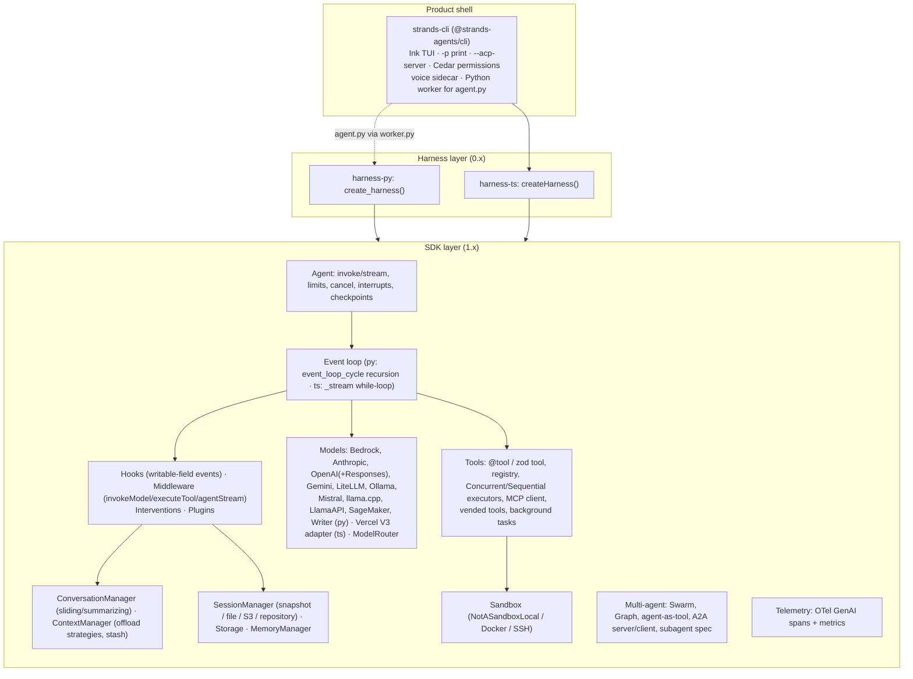

# Strands Agents (harness-sdk)

> Strands is AWS's open-source, in-process agent SDK, shipped as two parallel implementations: Python (`strands-agents`, 1.60) and TypeScript (`@strands-agents/sdk`, 1.20). Both follow one "model-driven" ReAct loop, built around three things: a typed, writable-field hook bus, a three-stage middleware chain, and an "interventions" policy layer compiled onto the hooks. Since September 2026 the same monorepo also ships a thin **harness** layer (`create_harness()` / `createHarness()`, about 5k LOC per language). The harness is a factory that wires coding-agent defaults onto a plain `Agent`: shell and file tools, context offload, snapshot sessions, memory, skills, subagents, and Monty code-mode. A separate `strands` CLI provides an Ink TUI and an ACP server. Strands belongs at the `harness-library` layer. Build on it if you want a Bedrock-friendly but provider-neutral loop that you embed and control end to end, with first-class Python *and* TypeScript. Skip it if you want a small core, OS-level sandboxing in the box, or a finished IDE product.

| | |
|---|---|
| Repo(s) | `strands-agents/harness-sdk` @ `12170cf02e4e` (2026-10-14). GitHub redirects the former `strands-agents/sdk-python` here; the repo's `created_at` is 2025-05-14. `strands-agents/sdk-typescript` is archived. |
| License | Apache-2.0 (`LICENSE.APACHE`, NOTICE "Copyright Amazon.com, Inc.") |
| Language(s) | Python ≥3.10 and TypeScript (Node ≥22, plus a browser build). The CLI is TS/TSX with two Python sidecars. |
| Size | 3,236 tracked files. Non-test source LOC: `strands-py/src` 71,901; `strands-ts/src` 56,601; `harness-py/src` 4,600; `harness-ts/src` 5,519; `strands-cli/src` 36,666; `strands-mcp/src` 1,356. Loop core (agent + event loop + hooks + middleware + types): about 12.3k LOC Python and about 11.4k LOC TS. Tests: 149.8k LOC Python and 101.7k LOC TS. Docs site: 1,228 files. |
| Version at pin | Release-tag context: `python/v1.60.0` (2026-10-12), `typescript/v1.20.0`, `harness-python/v0.2.0`, `harness-typescript/v0.2.0`, `harness-cli/v0.2.0` (all 2026-10-08), `mcp/v0.3.0` |
| Release history | `python/v0.1.0` 2025-05-16 (public launch) → `python/v1.0.0` 2025-07-15 → TS `v0.1.0` 2025-12-03 (separate repo) → TS `v1.0.0` 2026-04-30 → monorepo consolidation proposal 2026-05-05 → `typescript/v1.4.0`, the first TS tag in the monorepo, 2026-06-01 → `harness-*/v0.1.0` and `harness-cli/v0.1.0` 2026-09-21 → `v0.2.0` 2026-10-08. The repo has 119 GitHub releases. Python package versions are derived from git tags; the checked-in TS SDK and harness manifests contain `0.0.1-development`, so these release labels are not literal manifest versions. |
| Category | `harness-library` (SDK = library; `harness-*` = opinionated harness; `strands-cli` = thin product shell) |

## 1. Layering & package map

The monorepo holds two SDKs that aim for parity of *concepts and names* rather than shared code. The root `AGENTS.md` makes this a rule: identifiers match modulo casing, hook event names are shared, and directory stems are "mechanically translatable" ([`AGENTS.md:L46-L62`](https://github.com/strands-agents/harness-sdk/blob/12170cf02e4ee45dabf5c3e13fbb6663a1d44a28/AGENTS.md#L46-L62)). The monorepo design record says one team implements every feature in both languages, and gives agentic porting between Python and TS as a reason to co-locate them ([`team/designs/0009-mono-repository.md:L1-L45`](https://github.com/strands-agents/harness-sdk/blob/12170cf02e4ee45dabf5c3e13fbb6663a1d44a28/team/designs/0009-mono-repository.md#L1-L45)).



| Layer | Owns | Key evidence |
|---|---|---|
| `strands-py` / `strands-ts` (SDK) | Loop, message model, providers, tools, hooks, middleware, sessions, context, multi-agent, telemetry | `Agent.__init__` accepts about 30 collaborators ([`agent.py:L200-L235`](https://github.com/strands-agents/harness-sdk/blob/12170cf02e4ee45dabf5c3e13fbb6663a1d44a28/strands-py/src/strands/agent/agent.py#L200-L235)) |
| `harness-py` / `harness-ts` | Defaults: model, effort, prompt contract, built-in tools, plugins, caching, sessions, memory, skills, interventions sugar | `create_harness()` returns a plain `Agent` ([`harness-py/.../agent.py:L238-L256`](https://github.com/strands-agents/harness-sdk/blob/12170cf02e4ee45dabf5c3e13fbb6663a1d44a28/harness-py/src/strands_harness/agent.py#L238-L256), [`L526-L537`](https://github.com/strands-agents/harness-sdk/blob/12170cf02e4ee45dabf5c3e13fbb6663a1d44a28/harness-py/src/strands_harness/agent.py#L526-L537)) |
| `strands-cli` | TUI, print mode, ACP server, permission UI, MCP workspace trust, voice | Depends on `@strands-agents/harness ~0.1.1`, `@strands-agents/sdk`, `@agentclientprotocol/sdk 1.3.0`, `ink 7.1.1` ([`strands-cli/package.json:L59-L72`](https://github.com/strands-agents/harness-sdk/blob/12170cf02e4ee45dabf5c3e13fbb6663a1d44a28/strands-cli/package.json#L59-L72)) |
| `strands-mcp` | An MCP server that serves Strands *documentation* to coding agents. It does not expose an agent. | [`strands-mcp/README.md`](https://github.com/strands-agents/harness-sdk/blob/12170cf02e4ee45dabf5c3e13fbb6663a1d44a28/strands-mcp/README.md) |

Dependency gravity: the Python SDK hard-depends on `boto3`/`botocore`, `mcp`, `pydantic`, `docstring_parser`, and the OpenTelemetry API/SDK ([`strands-py/pyproject.toml:L31-L45`](https://github.com/strands-agents/harness-sdk/blob/12170cf02e4ee45dabf5c3e13fbb6663a1d44a28/strands-py/pyproject.toml#L31-L45)). Every other provider is an optional extra. The TS SDK hard-depends on `@aws-sdk/client-bedrock-runtime` and `@modelcontextprotocol/ext-tasks`. Everything else, including `@ai-sdk/provider`, `openai`, `@anthropic-ai/sdk`, `@google/genai`, `@a2a-js/sdk`, and Cedar WASM, is an optional peer ([`strands-ts/package.json:L302-L333`](https://github.com/strands-agents/harness-sdk/blob/12170cf02e4ee45dabf5c3e13fbb6663a1d44a28/strands-ts/package.json#L302-L333)). The harness adds `pydantic-monty==0.0.23` as a hard dependency because programmatic tool calling is on by default ([`harness-py/pyproject.toml:L27-L35`](https://github.com/strands-agents/harness-sdk/blob/12170cf02e4ee45dabf5c3e13fbb6663a1d44a28/harness-py/pyproject.toml#L27-L35)).

## 2. Agent loop

**Where it lives.** Python: `event_loop_cycle` ([`event_loop.py:L189-L410`](https://github.com/strands-agents/harness-sdk/blob/12170cf02e4ee45dabf5c3e13fbb6663a1d44a28/strands-py/src/strands/event_loop/event_loop.py#L189-L410)), driven by `Agent.stream_async` → `_run_loop` → `_execute_event_loop_cycle` ([`agent.py:L1291-L1814`](https://github.com/strands-agents/harness-sdk/blob/12170cf02e4ee45dabf5c3e13fbb6663a1d44a28/strands-py/src/strands/agent/agent.py#L1291-L1814)). TS: `Agent._stream`, a single `while (true)` loop ([`agent.ts:L1552-L1946`](https://github.com/strands-agents/harness-sdk/blob/12170cf02e4ee45dabf5c3e13fbb6663a1d44a28/strands-ts/src/agent/agent.ts#L1552-L1946)), wrapped by `stream()` → `_streamWithMiddleware()` → `_streamCore()`.

**Turn structure (Python):**

1. `stream_async` validates `limits` and acquires the concurrency lock. The default mode is `THROW`, which raises `ConcurrencyException`; an optional `idempotency_token` lets a duplicate caller wait for the original's result. It then starts a watcher for an external `cancel_signal` and attaches OTel baggage ([`agent.py:L1366-L1440`](https://github.com/strands-agents/harness-sdk/blob/12170cf02e4ee45dabf5c3e13fbb6663a1d44a28/strands-py/src/strands/agent/agent.py#L1366-L1440)).
2. `_run_loop` fires `BeforeInvocationEvent`, which can rewrite `messages` or set `cancel`. It appends the input and runs the `AgentStreamStage` middleware chain around the event loop ([`agent.py:L1519-L1603`](https://github.com/strands-agents/harness-sdk/blob/12170cf02e4ee45dabf5c3e13fbb6663a1d44a28/strands-py/src/strands/agent/agent.py#L1519-L1603)).
3. Each cycle first checks per-invocation `Limits`: `turns`, then `total_tokens`, then `output_tokens`. A tripped limit ends the loop gracefully with `limit_*` stop reasons ([`event_loop.py:L69-L102`](https://github.com/strands-agents/harness-sdk/blob/12170cf02e4ee45dabf5c3e13fbb6663a1d44a28/strands-py/src/strands/event_loop/event_loop.py#L69-L102)).
4. If the last message already ends in `toolUse`, or a tool interrupt is being resumed, the model call is skipped ([`event_loop.py:L289-L307`](https://github.com/strands-agents/harness-sdk/blob/12170cf02e4ee45dabf5c3e13fbb6663a1d44a28/strands-py/src/strands/event_loop/event_loop.py#L289-L307)). Otherwise `_handle_model_execution` runs a `while True` retry loop. Each pass estimates input tokens, fires `BeforeModelCallEvent` (cancelable, interruptible, and able to inject continuation messages), deep-copies messages, the system prompt and tool specs into an `InvokeModelContext`, and streams through the `InvokeModelStage` middleware chain against a *snapshot* of `_model_state`. The snapshot is written back only on success. `AfterModelCallEvent.retry` restarts the loop ([`event_loop.py:L470-L709`](https://github.com/strands-agents/harness-sdk/blob/12170cf02e4ee45dabf5c3e13fbb6663a1d44a28/strands-py/src/strands/event_loop/event_loop.py#L470-L709)).
5. On `tool_use`, `_handle_tool_execution` fires `BeforeToolsEvent` (which can cancel the whole batch or interrupt), validates tool uses, and delegates to the `ToolExecutor`. `AfterToolsEvent` always runs in a `finally`, so the two events stay paired on cancel, interrupt and error paths ([`event_loop.py:L802-L933`](https://github.com/strands-agents/harness-sdk/blob/12170cf02e4ee45dabf5c3e13fbb6663a1d44a28/strands-py/src/strands/event_loop/event_loop.py#L802-L933)).
6. After tools, the loop either stops or recurses. It stops on `AfterToolsEvent.end_turn` (a hook-forced halt whose content becomes the final assistant message), `request_state["stop_event_loop"]`, a captured structured output, cancellation, or a checkpoint. Otherwise it calls `recurse_event_loop` ([`event_loop.py:L970-L1030`](https://github.com/strands-agents/harness-sdk/blob/12170cf02e4ee45dabf5c3e13fbb6663a1d44a28/strands-py/src/strands/event_loop/event_loop.py#L970-L1030), [`L413-L454`](https://github.com/strands-agents/harness-sdk/blob/12170cf02e4ee45dabf5c3e13fbb6663a1d44a28/strands-py/src/strands/event_loop/event_loop.py#L413-L454)).
7. After the pass, `conversation_manager.apply_management` runs and `AfterInvocationEvent` fires with reverse callback order. If a hook set `resume`, or a plugin contributed continuation input, the whole invocation re-enters with new input ([`agent.py:L1656-L1708`](https://github.com/strands-agents/harness-sdk/blob/12170cf02e4ee45dabf5c3e13fbb6663a1d44a28/strands-py/src/strands/agent/agent.py#L1656-L1708)).

**Python vs TS: same semantics, different control flow.**

| Aspect | Python | TypeScript |
|---|---|---|
| Iteration | Recursion: `event_loop_cycle` → `recurse_event_loop` | `while (true)` in `_stream` ([`agent.ts:L1622-L1881`](https://github.com/strands-agents/harness-sdk/blob/12170cf02e4ee45dabf5c3e13fbb6663a1d44a28/strands-ts/src/agent/agent.ts#L1622-L1881)) |
| When assistant/tool messages enter history | The assistant message is appended right after the model call ([`event_loop.py:L693-L703`](https://github.com/strands-agents/harness-sdk/blob/12170cf02e4ee45dabf5c3e13fbb6663a1d44a28/strands-py/src/strands/event_loop/event_loop.py#L693-L703)) | **Deferred append**: the assistant `toolUse` message and the `toolResult` message are appended together after tools finish, so `messages` never holds a dangling `toolUse` ([`agent.ts:L1800-L1810`](https://github.com/strands-agents/harness-sdk/blob/12170cf02e4ee45dabf5c3e13fbb6663a1d44a28/strands-ts/src/agent/agent.ts#L1800-L1810)) |
| Hook dispatch | Explicit `await agent.hooks.invoke_callbacks_async(event)` calls | Hook events are *yielded into the stream*. `_streamCore` runs `_invokeCallbacks` on each `HookableEvent` before the consumer sees it, and throws `InterruptError` back into the generator ([`agent.ts:L1379-L1434`](https://github.com/strands-agents/harness-sdk/blob/12170cf02e4ee45dabf5c3e13fbb6663a1d44a28/strands-ts/src/agent/agent.ts#L1379-L1434), [`L1536-L1542`](https://github.com/strands-agents/harness-sdk/blob/12170cf02e4ee45dabf5c3e13fbb6663a1d44a28/strands-ts/src/agent/agent.ts#L1536-L1542)) |
| Context-overflow recovery | `ContextWindowOverflowException` → `conversation_manager.reduce_context` → recursive retry ([`agent.py:L1804-L1814`](https://github.com/strands-agents/harness-sdk/blob/12170cf02e4ee45dabf5c3e13fbb6663a1d44a28/strands-py/src/strands/agent/agent.py#L1804-L1814)) | Handled by the conversation/context-manager plugin through `AfterModelCallEvent.retry` |
| Cancellation | `threading.Event`, checked between chunks and before tools | Per-iteration `AbortController` composed with the caller's signal via `AbortSignal.any` ([`agent.ts:L1196-L1201`](https://github.com/strands-agents/harness-sdk/blob/12170cf02e4ee45dabf5c3e13fbb6663a1d44a28/strands-ts/src/agent/agent.ts#L1196-L1201)) |

**Stop reasons** form a closed literal set: `cancelled`, `checkpoint`, `content_filtered`, `end_turn`, `guardrail_intervened`, `interrupt`, `limit_output_tokens`, `limit_total_tokens`, `limit_turns`, `max_tokens`, `stop_sequence`, `tool_use` ([`types/event_loop.py:L39-L52`](https://github.com/strands-agents/harness-sdk/blob/12170cf02e4ee45dabf5c3e13fbb6663a1d44a28/strands-py/src/strands/types/event_loop.py#L39-L52)). `max_tokens` raises `MaxTokensReachedException` after the partial message has been recovered into history ([`event_loop.py:L312-L322`](https://github.com/strands-agents/harness-sdk/blob/12170cf02e4ee45dabf5c3e13fbb6663a1d44a28/strands-py/src/strands/event_loop/event_loop.py#L312-L322)).

**Retries.** Model retries are implemented as a hook, not as loop code. The default `ModelRetryStrategy` uses `max_attempts=6`, `initial_delay=4s` and `max_delay=240s` with exponential backoff, and fires only on `ModelThrottledException` ([`_retry.py:L21-L92`](https://github.com/strands-agents/harness-sdk/blob/12170cf02e4ee45dabf5c3e13fbb6663a1d44a28/strands-py/src/strands/event_loop/_retry.py#L21-L92), [`agent.py:L532-L543`](https://github.com/strands-agents/harness-sdk/blob/12170cf02e4ee45dabf5c3e13fbb6663a1d44a28/strands-py/src/strands/agent/agent.py#L532-L543)). The `ModelRouter` adds cross-provider failover on top (§3). Tool retries come from `AfterToolCallEvent.retry`. The docstrings warn that events streamed by a discarded attempt have already reached the consumer ([`hooks/events.py:L260-L314`](https://github.com/strands-agents/harness-sdk/blob/12170cf02e4ee45dabf5c3e13fbb6663a1d44a28/strands-py/src/strands/hooks/events.py#L260-L314)).

**Parallel tool calls.** `ConcurrentToolExecutor` is the default ([`agent.py:L559`](https://github.com/strands-agents/harness-sdk/blob/12170cf02e4ee45dabf5c3e13fbb6663a1d44a28/strands-py/src/strands/agent/agent.py#L559)). It runs one `asyncio` task per `toolUse`, all feeding a shared queue. Each task waits on a per-task `asyncio.Event` after every yielded event, so events interleave fairly and exert backpressure ([`concurrent.py:L19-L134`](https://github.com/strands-agents/harness-sdk/blob/12170cf02e4ee45dabf5c3e13fbb6663a1d44a28/strands-py/src/strands/tools/executors/concurrent.py#L19-L134)). `SequentialToolExecutor` is the opt-out.

**Steering, queued messages and the continuation mechanism.** The SDK has no user-message queue. It offers three primitives instead:

- `AfterInvocationEvent.resume`, which re-invokes with new input ([`hooks/events.py:L69-L114`](https://github.com/strands-agents/harness-sdk/blob/12170cf02e4ee45dabf5c3e13fbb6663a1d44a28/strands-py/src/strands/hooks/events.py#L69-L114)).
- `AfterModelCallEvent.retry` combined with appending a message.
- An internal *continuation* channel, through which plugins attach messages to `BeforeModelCallEvent` or `AfterInvocationEvent`. Each attached message carries `on_appended`/`on_abandoned` settlement callbacks ([`_continuation.py:L1-L58`](https://github.com/strands-agents/harness-sdk/blob/12170cf02e4ee45dabf5c3e13fbb6663a1d44a28/strands-py/src/strands/agent/_continuation.py#L1-L58)).

The CLI builds mid-turn steering from these primitives as an `InterventionHandler` called `LiveSteering`. Queued user text is pushed as a user message at `beforeModelCall`. At `afterModelCall` it is pushed *and* `retry=true` is set, which discards the in-flight response. At `AfterInvocationEvent` the queued text becomes `resume` ([`strands-cli/src/tui/steering.ts:L12-L90`](https://github.com/strands-agents/harness-sdk/blob/12170cf02e4ee45dabf5c3e13fbb6663a1d44a28/strands-cli/src/tui/steering.ts#L12-L90)).

## 3. Model / provider abstraction

**Message model.** The internal message model is Bedrock Converse-shaped. `ContentBlock` is a `TypedDict` with the keys `text`, `toolUse`, `toolResult`, `reasoningContent`, `cachePoint`, `guardContent`, `image`, `document`, `video`, `audio`, and `citationsContent` ([`types/content.py:L80-L107`](https://github.com/strands-agents/harness-sdk/blob/12170cf02e4ee45dabf5c3e13fbb6663a1d44a28/strands-py/src/strands/types/content.py#L80-L107)). Streaming events reuse Converse names (`messageStart`, `contentBlockDelta`, and so on). TS wraps the same shapes in classes (`Message`, `TextBlock`, `ToolUseBlock`, …) with `toJSON`/`fromMessageData` round-tripping. A system prompt is either a string or a `SystemContentBlock[]` that may carry `cachePoint`s. `split_system_prompt` keeps both forms in play for older providers ([`content.py:L129-L160`](https://github.com/strands-agents/harness-sdk/blob/12170cf02e4ee45dabf5c3e13fbb6663a1d44a28/strands-py/src/strands/types/content.py#L129-L160)).

**Provider contract.** A provider subclasses the `Model` ABC and implements `update_config`, `get_config`, `structured_output` and `stream(messages, tool_specs, system_prompt, *, tool_choice, system_prompt_content, invocation_state, cancel_signal, agent_metadata)`. The base class supplies optional `stateful`, `context_window_limit`, `count_tokens` (tiktoken `cl100k_base` or a chars/4 heuristic) and `estimate_utilization` ([`models/model.py:L187-L351`](https://github.com/strands-agents/harness-sdk/blob/12170cf02e4ee45dabf5c3e13fbb6663a1d44a28/strands-py/src/strands/models/model.py#L187-L351)). Stateful providers, which keep the conversation server-side (for example the OpenAI Responses API), make the built-in `_ModelPlugin` clear `agent.messages` after each invocation. Combining one with a conversation or context manager raises an error ([`model.py:L354-L374`](https://github.com/strands-agents/harness-sdk/blob/12170cf02e4ee45dabf5c3e13fbb6663a1d44a28/strands-py/src/strands/models/model.py#L354-L374), [`agent.py:L396-L400`](https://github.com/strands-agents/harness-sdk/blob/12170cf02e4ee45dabf5c3e13fbb6663a1d44a28/strands-py/src/strands/agent/agent.py#L396-L400)).

**Coverage.**

| Python (`strands/models/`, 12.1k LOC) | TypeScript (`src/models/`, 10.1k LOC) |
|---|---|
| `bedrock` (1,798 LOC; Converse/ConverseStream, guardrails, native `count_tokens`), `anthropic`, `openai` (Chat), `openai_responses`, `gemini`, `litellm`, `ollama`, `mistral`, `llamacpp`, `llamaapi`, `sagemaker`, `writer`, `_openai_bedrock` (Bedrock "Mantle" OpenAI-compatible endpoint) | `bedrock` (2,221 LOC), `anthropic`, `openai/` (chat + responses adapters + `mantle`), `google/`, **`vercel`**: an adapter onto any Vercel AI SDK `LanguageModelV3` provider ([`vercel.ts:L1-L28`](https://github.com/strands-agents/harness-sdk/blob/12170cf02e4ee45dabf5c3e13fbb6663a1d44a28/strands-ts/src/models/vercel.ts#L1-L28)) |

The Vercel adapter means the TS SDK *consumes* the AI SDK's provider spec (`@ai-sdk/provider`, an optional peer) rather than competing with it on breadth. Cross-reference: the Vercel AI SDK chapter.

**Defaults and AWS gravity.** The default model is `BedrockModel()`, and a bare string is treated as a Bedrock model id ([`agent.py:L361-L370`](https://github.com/strands-agents/harness-sdk/blob/12170cf02e4ee45dabf5c3e13fbb6663a1d44a28/strands-py/src/strands/agent/agent.py#L361-L370)). `DEFAULT_BEDROCK_MODEL_ID = "global.anthropic.claude-sonnet-4-6"` ([`bedrock.py:L44`](https://github.com/strands-agents/harness-sdk/blob/12170cf02e4ee45dabf5c3e13fbb6663a1d44a28/strands-py/src/strands/models/bedrock.py#L44)). The TS constructor follows the same rule ([`agent.ts:L567-L575`](https://github.com/strands-agents/harness-sdk/blob/12170cf02e4ee45dabf5c3e13fbb6663a1d44a28/strands-ts/src/agent/agent.ts#L567-L575)). The harness raises the default to `bedrock/global.anthropic.claude-opus-5` ([`harness-py/.../defaults.py:L5`](https://github.com/strands-agents/harness-sdk/blob/12170cf02e4ee45dabf5c3e13fbb6663a1d44a28/harness-py/src/strands_harness/defaults.py#L5)).

**Reasoning / effort.** The SDK passes reasoning config through per provider and carries `reasoningContent` blocks, including `redactedContent` and `reasoningSignature` on tool-use starts. The harness adds a single `effort` knob (`auto|off|minimal|low|medium|high|xhigh|max`). A per-provider table maps it to Claude thinking blocks, Bedrock effort, or OpenAI/Google levels, and raises on any level the provider does not offer ([`harness-py/.../models.py:L309-L316`](https://github.com/strands-agents/harness-sdk/blob/12170cf02e4ee45dabf5c3e13fbb6663a1d44a28/harness-py/src/strands_harness/models.py#L309-L316)).

**Prompt caching.** `CacheConfig(strategy="auto"|"anthropic", ttl, system_prompt_ttl, cache_key, tools_ttl)` auto-injects `cachePoint`s for Converse- and Anthropic-style providers. It also derives an OpenAI/LiteLLM/Mistral routing key `strands-<session_id>` whenever a session manager exists ([`model.py:L136-L171`](https://github.com/strands-agents/harness-sdk/blob/12170cf02e4ee45dabf5c3e13fbb6663a1d44a28/strands-py/src/strands/models/model.py#L136-L171)). `dynamic_trailing_blocks` lets injectors place volatile content *after* the last cache point, so caches stay warm. The harness environment plugin relies on this to inject the date per turn ([`environment.py:L1-L13`](https://github.com/strands-agents/harness-sdk/blob/12170cf02e4ee45dabf5c3e13fbb6663a1d44a28/harness-py/src/strands_harness/plugins/environment.py#L1-L13)).

**Token and cost accounting.** Each assistant message carries `metadata.usage`/`metrics`. The projected input-token estimate is the last real usage plus `count_tokens(new_messages)`, which avoids re-counting the whole history ([`event_loop.py:L125-L165`](https://github.com/strands-agents/harness-sdk/blob/12170cf02e4ee45dabf5c3e13fbb6663a1d44a28/strands-py/src/strands/event_loop/event_loop.py#L125-L165)). `EventLoopMetrics` aggregates per invocation. There is **no price table and no dollar-cost accounting** in either SDK; costs appear only as token counts.

**Model routing.** `ModelRouter` is a `Plugin` passed as `model=`. A pluggable `RoutingStrategy` picks candidates. The default `FallbackStrategy` prefers the least-failed candidate not yet tried since the last success, and `max_switches` caps switches per invocation ([`routing/router.py:L1-L13`](https://github.com/strands-agents/harness-sdk/blob/12170cf02e4ee45dabf5c3e13fbb6663a1d44a28/strands-py/src/strands/models/routing/router.py#L1-L13), [`fallback_strategy.py:L12-L40`](https://github.com/strands-agents/harness-sdk/blob/12170cf02e4ee45dabf5c3e13fbb6663a1d44a28/strands-py/src/strands/models/routing/fallback_strategy.py#L12-L40)). A `classifier_strategy` routes by LLM classification. Side calls (summarization, memory extraction, classifiers, steering, `web_fetch`) resolve their model as component `model=`, then `agent.aux_model`, then `agent.model`. This is a cross-SDK convention ([`AGENTS.md:L53`](https://github.com/strands-agents/harness-sdk/blob/12170cf02e4ee45dabf5c3e13fbb6663a1d44a28/AGENTS.md#L53)).

## 4. Tool system

**Definition API.**

- **Python.** `@tool` builds a Pydantic input model from the function signature with `create_model`, and takes descriptions from the docstring via `docstring_parser` ([`decorator.py:L192-L233`](https://github.com/strands-agents/harness-sdk/blob/12170cf02e4ee45dabf5c3e13fbb6663a1d44a28/strands-py/src/strands/tools/decorator.py#L192-L233)). `@tool(context=True)` injects a `ToolContext` that carries `agent`, `tool_use`, `invocation_state` and `interrupt()`.
- **Other Python forms.** Module-style tools (a `TOOL_SPEC` dict plus a function), file paths, `ToolProvider`s (MCP clients), and `Agent` instances, which are auto-wrapped as tools ([`agent.py:L252-L262`](https://github.com/strands-agents/harness-sdk/blob/12170cf02e4ee45dabf5c3e13fbb6663a1d44a28/strands-py/src/strands/agent/agent.py#L252-L262)).
- **Python hot reload.** `load_tools_from_directory=True` hot-reloads `./tools/*.py` through a shared `watchdog` observer ([`watcher.py:L1-L30`](https://github.com/strands-agents/harness-sdk/blob/12170cf02e4ee45dabf5c3e13fbb6663a1d44a28/strands-py/src/strands/tools/watcher.py#L1-L30)).
- **TypeScript.** `tool({ name, description, inputSchema: z.object(...) })` produces a `ZodTool`, whose schema is converted to JSON Schema ([`zod-tool.ts:L52-L80`](https://github.com/strands-agents/harness-sdk/blob/12170cf02e4ee45dabf5c3e13fbb6663a1d44a28/strands-ts/src/tools/zod-tool.ts#L52-L80)). A raw `FunctionTool` with a JSON schema is also available.
- **Direct calls.** `agent.tool.<name>(...)` calls a tool from code and, by default, records the call into history (`record_direct_tool_call`) ([`agent.py:L769-L782`](https://github.com/strands-agents/harness-sdk/blob/12170cf02e4ee45dabf5c3e13fbb6663a1d44a28/strands-py/src/strands/agent/agent.py#L769-L782)).

**Execution pipeline** (`ToolExecutor._stream`, [`_executor.py:L153-L410`](https://github.com/strands-agents/harness-sdk/blob/12170cf02e4ee45dabf5c3e13fbb6663a1d44a28/strands-py/src/strands/tools/executors/_executor.py#L153-L410)):

```
lookup tool → BeforeToolCallEvent (writable: selected_tool, tool_use, cancel_tool; interruptible)
  → background routing? (submit to BackgroundTasks; ack result)          [L262-L277]
  → ExecuteToolStage middleware chain → terminal: tool.stream()           [L307-L321]
  → AfterToolCallEvent (writable: result, retry)  → retry loop | ToolResultEvent
```

An unknown tool still passes through the middleware with `ctx.tool = None`, so a mocking middleware can intercept it. A tool exception becomes an `error` `toolResult` (`"Error: …"`) instead of crashing the loop ([`_executor.py:L385-L410`](https://github.com/strands-agents/harness-sdk/blob/12170cf02e4ee45dabf5c3e13fbb6663a1d44a28/strands-py/src/strands/tools/executors/_executor.py#L385-L410)).

**Structured output.** The structured-output schema is registered as an ephemeral tool. If the model ends its turn without calling it, the loop appends `structured_output_prompt` and *forces* `toolChoice` to that tool. A second refusal raises `StructuredOutputException` ([`event_loop.py:L368-L390`](https://github.com/strands-agents/harness-sdk/blob/12170cf02e4ee45dabf5c3e13fbb6663a1d44a28/strands-py/src/strands/event_loop/event_loop.py#L368-L390)). TS drops the plain-text turn rather than append it, because Bedrock rejects assistant prefill ([`agent.ts:L1700-L1711`](https://github.com/strands-agents/harness-sdk/blob/12170cf02e4ee45dabf5c3e13fbb6663a1d44a28/strands-ts/src/agent/agent.ts#L1700-L1711)).

**Built-ins.** The SDK has no default tools. Opt-in "vended" tools live in `strands/vended_tools/` and `src/vended-tools/`: `shell`/`bash`, `file_editor`, `python_repl`, `notebook`, `http_request`, `web_fetch`, `sleep`, `subagent`, `mcp_router`, `handoff_to_user`, `a2a_client`. All of them route through `agent.sandbox`. The larger community catalogue lives in the separate `strands-agents/tools` repo (`strands_tools`). The **harness** default set is `shell, read, write, edit, web_fetch, web_search, programmatic_tool_caller, subagent` ([`harness-py/.../defaults.py:L13-L26`](https://github.com/strands-agents/harness-sdk/blob/12170cf02e4ee45dabf5c3e13fbb6663a1d44a28/harness-py/src/strands_harness/defaults.py#L13-L26), [`agent.py:L79-L99`](https://github.com/strands-agents/harness-sdk/blob/12170cf02e4ee45dabf5c3e13fbb6663a1d44a28/harness-py/src/strands_harness/agent.py#L79-L99)):

- `web_search` is either native provider search or Exa. Exa is used only on explicit opt-in, and the harness logs a third-party warning when it is ([`agent.py:L108-L140`](https://github.com/strands-agents/harness-sdk/blob/12170cf02e4ee45dabf5c3e13fbb6663a1d44a28/harness-py/src/strands_harness/agent.py#L108-L140)).
- `web_fetch` returns a small-model *answer* about the page instead of the raw page.
- `programmatic_tool_caller` runs model-written Python in **Monty**, Pydantic's Rust interpreter. Every other tool is exposed inside as an `async` function, and only `print()` output returns to the model. Limits are 60 s of VM time, 256 MiB, 1,000 suspensions, 10 concurrent inner calls, 200k output characters, and a 900 s wall clock. Inner calls go through the normal executor, so interventions still apply ([`programmatic_tool_caller.py:L1-L60`](https://github.com/strands-agents/harness-sdk/blob/12170cf02e4ee45dabf5c3e13fbb6663a1d44a28/harness-py/src/strands_harness/tools/programmatic_tool_caller.py#L1-L60)).

Name collisions across built-ins, consumer tools, plugin tools and memory tools are pre-flighted, and `-`/`_` are treated as equal ([`agent.py:L175-L196`](https://github.com/strands-agents/harness-sdk/blob/12170cf02e4ee45dabf5c3e13fbb6663a1d44a28/harness-py/src/strands_harness/agent.py#L175-L196)).

**Output truncation.** No per-tool cap exists in the SDK loop. Two mechanisms cover it. The harness `read` tool pages files (default 2,000 lines, with offset/limit). The context manager offloads any tool result over 1,500 tokens to a 750-token preview plus a `retrieve_context` handle (§5).

**MCP.** `MCPClient` is a `ToolProvider` with a dedicated background thread and event loop per client, using `contextvars` propagation ([`mcp_client.py:L216-L229`](https://github.com/strands-agents/harness-sdk/blob/12170cf02e4ee45dabf5c3e13fbb6663a1d44a28/strands-py/src/strands/tools/mcp/mcp_client.py#L216-L229), [`L452-L466`](https://github.com/strands-agents/harness-sdk/blob/12170cf02e4ee45dabf5c3e13fbb6663a1d44a28/strands-py/src/strands/tools/mcp/mcp_client.py#L452-L466)). It supports:

- stdio, SSE and streamable-HTTP transports, plus OAuth token storage;
- tool filters and elicitation callbacks;
- prompts and resources;
- the SEP-2663 tasks extension (`mcp_tasks.py`);
- `load_servers()` for standard `mcpServers` JSON.

The harness namespaces MCP tools as `<server>_<tool>` and treats server failures as non-fatal by default ([`harness-py/.../agent.py:L426-L427`](https://github.com/strands-agents/harness-sdk/blob/12170cf02e4ee45dabf5c3e13fbb6663a1d44a28/harness-py/src/strands_harness/agent.py#L426-L427)).

**Approvals** sit outside the tool system, in the interventions layer (§7).

## 5. Context management

Two generations coexist.

**Generation 1: `ConversationManager`.** This is the default when `context_manager` is unset.

- `SlidingWindowConversationManager(window_size=40, should_truncate_results=True, per_turn=False)` trims history to a message count and truncates oversized tool results on overflow ([`sliding_window_conversation_manager.py:L36-L41`](https://github.com/strands-agents/harness-sdk/tree/12170cf02e4ee45dabf5c3e13fbb6663a1d44a28/strands-py/src/strands/agent/conversation_manager/sliding_window_conversation_manager.py#L36-L41)).
- `SummarizingConversationManager(summary_ratio=0.3, preserve_recent_messages=10, summarization_agent=None)` summarizes the oldest 10–80% of messages through `aux_model` or a dedicated agent ([`summarizing_conversation_manager.py:L42-L79`](https://github.com/strands-agents/harness-sdk/tree/12170cf02e4ee45dabf5c3e13fbb6663a1d44a28/strands-py/src/strands/agent/conversation_manager/summarizing_conversation_manager.py#L42-L79)).
- `NullConversationManager` does nothing.

Both active managers react to `ContextWindowOverflowException` and run `apply_management` after each invocation.

**Generation 2: `ContextManager`.** This is a plugin selected via `context_manager="auto"|"agentic"|config|instance` ([`_context_manager/context_manager.py:L118-L158`](https://github.com/strands-agents/harness-sdk/blob/12170cf02e4ee45dabf5c3e13fbb6663a1d44a28/strands-py/src/strands/_context_manager/context_manager.py#L118-L158)). Setting it forces the conversation manager to `Null` ([`L160-L189`](https://github.com/strands-agents/harness-sdk/blob/12170cf02e4ee45dabf5c3e13fbb6663a1d44a28/strands-py/src/strands/_context_manager/context_manager.py#L160-L189)). It runs an ordered **strategy pipeline**:

| Preset | Pipeline (constants at [`L31-L34`](https://github.com/strands-agents/harness-sdk/blob/12170cf02e4ee45dabf5c3e13fbb6663a1d44a28/strands-py/src/strands/_context_manager/context_manager.py#L31-L34), defaults at [`L83-L89`](https://github.com/strands-agents/harness-sdk/blob/12170cf02e4ee45dabf5c3e13fbb6663a1d44a28/strands-py/src/strands/_context_manager/context_manager.py#L83-L89)) |
|---|---|
| `auto` (harness default) | `Offload.truncate("tool_results", preview_tokens=750).when(threshold=1500)` → `Offload.summarize("*").when(utilization=0.85, preserve_recent=4)` → `EmergencyTruncateStrategy` (always last) |
| `agentic` | Truncate threshold 8,000, summarize only at 100% utilization. The agent also gets `summarize_context`, `truncate_context` and `pin_context` tools, and a middleware surfaces live token usage to the model ([`agent.py:L451-L459`](https://github.com/strands-agents/harness-sdk/blob/12170cf02e4ee45dabf5c3e13fbb6663a1d44a28/strands-py/src/strands/agent/agent.py#L451-L459), [`L505-L510`](https://github.com/strands-agents/harness-sdk/blob/12170cf02e4ee45dabf5c3e13fbb6663a1d44a28/strands-py/src/strands/agent/agent.py#L505-L510)) |

**Triggers.** The pipeline runs proactively on every `BeforeModelCallEvent`, using `projected_input_tokens / context_window_limit`. It runs reactively on `AfterModelCallEvent` when a `ContextWindowOverflowException` occurs, with up to 3 overflow retries via `event.retry = True` ([`context_manager.py:L226-L253`](https://github.com/strands-agents/harness-sdk/blob/12170cf02e4ee45dabf5c3e13fbb6663a1d44a28/strands-py/src/strands/_context_manager/context_manager.py#L226-L253)). Utilization is recomputed after each strategy that acts ([`L272-L317`](https://github.com/strands-agents/harness-sdk/blob/12170cf02e4ee45dabf5c3e13fbb6663a1d44a28/strands-py/src/strands/_context_manager/context_manager.py#L272-L317)).

**Spill-to-disk.** Offloaded originals go to a **stash**, which is keyed per session and agent and sits on the agent's `Storage` (in-memory by default). The harness points it at the session directory, so stash files land under `./.agent/sessions/context/…` instead of inside every snapshot ([`harness-py/.../agent.py:L467-L480`](https://github.com/strands-agents/harness-sdk/blob/12170cf02e4ee45dabf5c3e13fbb6663a1d44a28/harness-py/src/strands_harness/agent.py#L467-L480)). The model pulls originals back with the `retrieve_context` tool. These thresholds match what AWS principal engineer Arron Bailiss credited for the harness's token efficiency, as quoted by *The Stack* (2026-09-22): "tool results over ~1500 tokens get truncated … summarization triggers when the context window hits above 85%". The code confirms the thresholds. The efficiency claim itself (≈28% lower token cost on vendor-run benchmarks) is unverified.

**System prompt and project files.** The SDK takes `system_prompt` verbatim. The harness prepends `HARNESS_CONTRACT`, a model-neutral behavioural contract (act/explore/verify, parallel tools, `<system-reminder>` provenance, confirm irreversible actions), then appends `instructions` and per-request `context_parts` ([`prompt.py:L11-L60`](https://github.com/strands-agents/harness-sdk/blob/12170cf02e4ee45dabf5c3e13fbb6663a1d44a28/harness-py/src/strands_harness/prompt.py#L11-L60)).

**AGENTS.md** is handled only by the harness `EnvironmentContext` plugin. Before each user turn it injects a `<system-reminder>` containing platform, date, cwd, the cwd's `AGENTS.md` (capped at 16,000 chars) and *links* to nested `AGENTS.md`/`README.md` files up to two levels deep. Everything is read through the sandbox, so Docker and SSH sandboxes report their own environment ([`environment.py:L28-L91`](https://github.com/strands-agents/harness-sdk/blob/12170cf02e4ee45dabf5c3e13fbb6663a1d44a28/harness-py/src/strands_harness/plugins/environment.py#L28-L91)). `CLAUDE.md` is not read.

**Skills.** The `AgentSkills` plugin re-injects an `<available_skills>` XML block into the system prompt at each `BeforeInvocationEvent`. It works at the block level so cache points survive. A `skills(skill_name)` tool loads a skill's full `SKILL.md` on demand ([`agent_skills.py:L160-L243`](https://github.com/strands-agents/harness-sdk/blob/12170cf02e4ee45dabf5c3e13fbb6663a1d44a28/strands-py/src/strands/vended_plugins/skills/agent_skills.py#L160-L243)).

**Memory.** `MemoryManager` (a plugin) combines pluggable `MemoryStore`s (file, Bedrock Knowledge Base, test store) with model-driven extraction every few turns, retrieval injection via `InvokeModelStage` middleware, and `search_memory`/`add_memory` tools ([`memory_manager.py:L1-L50`](https://github.com/strands-agents/harness-sdk/blob/12170cf02e4ee45dabf5c3e13fbb6663a1d44a28/strands-py/src/strands/memory/memory_manager.py#L1-L50)). The harness defaults to a markdown file store at `./.agent/memory`. Subagents get read-only access.

## 6. State, sessions & durability

**Session managers** are `HookProvider`s attached at construction ([`agent.py:L545-L551`](https://github.com/strands-agents/harness-sdk/blob/12170cf02e4ee45dabf5c3e13fbb6663a1d44a28/strands-py/src/strands/agent/agent.py#L545-L551)):

| Manager | Format | Notes |
|---|---|---|
| `FileSessionManager` / `S3SessionManager` (`RepositorySessionManager`) | One JSON file per message: `session_<id>/agents/agent_<id>/messages/message_<n>.json`, plus `session.json` and `agent.json` | Older message-log design; Python only ([`file_session_manager.py:L28-L43`](https://github.com/strands-agents/harness-sdk/blob/12170cf02e4ee45dabf5c3e13fbb6663a1d44a28/strands-py/src/strands/session/file_session_manager.py#L28-L43)) |
| `SnapshotSessionManager` (recommended; TS `SessionManager`) | A whole-agent `Snapshot` blob. `snapshot_latest.json` is overwritten on each save; an append-only `immutable_history/snapshot_<uuid7>.json` is written when a `snapshot_trigger` fires | Saves on `"invocation"` (default), `"message"` or `"trigger"`. Python guardrail redactions flush immediately under every strategy; the source explicitly notes that TypeScript does not flush them under `trigger`. Multi-agent orchestrators save per `"node"` ([`snapshot_session_manager.py:L1-L19`](https://github.com/strands-agents/harness-sdk/blob/12170cf02e4ee45dabf5c3e13fbb6663a1d44a28/strands-py/src/strands/session/snapshot_session_manager.py#L1-L19), [`L59-L123`](https://github.com/strands-agents/harness-sdk/blob/12170cf02e4ee45dabf5c3e13fbb6663a1d44a28/strands-py/src/strands/session/snapshot_session_manager.py#L59-L123)) |

The harness defaults to `SnapshotSessionManager(save_latest_on="message")` over `LocalFileStorage("./.agent/sessions")`, so every completed message is durable. There is **no auto-resume**: each run mints a new 8-hex id unless `session={"id": …}` is passed ([`harness-py/.../agent.py:L467-L480`](https://github.com/strands-agents/harness-sdk/blob/12170cf02e4ee45dabf5c3e13fbb6663a1d44a28/harness-py/src/strands_harness/agent.py#L467-L480)). `Storage` is a unified byte-blob primitive (`write/read/delete/list`) with local-file, in-memory and S3 backends, plus BM25 and keyword search. Sessions, stash and memory share it under per-subsystem namespaces.

**Snapshots, fork and undo.** `agent.take_snapshot(preset="session", include/exclude, app_data)` and `load_snapshot` provide branch/undo at the API level ([`agent.ts:L1495-L1528`](https://github.com/strands-agents/harness-sdk/blob/12170cf02e4ee45dabf5c3e13fbb6663a1d44a28/strands-ts/src/agent/agent.ts#L1495-L1528)). The CLI's fork feature clones `messages` and the stash snapshot.

**Interrupts (human-in-the-loop durability).** `interrupt(name, reason)` raises `InterruptException` unless a stored response exists for the deterministic id. For tool hooks the id is `v1:before_tool_call:<toolUseId>:<uuid5(name)>` ([`types/interrupt.py:L79-L111`](https://github.com/strands-agents/harness-sdk/blob/12170cf02e4ee45dabf5c3e13fbb6663a1d44a28/strands-py/src/strands/types/interrupt.py#L79-L111), [`hooks/events.py:L247-L257`](https://github.com/strands-agents/harness-sdk/blob/12170cf02e4ee45dabf5c3e13fbb6663a1d44a28/strands-py/src/strands/hooks/events.py#L247-L257)). The agent returns `stop_reason="interrupt"` and stores a `PendingToolExecution` (the assistant message plus completed results) ([`event_loop.py:L764-L799`](https://github.com/strands-agents/harness-sdk/blob/12170cf02e4ee45dabf5c3e13fbb6663a1d44a28/strands-py/src/strands/event_loop/event_loop.py#L764-L799)). Resume is driven by the caller passing `interruptResponse` blocks. The hook or tool is **re-executed**, and `interrupt()` now returns the stored response. This is the same replay-with-memoized-answer model as LangGraph's `interrupt`. `_InterruptState` serializes into the snapshot, so a pending approval survives a process restart.

**Checkpoints.** `Agent(checkpointing=True)` pauses at two cycle boundaries, `after_model` and `after_tools`, returning `stop_reason="checkpoint"` with an opaque `Checkpoint{position, cycle_index, schema_version}`. Resume with `{"checkpointResume": {"checkpoint": …}}`. The checkpoint holds **no conversation state** and must be paired with a session manager. Precedence is interrupt > checkpoint and cancel > checkpoint ([`experimental/checkpoint/checkpoint.py:L1-L59`](https://github.com/strands-agents/harness-sdk/blob/12170cf02e4ee45dabf5c3e13fbb6663a1d44a28/strands-py/src/strands/experimental/checkpoint/checkpoint.py#L1-L59), [`event_loop.py:L1009-L1021`](https://github.com/strands-agents/harness-sdk/blob/12170cf02e4ee45dabf5c3e13fbb6663a1d44a28/strands-py/src/strands/event_loop/event_loop.py#L1009-L1021)). *Inference*: this is designed for an external orchestrator (a queue, Step Functions, or a durable-execution engine) to drive one cycle per activity. The repo ships no such adapter.

**Crash recovery limits.** Streaming text and unfinished tool calls are not persisted. Background tasks run in-process (`background_tasks/in_process/`). Their bookkeeping is mirrored into agent state, but the work itself does not survive a restart.

## 7. Safety & sandboxing

**Execution environment.** `Sandbox` is an ABC with six primitives: `execute_streaming`, `execute_code_streaming`, `read_file`, `write_file`, `remove_file` and `list_files`. It also has `get_tools()`, through which a sandbox can vend its own tools ([`sandbox/base.py:L36-L205`](https://github.com/strands-agents/harness-sdk/blob/12170cf02e4ee45dabf5c3e13fbb6663a1d44a28/strands-py/src/strands/sandbox/base.py#L36-L205)). Implementations:

- `NotASandboxLocalEnvironment` is the *default*. It runs host `sh` with no isolation, and its name is deliberately a warning ([`not_a_sandbox_local_environment.py:L1-L13`](https://github.com/strands-agents/harness-sdk/blob/12170cf02e4ee45dabf5c3e13fbb6663a1d44a28/strands-py/src/strands/sandbox/not_a_sandbox_local_environment.py#L1-L13), [`agent.py:L373-L376`](https://github.com/strands-agents/harness-sdk/blob/12170cf02e4ee45dabf5c3e13fbb6663a1d44a28/strands-py/src/strands/agent/agent.py#L373-L376)).
- `DockerSandbox` runs `docker exec` into an *existing* container, with `--` to block flag injection ([`docker.py:L19-L95`](https://github.com/strands-agents/harness-sdk/blob/12170cf02e4ee45dabf5c3e13fbb6663a1d44a28/strands-py/src/strands/sandbox/docker.py#L19-L95)).
- `SshSandbox` runs commands on a remote host.

All harness file, shell and environment tools route through `agent.sandbox`, so switching to Docker or SSH relocates every effect. In browsers, the TS SDK registers *no* default sandbox ([`agent.ts:L478-L484`](https://github.com/strands-agents/harness-sdk/blob/12170cf02e4ee45dabf5c3e13fbb6663a1d44a28/strands-ts/src/agent/agent.ts#L478-L484)). There is **no in-tree OS sandbox** (Seatbelt, Landlock, seccomp) and no network policy. AWS ships those in the separate Rust project **Strands Box**: Seatbelt plus default-deny Dogwood (Cedar-compatible, temporal) policies and an egress gateway, macOS only, pre-release 0.1.x. Box is harness-agnostic and is documented in-repo, but its code is not in this clone (`site/src/content/docs/user-guide/box/index.mdx`). Monty, used by `programmatic_tool_caller`, is a *language-level* sandbox, and its docstring says so.

**Interventions.** This is the policy layer. `InterventionHandler` subclasses override any of `before_invocation`, `before_tool_call`, `after_tool_call`, `before_model_call` and `after_model_call`, each returning `Proceed | Deny | Guide | Confirm | Transform`. `InterventionRegistry` registers one hook per overridden method. Input-side handlers get `HookOrder.INTERVENTION_INPUT=90` and output-side ones `INTERVENTION_OUTPUT=-90` ([`hooks/registry.py:L30-L41`](https://github.com/strands-agents/harness-sdk/blob/12170cf02e4ee45dabf5c3e13fbb6663a1d44a28/strands-py/src/strands/hooks/registry.py#L30-L41)). Handlers are evaluated in order:

- `Deny` short-circuits.
- `Confirm` turns into an `interrupt`.
- `Guide` feedback accumulates across handlers. Before a tool it becomes a cancel message; after a model call it becomes `retry=True` plus an appended user message.
- Each handler's `on_error` is `throw`, `deny` or `proceed` (fail-open).

Evidence: [`interventions/registry.py:L65-L267`](https://github.com/strands-agents/harness-sdk/blob/12170cf02e4ee45dabf5c3e13fbb6663a1d44a28/strands-py/src/strands/interventions/registry.py#L65-L267).

Vended handlers:

- `CedarAuthorization`: Cedar policies with an MCP schema generator (`cedarpy` / `@cedar-policy/cedar-wasm`).
- `HumanInTheLoop`: a stdio, async-callback or interrupt-based `ask`; an optional LLM risk `classifier`; and "trust" memory stored in agent state ([`vended_interventions/hitl/hitl.py:L1-L60`](https://github.com/strands-agents/harness-sdk/blob/12170cf02e4ee45dabf5c3e13fbb6663a1d44a28/strands-py/src/strands/vended_interventions/hitl/hitl.py#L1-L60)).
- `SteeringHandler` plugins: LLM steering with a tool ledger.

Harness sugar maps string values onto these handlers: `interventions="ask"` → HITL, `"smart"` → HITL with a classifier, `"*.cedar"` → Cedar, and any other string becomes the classifier's rubric. The default is **off** ([`harness-py/.../interventions.py:L45-L65`](https://github.com/strands-agents/harness-sdk/blob/12170cf02e4ee45dabf5c3e13fbb6663a1d44a28/harness-py/src/strands_harness/interventions.py#L45-L65)). Subagent children inherit the policy.

**CLI defaults are stricter than the library's.** `CedarPermissions` embeds a default policy. It permits `read` only when `context.session.path_in_workspace` holds (resolved with `realpath`), and also permits `todo_write` and `retrieve_context`. Everything else falls through to an Allow once / Always allow tool / Deny prompt with a diff preview. A `bypassPermissions` mode exists ([`strands-cli/src/tui/permissions/policy.ts:L12-L60`](https://github.com/strands-agents/harness-sdk/blob/12170cf02e4ee45dabf5c3e13fbb6663a1d44a28/strands-cli/src/tui/permissions/policy.ts#L12-L60), [`L169-L224`](https://github.com/strands-agents/harness-sdk/blob/12170cf02e4ee45dabf5c3e13fbb6663a1d44a28/strands-cli/src/tui/permissions/policy.ts#L169-L224)). Project-level MCP configs are gated by a workspace-trust file that records content digests (`workspace/trust.ts`).

**Provider-side guardrails.** Bedrock `guardrail_id/version` is supported. A guardrail-triggered `redactContent` chunk rewrites the last user message in history and in the session store ([`agent.py:L1750-L1763`](https://github.com/strands-agents/harness-sdk/blob/12170cf02e4ee45dabf5c3e13fbb6663a1d44a28/strands-py/src/strands/agent/agent.py#L1750-L1763)).

**Secrets.** The SDK does no secret brokering. Credentials come from provider SDK defaults (boto3 chain, env vars). Box is the vendor's answer for credential isolation.

## 8. Extensibility

| Mechanism | Surface | Evidence |
|---|---|---|
| **Hooks** | 16 Python event classes: Agent{Initialized}, Before/AfterInvocation, MessageAdded/Updated, Before/AfterTools, Before/AfterToolCall, Before/AfterModelCall, and multi-agent Initialized/Before/AfterNodeCall/Before/AfterMultiAgentInvocation. TS adds stream-level events (`ModelStreamUpdateEvent`, `ContentBlockEvent`, `ToolStreamUpdateEvent`, `InterruptEvent`, `AgentResultEvent`). Mutability is per field via `_can_write` (e.g. `cancel`, `retry`, `end_turn`, `resume`, `selected_tool`). `After*` events run in reverse registration order, and `HookOrder` sets priority | [`hooks/events.py:L26-L406`](https://github.com/strands-agents/harness-sdk/blob/12170cf02e4ee45dabf5c3e13fbb6663a1d44a28/strands-py/src/strands/hooks/events.py#L26-L406); TS ordering [`hooks/registry.ts:L56-L57`](https://github.com/strands-agents/harness-sdk/blob/12170cf02e4ee45dabf5c3e13fbb6663a1d44a28/strands-ts/src/hooks/registry.ts#L56-L57), [`L122-L133`](https://github.com/strands-agents/harness-sdk/blob/12170cf02e4ee45dabf5c3e13fbb6663a1d44a28/strands-ts/src/hooks/registry.ts#L122-L133) |
| **Middleware** | Three stages: `invokeModel`, `executeTool`, and `agentStream` (internal in TS). Each has Input → Output → Wrap phases. Handlers may retry, short-circuit, filter or inject events. Hooks fire *outside* the chain, so middleware retries are invisible to hooks. Documented as intended to "supersede hooks" | [`middleware/README.md:L1-L60`](https://github.com/strands-agents/harness-sdk/blob/12170cf02e4ee45dabf5c3e13fbb6663a1d44a28/strands-ts/src/middleware/README.md#L1-L60); stages [`stages.ts:L169-L184`](https://github.com/strands-agents/harness-sdk/blob/12170cf02e4ee45dabf5c3e13fbb6663a1d44a28/strands-ts/src/middleware/stages.ts#L169-L184), [`_middleware/stages.py:L46`](https://github.com/strands-agents/harness-sdk/blob/12170cf02e4ee45dabf5c3e13fbb6663a1d44a28/strands-py/src/strands/_middleware/stages.py#L46) |
| **Plugins** | `Plugin` ABC with `name`, `init_agent(agent)`, and auto-discovered `@hook` and `@tool` methods. Most SDK features are themselves plugins: ContextManager, MemoryManager, ModelRouter, AgentSkills, BackgroundTasks, AgentDelegation, `_ModelPlugin` | [`plugins/plugin.py:L19-L99`](https://github.com/strands-agents/harness-sdk/blob/12170cf02e4ee45dabf5c3e13fbb6663a1d44a28/strands-py/src/strands/plugins/plugin.py#L19-L99), registration order [`agent.py:L581-L607`](https://github.com/strands-agents/harness-sdk/blob/12170cf02e4ee45dabf5c3e13fbb6663a1d44a28/strands-py/src/strands/agent/agent.py#L581-L607) |
| **Interventions** | Typed policy handlers (§7) | — |
| **Skills** | `AgentSkills` (SKILL.md, from filesystem via sandbox or `https://` URLs) | §5 |
| **MCP** | Client: yes (§4). Server: **no** agent-as-MCP server. `strands-mcp` serves docs only | — |
| **Distribution** | Ordinary pip/npm packages (`strands-agents-tools`, an extension template repo). No runtime plugin marketplace. The repo ships a Claude Code / Codex / Cursor *developer* plugin (scaffolding, add-tool, port-from-LangGraph skills) via `.claude-plugin/marketplace.json` | `.agents/skills/strands/` |

The team's decision log says hooks are the low-level primitive, and that features should expose typed higher-level interfaces built on them, with `RetryStrategy` as the example ([`team/DECISIONS.md:L5-L44`](https://github.com/strands-agents/harness-sdk/blob/12170cf02e4ee45dabf5c3e13fbb6663a1d44a28/team/DECISIONS.md#L5-L44)). Interventions, retry strategies, conversation managers and steering all follow that pattern.

## 9. Multi-agent

| Pattern | Mechanism | Evidence |
|---|---|---|
| **Agent-as-tool** | Passing an `Agent` in `tools` auto-wraps it as `_AgentAsTool`, with fresh context per call unless `preserve_context=True`. `delegate=True` turns it into a *handoff*: the `AgentDelegation` plugin enforces a single call per turn and ends the loop with the delegate's content as the final message, while the delegate's stream surfaces natively | [`agent.py:L1129-L1140`](https://github.com/strands-agents/harness-sdk/blob/12170cf02e4ee45dabf5c3e13fbb6663a1d44a28/strands-py/src/strands/agent/agent.py#L1129-L1140), [`_agent_delegation.py:L1-L9`](https://github.com/strands-agents/harness-sdk/blob/12170cf02e4ee45dabf5c3e13fbb6663a1d44a28/strands-py/src/strands/agent/_agent_delegation.py#L1-L9) |
| **Swarm** | Agents share a `SharedContext` and receive an injected `handoff_to_agent(agent_name, message, context)` tool. Limits: `max_handoffs=20`, `max_iterations=20`, `execution_timeout=900s`, `node_timeout=300s`, plus optional repetitive-handoff detection | [`swarm.py:L266-L279`](https://github.com/strands-agents/harness-sdk/blob/12170cf02e4ee45dabf5c3e13fbb6663a1d44a28/strands-py/src/strands/multiagent/swarm.py#L266-L279), [`L608-L639`](https://github.com/strands-agents/harness-sdk/blob/12170cf02e4ee45dabf5c3e13fbb6663a1d44a28/strands-py/src/strands/multiagent/swarm.py#L608-L639) |
| **Graph** | `GraphBuilder` supports conditional edges (`condition(state[, invocation_state])`), cycles with `reset_on_revisit`, and `max_node_executions`. Execution runs in **batches**: all ready nodes run as parallel `asyncio` tasks whose events merge through one queue, failing fast. Nodes may be Agents or nested Swarms/Graphs. Interrupt and session resume recompute ready nodes | [`graph.py:L768-L884`](https://github.com/strands-agents/harness-sdk/blob/12170cf02e4ee45dabf5c3e13fbb6663a1d44a28/strands-py/src/strands/multiagent/graph.py#L768-L884) |
| **Model-configured subagents** | `multiagent/spec.py` authority modes `Fixed / Inherit / Open / Choice` decide which axes (instructions, tools, mcp_servers, model, context) become model-facing parameters, and tools can only be narrowed. The vended `subagent` tool uses it | [`spec.py:L1-L80`](https://github.com/strands-agents/harness-sdk/blob/12170cf02e4ee45dabf5c3e13fbb6663a1d44a28/strands-py/src/strands/multiagent/spec.py#L1-L80) |
| **Harness subagent** | A `generalist` preset. Children are built through `create_harness` itself, so they inherit the model, tools, plugins, hooks, interventions, skills and read-only memory. Depth is bounded by `subagent_depth` in `agent.state` (default 2), and the tool **always runs in the background** | [`harness-py/.../subagent.py:L462-L532`](https://github.com/strands-agents/harness-sdk/blob/12170cf02e4ee45dabf5c3e13fbb6663a1d44a28/harness-py/src/strands_harness/tools/subagent.py#L462-L532), [`agent.py:L69-L71`](https://github.com/strands-agents/harness-sdk/blob/12170cf02e4ee45dabf5c3e13fbb6663a1d44a28/harness-py/src/strands_harness/agent.py#L69-L71) |
| **Background tasks** | With `Agent(background_tasks=…)` the model may mark tool calls as background (`never\|agentic\|always` per tool). Results come back as **synthetic `strands_manage_background_task` toolUse/toolResult pairs** through the continuation channel | [`_background_tasks.py:L370-L415`](https://github.com/strands-agents/harness-sdk/blob/12170cf02e4ee45dabf5c3e13fbb6663a1d44a28/strands-py/src/strands/background_tasks/_background_tasks.py#L370-L415) |
| **A2A** | `A2AServer` exposes an `Agent` as Starlette/FastAPI with an `AgentCard`; TS uses Express. `A2AAgent` and the `a2a_client` tool consume remote agents | [`a2a/server.py:L29`](https://github.com/strands-agents/harness-sdk/blob/12170cf02e4ee45dabf5c3e13fbb6663a1d44a28/strands-py/src/strands/multiagent/a2a/server.py#L29), [`L238-L288`](https://github.com/strands-agents/harness-sdk/blob/12170cf02e4ee45dabf5c3e13fbb6663a1d44a28/strands-py/src/strands/multiagent/a2a/server.py#L238-L288) |

The harness keeps its *own copy* of the authority-mode classes (`Fixed`, `Inherit`, …) instead of importing `strands.multiagent.spec` ([`harness-py/.../subagent.py:L1-L43`](https://github.com/strands-agents/harness-sdk/blob/12170cf02e4ee45dabf5c3e13fbb6663a1d44a28/harness-py/src/strands_harness/tools/subagent.py#L1-L43)). *Inference*: this is parallel development; the two will drift unless they are consolidated. There is no git-worktree isolation. Parallel subagents share one sandbox and filesystem.

## 10. Surfaces & integration

- **In-process SDKs (primary).**
  - Python: sync `agent("…")`, `invoke_async`, `stream_async` (async iterator of dict events), plus a `callback_handler`. The default `PrintingCallbackHandler` writes to stdout, so embedders pass `callback_handler=None`.
  - TS: `invoke()` and `stream()` (an `AsyncGenerator<AgentStreamEvent, AgentResult>`), with `printer: false` to silence output. A separate browser entry point skips the Node defaults (sandbox, MCP stdio loader) ([`index.node.ts`](https://github.com/strands-agents/harness-sdk/blob/12170cf02e4ee45dabf5c3e13fbb6663a1d44a28/strands-ts/src/index.node.ts)).
  - Both provide `async with`/`Symbol.asyncDispose` shutdown.
- **Bidirectional streaming (Python only, 7.8k LOC).** `BidiAgent` handles real-time audio and text with barge-in, using Nova Sonic (Bedrock), Gemini Live and OpenAI Realtime backends (`strands/bidi/`). The CLI's voice mode drives it through a Python sidecar.
- **CLI (`@strands-agents/cli`).** An Ink/React TUI with a setup wizard, sessions, a model panel and fork. Modes ([`cli/arguments.ts:L49-L73`](https://github.com/strands-agents/harness-sdk/blob/12170cf02e4ee45dabf5c3e13fbb6663a1d44a28/strands-cli/src/cli/arguments.ts#L49-L73)):
  - `-p/--print` is headless and pipe-friendly.
  - `--agent <zip|dir|agent.ts|agent.py>` loads a user project. A Python `worker.py` executes Python agents, and only terminal commands cross the process boundary.
  - Every harness option is a flag.
- **ACP.** `--acp-server` serves `AcpService` over stdio with `loadSession: true`, image and embedded-context prompts, and HTTP/SSE MCP capabilities. `newSession` builds a harness per session, `loadSession` replays saved history, and `cancel` maps to `agent.cancel()` ([`acp/server.ts:L33-L120`](https://github.com/strands-agents/harness-sdk/blob/12170cf02e4ee45dabf5c3e13fbb6663a1d44a28/strands-cli/src/tui/acp/server.ts#L33-L120)). This makes the harness usable from ACP clients such as Zed. *Observation*: the ACP path does not call ACP `requestPermission`.
- **HTTP.** HTTP exposure exists only through A2A (Starlette/FastAPI/Express). There is no general REST/SSE app server; deployments wrap the agent in their own FastAPI or Express app. The docs cover Lambda, Fargate, EKS, Docker and Amazon Bedrock AgentCore (`site/.../sdk/deploy/`).
- **Config-as-data.** `define_harness_agent_config()` / `harness_agent_kwargs_from_config()` accept JSON-compatible definitions with module references for executable values. The TS side validates them with zod and loads `agent.ts` through an esbuild-based loader (`config-module-loader.ts`).
- **No web UI and no IDE extension** in-tree.

## 11. Observability & evals

**Tracing** is OTel-native and on by default; it is a no-op until a provider is configured.

- Span tree: `invoke_agent <name>` → event-loop cycle → `chat` (model) → `execute_tool <name>`, plus multi-agent and memory spans (`memory_search`, `memory_add`, `memory_inject`, `memory_extract`) ([`telemetry/tracer.py:L408-L443`](https://github.com/strands-agents/harness-sdk/blob/12170cf02e4ee45dabf5c3e13fbb6663a1d44a28/strands-py/src/strands/telemetry/tracer.py#L408-L443), [`L509-L540`](https://github.com/strands-agents/harness-sdk/blob/12170cf02e4ee45dabf5c3e13fbb6663a1d44a28/strands-py/src/strands/telemetry/tracer.py#L509-L540), [`L733-L796`](https://github.com/strands-agents/harness-sdk/blob/12170cf02e4ee45dabf5c3e13fbb6663a1d44a28/strands-py/src/strands/telemetry/tracer.py#L733-L796)).
- `OTEL_SEMCONV_STABILITY_OPT_IN` switches between legacy and latest-experimental GenAI semantic conventions (`gen_ai_latest_experimental`, `gen_ai_tool_definitions`, …) and has a Langfuse attribute mode ([`tracer.py:L120-L130`](https://github.com/strands-agents/harness-sdk/blob/12170cf02e4ee45dabf5c3e13fbb6663a1d44a28/strands-py/src/strands/telemetry/tracer.py#L120-L130)).
- `ThreadingInstrumentor` keeps context across MCP background threads.
- `baggage_attributes` propagate as OTel baggage (new in 1.60).
- Span data reflects the state *after* middleware has transformed it.
- The harness wires an exporter only when `OTEL_TRACES_EXPORTER` is set, deliberately overriding OTel's `otlp` default so it never stalls trying to reach a missing `localhost:4318` ([`harness-py/.../telemetry.py:L1-L66`](https://github.com/strands-agents/harness-sdk/blob/12170cf02e4ee45dabf5c3e13fbb6663a1d44a28/harness-py/src/strands_harness/telemetry.py#L1-L66)).

**Metrics.** `EventLoopMetrics` tracks cycles, token usage, latency and per-tool stats, plus an OTel meter (`telemetry/metrics.py`). Neither SDK computes dollar cost.

**Evals** live outside this repo, in `strands-agents/evals` (`strands_evals`; ChaosPlugin and AgentCore evaluation dashboards are documented). In-repo, the harness has live-model integration tests (`tests_integ/test_e2e.py`, `test_caching.py`) with `pytest-rerunfailures`. Benchmark claims are vendor-reported and, as far as this repo goes, not reproducible: The Stack reports 28% lower token cost, and The New Stack's headline says 45% cheaper than Claude Code/Codex. The two sources disagree with each other, and the repo contains no benchmark harness.

## 12. Notable design decisions & trade-offs

1. **Two hand-maintained SDKs in one repo.** Parity is enforced by convention, shared design docs, and agent-assisted porting, not by code generation. The cost shows in real divergences: recursive vs iterative loop, immediate vs deferred append, explicit vs stream-borne hooks, Python-only bidi and message-log session managers, TS-only Vercel adapter and browser build. Even the snapshot redaction flush differs, and the docstring documents it ([`snapshot_session_manager.py:L59-L72`](https://github.com/strands-agents/harness-sdk/blob/12170cf02e4ee45dabf5c3e13fbb6663a1d44a28/strands-py/src/strands/session/snapshot_session_manager.py#L59-L72)). The gain is first-class idiomatic APIs in both ecosystems. Deep Agents also has separate Python and TypeScript implementations; this chapter compares Strands' shared conventions without claiming exclusive dual-language support.
2. **Mutable event objects as the control plane.** Rather than return values, hooks mutate whitelisted fields (`cancel`, `retry`, `end_turn`, `resume`, `selected_tool`, `tool_use`, `result`). The control surface is very expressive: deny a model call, rewrite a tool, force-stop after tools, or loop the agent from outside. The cost is order-dependence, which `HookOrder` constants and reverse ordering for `After*` events try to tame. The team is already moving to middleware (Input/Output/Wrap) as the "functional" successor. Today the system therefore has hooks, middleware, interventions and plugins: four overlapping extension layers.
3. **Interrupts by re-execution.** Interrupt-then-resume re-runs the hook or tool and memoizes the human answer by a deterministic id. The design is simple and serializable, but hook and tool code before `interrupt()` must be idempotent.
4. **Checkpoints without state.** `Checkpoint` is a two-field position marker; state lives in the session manager. This decouples "where" from "what". The cost is that correctness depends on pairing the two, and TS must *regenerate* the assistant tool-use message on `afterModel` resume because of deferred append ([`agent.ts:L1755-L1776`](https://github.com/strands-agents/harness-sdk/blob/12170cf02e4ee45dabf5c3e13fbb6663a1d44a28/strands-ts/src/agent/agent.ts#L1755-L1776)).
5. **The harness is a factory, not a fork.** `create_harness()` returns a plain `Agent`, and explicit `agent_kwargs` beat harness sugar. Users can therefore drop to the SDK at any point without rewriting. The trade-off is that harness behaviour depends on *combinations* of SDK features, such as the context manager with the snapshot session manager, a shared `Storage`, background tasks and the subagent. Those combinations are only as stable as the 0.x harness.
6. **Code-mode via a foreign interpreter.** Programmatic tool calling relies on `pydantic-monty` 0.0.23, pinned exactly because "Monty is pre-1.0 and its API moves" ([`harness-py/pyproject.toml:L27-L35`](https://github.com/strands-agents/harness-sdk/blob/12170cf02e4ee45dabf5c3e13fbb6663a1d44a28/harness-py/pyproject.toml#L27-L35)). This is a dependency on the Pydantic ecosystem (cf. Pydantic AI). The TS harness uses the WASM/npm build `@pydantic/monty`.
7. **Unsafe by default at the library level, and loudly named.** `NotASandboxLocalEnvironment` with no approvals is the default. Safety is opt-in through interventions, Docker/SSH sandboxes or the external Box project. Only the CLI ships a default-deny Cedar policy. This keeps the library frictionless for servers and pushes isolation to the deployment (Lambda, Fargate, AgentCore).
8. **The loop is still monolithic.** The `0005-state-machine` design proposes splitting the loop into steps, orchestrators and middleware ([`team/designs/0005-state-machine.md:L1-L20`](https://github.com/strands-agents/harness-sdk/blob/12170cf02e4ee45dabf5c3e13fbb6663a1d44a28/team/designs/0005-state-machine.md#L1-L20)), and its status is still "Proposed". Today's middleware stages are a partial realization. Replacing the loop itself still means forking.

## 13. Scorecard

| Dimension | Score (1–5) | Rationale |
|---|---|---|
| Flexibility | 4 | Nearly every collaborator is swappable: Model ABC, ModelRouter, ToolExecutor, Conversation/ContextManager strategies, SessionManager, Storage, Sandbox, RetryStrategy. Hooks and three middleware stages can rewrite model and tool calls. The loop body itself (`event_loop_cycle` / `_stream`) is fixed, `AgentStreamStage` is internal in TS, and the decomposition design is unimplemented. |
| Integration | 4 | Beyond the SDK, the repo ships a harness (shell, file, web and code-mode tools, offload, snapshot sessions, memory, skills, subagents), a TUI CLI with permissions, an ACP server, voice, A2A, and AgentCore deploy docs. It lacks an in-tree OS sandbox (Box is separate and macOS-only), a web UI and an IDE extension. |
| Embeddability | 5 | First-class in-process libraries in Python and TS, plus a browser build, at stable 1.x with a typed API. The harness returns a plain `Agent`. Stdout printing must be disabled explicitly. |
| Durability | 4 | Snapshot sessions can save per message, with append-only immutable history and S3/file storage. Interrupts persist across restarts, checkpoints pause and resume at cycle boundaries, and Graph/Swarm save per node. There is no replay journal or durable-execution engine, and background tasks are in-process only. |
| Safety | 4 | Cedar policy engine, HITL with an LLM risk classifier and trust memory, Bedrock guardrail redaction, a Monty language sandbox, and Docker/SSH execution routing. The CLI defaults to default-deny Cedar with a workspace-scoped `read`. The library default is host execution with no gate, and there is no in-tree OS sandbox or network policy. |
| Extensibility | 5 | A hook bus with 16+ events and writable fields, Plugin classes with `@hook`/`@tool` discovery, middleware, interventions, AgentSkills, MCP client with tasks and elicitation, and hot-reloaded tool directories. Distribution is via ordinary packages; there is no runtime marketplace. |
| Multi-agent | 5 | Agent-as-tool with delegate/handoff semantics, Swarm (shared context and a handoff tool), Graph (conditional edges, cycles, parallel batches, nesting), a model-configured subagent spec, background subagents, and an A2A server and client. There is no worktree isolation. |
| Provider neutrality | 5 | Eleven native Python providers plus LiteLLM, and TS native providers plus a Vercel `LanguageModelV3` adapter. Unified caching, effort mapping and failover routing. Caveats: Bedrock is the default, boto3 and the Bedrock runtime are hard dependencies, and the message types are Converse-shaped. |
| Maturity | 4 | Python SDK 1.60 (Production/Stable classifier, released weekly since 2025-05, 8.8k stars, AWS-internal production use per AWS's launch post) and TS SDK 1.20. The harness and CLI are three weeks old at 0.2 and labelled Beta. |
| Minimalism | 2 | About 72k LOC Python and about 57k LOC TS of SDK source, plus 37k LOC CLI. Even the loop core is about 12k LOC per language. Four overlapping extension layers and two context-management generations add conceptual load. |

## 14. When to build on it / when not to

**Build on it when**
- You want an in-process harness library you own end to end in **both Python and TypeScript**, with matching concepts across the two (e.g., a Python backend plus a TS edge or browser front end).
- You deploy on AWS (Bedrock, AgentCore, Lambda/Fargate) but want to keep provider optionality: OpenAI, Anthropic, Gemini, LiteLLM, Ollama, or anything behind a Vercel AI SDK provider in TS.
- You need serious control points: per-invocation limits, external cancel signals, idempotent invocation, HITL interrupts that survive restarts, Cedar authorization, model-call retry and failover, and context offload with retrieval.
- You need multi-agent topologies (Graph or Swarm) or A2A interop inside the same SDK as your single agents.
- You want a "Claude-Code-like" generalist agent in about three lines (`create_harness()`) that you can later peel back to the raw SDK without a rewrite.

**Look elsewhere when**
- You need a small, auditable core. Pi-agent-core or mini-swe-agent are an order of magnitude smaller.
- You need OS-level sandboxing and network control *in the harness* (cf. Codex). Strands relies on Docker/SSH routing or the separate, macOS-only Box.
- You want a finished coding product with IDE integration, worktrees and plan mode. The Strands CLI is young (0.2) and has none of those.
- You need durable execution with automatic crash replay mid-turn. Checkpoints plus snapshots get close, but the orchestrator is yours to build.
- You need a strictly non-AWS dependency graph. The Python SDK always installs boto3, and the TS SDK always installs the Bedrock runtime client.

## 15. Evidence index

**Core loop and agent**
- [`strands-py/src/strands/event_loop/event_loop.py`](https://github.com/strands-agents/harness-sdk/blob/12170cf02e4ee45dabf5c3e13fbb6663a1d44a28/strands-py/src/strands/event_loop/event_loop.py): cycle, model retry loop, tool batch, checkpoints, limits
- [`strands-py/src/strands/agent/agent.py`](https://github.com/strands-agents/harness-sdk/blob/12170cf02e4ee45dabf5c3e13fbb6663a1d44a28/strands-py/src/strands/agent/agent.py): construction, `stream_async`, `_run_loop`, overflow recovery
- [`strands-ts/src/agent/agent.ts`](https://github.com/strands-agents/harness-sdk/blob/12170cf02e4ee45dabf5c3e13fbb6663a1d44a28/strands-ts/src/agent/agent.ts): `stream`, `_streamCore`, `_stream`, `_invokeModel`, `executeTools`
- [`strands-py/src/strands/agent/_continuation.py`](https://github.com/strands-agents/harness-sdk/blob/12170cf02e4ee45dabf5c3e13fbb6663a1d44a28/strands-py/src/strands/agent/_continuation.py), [`event_loop/_retry.py`](https://github.com/strands-agents/harness-sdk/blob/12170cf02e4ee45dabf5c3e13fbb6663a1d44a28/strands-py/src/strands/event_loop/_retry.py), [`types/event_loop.py`](https://github.com/strands-agents/harness-sdk/blob/12170cf02e4ee45dabf5c3e13fbb6663a1d44a28/strands-py/src/strands/types/event_loop.py)

**Extension surfaces**
- [`strands-py/src/strands/hooks/events.py`](https://github.com/strands-agents/harness-sdk/blob/12170cf02e4ee45dabf5c3e13fbb6663a1d44a28/strands-py/src/strands/hooks/events.py), [`hooks/registry.py`](https://github.com/strands-agents/harness-sdk/blob/12170cf02e4ee45dabf5c3e13fbb6663a1d44a28/strands-py/src/strands/hooks/registry.py), [`strands-ts/src/hooks/registry.ts`](https://github.com/strands-agents/harness-sdk/blob/12170cf02e4ee45dabf5c3e13fbb6663a1d44a28/strands-ts/src/hooks/registry.ts)
- [`strands-ts/src/middleware/README.md`](https://github.com/strands-agents/harness-sdk/blob/12170cf02e4ee45dabf5c3e13fbb6663a1d44a28/strands-ts/src/middleware/README.md), [`stages.ts`](https://github.com/strands-agents/harness-sdk/blob/12170cf02e4ee45dabf5c3e13fbb6663a1d44a28/strands-ts/src/middleware/stages.ts), [`strands-py/src/strands/_middleware/stages.py`](https://github.com/strands-agents/harness-sdk/blob/12170cf02e4ee45dabf5c3e13fbb6663a1d44a28/strands-py/src/strands/_middleware/stages.py)
- [`strands-py/src/strands/interventions/registry.py`](https://github.com/strands-agents/harness-sdk/blob/12170cf02e4ee45dabf5c3e13fbb6663a1d44a28/strands-py/src/strands/interventions/registry.py), [`vended_interventions/hitl/hitl.py`](https://github.com/strands-agents/harness-sdk/blob/12170cf02e4ee45dabf5c3e13fbb6663a1d44a28/strands-py/src/strands/vended_interventions/hitl/hitl.py)
- [`strands-py/src/strands/plugins/plugin.py`](https://github.com/strands-agents/harness-sdk/blob/12170cf02e4ee45dabf5c3e13fbb6663a1d44a28/strands-py/src/strands/plugins/plugin.py), [`vended_plugins/skills/agent_skills.py`](https://github.com/strands-agents/harness-sdk/blob/12170cf02e4ee45dabf5c3e13fbb6663a1d44a28/strands-py/src/strands/vended_plugins/skills/agent_skills.py)

**Models and tools**
- [`strands-py/src/strands/models/model.py`](https://github.com/strands-agents/harness-sdk/blob/12170cf02e4ee45dabf5c3e13fbb6663a1d44a28/strands-py/src/strands/models/model.py), [`models/bedrock.py`](https://github.com/strands-agents/harness-sdk/blob/12170cf02e4ee45dabf5c3e13fbb6663a1d44a28/strands-py/src/strands/models/bedrock.py), [`models/routing/router.py`](https://github.com/strands-agents/harness-sdk/blob/12170cf02e4ee45dabf5c3e13fbb6663a1d44a28/strands-py/src/strands/models/routing/router.py), [`strands-ts/src/models/vercel.ts`](https://github.com/strands-agents/harness-sdk/blob/12170cf02e4ee45dabf5c3e13fbb6663a1d44a28/strands-ts/src/models/vercel.ts)
- [`strands-py/src/strands/tools/decorator.py`](https://github.com/strands-agents/harness-sdk/blob/12170cf02e4ee45dabf5c3e13fbb6663a1d44a28/strands-py/src/strands/tools/decorator.py), [`tools/executors/_executor.py`](https://github.com/strands-agents/harness-sdk/blob/12170cf02e4ee45dabf5c3e13fbb6663a1d44a28/strands-py/src/strands/tools/executors/_executor.py), [`tools/executors/concurrent.py`](https://github.com/strands-agents/harness-sdk/blob/12170cf02e4ee45dabf5c3e13fbb6663a1d44a28/strands-py/src/strands/tools/executors/concurrent.py), [`tools/mcp/mcp_client.py`](https://github.com/strands-agents/harness-sdk/blob/12170cf02e4ee45dabf5c3e13fbb6663a1d44a28/strands-py/src/strands/tools/mcp/mcp_client.py)

**Context, state and execution environment**
- [`strands-py/src/strands/_context_manager/context_manager.py`](https://github.com/strands-agents/harness-sdk/blob/12170cf02e4ee45dabf5c3e13fbb6663a1d44a28/strands-py/src/strands/_context_manager/context_manager.py), [`agent/conversation_manager/`](https://github.com/strands-agents/harness-sdk/tree/12170cf02e4ee45dabf5c3e13fbb6663a1d44a28/strands-py/src/strands/agent/conversation_manager/)
- [`strands-py/src/strands/session/snapshot_session_manager.py`](https://github.com/strands-agents/harness-sdk/blob/12170cf02e4ee45dabf5c3e13fbb6663a1d44a28/strands-py/src/strands/session/snapshot_session_manager.py), [`session/file_session_manager.py`](https://github.com/strands-agents/harness-sdk/blob/12170cf02e4ee45dabf5c3e13fbb6663a1d44a28/strands-py/src/strands/session/file_session_manager.py), [`experimental/checkpoint/checkpoint.py`](https://github.com/strands-agents/harness-sdk/blob/12170cf02e4ee45dabf5c3e13fbb6663a1d44a28/strands-py/src/strands/experimental/checkpoint/checkpoint.py), [`types/interrupt.py`](https://github.com/strands-agents/harness-sdk/blob/12170cf02e4ee45dabf5c3e13fbb6663a1d44a28/strands-py/src/strands/types/interrupt.py)
- [`strands-py/src/strands/sandbox/base.py`](https://github.com/strands-agents/harness-sdk/blob/12170cf02e4ee45dabf5c3e13fbb6663a1d44a28/strands-py/src/strands/sandbox/base.py), [`sandbox/docker.py`](https://github.com/strands-agents/harness-sdk/blob/12170cf02e4ee45dabf5c3e13fbb6663a1d44a28/strands-py/src/strands/sandbox/docker.py), [`sandbox/not_a_sandbox_local_environment.py`](https://github.com/strands-agents/harness-sdk/blob/12170cf02e4ee45dabf5c3e13fbb6663a1d44a28/strands-py/src/strands/sandbox/not_a_sandbox_local_environment.py)

**Multi-agent and telemetry**
- [`strands-py/src/strands/multiagent/graph.py`](https://github.com/strands-agents/harness-sdk/blob/12170cf02e4ee45dabf5c3e13fbb6663a1d44a28/strands-py/src/strands/multiagent/graph.py), [`multiagent/swarm.py`](https://github.com/strands-agents/harness-sdk/blob/12170cf02e4ee45dabf5c3e13fbb6663a1d44a28/strands-py/src/strands/multiagent/swarm.py), [`multiagent/spec.py`](https://github.com/strands-agents/harness-sdk/blob/12170cf02e4ee45dabf5c3e13fbb6663a1d44a28/strands-py/src/strands/multiagent/spec.py), [`multiagent/a2a/server.py`](https://github.com/strands-agents/harness-sdk/blob/12170cf02e4ee45dabf5c3e13fbb6663a1d44a28/strands-py/src/strands/multiagent/a2a/server.py), [`background_tasks/_background_tasks.py`](https://github.com/strands-agents/harness-sdk/blob/12170cf02e4ee45dabf5c3e13fbb6663a1d44a28/strands-py/src/strands/background_tasks/_background_tasks.py)
- [`strands-py/src/strands/telemetry/tracer.py`](https://github.com/strands-agents/harness-sdk/blob/12170cf02e4ee45dabf5c3e13fbb6663a1d44a28/strands-py/src/strands/telemetry/tracer.py)

**Harness, CLI and governance**
- [`harness-py/src/strands_harness/agent.py`](https://github.com/strands-agents/harness-sdk/blob/12170cf02e4ee45dabf5c3e13fbb6663a1d44a28/harness-py/src/strands_harness/agent.py), [`defaults.py`](https://github.com/strands-agents/harness-sdk/blob/12170cf02e4ee45dabf5c3e13fbb6663a1d44a28/harness-py/src/strands_harness/defaults.py), [`prompt.py`](https://github.com/strands-agents/harness-sdk/blob/12170cf02e4ee45dabf5c3e13fbb6663a1d44a28/harness-py/src/strands_harness/prompt.py), [`interventions.py`](https://github.com/strands-agents/harness-sdk/blob/12170cf02e4ee45dabf5c3e13fbb6663a1d44a28/harness-py/src/strands_harness/interventions.py), [`plugins/environment.py`](https://github.com/strands-agents/harness-sdk/blob/12170cf02e4ee45dabf5c3e13fbb6663a1d44a28/harness-py/src/strands_harness/plugins/environment.py), [`tools/programmatic_tool_caller.py`](https://github.com/strands-agents/harness-sdk/blob/12170cf02e4ee45dabf5c3e13fbb6663a1d44a28/harness-py/src/strands_harness/tools/programmatic_tool_caller.py), [`tools/subagent.py`](https://github.com/strands-agents/harness-sdk/blob/12170cf02e4ee45dabf5c3e13fbb6663a1d44a28/harness-py/src/strands_harness/tools/subagent.py), [`telemetry.py`](https://github.com/strands-agents/harness-sdk/blob/12170cf02e4ee45dabf5c3e13fbb6663a1d44a28/harness-py/src/strands_harness/telemetry.py)
- [`harness-ts/src/agent.ts`](https://github.com/strands-agents/harness-sdk/blob/12170cf02e4ee45dabf5c3e13fbb6663a1d44a28/harness-ts/src/agent.ts), [`harness-ts/src/defaults.ts`](https://github.com/strands-agents/harness-sdk/blob/12170cf02e4ee45dabf5c3e13fbb6663a1d44a28/harness-ts/src/defaults.ts)
- [`strands-cli/src/tui/acp/server.ts`](https://github.com/strands-agents/harness-sdk/blob/12170cf02e4ee45dabf5c3e13fbb6663a1d44a28/strands-cli/src/tui/acp/server.ts), [`tui/permissions/policy.ts`](https://github.com/strands-agents/harness-sdk/blob/12170cf02e4ee45dabf5c3e13fbb6663a1d44a28/strands-cli/src/tui/permissions/policy.ts), [`tui/steering.ts`](https://github.com/strands-agents/harness-sdk/blob/12170cf02e4ee45dabf5c3e13fbb6663a1d44a28/strands-cli/src/tui/steering.ts), [`cli/arguments.ts`](https://github.com/strands-agents/harness-sdk/blob/12170cf02e4ee45dabf5c3e13fbb6663a1d44a28/strands-cli/src/cli/arguments.ts)
- [`AGENTS.md`](https://github.com/strands-agents/harness-sdk/blob/12170cf02e4ee45dabf5c3e13fbb6663a1d44a28/AGENTS.md), [`team/DECISIONS.md`](https://github.com/strands-agents/harness-sdk/blob/12170cf02e4ee45dabf5c3e13fbb6663a1d44a28/team/DECISIONS.md), [`team/designs/0009-mono-repository.md`](https://github.com/strands-agents/harness-sdk/blob/12170cf02e4ee45dabf5c3e13fbb6663a1d44a28/team/designs/0009-mono-repository.md), [`team/designs/0005-state-machine.md`](https://github.com/strands-agents/harness-sdk/blob/12170cf02e4ee45dabf5c3e13fbb6663a1d44a28/team/designs/0005-state-machine.md)

**External sources** (dates as published)
- AWS Open Source Blog, "Introducing Strands Agents, an Open Source AI Agents SDK", Clare Liguori, 2025-05-16. Launch post; names Amazon Q Developer, AWS Glue and VPC Reachability Analyzer as internal production users (vendor claim). <https://aws.amazon.com/blogs/opensource/introducing-strands-agents-an-open-source-ai-agents-sdk/>
- *The Stack*, "AWS targets AI cost worries with open source agent harness", Noah Bovenizer, 2026-09-22. Reports the 28% lower cost claim and quotes Arron Bailiss on the 1,500-token and 85% thresholds (thresholds confirmed in code; cost claim unverified). <https://www.thestack.technology/aws-targets-ai-cost-worries-with-open-source-agent-harness/>
- *The New Stack*, "AWS open-sources an AI agent it says is 45% cheaper than Claude Code and Codex", September 2026. Headline only was retrievable; the 45% figure conflicts with the 28% figure above. <https://thenewstack.io/aws-strands-harness-agent/>
- GitHub API, accessed 2026-10-14: `strands-agents/sdk-python` resolves to `strands-agents/harness-sdk` (created 2025-05-14, 8,812 stars); `strands-agents/sdk-typescript` is archived (last TS release there v1.3.0, 2026-05-21); `strands-agents/box` (Rust, created 2026-10-02) and `strands-agents/evals` are separate repos.
- GitHub releases `python/v1.60.0`, `harness-*/v0.2.0`, and the `python-wasm/v0.0.1` "strands-agents-wasm" release (2026-06-02; its code is not in this clone).
